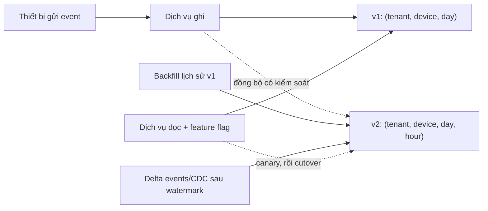
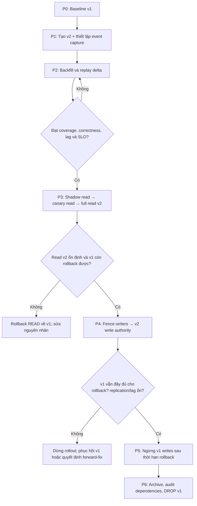
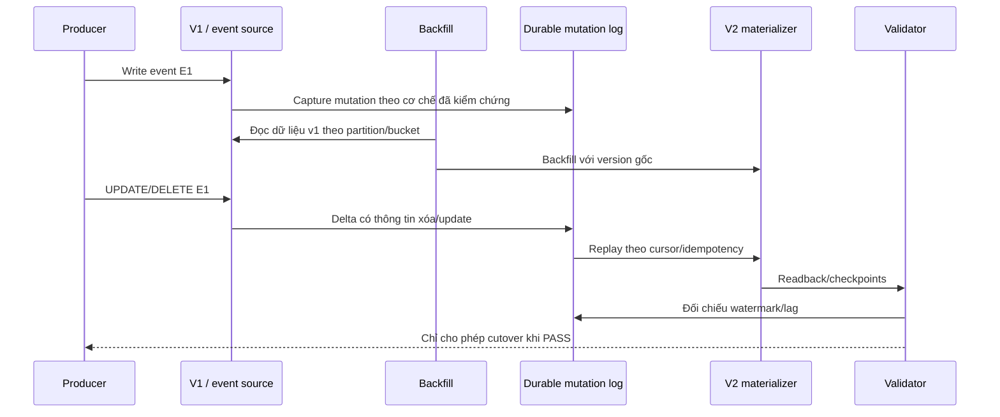

# Cắt chuyển đọc/ghi, quay lui và dọn bảng cũ theo kế hoạch

> **Chương:** Di chuyển và schema  
> **Học phần:** `DATABASE_ENGINE_WIDE_COLUMN_CASSANDRA` — Apache Cassandra

Khi một bảng Apache Cassandra trở nên quá lớn, phân vùng nóng hoặc không còn khớp với truy vấn nghiệp vụ, giải pháp thường là **tạo bảng mới được thiết kế theo truy vấn**, chuyển dữ liệu lịch sử (*backfill*), đồng bộ những thay đổi phát sinh trong lúc chuyển và **cắt chuyển** (*cutover*) ứng dụng từ bảng cũ sang bảng mới. Bài toán khó không phải chỉ là chạy `CREATE TABLE` hay chuyển hết số row, mà là:

- Khi nào có thể **đọc từ bảng mới** mà không trả dữ liệu thiếu hoặc cũ?
- Khi nào có thể **chuyển ghi** sang bảng mới mà vẫn giữ đường quay lui?
- Nếu quá trình migration gặp lỗi giữa chừng, có thể đảo lại feature flag ngay không?
- Khi nào bảng cũ **thật sự không còn được ứng dụng, job hoặc quy trình khôi phục sử dụng** và được phép xóa?

Cassandra là cơ sở dữ liệu phân tán theo mô hình *wide-column*: **partition key** được băm thành token để chọn replica, **clustering key** xác định thứ tự bên trong partition, còn **replication factor (RF)** và **consistency level (CL)** ảnh hưởng độ trễ/khả năng phục vụ. Một thay đổi primary key hoặc bucket không phải chỉnh tên cột đơn thuần: nó thay đổi cách dữ liệu được phân phối, đường đọc, đường ghi, compaction, repair và chi phí streaming trên nhiều node/DC.

Bài này xây một quy trình **v1 → v2 theo từng cổng kiểm tra (gates)**, có kiến trúc dữ liệu, CQL, Java Driver 4.x, watermark/delta replay, định nghĩa rollback theo từng pha, metrics, runbook xử lý lỗi và điều kiện *retire/drop* bảng cũ. Mọi lệnh tạo/xóa bảng trong ví dụ chỉ dành cho lab hoặc change được phê duyệt; **đừng chạy `DROP TABLE` trên production** khi chưa hoàn tất tất cả điều kiện dọn dẹp.

## 1. Vì sao cần bảng mới thay cho ALTER TABLE?

Giả sử hệ thống telemetry ghi các sự kiện theo thiết bị và ngày, còn bảng cũ bắt đầu xuất hiện partition quá lớn khi một thiết bị sinh nhiều triệu event mỗi ngày. Ứng dụng mới cần tìm sự kiện theo **tenant, thiết bị, ngày và giờ** để phục vụ API theo khung một giờ.

Bảng cũ có một partition cho cả ngày:

```sql
-- Giả định keyspace telemetry đã được tạo với NetworkTopologyStrategy.
CREATE TABLE IF NOT EXISTS telemetry.events_by_device_day_v1 (
    tenant_id text,
    device_id text,
    event_day date,
    event_at timestamp,
    event_id uuid,
    payload text,
    PRIMARY KEY ((tenant_id, device_id, event_day), event_at, event_id)
) WITH CLUSTERING ORDER BY (event_at ASC, event_id ASC);
```

Bảng mới bổ sung **hour bucket** vào partition key, do ứng dụng tính từ `event_at` theo UTC:

```sql
CREATE TABLE IF NOT EXISTS telemetry.events_by_device_hour_v2 (
    tenant_id text,
    device_id text,
    event_day date,
    event_hour tinyint,
    event_at timestamp,
    event_id uuid,
    payload text,
    PRIMARY KEY ((tenant_id, device_id, event_day, event_hour),
                 event_at, event_id)
) WITH CLUSTERING ORDER BY (event_at ASC, event_id ASC);
```

Ở v1, partition key là `(tenant_id, device_id, event_day)`; ở v2, là `(tenant_id, device_id, event_day, event_hour)`. Cùng một event nhưng **token và bộ replica có thể khác**. Với v2, một API muốn xem trọn một ngày phải truy cập **tối đa 24 hour buckets** rồi tổng hợp có giới hạn. Nếu một thiết bị vẫn quá nóng trong một giờ, có thể cần thêm shard; thiết kế theo **phân phối tải thực**, không phải cứ thêm một cột vào key là giải quyết được mọi vấn đề.

**Ranh giới CQL:** Apache Cassandra không hỗ trợ `ALTER TABLE` để thay đổi primary key, hay thay kiểu cột tùy ý như RDBMS. `ALTER TABLE ADD` có thể thêm regular column nhưng **không thể đổi partition key hiện tại**. Thay đổi như ví dụ cần **bảng mới + luồng di chuyển dữ liệu và truy vấn**. Đồng thời không được dùng `RENAME` primary key để giả lập việc phân phối lại token; đó không phải cách đổi mô hình phân vùng.



### Các yêu cầu cần chốt trước khi viết một dòng migration

| Yêu cầu | Câu hỏi phải trả lời |
| --- | --- |
| **Tính đúng** | Sự kiện có bất biến không? Có update/delete/TTL hoặc ghi đến muộn không? |
| **Khóa định danh** | `event_id` có ổn định qua retry/backfill không? Có event trùng payload nhưng khác ID không? |
| **Mốc thời gian** | `event_at` do thiết bị hay server đặt? Có nằm ngoài giờ UTC hiện tại không? |
| **Hiệu năng** | Partition size p99/max, read/write QPS, bucket fan-out và p99 SLO? |
| **Nhất quán** | RF/CL/DC là gì? Chấp nhận projection v2 lag bao lâu? |
| **Khả năng quay lui** | Muốn quay lui **chỉ đường đọc** hay cả **đường ghi chuẩn**? Trong bao lâu? |
| **Retention** | TTL/default TTL, tombstone, GDPR/legal deletes, thời gian backup và giữ bảng cũ? |
| **Cộng tác** | Ai sở hữu producer, event log, backfill, Java client, dashboard, runbook và quyền DROP? |

Một kế hoạch thiếu câu trả lời về **delete, timestamp và rollback window** chưa sẵn sàng cho production dù bảng v2 đã tạo thành công.

## 2. Các pha chuẩn: chuẩn bị → đồng bộ → chuyển đọc → chuyển ghi → nghỉ → xóa

Không nên có một nút `MIGRATE_ALL`. Chia quá trình thành các pha có **quyền đọc/ghi rõ ràng**:

| Pha | Nguồn đọc mặc định | Nguồn ghi chuẩn | Bảng v1 | Bảng v2 | Có thể rollback bằng flag? |
| --- | --- | --- | --- | --- | --- |
| **P0 — Baseline** | v1 | v1 | Phục vụ read/write | Chưa tồn tại | Không có cutover. |
| **P1 — Create & capture** | v1 | v1 | Bình thường | Đã tạo, nhận event/delta hoặc sẵn sàng | Có, miễn chưa ngừng v1. |
| **P2 — Backfill & shadow** | v1 | v1 | Bình thường | Backfill + delta; shadow read | Có thể tắt shadow/v2, bảo vệ v1. |
| **P3 — Read canary/cutover** | V2 cho cohort được chọn | v1 vẫn chuẩn | Ghi và giữ rollback read | Đọc thật, tiếp tục bắt kịp | **Có** nếu v1 vẫn đầy đủ và đúng. |
| **P4 — Write authority switch** | V2 | V2 là chuẩn; v1 có thể vẫn được cập nhật để rollback | Chỉ là mirror/đường dự phòng nếu đảm bảo fidelity | Nhận mọi mutation chuẩn | **Có điều kiện**, không còn là flag đơn thuần. |
| **P5 — Retire v1 writers** | V2 | V2 | Read-only hoặc không được cập nhật | Phục vụ đầy đủ | **Không** thể đơn giản quay lại v1 khi đã có dữ liệu chỉ tồn tại ở v2. |
| **P6 — Archive/Drop v1** | V2 | V2 | Snapshot/backup rồi xóa theo phê duyệt | Phục vụ chính | Cần **restore/migration ngược**, không có rollback tức thì. |

**Ý nghĩa của “source of truth”:** đây là nguồn trạng thái nghiệp vụ có quyền cuối cùng khi hai bảng khác nhau, **không** có nghĩa Cassandra tự biết một bảng là primary còn bảng kia là secondary. Quyền đó phải được định nghĩa trong **dòng dữ liệu ứng dụng, event log, quy tắc timestamp và vận hành**.



**Không hoán đổi thứ tự tùy tiện:** nếu chuyển read sang v2 trước khi backfill/delta đầy đủ, người dùng có thể thấy missing rows. Nếu chuyển write sang v2 và dừng v1 trước khi quy trình rollback được thiết kế, việc trả flag về v1 có thể làm mất khả năng nhìn thấy các write hợp lệ vừa xảy ra.

## 3. Phần khó nhất: backfill trong khi có ghi, cập nhật và xóa

Một migration không chỉ chép tất cả row hiện tại. Trong lúc backfill chạy nhiều giờ hoặc nhiều ngày, các producer tiếp tục tạo mutation:

- Event mới đến v1 sau khi worker đã quét partition đó.
- Client update lại payload, thay đổi cột hoặc gửi event đến muộn.
- Job xóa event theo chính sách; tombstone có timestamp.
- TTL của một cell gần hết hạn hoặc hết hạn giữa lúc đọc và reinsert.
- Một retry tới v1 đã thành công nhưng client thấy timeout và gửi lại.
- CDC consumer hoặc backfill worker restart và phát lại phần đã xử lý.

### 3.1. Không thể chỉ “scan v1 một lần rồi flip”

Ví dụ đơn giản:

```text
09:00  Backfill đọc event_id=E, payload="A" từ v1
09:01  Ứng dụng cập nhật E thành payload="B" trên v1
09:02  Backfill ghi payload="A" sang v2
09:03  Ứng dụng chuyển read sang v2
=> v2 có thể trả "A" dù v1 đang là "B"
```

Nếu copy dữ liệu lịch sử bằng **timestamp mới nhất do backfill sinh ra**, mutation cũ `A` có thể còn **thắng** mutation đúng `B` trong v2. Một cột bình thường `source_version` có thể giúp audit nhưng **không tự buộc Cassandra so sánh version theo trường đó**: Cassandra hòa giải cell theo timestamp, không theo giá trị một cột version tùy ý.

Nếu backfill đọc **chỉ những row còn sống**, nó còn có thể **không thấy DELETE tombstone**, rồi ghi lại dữ liệu đã bị xóa nhầm/đúng chính sách ở v2. Vì vậy phải có nguồn **delta gồm cả deletes** hoặc một rào chắn ghi ổn định, không chỉ đọc CQL từ v1.

### 3.2. Mô hình snapshot/backfill + delta stream

Một cách tổ chức là:

1. Thiết lập **nguồn sự kiện bền vững** (outbox/event log/CDC consumer) cho mọi INSERT/UPDATE/DELETE liên quan, bắt đầu **trước** khi chụp baseline/backfill.
2. Lưu **watermark/cursor** theo shard/partition của event source, đủ để biết nguồn sự kiện nào đã được consumer áp dụng ở v2.
3. Backfill các key/ranges cũ theo danh sách xác định; ghi **idempotent** với source version/timestamp/TTL chính sách phù hợp.
4. Tiếp tục áp dụng delta trong lúc backfill; consumer phải nhận cả **tombstone/delete, update và new rows**.
5. Sau khi backfill hết key và lag delta giảm dưới ngưỡng, chạy **reconciliation** cho phạm vi đã xử lý.
6. Chỉ đóng gate khi đã chứng minh không có lỗ hổng giữa **snapshot/backfill start** và **delta capture start**, và không còn những event bất khả thi để áp dụng.



Sơ đồ mô tả **kiến trúc logic**. Một cặp write Cassandra `INSERT v1` + `INSERT outbox` ở **hai partition khác nhau** không tự trở thành giao dịch cô lập tuyệt đối. Nếu cần không mất delta, chọn kiến trúc event-first với log bền vững hoặc một cơ chế giao nhận/capture được thử nghiệm, có thể truy hồi và đối soát. Nếu doanh nghiệp không thể cung cấp nguồn delta đáng tin, có thể phải **tạm khóa ghi một cửa sổ ngắn**, chạy backfill cuối, xác minh rồi mới flip. Đừng khẳng định “dual-write là atomic” chỉ vì dùng `BATCH`.

### 3.3. CDC của Cassandra: hữu ích nhưng không phải message bus hoàn chỉnh

Apache Cassandra hỗ trợ **Change Data Capture (CDC)** trên những phiên bản phù hợp: cần bật option ở node và property `cdc=true` trên table, đồng thời có consumer xử lý các **commit-log segments**. CDC được tổ chức theo node/segment; đội vận hành phải xử lý offset, độ bền, replay, capacity và trạng thái restart.

```sql
-- Chỉ áp dụng trên LAB đã có consumer CDC và cấu hình node phù hợp.
ALTER TABLE telemetry.events_by_device_day_v1 WITH cdc = true;
```

**Rủi ro vận hành:** tài liệu Apache nêu rõ không được bật CDC khi **chưa có consumer**. Khi `cdc_raw` đạt giới hạn theo cấu hình, write vào bảng CDC có thể bị chặn/từ chối; hành vi bổ sung phụ thuộc phiên bản và cấu hình. CDC cũng **không tự cung cấp** một snapshot toàn cluster nhất quán, không tự xử lý exactly-once ở consumer, không chuyển mọi event thành đúng schema v2, và không bảo đảm retention vô hạn.

Các việc phải có khi dùng CDC: phân biệt source node/mutation, kiểm soát duplicate, thứ tự per-key, xử lý tombstone, xác định cursor được persist **sau khi** apply thành công, giám sát missing segments, lưu checkpoint/lag và có quy trình reprocess. Nếu CDC bắt đầu khi migration đã chạy một thời gian, phải có **khoảng chồng lấn** hoặc reconciliation để đóng lỗ hổng.

## 4. Idempotency, timestamp, TTL và tombstone là điều kiện cắt chuyển

### 4.1. Tái ghi nhiều lần không được tạo bản ghi mới ngẫu nhiên

Với event bất biến, v2 dùng cùng `event_id` và clustering key như v1. Backfill/replay có thể gửi lại một event, nhưng cùng primary key và payload được đặt lại. **Không tạo UUID ngẫu nhiên mới trong mỗi retry**; nếu làm vậy có thể tạo duplicate rows và làm sai số lượng sự kiện.

Tuy nhiên tính idempotent của một câu `INSERT` còn phụ thuộc **timestamp/TTL**:

- Nếu dùng timestamp do coordinator tự tạo ở mỗi lần retry, những mutation tới muộn có thể thắng mutation khác không mong muốn.
- Nếu dùng `USING TIMESTAMP` cố định cho cùng event/version, server có cơ sở hòa giải ổn định hơn; vẫn cần quy tắc rõ ràng với **delete và concurrent updates**.
- Ghi lại TTL tương đối trên mỗi lần retry có thể **kéo dài expiry**. Khi cần giữ hạn gốc, tính từ `expires_at` tuyệt đối; nếu đã hết hạn, **không tái tạo** dữ liệu.
- `USING TTL 0` có nghĩa **không TTL** (trong ngữ nghĩa tương ứng), không phải hết hạn ngay.

### 4.2. LWW không phải version check nghiệp vụ

Ví dụ hai mutation vào cùng một cell ở v2:

```text
source update mới:    payload=B, timestamp=200
backfill stale:       payload=A, timestamp=300 do backfill tự lấy "now"
Kết quả trên v2:     A có thể thắng B — SAI dù backfill chạy SAU.
```

Nếu doanh nghiệp có **per-key monotonic version**, có thể thiết kế ánh xạ version vào timestamp mutation **một cách nhất quán và có thử nghiệm**, hoặc áp dụng dữ liệu qua một consumer có **single-writer order per key** với version kiểm soát. Một cột `version bigint` đơn thuần không khóa được các write CQL đồng thời nếu không có conditional logic.

**Không đặt timestamp quá xa tương lai** chỉ để “đè mọi dữ liệu cũ”: nó có thể che các mutation hợp lệ sau cutover trong thời gian dài. Nếu không bảo đảm được thứ tự, xem xét tạm **fence writes** và chạy reconciliation trước khi flip.

### 4.3. Delete/tombstone là một mutation phải được migrate

Với dữ liệu thay đổi, một DELETE ở v1 cần có tác động tương ứng ở v2 **theo primary key mới**. Nếu event đã bị xóa khỏi v1, backfill chỉ đọc dữ liệu sống sẽ không thể biết phải xóa gì ở v2. Cần mutation history đáng tin hoặc cách đối soát theo nguồn nghiệp vụ.

```sql
-- Minh họa CQL xóa ĐÚNG row ở v2. Chỉ trong LAB:
DELETE FROM telemetry.events_by_device_hour_v2
WHERE tenant_id = 'tenant-a'
  AND device_id = 'sensor-07'
  AND event_day = '2026-11-21'
  AND event_hour = 9
  AND event_at = '2026-11-21T09:15:00Z'
  AND event_id = 11111111-1111-4111-8111-111111111111;
```

**Điều kiện rất quan trọng:** muốn xóa đúng row v2, consumer phải biết `event_hour` và `event_at` **của row đã bị xóa**. Nếu bản ghi delete chỉ chứa `event_id` mà schema không có lookup theo ID, không thể định tuyến đến partition v2 bằng phép màu; cần nguồn metadata hoặc bảng lookup tương ứng.

Không dùng `nodetool repair` để đồng bộ **hai bảng khác schema**: repair đối soát **replicas của cùng bảng/token range**, không biến đổi dữ liệu từ v1 sang v2. Tránh hạ `gc_grace_seconds` khi migration còn lag, vì có nguy cơ zombie.

## 5. Lập kế hoạch backfill: chia việc đúng partition, tránh quét vô hạn

### 5.1. Lập inventory trước

Cần có danh sách partition/bucket có thể đọc từ v1: ví dụ `tenant_id`, `device_id` và `event_day` từ catalog/event index sẵn có, không suy rằng Cassandra hỗ trợ SQL `WHERE event_day BETWEEN ...` trên toàn bảng.

Một worker đọc **một partition đã biết**:

```sql
SELECT event_at, event_id, payload
FROM telemetry.events_by_device_day_v1
WHERE tenant_id = 'tenant-a'
  AND device_id = 'sensor-07'
  AND event_day = '2026-11-21'
  AND event_at >= '2026-11-21T09:00:00Z'
  AND event_at < '2026-11-21T10:00:00Z';
```

Khi backfill cả tháng, worker được điều phối qua **tập partition cụ thể**, không `SELECT *` toàn cụm. Nếu không có catalog partition keys, có thể cần quy trình scan token range chuyên dụng đã đánh giá I/O, hoặc export từ hệ thống upstream. **Không** dựng một vòng `ALLOW FILTERING` để chạy ad hoc ở production.

### 5.2. Cắt công việc thành đơn vị có thể resume

| Trường checkpoint | Ý nghĩa |
| --- | --- |
| `migration_id` | Mã change để phân biệt nhiều lần backfill. |
| `source_partition` / range | Partition/bucket hoặc token-range task. |
| `page_state` / cursor | Điểm tiếp tục trong task, theo contract driver và statement. |
| `source_snapshot_id` / log watermark | Điểm giao giữa baseline và delta. |
| `last_event_version` | Version/timestamp theo khóa khi có bảo đảm thứ tự. |
| `attempts`, `status`, `error_type` | Resume/retry có giới hạn và phân tích lỗi. |
| `started_at`, `verified_at` | Tuổi task và thời điểm evidence. |
| `checksum/hash` / sample IDs | Bằng chứng đối soát có thể tái kiểm tra. |

**Lưu ý về paging state:** trạng thái paging của Java Driver không phải cursor bất biến, tồn tại vĩnh viễn hoặc snapshot transaction. Nếu dữ liệu thay đổi, checkpoint nên dựa vào **khóa sắp xếp và watermark nghiệp vụ** khi có thể, không chỉ cất một blob paging state rồi hy vọng khôi phục chính xác sau nhiều ngày và nhiều upgrade.

### 5.3. Backfill phải giữ ngân sách tài nguyên

Theo dõi QPS read v1, write v2, p95/p99 của ứng dụng, coordinator timeout, `PendingCompactions`, disk free, network và repair. Một đợt backfill có thể gây **read amplification trên v1 và write/compaction trên v2** cùng lúc; sau RF=3, mỗi write mới vẫn được gửi tới các replicas tương ứng.

Bắt đầu với số task song song thấp, rate limit **mỗi DC/node hoặc tenant nóng**, tăng dần khi SLO còn dư địa. Dừng khi queue/latency vượt ngưỡng. Đừng chạy full repair, backup bulk và backfill toàn cụm cùng lúc trên link WAN mỏng.

## 6. Shadow reads và bộ tiêu chí xác minh v2

**Shadow read** nghĩa là ứng dụng vẫn trả response từ v1, đồng thời đọc v2 cho một tập request được chọn và **so sánh kết quả mà không trả dữ liệu v2 cho client**. Mục tiêu là phát hiện lỗi trước khi chuyển traffic thật.

### Đối chiếu theo contract, không chỉ đếm row

| Kiểm tra | Vì sao cần |
| --- | --- |
| **Tập event ID** trong khung giờ | Phát hiện thiếu/duplicate do mapping/late data. |
| **Payload và thứ tự clustering** | Đảm bảo cùng logic query khi đổi partition key. |
| **TTL/retention** | V2 không trả lại event đã hết hạn hoặc bị xóa hợp lệ. |
| **Update/delete gần thời điểm backfill** | Đường đồng bộ delta không bị mất mutation. |
| **Truy vấn không có kết quả** | Phát hiện dữ liệu đã xóa bị phục hồi sai. |
| **Tenant isolation** | V2 không trộn dữ liệu giữa tenants khi thêm thành phần key. |
| **P95/p99 latency và timeouts** | Tránh một schema đúng dữ liệu nhưng làm SLA tệ hơn. |
| **RF/CL/DC** | Cả v1/v2 có replica đủ và ứng dụng trong từng DC nhìn thấy trạng thái phù hợp. |
| **Backfill coverage và delta lag** | Mọi partition thuộc phạm vi đã xử lý, watermark bắt kịp. |

Đừng chỉ đối chiếu `COUNT(*)` của toàn bảng. Cassandra có thể phải quét rất rộng để đếm; hai count bằng nhau cũng không chứng minh **cùng key, cùng payload và cùng delete/TTL**. Đối chiếu tốt hơn là **per-partition/per-hour**, checksum chuẩn hóa có phiên bản, sample deterministic và đối soát các deletion events.

**Window near-real-time:** Nếu v2 có lag được thừa nhận (ví dụ vài giây), không so mọi request ngay tại t0 rồi coi mismatch là bug. Phải gắn kết quả với **watermark/offset**: so khi cả hai đường đã áp dụng event tới cùng version. Với dữ liệu quan trọng, chỉ cutover read khi lag ở mức được SLO cho phép.

### Một gate định lượng mẫu

```text
GATE R (read cutover readiness) — ví dụ phải tùy hệ thống
- source partitions inventoried and backfill checkpoint complete
- durable delta stream captures inserts, updates, deletes since baseline
- no uncovered CDC gaps / missing event segments
- v2 lag p99 below agreed freshness SLO (e.g. 5 seconds)
- exact match of critical sampled event_id/payload/expiry at same watermark
- no mismatch in cross-tenant access tests
- v2 read p99 and errors within SLO at peak representative load
- repair/compaction/disk/network headroom healthy
- fallback to v1 rehearsed while v1 remains current
- owner / change ticket approval: PASS
```

Các con số ví dụ **không phải default Cassandra**. Ứng dụng thanh toán có thể không chấp nhận một giây stale; hệ thống phân tích có thể chấp nhận vài phút. Ghi rõ yêu cầu của nghiệp vụ trước.

## 7. Cắt chuyển READ: shadow → canary → tỉ lệ lớn → toàn bộ

Cắt chuyển read nên được điều khiển bởi **feature flag cấu hình ứng dụng**, với mức chi tiết phù hợp theo service/tenant/DC. Không đổi toàn hệ thống cùng lúc chỉ vì vài request shadow đã thành công.

### Trình tự khuyến nghị

1. **Shadow 0% user-facing:** mọi request vẫn trả v1, một mẫu nhỏ cũng truy vấn v2 và ghi mismatch metrics đã ẩn dữ liệu nhạy cảm.
2. **Canary 1–5%** trên tenant/test group được phê duyệt: trả v2, theo dõi p99, errors, correctness, lag.
3. **Ramp có checkpoint:** 10% → 25% → 50% → 100% theo khoảng đủ có traffic đại diện, tránh peak không có người trực.
4. **Giữ v1 đúng:** trong pha P3, writer chuẩn vẫn ghi v1; v2 còn nhận delta. Điều này làm rollback **read route** về v1 tương đối đơn giản.
5. **Đánh giá theo DC:** client ở dc2 có thể thấy v2 chậm bắt kịp hoặc thiếu replica dù dc1 khỏe; kiểm tra `LOCAL_QUORUM`/RF và query probes từ các DC cần phục vụ.

**Không dùng auto fallback v2 → v1 để che sai dữ liệu** trong các câu truy vấn về delete/permission/retention. Nếu v2 trả *not found* vì event đã bị xóa đúng, fallback v1 có thể làm **lộ dữ liệu đã bị xóa**. Chỉ fallback khi có hợp đồng freshness và semantics rõ ràng; ghi cảnh báo và hạn chế mức độ của cơ chế fallback.

### Quan sát sau canary

| Tín hiệu | Khi nào STOP/rollback read? |
| --- | --- |
| Mismatch key/payload sau cùng watermark | Bất kỳ mismatch dữ liệu quan trọng vượt ngưỡng đã phê duyệt. |
| Wrong-tenant result hoặc dữ liệu đã delete xuất hiện | **STOP ngay**, coi là lỗi bảo mật/tính đúng. |
| V2 p99 vượt SLO và có xu hướng tăng | Dừng ramp, có thể quay lại v1. |
| Delta lag tăng liên tục, vượt freshness budget | Ngừng cutover, kiểm tra consumer/CDC. |
| Disk/compaction/repair backlog nguy hiểm | Giảm lưu lượng v2, xử lý tài nguyên. |
| Một DC thiếu schema agreement hoặc replica | Không mở cutover ở DC đó. |

Khi rollback read, **không xóa v2 ngay**: giữ dữ liệu, logs, checkpoints để điều tra, đồng thời tiếp tục cập nhật v2 nếu còn khả năng và được phép, tránh phải backfill lại từ đầu.

## 8. Cắt chuyển WRITE: đây là ranh giới không còn rollback bằng flag

Phần rủi ro nhất không phải chuyển câu `SELECT` mà là **đổi nơi ghi chuẩn**.

### 8.1. Vì sao dual-write kiểu “ghi cả hai lần” không atomic?

Một ứng dụng có thể làm:

```text
write(v1) => success
write(v2) => timeout/unknown
return success?  => v2 có thể thiếu
return failure?  => v1 có thể đã ghi; retry có thể duplicate side effects
```

Cassandra hỗ trợ `BATCH` trong những trường hợp cụ thể, nhưng **batch không cung cấp isolation transaction đa partition như RDBMS**. Nếu primary keys của v1/v2 khác nhau, rất có thể chúng ở các token partitions/replicas khác nhau. Gộp hai lệnh vào một logged batch không tạo một chính sách cutover đầy đủ hay giải quyết mọi trường hợp driver timeout, TTL, duplicate, xung đột timestamp.

**Phương án ưu tiên** là đặt một nguồn ghi chuẩn có semantics rõ ràng: một durable event log, producer với event ID ổn định, CDC/outbox đã kiểm chứng, và materializers cho v1/v2. Sau đó định nghĩa **thời điểm chuyển quyền write authority** và **fence** producer cũ.

### 8.2. Fencing: không cho writer cũ quay lại ghi trễ

Trong hệ nhiều instance Java, khi feature flag đổi sang v2, một instance cũ vẫn có thể chạy config cũ, job batch cũ vẫn gửi v1, hoặc consumer backlog tiếp tục viết out-of-order. Nếu những writer này không được chặn, cutover có thể tạo **split-brain ở tầng ứng dụng**.

Một runbook chuyển quyền ghi cần:

1. Đặt **migration epoch** hoặc version cấu hình bền vững; mọi producer được xác thực version khi ghi.
2. Tạm dừng/giới hạn ingest hoặc cho vào durable buffer trong cửa sổ chuyển, khi nghiệp vụ cho phép.
3. Drain hàng chờ đến watermark được chọn; bảo đảm event trước mốc đã áp dụng trên v2.
4. Đổi **single writer authority** sang v2, vô hiệu hóa writer phiên bản cũ hoặc bắt buộc nó chỉ gửi qua canonical endpoint.
5. Xác minh write-after từ **mọi phiên bản client/DC**, gồm retry và late arrival; quan sát không còn writes unauthorized vào v1.
6. Nếu cần rollback write, tiếp tục tạo **mirror từ v2 về v1** với semantics đầy đủ và kiểm chứng ngược.

Điều kiện cuối là quan trọng: **v1 có khả năng biểu diễn mọi mutation mới từ v2 không?** Ví dụ v2 thêm event type mà v1 không hỗ trợ, hoặc xóa data v1 theo retention sớm hơn; như vậy không có rollback về v1 không mất dữ liệu dù mirror service chạy.

### 8.3. Bảng quyết định cho rollback WRITE

| Trạng thái | Hướng xử lý khi v2 lỗi |
| --- | --- |
| **Trước write authority switch** (P0–P3) | Chuyển read flag về v1; v1 vẫn chuẩn, fix/rebuild v2. |
| **Ngay sau switch, v1 được mirror đầy đủ và có evidence** | Có thể chuyển lại write authority về v1 **sau khi fence v2 writers**, drain mirror và xác minh cùng watermark. |
| **v2 có writes chỉ tồn tại ở v2** | **Không flip về v1** trước khi reverse-backfill/replay phần thiếu, kể cả khi v1 đọc được phần lớn dữ liệu. |
| **v2 dùng tính năng/schema không biểu diễn được trong v1** | Cần forward-fix hoặc giải pháp rollback riêng có chấp nhận mất/chuyển đổi dữ liệu. |
| **Đã drop v1** | Không có rollback nóng; phải restore schema/data từ backup hoặc dựng bảng mới. |

### Mẫu điều kiện đóng gate WRITE

```text
GATE W (write authority cutover) — có ký duyệt
- all writer instances and batch jobs inventoried
- durable event stream / CDC history continuous, no unknown gap
- v2 read validation passed at agreed watermark
- all mutation types mapped (insert/update/delete/TTL/late writes)
- migration epoch/fencing enforced; old writers cannot write after switch
- rollback route and reverse sync tested OR owner accepts forward-only change
- v1 mirror complete for the rollback window if rollback is promised
- retry/idempotency rules tested for write timeouts
- latency/error, resource budgets and paging on-call ready
- go/no-go decision recorded with UTC timestamp
```

Không có **gate W** thì chiến dịch “cắt chuyển đọc/ghi trong một flag” là một lời hứa nguy hiểm.

## 9. Java Driver 4.x: áp dụng schema mới với query templates và feature flag

Đoạn mã minh họa cho **event bất biến**, hai đường đọc theo một khung giờ UTC, và một materializer ghi vào v2. Nó **không** tự thực hiện dual-write atomic, không triển khai event log bền vững, không phù hợp trực tiếp với counter/LWT/mutation xóa. Trong production, event consumer chỉ ACK cursor sau khi ghi v2 thành công và checkpoint bền vững.

### 9.1. Đọc theo v1 hoặc v2 trong **một giờ cụ thể**

```java
import java.time.Instant;
import java.time.LocalDate;
import java.time.ZoneOffset;
import java.util.ArrayList;
import java.util.List;
import java.util.UUID;

import com.datastax.oss.driver.api.core.CqlSession;
import com.datastax.oss.driver.api.core.DefaultConsistencyLevel;
import com.datastax.oss.driver.api.core.cql.PreparedStatement;
import com.datastax.oss.driver.api.core.cql.Row;

public final class EventHourReader {
    public enum ReadRoute { V1, V2 }

    private final CqlSession session;
    private final PreparedStatement queryV1;
    private final PreparedStatement queryV2;

    public EventHourReader(CqlSession session) {
        this.session = session;
        this.queryV1 = session.prepare(
            "SELECT event_at, event_id, payload " +
            "FROM telemetry.events_by_device_day_v1 " +
            "WHERE tenant_id=? AND device_id=? AND event_day=? " +
            "AND event_at >= ? AND event_at < ? LIMIT 100");
        this.queryV2 = session.prepare(
            "SELECT event_at, event_id, payload " +
            "FROM telemetry.events_by_device_hour_v2 " +
            "WHERE tenant_id=? AND device_id=? AND event_day=? " +
            "AND event_hour=? AND event_at >= ? AND event_at < ? LIMIT 100");
    }

    public List<UUID> sampleIds(
            String tenantId, String deviceId,
            Instant fromUtcInclusive, ReadRoute route) {
        // Contract: cửa sổ [from, until) đúng một giờ UTC;
        // from phải ở đầu giờ để chỉ cần một partition v2.
        if (fromUtcInclusive.atOffset(ZoneOffset.UTC).getMinute() != 0
                || fromUtcInclusive.atOffset(ZoneOffset.UTC).getSecond() != 0
                || fromUtcInclusive.getNano() != 0) {
            throw new IllegalArgumentException("Must start at UTC hour");
        }
        Instant untilUtcExclusive = fromUtcInclusive.plusSeconds(3600);
        LocalDate day = fromUtcInclusive.atZone(ZoneOffset.UTC).toLocalDate();
        byte hour = (byte) fromUtcInclusive.atZone(ZoneOffset.UTC).getHour();

        PreparedStatement q = route == ReadRoute.V1 ? queryV1 : queryV2;
        var bound = route == ReadRoute.V1
            ? q.bind(tenantId, deviceId, day,
                     fromUtcInclusive, untilUtcExclusive)
            : q.bind(tenantId, deviceId, day, hour,
                     fromUtcInclusive, untilUtcExclusive);

        List<UUID> ids = new ArrayList<>();
        for (Row row : session.execute(
                bound.setConsistencyLevel(DefaultConsistencyLevel.LOCAL_QUORUM)
                     .setIdempotent(true))) {
            ids.add(row.getUuid("event_id"));
        }
        return ids;
    }
}
```

**Giới hạn của mã đọc:** `LIMIT 100` phù hợp **sample có kiểm soát**, không chứng minh mọi sự kiện trong giờ đã được migrate; cần đi hết dữ liệu theo paging/cursor riêng cho reconciliation. Nếu API thật cần toàn bộ ngày, phải truy vấn **các hour buckets hợp lệ** và hợp nhất theo `(event_at, event_id)`, giới hạn fan-out/in-flight để không tạo quét rộng.

### 9.2. Materializer v2 cho event bất biến

```java
import java.time.Instant;
import java.time.LocalDate;
import java.time.ZoneOffset;
import java.util.UUID;

import com.datastax.oss.driver.api.core.CqlSession;
import com.datastax.oss.driver.api.core.DefaultConsistencyLevel;
import com.datastax.oss.driver.api.core.cql.PreparedStatement;

public final class V2EventMaterializer {
    private final CqlSession session;
    private final PreparedStatement insertV2;

    public V2EventMaterializer(CqlSession session) {
        this.session = session;
        this.insertV2 = session.prepare(
            "INSERT INTO telemetry.events_by_device_hour_v2 " +
            "(tenant_id, device_id, event_day, event_hour, " +
            "event_at, event_id, payload) VALUES (?, ?, ?, ?, ?, ?, ?) " +
            "USING TIMESTAMP ?");
    }

    public void applyImmutableEvent(
            String tenantId, String deviceId, Instant eventAt,
            UUID eventId, String payload, long approvedWriteTimeMicros) {

        LocalDate day = eventAt.atZone(ZoneOffset.UTC).toLocalDate();
        byte hour = (byte) eventAt.atZone(ZoneOffset.UTC).getHour();

        session.execute(insertV2.bind(
                tenantId, deviceId, day, hour,
                eventAt, eventId, payload, approvedWriteTimeMicros)
            .setConsistencyLevel(DefaultConsistencyLevel.LOCAL_QUORUM)
            .setIdempotent(true));
    }
}
```

**Điều kiện bắt buộc để ví dụ materializer đúng:**

- `eventId`, payload, `eventAt` và `approvedWriteTimeMicros` được **cấp từ nguồn đáng tin, ổn định qua retry**. Không sinh timestamp mới cho từng lần retry.
- Ví dụ **không có TTL**; muốn giữ retention gốc, phải có `expires_at`/policy riêng và câu lệnh tương ứng. Reinsert với TTL mới mà không xét hạn gốc có thể giữ dữ liệu quá lâu.
- Ví dụ chỉ cho event **bất biến, không bị xóa**. Khi có update/delete/correction, cần một materializer khác với **thứ tự mutation và tombstone được định nghĩa rõ**, không đơn giản re-INSERT giá trị cũ.
- Consumer phải giới hạn in-flight, theo dõi CL timeouts/unavailable, có dead-letter và replay an toàn; **không ACK event log trước khi write v2 hoàn tất** theo hợp đồng giao nhận.
- `LOCAL_QUORUM` đảm bảo phản hồi từ quorum của local DC theo RF, **không** chứng minh v2 đã đồng bộ trên tất cả replica/DC. Lịch repair và monitoring vẫn cần thiết.
- `setIdempotent(true)` phù hợp trong **điều kiện event bất biến và timestamp cố định** nêu trên; không áp vào counter `+1` hoặc thao tác có side effect.

## 10. Rollback theo từng pha: bốn quy trình khác nhau

Một checklist “gạt flag về OFF” không đủ. Mỗi pha có ranh giới quyền dữ liệu khác nhau.

### RB-R1 — Rollback trong P1/P2 (v1 vẫn serve/read/write)

1. Dừng worker backfill và consumer materialize v2, **không** dừng producer v1.
2. Xác minh ứng dụng vẫn read/write v1 theo CL cũ, không có query v2 trong hot path.
3. Giữ v2 và checkpoint để chẩn đoán, ghi gap/delta không xử lý; không drop v2 khi chưa điều tra.
4. Nếu cần retry migration, backfill/replay theo checkpoint có idempotency, tránh ghi dữ liệu cũ bằng timestamp mới.

**Có thể rollback nhanh** vì v1 chưa mất quyền write.

### RB-R2 — Rollback READ trong P3 (v1 write authority)

1. Tắt flag read v2 theo cohort/DC, tránh lệch cấu hình giữa app instances.
2. Đảm bảo v1 còn đầy đủ, không bị TTL/cleanup/retention mới làm mất dữ liệu mà v2 đã có.
3. Theo dõi p99/error và key sample từ v1 sau rollback.
4. Tiếp tục delta capture v2 nếu mục tiêu là sửa và rollout lại, có owner giám sát lag.
5. Đóng incident chỉ khi lỗi user-facing hết và mismatch đã được khoanh vùng.

**Cảnh báo:** nếu P3 có write nhầm chỉ tới v2, đây **không còn** là rollback READ đơn giản.

### RB-R3 — Rollback WRITE sau P4 (v2 đã canonical)

1. **Đóng cổng ghi mới** hoặc đưa event vào durable buffer; không để hai writer authority chạy song song.
2. Dùng migration epoch/fencing để chặn v2 writer cũ sau khi chuyển.
3. Xác minh **v1 mirror đã nhận mọi mutation v2**, kể cả DELETE, TTL, late event và không còn lag sau watermark cuối.
4. Nếu v1 thiếu dữ liệu, chạy **reverse-replay/reconcile** với nguồn sự kiện đã xác minh, rồi mới trả write authority về v1.
5. Kiểm tra schema v1 còn biểu diễn được mọi record; nếu không thì **rollback không an toàn**, phải forward-fix hoặc giải pháp khác có phê duyệt.
6. Mở write v1 trở lại theo cohort, theo dõi duplicate/missing/latency, giữ v2 trong trạng thái có thể điều tra.

Không làm bước 3–4 mà chỉ đổi flag là nguy cơ **mất hiển thị những ghi hợp lệ sau cutover**. Nếu hệ thống đã tạo loại event chỉ v2 hiểu, không có rollback hoàn toàn không mất dữ liệu dù kỹ thuật cho phép tạo lại v1.

### RB-R4 — Sau P5/P6 (v1 không còn cập nhật hoặc đã DROP)

Lúc này **không có đường quay lui nóng**. Muốn dùng v1 lại cần:

- Khôi phục schema và dữ liệu v1 từ backup có manifest/checksum.
- Replay những mutation xảy ra **kể từ điểm backup/stop v1** vào v1 nếu schema cho phép.
- Reconcile TTL/delete/updated rows theo nguồn dữ liệu, không hồi sinh tombstone hoặc ghi đè event hợp lệ.
- Chạy read/write probes, đánh giá RF/CL/DC và nâng cấp client trước khi cutover ngược.

Nếu không có nguồn để tái dựng, phải chọn **forward-fix v2**. Lời hứa “có thể rollback sau DROP TABLE” phải được sửa thành “có thể **restore/rebuild** với RPO/RTO cụ thể”.

## 11. Khi nào được ngừng v1 writes?

Một sai lầm thường gặp là **v2 đọc đã ổn → tắt v1 ngay để tiết kiệm ghi**. Nhưng khi v2 trở thành write authority, nếu v1 ngừng nhận mutation thì mỗi phút trôi qua tạo thêm **khoảng cách rollback**.

Trước khi ngừng v1 writes cần đồng thời xác nhận:

- **Rollback window** đã hết; business và operator chấp nhận đường rollback nóng không còn.
- Không còn client, batch job, ETL, report, DR pipeline, CDC consumer hoặc legacy API **đọc v1**.
- Có backup v2 độc lập, restore drill và chính sách RPO/RTO hiện hành, không dựa vào v1 như bản backup trá hình.
- Mọi mutation/late event của v2 được xử lý đúng; không còn v1 mirror backlog cần thiết cho rollback.
- Security/data retention yêu cầu giữ hoặc không giữ v1 thế nào? V1 chứa dữ liệu nhạy cảm trùng lặp trong thời gian dài có thể tăng rủi ro.
- Bảng v2 đã chạy qua nhiều chu kỳ peak load, repair, node restart/GC/compaction với SLO ổn định.

**Thao tác ngừng v1 writes nên có trạng thái rõ** trong cấu hình deployment và dashboard: `v1_write_enabled=false`, nhưng đó là **biến ứng dụng**, không phải option Cassandra. Sau đổi flag, đo số mutation/traffic tới v1 để phát hiện writer bỏ sót.

### Dữ liệu “im lặng” không chứng minh dependency đã hết

Một consumer báo không đọc v1 trong 7 ngày chưa đủ nếu nghiệp vụ có job **cuối tháng** hoặc DR chỉ chạy khi sự cố. Phải có **inventory có chữ ký owner** cho service, scheduled jobs, notebooks, BI/report, cache warmers, credential/role, CDC/backup và quy trình restore. Nếu cần, theo dõi từ Java Driver/metrics/audit logging theo phạm vi có quyền, nhưng đừng bật FQL raw vô hạn chỉ để tìm người dùng cũ.

## 12. Khi nào được dọn bảng cũ? Quy trình DROP có điều kiện

`DROP TABLE` không phải cách “giảm tiền disk an toàn” ngay khi v2 lên production. Cassandra sẽ loại schema và dữ liệu logic của bảng; auto-snapshot có thể hỗ trợ tùy cấu hình, nhưng **không bảo đảm restore tức thì hoặc backup ngoài cụm**.

### 12.1. Giai đoạn quarantine/deprecate

1. Đánh dấu bảng `events_by_device_day_v1` là **deprecated** trong catalog/change ticket của tổ chức (không phải CQL keyword).
2. Thay mọi query template v1 trong code, cron, data jobs và dashboard; kiểm tra API phiên bản cũ vẫn còn tải từ mobile/desktop hay không.
3. Gỡ hoặc thu hồi quyền ghi v1 **khi được phê duyệt**, có biện pháp phát hiện writer cũ; tránh vô tình làm hỏng job kế toán/khôi phục chưa migrate.
4. Giữ bảng v1 **read-only** trong khoảng quarantine đủ để phát hiện dependency ít dùng và đáp ứng rollback/retention.
5. Chụp snapshot theo quy trình, tải ra storage khác DC, kiểm tra manifest/schema/checksum và diễn tập khôi phục **một mẫu partition** trên cluster cách ly.
6. Duyệt delete/TTL/legal hold và quyền riêng tư; nếu v1 chứa dữ liệu phải xóa theo chính sách, backup cũng cần retention/purge phù hợp.

### 12.2. Gate cuối cùng để DROP

```text
GATE D (Drop old table) — destructive operation, needs approval
- no client/service/BI/batch/DR/backup restore dependency on v1
- application versions requiring v1 are sunset and access confirmed
- v2 data coverage and correctness verified through retention cycle
- no outstanding delta gap, repair risk or data-reconciliation incident
- write authority v2 and all v1 writer paths disabled/fenced
- rollback window closed and restore RPO/RTO explicitly accepted
- v1 schema + snapshots backed up offsite; restore drill passed
- legal hold, privacy and data deletion policy checked
- change ticket, two-person approval and maintenance window recorded
- post-DROP schema, application, disk and audit checks planned
```

Trên production, **không thực hiện DROP nếu bất kỳ điều kiện trọng yếu nào chưa đạt**. Nếu còn nghi ngờ về một consumer, trì hoãn DROP thường rẻ hơn sự cố phải dựng lại v1 từ backup.

### 12.3. Ví dụ các lệnh và cảnh báo

```bash
# Quan sát trước khi bàn tới DROP (lệnh không đổi dữ liệu):
nodetool status
nodetool describecluster
nodetool tablestats telemetry.events_by_device_day_v1
nodetool compactionstats
nodetool listsnapshots

# CẦN CHÍNH SÁCH BACKUP và quyền admin; snapshot chỉ áp dụng trên
# node được gọi, phải điều phối đầy đủ node/range trong kế hoạch.
nodetool snapshot --tag pre-retire-v1 --table events_by_device_day_v1 telemetry
```

```sql
-- CHỈ là ví dụ lệnh phá hủy cho môi trường LAB hoặc change đã phê duyệt.
-- Không chạy nếu GATE D chưa PASS, không lặp lại tự động để "sửa lỗi".
DROP TABLE IF EXISTS telemetry.events_by_device_day_v1;
```

**Quan trọng:**

- `IF EXISTS` chỉ giảm lỗi khi table không tồn tại, **không** làm lệnh an toàn hơn hoặc tạo khả năng rollback.
- Snapshot thường là hard link tới SSTable trên node và có thể giữ disk usage; không coi bản sao cục bộ là offsite/DR.
- Sau DROP, node có thể giải phóng SSTable data theo cơ chế tương ứng, nhưng **đừng hứa disk free tăng ngay theo logical size**: snapshot, backups và compaction/file lifecycle có thể giữ bytes.
- Không chạy `nodetool clearsnapshot --all` như một phần cleanup mặc định; nó có thể xóa nguồn restore của bảng khác hoặc vi phạm retention.
- Sau DROP, xác minh schema agreement ở các node và không còn CQL query v1; lỗi “table not found” phải được hiểu như bằng chứng dependency bỏ sót, không giải bằng cách tạo một bảng rỗng cùng tên.

## 13. Giám sát khi migration chạy: dữ liệu, hiệu năng và tiến độ

Một dashboard tốt phải tách **tiến độ migration** khỏi **sức khỏe Cassandra** và **tính đúng nghiệp vụ**.

| Nhóm metric | Ví dụ | Tiêu chí hành động |
| --- | --- | --- |
| **Backfill progress** | Số partition/range hoàn thành, bytes/h, cursor tuổi, retry count | Tiến độ đứng, lỗi lặp lại, task quá hạn. |
| **Delta/capture** | CDC lag, last offset/segment, missing segments, consumer restart, dead-letter size | Không đủ điều kiện read/write gate nếu chưa chắc delta liên tục. |
| **Data validation** | Sample checksum mismatch, missing event IDs, duplicate IDs, delete/TTL violations | Mismatch critical cần STOP canary. |
| **Routing** | % read v2, % write v2, v1 write attempts, feature epoch/version distribution | Writer cũ còn hoạt động, ramp không đồng nhất giữa DC. |
| **Client SLO** | Read/write p95/p99, timeout, unavailable, retry attempts, request rate | Rollback read hoặc giảm backfill khi ảnh hưởng API. |
| **Cassandra resources** | CPU, GC, disk free, IO await, `PendingCompactions`, `PendingFlushes` | Throttle backfill/delta, chưa mở ramp mới. |
| **Replica state** | `nodetool status`, keyspace RF, CL errors, repair coverage, hints | Dừng cutover khi mất quorum hoặc repair/disk nguy hiểm. |
| **Multi-DC** | WAN traffic, cross-DC streaming/hints, lag v2 từng DC | Không đánh giá chỉ từ DC khỏe nhất. |
| **Retention/security** | TTL mis-match, rows deleted đúng chính sách xuất hiện lại, tenant boundary | Sự cố data correctness/security, dừng ngay. |

### Tại sao timestamp trông “đúng” vẫn có thể gây bug?

Một query `WRITETIME(payload)` chỉ đọc timestamp **của cell hiện hành** trong Cassandra; nó không mô tả đầy đủ partition tombstone, range deletion, TTL đã hết hạn hoặc lịch sử update. Nguồn nghiệp vụ/CDC cần giữ metadata cần thiết để đối soát.

```sql
-- Thực hiện chỉ đọc theo đầy đủ partition key trên LAB:
SELECT payload, WRITETIME(payload) AS write_time_us, TTL(payload) AS ttl_left_s
FROM telemetry.events_by_device_day_v1
WHERE tenant_id = 'tenant-a'
  AND device_id = 'sensor-07'
  AND event_day = '2026-11-21'
  AND event_at = '2026-11-21T09:15:00Z'
  AND event_id = 11111111-1111-4111-8111-111111111111;
```

Nếu payload đã bị DELETE, CQL có thể không trả cell, và một backfill chỉ dựa trên kết quả `SELECT` hiện tại **không thể tái tạo tombstone lịch sử**. Đây là lý do luôn kiểm tra **delta capture bao gồm deletes** trước khi tuyên bố hoàn tất.

### Không dùng một con số count để đánh giá đúng dữ liệu

Nếu v1 có 1 triệu event, v2 có 1 triệu event, **không có nghĩa hai bảng giống nhau**: có thể thiếu 10.000 event và trùng 10.000 event khác. Kiểm tra theo key/hashes, deletion history, TTL, partition distribution và thời điểm watermark. Với bảng large, tránh `COUNT(*)` toàn bảng; thiết kế batch validation bằng partitions/buckets cụ thể để không làm hệ thống quá tải.

## 14. Xử lý tình huống sự cố: quyết định STOP hay tiếp tục

### Sự cố A — v2 thiếu một nhóm event cũ sau canary READ

**Tín hiệu:** event IDs trước ngày chuyển đã có ở v1 nhưng v2 trả `null`, read SLO còn tốt.

**Điều tra:** bucket mapping UTC, inventory, checkpoint bị bỏ qua, backfill worker bị lỗi, CDC gap, TTL/do-not-restore policy, query sử dụng thiếu `event_hour`. Kiểm tra v2 endpoint/CL và một vài key ở các DC.

**Hành động:** rollback read cohort về v1 nếu v1 còn chuẩn; dừng ramp, giữ v2, reprocess theo nguồn đáng tin. **Không** mặc định fallback khi dữ liệu thiếu do delete hợp lệ.

### Sự cố B — backfill “ghi cũ lên mới”

**Tín hiệu:** event vừa update sang payload `B` nhưng v2 hiện `A`, `WRITETIME` trên v2 lớn hơn event nguồn.

**Điều tra:** worker đã sinh timestamp hiện tại, source event version không được so sánh, duplicate/out-of-order replay.

**Hành động:** dừng backfill/delta có nguy cơ, giữ evidence, xây lại version policy hoặc dùng write-fence để backfill cuối. Chạy đối soát đầy đủ những keys đã bị ảnh hưởng; không giải quyết bằng timestamp cực đại.

### Sự cố C — v2 p99 xấu khi canary 25%

**Tín hiệu:** query v2 đúng về nội dung nhưng disk read hoặc compaction tăng, `LOCAL_QUORUM` timeout.

**Điều tra:** số hour buckets truy cập mỗi request, hot partition, v2 write/compaction, cache/memtable, index, RF/CL, shadow read load.

**Hành động:** ngừng tăng % traffic; giảm shadow sample/backfill, tối ưu query/bucket hoặc tăng capacity có kế hoạch. Nếu chưa đổi write authority, rollback read về v1 là đường an toàn.

### Sự cố D — sau write cutover có request mới chỉ ở v2

**Tín hiệu:** service trong v1 chỉ đọc không thấy event mới, dù v2 có và API nói phải rollback.

**Điều tra:** mirror v2→v1 có được triển khai không, lag/failed events, schema v1 có biểu diễn được event mới không.

**Hành động:** không flip về v1 trước khi reverse-reconcile/accept RPO; chuyển vào chế độ kiểm soát ghi, ghi nhận phạm vi ảnh hưởng và owner quyết định forward-fix hay reverse migration.

### Sự cố E — muốn DROP vì disk sắp đầy

**Tín hiệu:** disk trên node gần hết, bảng v1 còn lớn, đã có v2 phục vụ một phần.

**Điều tra:** còn readers/writers v1 không, snapshot/backup đã kiểm chứng chưa, disk pressure có đến từ compaction/streaming v2 không.

**Hành động:** **không DROP v1 khi Gate D chưa PASS**; giải quyết capacity bằng phương án an toàn, giảm backfill/streaming, dời tác vụ I/O, mở rộng disk. DROP không phải phép chữa disk đầy tức thì.

## 15. Một runbook go/no-go đầy đủ

### Trước P1 — bản thiết kế

- [ ] Xác nhận lý do migrate và bảng v2 theo truy vấn, partition size và RF/CL thực tế.
- [ ] Duyệt các thao tác INSERT/UPDATE/DELETE/TTL/LWT/counter và nguồn bản ghi version.
- [ ] Chỉ rõ event ID, mapping v1→v2, time zone/bucketing, late-arrival và tenant boundary.
- [ ] Lưu schema, backup/restore drill, inventory client/jobs/DC và người phụ trách.
- [ ] Có nguồn delta đáng tin, khả năng replay và kiểm soát capacity (đặc biệt CDC).

### Trước P3 — READ cutover

- [ ] Backfill coverage hoàn tất theo inventory; **không có delta gap**.
- [ ] V2 đã apply đến watermark thỏa freshness SLO và xử lý deletes/expiry.
- [ ] Shadow/canary data validation PASS theo key, payload, TTL và quyền tenant.
- [ ] Query v2 p99/error đạt SLO ở peak, không ép quét rộng nhiều partition.
- [ ] V1 vẫn được ghi chuẩn, read rollback flag đã diễn tập.

### Trước P4 — WRITE authority cutover

- [ ] Tất cả producers được inventory; instance cũ có fencing/version rejection.
- [ ] Durable buffer/event log có checkpoint, pending events được drain đến mốc.
- [ ] Kế hoạch reverse sync/mirror v2→v1 được thử **nếu hứa rollback write**.
- [ ] Lỗi timeout/duplicate có policy idempotency, Java driver không retry mù quáng.
- [ ] Có on-call, rollback decision owner, stop conditions và timeline UTC.

### Trước P5/P6 — Retire/Drop

- [ ] V2 đã phục vụ ổn định qua đủ chu kỳ workload, retention và vận hành.
- [ ] Không còn đọc/ghi v1 từ service, batch, BI, repair/DR pipeline, API cũ.
- [ ] Đã chấp nhận rằng rollback nóng về v1 **không còn được bảo đảm**.
- [ ] Đã có backup offsite của v1, schema/manifest/checksum và restore drill.
- [ ] Data retention/legal hold/privacy và quyền DROP có phê duyệt.
- [ ] Cảnh báo hậu DROP, schema agreement và kiểm tra ứng dụng đã sẵn sàng.

**Nếu bất kỳ mục cốt lõi nào FAIL, dừng cổng tiếp theo**; báo rõ pha hiện tại và dữ liệu nào được tin cậy, thay vì cố ép migration “hoàn thành” theo deadline lịch.

## 16. Bài tập tình huống và tự kiểm tra

**Câu 1.** Vì sao không thể dùng `ALTER TABLE` để chuyển từ partition key `(tenant_id, device_id, event_day)` sang `(tenant_id, device_id, event_day, event_hour)`?

**Câu 2.** Backfill toàn bộ v1 xong vào 23:00, nhưng dịch vụ vẫn ghi liên tục từ 20:00. Có thể chuyển read ngay khi job báo 100% không? Cần bằng chứng gì về delta?

**Câu 3.** `INSERT` v2 từ backfill mang timestamp hiện tại (mới hơn mọi mutation trước), trong khi v1 có update hợp lệ sau khi worker đọc. Rủi ro nào xảy ra?

**Câu 4.** Vì sao CQL `SELECT` chỉ trả row còn sống trong v1 không đủ để migration giữ đúng những DELETE đã xảy ra?

**Câu 5.** Team dùng hai câu `INSERT` vào v1/v2 và ghi trong một logged batch, sau đó nói dual-write đã có transaction isolation như SQL. Nhận định đúng không?

**Câu 6.** V2 đọc đúng ở dc1 với `LOCAL_QUORUM`, nhưng dc2 timeout. Có nên bật read v2 100% cả cụm không? Bạn kiểm tra những gì?

**Câu 7.** P3 đã phục vụ 30% request bằng v2, nguồn ghi vẫn là v1. Nếu v2 có p99 tăng, rollback nào đơn giản nhất và điều kiện tiên quyết?

**Câu 8.** Sau P4, v2 đã nhận 50.000 event mới; mirror tới v1 lỗi 10.000 event. Vì sao chỉ tắt feature flag để đọc/ghi v1 là nguy hiểm?

**Câu 9.** Một event có `expires_at` ngày 21, backfill vào ngày 20 và retry sau ngày 21. Có nên reinsert với `TTL 0` không?

**Câu 10.** Khi P5, bảng v1 không có query trong 10 ngày. Điều này có đủ để DROP không? Hãy nêu ba dependency ít xuất hiện cần kiểm tra.

**Câu 11.** `nodetool snapshot` được chạy trên một node trước DROP. Có thể coi đó là backup toàn cluster và có thể restore v1 trong vài giây không?

**Câu 12.** V1 và v2 đều báo khoảng một triệu row. Làm thế nào để phát hiện dữ liệu bị thiếu, trùng hoặc xóa nhầm dù count gần bằng nhau?

<details>
<summary>Gợi ý đáp án</summary>

1. Apache Cassandra không cho thay primary key hiện có bằng `ALTER TABLE`. Cần bảng mới và mapping dữ liệu theo khóa mới.
2. Chưa. Cần xác minh mọi mutation sau khi backfill bắt đầu (INSERT/UPDATE/DELETE/TTL) đã được capture/replay, không có gap và lag/coverage đạt gate R.
3. Backfill stale có timestamp lớn hơn có thể thắng mutation đúng trên v2; phải có source version/timestamp policy hoặc write fencing.
4. `SELECT` logic không trả tombstone lịch sử như một event delete; nếu v2 có row cũ, thiếu delete replay có thể làm row sống lại.
5. Không. Logged batch trong Cassandra không cung cấp isolation giao dịch toàn cục đa partition như RDBMS, không thay durable event log/reconciliation.
6. Không. Kiểm tra replica/RF/CL ở dc2, topology, schema, streaming, repair, lag và Java driver local DC, canary riêng.
7. Rollback READ flag về v1; chỉ an toàn khi v1 vẫn là nguồn ghi chuẩn, đầy đủ và không bị thay đổi retention phá dữ liệu.
8. V1 thiếu 10.000 mutation hợp lệ, nên rollback có thể làm mất khả năng đọc/ghi dữ liệu vừa nhận; cần reverse sync/accept RPO hoặc forward-fix.
9. Không. TTL=0 có thể **loại bỏ TTL**, khiến event sống lâu trái chính sách. Bỏ qua khi đã hết hạn; nếu chưa, dùng remaining TTL từ thời hạn gốc.
10. Chưa. Kiểm tra job cuối tháng/quý, DR restore pipeline, BI export, app phiên bản cũ và legal retention.
11. Không. Snapshot nằm theo node/SSTable, không tự bảo đảm bao phủ toàn cluster, được lưu offsite hay restore nhanh; cần orchestrator/manifest/restore drill.
12. Reconcile theo event ID/key, checksum/payload, delete/TTL và watermark, thực hiện theo partition/bucket, không chỉ count tổng.

</details>

## Ghi nhớ

- **Đổi partition key hay query model thường cần bảng v2**, không thể chỉnh primary key hiện có bằng `ALTER TABLE`.
- **Backfill không đủ** khi nguồn vẫn thay đổi: phải xử lý delta theo watermark/CDC/event log, gồm UPDATE/DELETE/TTL và retry.
- **READ cutover** có thể rollback về v1 bằng feature flag **chỉ khi v1 vẫn được ghi đầy đủ**. **WRITE cutover** cần fencing, source-of-truth và reverse-sync nếu muốn rollback thật sự.
- **CQL batch không cung cấp transaction isolation đa partition**; timestamp tự sinh ở backfill có thể thắng update mới, và tombstone/TTL có thể bị phục hồi sai.
- **Dọn bảng cũ là một change phá hủy có gate riêng**: inventory dependency, backup offsite, restore drill, retention, rollback window và phê duyệt.
- Kiểm tra thành công bằng **key-level reconciliation + lag + p99/CL/DC + repair/compaction health**, không chỉ “job backfill 100%” hoặc row count gần nhau.

### Tài liệu tham khảo

- [Apache Cassandra — CQL DDL: ALTER TABLE, DROP TABLE và primary key](https://cassandra.apache.org/doc/stable/cassandra/developing/cql/ddl.html)
- [Apache Cassandra — CQL DML: TIMESTAMP, TTL, DELETE và BATCH](https://cassandra.apache.org/doc/stable/cassandra/developing/cql/dml.html)
- [Apache Cassandra — Change Data Capture: cấu hình, consumer, disk limits](https://cassandra.apache.org/doc/stable/cassandra/managing/operating/cdc.html)
- [Apache Cassandra — Backups: snapshot và incremental backups](https://cassandra.apache.org/doc/stable/cassandra/managing/operating/backups.html)
- [Apache Cassandra — Repair: dữ liệu khác nhau giữa replicas](https://cassandra.apache.org/doc/stable/cassandra/managing/operating/repair.html)
- [Apache Cassandra — Tombstones và gc_grace_seconds](https://cassandra.apache.org/doc/stable/cassandra/managing/operating/compaction/tombstones.html)
- [DataStax Java Driver 4.x — Statements, idempotence, query options](https://docs.datastax.com/en/developer/java-driver/4.17/manual/core/statements/index.html)
- [DataStax Java Driver 4.x — Retries](https://docs.datastax.com/en/developer/java-driver/4.17/manual/core/retries/index.html)

