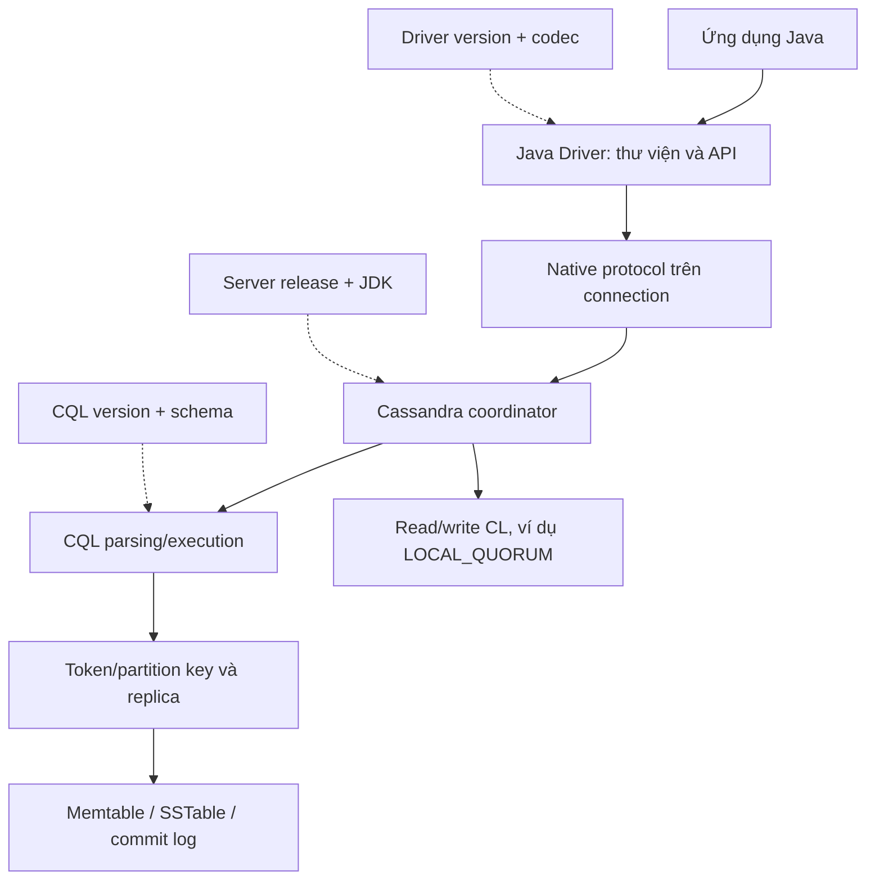

# Xác định phiên bản server, CQL, native protocol và Java driver

> **Chương:** Nâng cấp và tương thích  
> **Phạm vi:** Apache Cassandra, cơ sở dữ liệu phân tán kiểu *wide-column*, cùng ứng dụng sử dụng CQL và Cassandra Java Driver. Bài phân biệt phiên bản của **máy chủ Cassandra**, **ngôn ngữ CQL**, **giao thức native transport**, và **thư viện Java driver** để chuẩn bị nâng cấp, chẩn đoán kết nối và xác minh khả năng tương thích.
>
> **Kết quả học tập:** Thu thập đúng bốn loại phiên bản ở từng tầng; biết sự khác nhau giữa **phiên bản giao thức server hỗ trợ** và **phiên bản driver thực sự thương lượng trên kết nối**; kiểm tra tình trạng mixed-version trong cluster; lập bảng tương thích, baseline và runbook kiểm thử trước khi nâng cấp Cassandra/Java.

## 1. Bài toán: “Cassandra bản 4” nghĩa là cái gì?

Một ứng dụng Java đang đọc dữ liệu theo partition key với `LOCAL_QUORUM`. Sau khi thay thư viện driver, một số request bị lỗi ở giai đoạn kết nối, còn câu CQL cũ vẫn chạy được bằng `cqlsh`.

Nhóm vận hành hỏi:

- Node Cassandra có đang chạy **cùng phiên bản server** hay có node chưa được nâng cấp?
- Server công bố **CQL version** nào?
- Native protocol mà server hỗ trợ là **v4, v5 hay phiên bản khác**?
- Ứng dụng thực tế đang chạy **Java Driver 3.x, 4.x hay artifact khác**?
- Phiên bản **native protocol được thương lượng** trên kết nối Java có giống chuỗi báo bởi `system.local` hay không?
- JDK của ứng dụng và server có còn được driver/Cassandra phiên bản đó hỗ trợ không?

Sáu câu hỏi này có thể cho ra **sáu đáp án khác nhau mà không hề mâu thuẫn**.

Ví dụ giả định:

```text
Node server:              Apache Cassandra 4.1.x
CQL specification:        3.x
Native protocol ở server: v4/v5 theo release và cấu hình
Java Driver artifact:     dòng 4.x
JDK ứng dụng:             một phiên bản Java được driver hỗ trợ
Protocol trên connection: do client và server thương lượng

Con số 4 xuất hiện ở nhiều nơi
nhưng không cùng biểu thị một loại phiên bản.
```

Các giá trị trên chỉ minh họa **loại thông tin**, không phải bảng tương thích cố định. Không suy ra `Java Driver 4.x` nhất định phải sử dụng `native protocol v4` hoặc `CQL 4`.

## 2. Bốn lớp phiên bản và hai lớp bổ sung

| Lớp | Nó đại diện cho điều gì? | Nguồn xác minh chính | Không được đồng nhất với |
| --- | --- | --- | --- |
| **Cassandra server release** | Phần mềm Cassandra chạy trên từng node | `nodetool version`, `system.local.release_version` | Phiên bản driver hoặc CQL |
| **CQL version** | Phiên bản đặc tả ngôn ngữ/trình phân tích CQL được server báo | `system.local.cql_version`, `SHOW VERSION` trong `cqlsh` | Version của `cqlsh` hoặc Cassandra release |
| **Native protocol version** | Giao thức nhị phân client ↔ server để gửi CQL và trao đổi dữ liệu | `system.local.native_protocol_version`, `SHOW VERSION`, thông tin connection | Phiên bản thư viện Java driver |
| **Java driver version** | Phiên bản thư viện ở ứng dụng, API/config/codec/retry/load balancing | Dependency graph, build manifest, SBOM/runtime metadata | Version của máy chủ |
| **Negotiated protocol** | Phiên bản giao thức **một connection cụ thể** dùng sau handshake | Log/diagnostics của đúng driver và connection | Giá trị server công bố là tự động đủ bằng chứng |
| **JDK/runtime version** | JVM chạy Cassandra hoặc ứng dụng Java | `java -version` ở đúng process/container, runtime inventory | CQL/native protocol |

Ngoài ra còn có:

- **Phiên bản `cqlsh`**: chương trình client Python điều khiển CQL, có vòng đời riêng.
- **Phiên bản `nodetool`/tooling**: công cụ quản trị có thể được chạy từ một bản cài đặt khác với node đang kết nối.

**Nguyên tắc:** mỗi kết luận tương thích phải chỉ rõ **tầng, node/client, nguồn bằng chứng và thời điểm đo**.

## 3. Bản đồ giao tiếp từ Java đến Cassandra



Các lớp chịu trách nhiệm khác nhau:

1. **Java driver** mở connection, chọn coordinator theo local datacenter, mã hóa câu lệnh/giá trị, gửi request và quản lý timeout.
2. **Native protocol** quy định khung thông điệp và cách hai phía trao đổi trên connection.
3. **Cassandra server** phân tích CQL, kiểm tra quyền/schema, chọn replica theo token, thực hiện read/write path.
4. **CQL version** mô tả một lớp cú pháp/ngữ nghĩa ngôn ngữ, nhưng việc hỗ trợ tính năng còn phụ thuộc release, feature gates và dịch vụ đang chạy.
5. **JDK** quyết định môi trường thực thi, khả năng mã hóa, TLS, GC và tương thích binary.

Nếu một câu `CREATE TABLE` chạy được qua `cqlsh` nhưng Java driver không kết nối được, nguyên nhân có thể nằm ở **handshake/protocol, TLS, authentication, codec hoặc driver runtime** chứ không phải cú pháp CQL.

## 4. Thu thập trực tiếp từ CQL: `system.local`

Bảng hệ thống `system.local` chứa thông tin về **node đang phục vụ truy vấn hệ thống đó**. Đây là cách hữu ích để lấy các chuỗi phiên bản phía server khi có quyền đọc tương ứng.

Ví dụ trong `cqlsh`:

```cql
SELECT release_version,
       cql_version,
       native_protocol_version,
       cluster_name,
       data_center,
       rack,
       partitioner
FROM system.local
WHERE key = 'local';
```

Các trường cần hiểu:

| Cột | Ý nghĩa |
| --- | --- |
| `release_version` | Cassandra server release trên node liên quan |
| `cql_version` | Phiên bản CQL được node báo |
| `native_protocol_version` | Phiên bản native protocol mà metadata node công bố |
| `cluster_name` | Tên cluster, dùng để phát hiện kết nối nhầm môi trường |
| `data_center` | Datacenter do topology/snitch nhận diện |
| `rack` | Rack theo topology |
| `partitioner` | Thuật toán tính token từ partition key |
| `key` | Khóa đặc biệt của bản ghi local, thường là `'local'` |

Các cột này là **metadata vận hành**, không phải một API bảo đảm tất cả dịch vụ tương thích CQL có schema giống nhau. Với bản phân phối hoặc release khác, xác minh bằng `DESCRIBE TABLE system.local`/metadata được phép truy cập.

### Vì sao kết quả chỉ phản ánh một node?

`system.local` không phải bảng dữ liệu được replication để trả một record về mọi node. Khi ứng dụng kết nối qua nhiều coordinator, một lần SELECT không tạo một inventory toàn cluster.

Để biết **phiên bản của từng server**, phải:

- Lấy thông tin từ từng node bằng công cụ quản trị có quyền; hoặc
- Dùng một collector đã thiết kế cho node-level metrics/version inventory; hoặc
- Kết hợp metadata peers và xác minh lại trực tiếp trên các node quan trọng.

**Không kết luận “toàn cluster đã ở 5.x” từ một dòng `release_version` của một coordinator.**

### Phải ghi lại thời điểm và đích đã hỏi

Một bản ghi kiểm kê tốt có ít nhất:

```text
observed_at_utc:
cluster:
coordinator/node endpoint:
datacenter / rack:
release_version:
cql_version:
native_protocol_version:
partitioner:
source = system.local:
```

Nếu có DNS/load balancer hoặc nhiều contact points, ghi cả **host thực tế** được kết nối. Chỉ ghi chuỗi release mà không ghi host sẽ khó tìm node còn sót trong một rolling upgrade.

## 5. Quan sát nhanh bằng `cqlsh`

Khi kết nối tới node có quyền và dùng bản `cqlsh` phù hợp:

```bash
cqlsh 192.0.2.10 9042
```

`192.0.2.10` là địa chỉ dành riêng cho tài liệu, cần thay bằng node thật. Trên phiên `cqlsh` có hỗ trợ các lệnh meta:

```text
SHOW VERSION;
SHOW HOST;
```

`SHOW VERSION` thường cho thông tin về **Cassandra server**, **CQL specification**, **native protocol** và đôi khi version của công cụ. `SHOW HOST` giúp xác nhận node đang phục vụ phiên kết nối.

Tùy phiên bản/distribution, output, tên lệnh và mức chi tiết có thể thay đổi. Quan sát thực tế trong lab, không viết parser cố định dựa vào thứ tự chữ trong banner.

### Phân biệt `cqlsh --version` và `SHOW VERSION`

```bash
cqlsh --version
```

Lệnh này chủ yếu xác định **phiên bản chương trình cqlsh** trên máy gọi. Nó **không** tự chứng minh Cassandra server đã được nâng cấp, cũng không phải version của Java driver.

Ngược lại, `SHOW VERSION` trong một session có kết nối có thể phản ánh **server và protocol mà cqlsh đang dùng**. Nó không cho biết native protocol thương lượng của **một ứng dụng Java khác**.

### Vì sao một cqlsh kết nối được chưa đủ?

- Java driver có thể chỉ hỗ trợ một tập native protocol khác.
- Java driver có thể sử dụng TLS hoặc authentication khác.
- Ứng dụng có thể cấu hình local DC, contact points, retry và load balancing khác.
- `cqlsh` có thể kết nối đúng một node khỏe, trong khi driver đi qua những node mixed-version khác.

**Luôn test bằng chính client stack và workload sẽ chạy trong production.**

## 6. Lấy phiên bản server bằng `nodetool`

Trên node được cấp quyền:

```bash
nodetool version
nodetool status
nodetool describecluster
```

Cách hiểu:

- `nodetool version`: thông tin release của **node được truy vấn** qua giao diện quản trị phù hợp.
- `nodetool status`: node/DC, trạng thái `UN`/`DN` và token ownership tổng quát; **không phải một bảng version đầy đủ**.
- `nodetool describecluster`: mô tả cluster, bao gồm một số thông tin về schema/cluster; **không phải nguồn thay thế trực tiếp cho version từng node**.

Một số `nodetool` hỗ trợ chỉ định host qua tham số `-h`; cú pháp, JMX/TLS/auth và quyền có thể khác theo release. Trước khi tự động hóa, đọc help của **đúng công cụ**:

```bash
nodetool help
nodetool help version
```

### Lưu ý về phiên bản của bản thân `nodetool`

Nếu máy laptop cài công cụ của release A nhưng dùng nó nói chuyện với node release B, một số lệnh có thể hoạt động, một số lệnh khác có thể không tương thích hoặc in output khác.

**Không đoán phiên bản server chỉ từ đường dẫn cài đặt `nodetool` trên laptop**. Cần biết mục tiêu JMX thực tế và kết quả từ node đó. Dùng tooling phù hợp trong runbook nâng cấp.

### Quyền hạn và an toàn

Lấy version là hoạt động quan sát, nhưng JMX và tài khoản vận hành vẫn có thể lộ nhiều thông tin/quyền nguy hiểm. Chỉ mở truy cập qua mạng quản trị được bảo vệ; không tắt authentication hoặc công khai cổng JMX chỉ để chạy `nodetool version`.

## 7. Xác định phiên bản các node khác: `system.peers` và `peers_v2`

Thông tin về các peer có thể được nhìn từ các bảng hệ thống do Cassandra duy trì. Với phiên bản hỗ trợ `system.peers`:

```cql
SELECT peer, data_center, rack, release_version, schema_version
FROM system.peers;
```

Một số release mới cung cấp `system.peers_v2` với metadata endpoint/port phong phú hơn:

```cql
-- Chỉ chạy khi bảng/cột tồn tại trong release hiện dùng.
SELECT peer, peer_port, data_center, rack, release_version
FROM system.peers_v2;
```

**Không dùng hai truy vấn như cú pháp mặc định bất biến.** Tên cột/bảng khác nhau theo release; xác minh schema của hệ trước khi dùng `peers_v2`.

### Peer metadata không phải chứng cứ tuyệt đối

- Nó phản ánh **thông tin node hiện tại biết hoặc đã nhận**, có thể trễ trong lúc topology thay đổi.
- Node đã rời cluster, đang thay thế hoặc gossip bị lỗi có thể làm inventory thiếu/chưa cập nhật.
- Nó không tự chứng minh một process server cụ thể hiện còn đang chạy hoặc phục vụ CQL.
- Không nhìn thấy local node trong `system.peers` theo cách tương tự peers khác.

Do đó, dùng peer inventory để **tìm node có khả năng lệch phiên bản**, sau đó xác minh trực tiếp theo node ở các bước quan trọng.

### Mẫu bảng phiên bản cluster

| Node | DC | Rack | Server release | CQL version | Native metadata | Trạng thái | Nguồn |
| --- | --- | --- | --- | --- | --- | --- | --- |
| N1 | dc1 | r1 | 4.1.x (minh họa) | 3.x | protocol theo thực tế | UN | `nodetool` + local |
| N2 | dc1 | r2 | 4.1.x | 3.x | protocol theo thực tế | UN | local |
| N3 | dc1 | r3 | 4.0.x (minh họa) | 3.x | protocol theo thực tế | UN | peer + direct |
| N4 | dc2 | r1 | 4.1.x | 3.x | protocol theo thực tế | UN | local |

Nếu phát hiện N3 khác release, đó có thể là **rolling upgrade có chủ đích** hoặc node bị bỏ sót. Phải đối chiếu kế hoạch nâng cấp; đừng tự động kết luận lỗi hoặc tiếp tục cập nhật schema mới.

## 8. CQL version là đặc tả ngôn ngữ, không phải feature matrix

Cassandra sử dụng CQL để mô tả keyspace, bảng, khóa phân vùng, clustering columns và truy vấn. Ví dụ:

```cql
CREATE TABLE IF NOT EXISTS lab.events_by_device_day (
    device_id text,
    event_day date,
    event_time timestamp,
    event_id uuid,
    payload text,
    PRIMARY KEY ((device_id, event_day), event_time, event_id)
) WITH CLUSTERING ORDER BY (event_time DESC, event_id ASC);
```

Đây là ví dụ **CQL cơ bản**, giả định keyspace `lab` đã tồn tại. Việc `system.local.cql_version` cùng thuộc một dòng `3.x` ở hai server **không có nghĩa mọi tính năng và cú pháp đều tương đương**.

Ví dụ những khả năng có thể phụ thuộc server release/config:

- Kiểu dữ liệu, aggregate, UDF hoặc UDA.
- Secondary index, Storage-Attached Index (SAI) và hành vi truy vấn liên quan.
- Materialized view, CDC, `VECTOR` hoặc những tính năng được bổ sung ở release mới.
- Cú pháp quản trị/schema và các option compaction/TTL.
- Quy tắc security, authentication và UDF enablement.

**Đừng kết luận “cùng CQL version ⇒ câu CQL mới chắc chắn chạy trên mọi node”.** Kiểm tra release notes, capability của server/feature flag và chạy integration test trên cluster cùng topology.

### Thử cú pháp mà không làm rủi ro production

Trong môi trường lab:

```cql
DESCRIBE KEYSPACE lab;
DESCRIBE TABLE lab.events_by_device_day;
```

Sau đó chạy các truy vấn đại diện theo partition key, không bắt đầu bằng `ALTER TABLE` hoặc bật feature mới trên cluster đang serving.

Nếu một driver có codec chưa hỗ trợ kiểu mới, server có thể chấp nhận DDL nhưng **client Java vẫn lỗi khi giải mã giá trị**. Vì thế nâng cấp CQL feature có thể đòi đổi driver/codec và kiểm thử dữ liệu.

## 9. Native protocol: định nghĩa và nơi xảy ra thương lượng

Native transport protocol là giao thức để client như `cqlsh`, Java Driver và các ngôn ngữ khác nói chuyện với Cassandra qua kết nối mạng. Phiên bản giao thức được dùng trên **connection**, không phải là tên thư viện.

```text
Java Driver 4.x
      |
      | TCP/TLS, startup/handshake,
      | xác thực, thương lượng protocol
      v
Cassandra native transport
      |
      +--> request CQL
      +--> prepared statements / bindings
      +--> results / errors / metadata
```

Những điểm quan trọng:

- Một **server release** có thể hỗ trợ tập protocol versions phù hợp với nó.
- Một **driver release** có thể hỗ trợ tập protocol versions khác; thư viện driver v4 không đồng nghĩa protocol v4.
- Khi mở kết nối, hai phía phải dùng một protocol chung được hỗ trợ, theo khả năng thương lượng của driver.
- **Version thực sự dùng** có thể khác giá trị version cao nhất/được công bố phía server.
- Trong cluster **mixed-version**, tập protocol chung có thể bị giới hạn bởi các node cũ.

### “Server công bố protocol v5” không chứng minh Java đang dùng v5

Truy vấn:

```cql
SELECT release_version, native_protocol_version
FROM system.local
WHERE key = 'local';
```

chỉ là **metadata ở phía server được truy vấn**. Nó không chứng minh một Java connection đã chọn protocol đó. Phải lấy bằng chứng **đúng client/connection** qua diagnostics/log driver được release hỗ trợ.

Nếu `SHOW VERSION` cho native protocol mà `cqlsh` sử dụng, đó vẫn là **kết nối cqlsh**, không phải kết nối Java.

### Vì sao native protocol cần kiểm tra khi nâng cấp?

Sự thay đổi protocol có thể ảnh hưởng:

- Framing và cách diễn giải response/error.
- Truyền metadata, prepared statement và tham số.
- Codec hỗ trợ các kiểu dữ liệu mới.
- Khả năng kết nối với các node cũ trong rolling upgrade.
- Hành vi driver khi một connection gặp phiên bản không hỗ trợ.

Không có nghĩa nâng server release phải đổi native protocol ngay. Cũng không có nghĩa giữ protocol cũ mãi là tương thích với mọi tính năng mới.

## 10. Lấy bằng chứng negotiated protocol của Java driver

Có ba cấp độ tin cậy:

| Bằng chứng | Kết luận có thể đưa ra | Không kết luận được |
| --- | --- | --- |
| Server `native_protocol_version` | Metadata protocol phía node | Giao thức mà Java connection đã chọn |
| `cqlsh SHOW VERSION` | Protocol thông tin/đang dùng của phiên cqlsh đó | Protocol Java driver |
| **Java Driver diagnostics/connection logs** | Protocol đã thương lượng trên connection/host cụ thể khi driver có ghi | Mọi connection khác nếu chưa quan sát |

Cách làm:

1. Xác định Java Driver artifact/version thực đang được đóng gói.
2. Ghi server releases trên **những host driver sẽ kết nối**.
3. Tham khảo tài liệu/logging configuration của đúng driver release để bật **mức log chẩn đoán ngắn hạn** cho handshake/protocol.
4. Mở một session mới trong **lab/canary**, xác nhận protocol đã thương lượng theo host.
5. Tắt log chi tiết sau khi đã thu đủ dữ liệu để tránh overhead/lộ thông tin.

**Không đoán tên logger hay viết một đoạn API lấy protocol negotiated nếu release đang dùng không cung cấp rõ.** Có phiên bản driver cho phép cấu hình protocol cố định, nhưng chỉ ép phiên bản qua cấu hình khi đã kiểm thử tương thích và biết hệ quả.

### Phân biệt các lỗi dễ giống nhau

- **Unsupported protocol version**: có thể do tập protocol server/driver không có phần giao.
- **TLS handshake failure**: lỗi trust store/cipher/TLS policy, không phải native protocol.
- **Authentication failure**: credential/method không phù hợp, không phải mismatch CQL version.
- **No node available**: driver không có host hợp lệ hoặc mất kết nối, chưa đủ chứng minh protocol sai.
- **Invalid query/unprepared**: có thể do schema, prepared statement cache hoặc tính năng CQL, không nhất thiết do protocol.
- **Codec error**: driver không encode/decode được type cụ thể dù connection hoạt động.

Điều tra dựa trên **exception đầy đủ, coordinator/host, log phía server/driver và thời điểm**; không sửa protocol setting ngay khi có timeout.

## 11. Java driver version: đừng suy từ `pom.xml` một cách đơn giản

Nếu ứng dụng dùng Java Driver 4.x, namespace API thường là:

```java
import com.datastax.oss.driver.api.core.CqlSession;
```

Dòng Java Driver 3.x dùng API cũ khác, ví dụ package:

```java
import com.datastax.driver.core.Cluster;
```

Đây là **dấu hiệu dòng API**, không phải bằng chứng đủ để biết patch version runtime. Artifact có thể bị dependency management ép version, bị đóng vào fat JAR hoặc được thay bởi một distribution khác.

### Ba nơi phải kiểm tra

1. **Build declaration:** bản phát triển mong muốn ở Maven/Gradle.
2. **Resolved dependency graph:** version thực sự được dependency solver chọn, kể cả transitive/BOM.
3. **Artifact/runtime:** thư viện đang nằm trong container/JAR và được JVM load.

Một file build ghi driver 4.15 nhưng dependency management chọn 4.17, hoặc deployment vẫn dùng image cũ, có thể khiến kết luận version sai.

### Ví dụ Maven

```bash
mvn dependency:tree
```

Lọc theo artifact/namespace Java driver sau khi đã kiểm tra group ID tương ứng trong bản đang dùng. Với Java Driver 4.x, có các distribution/phát hành dùng tọa độ Maven khác nhau; **không lấy group ID cũ làm chuẩn bất biến cho mọi release**.

Trong CI/CD nên lưu **dependency lock/SBOM, artifact checksum và image digest** để truy được version chính xác đã triển khai.

### Ví dụ Gradle

```bash
./gradlew dependencies --configuration runtimeClasspath
./gradlew dependencyInsight --dependency java-driver-core \
    --configuration runtimeClasspath
```

Hai lệnh là ví dụ để người học kiểm tra trên project phù hợp; kết quả tùy cấu trúc multi-module, plugin và tên configuration. Bài này không yêu cầu chạy build trong repository được giao.

### Khi build là fat JAR hoặc container

Cần quan sát cả:

- Driver library có bị shade/relocate không?
- Có nhiều bản JAR trùng class trên classpath không?
- Artifact ở production có đúng digest của CI không?
- Các instance service tại hai DC/region có chạy cùng version không?
- Java runtime có load class từ JAR mong đợi không?

**Đổi version ở source code chưa chứng minh deployment đã đổi**.

## 12. Java Driver 4.x: đọc metadata server và runtime library

Ví dụ hoàn chỉnh cho môi trường **lab**, dùng một contact point thuộc `dc1`. Cluster/keyspace/user phải được chuẩn bị sẵn; địa chỉ `192.0.2.10` là địa chỉ dành cho tài liệu.

```java
import java.net.InetSocketAddress;
import java.util.Map;
import java.util.UUID;

import com.datastax.oss.driver.api.core.CqlSession;
import com.datastax.oss.driver.api.core.cql.ResultSet;
import com.datastax.oss.driver.api.core.cql.Row;
import com.datastax.oss.driver.api.core.metadata.Node;

public final class CassandraVersionInventory {

    public static void main(String[] args) {
        try (CqlSession session = CqlSession.builder()
                .addContactPoint(
                    new InetSocketAddress("192.0.2.10", 9042))
                .withLocalDatacenter("dc1")
                .build()) {

            // Thông tin manifest của JAR, có thể null nếu build/shading
            // không bảo lưu Implementation-Version.
            Package driverPackage = CqlSession.class.getPackage();
            String runtimeDriverVersion =
                driverPackage == null
                    ? null
                    : driverPackage.getImplementationVersion();

            System.out.println(
                "Driver JAR implementation-version: " +
                (runtimeDriverVersion == null
                    ? "unknown - inspect dependency graph/SBOM"
                    : runtimeDriverVersion));

            // system.local là metadata phía server/coordinator.
            // Không chứng minh toàn bộ node trong cluster cùng version.
            ResultSet result = session.execute(
                "SELECT release_version, cql_version, " +
                "native_protocol_version, data_center, rack " +
                "FROM system.local WHERE key = 'local'");

            Row row = result.one();
            Node coordinator =
                result.getExecutionInfo().getCoordinator();

            if (row == null) {
                throw new IllegalStateException(
                    "system.local did not return local metadata");
            }

            System.out.println(
                "Server release: " + row.getString("release_version"));
            System.out.println(
                "CQL version: " + row.getString("cql_version"));
            System.out.println(
                "Server protocol metadata: " +
                row.getString("native_protocol_version"));
            System.out.println(
                "Server DC: " + row.getString("data_center"));
            System.out.println(
                "Server rack: " + row.getString("rack"));
            System.out.println(
                "Coordinator: " +
                (coordinator == null
                    ? "unknown"
                    : coordinator.getEndPoint()));

            // Driver metadata của các node được khám phá;
            // thông tin có thể chưa cập nhật trong khi rolling upgrade.
            for (Map.Entry<UUID, Node> entry :
                    session.getMetadata().getNodes().entrySet()) {
                Node node = entry.getValue();
                System.out.printf(
                    "node=%s dc=%s serverVersion=%s%n",
                    node.getEndPoint(),
                    node.getDatacenter(),
                    node.getCassandraVersion());
            }
        }
    }
}
```

Đoạn mã dùng **Java Driver 4.x API**; cần khai báo dependency phù hợp và cấu hình authentication/TLS theo môi trường, không lưu password trong source. Nó minh họa thu thập **server release, CQL, server protocol metadata, version JAR và metadata peer** — **không đo negotiated protocol của từng connection**.

### Giới hạn của ví dụ

- `getImplementationVersion()` có thể trả `null` nếu JAR không ghi manifest hoặc đã được shade; fallback về **resolved dependencies/SBOM**.
- `system.local` cho biết metadata của node phục vụ request, không phải tất cả node.
- `getMetadata().getNodes()` là **những node driver khám phá và metadata đang có**, không nhất thiết là nguồn inventory chuẩn khi gossip/mixed-version biến động.
- `getCassandraVersion()` có thể thiếu/chưa cập nhật cho một node mới hoặc mất liên lạc.
- Kết nối Java thường không cố chọn mọi remote DC chỉ để đọc version. Với node cụ thể, dùng phương pháp quản trị inventory trực tiếp.
- Session trong ví dụ chưa tự kiểm tra plugin, index, feature flags hoặc tính năng CQL nâng cao.
- Cấu hình `withLocalDatacenter("dc1")` chỉ hướng driver chọn coordinator, **không thay RF hay token placement**.

### Vì sao không dùng `SELECT * FROM system.local` trong code?

Chọn cột cụ thể giúp rõ hợp đồng đo và dễ phát hiện một cột không còn hỗ trợ; `SELECT *` có thể đọc thêm metadata không cần thiết, phụ thuộc schema theo release. Với công cụ chẩn đoán thủ công, `SELECT *` đôi lúc hữu ích nhưng nên giới hạn quyền và phạm vi.

## 13. Connection protocol và driver release: phép thử thực tế

Một kế hoạch xác minh giao thức nên dùng **cùng driver và chính cấu hình production** trong canary:

```text
Driver artifact/version
     |
     +--> CqlSession tại dc1
            |
            +--> connect N1 (server release A)
            +--> connect N2 (server release B)
            |
            +--> protocol negotiated (theo log)
            +--> auth/TLS successful
            +--> prepared SELECT thành công
            +--> INSERT/UPDATE idempotent test
            +--> read/write CL đáp ứng
```

Việc một query chưa lỗi chưa đủ; cần kiểm tra:

- Connection pool khi **mở mới** với từng release server.
- Prepared statements sau reconnect/restart.
- Paging với partition và clustering range.
- Collections/UDT/decimal/timestamp mà ứng dụng đang dùng.
- Retry, idempotency, timeouts và exception mapping.
- Failover khi một node bị restart trong **lab**.
- Request routing theo local DC, nhất là khi cluster nhiều datacenter.

Driver có thể hỗ trợ giao thức chung nhưng **một codec hay tính năng query cụ thể vẫn không tương thích**. Kiểm tra cả **wire compatibility lẫn application behavior**.

## 14. Phân biệt driver native protocol và phiên bản Java/JDK

Có hai máy dùng Java:

1. **Server JVM** chạy Cassandra.
2. **Application JVM** chạy Java driver.

Hai JVM không nhất thiết có cùng version. Nhưng cả hai đều có yêu cầu hỗ trợ theo Cassandra release/driver release và bản phân phối đang dùng.

Đo runtime tại đúng nơi:

```bash
java -version
```

Với container/Kubernetes, lệnh ở **host** không chắc cho version JVM bên trong container. Phải xác minh image/container thực tế hoặc thông tin process/JVM metrics.

### JDK sai gây lỗi không giống native protocol sai

| Hiện tượng | Ứng viên nguyên nhân |
| --- | --- |
| `UnsupportedClassVersionError` | Bytecode được build cho Java mới hơn runtime hiện có |
| TLS handshake/cipher failure | JDK crypto policy, trust store, certificate, driver/TLS config |
| Driver không khởi tạo do thiếu class | Dependency version/conflict hoặc artifact bị đóng thiếu |
| Connect thành công nhưng decode UDT sai | Codec/schema version hoặc tính năng server/driver |
| Server không khởi chạy sau nâng cấp | JVM flags/GC/JDK không được Cassandra release hỗ trợ |
| Native protocol unsupported | Giao thức client/server không có phiên bản chung hoặc cấu hình không phù hợp |

Không được chữa `UnsupportedClassVersionError` bằng cách đổi CQL version. Đây là lỗi ở **binary/JVM runtime**, một tầng khác.

## 15. Nhận diện mixed-version trong rolling upgrade

Một số quy trình nâng cấp Cassandra cho phép chạy các node ở **hai release được hỗ trợ cùng lúc trong một giai đoạn ngắn**. Nó không có nghĩa mọi cặp phiên bản đều an toàn cùng hoạt động vô thời hạn.

Ví dụ:

```text
Trước upgrade:
  N1 = release A
  N2 = release A
  N3 = release A

Giữa rolling upgrade (nếu đường nâng cấp này được hỗ trợ):
  N1 = release B
  N2 = release A
  N3 = release A

Sau upgrade:
  N1 = release B
  N2 = release B
  N3 = release B

Mỗi bước phải kiểm tra cluster health,
CQL/native protocol và Java client.
```

### Những điều phải xác minh khi mixed-version

- Đường nâng cấp A → B **được tài liệu release hỗ trợ**, không nhảy phiên bản tùy tiện.
- Node đã đổi release có đúng **schema version** và không bị lỗi gossip/messaging.
- Driver kết nối được **cả node A và node B** với giao thức được thương lượng phù hợp.
- Không bật tính năng/schema mới yêu cầu tất cả node đã ở B khi vẫn còn node A.
- Các hoạt động bootstrap, repair, streaming, upgrade SSTable và backup/restore phải theo **runbook phiên bản**.
- Mọi DC/rack đã được kiểm kê, không bỏ sót một node.
- Bản rollback có được hỗ trợ sau khi format/metadata đã thay đổi hay không.

**Rolling upgrade là trạng thái tạm có điều kiện, không phải chứng chỉ tương thích chung.**

### Vì sao schema version không phải server release?

`schema_version` là định danh metadata schema, thường dùng nhận biết các node đã đồng ý về schema hay chưa. Hai node có cùng server release có thể khác schema version; hai node khác release trong một giai đoạn upgrade có thể vẫn có schema metadata tương thích.

Do đó không lấy `schema_version` làm `release_version`.

## 16. Ma trận tương thích: phải có nguồn chứng minh theo từng cặp

Một bảng quyết định tốt cần ghi **phiên bản cụ thể**, không chỉ các nhãn “mới nhất”:

| Đối tượng | Hiện tại | Dự kiến | Câu hỏi cần xác minh |
| --- | --- | --- | --- |
| Cassandra server | Release A + patch | Release B + patch | Đường upgrade hỗ trợ? JDK cần gì? SSTable format? |
| CQL/schema | CQL metadata và DDL hiện có | Tính năng DDL muốn dùng | Cú pháp/type có được tất cả node hỗ trợ? |
| Native protocol | Metadata hiện tại + negotiated logs | Phạm vi driver hỗ trợ | Có protocol chung trên mỗi connection? |
| Java Driver | Resolved artifact version X | Version Y | Có tương thích server A/B và runtime Java? |
| Application JDK | Java X | Java Y | Driver và TLS libs có hỗ trợ? |
| Server JDK | Java S | Java T | Cassandra release và GC flags có hỗ trợ? |
| Security | Auth/TLS hiện tại | Policy dự kiến | Driver handshake/auth còn hoạt động? |
| Topology | RF/DC/rack/token ranges | Node kế hoạch | Có đủ replica cho CL trong từng pha? |

Điền các ô bằng **release notes và compatibility documentation của đúng bản phân phối**, cộng **kết quả thử trên cluster staging**. Không dùng một bảng con số phiên bản viết từ trí nhớ để phê duyệt nâng cấp hệ thống quan trọng.

### Bằng chứng tương thích nên có ba nguồn

1. **Cam kết/giới hạn từ nhà phát hành:** documented supported versions, upgrade paths, config/JDK requirements.
2. **Inventory từ cluster và artifact thực:** những version đang chạy, không phải version dự kiến.
3. **Kết quả integration test có thể tái tạo:** cùng schema, data types, CL, topology, driver build và workload.

Nếu thiếu một nguồn, ghi rõ **“chưa xác minh”**, không tự biến thành PASS.

## 17. Điều gì thay đổi khi nâng Java Driver 3.x sang 4.x?

Java Driver 3.x và 4.x khác nhau về API, cấu hình, metadata, policies và driver internals. Chuyển 3 → 4 **không chỉ là đổi số version trong dependency**.

| Hạng mục | Driver 3.x (khái niệm) | Driver 4.x (khái niệm) |
| --- | --- | --- |
| Khởi tạo | API `Cluster`/`Session` đời cũ | `CqlSession`, builder/context |
| Namespace thường gặp | `com.datastax.driver.core` | `com.datastax.oss.driver.api.core` |
| Local DC/load balancing | API và policy cũ | `withLocalDatacenter` hoặc cấu hình 4.x |
| Config | Định dạng/option cũ | Cấu hình 4.x khác |
| Codec/customization | API codec 3.x | Codec/type API 4.x |
| Async/reactive API | Interface riêng | Interface 4.x, cần migrate code |
| Metrics/retries | Chính sách 3.x | Cấu hình/instrumentation 4.x |

Đây là bảng **khác biệt kiến trúc API**, không phải toàn bộ migration guide. Với code có UDT, custom codecs, custom load balancing, speculative retry hoặc manual timestamps, cần kiểm tra từng API call thay vì tìm-and-replace package name.

### Một dấu hiệu dễ đánh lừa

Source code đã import `CqlSession` nhưng runtime đóng hai bộ thư viện khác nhau qua các transitive dependencies; hoặc CI build phiên bản Y nhưng image deploy vẫn là phiên bản X.

Vì vậy phải có **build dependency verification + runtime artifact verification + integration tests**.

## 18. CQL schema theo truy vấn và tác động khi đổi version

Ví dụ một bảng wide-column:

```cql
CREATE TABLE IF NOT EXISTS lab.orders_by_customer_day (
    customer_id uuid,
    order_day date,
    created_at timestamp,
    order_id uuid,
    status text,
    total decimal,
    PRIMARY KEY ((customer_id, order_day), created_at, order_id)
) WITH CLUSTERING ORDER BY (created_at DESC, order_id ASC);
```

Một truy vấn hợp lệ theo partition key:

```cql
SELECT created_at, order_id, status, total
FROM lab.orders_by_customer_day
WHERE customer_id = aaaaaaaa-aaaa-4aaa-8aaa-aaaaaaaaaaaa
  AND order_day = '2026-11-21'
LIMIT 20;
```

Ngay cả khi server và driver “tương thích để kết nối”, cần bảo đảm:

- Prepared statement vẫn bind đúng `uuid`, `date`, `timestamp` và `decimal`.
- Partition key được encode chính xác, giữ token-aware routing.
- Driver local DC đúng; không gửi coordinator sang DC khác ngoài ý định.
- CL `LOCAL_QUORUM` được giữ đúng trong ứng dụng.
- Paging, timestamps, TTL và null/`UNSET` có ngữ nghĩa phù hợp sau nâng driver.
- Truy vấn không vô tình chuyển thành filter rộng hoặc dùng schema feature mới chưa hỗ trợ.

**Tương thích giao thức không tự bảo đảm đúng kết quả nghiệp vụ.** Một driver codec lỗi có thể làm dữ liệu đọc sai ngay cả khi kết nối đã thành công.

## 19. Kiểm chứng read/write consistency trong môi trường nhiều DC

Giả sử RF=3 trong `dc1` và RF=3 trong `dc2`:

- `LOCAL_QUORUM` ở coordinator dc1 yêu cầu hai replica **dc1**.
- `LOCAL_QUORUM` ở coordinator dc2 yêu cầu hai replica **dc2**.
- `QUORUM` toàn cụm với RF tổng 6 thường cần bốn phản hồi.
- `EACH_QUORUM` áp dụng cho write theo quorum của từng DC, không phải consistency level đọc phổ thông.

Nâng cấp driver có thể thay cách chọn coordinator do khác config/load balancing; nếu local DC bị cấu hình sai, ứng dụng có thể đi qua WAN hoặc không chọn được host phù hợp.

### Bộ kiểm tra tối thiểu

1. Ghi RF/DC, cluster name và coordinator DC thực tế.
2. Đọc một partition bằng `LOCAL_QUORUM` trong từng DC dự kiến.
3. Ghi p95/p99 và lỗi theo DC khi restart node lab.
4. Thử một prepared write idempotent đã định nghĩa rõ, sau đó đọc kiểm chứng.
5. Đảm bảo dữ liệu đang trong quá trình repair/streaming không làm kết luận về driver sai lệch.
6. Không đánh giá tính đúng đắn cross-DC chỉ bằng một SELECT ở dc1.

Một cặp local quorum khác DC không có giao replica bắt buộc; vì vậy **đọc ngay ở DC khác** có thể chưa thấy ghi local vừa được ACK, dù cả server và driver đều tương thích.

## 20. Test matrix theo cấp độ: connection → feature → workload

| Mức | Kiểm tra | Tiêu chí đạt |
| --- | --- | --- |
| **T0: Inventory** | Đúng release của mọi node, CQL/protocol metadata, JDK và driver | Có đủ node/app artifacts được kiểm kê |
| **T1: Connect** | TCP/TLS, authentication, driver startup, metadata discovery | Session mở được tới các host cần thiết |
| **T2: Protocol** | Negotiated protocol trong canary theo từng host/version | Giao thức chung được hỗ trợ, không có handshake mismatch |
| **T3: CQL** | `SELECT`/`INSERT`/`UPDATE` với schema thực, prepared statements | Không có syntax/type/codec lỗi |
| **T4: Consistency** | CL và local DC, replication, node failure simulation | Đọc/ghi theo semantics và failure budget |
| **T5: Features** | UDT, collections, LWT, TTL, index/SAI nếu dùng | Tính năng cụ thể hoạt động đúng |
| **T6: Performance** | p95/p99, CPU, GC, disk, driver in-flight/retries | Đạt SLO dưới tải đại diện |
| **T7: Recovery** | Reconnect, rolling restart, repair/streaming interaction | Hệ phục hồi theo runbook |
| **T8: Deployment** | Artifact digest, SBOM, effective config, rollout mỗi DC | Production chạy đúng version đã duyệt |

Trường hợp không dùng UDF/SAI/LWT thì không cần tạo tính năng mới chỉ để “đủ checklist”; nhưng phải ghi rõ **not applicable**. Nếu ứng dụng có UDT/collection lớn, nên ưu tiên test tương ứng vì các kiểu phức tạp dễ gây codec lỗi.

## 21. Ví dụ thu thập inventory trước nâng cấp

Một manifest kiểm kê đơn giản:

```yaml
# Minh họa cấu trúc báo cáo, không phải cassandra.yaml.
observed_at_utc: "2026-11-21T09:00:00Z"
cluster: "lab-upgrade"
server_nodes:
  - node: "N1"
    dc: "dc1"
    release_version: "A"
    cql_version: "CQL-reported"
    native_protocol_metadata: "server-reported"
    source: "system.local + nodetool"
  - node: "N2"
    dc: "dc1"
    release_version: "B"
    cql_version: "CQL-reported"
    native_protocol_metadata: "server-reported"
    source: "system.local + nodetool"
applications:
  - service: "orders-api"
    driver_library_version: "resolved-runtime-artifact"
    application_jdk: "runtime-version"
    configured_local_dc: "dc1"
    negotiated_protocol:
      verification: "driver-connection-logs"
      value: "measured-per-connection"
compatibility_decision: "PENDING"
```

Các giá trị A/B/`server-reported` chỉ là placeholders, không phải phiên bản thật. Trong một triển khai nghiêm túc, nên có **host ID**, endpoint, rack, source timestamp, Cassandra patch version, driver artifact coordinates và đường dẫn log/đối chứng.

Không lưu mật khẩu, token, private key hoặc dữ liệu khách hàng trong manifest.

### Mẫu kiểm tra tính đầy đủ

- Có bao nhiêu node đang thuộc ring? Bao nhiêu node đã đo trực tiếp?
- Có mấy ứng dụng/language clients kết nối tới cluster?
- Có thành phần batch/ETL/backup/monitoring cũng sử dụng native protocol không?
- Có vùng nào còn image cũ hoặc cấu hình driver cũ không?
- Có client `cqlsh`/admin tool không tương thích bản server mới không?
- Những features nào phụ thuộc release cụ thể?

**Inventory chỉ đầy đủ khi đã tính cả các client ít xuất hiện** như import job chạy cuối tháng và công cụ backup.

## 22. Quy trình nâng cấp theo hai trục: server và driver

Không nên đổi đồng thời server major, Java Driver major, JDK và CQL schema trong một lần rồi chỉ đo “hệ còn chạy”.

Một trình tự kiểm thử dễ quy trách nhiệm:

```text
BASELINE
  |
  +--> Kiểm kê server/CQL/protocol/driver/JDK
  |
  +--> Tạo lab/staging giống topology và dữ liệu đại diện
  |
  +--> Thử driver dự kiến với server hiện tại
  |       -> connection, codec, CL, p99
  |
  +--> Thử server mục tiêu với driver hiện tại
  |       -> có nằm trong compatibility matrix?
  |
  +--> Thử trạng thái mixed-version được hỗ trợ
  |       -> reconnect, rolling restart, no new features
  |
  +--> Thử cả server mục tiêu + driver mục tiêu
  |       -> full integration + failover + recovery
  |
  +--> Chọn thứ tự rollout, fallback và rollback
  |
  +--> Canary production -> từng rack/DC -> verification
```

Thứ tự thực tế **phụ thuộc đường nâng cấp được hỗ trợ**; sơ đồ là phương pháp kiểm thử, không phải mệnh lệnh luôn nâng driver trước server.

### Khi nào nên giữ driver cũ tạm thời?

Chỉ khi **driver đó được xác nhận tương thích với cả server cũ và đích** trong thời gian rolling upgrade. Không phải mọi major driver hỗ trợ mọi major Cassandra.

### Khi nào nên đổi driver trước?

Khi driver đang sử dụng **không hỗ trợ server mục tiêu**, nhưng có một driver trung gian/driver mới hỗ trợ cả hai phía và ứng dụng đã migration API thành công. Vẫn cần test protocol, codec, auth, JDK và performance.

**Không tự nhảy major chỉ dựa vào việc local dev kết nối được.**

## 23. Nâng cấp server: những điều phải giữ ổn định

Trong một rolling upgrade được hỗ trợ, thường cần giữ khả năng phục vụ request giữa những node ở các release khác nhau.

Các nguyên tắc an toàn:

1. Chụp snapshot/backup được xác minh và có kế hoạch restore.
2. Đảm bảo replication factor, node health và capacity đủ cho một node tạm ngừng.
3. Đọc quy trình release-specific về thứ tự node, rack/DC, SSTable format và compaction.
4. Không mở tính năng CQL/schema mới trong lúc có node cũ chưa hỗ trợ.
5. Giám sát streaming/repair, `tpstats`, GC, disk headroom và read/write p99.
6. Sau mỗi node, kiểm tra version trực tiếp, gossip, schema agreement và CQL từ Java.
7. Tránh chạy thêm bootstrap/rebuild/major repair không cần thiết trong cùng cửa sổ thay đổi.
8. Khi mọi node đã ở release đích, chạy bước hậu nâng cấp **đúng theo tài liệu release**.
9. Xác nhận cơ chế rollback còn hợp lệ sau khi schema hoặc SSTable format đã thay đổi.
10. Chỉ kết thúc khi cả application/ETL clients còn tương thích và đạt SLO.

**Không dựa vào một runbook nâng cấp giữa hai phiên bản bất kỳ.** Một số bước bắt buộc/cấm có thể khác giữa các major releases.

## 24. Chẩn đoán 8 sự cố điển hình

### A — `cqlsh` chạy được nhưng Java Driver không kết nối

**Kiểm tra:** driver resolved/runtime version, native protocol được hỗ trợ, JDK, TLS, auth, contact points, local DC và exception thực tế.

**Lưu ý:** một `cqlsh` trên node X không chứng minh mọi host mà driver sẽ chọn đều tương thích.

### B — `system.local.release_version` đúng nhưng cluster còn node cũ

**Nguyên nhân có thể:** chỉ hỏi một coordinator, peer metadata chưa cập nhật hoặc rolling upgrade chưa hoàn tất.

**Xử lý:** lập danh sách node từ topology, kiểm tra trực tiếp từng node, ghi bằng chứng theo DC/rack.

### C — Banner nói native protocol v4 nhưng driver package 4.x

**Giải thích:** đây là hai đối tượng khác nhau. Không có mâu thuẫn chỉ vì con số giống hoặc khác.

**Xử lý:** tìm negotiated protocol trên đúng connection và đối chiếu compatibility matrix.

### D — Driver 4.x được khai báo nhưng runtime vẫn báo driver cũ

**Khả năng:** dependency management, fat JAR/shading, image cũ hoặc nhiều bản JAR trùng class.

**Xử lý:** dependency graph, artifact hash, image digest, runtime manifest/SBOM, rollout inventory.

### E — Java hoạt động trước nâng cấp nhưng lỗi codec ở một kiểu mới

**Khả năng:** server hỗ trợ type mới nhưng driver version/codec hiện tại không encode/decode được; UDT/schema mismatch.

**Xử lý:** kiểm tra type cụ thể, prepared query/bind, driver release support và schema. Không ép cast dữ liệu tùy ý.

### F — Mixed-version cluster báo lỗi protocol ở một số host

**Khả năng:** driver không hỗ trợ tập protocol của node cũ/mới hoặc policy kết nối khác sau restart.

**Xử lý:** xác minh version trên từng host, driver diagnostics theo connection, đường nâng cấp hỗ trợ. Dừng rollout nếu đường tương thích không được chứng minh.

### G — Sau nâng driver, p99 tăng nhưng server version không đổi

**Khả năng:** local DC, load balancing, pool, timeout, speculative execution, retry hoặc prepared statements có cấu hình khác.

**Xử lý:** so driver effective config và coordinator distribution, CL, request in-flight/retries; đo lại dưới cùng workload.

### H — Cassandra vẫn báo CQL 3.x sau khi nâng server major

**Giải thích:** số phiên bản CQL là lớp độc lập; không bắt buộc tăng cùng server release. Không coi đây là bằng chứng upgrade thất bại.

**Xử lý:** kiểm tra `release_version` trực tiếp, compatibility documents và feature test thay vì đòi `cql_version` bằng server major.

## 25. Những hiểu lầm phải tránh

**“Cassandra 4.x ⇒ Java Driver 4.x ⇒ native protocol v4.”** Sai. Ba số thuộc ba lớp khác nhau và phải kiểm tra riêng.

**“CQL version bằng phiên bản `cqlsh`.”** Sai. `cqlsh` là client; `cql_version` do server báo là đặc tả ngôn ngữ.

**“`SHOW VERSION` ở cqlsh chứng minh Java Driver dùng cùng protocol.”** Sai. Đây là hai client/connection khác nhau.

**“Một dòng `system.local` đại diện toàn bộ cluster.”** Sai. Nó phản ánh node được hỏi.

**“`system.peers` đủ để chứng minh mọi server đang chạy đúng version.”** Sai. Peer metadata có thể trễ hoặc thiếu; xác minh trực tiếp trong thay đổi quan trọng.

**“Có native protocol chung là mọi CQL feature đều được hỗ trợ.”** Sai. Feature tùy release, schema, codec và configuration.

**“Phiên bản driver trong `pom.xml` chắc chắn là bản JVM đang dùng.”** Sai nếu có dependency resolution, shading, deploy image cũ hoặc classpath conflict.

**“Đổi major driver chỉ cần đổi group/artifact version.”** Sai. API, config và runtime semantics có thể khác.

**“Cùng CQL version nghĩa là có thể bật tính năng mới trên mọi node mixed-version.”** Sai. Cần feature matrix của release cũ nhất đang phục vụ.

**“`nodetool status` báo `UN` là upgrade hoàn tất.”** Sai. Trạng thái ring không cho biết release, schema agreement, protocol hoặc SLO.

**“JDK của host chính là JDK của Cassandra container.”** Sai. Cần đo runtime trong process/container.

**“Driver mới tự sửa schema và partition key cho ứng dụng.”** Sai. Schema và mô hình wide-column là trách nhiệm riêng.

**“`LOCAL_QUORUM` bảo đảm native protocol hoạt động trong mọi DC.”** Sai. CL không phải cơ chế negotiation/giao thức.

**“Nâng server xong mới kiểm tra Java clients cũng được.”** Rủi ro cao. Cần kiểm chứng trước trong staging và canary.

**“Một lần SELECT thành công là đủ cho tương thích.”** Sai. Cần prepared statements, codecs, write/read, failure, retry, p99 và các DC.

## 26. Bài tập tự kiểm tra

1. Phân biệt `release_version`, `cql_version`, `native_protocol_version` và Java driver artifact version.
2. Một node báo server 4.1.x, `cql_version` 3.x. Điều đó có mâu thuẫn không?
3. Có thể dùng `SHOW VERSION` của `cqlsh` để khẳng định protocol của Java Driver đang dùng không? Vì sao?
4. Trình bày câu CQL để xem ba trường phiên bản trong `system.local`.
5. Vì sao phải chạy inventory trên từng node, không chỉ từ coordinator đầu tiên?
6. Khi nào `system.peers`/`peers_v2` giúp ích và giới hạn của chúng là gì?
7. `nodetool version` trả server hay client version? Cần ghi thêm thông tin gì để tránh nhầm node?
8. Vì sao `mvn dependency:tree` có thể đáng tin hơn việc chỉ đọc một dòng dependency declaration?
9. Khi `Package.getImplementationVersion()` trả null, nên dùng nguồn nào để xác minh Java driver runtime?
10. So sánh hai dòng API `com.datastax.driver.core.Cluster` và `com.datastax.oss.driver.api.core.CqlSession`.
11. Một driver hỗ trợ kết nối nhưng không đọc được UDT mới. Nguyên nhân có thể ở những tầng nào?
12. Vì sao feature CQL mới phải được test khi cluster còn mixed-version?
13. Đề xuất một bảng inventory gồm release, CQL, protocol metadata, DC/rack và nguồn quan sát.
14. Giải thích vì sao `schema_version` không phải `release_version`.
15. Một release mới cần JDK khác. Tại sao đây không phải vấn đề native protocol đơn thuần?
16. Khi Java Driver báo unsupported protocol, những dấu hiệu nào giúp phân biệt với TLS và authentication failure?
17. Thử nghiệm nào chứng minh driver giữ local DC và `LOCAL_QUORUM` sau khi nâng?
18. Với RF=3 dc1 + RF=3 dc2, tại sao đọc local quorum ở hai DC không nhất thiết thấy cùng một ghi mới ngay lập tức?
19. Kể tên ít nhất bốn nhóm feature ngoài SELECT đơn giản cần thử khi nâng driver/server.
20. Viết checklist go/no-go cho rolling upgrade Cassandra/Java Driver.
21. Vì sao không nên ép protocol version cố định trên production khi chưa thử?
22. Trình bày cách kiểm chứng một app đã deploy đúng driver patch version trên mọi region.
23. Làm sao kiểm tra các client “quên trong inventory” như batch ETL hoặc backup job?
24. Tại sao phải đo p99/timeouts cùng throughput khi nâng cấp dù handshake đã thành công?
25. Một node N3 chưa nâng, nhưng N1/N2 đã ở release mới. Bạn sẽ thu thập bằng chứng nào trước khi cho phép dùng một CQL type mới?

## 27. Runbook ngắn trước, trong và sau nâng cấp

### Trước nâng cấp

- [ ] Ghi version từng node (`release_version`, CQL, native protocol metadata) và topology RF/DC/rack.
- [ ] Ghi resolved/runtime Java Driver version từng ứng dụng, JDK và actual protocol trên canary.
- [ ] Kiểm tra đường upgrade được hỗ trợ và compatibility matrix chính thức cho **cặp version cụ thể**.
- [ ] Snapshot/backup và thử restore; ghi rõ rollback giới hạn bởi SSTable/schema.
- [ ] Test CQL, prepared statements, codec, LWT/TTL/UDT/index (nếu dùng).
- [ ] Chốt SLO, metric baseline, tiêu chí dừng và các bước phục hồi.

### Trong nâng cấp

- [ ] Đổi một phạm vi node/app đã duyệt, tránh thay nhiều tầng cùng lúc khi có thể.
- [ ] Sau từng thay đổi, đo version thực trên node/instance, không dựa ticket.
- [ ] Kiểm tra protocol handshake, auth/TLS, coordinator local DC và CL.
- [ ] Kiểm tra schema agreement, node health, read/write p99 và compaction/streaming.
- [ ] Dừng rollout khi thấy node không hỗ trợ protocol/tính năng hoặc ảnh hưởng SLO.

### Sau nâng cấp

- [ ] Xác nhận không còn node/app artifact ngoài bản dự kiến.
- [ ] Chạy regression/integration tests, kiểm tra kết quả dữ liệu theo partition key.
- [ ] Xác minh negotiated protocol của các connection canary đại diện.
- [ ] So p95/p99, timeout, errors, driver retry và resource headroom với baseline.
- [ ] Lưu inventory cuối, release/driver coordinates, JDK, cấu hình và bằng chứng.
- [ ] Không bật tính năng CQL mới cho đến khi đã kiểm tra mọi server/client liên quan.

## 28. Sơ đồ quyết định

```text
   Cần biết cluster và ứng dụng đã tương thích?
                        |
                        v
              Đo server trên TỪNG node
              nodetool version / system.local
                        |
                        v
              Đo cql_version và
              native_protocol_version
                        |
                        v
              Đo dependency và runtime
              Java Driver / JDK ứng dụng
                        |
                        v
            Kiểm chứng negotiated protocol
            bằng driver diagnostics theo host
                        |
                        v
             Đối chiếu official compatibility
             + đường upgrade được hỗ trợ
                        |
                    +---+---+
                    |       |
                 Chưa rõ    Được hỗ trợ
                    |       |
             Không rollout  v
                    |    Lab + canary:
                    |    connect/TLS/auth,
                    |    prepared CQL, codec,
                    |    CL, lỗi, p99
                    |       |
                    +---+---+
                        |
                 Đạt và có rollback?
                    |          |
                   Không       Có
                    |          |
                 No-go      Rollout có
                            kiểm soát
                               |
                           Verify từng
                           node + app
```

**Ghi nhớ:** Phiên bản **Cassandra server**, **CQL**, **native protocol** và **Java Driver** là bốn khái niệm khác nhau; phiên bản giao thức đã **thương lượng trên connection** còn là một phép đo riêng. Hãy lấy `release_version`/`cql_version`/`native_protocol_version` từ server, xác minh Java Driver bằng **resolved dependency và runtime artifact**, rồi kiểm tra giao thức trên đúng client connection. Khi nâng cấp, chỉ coi tương thích là đạt nếu **mọi node và ứng dụng cần thiết** nằm trên đường hỗ trợ, **schema/codec/CL đúng**, và **truy vấn nghiệp vụ tiếp tục đáp ứng SLO**.
