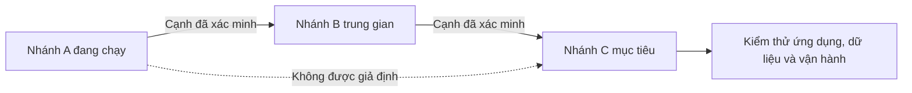

# Đường nâng cấp được hỗ trợ và điều kiện nhảy phiên bản trong Apache Cassandra

## 1. Nâng cấp Cassandra là thay đổi của cả hệ thống phân tán

Apache Cassandra là cơ sở dữ liệu **wide-column**: mỗi partition được định vị từ **partition key**, lưu ở nhiều replica theo replication factor (RF) và phục vụ ứng dụng qua CQL. Trong module `DATABASE_ENGINE_WIDE_COLUMN_CASSANDRA`, thiết kế bảng theo truy vấn, read/write consistency, compaction, repair, xử lý lỗi và kết nối từ Java đều liên quan trực tiếp đến một đợt nâng cấp.

Khác với thay một thư viện trong ứng dụng, nâng cấp Cassandra có thể khiến **nhiều phiên bản node cùng hoạt động trong một khoảng thời gian**. Lúc đó, các node phải trao đổi thông điệp tương thích, hiểu metadata schema, tiếp nhận dữ liệu được stream và tiếp tục đáp ứng số replica mà consistency level yêu cầu. Bên cạnh Cassandra Server, còn có Java/JDK, Java Driver, native protocol, định dạng SSTable, hệ điều hành, cấu hình bảo mật và công cụ backup.

Ví dụ: nhóm vận hành đang chạy một cluster hai DC, mỗi DC có RF=3. Họ muốn cập nhật phần mềm mà không dừng API Java. Nếu chỉ thay binary của ba node cùng DC đồng thời, các truy vấn `LOCAL_QUORUM` có thể thất bại dù mọi bước cài đặt phần mềm đều “thành công”. Nếu nâng cấp sang một phiên bản không có **đường chuyển đổi trực tiếp được hỗ trợ**, việc khởi động một node có thể gây lỗi không thể sửa đơn giản bằng cách hạ binary.

Bài học này tập trung vào **cách xác định đường nâng cấp được hỗ trợ và điều kiện được phép bỏ qua phiên bản trung gian**. Không có quy tắc “chỉ cần version đích mới hơn là nâng cấp được”.

### Kết quả cần đạt

Sau bài, bạn có thể:

1. Phân biệt **patch upgrade**, **minor/feature upgrade** và **major upgrade**, đồng thời đọc đúng điều kiện nâng cấp cho *cặp phiên bản nguồn–đích*.
2. Lập đồ thị các bước nâng cấp hợp lệ, biết khi nào được **nhảy thẳng** và khi nào bắt buộc đi qua bản trung gian.
3. Kiểm tra điều kiện về Java/JDK, driver, giao thức, SSTable, schema, replication và cluster health.
4. Thiết kế runbook rolling upgrade có giới hạn số replica rời cluster, gate trước/sau từng node và điểm dừng khi lỗi.
5. Phân biệt **tiếp tục nâng cấp**, **hoàn tác cấu hình ứng dụng**, **hạ cấp binary** và **phục hồi từ backup**; không nhầm chúng là một thao tác.

## 2. "Được hỗ trợ" nghĩa là gì?

Một *upgrade path* là cặp hay chuỗi **phiên bản Cassandra Server** mà nhà phát hành và bản phân phối triển khai mô tả có thể chuyển đổi theo một quy trình xác định. Tính hợp lệ phải được xác minh từ **tài liệu nâng cấp và release notes của đúng phiên bản nguồn, đích, bản phân phối và kiến trúc vận hành**.

Nên tách ba câu hỏi:

| Câu hỏi | Ví dụ | Kết luận cần có |
| --- | --- | --- |
| **Có đường nâng cấp trực tiếp?** | Từ nhánh A sang nhánh C | Tài liệu cho phép A → C hay yêu cầu qua B? |
| **Được phép nâng cấp kiểu nào?** | Rolling upgrade không dừng toàn cụm | Tài liệu có cho phép chạy mixed-version tạm thời và thứ tự thao tác không? |
| **Hệ thống hiện tại đáp ứng điều kiện?** | Node chưa repair, JDK cũ, driver chưa tương thích | Đường lý thuyết hợp lệ nhưng preflight có thể vẫn phải chặn |

Một đường nâng cấp “supported” **không bảo đảm tự động** rằng cluster khỏe, dữ liệu đủ backup, phiên bản Java hỗ trợ, mọi plugin tương thích hoặc khả năng rollback còn tồn tại. Nó chỉ là điểm xuất phát để lập kế hoạch.

### Cấp độ phiên bản

Giả sử tên phiên bản có dạng `X.Y.Z`. Cách phân loại major/minor/patch có thể gắn với chính sách phát hành của từng dòng Cassandra, nên phải đọc release notes thay vì suy diễn chỉ từ số:

- **Bản sửa lỗi trong cùng nhánh phát hành:** thường có ít thay đổi tương thích hơn, nhưng vẫn phải đọc cảnh báo, sửa cấu hình, giới hạn JDK và thủ tục restart.
- **Chuyển giữa các nhánh phát hành:** có thể đổi yêu cầu JVM, giao thức, option CQL, cách xử lý schema, SSTable hoặc tính năng vận hành.
- **Nhảy qua nhiều nhánh:** chỉ hợp lệ khi tài liệu **nêu rõ có hỗ trợ trực tiếp**; nếu không, phải xây đường qua các nhánh trung gian được hỗ trợ.

Ví dụ những tên nhánh bạn có thể gặp khi nghiên cứu lịch sử Cassandra là `3.11`, `4.0`, `4.1` và `5.0`. **Việc liệt kê các tên này không khẳng định tất cả các cặp giữa chúng đều nâng cấp trực tiếp được.** Một đường từ `3.11` tới `5.0` chẳng hạn **không được tự suy ra** chỉ vì cả hai là phiên bản Cassandra; phải xác nhận hướng dẫn chính thức và các bước trung gian cần thiết.

## 3. Đồ thị nâng cấp: chỉ đi qua các cạnh đã xác minh

Biểu diễn các bản phát hành như đỉnh của một đồ thị có hướng. Chỉ thêm cạnh `A → B` sau khi xác minh tài liệu nói rõ cặp đó được hỗ trợ với điều kiện tương ứng.



Sơ đồ là **mô hình ra quyết định**, không phải bản công bố tương thích của bất kỳ nhánh Cassandra cụ thể nào.

### 3.1. Quy trình xác minh từng cạnh

Với mọi cặp nguồn–đích dự định áp dụng:

1. **Chốt số phiên bản chính xác** trên từng node (bao gồm patch version), không chỉ tên “Cassandra 4” hay tên image `latest`.
2. **Xác định bản phân phối**: Apache Cassandra chuẩn, bản được quản lý hoặc sản phẩm tích hợp có thể có lịch và ràng buộc khác nhau.
3. **Đọc hướng dẫn nâng cấp cho chính phiên bản đích** cùng release notes của tất cả nhánh bị ảnh hưởng. Tìm mục *Supported upgrade paths*, *Upgrading*, *Breaking changes*, *Prerequisites*, *Java compatibility*, *SSTable upgrades* và *Mixed-version operation*.
4. **Đối chiếu nguồn có thuộc danh sách được phép không**; nếu tài liệu chỉ cho phép một tập phiên bản nguồn hoặc yêu cầu mức patch tối thiểu, ghi đầy đủ điều kiện đó.
5. **Kiểm tra thủ tục:** có yêu cầu nâng lên patch mới nhất của nhánh nguồn, đổi cấu hình, chạy repair, chạy công cụ chuyển đổi, hoàn tất nâng cấp toàn cluster trước bước tiếp hay không?
6. **Lập bản thử nghiệm:** dựng topology và workload đại diện, nâng cấp từ chính dữ liệu/snapshot tương thích và ghi lại cách ứng dụng Java hoạt động.
7. **Ghi bằng chứng:** nguồn tài liệu, revision/ngày truy cập, release notes, người duyệt và kết quả thử. Chỉ lúc này mới đưa `A → B` vào kế hoạch triển khai.

Nếu **không tìm được tuyên bố chính thức** rằng `A → C` được hỗ trợ trực tiếp, đánh dấu `NOT_VERIFIED` và **không thực hiện nhảy**. Không dùng một bài blog hay việc “node khởi động được ở lab” để thay thế chứng nhận đường nâng cấp sản xuất.

### 3.2. Ma trận ra quyết định (mẫu để điền từ tài liệu thật)

| Cặp nguồn–đích | Xác nhận hỗ trợ trực tiếp | Điều kiện bắt buộc | Cách hành động |
| --- | --- | --- | --- |
| `A.Z1 → A.Z2` (cùng nhánh) | `VERIFIED / NOT_VERIFIED` | Patch floor, JDK, restart và release notes | Nâng khi đủ gate |
| `A → B` (nhánh kế tiếp) | `VERIFIED / NOT_VERIFIED` | Rolling procedure, mixed-version, schema/SSTable | Thử staging rồi rolling |
| `A → C` (bỏ nhánh B) | Chỉ `VERIFIED` nếu tài liệu nêu rõ | Điều kiện nhảy và tính năng bị cấm trong pha mixed | Nếu thiếu bằng chứng, đi qua B |
| `B → C` | `VERIFIED / NOT_VERIFIED` | Hoàn tất hậu nâng cấp tại B trước khi đi tiếp | Chờ đầy đủ điều kiện rồi mới mở hop mới |

**Ma trận này là biểu mẫu kiểm soát, không phải danh sách đường nâng cấp được Apache Cassandra cam kết.** Người vận hành phải thay A/B/C bằng bản phát hành thật và đính kèm tài liệu tương ứng.

### 3.3. Khi nào không được bỏ qua một phiên bản trung gian?

Không bỏ qua nếu có **bất kỳ** điều kiện nào sau:

- Tài liệu nói phải nâng qua một nhánh trung gian hoặc chỉ hỗ trợ nguồn nằm trong tập cho phép.
- Đích yêu cầu schema/storage migration chỉ có thể thực hiện bằng quy trình của bản trung gian.
- Mixed-version trên đường trực tiếp không được tài liệu cho phép.
- Bản nguồn quá cũ so với yêu cầu patch floor.
- Chưa có JDK, Java Driver, plugin auth/encryption, monitoring hay SSTable tool tương thích.
- Không thể kiểm chứng backup/restore và giới hạn dữ liệu có thể bị mất.
- Cluster đang có node lỗi, schema disagreement kéo dài, streaming/topology change hay compaction debt làm rủi ro vượt ngưỡng.

Ngược lại, **có thể cân nhắc nhảy** chỉ khi cặp nguồn–đích được tài liệu hỗ trợ rõ ràng, tất cả điều kiện đã thỏa và kiểm thử staging thành công. “Giảm số lần restart” **không phải** lý do để bỏ qua bước bắt buộc.

## 4. Kiểm kê phiên bản hiện tại trước khi quyết định đường đi

Trong thực tế, bạn không thể lập path chính xác nếu cluster đã có nhiều phiên bản node khác nhau do thay dở trước đây.

Thực hiện kiểm tra từ đường quản trị đáng tin cậy ở từng node hoặc qua công cụ điều phối đã xác thực:

```bash
# Trên node Cassandra có quyền quản trị:
nodetool version
nodetool status
nodetool describecluster

# Lấy thông tin tình trạng để đối chiếu thêm:
nodetool info
nodetool netstats
nodetool compactionstats
```

Các lệnh có thể cần tùy chọn JMX/đường kết nối khác tùy môi trường. `nodetool status` và `describecluster` cung cấp trạng thái topology/schema từ góc nhìn node được hỏi, không nên dùng kết quả từ một node bất kỳ làm bằng chứng rằng mọi node đều khỏe.

Trong `cqlsh`, có thể đọc metadata của coordinator đang kết nối:

```sql
SELECT release_version, schema_version
FROM system.local;
```

`system.local` là thông tin **cục bộ** của node; một kết nối CQL qua load balancer có thể tới coordinator khác. Ghi rõ node đích khi kiểm kê. Hệ thống Cassandra ở các phiên bản khác nhau có cấu trúc bảng peer khác nhau; tránh viết script cố định chỉ dựa vào một bảng `system.peers` mà không kiểm tra phiên bản.

### Manifest preflight nên lưu

| Trường | Ý nghĩa |
| --- | --- |
| `cluster_id`, môi trường, giờ UTC | Tránh nhầm cluster và phát hiện thay đổi ngoài cửa sổ |
| Node, DC, rack, host ID | Xác định topology và thứ tự rolling |
| `source_version` chính xác trên từng node | Phát hiện node đã nâng dở hoặc patch không đồng đều |
| Cassandra distribution / package / image digest | Tránh trộn gói phần mềm không tương thích |
| JDK và OS thực tế | Xác thực điều kiện runtime |
| Keyspace RF, consistency mục tiêu | Tính số replica được phép vắng mặt |
| Schema versions, trạng thái schema agreement | Chặn schema drift/disagreement trước nâng cấp |
| SSTable format và disk capacity | Xác định giới hạn, khối lượng chuyển đổi/compaction |
| Driver versions, protocol, TLS/auth plugins | Xác thực khả năng kết nối của ứng dụng Java |
| Backup ID, restore-test, RPO/RTO | Quyết định có điểm phục hồi đáng tin hay chưa |
| Kết quả repair/streaming/compaction | Kiểm tra có đang thay đổi dữ liệu/topology hoặc thiếu headroom |

Với environment dùng container, cần ghi **image digest** và cấu hình persistent volume. Chỉ đổi tag image có thể kéo theo thay đổi JDK, entrypoint, file ownership hoặc cấu hình mặc định ngoài phiên bản Cassandra.

## 5. Tương thích không chỉ là phiên bản server

Để nhảy lên một nhánh mới, cần đủ tất cả nhóm tương thích bên dưới.

### 5.1. Java/JDK, hệ điều hành và runtime

Cassandra Server chạy trên JVM. Một bản đích có thể yêu cầu hoặc hỗ trợ các dòng JDK khác bản nguồn; thư viện, GC option, heap tuning, TLS cipher và startup script cũng có thể thay đổi.

**Cách làm đúng:**

1. Tra tài liệu đích để biết **JDK được hỗ trợ**, version tối thiểu và giới hạn cấu hình.
2. Kiểm tra vendor/build thực tế trên node; đừng coi “Java chạy được” là dấu hiệu tương thích production.
3. Kiểm thử kết hợp **Cassandra target + JDK target + OS/container base image** trong staging.
4. Nếu phải đổi cả JDK và Cassandra, xác định thứ tự mà **cả bản nguồn lẫn đích đều hỗ trợ** ở từng bước, hoặc dùng chiến lược thay thế node được bản phân phối hướng dẫn.
5. Kiểm các option JVM đã bị bỏ/hết hỗ trợ, quyền filesystem, TLS keystore/truststore và giám sát GC.

`java -version` là một phép kiểm nhanh trên host, nhưng cần kiểm cả JVM mà **process Cassandra đang thực sự chạy** (đường dẫn Java, launch script, container).

### 5.2. Native protocol, Java Driver và CQL

Java Driver kết nối với Cassandra qua native protocol. Server mới hơn có thể thay đổi giao thức/khả năng hỗ trợ, trong khi driver còn phải hiểu metadata, schema events, token map, paging và kiểu dữ liệu CQL.

Trước khi nâng:

- Kiểm tra **support matrix của đúng Java Driver** và bản Cassandra đích, bao gồm mức Java runtime của ứng dụng.
- Kiểm thử prepared/bound statements, paging, batch, LWT, consistency và retry policy trong pha cluster chạy mixed-version.
- Xác nhận tên local datacenter, contact points, TLS, authentication/authorization và schema refresh.
- Tránh bật tính năng CQL **chỉ có trên bản đích** trước khi tất cả node/server/driver liên quan sẵn sàng.
- Không dùng việc hạ `LOCAL_QUORUM` xuống `ONE` để che đi lỗi compatibility hay thiếu replica trong lúc rolling.

Ví dụ Java Driver 4.x tạo session qua cấu hình liên quan phiên bản đã được xác minh:

```java
import java.net.InetSocketAddress;
import com.datastax.oss.driver.api.core.CqlSession;
import com.datastax.oss.driver.api.core.DefaultConsistencyLevel;
import com.datastax.oss.driver.api.core.cql.PreparedStatement;
import com.datastax.oss.driver.api.core.cql.BoundStatement;

import java.util.UUID;

public final class UpgradeSmokeTest {
    public static void run(CqlSession session, UUID orderId) {
        PreparedStatement prepared = session.prepare(
            "SELECT order_id, status FROM commerce.orders_by_id WHERE order_id = ?");
        BoundStatement query = prepared.bind(orderId)
            .setConsistencyLevel(DefaultConsistencyLevel.LOCAL_QUORUM);
        session.execute(query).one();
    }

    // Chỉ minh họa cách build một session test tại môi trường được cấu hình.
    public static CqlSession connect() {
        return CqlSession.builder()
            .addContactPoint(new InetSocketAddress("127.0.0.1", 9042))
            .withLocalDatacenter("dc1")
            .build();
    }
}
```

Đoạn code là **smoke test đọc** với bảng giả định `commerce.orders_by_id` tồn tại trong lab; nó **không** xác nhận Driver 4.x tương thích với mọi bản Cassandra hiện có hay trong tương lai. Trong production phải cấu hình credential/TLS đúng, dùng session tái sử dụng, có test ghi với dữ liệu thử và so sánh kết quả nghiệp vụ trước/sau nâng cấp.

### 5.3. SSTable và định dạng dữ liệu trên đĩa

SSTable là tệp dữ liệu bất biến của Cassandra, được compaction và snapshot theo từng node. Một nhánh server mới có thể **đọc được định dạng SSTable cũ** trong phạm vi được tài liệu hỗ trợ, nhưng khả năng này không có nghĩa phiên bản server cũ có thể đọc mọi SSTable do server mới tạo ra.

**Phải phân biệt:**

- **Nâng binary và khởi động node:** server đích cần đọc dữ liệu hiện có để phục vụ.
- **Chuyển định dạng SSTable:** có thể sử dụng lệnh `nodetool upgradesstables` khi hướng dẫn của bản đích yêu cầu/khuyến nghị, thường sau khi toàn cluster đã hoàn tất nâng binary.
- **Compaction trong quá trình vận hành:** có thể tạo SSTable theo định dạng mới, ảnh hưởng khả năng quay lại phiên bản cũ.
- **Restore snapshot:** phải có quy trình nạp tệp, schema và công cụ tương thích với phiên bản đích; snapshot cũ không tự bảo đảm restore trên phiên bản mới.

```bash
# Kiểm tra cú pháp trên node đúng phiên bản trước khi cân nhắc chạy:
nodetool help upgradesstables
```

**Không chạy `nodetool upgradesstables` trên mọi node ngay trong pha mixed-version** nếu tài liệu chưa cho phép. Thao tác rewrite SSTable có thể tốn I/O, CPU, disk và làm mất lựa chọn downgrade vốn đã hạn chế. Chỉ thực hiện theo trình tự được xác nhận cho cặp phiên bản nguồn–đích.

### 5.4. Schema, replication và table options

Schema Cassandra được lan truyền trong cluster. Trong rolling upgrade, các bản node khác nhau có thể có cách xử lý metadata hoặc option mới khác nhau. Do đó:

- Tránh thay `CREATE/ALTER/DROP KEYSPACE/TABLE` không cần thiết trong thời gian mixed-version.
- Không bật option/tính năng mới (compaction, index, table feature, protocol feature) trước khi bản đích triển khai đủ toàn cụm và các client liên quan hỗ trợ.
- Xác nhận consistency của các keyspace quan trọng với RF và DC thực tế; đổi binary **không** phải dịp thay đồng thời partition key hay RF nếu không có kế hoạch riêng.
- Nếu cần đổi `NetworkTopologyStrategy` hoặc topology, xử lý ở cửa sổ migration độc lập có streaming/repair và validation.

Sự đồng thuận schema về mặt metadata **không bảo đảm** dữ liệu nghiệp vụ đã được replicate hoặc repair; đó là hai bài toán khác nhau.

### 5.5. Công cụ và tích hợp ngoài cluster

Ngoài server/driver, xem xét `cqlsh`, `nodetool`, backup/snapshot tools, CDC pipeline, metrics exporter, các plugin security, authentication, audit, IaC operator và script triển khai. Những công cụ này có thể thay đổi đối số CLI, cách đọc metrics, bảng `system_*` hoặc layout tệp khi nâng phiên bản.

**Không dựa hoàn toàn vào một công cụ vận hành cũ** chỉ vì nó còn gọi được một vài lệnh `nodetool` sau nâng cấp.

## 6. Tính khả dụng khi rolling theo RF và consistency

Rolling upgrade là thay phiên bản **từng node hoặc nhóm node giới hạn**, giữ các replica còn lại phục vụ truy vấn. Khả năng chịu lỗi phụ thuộc RF, CL, topology và lượng node/replica đang khả dụng; không phụ thuộc riêng số node toàn cluster.

Với `RF=3` trong **một DC**, `LOCAL_QUORUM` cần hai replica cho mỗi partition. Nếu một replica không sẵn sàng trong DC đó, về mặt đếm replica còn hai nên **có thể** đáp ứng CL; nếu hai replica không sẵn sàng thì không thể đáp ứng. Điều này giả định cả hai replica còn lại đều khỏe và có mạng/độ trễ phù hợp.

| RF trong DC | Số replica cần cho LOCAL_QUORUM | Tối đa replica có thể vắng mặt theo phép đếm cơ bản |
| --- | ---: | ---: |
| 1 | 1 | 0 |
| 2 | 2 | 0 |
| 3 | 2 | 1 |
| 5 | 3 | 2 |

Đây là **giới hạn toán học**, không phải khuyến nghị nâng cùng lúc hai replica khi RF=5: nên để thêm biên an toàn cho sự cố đột xuất, GC, network partition hoặc node chưa warm-up. Hệ thống dùng `ALL`, `EACH_QUORUM`, LWT hoặc CL liên DC có điều kiện khác, phải xét riêng.

### Nguyên tắc điều phối

1. Mỗi lần chỉ nâng **một node** khi chưa có lý do đã kiểm thử để song song hóa; không chạy đồng thời các replica phục vụ cùng partition đến ngưỡng khiến CL không đạt.
2. Ưu tiên quy trình **theo rack/DC** đã được bản phân phối hỗ trợ, dựa trên RF và mức độ rủi ro. Đừng suy rằng “nâng hết DC1 rồi DC2” luôn an toàn với mọi consistency.
3. Chờ node khởi động xong, `UN` trong `nodetool status`, sẵn sàng phục vụ CQL và metrics ổn định; không chỉ dựa vào process ID.
4. Không nâng node tiếp theo nếu node trước còn streaming không mong đợi, schema disagreement chưa giải thích, error rate tăng hoặc client timeout vượt gate.
5. Hạn chế các thao tác nặng khác như bulk load, thay RF, decommission, rebuild và compaction đặc biệt trong cửa sổ rolling.

Một cluster RF=3 với một node `DN` sẵn từ trước **không** còn cùng ngân sách chịu lỗi như cluster khỏe. Preflight phải chặn nâng tiếp các replica liên quan nếu điều đó làm mất khả năng đáp ứng CL.

## 7. Runbook nâng cấp hai nhánh có hỗ trợ rolling

Runbook dưới đây là **khung điều phối**, không thay cho hướng dẫn của đúng cặp version. Các bước cụ thể về package, cấu hình, JVM và post-upgrade phải lấy từ tài liệu bản đích.

### Pha A — Chốt kế hoạch và điểm hồi phục

1. Ghi **phiên bản nguồn chính xác** của mọi node, nhánh đích, nguồn gói cài đặt/image digest và danh sách cạnh nâng cấp được hỗ trợ.
2. Xác nhận điều kiện patch floor, JDK, OS, driver, TLS/auth, cấu hình, plugin, schema và SSTable.
3. Đọc release notes và các thay đổi hành vi: CQL, compaction, tombstone/TTL, metrics, repair và các option đã bị bỏ hỗ trợ.
4. Kiểm tra `nodetool status`, schema, repair cadence, hinted handoff, compaction backlog, disk free, backup/snapshot đủ node.
5. Tạo **backup đã xác thực** và có kế hoạch restore thử, gồm schema, data SSTable, metadata auth/role nếu cần. Không coi snapshot một node là bản sao của toàn cụm.
6. Đặt SLO và stop condition: ví dụ tỷ lệ timeout/unavailable, p99 query latency, dropped mutations, GC pause, số replica `DOWN` và thời gian một node khởi động vượt mức chấp nhận.
7. Lên lịch người vận hành, thông báo ứng dụng/đội trực, phân công người phê duyệt go/no-go.

### Pha B — Nâng một node canary

Ví dụ các bước thao tác **tại node đã được chọn và khi cửa sổ bảo trì được phê duyệt**:

```text
PRECHECK_NODE
  -> VERIFY_REPLICA_BUDGET_AND_CLUSTER_GATES
  -> DRAIN_OR_GRACEFUL_STOP_BY_VERSION_RUNBOOK
  -> STOP_CASSANDRA_SERVICE
  -> INSTALL_VERIFIED_TARGET_BINARY_AND_JDK
  -> MIGRATE_CONFIGURATION_AS_REQUIRED
  -> START_CASSANDRA_SERVICE
  -> WAIT_FOR_NODE_UP_AND_NATIVE_PROTOCOL_READY
  -> CHECK_SCHEMA_AND_LOGS
  -> RUN_CQL_AND_JAVA_SMOKE_TESTS
  -> OBSERVE_METRICS
  -> APPROVE_NEXT_NODE
```

Một số runbook dùng `nodetool drain` trước khi dừng dịch vụ để flush memtable và ngừng tiếp nhận thêm ghi trên node. **Thực hiện đúng hướng dẫn của bản nguồn/đích**, vì cách dừng dịch vụ và thao tác trong hệ thống managed/container có thể khác. Không chạy `drain` như một lệnh thử nghiệm trên production.

Các lệnh **chỉ đọc** hữu ích sau khi node trở lại:

```bash
nodetool version
nodetool status
nodetool describecluster
nodetool netstats
nodetool compactionstats
nodetool tpstats
```

Quan sát log Cassandra và giám sát từ ứng dụng Java: kết nối thành công, query theo partition key, prepared statement, đọc/ghi thử theo CL dự kiến, latency p95/p99 và số timeout.

### Pha C — Rolling từng node còn lại

Sau canary:

- Chỉ mở node kế tiếp khi gate node trước đạt.
- Ghi timeline từng node: `STARTED`, `STOPPED`, `TARGET_RUNNING`, `SMOKE_PASS`, `VERIFIED`.
- Giữ tổng số replica vắng mặt trong giới hạn của workload, kể cả node lỗi độc lập vừa xuất hiện.
- Nếu có lỗi, **dừng chuỗi rolling và điều tra**; không tự tăng concurrency của upgrade để “kịp lịch”.
- Tiếp tục ghi định kỳ trạng thái schema, các node đang dùng version nào và health của cả hai DC.

Không thay đổi schema, bật tính năng mới hoặc nâng mức protocol theo giả định trong thời gian mixed-version nếu chưa được tài liệu cho phép. Thời gian tồn tại trạng thái mixed-version nên **đủ ngắn nhưng không đánh đổi gate kiểm tra**.

### Pha D — Hoàn tất toàn cụm và hậu nâng cấp

1. Xác nhận **mọi node dự kiến** đang chạy bản đích, số replica `UP` phù hợp và cluster không còn trạng thái mixed-version.
2. Xác nhận schema metadata và sự sẵn sàng đọc/ghi trên mỗi DC theo CL thực tế.
3. Chạy regression test CQL/Java Driver, kiểm latency, error rate, dữ liệu mẫu và các luồng LWT/batch/paging.
4. Thực hiện bước post-upgrade **bắt buộc của tài liệu**: thay cấu hình, điều chỉnh metric, repair theo quy trình, SSTable upgrades nếu được yêu cầu. Lên lịch và kiểm disk trước khi rewrite dữ liệu.
5. Chỉ **sau khi** toàn cluster và client tương thích mới xem xét bật tính năng mới của bản đích; tách thành change riêng nếu có thể.
6. Lưu bản ghi version, release notes, manifest, lệnh đã chạy, lỗi đã xử lý, số liệu trước/sau và thời điểm kết thúc.

Nếu cần thực hiện hop tiếp theo, **không bắt đầu ngay** khi node cuối vừa khởi động. Phải hoàn tất toàn bộ post-upgrade gate của hop trước, bao gồm những yêu cầu chuẩn hóa dữ liệu/storage và backup theo quy định nguồn–đích tiếp theo.

## 8. Kiểm tra tính năng Java và CQL khi có mixed-version

Ví dụ bảng đơn hàng có:

```sql
CREATE TABLE commerce.orders_by_id (
  order_id uuid PRIMARY KEY,
  customer_id uuid,
  status text,
  updated_at timestamp
);
```

Trong staging, dùng bộ dữ liệu giả có kỳ vọng rõ và chạy các nhóm test sau với **đúng driver/version thực tế**:

| Nhóm | Kiểm tra | Rủi ro phát hiện |
| --- | --- | --- |
| Kết nối | TLS, authentication, contact points và local DC | Không thể handshake hoặc mở phiên |
| Read theo partition key | `SELECT ... WHERE order_id = ?` với CL dịch vụ dùng | Lỗi schema/protocol, timeout, replica không sẵn |
| Write idempotent | `INSERT`/`UPDATE` vào bản ghi thử, đọc đối chiếu | Dữ liệu không hội tụ hoặc lỗi CQL |
| Prepared statements | Prepare rồi execute qua nhiều coordinator | `UNPREPARED`, metadata không nhất quán |
| Paging | Đọc kết quả nhiều trang từ bảng thử | Lỗi page state/compatibility hoặc độ trễ khác thường |
| LWT/conditional update | `UPDATE ... IF version = ?` nếu nghiệp vụ dùng | Tranh chấp CAS, điều kiện CL/serial hoặc lỗi chức năng |
| Dữ liệu đặc biệt | UDT, collection, TTL/tombstone nếu có | Thay đổi behavior trên kiểu dữ liệu |
| Background jobs | Repair, backup/snapshot, metrics exporter | Tích hợp vận hành không tương thích |

Không thử câu lệnh xóa dữ liệu hoặc migration schema không thể đảo ngược bằng cách “smoke test” production. Tập kiểm thử nên nằm trên staging, hoặc dùng khóa/bảng test được phê duyệt và có quy trình dọn.

### Không ghép nâng cấp server với đổi mô hình wide-column

Nếu đồng thời đổi partition key hoặc chuyển bảng `orders_by_id` sang `orders_by_customer`, sẽ khó quy nguyên nhân lỗi cho binary upgrade hay data migration. Cách an toàn hơn:

1. Hoàn thành **thay đổi schema tương thích** trước hoặc sau theo từng release độc lập.
2. Nâng cluster theo đường được hỗ trợ, giữ truy vấn và CL như baseline.
3. Kiểm thử ổn định.
4. Triển khai data migration riêng với backfill, dual-write, đối soát, hạn chế concurrency và rollback app.

Điều này cũng áp dụng cho thay đổi RF, compaction strategy hoặc TTL: một đợt nâng cấp phức tạp cần ít biến số nhất có thể.

## 9. Khi gặp lỗi: dừng ở đâu và có được hạ cấp không?

**Rollback binary không đồng nghĩa khôi phục dữ liệu.** Một node đã khởi động bằng bản mới có thể tạo SSTable định dạng mới, ghi metadata mới hoặc áp dụng thay đổi không tương thích với bản cũ. Đường **downgrade** thường có điều kiện khác, thậm chí **không được hỗ trợ**.

### 9.1. Bốn hướng xử lý phải phân biệt

| Hướng | Dùng khi | Điều kiện |
| --- | --- | --- |
| **Pause/repair forward** | Một node mới lỗi nhưng cluster còn khỏe | Dừng nâng tiếp, điều tra log/config/JDK/protocol, sửa rồi kiểm thử lại |
| **Tiếp tục nâng sau khắc phục** | Có lỗi môi trường được giải quyết và path vẫn hợp lệ | Gate canary và cluster đạt lại |
| **Quay lại cấu hình/ứng dụng cũ** | Lỗi do driver feature flag hoặc ứng dụng không tương thích | Schema và CQL cũ còn hỗ trợ; không giả định downgrade server |
| **Khôi phục từ backup** | Dữ liệu/schema không thể quay lại bằng thao tác an toàn | Backup đầy đủ, được kiểm tra; quy trình restore tách biệt, RPO/RTO rõ |

Một số lỗi cấu hình có thể giải quyết bằng sửa tham số và restart lại node **trên cùng bản đích**. Không tự chọn hạ Cassandra Server xuống binary cũ chỉ vì node không lên được.

### 9.2. Gate dừng bắt buộc

Dừng nâng node tiếp theo khi có một hoặc nhiều dấu hiệu:

- Tỷ lệ `Unavailable`/timeout, p99 hoặc latency giữa các DC vượt giới hạn đã thống nhất.
- Thêm node không `UP` hoặc replica trong DC xuống dưới số cần cho CL.
- Schema disagreement chưa xác định nguyên nhân hoặc giao thức/driver không kết nối được.
- Node mới liên tục restart, GC quá lớn, disk gần đầy, compaction kéo dài bất thường.
- Snapshot/backup phục hồi không thể xác minh khi đang có sự cố dữ liệu.
- Cấu hình, plugin hoặc JDK mới cho hành vi khác với thử nghiệm staging.

Việc giữ một cluster mixed-version trong thời gian dài cũng có rủi ro; khi bị chặn phải đưa ra quyết định khắc phục có người chịu trách nhiệm, giới hạn thời gian và bằng chứng trước khi đi tiếp.

### 9.3. Thiết kế đường phục hồi trước ngày nâng cấp

Bộ hồ sơ tối thiểu phải có:

- Backup cluster **trước nâng cấp**, cả SSTable và metadata/schema cần thiết, lưu ở nơi độc lập và có kiểm thử restore.
- Gói binary/JDK/config gốc và đích, checksum và cách dựng lại node **theo đường được hỗ trợ**.
- Lịch sự kiện, migration, SSTable rewrite, compaction và mọi feature đã bật sau khi nâng.
- Runbook dựng cluster mới và nạp dữ liệu theo bản tương thích, nếu direct downgrade không được hỗ trợ.
- Quy tắc đảm bảo writes sinh ra sau snapshot được đối soát/replay hoặc được thừa nhận là mất trong RPO.

**Không được hứa “rollback trong 5 phút” chỉ dựa vào việc giữ file cài đặt cũ.** Thử nghiệm phục hồi và RPO/RTO mới là bằng chứng đáng tin.

## 10. Điều kiện nhảy tiếp qua bản trung gian

Giả sử tài liệu xác minh được đường `A → B → C` và **không xác minh** `A → C`. Khi đó phải hoàn tất đợt A→B rồi mới đánh giá B→C.

Ở điểm B cần kiểm:

1. **Phiên bản đồng nhất:** mọi node ở phiên bản B/patch yêu cầu; không sót node A.
2. **Cluster khỏe:** node `UP`, schema agreement hợp lệ, không có streaming/topology change không mong đợi, không có backlog nguy hiểm.
3. **Dữ liệu tương thích:** các bước post-upgrade, repair/rebuild hoặc SSTable migration bắt buộc cho B đã hoàn thành và xác thực.
4. **Ứng dụng an toàn:** Java Driver, native protocol, auth/TLS và các truy vấn CQL đang dùng đã qua regression.
5. **Cấu hình đúng:** tùy chọn JDK, `cassandra.yaml`, compaction, cache, metrics/monitoring phù hợp bản B.
6. **Backup mới:** có điểm khôi phục đã xác thực ở trạng thái B nếu kế hoạch/đường tiếp theo yêu cầu.
7. **Bằng chứng cạnh B→C:** hướng dẫn đích C cho phép bắt đầu từ bản B/patch hiện có, không có bước tiền xử lý bị bỏ qua.

Chỉ khi tất cả điều kiện đạt mới mở đợt tiếp theo. Nếu đích yêu cầu **một mức patch tối thiểu** của nhánh B, phải nâng lên mức đó trước, dù B đã thuộc đúng nhánh chính.

### Thuật toán quyết định đơn giản

```text
input: source_version, target_version, distribution, cluster_facts

if any_node_version_is_unknown_or_inconsistent:
    BLOCK("Inventory and stabilize cluster")

edges = verified_direct_upgrade_edges_from_official_docs(
    distribution, source_version, target_version
)

path = find_supported_path(edges, source_version, target_version)
if path is missing:
    BLOCK("No verified supported upgrade path")

for hop in path:
    if not prerequisites_satisfied(hop, cluster_facts):
        BLOCK("JDK/driver/schema/SSTable/health/backup gate")
    test_hop_in_staging(hop)
    rolling_upgrade_with_per_node_gates(hop)
    verify_cluster_complete(hop)
    complete_required_post_upgrade_steps(hop)
    verify_application_and_restore_readiness(hop)

SUCCESS("All hops verified; release record preserved")
```

Đây là **pseudo-code về quy trình điều phối**, không phải API Cassandra hay chương trình thay thế runbook phiên bản.

## 11. Bài tập tình huống: nâng một cluster nhiều DC

Một cluster Cassandra có:

- `dc1`: `a1`, `a2`, `a3`; `RF(dc1)=3`.
- `dc2`: `b1`, `b2`, `b3`; `RF(dc2)=3`.
- Ứng dụng Java ghi và đọc với `LOCAL_QUORUM` ở DC cục bộ; có một worker dùng LWT.
- Một số node ở bản `A`, nhóm muốn lên nhánh `C`. Tài liệu mà đội đã xác minh **chỉ xác nhận** A→B và B→C, **không xác nhận** A→C trực tiếp.
- Một node ở `dc1` đang có nhiều pending compaction và backup remote gần nhất chưa kiểm checksum.

**Hãy trả lời:**

1. Có được nâng thẳng từ A lên C vì mục tiêu là giảm thời gian bảo trì không? Vì sao?
2. Phải chặn triển khai ở những gate nào khi còn pending compaction và backup chưa được kiểm tra?
3. Với RF=3 và LOCAL_QUORUM ở DC, vì sao không nên nâng hai node của cùng DC đồng thời?
4. Sau khi node đầu lên B và node đó `UP`, có thể lập tức nâng một node khác lên C không? Điều kiện nào còn thiếu?
5. Khi nào dùng `nodetool upgradesstables`, và vì sao không chạy tùy tiện giữa pha mixed-version?
6. Khi server B chạy tốt nhưng ứng dụng Java có lỗi protocol, bạn sẽ kiểm những yếu tố nào trước khi nghĩ tới downgrade?
7. Nếu ở B một số SSTable đã được viết theo định dạng mới, tại sao chỉ copy binary A về có thể nguy hiểm?
8. Bạn sẽ lưu những trường nào để kiểm toán rằng mỗi hop hoàn tất hợp lệ?

**Gợi ý giải:**

- Chỉ đi **A→B→C** vì không có cạnh A→C được xác minh; một đường chưa được xác nhận không phải đường “có thể thử trên production”.
- Phải xử lý baseline cluster health, compaction I/O/disk headroom và **backup đủ điều kiện restore** trước khi đi tiếp.
- RF=3, LOCAL_QUORUM cần hai replica; hạ hai replica cùng DC có thể chỉ còn một, khiến truy vấn liên quan không đạt consistency.
- Hoàn tất **toàn bộ cluster lên B**, post-upgrade, schema/driver/data validation và điều kiện B→C trước hop thứ hai.
- SSTable upgrade chỉ làm theo hướng dẫn đích, thường sau khi hết mixed-version và với đủ disk/I/O.
- Kiểm native protocol, driver version, JDK của ứng dụng, TLS/auth, prepared statements, schema và log trước khi quyết định xử lý server.
- Binary cũ có thể không đọc dữ liệu/metadata mới; rollback phải có **đường được hỗ trợ hoặc restore** đã thử.
- Audit chứa source/target patch version, node/DC, release notes, điều kiện tiền nhiệm, bằng chứng staging, manifest backup, kết quả gate và người phê duyệt.

## 12. Checklist trước khi phê duyệt nâng cấp

- [ ] Đã xác định bản nguồn/đích chính xác trên **từng node**, bản phân phối và image/package digest.
- [ ] Đã tra tài liệu/release notes để xác nhận **từng cạnh nâng cấp trực tiếp** và patch floor; không tự suy từ số phiên bản.
- [ ] Đã đánh giá khả năng **mixed-version** và thứ tự rolling theo hướng dẫn đích.
- [ ] Đã kiểm JDK, JVM options, OS, driver, native protocol, TLS, auth và plugin tương thích.
- [ ] Đã kiểm schema/table options, RF theo DC, CL thực tế, topology và trạng thái repair/streaming.
- [ ] Đã tính giới hạn replica được phép không sẵn sàng và có biên cho lỗi ngoài dự kiến.
- [ ] Đã thử nâng trong staging với dữ liệu, topology và workload đại diện.
- [ ] Đã có backup/snapshot **đủ node**, schema/metadata, kho ngoài cluster và kết quả restore test.
- [ ] Đã mô tả thứ tự node canary/rolling, thời gian quan sát và stop condition định lượng.
- [ ] Đã có smoke/regression test của API Java, CQL, paging, LWT và mọi luồng quan trọng.
- [ ] Đã tách nâng server khỏi migration partition key, RF, schema và compaction lớn nếu có thể.
- [ ] Đã ghi các bước post-upgrade: SSTable format, repair/validation, logging và metrics theo tài liệu.
- [ ] Đã có chiến lược xử lý lỗi **không phụ thuộc vào downgrade không được hỗ trợ**.
- [ ] Đã có hồ sơ kết quả từng node/hop, người phê duyệt và quyết định go/no-go.

**Kết luận:** Đường nâng cấp Cassandra được hỗ trợ là **chuỗi bước có bằng chứng phiên bản**, không phải một phép so sánh số. “Nhảy phiên bản” chỉ được phép khi **cặp nguồn–đích được tài liệu xác nhận trực tiếp** và các điều kiện JDK, driver, giao thức, schema, SSTable, replica, backup, mixed-version và staging đều đạt. Nâng từng node có gate rõ ràng, hoàn tất hậu nâng cấp trước hop tiếp theo và xem **restore đã kiểm thử**, chứ không phải khả năng copy binary cũ, là nền tảng phục hồi đáng tin cậy.
