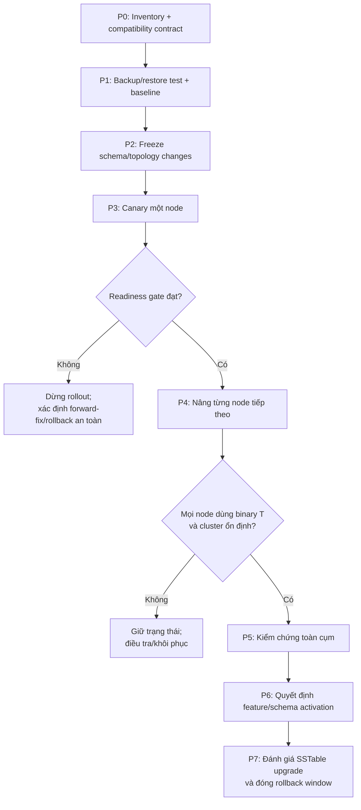

# Cụm chạy lẫn phiên bản trong giai đoạn chuyển tiếp

**Chương:** Nâng cấp và tương thích  
**Module:** `DATABASE_ENGINE_WIDE_COLUMN_CASSANDRA` — Apache Cassandra

Một cụm Apache Cassandra thường không thể dừng đồng thời mọi node chỉ để cài phiên bản mới. Khi nâng cấp cuốn chiếu (*rolling upgrade*), có khoảng thời gian node A đã chạy phiên bản đích, còn node B/C vẫn chạy phiên bản nguồn. Trạng thái này gọi là **mixed-version cluster** — một trạng thái **chuyển tiếp có kiểm soát**, không phải kiến trúc lâu dài để vận hành nhiều thế hệ Cassandra cùng lúc.

Việc nhìn thấy mọi node ở trạng thái `UN` và ứng dụng còn đọc/ghi được **không đủ chứng minh** một lần nâng cấp thành công. Phải kiểm tra **đường nâng cấp chính thức**, tương thích internode messaging/gossip, giao thức CQL, schema, JDK, driver Java, SSTable, replication/consistency level và khả năng rollback. Chỉ cần bật một tính năng mới hoặc viết lại định dạng tệp quá sớm, cửa sổ quay lại phiên bản cũ có thể đóng dù cả cụm vẫn đang hoạt động.

Bài này kết nối kiến thức về kiến trúc phân tán và mô hình wide-column của Apache Cassandra, partition key, thiết kế bảng theo truy vấn, consistency level, replication, compaction, repair, xử lý lỗi và kết nối Java thành một **runbook nâng cấp có điểm dừng rõ ràng**.

> **Giới hạn:** Không có quy tắc “mọi cặp phiên bản Cassandra đều cho phép rolling upgrade trực tiếp”. Điều kiện hỗ trợ thay đổi theo major/minor release, bản phân phối, JDK và cấu hình. Những ví dụ dùng các tên node và phiên bản giả định; trước khi nâng cấp thực tế phải đọc **upgrade notes và compatibility matrix của chính phiên bản nguồn/đích**, bao gồm các bản trung gian nếu bắt buộc. Không chạy các lệnh dừng hoặc nâng cấp trên production chỉ vì ví dụ trong bài.

## 1. Mục tiêu học tập

Sau bài này, bạn có thể:

1. Giải thích trạng thái **mixed-version**, phân biệt binary version, internode messaging, native CQL protocol, schema và SSTable format.
2. Biết vì sao **hỗ trợ rolling upgrade theo cặp phiên bản cụ thể** là điều kiện tiên quyết; không tự suy từ số phiên bản gần nhau.
3. Lập kế hoạch đổi từng node khi vẫn giữ replica availability ở consistency level ứng dụng cần.
4. Xác định thứ tự **backup → baseline → canary → rolling từng node → xác minh → đóng cửa sổ rollback**.
5. Đọc `nodetool status`, `version`, `describecluster`, `tpstats`, `netstats` và thông tin `system.local`/`system.peers_v2` phù hợp phiên bản.
6. Nêu lý do nên **đóng băng thay đổi schema/tính năng mới** và tránh rewrite SSTable format trước khi biết rollback còn khả thi.
7. Phân tích quan hệ giữa JDK, driver Java, TLS, authentication/authorization, client protocol và từng node mới/cũ.
8. Thiết kế smoke tests CQL ở `LOCAL_QUORUM`/`ALL` trong điều kiện có node bảo trì, không nhầm timeout với mất dữ liệu.
9. Đặt stop conditions cho p95/p99, lỗi `Unavailable`/timeout, schema agreement, disk, GC và log incompatibility.
10. Soạn runbook rollback/forward-fix theo **mốc nào đã hoàn thành**, không mặc định chỉ hạ binary là an toàn.

## 2. “Phiên bản” trong Cassandra có nhiều lớp

### 2.1. Không chỉ có một con số release

| Lớp | Ví dụ khái niệm | Vì sao phải kiểm tra |
| --- | --- | --- |
| **Server binary** | Node A chạy release mới, B/C chạy release cũ | Quyết định code, tính năng, cách xử lý dữ liệu và internode traffic |
| **Internode messaging/gossip** | Các node trao đổi membership, mutation, streaming | Node mới và cũ phải có cơ chế tương thích **được phiên bản hỗ trợ** |
| **Native CQL protocol** | Java Driver kết nối cổng CQL, đàm phán protocol | Driver phải hỗ trợ tập server versions; không phải cùng một protocol với internode |
| **Schema/features** | Table options, indexes, role permissions, UDT, functions | Tính năng mới có thể tạo metadata mà node cũ không hiểu |
| **SSTable format** | Tệp được viết bởi binary cũ/mới | Có thể quyết định binary cũ còn đọc được dữ liệu sau rollback không |
| **Commit log/system metadata** | Trạng thái local, metadata bootstrap, log replay | Một vài thay đổi sau boot có thể hạn chế khả năng hạ cấp |
| **Java/JDK** | Runtime mà Cassandra server được phép dùng | JDK không được hỗ trợ có thể không khởi động được hoặc gây lỗi GC/crypto |
| **Client/driver** | Driver Java 4.x, configuration/TLS | Cần chạy cả khi coordinator có phiên bản cũ và mới |

Các lớp này liên quan nhau nhưng **không đồng nghĩa**. Một client kết nối được cổng `9042` không chứng minh hai node server đã tương thích internode messaging. Ngược lại, node có thể gossip thành công nhưng một tính năng CQL mới chưa được chấp nhận trong mixed-version.

### 2.2. Mixed-version là gì?

Giả sử kế hoạch nâng cấp từ bản **S** lên bản **T**, trên một cluster RF=3 một DC:

```text
Trước thay đổi:
  A: S  UN       B: S  UN       C: S  UN

Sau canary:
  A: T  UN       B: S  UN       C: S  UN   <- mixed-version

Sau node thứ hai:
  A: T  UN       B: T  UN       C: S  UN   <- mixed-version

Sau node cuối:
  A: T  UN       B: T  UN       C: T  UN   <- cùng binary version
```

Trong khi A được dừng và nâng cấp, A có thể tạm là `DN`; B/C còn phục vụ requests nếu RF, CL và tình trạng thực tế cho phép. Những mũi tên này chỉ hợp lệ nếu **S → T là đường nâng cấp cuốn chiếu được hỗ trợ**. Không lấy ví dụ S/T làm bằng chứng cho mọi cặp release.

**Điều kiện hoàn tất còn nhiều hơn cùng binary:** phải xác minh rằng schema, read/write, metadata, repairs, authentication, client, SSTable upgrade policy và tài liệu vận hành đã đạt tiêu chí đích. Một số bước hậu nâng cấp có thể tiếp tục sau khi node cuối đã chạy T.

### 2.3. Trạng thái mixed-version không phải trạng thái “mong muốn”

Trong giai đoạn này:

- Không bật tính năng/DDL chỉ tồn tại ở phiên bản T khi node S vẫn có thể xử lý nó.
- Không giữ mixed-version nhiều tuần chỉ vì ứng dụng vẫn chạy được.
- Không mặc định chạy các maintenance operation có format/metadata mới trên toàn cụm.
- Không nâng cấp nhiều node cùng lúc nếu làm mất quorum ở các replica set quan trọng.
- Không mặc định hạ binary trở lại S khi đã có dữ liệu/tệp/metadata được viết bởi T.
- Không chạy đồng thời topology changes (thêm DC/replace nhiều node) trừ khi runbook của cặp version cho phép và có phương án kiểm soát.

**Mục tiêu:** tối thiểu thời gian chạy lẫn phiên bản, nhưng vẫn dành đủ thời gian kiểm chứng sau từng node. Đẩy nhanh quá mức khiến nhiều sự cố xuất hiện đồng thời và không biết node nào gây lỗi.

## 3. Điều kiện bắt buộc: xác minh đường nâng cấp

### 3.1. Không có ma trận tương thích “mặc định”

Một số đường nâng cấp có thể yêu cầu phiên bản trung gian hoặc **không hỗ trợ rolling upgrade**; một vài cặp phiên bản còn có điều kiện cụ thể về repair, SSTable format, auth, JDK hoặc cấu hình. Vì thế, trước khi chạm vào binary:

1. Ghi **phiên bản hiện tại chính xác** của từng node, bao gồm patch release/bản phân phối.
2. Ghi **phiên bản đích chính xác**, lý do nâng cấp và tính năng dự kiến dùng sau nâng cấp.
3. Tìm upgrade notes được nhà phát hành hỗ trợ cho **cặp nguồn → đích**.
4. Xác nhận phiên bản trung gian nếu bắt buộc; không nhảy qua vì hai đầu đều là “stable”.
5. Kiểm tra OS/JDK, CPU architecture, GC, disk format, TLS libraries, JMX và exporter.
6. Kiểm tra tương thích driver Java/CQL và các công cụ backup/repair/operator.
7. Ghi rõ **quy trình dừng/start từng node** và các bước hậu nâng cấp.
8. Xác định rollback còn hợp lệ **tới thời điểm nào**, khi nào chỉ có thể forward-fix hoặc restore.

Nếu không tìm thấy tài liệu xác nhận cặp version được hỗ trợ, trạng thái là **BLOCKER**, không “thử canary trên production để xem có chạy không”.

### 3.2. Biểu mẫu compatibility contract

| Thành phần | Giá trị phải có trước bảo trì | Điều kiện PASS |
| --- | --- | --- |
| Server source/target | `S_full_version → T_full_version` | Được hỗ trợ bởi release notes |
| Upgrade path | Trực tiếp hay có intermediate release | Thứ tự được duyệt |
| Internode messaging | Điều kiện hỗ trợ mixed-version | Không có incompatibility đã biết |
| JDK runtime | Phiên bản JDK cho S và T | Có runtime phù hợp từng bước |
| OS/packages | Repo/image, systemd/Helm/operator | Có cách rollback package và kiểm chứng hash |
| Driver Java | Driver version, native protocol, TLS | Test với node S và node T |
| Schema/features | DDL/options đang dùng và sẽ đổi | Freeze tính năng không tương thích |
| SSTable format | Quy tắc đọc tệp cũ/mới | Có kế hoạch không rewrite quá sớm |
| Security | Auth, roles, certificates, JMX | Login và RBAC hoạt động xuyên giai đoạn |
| Maintenance | Repair, streaming, backup, snapshots | Các thao tác được lên lịch phù hợp |
| Replica health | RF, CL, node/rack/DC | Đủ replica đáp ứng trong từng bước |
| Rollback | Mốc cho phép, nguồn dữ liệu, backup | Không hứa downgrade đơn giản khi đã vượt mốc |

Không thay bảng này bằng cảm tính “chỉ là minor release”. Ngay cả patch release cũng có thể có breaking issue ảnh hưởng workload riêng; cần đọc release notes và kiểm tra cluster thực tế.

## 4. Replica và consistency level quyết định tính khả dụng

### 4.1. Ví dụ RF=3 với một node tạm offline

Giả sử `NetworkTopologyStrategy` có RF=3 trong `dc1` và A/B/C đều lưu replica của partition đang xét. Khi A tạm dừng nâng cấp:

| CL trên coordinator trong `dc1` | Số replica cần đáp ứng | Khi A down, B/C khỏe |
| --- | ---: | --- |
| `ONE` / `LOCAL_ONE` | 1 | Có thể đáp ứng |
| `LOCAL_QUORUM` | 2 | Có thể đáp ứng nếu cả B/C khỏe |
| `QUORUM` (chỉ 1 DC RF=3) | 2 | Có thể đáp ứng |
| `ALL` | 3 | Không đáp ứng trong lúc A down |
| `EACH_QUORUM` cho write với 1 DC | Quorum của DC liên quan | Phụ thuộc replica và yêu cầu thực tế |

**Không suy số lượng 3 node toàn cluster đồng nghĩa mọi partition có RF=3.** Với nhiều DC và NTS, phải tính riêng replica placement/tổng RF; với `LOCAL_QUORUM`, quorum chỉ tính theo RF **của DC local**.

Khi A đã lên phiên bản T và là `UN`, chưa chắc nó đã nhận đầy đủ mutations trong lúc Down nếu có outage dài hoặc các nguồn B/C không đồng nhất. Hinted handoff/repair và khả năng phục vụ của replica phải được đánh giá theo độ dài downtime và lịch vận hành.

### 4.2. Các tình huống không thể coi là không gián đoạn

- **RF=1:** dừng replica duy nhất gây mất khả dụng cho ranges nó lưu.
- **RF=2 + LOCAL_QUORUM:** cần cả hai replica; dừng một có thể gây unavailable.
- **RF=3 nhưng một replica đã Down trước maintenance:** dừng thêm replica của cùng partition có thể mất quorum.
- **`ALL`:** chỉ một replica tạm Down cũng có thể làm read/write không đạt CL.
- **Multi-DC với write `EACH_QUORUM`:** cần quorum ở từng DC; sự cố trong một DC có thể chặn writes.
- **Đang replace/bootstrap/repair nặng:** resource và replica health có thể không đủ headroom.

Không đổi CL của ứng dụng tùy tiện chỉ để “qua” cửa sổ upgrade; đó là thay đổi **bảo đảm đọc/ghi**, phải được phê duyệt như một quyết định sản phẩm/durability.

### 4.3. Vì sao chỉ nâng một node mỗi lần?

Trong một replica set RF=3, thường còn hai bản sao đáp ứng local quorum khi một node vắng. Nếu nâng A và B đồng thời, chỉ còn C: quorum có thể thất bại. Racks, vnodes, DC và replication placement còn làm một node xuất hiện trong nhiều replica sets; quy trình an toàn thường là **mỗi lần một node** (hoặc mức song song được runbook chứng minh không trùng replica set).

**Không dựa vào câu “hai node còn Up trong cluster”** khi cluster có nhiều token ranges/replication khác nhau; kiểm tra topology và thực tế khả dụng của các replica liên quan.

## 5. Bản đồ giai đoạn rolling upgrade



Từng mốc phải có **biên bản và người duyệt**; không tự động nhảy tới P7 khi lệnh cài gói cuối cùng trả exit code 0.

## 6. P0 — Kiểm kê toàn bộ cluster và workload

### 6.1. Lấy thông tin release từ node đang chạy

```bash
nodetool status
nodetool version
nodetool describecluster
nodetool info
nodetool tpstats
nodetool netstats
nodetool compactionstats
```

Chạy các lệnh trên các node cần thiết, không chỉ một coordinator. Output `nodetool version` phản ánh server mà công cụ kết nối, còn package version của binary được cài đặt có thể khác nếu service chưa được restart. Trong tình huống nâng cấp, **phải xác minh tiến trình đang chạy**, không chỉ manifest của image/container.

Trong `cqlsh` ở node tương ứng:

```sql
SELECT cluster_name, release_version, schema_version
FROM system.local;

SELECT data_center, rack, host_id
FROM system.local;
```

Để tham khảo thông tin peers trong một số phiên bản:

```sql
-- Kiểm tra schema của system.peers_v2 trước khi chạy:
SELECT peer, data_center, rack, release_version, schema_version
FROM system.peers_v2;
```

**Lưu ý:** `system.peers_v2` và một số cột/địa chỉ có thể khác theo Cassandra 4.x/5.x hoặc bản phân phối. Đây là nguồn gossip/peer view của **một node**, có thể chậm cập nhật; không dùng nó thay việc xác minh `nodetool version` trực tiếp trên từng process.

### 6.2. Tải nền và thành phần phụ thuộc

Ghi các nhóm bằng chứng:

| Nhóm | Trước thay đổi cần ghi |
| --- | --- |
| Node/DC/rack | Tên, endpoint, host ID, token/ownership, phiên bản hiện tại |
| Dữ liệu | Keyspaces, NTS RF, table/index/UDT, dung lượng SSTable, compaction |
| Khả dụng | CL các API, read/write p50/p95/p99, timeouts, unavailable, error rate |
| Sức khỏe | CPU, heap/GC, native memory, disk free, I/O wait, network |
| Repair/backup | Lịch repair, snapshot/restore status, tombstone/grace, node downtime |
| Bảo mật | Authentication/authorization, `system_auth` RF, TLS/JMX certificates |
| Client | Java Driver version, JDK, native protocol, contact points, local DC |
| Ops tools | Monitoring/exporters, backup agents, repair scheduler, deployment operator |
| Thao tác đang chạy | Streaming, compaction, rebuild, topology changes, schema migration |

Không nâng cấp khi cluster đang có một node Down không rõ nguyên nhân, repair lỗi kéo dài hoặc disk gần đầy. Mục tiêu là tránh “thay đổi version” khi đã có một lỗi khác có thể tạo mất quorum.

### 6.3. Các câu hỏi năng lực cần trả lời

- Một node down thì các replica sets trong mỗi DC còn đạt CL không?
- Có đủ disk headroom cho node khởi động lại, flush, compaction và tệp format mới không?
- Có alert nào đang bị tắt/đang đỏ từ trước khi bắt đầu?
- Downtime dự kiến của một node có gần vượt khả năng bù dữ liệu/tombstone policy không?
- Driver có thể kết nối khi contact point đầu tiên đã nâng còn các peer chưa nâng không?
- Backup có thể restore theo **phiên bản cần khôi phục**, hay chỉ có snapshot trên cùng volume?
- Có task `ALTER KEYSPACE`, `CREATE INDEX`, `nodetool repair`, bootstrap hoặc replace đang chờ và cần hoãn không?

Nếu chưa trả lời, ghi **chưa xác minh** và coi đây là điều kiện phải giải quyết trước bảo trì, không điền mặc định “PASS”.

## 7. P1 — Backup, khả năng phục hồi và rollback

### 7.1. Snapshot và backup độc lập

`nodetool snapshot` có thể tạo điểm giữ SSTable trên từng node theo cú pháp/version được hỗ trợ. Nhưng snapshot cùng ổ không đủ nếu disk bị lỗi; backup tốt phải có tệp ở nơi độc lập, metadata/schema, checksums và thử restore.

Ví dụ trên node lab:

```bash
nodetool help snapshot

# Chỉ khi đã kiểm tra cú pháp/version trên môi trường:
nodetool snapshot -t pre_mixed_upgrade_20261121

nodetool listsnapshots
```

Với cluster nhiều node/DC, snapshot trên một node **không tự chụp tất cả replica**. Một bộ backup phục vụ rollback/restore cần kế hoạch thống nhất về thời điểm, dữ liệu còn trong commit log, schema, replication và TTL/tombstone. Không xem việc `snapshot` trả success là bảo đảm RPO/RTO.

### 7.2. Phân biệt các mức rollback

| Mức | Ý nghĩa | Điều kiện |
| --- | --- | --- |
| **Dừng rollout** | Không nâng tiếp node khác, giữ cluster ở trạng thái hiện tại | Cần xác minh phiên bản đang chạy vẫn tương thích; không có bước nguy hiểm đang diễn ra |
| **Khôi phục dịch vụ/route** | Thay contact point/traffic hoặc fix config/driver để ứng dụng chạy | Không nhất thiết thay binary hay dữ liệu |
| **Hạ binary một node** | Đưa T về S trên node đã nâng | **Chỉ** khi đường downgrade/rollback được release notes hỗ trợ và data/system metadata còn tương thích |
| **Restore node/cluster** | Dựng lại dữ liệu từ backup/snapshot | Cần quy trình khôi phục có kiểm chứng, đánh giá mất dữ liệu/RPO |
| **Forward-fix** | Sửa config/patch hoặc nâng tiếp theo runbook | Có thể an toàn hơn downgrade sau khi format/schema đã đổi |

Cần ghi rõ **điểm không thể rollback một cách đơn giản**. Ví dụ một số format SSTable mới hoặc schema feature mới có thể không được binary cũ hiểu. **Không hứa** chỉ dùng `apt install old-version`/`docker rollback` sẽ phục hồi node.

### 7.3. Đừng copy metadata hệ thống để “giữ identity”

Trong lúc rollback, không copy `system.local`, host ID, tokens hay toàn bộ data directory của node khác rồi mong member cũ trở lại. Host identity, token ownership, topology/gossip metadata phải theo quy trình của version cụ thể. Nếu một node đã bị replacement/removenode hoặc metadata thay đổi, đó không còn là ca rollback binary đơn giản.

## 8. P2 — Freeze schema, topology và tính năng mới

Trong mixed-version, hai nhóm rủi ro lớn là **tính năng mới** và **trạng thái schema/metadata mà node cũ không hiểu**.

### 8.1. Đặt “freeze list” trong change window

| Hạng mục | Chính sách mặc định trong mixed-version | Lý do |
| --- | --- | --- |
| `CREATE/ALTER TABLE` | Hoãn, trừ sửa lỗi khẩn được matrix cho phép | Node cũ có thể không hiểu option/metadata |
| New indexes/views/features | Không kích hoạt trước full-cluster gate | Mỗi phiên bản có thể xử lý khác |
| `ALTER KEYSPACE ... replication` | Hoãn thay RF/DC nếu không bắt buộc | Tạo streaming/repair và rủi ro availability |
| Add/remove/replace node/DC | Hoãn hoặc theo runbook riêng | Trộn biến topology và version |
| Compaction strategy migration | Hoãn nếu chưa xác minh tương thích | SSTable rewrite/chi phí đĩa |
| `nodetool upgradesstables` | **Không chạy sớm** | Có thể tạo SSTable format ảnh hưởng rollback |
| Repair/rebuild/scrub | Không chạy theo phản xạ; xem hướng dẫn cặp phiên bản | I/O, streaming và lỗi tương thích |
| Driver/protocol feature mới | Tắt/giữ cấu hình tương thích | Client có thể gặp node phiên bản cũ |
| Auth/JMX/TLS policy changes | Hoãn thay đổi độc lập, trừ bảo mật bắt buộc | Khó phân biệt lỗi access với lỗi upgrade |

Đây là **chính sách an toàn đề xuất**, không phải tuyên bố mọi DDL đều bị Cassandra cấm trong mixed-version. Nếu một migration có thể trì hoãn, hãy trì hoãn; nếu khẩn cấp, phải xác minh riêng version pair và rollback của migration ấy.

### 8.2. Schema agreement không phải thông số trang trí

Cassandra có schema được phân phối giữa peers. Trong giai đoạn thay version, **schema disagreement** có thể gây lỗi query chuẩn bị sẵn, coordinator routing hoặc DDL. Cần xác minh schema agreement qua metrics, logs và `nodetool describecluster`/metadata phù hợp.

```bash
nodetool describecluster
nodetool status
```

Một response `UN` không chứng minh mọi node có cùng schema. Ngược lại, schema version khác nhau trong vài giây ngay sau thay đổi không tự chứng minh data corruption; phải đánh giá persistence/timing và lỗi client.

### 8.3. SSTable format và compaction

SSTable là file bất biến trên replica. Sau khi binary lên T, một số SSTable cũ có thể được đọc tương thích; những SSTable được tạo mới qua flush/compaction có thể dùng format mà phiên bản T hỗ trợ. Vì thế:

- Không tự chạy `nodetool upgradesstables` khi còn node S hoặc khi cần rollback dễ dàng.
- Sau full-cluster upgrade, kiểm tra runbook xem có cần upgrade format thủ công không.
- Đừng mặc định **không gọi upgradesstables thì rollback luôn an toàn**: flush/compaction hoặc metadata mới vẫn có thể khiến rollback không được hỗ trợ.
- Chụp backup thích hợp và xem cửa sổ rollback trước khi quyết định rewrite format.
- Không rename file SSTable để giả lập format cũ.

## 9. P3 — Nâng canary một node

### 9.1. Chọn node canary hợp lý

Một canary nên:

- Thuộc DC/rack có khả năng chịu một node Down theo CL thực tế.
- Có disk/CPU/GC/compaction khỏe, không đang repair/streaming.
- Có metrics, logs và khả năng quan sát trực tiếp.
- Phục vụ workload đại diện, nhưng không phải node duy nhất của workload quan trọng.
- Không đồng thời mang nhiệm vụ maintenance bất thường.
- Có đường kết nối đủ tốt để quay lại trạng thái ổn định nếu package/startup gặp lỗi.

Không chọn node chỉ vì “ít traffic” mà không biết token ranges hoặc thành viên replica set nào sẽ bị ảnh hưởng.

### 9.2. Trình tự một node (mô hình, không phải script production)

```text
Bước 1: ghi p99, errors, disk, GC và node health của cluster
Bước 2: xác minh các replica còn lại đáp ứng CL
Bước 3: đưa node canary vào maintenance theo runbook
Bước 4: drain nếu phiên bản/hạ tầng yêu cầu
Bước 5: stop Cassandra và kiểm tra process thực sự đã dừng
Bước 6: cài binary/JDK/config T theo đường hỗ trợ
Bước 7: start node, xem startup logs và mixed-version warnings
Bước 8: xác minh node T tham gia ring, schema và CQL hoạt động
Bước 9: theo dõi load, hints/repair needs, p99 và error rate
Bước 10: chỉ khi gate đạt mới nâng node tiếp
```

Trên Linux/systemd lab, các lệnh minh họa:

```bash
# Đang chạy Cassandra S, trước khi bảo trì node:
nodetool status
nodetool version
nodetool tpstats
nodetool compactionstats

# Nếu runbook của cặp version yêu cầu:
nodetool drain

# Dừng service trên node được chọn:
sudo systemctl stop cassandra

# Xác minh không còn process Cassandra đang mở data directory:
pgrep -af 'org.apache.cassandra.service.CassandraDaemon'

# Tại đây việc thay package/image/JDK phải dùng quy trình đã duyệt.
# Không có lệnh cài bản T chung cho mọi hệ thống.

# Sau khi cài phiên bản và config được duyệt:
sudo systemctl start cassandra

# Chỉ sau khi server đã khởi động ổn định:
nodetool version
nodetool status
nodetool describecluster
nodetool tpstats
nodetool netstats
```

**Lưu ý:** `nodetool drain` không có nghĩa process đã dừng; `pgrep` cần được diễn giải trong namespace/container phù hợp. Với Kubernetes/operator, không copy `systemctl` vào pod: dùng maintenance/rolling upgrade mechanism của operator, bảo đảm readiness và replica safety.

### 9.3. Kiểm tra bản T đang chạy chứ không chỉ đã cài

- `nodetool version` trên canary hiển thị target release phù hợp.
- Startup logs không có incompatibility/unknown table format/serialization exception chưa xử lý.
- Node được peers thấy ở `UN` và gossip/schema ổn định.
- Các nguồn dữ liệu CQL (cũ và mới) còn đọc được.
- Read/write tại CL được phê duyệt đạt, không có timeout/error tăng vượt ngưỡng.
- GC/CPU/disk/compaction không bị áp lực bất thường.
- JMX/exporters, TLS/auth, backup/health check còn hoạt động.

Nếu canary không khởi động được, **dừng rollout**. Không tự xóa data directory, ép replace node hoặc cài lại bản cũ mà chưa xác minh rollback được hỗ trợ.

## 10. Thực hành CQL trong cluster lab RF=3

Lab có ba node A/B/C trong `dc1`, tất cả ở S trước khi bắt đầu. Chỉ khi có **đường nâng cấp được hỗ trợ** và cluster disposable mới tiến hành canary ở chương trước. Các câu CQL sau chỉ cần cluster lab khỏe; chúng giúp xây baseline đọc/ghi trong lúc bảo trì.

### 10.1. Tạo keyspace/table và ba khóa kiểm chứng

```sql
CREATE KEYSPACE IF NOT EXISTS lab_upgrade
WITH replication = {
  'class': 'NetworkTopologyStrategy',
  'dc1': 3
}
AND durable_writes = true;

CREATE TABLE IF NOT EXISTS lab_upgrade.orders_by_id (
    order_id uuid PRIMARY KEY,
    customer_id uuid,
    state text,
    amount_cents bigint,
    updated_at timestamp
);

CONSISTENCY ALL

INSERT INTO lab_upgrade.orders_by_id
    (order_id, customer_id, state, amount_cents, updated_at)
VALUES (
    20000000-0000-4000-8000-000000000401,
    10000000-0000-4000-8000-000000000001,
    'CREATED',
    100000,
    '2026-11-21T01:00:00Z'
);

INSERT INTO lab_upgrade.orders_by_id
    (order_id, customer_id, state, amount_cents, updated_at)
VALUES (
    20000000-0000-4000-8000-000000000402,
    10000000-0000-4000-8000-000000000002,
    'CREATED',
    150000,
    '2026-11-21T01:00:00Z'
);

INSERT INTO lab_upgrade.orders_by_id
    (order_id, customer_id, state, amount_cents, updated_at)
VALUES (
    20000000-0000-4000-8000-000000000403,
    10000000-0000-4000-8000-000000000003,
    'CREATED',
    190000,
    '2026-11-21T01:00:00Z'
);
```

Chỉ tiếp tục nếu **ba INSERT đều được ACK ở `ALL`** trước khi dừng node. Nếu một write timeout, chưa biết chính xác replica nào đã nhận mutation; sửa môi trường và tạo bộ khóa mới để baseline rõ ràng. Một ACK ở `ALL` là bằng chứng đáp ứng của replica theo CL tại thời điểm đó, không thay backup/repair.

### 10.2. Trong lúc A Down, chọn CL có chủ đích

Khi A đã dừng để bảo trì, thử trên cluster lab từ coordinator B hoặc C:

```sql
CONSISTENCY LOCAL_QUORUM

UPDATE lab_upgrade.orders_by_id
SET state = 'PAID',
    updated_at = '2026-11-21T01:05:00Z'
WHERE order_id = 20000000-0000-4000-8000-000000000401;

SELECT order_id, state, amount_cents
FROM lab_upgrade.orders_by_id
WHERE order_id = 20000000-0000-4000-8000-000000000401;
```

Với RF=3 trong `dc1` và B/C còn khỏe, local quorum = 2 nên thao tác có thể thành công dù A Down. Điều đó **không** chứng minh A đã nhận mutation. Sau khi A quay lại, cần quan sát backlog/hints/repair policy và đảm bảo dữ liệu hội tụ theo kế hoạch.

Không dùng `CONSISTENCY ALL` trong lúc A Down rồi kết luận “Cassandra T bị lỗi” khi request không đáp ứng: đó có thể chính là semantics của CL. Tương tự, không giảm xuống `ONE` chỉ để phép thử qua và xem là kiểm chứng nhất quán.

### 10.3. Sau khi A lên T và `UN`

```sql
CONSISTENCY LOCAL_QUORUM

SELECT order_id, state, amount_cents
FROM lab_upgrade.orders_by_id
WHERE order_id = 20000000-0000-4000-8000-000000000401;

SELECT order_id, state, amount_cents
FROM lab_upgrade.orders_by_id
WHERE order_id = 20000000-0000-4000-8000-000000000402;
```

Kỳ vọng hàng 401 có `state='PAID'` (không có ghi cạnh tranh); hàng 402 vẫn `CREATED`. Khi cả ba replica đã khỏe, có thể kiểm thử `ALL` **cho bộ khóa mẫu**:

```sql
CONSISTENCY ALL

SELECT order_id, state
FROM lab_upgrade.orders_by_id
WHERE order_id = 20000000-0000-4000-8000-000000000401;
```

Một SELECT thành công ở `ALL` không chứng minh mọi partition toàn cluster đã đồng nhất vật lý. Một SELECT timeout cũng không tự khẳng định mất dữ liệu: xem availability, latency và coordinator/replica state trước.

## 11. P4 — Tiếp tục từng node và kiểm soát mixed-version

Sau khi canary đạt gate, thực hiện tuần tự cho B rồi C (hoặc thứ tự được topology/runbook phê duyệt), lặp **toàn bộ** kiểm chứng. Trạng thái cuối mỗi bước phải ghi rõ số node S/T:

| Mốc | A | B | C | Điều kiện tiến tiếp |
| --- | --- | --- | --- | --- |
| T0 | S/UN | S/UN | S/UN | Baseline/backup/compatibility contract đạt |
| T1 | Down | S/UN | S/UN | B/C đủ quorum, client SLO được giữ |
| T2 | T/UN | S/UN | S/UN | Canary logs/read/write/security/metrics đạt |
| T3 | T/UN | Down | S/UN | A/C đủ quorum |
| T4 | T/UN | T/UN | S/UN | Không lỗi mixed-version, schema ổn |
| T5 | T/UN | T/UN | Down | A/B đủ quorum |
| T6 | T/UN | T/UN | T/UN | Full-cluster smoke tests đạt |
| T7 | T/UN | T/UN | T/UN | Quyết định tính năng/schema/SSTable theo runbook |

Bảng mô tả **một DC ba node RF=3**, không phải thứ tự đúng cho mọi cluster multi-DC/rack. Trong tình huống canary cần quay về S nhưng rollback bị cấm, **dừng và chuyển cấp xử lý** theo quy trình incident; không tự tiếp tục B/C vì “cùng version có thể sẽ khỏi”.

### 11.1. Quan sát giao tiếp cũ–mới

Khi A=T, B/C=S, chú ý:

- Gossip/membership: có node bị nhìn thành Down thất thường không?
- Internode logs: handshake/serialization/messaging errors, unsupported protocol messages.
- CQL coordinator: request routing tới A và B/C có kết quả/timing tương đương không?
- Native protocol: driver có phát sinh errors khi bắt tay hoặc chuẩn bị statement không?
- Hints/repair: backlog có tăng do A Down/Up hay do incompatibility?
- Schema versions: có bất đồng liên tục không?
- TLS/auth: certificates, cipher suites và security providers có tương thích không?

Nếu có lỗi chỉ xuất hiện khi A nói chuyện với B/C, cần phân biệt giữa **mạng/TLS** và **hỗ trợ phiên bản internode**. Không thay đổi cipher suite/tắt encryption tùy tiện để né lỗi.

### 11.2. Những gì nên giữ cố định

Trong cùng change window, cố gắng không đổi đồng thời:

- Replication factor, snitch/DC/rack, token allocation.
- Consistency level hoặc retry policy của ứng dụng.
- Compaction strategy, TTL, `gc_grace_seconds`.
- Authenticator/authorizer, role manager hoặc JMX mode.
- Cache tuning, memtable/GC/heap size nếu không bắt buộc bởi target version.
- Schema/DDL và tính năng mới.
- Java Driver version và application release, trừ khi upgrade plan đã chủ động tách pha và kiểm chứng.

Nếu bắt buộc đổi JDK/config cùng binary, ghi nó là **một biến bắt buộc trong compatibility contract** và kiểm chứng tác động riêng bằng canary/staging. Không che rủi ro bằng lời nói “chỉ đổi Cassandra”.

## 12. Java Driver: cùng một ứng dụng nói chuyện với node S và T

### 12.1. Native CQL protocol cần kiểm tra riêng

Java Driver 4.x có logic đàm phán native protocol và khám phá topology, nhưng **không phải mọi bản driver hỗ trợ mọi bản server**. Khi triển khai mixed-version:

1. Xác định driver version, JDK của ứng dụng, transport TLS/auth.
2. Kiểm tra support matrix của driver với **cả S và T**.
3. Kiểm thử prepared statements, paging, batch semantics, UDT và bảng nghiệp vụ trong lab.
4. Giữ tính năng CQL mới **chưa dùng** cho đến khi full cluster đã lên T và driver được hỗ trợ.
5. Quan sát lỗi protocol negotiation, unavailable, read/write timeout và số connection đóng/mở.
6. Đặt `localDatacenter` đúng DC và hạn chế remote coordinator ngoài ý muốn.
7. Đừng thay driver và server đồng loạt nếu khó xác định lỗi; có thể tách hai đợt theo đường tương thích được duyệt.

CQL native protocol dành cho **client ↔ coordinator**; internode messaging là giao thức khác. Việc driver đàm phán thành công với A=T không chứng minh A giao tiếp tốt với B/C=S trong mọi đường write/streaming.

### 12.2. Code smoke test với Java Driver 4.x

Ví dụ giả định đã tạo bảng `lab_upgrade.orders_by_id` theo mục 10. `CqlSession` nên được tạo **một lần theo vòng đời dịch vụ** với contact points, TLS, auth và local DC đúng môi trường.

```java
import com.datastax.oss.driver.api.core.CqlSession;
import com.datastax.oss.driver.api.core.DefaultConsistencyLevel;
import com.datastax.oss.driver.api.core.cql.PreparedStatement;
import com.datastax.oss.driver.api.core.cql.Row;

import java.time.Instant;
import java.util.UUID;

public final class MixedVersionSmokeTest {
    public static void check(CqlSession session) {
        UUID id = UUID.fromString(
            "20000000-0000-4000-8000-000000000401"
        );

        PreparedStatement read = session.prepare(
            "SELECT order_id, state, amount_cents, updated_at " +
            "FROM lab_upgrade.orders_by_id WHERE order_id = ?"
        );

        Instant startedAt = Instant.now();
        long startNanos = System.nanoTime();

        try {
            Row row = session.execute(
                read.bind(id).setConsistencyLevel(
                    DefaultConsistencyLevel.LOCAL_QUORUM)
            ).one();

            double elapsedMs =
                (System.nanoTime() - startNanos) / 1_000_000.0;

            if (row == null) {
                System.out.println(
                    "ABSENT at " + startedAt +
                    ", elapsedMs=" + elapsedMs
                );
            } else {
                System.out.println(
                    "FOUND at " + startedAt +
                    ", state=" + row.getString("state") +
                    ", cents=" + row.getLong("amount_cents") +
                    ", elapsedMs=" + elapsedMs
                );
            }
        } catch (RuntimeException ex) {
            double elapsedMs =
                (System.nanoTime() - startNanos) / 1_000_000.0;
            System.err.println(
                "READ_ERROR at " + startedAt +
                ", elapsedMs=" + elapsedMs +
                ", type=" + ex.getClass().getSimpleName()
            );
        }
    }
}
```

**Cách diễn giải:**

- `LOCAL_QUORUM` ở RF=3 local DC cần hai replica đáp ứng; nếu cluster lab RF=1 thì bài toán bảo trì khác hoàn toàn.
- Kết quả `ABSENT` khác `READ_ERROR`. Timeout/unavailable không được ghi thành “hàng bị xóa”.
- `elapsedMs` đo một request end-to-end, không phải CPU time của Cassandra.
- Một request không tạo p99 có ý nghĩa; dùng metrics/benchmark nhiều mẫu để đánh giá SLO.
- Session có thể chọn các coordinators khác nhau theo driver; để so A và B/C, cần instrument request/coordinator/DC thay vì suy từ contact point đầu tiên.
- Không dùng một smoke test pass để chứng minh tính đúng của mọi protocol feature hoặc mọi replica.

### 12.3. Prepared statements trong mixed-version

Prepared statement metadata/caching có thể nằm trên nhiều coordinators. Sau khi restart/nâng phiên bản từng node, driver có thể cần prepare lại statement trên node mới. Quan sát:

- `UNPREPARED` và cơ chế re-prepare của driver.
- Thay đổi metadata result set/column types do schema change ngoài ý muốn.
- Lỗi timeout trong giai đoạn node warm-up.
- Cache/JIT/GC warm-up ở node T khác node S.
- Paging state/protocol support đối với truy vấn nhiều trang, đặc biệt khi phiên bản/driver khác nhau.

Không cố tái sử dụng paging state từ một context không tương thích hoặc sửa prepared query syntax thành tính năng T-only khi còn node S.

## 13. Schema, indexes, LWT và ngữ nghĩa dữ liệu

### 13.1. Schema thay đổi có thể tạo lỗi khó rollback

Khi cả cluster đã chạy T, một số tùy chọn table/index mới mới nên được xem xét. Trong mixed-version, nếu schema feature được tạo bằng node T nhưng node S không hiểu, bạn có thể gặp schema disagreement hoặc lỗi xử lý query. Đóng băng DDL vừa giúp an toàn vừa giúp phân biệt **sự cố version** với **sự cố migration**.

Đặc biệt cần kiểm tra:

- Primary key và clustering order đang dùng.
- Secondary indexes, materialized views, custom index implementations.
- UDT/functions/aggregates và serializers đặc thù.
- TTL, tombstones, counter tables.
- Auth/role permissions metadata.
- Batch/LWT/conditional updates và consistency semantics.
- CDC, commit log hoặc virtual tables nếu workload có dùng.

Danh sách trên là **checklist kiểm thử**, không phải khẳng định các tính năng đều bị phá vỡ khi nâng cấp.

### 13.2. Tránh phát sinh tính năng T-only trong rolling phase

Nếu bản T có tính năng indexes/compaction/schema mới, hãy có hai bước tách biệt:

1. **Upgrade binary:** cluster hoàn toàn chạy T, schema/tính năng ứng dụng cũ tiếp tục hoạt động.
2. **Adopt feature:** đánh giá khả năng tương thích driver, dữ liệu và rollback, rồi bật feature mới qua một change window khác.

Không trộn hai sự kiện vào cùng canary; nếu lỗi xuất hiện sẽ khó xác định do server binary hay schema feature.

### 13.3. LWT và conditional write cần test riêng

Với những workloads dùng `IF NOT EXISTS`, `IF state = ...` hoặc counters, phải kiểm tra hành vi theo đường tương thích và consistency levels có liên quan. Một nhóm request `INSERT` thông thường pass không chứng minh LWT/Paxos paths hoạt động đúng trên mọi phiên bản.

Ví dụ lab, dùng khóa riêng để tránh thay dữ liệu baseline:

```sql
INSERT INTO lab_upgrade.orders_by_id (
    order_id, customer_id, state, amount_cents, updated_at
) VALUES (
    20000000-0000-4000-8000-000000000499,
    10000000-0000-4000-8000-000000000099,
    'CREATED', 50000, '2026-11-21T01:10:00Z'
) IF NOT EXISTS;
```

Đọc kết quả `[applied]` và log CL/latency. Với production, LWT có overhead/consistency đặc thù và quy trình điều kiện cho từng phiên bản; không kết luận từ một lần gọi là toàn bộ conditional path ổn.

## 14. Maintenance operations trong mixed-version

### 14.1. Repair, hints và streaming

Sau khi một node restart, một số mutations có thể cần được bù. Hinted handoff và repair phụ thuộc tình trạng replica/TTL/tombstone và cơ chế phiên bản. Dù Cassandra có thể vận hành hỗn hợp trong đường upgrade được hỗ trợ, **đừng mặc định mọi job repair/streaming lớn an toàn vào mọi thời điểm**.

Quy trình:

1. Ghi trạng thái repair/hints/streaming trước canary.
2. Không khởi tạo nhiều repair song song với upgrade trừ runbook yêu cầu.
3. Sau khi node T khởi động, xem `nodetool netstats`, logs và metrics replica.
4. Nếu có lỗi, dừng tiến trình upgrade và phân biệt do thiếu replica, do IO/network hay do tương thích version.
5. Lập lịch anti-entropy repair sau khi full-cluster upgrade theo tài liệu phiên bản và repair cadence của cụm.

Một repair hoàn tất không thay backup và không bảo đảm mọi mutation lịch sử đã tồn tại nếu tất cả replica của một partition đều mất dữ liệu.

### 14.2. Compaction và SSTable upgrade

Compaction là hoạt động bình thường để hòa giải SSTables. Không tự tắt mọi compaction để “giữ định dạng cũ” trừ khi version-specific runbook cho phép; tắt dài ngày có thể làm read p99 và disk headroom xấu đi.

`nodetool upgradesstables` được dùng trong một số quy trình sau nâng cấp để rewrite SSTables cũ. Thông thường nên:

- Chờ **mọi node lên T** và cluster ổn định.
- Kiểm tra rolling back còn là nhu cầu hay đã đóng cửa sổ.
- Đọc tài liệu cặp version về format và thời điểm rewrite.
- Chạy theo từng node/table với disk headroom và backup.
- Giám sát compaction/p99, không đồng thời rewrite nhiều fault domains.

**Không dùng `upgradesstables` để sửa SSTable corruption.** Nếu tệp lỗi, đó là bài toán verify/scrub/restore khác; scrub có thể bỏ hàng và cần đánh giá nguồn replica.

### 14.3. Snapshot, restore và backup tools

Một bản snapshot được chụp bằng S không bảo đảm khôi phục được trực tiếp trên T, hoặc ngược lại, nếu schema/format/version khác. Backup manifests phải lưu version, schema, snapshot timestamp, token/host metadata phù hợp và cách restore được kiểm chứng.

Ngoài Cassandra server, các backup/repair agents dùng JMX/native protocol có thể phải nâng phiên bản tương thích. Không kiểm tra mỗi driver ứng dụng mà bỏ qua công cụ vận hành.

## 15. P5 — Xác minh toàn cụm sau node cuối

Sau khi các node đều chạy T, kiểm tra ở nhiều lớp:

### 15.1. Topology và binary

```bash
nodetool status
nodetool version
nodetool describecluster
nodetool tpstats
nodetool netstats
nodetool compactionstats
```

Lặp trên từng node/DC hoặc qua công cụ inventory đáng tin. Tất cả các process phải có version T thực sự; không coi package deployment success là bằng chứng process đã restart.

### 15.2. Đường đọc/ghi và dữ liệu

- Baseline keys được đọc đúng ở CL xác định.
- Ghi mới sau upgrade được ACK và đọc lại theo điều kiện ứng dụng.
- Update, DELETE/TTL và LWT nếu workload sử dụng được thử riêng.
- Không có schema disagreement kéo dài.
- Không có mutation serialization errors hoặc server/client incompatibility trong logs.
- Replica/offline/repair state được đánh giá, không dựa vào một SELECT ở `ONE`.
- Java Driver, TLS/auth, application metrics và query p99 ổn định.

### 15.3. Tài nguyên và vận hành

- CPU, heap/GC, disk free, read/write p95/p99 trở về vùng baseline hoặc mức SLO được phê duyệt.
- Compaction backlog, SSTables/read, read/write timeouts không tăng không kiểm soát.
- Repair/backup/snapshot scheduling, monitoring exporters, JMX và alerting hoạt động.
- Không còn node bị gán sai DC/rack/tokens sau restart.
- Không có job vận hành bị giữ ở trạng thái mixed-version ngoài ý định.
- Logs và incident timeline đầy đủ cho toàn bộ thay đổi.

**Một node `UN` không phải giấy chứng nhận sự tương thích.** Phải kết hợp readiness ở node, coordinator/client, dữ liệu và hạ tầng.

## 16. Bảng readiness gate cho từng bước

| Gate | Bằng chứng cần có | Nếu không đạt |
| --- | --- | --- |
| G0 — Path | Official upgrade notes xác nhận S → T và JDK | Không bắt đầu |
| G1 — Health | Tất cả replicas cần thiết đủ quorum, không incident tồn dư | Hoãn |
| G2 — Backup | Backup độc lập và restore plan được kiểm chứng | Không nâng |
| G3 — Frozen scope | DDL/topology/features/maintenance được kiểm soát | Đóng băng thay đổi hoặc tách change |
| G4 — Canary startup | T process chạy, không có fatal error, node UN | Dừng rollout, điều tra |
| G5 — Messaging | Không có lỗi gossip/internode/serialization chưa xử lý | Dừng rollout |
| G6 — Schema | Agreement ổn định, metadata tương thích | Dừng và bảo vệ dữ liệu |
| G7 — Clients | Driver, auth/TLS, prepared queries và p99 pass | Dừng nâng tiếp |
| G8 — Data | Baseline read/write/LWT sample pass ở CL được chọn | Điều tra/quay kế hoạch |
| G9 — Capacity | Disk/GC/CPU/compaction/repairs ổn định | Giảm tải/hoãn |
| G10 — Whole cluster | Mọi node ở T, logs/SLO/ranges đạt | Không đóng change |
| G11 — Post-upgrade | Có quyết định rõ về SSTable format, feature activation và rollback | Không bật feature hoặc rewrite sớm |

Ngưỡng p99/error rate/disk free phải là giá trị **cụ thể theo workload**. Ghi “không tăng nhiều” không đủ cho một gate có thể audit.

## 17. Rollback: phải quyết định theo trạng thái dữ liệu thực tế

### 17.1. Ví dụ canary vừa thất bại

A đã cài T nhưng không thể kết nối internode với B/C. Có thể do cấu hình network/TLS, sai JDK hoặc không có hỗ trợ protocol. Trước khi quyết định:

1. Ghi binary/JDK/config T, thời điểm lỗi, logs và phiên bản peers.
2. Kiểm tra rollout có dừng hoàn toàn chưa; B/C chưa nâng.
3. Xác minh A đã ghi SSTable/commit log/system metadata mới gì và có giới hạn downgrade nào.
4. Đọc rollback/downgrade notes của cặp phiên bản.
5. Nếu **được hỗ trợ**, thực hiện rollback A theo runbook đã kiểm chứng.
6. Nếu **không được hỗ trợ**, đánh giá forward-fix/restore/replace với owner và plan rõ.
7. Không bật lại A hai version thay phiên liên tục, không xóa hệ thống metadata và không sửa file SSTable thủ công.

### 17.2. Không nhầm “hoãn P4” với rollback toàn cluster

Nếu A=T và B/C=S nhưng client SLO vẫn đạt, **dừng nâng tiếp** giữ mixed-version là phương án tạm thời để điều tra trong **cửa sổ được version pair hỗ trợ**. Nhưng không nên để trạng thái này vô thời hạn. Cần thời hạn ra quyết định, chủ sở hữu và phương án quay lại trạng thái được hỗ trợ.

### 17.3. Sau khi bật feature mới hoặc rewrite format

Khi schema/format đã được chuyển sang trạng thái T-only, trở về S có thể đòi restore hoặc quy trình downgrade chuyên biệt (nếu có). Không tự khởi động binary S trên data directory mà T đã viết mà chưa xác nhận compatibility. Khi có bất kỳ mức độ mất dữ liệu/RPO, phải công bố và đánh giá trước khi thao tác.

### 17.4. Những điều tuyệt đối tránh

- Xóa `system` keyspace để Cassandra “quên phiên bản”.
- Copy host ID/tokens giữa nodes để giải quyết mismatch.
- Hạ version Cassandra bằng cách thay nhãn Docker image trong khi format/metadata chưa được đánh giá.
- Ép repair/compaction/scrub trên nhiều node để làm hết warning không rõ nguyên nhân.
- Giảm RF/CL hoặc tắt authentication/TLS để bypass lỗi upgrade.
- Thay schema/DDL tạo dữ liệu mới khi chưa xác định rollback window.

## 18. Các tình huống chẩn đoán

### A. Node T đã `UN` nhưng các peer S báo lỗi serialization

**Khả năng:** cặp version không được hỗ trợ, sai binary/JDK, lỗi tương thích internode hoặc configuration. Xem official upgrade notes, startup/gossip logs, TLS/cipher, version từng process. **Dừng nâng thêm**; không cho phép schema feature mới để thử “sửa protocol”.

### B. `nodetool version` cho thấy S dù gói T đã cài

Service có thể chưa restart, đang dùng binary khác, hoặc lệnh kết nối tới node khác. Xác minh process PID, service/container image digest, JDK và `nodetool` target. Không đánh dấu hoàn tất chỉ vì deployment console báo thành công.

### C. Client CQL bị `UNPREPARED` sau khi nâng A

Node restart làm cache prepared statement cũ mất; driver thường có cơ chế re-prepare nếu phiên bản hỗ trợ. Kiểm tra driver metrics, số lần retry, schema metadata, native protocol support và thời điểm lỗi. Không thêm quyền DDL/đổi schema ngay để xử lý lỗi prepare.

### D. Trong lúc A Down, `CONSISTENCY ALL` thất bại

Đó có thể là semantics bình thường của CL=ALL yêu cầu mọi replica. Đánh giá RF/CL được ứng dụng thực tế dùng; không coi failure của phép thử này là data corruption hoặc do T. Nếu production thật dùng ALL, phải lập kế hoạch maintenance window/outage có chủ đích.

### E. Sau khi A lên T, local quorum đọc được nhưng peers còn hints chờ gửi cho A

B/C có thể đã ACK mutation trong lúc A Down, còn các node lưu hints cho replica vắng mặt. A cần nhận dữ liệu bỏ lỡ qua những cơ chế phù hợp. Quan sát hints/repairs/latency, không suy `LOCAL_QUORUM` pass là mọi SSTable trên A đã hội tụ. Cần kế hoạch anti-entropy theo version.

### F. Một node T có GC pause tăng mạnh

Đổi JDK, GC flags, heap/native memory hoặc server implementation có thể ảnh hưởng. So baseline cùng workload, JFR/GC logs được phép, CPU/compaction, cgroup. Không thay heap toàn cụm trước khi biết lý do canary.

### G. Team muốn bật index/compaction feature mới sau canary

Hoãn. Binary T trên A không có nghĩa B/C=S hiểu metadata/query tương ứng. Chỉ mở feature sau khi mọi node T, driver/backup tools hỗ trợ và rollback đã được đánh giá.

### H. `upgradesstables` đã chạy trên một số node, giờ cần downgrade

Kiểm tra format từng node, khả năng binary S đọc được tệp, backups và downgrade notes. Không tự thay binary S để thử. Đây là ví dụ điển hình khiến rollback phụ thuộc **trạng thái file dữ liệu**, không chỉ bản gói.

### I. Cụm đa DC, dc2 còn một node Down

Không bắt đầu rolling upgrade dc2 chỉ vì dc1 khỏe. Với `NetworkTopologyStrategy` và `LOCAL_QUORUM`, cần quorum riêng trong mỗi DC được client dùng. Kiểm tra RF/placement/tình trạng replica của dc2 trước.

### J. Auth CQL thành công trên S nhưng bị từ chối trên T

Xem `system_auth` RF/repair, role/permission cache, authenticator/authorizer config, TLS certs, JDK crypto policy và logs. Không bật `AllowAllAuthenticator` trên T để “kiểm tra tạm”; đó là thay đổi rủi ro bảo mật.

### K. p99 tăng mạnh dù số node `UN` không đổi

Một node mới khởi động có thể còn warm-up cache/JIT/GC, compaction/streaming backlog hoặc driver chưa cân bằng kết nối. So request routes, disk, heap/GC, SSTables/read và compaction. Không chỉ xem ring membership.

### L. Repair job báo lỗi chỉ khi chạy qua node cũ và mới

Ghi đúng phiên bản, command/options, source/target ranges và logs. Không mặc định repair cùng cờ CLI hoạt động tương đương giữa S và T. Hoãn job lớn, xác minh repair compatibility trong release notes và chỉ chạy phạm vi đã được phê duyệt.

## 19. Nhật ký rollout và mốc UTC

Một biên bản có thể dùng lại:

```text
CHANGE_ID:
CLUSTER / ENVIRONMENT:
SOURCE_CASSANDRA_VERSION:
TARGET_CASSANDRA_VERSION:
SUPPORTED_UPGRADE_PATH / DOCUMENTATION:
SOURCE_JDK / TARGET_JDK:
DRIVER_VERSION / SUPPORTED_NATIVE_PROTOCOL:
NODE / DC / RACK / HOST_ID:
KEYSPACE_RF / CLIENT_READ_CL / CLIENT_WRITE_CL:
BACKUP_ID / RESTORE_TEST:
SCHEMA_FREEZE_START_UTC:
FEATURE_FREEZE_RULES:
NODE_STOP_START_UTC:
NODE_DRAINED / SERVICE_STOPPED_VERIFIED:
BINARY_INSTALLED / PROCESS_VERSION_VERIFIED:
NODE_UN_AT_UTC:
SCHEMA_AGREEMENT:
GOSSIP / INTERNODE_WARNINGS:
DRIVER_ERRORS / AUTH_ERRORS:
CQL_BASELINE_KEYS / EXPECTED_VALUES:
READ_P95_P99 / WRITE_P95_P99:
CPU / GC_PAUSE / DISK_FREE / COMPACTION:
HINTS / REPAIR / STREAMING_STATUS:
CANARY_GATE_RESULT:
ROLLBACK_ELIGIBLE_AT_CURRENT_STATE:
REMAINING_NODES_S / T:
POST_UPGRADE_REPAIR_PLAN:
SSTABLE_FORMAT_UPGRADE_DECISION:
FEATURE_ACTIVATION_DECISION:
APPROVAL / INCIDENT / NEXT_ACTION:
```

Thời gian phải dùng UTC hoặc offset rõ ràng; cần đồng bộ clock để so logs node cũ/mới với client metrics. Chỗ chưa có số liệu ghi **“chưa quan sát”**; không điền “ok” hoặc 0 như thể đã đo.

### 19.1. Mẫu báo cáo từng node

| Mốc | Tình trạng | Bằng chứng |
| --- | --- | --- |
| Trước stop | S/UN, peers khỏe | Version, status, CL availability |
| Đã dừng | Down theo dự kiến | Process stopped, logs, replica quorum |
| Sau start | T/đang join | Startup logs, process version |
| Sẵn sàng | T/UN | Schema, gossip, JMX, driver smoke tests |
| Hậu canary | SLO ổn | p99, errors, GC/disk, hints/repairs |
| Quyết định | GO / HOLD / ROLLBACK-REVIEW | Approval, remaining risk |

## 20. Bài tập tính quorum và quyết định triển khai

### Tình huống 1: RF=3 một DC, read/write `LOCAL_QUORUM`

A Down, B/C khỏe. Local quorum=2, có thể đáp ứng. Nhưng nếu B vừa có disk issue, ngưỡng an toàn bị phá: **dừng maintenance và khôi phục B** trước khi nâng tiếp.

### Tình huống 2: RF=2 một DC, CL=`LOCAL_QUORUM`

Local quorum=2, dừng một replica khiến nhiều partition không còn quorum. Không thể gọi rolling upgrade là không gián đoạn nếu workload bắt buộc CL này và không có cơ chế bổ sung.

### Tình huống 3: NTS `dc1:3`, `dc2:3`, ứng dụng dùng `LOCAL_QUORUM` trong từng DC

Mỗi DC cần 2 replica. Có thể bảo trì một replica trong DC **khi các replica còn lại khỏe**; nhưng availability ở DC kia cũng phải được đánh giá riêng. `QUORUM` toàn cluster với total RF=6 cần 4 phản hồi, khác local quorum=2.

### Tình huống 4: NTS `dc1:3`, `dc2:3`, writer dùng `EACH_QUORUM`

Write cần quorum ở **mỗi DC**. Nếu một DC đã thiếu replica, việc nâng node ở DC khác không giải quyết lỗi do DC thứ nhất; có thể gây write unavailable. Cần kế hoạch bảo trì/CL có chủ đích.

### Tình huống 5: Vừa nâng A=T, team muốn chạy major compaction để giảm file count

Không được xem compaction là bước “dọn sạch trước B/C” không rủi ro. Nó có thể tạo SSTables mới, tăng disk I/O và thay khả năng rollback. Chỉ theo runbook/version matrix và có headroom/backup.

### Tình huống 6: Canaries pass nhưng không có restore test

Không đạt P1/G2. Nếu chẳng may format/metadata đổi và binary cũ không đọc được, backup không kiểm chứng không phải rollback plan đầy đủ. Hoãn rollout cho đến khi có kế hoạch phục hồi được phê duyệt.

### Tình huống 7: Client kết nối A=T nhưng đọc hàng trên replica B=S

Đây là read bình thường trong cụm mixed-version được hỗ trợ; coordinator A có thể phải phối hợp với replica B qua internode messaging. Kết nối native CQL thành công chỉ là một phần; kiểm tra cả đường coordinator→replica và dữ liệu đọc/ghi.

### Tình huống 8: Cassandra T Up nhưng exporter/backup agent lỗi

Upgrade chưa hoàn tất về mặt vận hành. Khả năng quan sát và phục hồi là điều kiện cần: nâng từng node tiếp khi mất metrics/backup tạo rủi ro kéo dài. Sửa tương thích công cụ vận hành và xác minh trước khi GO.

## 21. Câu hỏi tự kiểm tra

1. Trạng thái mixed-version là gì? Vì sao không nên giữ lâu dài?
2. Binary version, native protocol, internode messaging và SSTable format khác nhau thế nào?
3. Vì sao không được tự giả định mọi đường nâng cấp major/minor đều hỗ trợ rolling?
4. Cần kiểm tra JDK và driver Java trước hay sau khi nâng canary? Vì sao?
5. RF=3 một DC và CL=`LOCAL_QUORUM`: khi một replica Down, còn bao nhiêu replica cần trả lời? Điều kiện nào có thể làm phép ghi vẫn fail?
6. RF=2 và CL=`LOCAL_QUORUM`: dừng một node ảnh hưởng gì?
7. `ALL` có phù hợp để kiểm thử trong lúc một replica đang bảo trì Down không?
8. Vì sao node `UN` không chứng minh schema agreement, data convergence hoặc protocol compatibility?
9. Khi một node T và hai node S, có nên bật schema/index feature chỉ có trong T không?
10. Khi nào nên chạy `nodetool upgradesstables`? Tại sao không vội chạy trước khi đánh giá rollback?
11. Không chạy `upgradesstables` có bảo đảm downgrade binary luôn an toàn không?
12. Hinted handoff, repair và streaming liên quan như thế nào tới node vừa nâng cấp?
13. Tại sao một SELECT ở `LOCAL_QUORUM` không chứng minh mọi replica đã có cùng SSTable bytes?
14. Điều gì khác nhau giữa “dừng rollout” và “rollback về binary S”?
15. Khi một node không start được sau upgrade, vì sao không xóa data directory hay copy `system.local`?
16. Những việc gì nên bị đóng băng trong giai đoạn mixed-version?
17. Vì sao không nên thay driver, keyspace RF và compaction strategy đồng thời với binary upgrade?
18. Mục tiêu của test LWT và prepared statements có khác test INSERT/SELECT thông thường không?
19. Cách nào xác minh process Cassandra đang chạy T mà không chỉ tin package/image tag?
20. Khi p99 tăng nhưng node vẫn `UN`, cần xem những metrics nào?
21. Các rủi ro của backup/snapshot khi SSTable format hoặc schema đã thay đổi là gì?
22. Hãy lập timeline UTC và readiness gates cho ba node A/B/C với S→T được hỗ trợ.
23. Trong cluster hai DC RF3/RF3, `QUORUM` khác `LOCAL_QUORUM` ở bao nhiêu replica ACK? Vì sao?
24. Khi nào nên chọn forward-fix/restore thay vì hạ binary?
25. Vì sao việc khởi động lại các nodes S/T nhiều lần mà không kiểm chứng dữ liệu có thể làm tình hình xấu hơn?

### Checklist trước khi chấp thuận hoàn thành rolling upgrade

- [ ] Có bằng chứng cặp phiên bản và toàn bộ đường upgrade được hỗ trợ.
- [ ] Phiên bản JDK, OS, Java Driver, TLS, JMX và backup tools tương thích.
- [ ] Biết rõ RF/CL của các ứng dụng và replica placement theo DC/rack.
- [ ] Không có node Down, pending incident hoặc disk pressure chưa xử lý.
- [ ] Có backup độc lập, schema/metadata và restore plan đã kiểm chứng.
- [ ] Đã freeze schema/new features/topology/maintenance không cần thiết.
- [ ] Một canary được chọn và nâng theo procedure đã duyệt, không nâng nhiều replica đồng thời.
- [ ] Process của canary thực sự chạy T, peers thấy `UN`, không internode errors chưa xử lý.
- [ ] Schema agreement, TLS/auth và client protocol hoạt động trong mixed-version.
- [ ] Các bài smoke test CQL/Java ở CL phù hợp đạt; test LWT/index/counter nếu workload dùng.
- [ ] Đã theo dõi GC, disk I/O, SSTables, p95/p99, timeouts, repair/hints/streaming.
- [ ] Mỗi node tiếp theo chỉ được nâng sau khi gate trước đạt và có approval.
- [ ] Mọi node trong các DC đã chạy phiên bản T, không còn binary S sót lại.
- [ ] Đã kiểm tra backup, monitoring, JMX, repair scheduler và vận hành thường ngày.
- [ ] Có quyết định rõ về thời điểm sử dụng feature mới và rewrite SSTable format.
- [ ] Rollback window, giới hạn downgrade và forward-fix/restore được ghi rõ.
- [ ] Biên bản thay đổi phân biệt kết quả kiểm tra với những rủi ro chưa chứng minh.

**Ghi nhớ:** **Mixed-version cluster chỉ là trạng thái trung gian của rolling upgrade được hỗ trợ**. Mỗi lần nâng một node phải bảo vệ quorum, metadata, giao thức nội bộ, CQL driver và độ bền dữ liệu; mỗi bước cần có metrics, smoke tests và cửa dừng. Đừng nhầm **tất cả nodes `UN`** với **đã hoàn tất nâng cấp**, và đừng đổi schema hoặc SSTable format trước khi hiểu rõ giới hạn rollback.

## Tài liệu đối chiếu trước vận hành

- [Apache Cassandra — Documentation, chọn đúng phiên bản server](https://cassandra.apache.org/doc/).
- [Apache Cassandra — Quản lý cluster và các thao tác vận hành](https://cassandra.apache.org/doc/latest/cassandra/managing/operating/).
- [Apache Cassandra — Các lệnh nodetool](https://cassandra.apache.org/doc/latest/cassandra/managing/tools/nodetool/).
- [Apache Cassandra — Compatibility/upgrade information theo bản phát hành](https://cassandra.apache.org/_/download.html).
- [Apache Cassandra — Upgrade SSTables](https://cassandra.apache.org/doc/latest/cassandra/managing/tools/nodetool/upgradesstables.html).

Những liên kết này là điểm bắt đầu để tìm tài liệu. **Chỉ tài liệu chính thức của đúng cặp phiên bản và bản phân phối đang chạy** mới quyết định đường nâng cấp/rollback nào được hỗ trợ; không được lấy ví dụ học tập này làm xác nhận tương thích.

