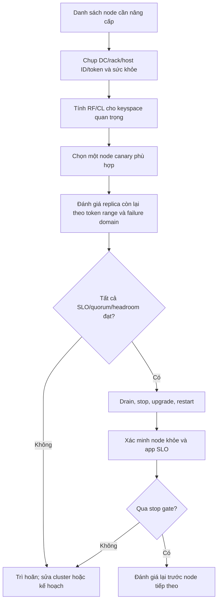
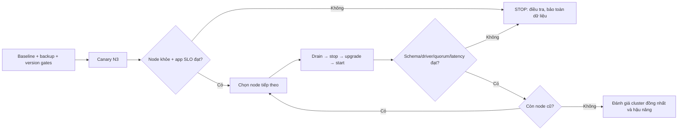
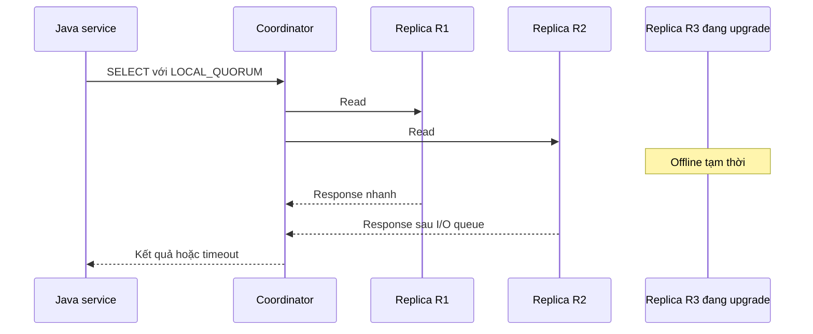

# Thứ tự nâng cấp nút và bảo vệ số bản sao đang phục vụ trong Apache Cassandra

## 1. Bài toán: nâng cấp phiên bản mà vẫn giữ được quorum

Apache Cassandra là cơ sở dữ liệu **wide-column phân tán**: **partition key** quyết định replica chịu trách nhiệm một partition, dữ liệu được sao chép theo **replication factor (RF)**, và truy vấn CQL chỉ được xác nhận khi đạt **consistency level (CL)** mà ứng dụng yêu cầu. Một cluster có thể chạy trên nhiều rack, availability zone (AZ) và datacenter (DC).

Khi nâng cấp phần mềm Cassandra, quản trị viên thường phải dừng, đổi binary/config và khởi động lại từng node. Trong thời gian đó, node bị dừng **không phục vụ request**; những replica còn lại phải gánh phần tải bị chuyển sang. Nếu dừng nhầm node hoặc nâng cấp đồng thời những node giữ cùng partition, ứng dụng Java có thể gặp `UnavailableException`, read/write timeout hoặc p99 tăng vọt dù dữ liệu chưa mất.

**Đề bài của một rolling upgrade không đơn giản là “nâng lần lượt N1 → N2 → N3”.** Đó là bài toán phải giữ đồng thời:

1. **Đường nâng cấp được hỗ trợ:** phiên bản nguồn/đích, JDK, cấu hình, định dạng SSTable, schema và driver.
2. **Replica đủ về số lượng theo từng CL và DC** trong lúc một node offline.
3. **Replica còn lại đủ về năng lực thực tế:** disk/CPU/network/GC, read/write latency và tải nền.
4. **Cửa sổ mixed-version được kiểm soát:** node phiên bản cũ/mới cùng tồn tại chỉ trong phạm vi được tài liệu phiên bản hỗ trợ.
5. **Có stop gate và phương án phục hồi:** không nâng node tiếp theo chỉ vì node vừa lên hiện `UN`.

> Nguyên tắc: *Mỗi node chỉ được lấy ra khỏi vòng phục vụ sau khi chứng minh những replica còn lại đáp ứng CL và SLO của ứng dụng; chỉ chuyển node tiếp theo khi node trước đã thực sự trở lại khỏe mạnh.*

## 2. Nâng cấp node khác thay đổi topology

| Thao tác | Mục tiêu | Hệ quả đối với ownership |
| --- | --- | --- |
| **Rolling upgrade/restart** | Dừng node tạm thời rồi đưa chính node đó trở lại với phiên bản mới | Token ownership thường được giữ; node offline trong cửa sổ nâng cấp |
| **Bootstrap/scale out** | Thêm node vào cluster | Thay đổi thành viên và streaming dữ liệu |
| **Decommission** | Rút một node sống khỏi cluster có kiểm soát | Chuyển ownership/range theo quy trình |
| **Removenode** | Xử lý membership của node chết theo điều kiện phiên bản | Không phải thao tác nâng cấp thông thường |
| **Replace node** | Thay host/disk hoặc node không thể phục hồi | Có quy trình identity/tokens/streaming riêng |
| **Repair** | Đối chiếu và đồng bộ replica | Không thay thế binary upgrade hay backup |

**Không decommission một node chỉ vì muốn cài binary mới.** Rolling upgrade bình thường nhằm đưa cùng thành viên quay lại, không tự ý thay đổi partition ownership.

Tương tự, `nodetool drain` giúp chuẩn bị node cho shutdown, **không phải lệnh “rời ring” vĩnh viễn**. Sau restart, cần xác minh node đã tham gia lại, có thể phục vụ CQL và không có lỗi startup/recovery.

## 3. Số replica cần phục vụ phụ thuộc RF, CL và partition

Giả sử keyspace `shop` có `NetworkTopologyStrategy` với `RF(dc1)=3`. Mỗi partition có ba replica trong dc1, ví dụ R1, R2, R3. Số phản hồi tối thiểu thay đổi theo CL:

| CL thông thường | Số phản hồi cần với RF3 tại một DC | Khi dừng một replica |
| --- | ---: | --- |
| `ONE` | 1 | Còn 2 replica, có thể phục vụ nếu chúng khỏe |
| `LOCAL_ONE` | 1 tại DC địa phương | Còn 2 local replica, có thể phục vụ |
| `LOCAL_QUORUM` | `floor(3/2)+1 = 2` tại DC địa phương | Còn đúng 2; không còn biên chịu lỗi thứ hai |
| `QUORUM` | 2 với keyspace chỉ có RF3 trong một DC | Còn đúng 2 |
| `ALL` | 3 | Không đáp ứng khi một replica bị dừng |

Đây là **tính toán số lượng**, chưa đảm bảo hai replica còn lại có đủ dữ liệu, dung lượng, networking và thời gian phản hồi. Nếu R2 đang Up nhưng bị GC pause hoặc disk latency rất cao, một request `LOCAL_QUORUM` vẫn có thể timeout khi R3 offline.

### Bảng quyết định trước khi dừng một node

| RF trong DC | CL của ứng dụng | Replica cần | Còn lại khi dừng một replica | Đánh giá |
| ---: | --- | ---: | ---: | --- |
| 3 | `LOCAL_QUORUM` | 2 | 2 | **Có thể** rolling nếu cả hai replica còn lại khỏe |
| 3 | `LOCAL_ONE` | 1 | 2 | Có dư địa số lượng hơn, nhưng bảo đảm nhất quán khác |
| 3 | `ALL` | 3 | 2 | **Không đạt CL** |
| 2 | `LOCAL_QUORUM` | 2 | 1 | **Không đạt CL** |
| 1 | `ONE` | 1 | 0 | Partition có thể không phục vụ được |
| 5 | `LOCAL_QUORUM` | 3 | 4 | Có thể chịu một node offline, vẫn phải xét lỗi khác |

**Không tự hạ CL từ `LOCAL_QUORUM` xuống `ONE` để “nâng cấp không gián đoạn”** khi nghiệp vụ dựa vào quorum. Nếu cấu hình RF2 và bắt buộc `LOCAL_QUORUM`, cần thiết kế cửa sổ gián đoạn, nâng năng lực dự phòng hợp lệ hoặc kiến trúc khác; đổi RF cũng phải có quy trình streaming/repair và kiểm chứng, không sửa metadata rồi giả định replica đã có dữ liệu.

### Hai lỗi Down cùng lúc nguy hiểm thế nào?

```text
RF(dc1) = 3, LOCAL_QUORUM = 2

Trạng thái A: R1 Up, R2 Up, R3 Up  → có 3 replica.
Đang nâng R3: R1 Up, R2 Up, R3 Down → còn đúng 2.
R2 lỗi thêm:  R1 Up, R2 Down, R3 Down → chỉ còn 1.

Kết luận: Quorum không đạt dù quy trình bảo trì chỉ chủ động dừng R3.
```

Nâng cấp làm **tiêu thụ fault budget**. Trong giai đoạn một replica offline, một sự cố độc lập trên replica khác có thể khiến toàn bộ partition của nhóm đó không đạt CL.

## 4. Tính theo từng DC, không chỉ đếm node toàn cluster

Giả sử keyspace có:

```sql
CREATE KEYSPACE IF NOT EXISTS upgrade_multidc_example
WITH replication = {
    'class': 'NetworkTopologyStrategy',
    'dc1': 3,
    'dc2': 3
}
AND durable_writes = true;
```

Với tổng RF = 6:

- `LOCAL_QUORUM` từ coordinator ở dc1 cần **2/3 replica dc1**.
- `LOCAL_QUORUM` từ coordinator ở dc2 cần **2/3 replica dc2**.
- `QUORUM` toàn keyspace cần **floor(6/2)+1 = 4 replica**.
- `EACH_QUORUM` đối với ghi thông thường cần quorum **ở từng DC** (ví dụ 2 tại dc1 và 2 tại dc2).
- `ALL` cần đủ toàn bộ replica, vì thế dừng một replica có thể làm request sử dụng CL này không đáp ứng.

| Trạng thái | `LOCAL_QUORUM` dc1 | `LOCAL_QUORUM` dc2 | `QUORUM` toàn cluster | `EACH_QUORUM` ghi |
| --- | --- | --- | --- | --- |
| 3 replica khỏe ở cả hai DC | Có thể đạt | Có thể đạt | Có thể đạt | Có thể đạt |
| Dừng một replica dc1; dc2 khỏe | Còn 2, có thể đạt | Còn 3, có thể đạt | Còn 5, có thể đạt | Còn 2+3, có thể đạt |
| Dừng hai replica dc1; dc2 khỏe | **Không đủ** | Còn 3, có thể đạt | Còn tổng 4, có thể đạt trong một số đường request | **Không đủ quorum dc1** |
| Toàn dc2 mất; dc1 còn 3 | Có thể đạt ở dc1 | **Không đủ** | Chỉ 3, **không đủ 4** | **Không đủ dc2** |

Ma trận giả định các replica live có dữ liệu và network thực sự phục vụ được. Không dùng một phép cộng node sống làm bảo đảm tất cả partition/CL đều có thể xử lý: placement, trạng thái node và DC của coordinator vẫn quyết định.

### Với LWT/CAS

LWT có **serial consistency** như `SERIAL` hoặc `LOCAL_SERIAL` cùng CL thông thường cho các pha tương ứng. Điều kiện khả dụng/độ trễ của LWT không thể suy từ phép đếm `LOCAL_QUORUM` của đọc/ghi thông thường mà bỏ qua Paxos. Trong cửa sổ nâng cấp, hãy kiểm thử riêng những API dùng `IF NOT EXISTS`, `IF` hoặc cơ chế điều kiện.

## 5. Chọn thứ tự node dựa vào miền lỗi và token ownership

Một cluster nhiều node không phải lúc nào cũng có sơ đồ “mỗi partition nằm trên R1, R2, R3” cố định. Với vnodes, mỗi node có nhiều token; **mỗi partition có tập replica riêng** do token placement và topology quyết định.



### Những đặc điểm cần xét khi chọn thứ tự

- **DC phục vụ traffic:** nếu ứng dụng dùng `LOCAL_QUORUM`, không ngầm cho rằng một DC khác khỏe có thể thay thế local replica đang thiếu.
- **Rack/AZ độc lập:** tránh tạo maintenance đồng thời tại nhiều miền lỗi khiến các replica cùng partition thiếu quorum.
- **Token ranges và vnodes:** một node có thể phục vụ nhiều tập partition; không chỉ kiểm tra một khóa mẫu.
- **Vai trò ứng dụng:** node được dùng làm contact point/coordinator thường xuyên có thể làm driver tái định tuyến nhiều request khi offline.
- **Tải và headroom:** một node “ít CPU” chưa chắc là canary tốt nếu replica còn lại của các range liên quan đã quá tải.
- **Node đang lỗi:** không dùng node Down hoặc đang Joining/Leaving/Moving làm giả định dự phòng khỏe.
- **Khác biệt phần cứng/config:** chọn canary đại diện cho class thiết bị/cấu hình sắp nâng để phát hiện vấn đề sớm.

**Đừng lựa chọn thứ tự chỉ theo IP tăng dần hoặc vị trí trong `nodetool status`.** Đánh giá từng node và cập nhật kế hoạch sau mỗi lượt vì replica health và tải có thể thay đổi.

### Một node tại một thời điểm là mặc định an toàn hơn, nhưng chưa đủ

Trong RF3 + `LOCAL_QUORUM`, nếu dừng một node, chỉ còn đúng hai replica cho những range liên quan. Vì vậy **không bắt đầu dừng node thứ hai khi node thứ nhất mới “đang boot”**. Node thứ nhất phải thực sự phục vụ được dữ liệu và SLO; nếu có streaming/compaction/recovery nặng cần chờ tải ổn định.

Nâng cấp song song chỉ nên xảy ra khi capacity và quorum coverage **được chứng minh cho mọi token range và workload**, có runbook chính thức và automation/stop gate đáng tin. Không dùng “chúng ở hai rack khác nhau” làm bằng chứng đủ khi chưa xét tập replica.

## 6. Đường nâng cấp và mixed-version là hàng rào đầu tiên

Trước khi cài binary, xác minh **đường nâng cấp được nhà phát hành hỗ trợ** cho cặp phiên bản nguồn → đích cụ thể. Không suy từ số phiên bản rằng có thể nhảy tùy ý từ 3.x sang 5.x hoặc chuyển giữa những bản phân phối khác nhau.

### Ma trận cần lập trước đợt nâng cấp

| Hạng mục | Câu hỏi cần xác minh | Nếu sai có thể gây gì? |
| --- | --- | --- |
| Cassandra source/target | Có hỗ trợ upgrade trực tiếp không? Cần đi qua bản trung gian không? | Node không thể tham gia hoặc không thể rollback |
| Mixed-version window | Bản cũ và mới có thể sống cùng cluster trong bao lâu/điều kiện nào? | Gossip/schema/protocol không tương thích |
| JDK/JVM | Mỗi bản Cassandra yêu cầu Java nào, flags GC nào còn hợp lệ? | JVM không khởi động, GC/memory regression |
| `cassandra.yaml` và cấu hình | Option nào bị đổi tên, bỏ hoặc có default mới? | Thay đổi auth/compaction/network ngoài ý định |
| SSTable/commit log | File format có thể đọc bởi phiên bản mới/cũ không? | Downgrade bị chặn; node cần khôi phục từ backup |
| Native protocol/CQL | Client có thể dùng phiên bản protocol phù hợp không? | Java Driver gặp lỗi kết nối/prepare/query |
| Java Driver và codec | Driver 4.x release đang chạy hỗ trợ server/version không? | Metadata/UDT/collection/serial consistency lỗi |
| Auth/TLS | Cipher suite, certificate, token, role/permission và cổng có tương thích? | Tất cả client mới bị từ chối |
| Công cụ vận hành | `nodetool`/JMX, backup agent, exporter, operator có hỗ trợ? | Sai chỉ số hoặc automation không chạy |
| Schema/features mới | Tính năng chỉ có ở target đã được bật chưa? | Node old-version không đọc metadata hoặc query mới |

**Không thể tự kết luận tương thích chỉ từ việc một node đích khởi động thành công.** Một đợt upgrade hợp lệ cần được kiểm chứng bằng release notes, compatibility matrix và thử nghiệm chính xác trên lab cùng version/distribution.

### Vì sao phải hạn chế DDL trong lúc mixed-version?

Một số tính năng schema/index/storage mới chỉ có ở bản đích. Nếu tạo bảng, type, index hoặc tùy chọn mới khi còn node cũ:

- Node cũ có thể không hiểu metadata hoặc CQL mới.
- Prepared statements/codec của client có thể nhận schema không đồng nhất.
- Rollback trở nên khó hoặc không được hỗ trợ.

Trong thời gian hỗn hợp phiên bản, **đóng băng thay đổi schema không liên quan** và chỉ bật tính năng mới sau khi toàn cluster đạt trạng thái được tài liệu phiên bản xác nhận.

## 7. Dự phòng năng lực: quorum đủ nhưng cluster vẫn có thể chậm

Khi một node offline, coordinator thường chuyển request sang các node còn khả dụng. Với ba replica tương đương, phần tải phục vụ ở những replica còn lại có thể tăng đáng kể theo workload. Không dùng một công thức cố định “tải tăng 50%” cho mọi cluster, vì:

- Token ownership và client routing khác nhau.
- Read `ONE`, `LOCAL_QUORUM` và write CL tạo công việc replica khác nhau.
- Hot partition có thể khiến một node trở thành nút thắt.
- Cache, SSTable layout, tombstone, compaction và GC không đồng đều.
- Startup/recovery có thể tạo thêm I/O nền ngay sau khi node trở lại.

### Một ví dụ định lượng về headroom

Giả sử tổng khối lượng công việc hữu ích của ba node tương đương là 180 đơn vị/giây, chia đều:

```text
Trước upgrade:
  N1 = 60, N2 = 60, N3 = 60 (đơn vị công việc/giây)

Trong lúc N3 offline:
  N1 + N2 phải gánh 180 đơn vị/giây nếu tổng công việc không đổi.
  Nếu chia đều, mỗi node ~90 thay vì 60 = tăng 50%.
```

Đây chỉ là **mô hình tải lý tưởng**, không phải dự báo QPS hay IOPS Cassandra. Khi mỗi node đã chạy sát ngưỡng an toàn, mức tăng này có thể làm disk await, hàng đợi read/write và p99 tăng. Vì vậy cần có giới hạn tải, khả năng giảm ingest không thiết yếu hoặc dời maintenance window.

### Các chỉ số quan trọng trước khi dừng một node

| Nhóm | Cần đo | Điều kiện nên dừng rollout |
| --- | --- | --- |
| CQL/API | Read/write p95/p99, timeout, unavailable, failed attempts | SLO vượt ngưỡng |
| Replica health | Up/Normal, DC/rack, latency cục bộ, queue | Một replica bắt buộc không khỏe |
| Disk | Free space, read/write latency, IOPS/bandwidth | Không đủ headroom hoặc disk lỗi |
| JVM | Heap, GC pauses, CPU, pending tasks | Pause kéo dài hoặc CPU bão hòa |
| Storage nền | Flush, compaction pending, repair/streaming | Công việc nền đang tranh chấp quá lớn |
| Driver | Reconnection, pool saturation, retries/speculation | Retry storm, connection không chuyển được node |

Quorum theo số lượng là điều kiện **cần**, không phải điều kiện **đủ** cho nâng cấp không gián đoạn.

## 8. Preflight toàn cluster trước cửa sổ nâng cấp

### 8.1. Khóa kế hoạch và chụp baseline

- Ghi source/target versions, JDK, package/image checksums và lộ trình được hỗ trợ.
- Ghi node host ID, IP, DC/rack, tokens/ownership, trạng thái và thứ tự dự kiến.
- Ghi RF/CL theo từng keyspace và endpoint quan trọng; lưu riêng các request `ALL` hoặc LWT.
- Đặt maintenance window, người chịu trách nhiệm, điều kiện dừng và kênh incident.
- Chụp backup/snapshot/commit log theo chính sách và **thử restore** trước với dữ liệu quan trọng.
- Lưu versioned configuration, chứng chỉ, role/permission và artifact của ứng dụng liên quan.
- Kiểm tra free disk không gian dành cho flush/startup/SSTable cùng compaction.

Không coi snapshot là backup off-node nếu các file vẫn nằm trên cùng ổ đĩa với node sẽ nâng. Và **backup được tạo trên bản cũ không mặc định có thể restore trên một bản target bất kỳ**; phải dùng quy trình tương thích.

### 8.2. Quan sát trước khi chọn node

Trên những node liên quan:

```bash
nodetool version
nodetool status
nodetool describecluster
nodetool netstats
nodetool tpstats
nodetool compactionstats
```

`nodetool status` cho biết membership/Up-Normal theo cách node nhìn thấy; nó **không kiểm tra trực tiếp mọi partition**. `nodetool netstats`/`compactionstats` giúp nhận diện hoạt động streaming/repair/backlog có thể ảnh hưởng I/O khi upgrade.

### 8.3. Kiểm tra truy vấn đại diện

Trong `cqlsh` qua một coordinator phù hợp:

```text
CONSISTENCY LOCAL_QUORUM;
```

Thử read/write **trên khóa lab/health-check riêng** và ghi latency; lặp trên các DC cần phục vụ. Với production, probe phải có key ổn định, TTL/cleanup và không sửa dữ liệu nghiệp vụ thật.

Một câu `SELECT` thành công **không chứng minh mọi token range hoặc CL đều an toàn**. Số liệu từ ứng dụng thật và cluster metrics phải là nguồn quyết định.

## 9. Định nghĩa điều kiện “node khỏe” trước và sau nâng cấp

Thấy `UN` chưa đủ. Một node đã khởi động nhưng còn replay commit log, compaction nặng, schema chưa ổn định hoặc mạng lỗi có thể chưa chịu được tải.

### Bộ điều kiện phục vụ tối thiểu

1. **Process:** Cassandra khởi động ổn, không crash loop.
2. **Membership:** node xuất hiện Up/Normal, DC/rack và host identity đúng.
3. **Schema:** không có schema disagreement kéo dài; không có lỗi metadata/DDL.
4. **Data path:** đọc/ghi mẫu theo CL yêu cầu thành công qua nhiều partition đại diện.
5. **Replica path:** coordinator có thể liên lạc với những replica cần thiết; không có timeout tăng mạnh.
6. **Storage:** disk free/latency, flush/compaction và logs startup không cho thấy lỗi.
7. **Client:** Java Driver kết nối được, prepared statements/UDT/auth/TLS tương thích.
8. **SLO:** p95/p99, retries, unavailable và error rate quay về ngưỡng chấp nhận đủ lâu.

Không chỉ kiểm tra ngay tại một khoảnh khắc. Sau restart, cache ấm lại và streaming/repair có thể khiến các chỉ số biến động; **thời gian ổn định** là điều kiện do SLO/runbook quy định.

## 10. Runbook rolling upgrade cho một node

Các lệnh dưới đây là **minh họa cho môi trường lab hoặc production có change approval**. Lệnh cài đặt phần mềm, quản lý service và tên package phụ thuộc hệ điều hành/cluster manager, vì thế không đưa một `apt upgrade` hoặc `systemctl` cụ thể làm hướng dẫn phổ quát.

### Bước 1 — Chọn node và xác minh quorum

Ví dụ cần nâng N3 thuộc dc1, trong khi N1/N2 còn phục vụ RF3 local quorum. Kiểm tra rằng **N1/N2 thật sự khỏe** đối với những partition có N3 là replica và chúng còn CPU/disk/network headroom.

```bash
nodetool status
nodetool describecluster
nodetool tpstats
nodetool compactionstats
```

Nếu một node cần thiết khác Down hoặc đang Joining/Leaving/Moving, **hoãn nâng N3**. Không chủ động tạo sự cố thứ hai khi cluster đã mất khả năng chịu lỗi.

### Bước 2 — Kiểm soát traffic và các công việc nền

Đảm bảo Java Driver có contact points/routing sang node khác, kiểm tra load balancer nếu có, giảm công việc ghi/scan không cấp thiết khi runbook yêu cầu. Không mở nhiều lần bootstrap/rebuild/repair trong cùng cửa sổ chỉ để “kiểm tra”.

Không thay đổi consistency level để che vấn đề. Nếu cần chuyển coordinator traffic chủ động, dùng cơ chế đã được **driver/operator** hỗ trợ và kiểm tra ảnh hưởng với pool/reconnect.

### Bước 3 — Drain node trước shutdown có kế hoạch

Trên đúng node đã chọn:

```bash
nodetool help drain
nodetool drain
```

`drain` đưa node vào quá trình chuẩn bị shutdown và flush những memtable cần thiết theo phiên bản. **Không bắt buộc chạy `nodetool flush` riêng trước drain** khi không có lý do từ runbook. Drain không tự tăng RF, không chuyển ownership và không bảo đảm các replica khác chịu được tải.

Xác minh exit code và logs; nếu drain lỗi, **dừng đợt nâng cấp** và đánh giá disk/commit log/flush. Không coi một command treo là thành công, không dùng `kill -9` như lối tắt mặc định.

### Bước 4 — Stop, đổi binary và cấu hình theo phiên bản

Sau khi drain thành công, dùng service manager/operator để dừng process. Cập nhật binary/JDK/config **theo upgrade guide của đúng cặp phiên bản**:

- Giữ đường dẫn dữ liệu, commit log, host identity, tokens và DC/rack đúng thiết kế.
- So sánh cấu hình cũ/mới, không copy `cassandra.yaml` cũ đè lên file mẫu mới mà không đánh giá.
- Kiểm tra TLS/trust, password/roles, file permissions và JMX.
- Không xóa SSTable/commit log/system tables để “bắt đầu sạch”.
- Không chạy `decommission`, `removenode` hay `cleanup` như một phần bình thường của rolling upgrade.

### Bước 5 — Start và kiểm tra tương thích

Khởi động dịch vụ theo runbook, quan sát logs và:

```bash
nodetool version
nodetool status
nodetool info
nodetool describecluster
nodetool netstats
nodetool tpstats
nodetool compactionstats
```

Xác minh phiên bản đã đúng, node dùng đúng DC/rack/identity và không có schema mismatch hoặc lỗi SSTable/commit log/protocol. Kiểm tra read/write và authentication qua Java Driver phiên bản thực tế, **không chỉ cqlsh**.

### Bước 6 — So SLO với baseline và mở cổng cho node tiếp theo

Theo dõi trong một cửa sổ đủ dài:

- Quorum và khả năng phục vụ CQL theo các CL quan trọng.
- API p95/p99 và timeout/unavailable so với baseline.
- Driver reconnect/retry/connection pool; không có lỗi protocol/codec.
- Disk headroom, pending compactions, streaming/repair và GC.
- Node đã nhận lại traffic và chịu tải bình thường, không còn tình trạng chỉ “đang Up nhưng chưa sẵn sàng”.

**Chỉ mở lượt nâng N4/N2 sau khi tất cả tiêu chí đạt.** Nếu bất kỳ tiêu chí nào xấu đi, dừng rollout và dùng playbook xử lý sự cố.

## 11. Trình tự nâng toàn cluster và giới hạn mixed-version

Không tồn tại một thứ tự DC/rack cố định đúng cho mọi cặp phiên bản Cassandra và mọi topology. Quy trình triển khai phải tuân theo **upgrade guide hỗ trợ phiên bản**, rồi dùng quorum/capacity để quyết định thứ tự node.

### Chiến lược thận trọng thường dùng

1. **Canary:** chọn một node đại diện, nâng và giữ quan sát đủ lâu.
2. **Mỗi lần một node:** nâng tiếp trong phạm vi DC/rack đã được đánh giá, không lấy thêm replica ra khi node trước chưa khỏe.
3. **Đánh giá lại trước mỗi lượt:** node vừa nâng có thể tạo tác động lên replica/caches hoặc phát sinh workload ngoài dự kiến.
4. **Nhiều DC:** xét thứ tự theo trách nhiệm traffic, latency WAN và semantics CL; không mặc định dc2 có thể nhận toàn bộ workload dc1.
5. **Kết thúc mixed-version:** xác minh toàn cluster đã lên target version và schema/driver ổn định.
6. **Việc hậu nâng:** các tác vụ định dạng SSTable, tối ưu hoặc bật feature mới chỉ làm khi **guide cho phép** và có kế hoạch capacity/rollback.



**Cửa sổ mixed-version nên được giữ ngắn theo runbook nhưng không được rút ngắn bằng cách bỏ qua kiểm tra.** Nếu canary thất bại, không nâng hàng loạt để “đồng bộ phiên bản cho nhanh”. Nếu cluster phải ở mixed-version lâu hơn dự kiến, cần đánh giá lại việc hỗ trợ/khả năng phục hồi và hạn chế các tính năng không tương thích.

### Không nâng cấp song song hai node khi chỉ có đúng quorum

Với RF3 local quorum, sau khi dừng một node còn hai replica. Nếu một node khác được drain trước khi node đầu sẵn sàng, một số partition có thể chỉ còn một replica đáp ứng; kết quả là unavailable. **Cùng rack hoặc khác rack không cứu được tình huống này nếu tập replica bị rút quá nhiều.**

## 12. Kịch bản multi-DC với lưu lượng và WAN

Giả sử hai DC địa lý:

```text
Keyspace RF: dc1=3, dc2=3
Client ở dc1: LOCAL_QUORUM
Client ở dc2: LOCAL_QUORUM
Một số batch job: QUORUM toàn keyspace
Một số write: EACH_QUORUM
```

Nếu đang nâng một node dc1:

- API local quorum ở dc1 còn đủ **2 local replica** trong điều kiện khỏe mạnh.
- API local quorum ở dc2 vẫn dùng replica dc2 và không mặc định cần đợi WAN cho quorum local.
- Batch job `QUORUM` cần **4 replica toàn keyspace**; phải xét mạng/quorum và replica thực tế.
- Write `EACH_QUORUM` cần quorum ở **cả dc1 và dc2**; WAN/DC sự cố có thể làm request thất bại dù dc1 đủ local quorum.

**Đừng chọn một node dc2 làm canary khi dc1 đang mất quorum** chỉ vì “DC còn lại vẫn có ba node”. Tình huống đó có thể làm batch job global quorum/EACH_QUORUM không còn đáp ứng được, và khả năng DC dự phòng nhận traffic phụ thuộc Java Driver/failover policy.

### Nếu WAN bị chia cắt giữa hai DC

Quorum local có thể tiếp tục hoạt động độc lập trong DC của mình, nhưng **khả năng nhìn thấy dữ liệu mới giữa DC** không được đảm bảo như thể mạng vẫn nguyên vẹn. Không dùng thành công của local read để tuyên bố cluster toàn cầu đã đồng bộ.

Trước khi tiếp tục nâng sau WAN recovery, cần xem hints/anti-entropy repair theo chính sách và bảo đảm các replica bị chậm đã có khả năng phục vụ. Không khởi động repair hàng loạt đồng thời với nâng node nếu không có runbook capacity rõ ràng.

## 13. Các thao tác hậu nâng: tránh phá khả năng quay lại phiên bản cũ

Một số upgrade path có bước xử lý định dạng SSTable sau khi chuyển binary, thường được gọi qua công cụ như:

```bash
nodetool help upgradesstables
```

**Không chạy `nodetool upgradesstables` đại trà theo thói quen.** Việc có cần chạy, ở thời điểm nào, phiên bản nào và phạm vi bảng nào phải theo **hướng dẫn nâng cấp cụ thể**. Chuyển định dạng tệp có thể:

- Tốn nhiều disk read/write và tăng compaction backlog.
- Yêu cầu không gian đĩa để tạo SSTable mới trước khi giải phóng tệp cũ.
- Làm rollback binary **không còn đơn giản hoặc không được hỗ trợ** vì bản cũ có thể không đọc được định dạng mới.

Tương tự, không tự động bật SAI, UCS hoặc schema/index features chỉ có ở target version khi vẫn có node cũ hoặc khi chưa được kiểm thử. **Tách riêng đợt upgrade binary khỏi đợt bật tính năng mới** để giảm biến số và giữ rollback window.

### Snapshot không phải phép quay ngược vô điều kiện

Backup trước upgrade là một lớp bảo vệ quan trọng, nhưng việc phục hồi có thể cần dựng node/cluster cùng phiên bản tương thích, đảm bảo host identity/tokens và xử lý mutation phát sinh sau thời điểm backup. Không chỉ copy lại thư mục SSTable cũ vào node đang chạy phiên bản mới rồi gọi là rollback thành công.

## 14. Khi nâng cấp thất bại: stop gate và lựa chọn rollback

| Triệu chứng | Nguyên nhân cần kiểm tra | Hành động đầu tiên |
| --- | --- | --- |
| Node không start sau đổi binary | JDK/config/JVM flags, file permissions, version path | Giữ node offline, kiểm tra logs/compatibility, không nâng node khác |
| Node Up nhưng `nodetool status` không `UN` | Gossip, tokens, DC/rack, bootstrap/rejoin | Dừng rollout, kiểm tra identity/topology |
| Schema disagreement kéo dài | Mixed version, DDL chưa đồng bộ, node lỗi | Dừng DDL và nâng tiếp; đánh giá schema/cluster logs |
| `ReadTimeout` tăng | Replica còn lại bị quá tải, cache cold, disk/GC/network | Giảm tải, so p99 từng replica/driver |
| `Unavailable` tăng | CL không đạt vì thiếu replica hoặc DC | Kiểm tra RF/CL/partition ownership trước |
| Java `AllNodesFailedException` | Auth/TLS/protocol/routing hoặc network | Xem root causes theo từng node, không gán một nguyên nhân |
| Startup đọc SSTable/commit log lỗi | Data format, corruption, config/version mismatch | Không xóa dữ liệu; dùng recovery guide và bản backup |
| Disk free sụt nhanh | Flush/compaction/streaming/upgradesstables | Dừng công việc bổ sung, xử lý headroom |
| GC/CPU tăng sau upgrade | Runtime config mới, JVM/heap/GC regression | So sánh flags/JDK và metrics với baseline |

### Khi nào có thể quay lại binary cũ?

**Không có câu trả lời chung “chỉ cần cài lại version cũ”.** Rollback phụ thuộc cặp version, các định dạng file/schema đã được ghi, thay đổi configuration, protocol và bước post-upgrade đã thực hiện.

Một quyết định đúng:

1. Đọc rollback/downgrade policy của đúng cặp source/target trước ngày triển khai.
2. Xác định node đã ghi SSTable, commit log hoặc schema ở định dạng nào sau khi start bản mới.
3. Xem khả năng khôi phục bằng binary cũ **có được hỗ trợ** hay phải dựng lại từ backup/snapshot tương thích.
4. Nếu nâng không thể rollback an toàn, ưu tiên **giữ node ở trạng thái an toàn, bảo vệ cluster còn lại và làm theo runbook recovery**.
5. Không chạy `rm` trên data directory, commit log, `system` tables để “ép downgrade”.

**Không tự quyết định rollback bằng cách xóa các file gây lỗi.** Một node bị nâng sai phiên bản nhưng còn dữ liệu nguyên vẹn thường có cơ hội phục hồi tốt hơn một node bị xóa một phần hệ thống lưu trữ.

## 15. Thực hành CQL trên cluster lab ba node

Ví dụ trong lab cô lập với DC tên `dc1` và ít nhất ba node để hỗ trợ RF3. Lab không dùng để chứng minh production an toàn chỉ từ một partition; mục tiêu là quan sát rõ CL và thời điểm mất replica.

### Tạo bảng theo partition key

```sql
CREATE KEYSPACE IF NOT EXISTS upgrade_lab
WITH replication = {
    'class': 'NetworkTopologyStrategy',
    'dc1': 3
}
AND durable_writes = true;

CREATE TABLE IF NOT EXISTS upgrade_lab.orders_by_id (
    order_id uuid PRIMARY KEY,
    status text,
    updated_at timestamp
);
```

Trong `cqlsh`:

```text
CONSISTENCY LOCAL_QUORUM;
```

Ghi và đọc mẫu:

```sql
INSERT INTO upgrade_lab.orders_by_id (
    order_id, status, updated_at
) VALUES (
    11111111-1111-4111-8111-111111111111,
    'READY',
    '2026-11-20 10:00:00+0000'
);

SELECT status, updated_at
FROM upgrade_lab.orders_by_id
WHERE order_id = 11111111-1111-4111-8111-111111111111;
```

### Quan sát một node tạm offline

Trên lab, sau khi xác minh các replica còn lại khỏe, mô phỏng **một node drain/stop theo runbook**, rồi từ coordinator còn hoạt động:

```bash
nodetool status
nodetool tpstats
nodetool compactionstats
```

Chạy lại truy vấn `LOCAL_QUORUM` trên một số partition test khác nhau. Với RF3, còn hai replica khỏe, request có thể tiếp tục; nhưng p99 có thể tăng và một node mất thêm sẽ làm quorum không đạt.

**Không tắt node thứ hai chỉ để làm ví dụ unavailable trên môi trường chia sẻ.** Nếu muốn minh họa RF2/quorum thất bại, dùng cluster test cô lập hoặc mô phỏng topology trên giấy.

### Kiểm chứng sau khi node trở lại

Sau khi restart:

```bash
nodetool version
nodetool status
nodetool describecluster
nodetool netstats
nodetool tpstats
```

Kiểm tra dữ liệu bằng `SELECT` và quan sát logs. Trạng thái `UN` và một hàng đọc được **không chứng minh mọi token range đã hội tụ**; nếu node downtime dài hoặc đã bỏ lỡ mutation, áp dụng quy trình hints/repair tương ứng trước khi kết luận.

## 16. Java Driver 4.x: probe theo CL, không che lỗi bằng retry

Java Driver 4.x có thể kết nối tới nhiều contact points và chọn local DC. Ví dụ repository probe CQL bằng **prepared statement**; các contact point được mô tả là địa chỉ lab, và session được mở ở lớp ứng dụng.

```java
import java.util.UUID;
import java.util.concurrent.TimeUnit;

import com.datastax.oss.driver.api.core.CqlSession;
import com.datastax.oss.driver.api.core.DefaultConsistencyLevel;
import com.datastax.oss.driver.api.core.cql.BoundStatement;
import com.datastax.oss.driver.api.core.cql.PreparedStatement;
import com.datastax.oss.driver.api.core.cql.Row;

public final class UpgradeReadProbe {
    private final CqlSession session;
    private final PreparedStatement select;

    public UpgradeReadProbe(CqlSession session) {
        this.session = session;
        this.select = session.prepare(
            "SELECT status, updated_at FROM upgrade_lab.orders_by_id " +
            "WHERE order_id = ?"
        );
    }

    public ProbeResult check(UUID orderId) {
        BoundStatement statement = select.bind(orderId)
            .setConsistencyLevel(DefaultConsistencyLevel.LOCAL_QUORUM)
            .setIdempotent(true);

        long startNanos = System.nanoTime();
        Row row = session.execute(statement).one();
        long elapsedMillis = TimeUnit.NANOSECONDS.toMillis(
            System.nanoTime() - startNanos
        );

        return new ProbeResult(
            row != null ? row.getString("status") : null,
            elapsedMillis
        );
    }

    public static final class ProbeResult {
        public final String status;
        public final long latencyMillis;

        public ProbeResult(String status, long latencyMillis) {
            this.status = status;
            this.latencyMillis = latencyMillis;
        }
    }
}
```

Ví dụ chỉ là **một probe đọc**, không đủ thay thế load test hay kiểm chứng write/LWT trên mọi bảng. Trong ứng dụng thật, session cần được tạo bằng **contact points dự phòng, `withLocalDatacenter(...)`, TLS/auth và timeout** phù hợp với triển khai.

Khi phiên bản node không tương thích native protocol hoặc certificate, Java có thể gặp lỗi connection/`AllNodesFailedException` trước khi đến mức `ReadTimeoutException`. Vì vậy:

- Đếm **logical requests và attempts** riêng, theo dõi retry/speculative execution.
- Phân biệt lỗi server `Unavailable`, `ReadTimeout`/`WriteTimeout` với timeout tại driver.
- Không tăng retry vô hạn khi một node đã offline; retry storm có thể làm hai replica còn lại quá tải.
- Giữ CL của ứng dụng nhất quán trước và sau upgrade để kết quả benchmark có ý nghĩa.
- Ghi metrics theo query template, cluster/DC, driver/server version, không đưa partition keys nhạy cảm vào label.

### Probe không sửa dữ liệu nghiệp vụ

Với health check cần ghi, tạo bảng/keyspace test có TTL/cleanup phù hợp, dùng `operation_id` ổn định và kiểm soát write timeout outcome. Không chạy `INSERT` vào dữ liệu đơn hàng thật chỉ để đo rolling upgrade; đặc biệt tránh counter/LWT không idempotent bị retry.

## 17. Quan sát đường đi: request nào chậm và ở đâu?



Sơ đồ đơn giản hóa; coordinator có thể chọn data/digest requests và read behavior khác theo phiên bản. Mục tiêu là thấy rằng **hai replica còn sống vẫn có thể tạo timeout nếu một replica chậm hơn deadline**.

### Ma trận nguồn số liệu

| Công cụ/nguồn | Tìm điều gì? | Hạn chế |
| --- | --- | --- |
| `nodetool status` | Up/Down, DC, rack, trạng thái token | `UN` không chứng minh latency/CL |
| `nodetool describecluster` | Cluster/schema/version metadata theo output bản | Không phải giao dịch kiểm thử CQL |
| `nodetool tpstats` | Active/pending/dropped messages | Cần xem rate theo thời gian |
| `nodetool compactionstats` | Active/pending compactions | Pending task không bằng bytes |
| `nodetool tablestats` | SSTable, memtable, local latency | Dữ liệu cục bộ một node/bảng |
| `nodetool tablehistograms` | Read/write latency tail, partition/SSTable stats | Percentile ước lượng, không phải API p99 |
| `nodetool netstats` | Streaming/hints/network-related state | Nội dung phụ thuộc phiên bản |
| JVM/OS | GC, CPU, disk await, free space, network | Cần ghép đúng thời gian và node |
| Driver/API | p95/p99, timeout, retry, connection failures | Không tự nói SSTable hay replica gốc lỗi |

### Phân biệt khả dụng và latency

Một đợt upgrade có thể đạt `0 unavailable` nhưng vẫn vi phạm p99 vì node còn lại bão hòa. Trái lại, một API `LOCAL_ONE` có thể vẫn nhanh trong khi API `ALL` thất bại. **Dashboard phải phân nhóm theo CL, query template và DC**, không chỉ tổng lỗi toàn dịch vụ.

## 18. Sáu tình huống tự đánh giá

### Tình huống A — RF3 nhưng một replica đã Down

Ứng dụng `LOCAL_QUORUM`, R1/R2 Up, R3 Down. Đội vận hành muốn nâng R2 trước vì nó là node ít traffic.

**Đáp án định hướng:** Không. Dừng R2 sẽ chỉ còn R1 cho nhiều partition, không đủ local quorum. Cần sửa/khôi phục R3 trước hoặc thiết kế maintenance khác; “ít traffic” không làm R2 hết vai trò replica.

### Tình huống B — RF2 với `LOCAL_QUORUM`

Hai node là replica tại dc1; đội ngũ muốn rolling upgrade không downtime mà không thay RF/kiến trúc.

**Đáp án định hướng:** `LOCAL_QUORUM` RF2 cần cả hai replica. Dừng một sẽ không đạt CL cho những partition tương ứng. Phải có kế hoạch khả dụng phù hợp; không hứa rolling không downtime theo số lượng này.

### Tình huống C — Node vừa lên `UN`

N1 nâng xong, đã `UN` nhưng disk await lớn, replay/compaction còn nặng; API read p99 tăng từ 40 ms lên 350 ms. Có thể chuyển sang N2 không?

**Đáp án định hướng:** Không. `UN` là điều kiện cần về membership; phải đợi node chịu tải tốt, p99/timeout ổn định và xác minh những replica còn lại.

### Tình huống D — Hai DC, một batch dùng global `QUORUM`

Keyspace RF3+RF3. dc2 mất hoàn toàn, dc1 vẫn khỏe. Java ở dc1 dùng `LOCAL_QUORUM` thành công nhưng batch job `QUORUM` timeout/unavailable.

**Đáp án định hướng:** Local quorum dc1 cần 2/3, còn global quorum cần 4/6. dc1 chỉ có 3, không đủ global quorum. Không tiếp tục nâng node khi cluster đang mất DC trừ khi có kế hoạch phục hồi/khả dụng được phê duyệt.

### Tình huống E — Muốn bật schema feature mới ngay trên canary

N1 vừa lên phiên bản target hỗ trợ index/DDL mới, N2/N3 vẫn chạy bản cũ. Đội ứng dụng muốn tạo index mới để kiểm thử query trên cluster production.

**Đáp án định hướng:** Không bật feature phụ thuộc target khi chưa qua compatibility gate và toàn cluster chưa ở trạng thái được hỗ trợ. Thử riêng trong lab; trong mixed-version hạn chế DDL và thay đổi không liên quan.

### Tình huống F — Định rollback binary sau khi chuyển SSTable

Toàn cluster đã chạy target; một số node đã thực hiện `upgradesstables`, p99 xấu. Operator muốn cài lại binary cũ trên một node rồi khởi động.

**Đáp án định hướng:** Không mặc định an toàn. File format/schema có thể không tương thích ngược; phải đọc downgrade/rollback guide đúng version, xác minh bản backup và đường phục hồi trước. Đừng xóa SSTable để ép binary cũ chạy.

### Tình huống G — Client kết nối vào một IP duy nhất

RF3/`LOCAL_QUORUM` vẫn đủ replica, nhưng toàn bộ Java pods cấu hình duy nhất contact point trỏ tới node đang nâng, không có metadata/routing hoạt động từ trước. Khi node dừng, ứng dụng mất kết nối.

**Đáp án định hướng:** Số replica đủ là chưa đủ; cần Java Driver/session/topology discovery và contact points dự phòng, TLS/auth chuẩn, kiểm thử failover từ client. Không nhầm server-side availability với client reachability.

## 19. Checklist trước, trong và sau rolling upgrade

**Trước khi nâng**

- [ ] Xác minh đường nâng cấp/rollback được **phiên bản/distribution hỗ trợ chính thức**; ghi source, target, JDK và Java Driver.
- [ ] Kiểm thử cùng schema, SSTable/protocol/auth/TLS, client/UDT và đặc tính workload trên staging.
- [ ] Chụp backup/snapshot và kiểm chứng restore; lưu config, certs, role/schema và node identity.
- [ ] Liệt kê keyspace, RF theo DC, CL, các API `ALL` và LWT.
- [ ] Kiểm tra token range/replica placement, DC/rack và trạng thái những node còn lại.
- [ ] Đảm bảo còn đủ replica theo CL **và đủ CPU/disk/network headroom** khi một node offline.
- [ ] Tránh bootstrap/decommission/repair lớn, schema changes và fault domain incident đang diễn ra.
- [ ] Thiết lập baseline p95/p99, timeout/unavailable, driver retries, compaction, GC, disk và network.
- [ ] Có canary, stop gate, owner, maintenance window và runbook failure/recovery.

**Trong từng lượt**

- [ ] Chỉ dừng node được chọn sau khi quorum/headroom check PASS.
- [ ] Drain trên đúng node; xác minh hoàn tất trước stop.
- [ ] Cập nhật binary/JDK/config đúng phiên bản, giữ host identity/tokens/DC/rack.
- [ ] Không dùng decommission/removenode/cleanup hoặc xóa commit log như thao tác nâng cấp thông thường.
- [ ] Start, đọc logs và xác minh version, `UN`, schema, CQL và Java connectivity.
- [ ] Theo dõi p95/p99, timeout, pending compactions, disk, GC và lỗi driver trong cửa sổ ổn định.
- [ ] **Không nâng node tiếp theo** nếu node trước mới boot, còn lỗi hoặc thiếu headroom.
- [ ] Không bật DDL/tính năng mới khi cluster vẫn mixed-version trừ trường hợp được guide cho phép rõ.

**Sau khi hoàn tất**

- [ ] Xác nhận toàn bộ node thuộc target version đúng, schema/driver ổn định.
- [ ] Kiểm tra read/write và LWT theo CL từ mỗi DC liên quan.
- [ ] Đối chiếu p95/p99/error với baseline cả giờ cao điểm và trạng thái ổn định.
- [ ] Đánh giá repair/catch-up cho node bị offline lâu theo runbook, không tự động ép repair toàn cluster.
- [ ] Chỉ chạy `upgradesstables` hoặc đổi cấu hình/features mới theo upgrade guide và budget I/O.
- [ ] Lưu báo cáo: thứ tự node, thời gian downtime, SLO, lỗi, phiên bản và thay đổi cấu hình.
- [ ] Đánh giá lại backup/restore và kịch bản phục hồi ở target version.

**Ghi nhớ:** Rolling upgrade Cassandra chỉ an toàn khi **mỗi bước chủ động rút ít replica hơn số dự phòng của CL**, các replica còn lại có đủ năng lực đáp ứng p99, và cặp phiên bản hỗ trợ mixed-version trong thời gian nâng. **Thứ tự node cần dựa trên token/replica, DC/rack và sức khỏe thực**, không chỉ tên host. Drain, restart và trạng thái `UN` là các bước cần thiết, nhưng **quorum, driver compatibility, dữ liệu và SLO ứng dụng** mới quyết định khi nào được tiếp tục.
