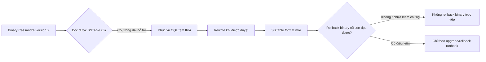
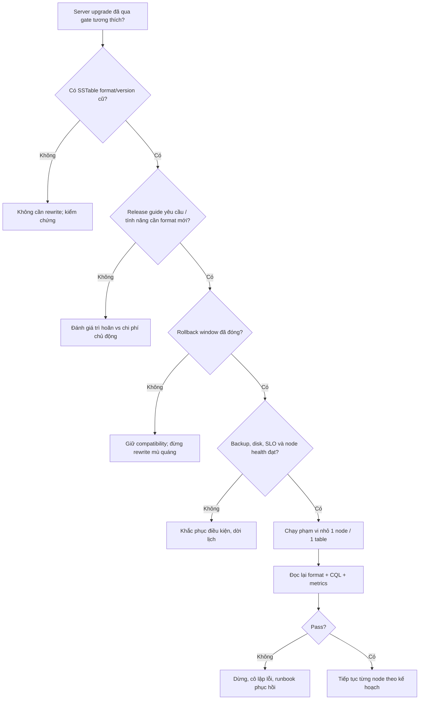
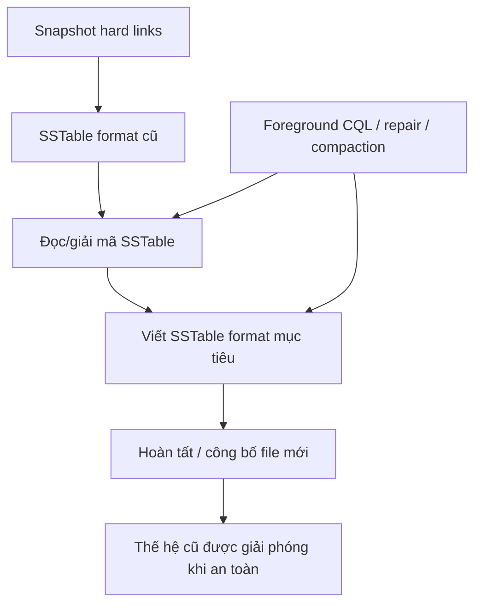

# Tương thích định dạng SSTable và nhu cầu upgradesstables

## 1. Bối cảnh: nâng cấp Cassandra chưa đồng nghĩa nâng cấp mọi tệp dữ liệu

Apache Cassandra là cơ sở dữ liệu **wide-column phân tán**, lưu các partition theo token của partition key tại những natural replicas do replication strategy quyết định. Mỗi replica ghi mutation vào commitlog, cập nhật memtable, sau đó flush thành **SSTable bất biến**. Đọc CQL có thể phải hòa giải dữ liệu giữa memtable và nhiều SSTable, còn compaction tạo SSTable mới từ những SSTable cũ.

Khi chuyển từ một phiên bản Cassandra sang phiên bản khác, cần phân biệt:

1. **Phiên bản binary/server:** mã Cassandra đang chạy ở từng node.
2. **Phiên bản và họ định dạng SSTable:** cách dữ liệu, index và metadata được biểu diễn trên đĩa.
3. **Compatibility mode và tính năng mới:** giới hạn format/protocol/tính năng mà cluster có thể sử dụng khi các node chưa cùng phiên bản.
4. **Phiên bản ứng dụng Java/driver và CQL:** client còn đọc/ghi theo consistency level, schema và query contract nào.

Thay binary có thể khiến node mới **đọc được SSTable cũ** trong phạm vi hỗ trợ, trong khi các file ấy vẫn giữ nguyên format cũ. Việc chuyển các file còn lại sang format được dùng bởi phiên bản mới là nhiệm vụ có thể thực hiện bằng `nodetool upgradesstables`; nó **đọc và viết lại SSTable**, không phải lệnh “nâng cấp phần mềm” và không phải thao tác chỉ thay tên file.

Bài thuộc chương **Nâng cấp và tương thích** của mô-đun `DATABASE_ENGINE_WIDE_COLUMN_CASSANDRA`. Phạm vi liên hệ mô hình wide-column, partition key, thiết kế bảng theo truy vấn, CQL, replication/consistency, compaction/repair, xử lý lỗi và truy cập từ ứng dụng Java.

Sau bài này, người học có thể:

- Nhận diện **format/version** của SSTable và phân biệt định dạng trên đĩa với phiên bản server.
- Quyết định **khi nào cần, nên trì hoãn hoặc không cần** chạy `upgradesstables` theo upgrade guide của **đúng source/target version**.
- Hiểu rõ `-a`, `-j`, phạm vi keyspace/table và ranh giới với công cụ offline `sstableupgrade`.
- Lập kế hoạch backup, dung lượng tạm, CPU/disk I/O, cửa sổ rollback, tiến độ theo node và kiểm tra dữ liệu CQL.
- Đánh giá ảnh hưởng read/write p95/p99, error, compaction, repair và hoạt động Java Driver trong thời gian rewrite.

## 2. SSTable là một tập thành phần, không phải một file duy nhất

Cassandra dùng cấu trúc **LSM-tree**. Mutation đi qua commitlog/memtable; flush sinh ra SSTable trên disk; các SSTable không sửa trực tiếp mà được thay thế bởi thế hệ file mới sau compaction hoặc rewrite.

Một SSTable BIG thông thường có các thành phần với hậu tố tương tự:

| Thành phần | Chức năng khái niệm | Ý nghĩa khi nâng cấp |
| --- | --- | --- |
| `Data.db` | Chứa partition, rows/cells và tombstone theo bố trí của format | Đọc/ghi lại khối lượng dữ liệu lớn; phải bảo toàn nội dung logic |
| `Index.db` hoặc thành phần index tương đương | Hỗ trợ tìm vị trí partition/row | Bố cục thay đổi theo họ format BIG/BTI |
| `Summary.db` | Tóm tắt index để tìm kiếm nhanh | Có thể được dựng lại theo quy tắc version |
| `Filter.db` | Bloom filter cho việc tra partition | Tác động false-positive/read I/O, tùy format |
| `Statistics.db` | Metadata: timestamp, tombstone, repaired state, v.v. | Một số thay đổi SSTable version nằm ở metadata |
| `CompressionInfo.db` | Thông tin khối nén nếu bảng sử dụng nén | Cần tương thích compression codec và cấu hình |
| `TOC.txt`/checksum components | Danh sách thành phần/checksum | Không được tự xóa hoặc đổi tên bằng tay để “nâng cấp” |

**Danh sách chính xác khác nhau theo phiên bản và format.** Ví dụ BTI dùng cách tổ chức index khác BIG; không suy rằng mọi định dạng phải có đủ đúng các thành phần nêu trên. Hãy nhìn **descriptor và metadata của phiên bản đang chạy**, không chỉ grep một hậu tố.

### Cách đọc tên tệp

Ví dụ minh họa:

```text
nb-142-big-Data.db
│   │   │    └── SSTable component
│   │   └────── Họ định dạng BIG
│   └────────── Generation ID
└────────────── Mã phiên bản SSTable

oa-221-big-Data.db       # ví dụ BIG thế hệ 5.0
da-317-bti-Data.db       # minh họa BTI thế hệ 5.0
```

Không nhầm **generation ID** với phiên bản Cassandra. Hai file có thế hệ khác nhau có thể cùng format/version; ngược lại, một thư mục table có thể chứa **SSTable cũ và mới cùng lúc**.

## 3. Những mốc format cần nhớ: BIG và BTI

Theo danh mục SSTable versions của Apache Cassandra, những mốc tiêu biểu gồm:

| Dòng Cassandra | Format/version SSTable tiêu biểu | Điều cần hiểu |
| --- | --- | --- |
| Cassandra 3.x | Họ BIG, ví dụ `mc`, `md`, `me` tùy 3.x patch | Không có một prefix duy nhất cho mọi 3.x |
| Cassandra 4.0/4.1 | BIG `nb` trên các bản phát hành tương ứng | 4.1 **không mặc nhiên** tạo một format prefix mới chỉ vì đổi minor |
| Cassandra 5.0 | BIG `oa` | Các trường metadata/semantics liên quan 5.0 được cập nhật |
| Cassandra 5.0 | **BTI `da`** | Họ SSTable trie-indexed mới, chỉ sử dụng khi version/configuration hỗ trợ |

Đây là **ví dụ version IDs**, không phải ma trận tương thích đầy đủ để đưa file giữa mọi release. Một số prefix thay đổi qua patch release; luôn xem danh sách trên tài liệu **đúng phiên bản** và kiểm tra thực tế.

Cassandra 5.0 có thể tạo BIG hoặc BTI tùy cấu hình. Đoạn cấu hình minh họa:

```yaml
# Trích đoạn cassandra.yaml cho bản 5.0 hỗ trợ BTI.
# KHÔNG thay trong lúc mixed-version/production khi chưa duyệt.
sstable:
  selected_format: bti
```

Với cấu hình tương thích thông thường, BIG có thể vẫn là mặc định; **việc chạy Cassandra 5.0 không tự bảo đảm mọi SSTable đang là BTI**. Việc chuyển từ BIG sang BTI phải được xem là **một quyết định format riêng**, có kế hoạch benchmark và rollback tương thích. Không suy BTI phù hợp mọi workload chỉ vì nó mới hơn.

**Cột mốc format còn liên quan tính năng:** ví dụ một số cải tiến timestamp/tombstone và extended TTL cần các thành phần format/protocol mới. Nếu compatibility mode đang cố ý giữ chuẩn cũ, tính năng phụ thuộc format mới có thể chưa được phép sử dụng.

## 4. Khác biệt giữa bốn khái niệm “tương thích”



| Loại tương thích | Câu hỏi kỹ thuật | Không được suy ra |
| --- | --- | --- |
| **Binary ↔ SSTable cũ** | Bản Cassandra mới còn đọc được file được tạo bởi release cũ nào? | Không có nghĩa hỗ trợ **mọi** format lịch sử |
| **Binary cũ ↔ SSTable mới** | Sau rewrite, binary trước upgrade còn đọc được file không? | Không mặc nhiên; rollback có thể bị chặn |
| **Node ↔ node trong rolling upgrade** | Messaging/streaming/feature flags có hỗ trợ trộn phiên bản đã định không? | Không suy từ việc một node đọc được file cũ; SSTable không phải wire protocol |
| **Snapshot/restore ↔ target** | Snapshot ở format cũ có nạp được vào cluster đích không? Có cần đổi offline? | Không tự giải quyết bằng `nodetool upgradesstables` trên cluster đích |
| **CQL/Java Driver ↔ schema** | Truy vấn cũ, CL và result mapping còn đúng không? | SSTable rewrite không chứng minh API correctness |

**Quy tắc quan trọng:** “bản mới đọc được file cũ” **không suy ra** “bản cũ đọc được file mới”. Sau khi format mới đã xuất hiện ở data directory, quay binary về release trước có thể làm node không khởi động được hoặc không đọc được dữ liệu.

## 5. Khi nào cần chạy `nodetool upgradesstables`?

Không có đáp án “sau mọi patch/minor upgrade đều bắt buộc”. Quyết định phụ thuộc **đường nâng cấp được hỗ trợ**, định dạng SSTable hiện có, yêu cầu tính năng mới, mục tiêu performance và hướng dẫn của từng release.

| Tình huống | Kết luận sơ bộ | Điều phải xác minh |
| --- | --- | --- |
| Mới cài cluster, mọi SSTable đã ở format mục tiêu | **Thường không cần** rewrite | Phiên bản/format thật, không chỉ version binary |
| Upgrade patch trong cùng nhánh, format không đổi | **Thường không cần** | Release notes có yêu cầu rewrite, sửa lỗi metadata hay không |
| Upgrade major làm đổi format và guide yêu cầu upgrade dữ liệu trên đĩa | **Cần lên lịch** sau những gate upgrade tương thích | Source/target path, disk headroom, rollback, mỗi node |
| Binary mới vẫn đọc SSTable cũ, mọi tính năng/SLAs đã đạt | **Có thể trì hoãn** nếu guide cho phép | Thời hạn hỗ trợ format cũ, lỗi đã biết, chi phí chờ |
| Nhiều SSTable lạnh còn format cũ rất lâu | **Cân nhắc chủ động rewrite** | Compaction thông thường có thể không đụng chúng trong thời gian dài |
| Chuyển BIG → BTI trên 5.0 | **Thử nghiệm riêng**, có thể cần rewrite cả SSTable hiện tại | `selected_format`, compatibility mode, cách dùng `-a` theo version |
| Vừa chạy major rolling upgrade, vẫn còn node binary cũ | **Không tự ý rewrite** chỉ vì đã có binary mới | Hướng dẫn compatibility/rollback chính thức trước |
| Disk gần đầy hoặc compaction đang quá tải | **Trì hoãn** trừ trường hợp có quy trình xử lý đặc biệt | Dung lượng tạm, giới hạn jobs, p99, availability |
| Muốn sửa bảng sai partition key hoặc query `ALLOW FILTERING` | **Không phải công cụ phù hợp** | Cần thiết kế bảng theo truy vấn/migration dữ liệu |
| Muốn sửa dữ liệu lệch giữa replicas | **Không phải anti-entropy repair** | Dùng repair/đối soát theo runbook; SSTable upgrade không đối chiếu replica |

### Cây quyết định



**Nội dung này không thay thế upgrade guide.** Có những upgrade path yêu cầu đổi SSTable để hoàn tất nâng cấp; có những path cho phép server tiếp tục đọc định dạng cũ. Tài liệu và package được triển khai thực tế là nguồn quyết định cuối cùng.

## 6. Cassandra 5.0: compatibility mode phải được xem cùng SSTable format

Ở những release 5.0 có tùy chọn `storage_compatibility_mode`, cấu hình có thể giới hạn phiên bản SSTable, commitlog, hints và các tính năng liên quan. Tài liệu 5.0 mô tả các giá trị:

| Mode | Ý nghĩa | Rủi ro nếu hiểu sai |
| --- | --- | --- |
| `CASSANDRA_4` | Duy trì tương thích định dạng/tính năng cần thiết với Cassandra 4.x trong giai đoạn được hỗ trợ | Không thể mặc nhiên dùng một số tính năng mới phụ thuộc format 5.0 |
| `UPGRADING` | Giai đoạn hệ thống theo dõi phiên bản node, bật điều kiện tương thích theo quy tắc upgrade | Có chi phí kiểm tra; phải theo thứ tự rolling restart được tài liệu yêu cầu |
| `NONE` | Cho phép hành vi/tính năng mới theo target version mà không duy trì giám sát tương thích cũ | Không còn coi rollback trực tiếp về 4.x là an toàn |

Một **quy trình điển hình do tài liệu cấu hình 5.0 nêu**: rolling upgrade ở chế độ tương thích → rolling restart vào `UPGRADING` → khi hoàn thành theo tài liệu, rolling restart với `NONE`. Đây không phải lệnh áp dụng chung cho mọi Cassandra version; mỗi nhánh có cú pháp và yêu cầu riêng.

**Tách hai lựa chọn:** `storage_compatibility_mode` kiểm soát khả năng ghi/đọc/tính năng theo giai đoạn; `sstable.selected_format` chọn họ BIG/BTI được hỗ trợ. Không bật `selected_format: bti` trong lúc cluster còn node cũ không hiểu BTI, chỉ để benchmark trước khi upgrade xong.

### Tại sao không chạy rewrite ngay sau khi node đầu tiên khởi động ở 5.0?

Một cluster đang rolling upgrade có thể còn node cũ. File mới hoặc tính năng mới có thể gây khó khăn cho rollback node đã nâng; trong khi đó, byte SSTable thuộc node là **dữ liệu cục bộ** và một số quá trình streaming/repair có thể có điều kiện tương thích khác với đọc file local. Việc node mới chạy bình thường **chưa đủ** cho phép toàn bộ hệ thống chuyển format. Ghi rõ thời điểm “đã chấp nhận không rollback binary cũ” trước khi chuyển định dạng.

## 7. `nodetool upgradesstables`: đúng chức năng và đúng phạm vi

Theo tài liệu nodetool Cassandra 5.0, lệnh `upgradesstables` **viết lại những SSTable chưa ở version hiện tại** của node cho keyspace/table được chỉ định. Thực hiện qua **JMX tới node đang chạy**.

### Cú pháp minh họa

```bash
# Tìm đúng syntax của binary tại node LAB:
nodetool version
nodetool help upgradesstables

# Chỉ đọc tình trạng node/table:
nodetool status
nodetool netstats
nodetool compactionstats
nodetool tablestats migration_lab_ks.events_by_device

# Bước rewrite CHỈ trong cluster lab hoặc maintenance được duyệt:
nodetool upgradesstables -j 1 migration_lab_ks events_by_device
```

Lệnh cuối **sẽ thay đổi dữ liệu trên đĩa**. Không chạy ngay trên production chỉ vì thấy trong tài liệu. Nó không phải “dry-run”.

### Các tùy chọn cần hiểu

| Tùy chọn | Công dụng | Cảnh báo |
| --- | --- | --- |
| Không đưa keyspace/table | Theo tài liệu, có thể xử lý nhiều keyspace/table của node | **Phạm vi cực rộng**; không dùng cho thử nghiệm ban đầu |
| `<keyspace> <table> ...` | Giới hạn các bảng trong keyspace ở node được kết nối | Không có nghĩa mọi replica trong cluster cùng được nâng |
| `-j N` / `--jobs N` | Số SSTable xử lý đồng thời theo mức giới hạn | Tăng N đòi nhiều disk I/O/CPU và headroom hơn |
| `-j 0` | Dùng mọi compaction threads có sẵn theo mô tả tool | **Không phải chế độ an toàn để “nhanh nhất”** khi production bận |
| `-a` / `--include-all-sstables` | Bao gồm SSTable **đã ở version hiện tại** | Có thể tạo rewrite khối lượng rất lớn, không dùng chỉ để chắc ăn |
| `-t` / `--max-timestamp` (bản hỗ trợ) | Lọc SSTable theo thời điểm tạo cục bộ trong một số release | **Không** phải điều kiện theo mutation writetime; kiểm tra đơn vị/cú pháp ở binary |
| `-h`/`-p`/JMX credentials | Chỉ định node quản trị và thông tin xác thực | Khác với CQL contact point 9042; bảo vệ JMX/TLS/secret |

**Lưu ý về `-a` khi chuyển BIG/BTI:** một số thao tác chuyển format cần viết lại cả file đã có version phù hợp nhưng chưa thuộc họ format mong muốn. Tuy nhiên `-a` đơn thuần **không bảo đảm** chuyển thành BTI nếu `selected_format`/compatibility mode chưa đúng. Cần thử trên lab đúng release và đối chiếu descriptor output, không dựa vào tên lệnh.

### Lệnh ở một node khác

```bash
# Phần -h chỉ node JMX. Hệ thống thật có thể cần -p, -u, -pwf và TLS.
nodetool -h cassandra-node-d upgradesstables -j 1 migration_lab_ks events_by_device
```

Nên dùng **một node một lúc**, hoặc đơn vị triển khai đủ nhỏ theo hướng dẫn vận hành và RF/CL, để các replica khác còn khả năng phục vụ khi node đang cạnh tranh I/O. Đừng khởi chạy song song trên mọi replica của cùng một partition nếu SLO đọc/ghi phụ thuộc vào chúng.

## 8. `nodetool upgradesstables` khác `sstableupgrade` (offline)

Đây là hai công cụ **dễ nhầm nhưng ranh giới an toàn khác nhau**:

| Tiêu chí | `nodetool upgradesstables` | `sstableupgrade` |
| --- | --- | --- |
| Chế độ | Quản trị **node Cassandra đang chạy** qua JMX | **Offline** SSTable utility |
| Đơn vị | Keyspace/table trên node | SSTable của table/snapshot được chỉ định |
| Phương thức | Server điều phối rewrite giống tác vụ compaction | Tool chạy trên file với phiên bản Cassandra cung cấp |
| Khi dùng | Sau upgrade khi quy trình cho phép chuyển file online | Tác vụ offline đặc biệt, restore snapshot cũ hoặc đổi format theo tài liệu |
| Điều kiện an toàn | Disk headroom, node sức khỏe tốt, SLO, backup, concurrency | **Dừng Cassandra** trên data directory mục tiêu trước; không chạy cùng tiến trình |
| Rủi ro | I/O/CPU và định dạng mới làm rollback binary khó | Chạm file/snapshot trực tiếp, có thể phá hard links hoặc làm backup tăng dung lượng |

Tài liệu `sstableupgrade` của Cassandra 5.0 nói rõ **phải dừng Cassandra trước khi chạy**; không dùng nó trên data directory đang được node phục vụ. Dù tài liệu offline có mô tả một số khả năng downgrade SSTable trong phạm vi nhất định, **đó không phải lời hứa rollback toàn cluster**, vì commitlog, system keyspaces, schema, tính năng mới và protocol có thể đã đổi. Không dùng offline tool như biện pháp khôi phục khẩn cấp khi chưa có runbook/version compatibility được kiểm chứng.

### Snapshot và hard links

Snapshot Cassandra thường dựa trên hard links của SSTable. Rewrite live SSTable tạo thế hệ file mới nhưng snapshot có thể **giữ lại** inode/file thế hệ cũ, khiến dung lượng không giảm như dự kiến. Nếu nâng cấp trực tiếp snapshot bằng offline tool, tài liệu ghi việc này **có thể phá hard link với live SSTable**, làm bản snapshot chiếm dung lượng độc lập.

Vì vậy trước khi thay format:

1. Lấy backup **ngoài node/miền lỗi** và kiểm thử khả năng restore.
2. Biết snapshot nào đang giữ SSTable cũ, retention/backup upload thế nào.
3. Không dùng `clearsnapshot` tùy tiện chỉ để lấy thêm disk free.
4. Khi cần restore snapshot cũ sang target mới, xác minh **format conversion/version path được hỗ trợ** trên môi trường cô lập.

## 9. Tác động tài nguyên: rewrite không phải đổi tên file

Một thao tác rewrite phải **đọc SSTable cũ và tạo SSTable mới**, trong khi Cassandra vẫn phải phục vụ read/write foreground.



### Những nơi phát sinh chi phí

- **Disk read/write I/O:** đọc dữ liệu cũ, ghi file mới, có thể ghi index/filter/metadata mới.
- **Dung lượng tạm:** trong một khoảng thời gian có thể đồng tồn tại old/new SSTable; snapshot còn giữ old inode.
- **CPU và allocation/GC:** deserialize, nén/giải nén, checksum và tạo index; mức chi phí phụ thuộc codec, SSTable count và workload.
- **Compaction contention:** rewrite dùng compaction executor/tài nguyên; pending compactions có thể tăng.
- **CQL latency:** p95/p99 có thể tăng dù node vẫn báo `UN`; CL quorum đòi đủ phản hồi từ replica.
- **Storage topology:** nhiều data directories/volumes không cân bằng; đĩa bận nhất quyết định an toàn hơn disk free trung bình.

### Ước lượng headroom (minh họa, không phải bảo đảm)

Giả sử một table trên node có **400 GiB** SSTable cần rewrite, dung lượng free tổng hiện tại **180 GiB**. Nếu công việc cần tạo một hoặc nhiều output SSTable trước khi file nguồn tương ứng được giải phóng, liệu 180 GiB đã đủ?

**Không thể kết luận** chỉ từ hai số này. Điều kiện còn phụ thuộc:

1. Rewrite theo từng SSTable hay nhiều file cùng lúc (`-j`).
2. Kích thước **SSTable lớn nhất** và hệ số nén/định dạng đầu ra.
3. Snapshot có giữ hard links cũ hoặc backups đang nằm cùng volume không.
4. Concurrent flush, compaction/repair, hints, commitlog và write growth.
5. Disk free **từng mount/data directory**, không chỉ tổng trên các volume.

Lập budget thận trọng cho **peak temporary bytes** và đặt stop threshold theo policy. “Đủ dung lượng để chứa dataset mới sau cùng” **không đồng nghĩa** đủ dung lượng cho thời điểm old/new cùng tồn tại.

### Nên chọn `-j` bao nhiêu?

Không có giá trị tối ưu chung. Bắt đầu bằng **1** tại một bảng nhỏ/node canary, đo throughput rewrite và p99 CQL; chỉ tăng jobs khi disk headroom/latency ổn định, không chồng với repair/streaming lớn. Tài liệu `upgradesstables` định nghĩa `-j 0` dùng tất cả compaction threads: đó là lựa chọn dễ tạo cạnh tranh tài nguyên, không phải khuyến nghị mặc định.

## 10. Quan sát trước, trong và sau việc chuyển format

### Những phép đo tối thiểu

| Lớp | Trước | Trong | Sau |
| --- | --- | --- | --- |
| **SSTable inventory** | Version/họ format, số file, disk bytes theo table/node | SSTable mới được sinh, old/new đồng tồn tại | Bản kiểm kê còn bao nhiêu SSTable cũ |
| **Cluster** | `UN`, schema agreement, DC/rack, RF/CL | Không mất quorum/replica; không có topology change bất thường | Trở lại trạng thái bình thường |
| **Compaction/rewrite** | Active/pending compactions và validation | Rewrite jobs, bytes progress nếu exporter/log có | Backlog trở về mức mục tiêu |
| **Host disk** | Free bytes trên từng volume, IOPS, disk await | Peak read/write, temporary headroom | Free space/SSTable count hợp lý |
| **CPU/JVM** | CPU/GC baselines | CPU throttle, heap/GC pause | Không có GC hay CPU drift kéo dài |
| **CQL/client** | p50/p95/p99, error/timeouts, throughput | Tail latency và timeout theo query/CL | So cùng workload/consistency trước/sau |
| **Repair/backup** | Lịch repair, backup manifest, snapshot links | Tránh chạy trùng công việc nặng | Kiểm tra backup/repair kế tiếp không lỗi |

Các lệnh **chỉ đọc** trên node:

```bash
nodetool version
nodetool status
nodetool describecluster
nodetool netstats
nodetool compactionstats
nodetool tpstats
nodetool tablestats migration_lab_ks.events_by_device
nodetool listsnapshots
```

**Định nghĩa rõ phạm vi metric:** `proxyhistograms` đo từ góc nhìn coordinator, `tablestats` chỉ ở node được hỏi, còn p99 Java Driver đo end-to-end của ứng dụng. Không cộng percentile từ các nguồn hoặc đánh giá chỉ từ node canary khi các replica khác đang gặp vấn đề.

### Kiểm kê descriptor trên máy lab (đọc-only)

Không có một câu CQL chuẩn truy vấn chính xác “version của tất cả SSTable files” như query system_schema. Có thể kết hợp **metadata/filesystem inventory** trên đúng node và công cụ sstable utilities của binary:

```bash
# Minh họa Linux tại môi trường LAB. Đường dẫn tùy data_file_directories.
# Không chạy chmod/mv/rm trên SSTable directory!
find /var/lib/cassandra/data/migration_lab_ks/ -type f -name '*-Data.db'

# Ví dụ kiểm kê bằng công cụ offline trên bản sao file/snapshot
# khi đã xác minh yêu cầu dừng Cassandra của bản utility:
sstablemetadata --help
```

Để đọc tên phiên bản, phân tích **descriptor tương ứng version và họ format**. File trong `snapshots/` và `backups/` có thể không phải live SSTable; đếm riêng. Không suy “chỉ thấy `oa` trong một thư mục” nghĩa là cả node/cluster đã chuyển hết format.

## 11. Runbook nâng định dạng theo từng node

### Gate 0 — Chốt upgrade path và quyền rollback

Ghi source/target Cassandra/JDK, version driver, compatibility settings, phiên bản SSTable hiện hữu, schema/feature đang dùng, RF theo DC, CL ứng dụng và các node/rack đang khỏe. Lấy **upgrade guide đúng release**, kiểm tra thứ tự rolling upgrade và giai đoạn nào mới được rewrite.

**Nếu còn chủ trương rollback binary cũ**, chưa phát lệnh rewrite tạo format binary cũ không đọc được.

### Gate 1 — Backup/restore và đo dung lượng

- Backup ngoài node đã hoàn tất checksum/manifest và **restore thử**.
- Biết snapshot nào giữ SSTable cũ; không xóa để “giải phóng tạm”.
- Tính disk headroom theo **node và từng data volume**, kích thước SSTable lớn nhất và mức write growth dự kiến.
- Xác nhận RPO/RTO/rollback path khi rewrite không hoàn tất; không chỉ có kế hoạch “cài lại binary”.
- Tạo danh sách các bảng lớn, cold partitions, SSTable count và yêu cầu SLA của ứng dụng Java.

### Gate 2 — Hoàn thành rolling server upgrade đúng hướng dẫn

Nâng binary theo thứ tự và điều kiện tương thích của release, kiểm tra node `UN`, gossip, schema agreement, metrics, CL và CQL correctness. Giữ compatibility mode theo quy trình khi còn node cũ.

Không coi `nodetool upgradesstables` là bước có thể thực hiện sớm ở bất kỳ node nào: **chỉ chạy khi runbook phiên bản mục tiêu cho phép**, và thời điểm rollback/compatibility đã được cân nhắc.

### Gate 3 — Canary phạm vi nhỏ

Chọn **một node, một bảng lab hoặc bảng ít rủi ro**, đo p99/CPU/disk trước. Xem trợ giúp chính binary:

```bash
nodetool help upgradesstables

# CẢNH BÁO: rewrite thực, chỉ sau Gate 0–2 ở LAB/maintenance được duyệt:
nodetool upgradesstables -j 1 migration_lab_ks events_by_device
```

Theo dõi `compactionstats`, logs, host I/O, disk free, CQL timeouts và mô tả SSTable mới; giữ bảng khác và các node khác làm nhóm so sánh. Nếu chưa có SSTable cũ, tool có thể không cần rewrite; không dùng `-a` chỉ để tạo tải cho lab.

### Gate 4 — Kiểm chứng sau canary

1. Kiểm tra tiến trình kết thúc **không lỗi**, metadata của SSTable format mới và số lượng SSTable version cũ còn lại.
2. Đọc lại tập partition keys mẫu và những trường có TTL/tombstone/collections, so với baseline.
3. Kiểm tra p95/p99, successful throughput, read/write timeout ở cùng workload.
4. Đảm bảo disk free, pending compaction, CPU/GC đã ổn định.
5. Đảm bảo repair, backup và restore procedure vẫn có đường tương thích với format mới.

**Nếu canary lỗi:** dừng rollout, điều tra log/format/repair/backup; **không tự đổi file prefix hoặc downgrade binary**.

### Gate 5 — Mở rộng từng node

Xếp lịch một node một lần (hoặc đơn vị nhỏ theo RF/CL/upgrade guide), chờ đã hoàn tất và các SLO đạt trước khi chuyển node khác. Trong nhiều DC, cân nhắc độc lập từng DC/rack và WAN/backups; không làm tất cả replicas của hot partitions bão hòa cùng lúc.

### Gate 6 — Kiểm kê toàn cluster và đóng change

Ghi phần trăm SSTables/bytes ở format mục tiêu **theo node/table/DC**, release versions và config, test restore data cùng số liệu latency/throughput. Đảm bảo công việc định kỳ như repair/compaction/backup không lỗi khi gặp SSTable mới. Chỉ đóng ticket nếu **đúng phạm vi đã cam kết**, không phải thấy lệnh trên một node trả success.

## 12. Thực hành lab: kiểm tra dữ liệu trước/sau rewrite

Ví dụ dùng một cluster lab Cassandra theo source/target upgrade path đã được phê duyệt và có một DC `dc1` ba nodes cho RF3. Tên keyspace/table được tách biệt khỏi production.

### 12.1. Fixture CQL

```sql
CREATE KEYSPACE migration_lab_ks
WITH replication = {'class': 'NetworkTopologyStrategy', 'dc1': 3}
AND durable_writes = true;

CREATE TABLE migration_lab_ks.events_by_device (
    device_id text,
    bucket_day date,
    event_ts timestamp,
    event_id uuid,
    event_type text,
    payload text,
    PRIMARY KEY ((device_id, bucket_day), event_ts, event_id)
) WITH CLUSTERING ORDER BY (event_ts DESC, event_id DESC);

INSERT INTO migration_lab_ks.events_by_device
    (device_id, bucket_day, event_ts, event_id, event_type, payload)
VALUES (
    'synthetic-device-007', '2026-11-21',
    '2026-11-21T08:00:00+0000',
    11111111-2222-4333-8444-555555555555,
    'HEARTBEAT', 'sample-A'
);

INSERT INTO migration_lab_ks.events_by_device
    (device_id, bucket_day, event_ts, event_id, event_type, payload)
VALUES (
    'synthetic-device-007', '2026-11-21',
    '2026-11-21T08:05:00+0000',
    22222222-3333-4444-8555-666666666666,
    'ALERT', 'sample-B'
);
```

Để test retention/tombstone nên dùng **bảng lab riêng và chính sách TTL được tính trước**, không cần tạo outage/DELETE hàng loạt. Hai hàng trên chỉ phục vụ correctness smoke test; chúng không đại diện khối lượng I/O và SLA production.

### 12.2. Ghi baseline

```sql
CONSISTENCY LOCAL_QUORUM
PAGING 1

SELECT event_ts, event_id, event_type, payload
FROM migration_lab_ks.events_by_device
WHERE device_id = 'synthetic-device-007'
  AND bucket_day = '2026-11-21'
LIMIT 10;
```

Với `PAGING 1`, hai hàng fixture được trả qua nhiều trang; bắt buộc kiểm tra **cả hai hàng**, không chỉ page đầu. Ghi key/row set và giá trị. Nếu một số node chỉ phục vụ khi `CL ONE` nhưng không đủ `LOCAL_QUORUM`, đó là vấn đề availability/replica, không thể gọi “format upgrade thành công”.

### 12.3. Tạo SSTable trong lab để quan sát version

```bash
# Chỉ trên lab; không tự flush toàn production chỉ để học.
nodetool flush migration_lab_ks events_by_device

# Đo trên mỗi node được phép thao tác:
nodetool status migration_lab_ks
nodetool tablestats migration_lab_ks.events_by_device
nodetool compactionstats
```

**Đường đi bài tập đúng:** thực hành một dataset được tạo ở bản Cassandra nguồn → nâng binary trong lab theo hướng dẫn → inventory SSTable version còn cũ → khi đã an toàn mới dùng `upgradesstables`. Nếu tạo fixture **sau khi** server đã nâng và flush ngay ở bản mới, file có thể đã là format hiện tại nên tool không cần làm gì.

### 12.4. Rewrite canary (không phải lệnh đọc-only)

```bash
# Phải xác nhận server/compatibility, backup, disk headroom và quyền rollback.
# Không thực hiện trên production khi chỉ học.
nodetool help upgradesstables
nodetool upgradesstables -j 1 migration_lab_ks events_by_device

# Sau khi chạy, quan sát các việc còn lại:
nodetool compactionstats
nodetool tablestats migration_lab_ks.events_by_device
```

Không dùng `nodetool upgradesstables -a` trong bài tập trừ khi mục tiêu riêng là kiểm chứng rewrite toàn bộ SSTable và có dư dung lượng, downtime/SLO budget. Không xóa tay file cũ hoặc snapshot, không chạy `sstableupgrade` offline khi node đang hoạt động.

### 12.5. Kiểm chứng sau

Lặp đúng truy vấn `LOCAL_QUORUM`, đọc đủ hai trang, đối chiếu khóa/giá trị. Tính:

\[
\mathrm{correctness} =
\bigl(\mathrm{keys}_{before}=\mathrm{keys}_{after}\bigr)
\land
\bigl(\mathrm{values}_{before}=\mathrm{values}_{after}\bigr)
\]

Đây là **định nghĩa kiểm tra trên fixture**, không phải bằng chứng toàn cluster không mất mutation. Với tải thực cần đối soát nhiều partition, dữ liệu TTL/tombstone và các ca ghi/đọc trong lúc compaction/repair.

## 13. Kiểm chứng qua ứng dụng Java Driver 4.x

Đoạn minh họa dùng Java Driver 4.x, giả sử `CqlSession session` đã kết nối local DC `dc1`, role có quyền `SELECT` và mọi imports đã khai báo. Nó **đọc dữ liệu trước/sau để kiểm tra API contract**, không trực tiếp gọi JMX/nodetool.

```java
PreparedStatement ps = session.prepare(
    "SELECT event_ts, event_id, event_type, payload " +
    "FROM migration_lab_ks.events_by_device " +
    "WHERE device_id = ? AND bucket_day = ? LIMIT 10"
);

BoundStatement request = ps.bind(
    "synthetic-device-007",
    LocalDate.of(2026, 11, 21)
).setConsistencyLevel(DefaultConsistencyLevel.LOCAL_QUORUM)
 .setPageSize(1);

long start = System.nanoTime();
ResultSet rows = session.execute(request);
long firstPage = System.nanoTime();

List<String> fingerprint = new ArrayList<>();
for (Row r : rows) {
    // Trong lab không có PII; với dữ liệu thực phải hash/redact an toàn.
    fingerprint.add(
        r.getInstant("event_ts") + "|" +
        r.getUuid("event_id") + "|" +
        r.getString("event_type") + "|" +
        r.getString("payload"));
}
long completed = System.nanoTime();

System.out.printf(
    "rows=%d firstPageMs=%.2f fullResultMs=%.2f%n",
    fingerprint.size(),
    (firstPage - start) / 1_000_000.0,
    (completed - start) / 1_000_000.0);
// So sánh fingerprint với baseline cố định ở bước trước.
```

Các import tiêu biểu: `java.time.LocalDate`, `java.util.List/ArrayList` và các class Driver `PreparedStatement`, `BoundStatement`, `ResultSet`, `Row`, `DefaultConsistencyLevel`.

**Đọc đúng phép đo:**

- `firstPageMs` không đại diện toàn bộ query nếu result có paging.
- `fullResultMs` đo đủ các trang và cả thời gian xử lý ở client.
- Một lần đọc không đủ để tính p99; cần histogram qua nhiều operations cùng tải và error/timeout rate.
- Không thay CL hoặc page size giữa before/after để “giảm latency” mà vẫn gọi đó là cùng contract.
- Khi ghi/đọc đồng thời trong upgrade, kiểm tra timeout và correctness riêng ở mỗi node/coordinator, không chỉ node canary.
- Fingerprint ví dụ chỉ dùng dữ liệu giả; trên dữ liệu thực, không log raw payload/partition key vào benchmark hay ticket.

## 14. Mất tính tương thích khi rollback: lỗi dễ gây outage lớn

**Tình huống giả định:** cluster từ 4.x sang 5.0, các node đã chạy binary mới và hoạt động. Người vận hành chạy `upgradesstables` chuyển một số file sang version/họ format mới, rồi phát hiện bug CQL nghiêm trọng nên cài binary 4.x trở lại ngay.

Điều có thể xảy ra:

1. Binary cũ **không hiểu** SSTable mới và không mở dữ liệu được.
2. Commitlog/hints/metadata, schema hoặc feature flags cũng có thể không tương thích.
3. Một số node đã rewrite, một số chưa → trạng thái khó cứu hơn việc rolling upgrade hoàn toàn chưa rewrite.
4. Backup ngay trước rewrite có thể **không bao phủ mutation được ACK sau đó**.
5. Nếu snapshots chỉ là hard-link cùng disk, dữ liệu không có bản off-host khi disk hỏng.

**Kế hoạch xử lý đúng** phải được xây trước change:

- Xác nhận **điểm không thể rollback** của binary/format/tính năng theo upgrade guide.
- Nếu vẫn cần rollback, chọn chiến lược **rebuild/restore** từ backup tương thích và tính RPO/RTO.
- Không dùng đổi đuôi `oa` thành `nb` hoặc chép file format mới vào node cũ để “ép chạy”.
- Không suy offline `sstableupgrade` có chế độ downgrade là toàn bộ cluster hỗ trợ downgrade không mất dữ liệu.
- Ghi lại các thời điểm backup, rewrite, write ACK cuối và mốc phục hồi có thể chấp nhận.

### So sánh cơ hội rollback theo pha

| Pha | Rollback binary cũ | Điều kiện |
| --- | --- | --- |
| Trước rolling upgrade | Thường theo kế hoạch hiện tại | Dữ liệu còn format nguồn, backup/restore có sẵn |
| Mixed-version theo path được hỗ trợ | Có thể **có điều kiện** | Guide quy định, chưa dùng feature/format làm mất tương thích |
| Toàn cluster binary mới, compatibility vẫn giữ old format | Có thể **có điều kiện** | Phải xét commitlog/schema/metadata, không chỉ SSTable |
| Rewrite SSTable sang format mới | **Không giả định an toàn** | Cần runbook khôi phục/migrate xuống đích đã được kiểm thử |
| Đã bật feature mới phụ thuộc format mới | Nguy cơ không rollback trực tiếp được | Phải kiểm chứng compatibility/backup/correctness toàn hệ thống |

Không có một dòng nào là lời hứa “downgrade Cassandra luôn làm được”. Đường nâng cấp và quay lại phải được nhà vận hành phê duyệt từ tài liệu đúng version.

## 15. Phân biệt lỗi format với lỗi consistency/replication

| Triệu chứng | Giả thuyết cần xem | Hành động chẩn đoán |
| --- | --- | --- |
| Server mới báo lỗi đọc SSTable khi start | Format không được hỗ trợ, file hỏng, codec/component thiếu | Kiểm tra log có thông tin descriptor/version và checksum, so với upgrade guide |
| Một bảng còn nhiều file format cũ | Chưa rewrite; dữ liệu lạnh chưa được compaction | Inventory version theo node/table; xác định có cần rewrite không |
| `upgradesstables` chạy mà không thấy file đổi | File đã ở format hiện tại, sai node/table hoặc compatibility giữ format cũ | Xem output, descriptor, selected_format và scope |
| Disk gần đầy khi rewrite | Old/new cùng tồn tại, snapshots, flush/compaction | Dừng triển khai, đánh giá per-volume disk headroom, không xóa SSTable tay |
| p99 tăng và timeout `LOCAL_QUORUM` | Replica bị I/O/GC cạnh tranh; không đủ phản hồi đúng hạn | Host disk await, ClientRequest latency, compactionstats trên mọi replica |
| Node `UN` nhưng CQL sai | Dữ liệu mismatch, CL, TTL/tombstone, query hoặc bug | So key/value và trace; `UN` không chứng minh đúng dữ liệu |
| Repair streaming thất bại trong mixed-version | Vấn đề compatibility/messaging, network hoặc format | Kiểm tra release matrix và logs; tránh quy ngay cho disk |
| Snapshot cũ không restore sang release mới | Snapshot format quá cũ, schema/config thiếu | Offline test/upgrade snapshot theo docs, không động vào file live |
| Major compaction tạo SSTable mới nhưng còn file cũ | Một số table không được compact hoặc snapshot giữ file | Kiểm kê từng table, không kết luận từ một thư mục |
| Java Driver chỉ kết nối một phần node | Node version/health, TLS, metadata/routing, auth | Phân biệt lỗi kết nối, unsupported protocol và lỗi SSTable |

### Không sử dụng nhầm các lệnh

- `nodetool repair`: đối soát dữ liệu giữa replicas, **không** đồng nghĩa rewrite mọi SSTable theo format mới.
- `nodetool compact`: ép compaction theo phạm vi, có chi phí riêng; **không phải** thay thế đồng nghĩa cho `upgradesstables`.
- `nodetool refresh`: nạp SSTable đã đặt đúng vào thư mục theo quy tắc; không tự chuyển format được nhận dạng từ version bất kỳ.
- `nodetool cleanup`: xóa dữ liệu không còn thuộc token range của node sau topology change; **không** sửa format.
- `sstableupgrade`: offline utility với điều kiện dừng Cassandra, **không** chạy trên live data directory.

## 16. Checklist quản lý thay đổi cho đội vận hành

- [ ] Source/target Cassandra version, Java/JDK/driver version và official upgrade path đã xác minh.
- [ ] Inventory SSTable versions và định dạng BIG/BTI theo node/table/DC; biết file nào là snapshot.
- [ ] Compatibility mode/selected format được duyệt, chưa bật tính năng không rollback được.
- [ ] Có backup ngoài node với checksum và đã thử restore vào môi trường cô lập.
- [ ] Đã lập disk headroom cho peak rewrite trên **từng data volume**, tính snapshot links và tăng trưởng ghi.
- [ ] Đã chốt `-j`, giới hạn phạm vi keyspace/table, node order và ngưỡng stop p99/error/disk/GC.
- [ ] Tránh chồng repair, bootstrap, stream, backup và heavy compaction nếu không có budget.
- [ ] Đã chụp baseline successful QPS, p50/p95/p99, timeout, GC, disk I/O và SSTables count.
- [ ] Dùng canary một node/bảng, đọc lại descriptor/version và data fixture, đo SLO trước khi mở rộng.
- [ ] Tất cả nodes đã xác nhận healthy và các keyspaces quan trọng vẫn đạt RF/CL phục vụ.
- [ ] Tài liệu rollback **nêu rõ trường hợp không thể downgrade binary trực tiếp**, cùng RPO/RTO.
- [ ] Đã ghi hậu kiểm backup/restore, repair và data correctness sau khi format chuyển xong.

## 17. Bài tập tình huống và tự kiểm tra

### Tình huống A — upgrade xong nhưng không rewrite

Cluster nâng từ 4.x lên 5.0 theo path hỗ trợ, mọi node đều chạy 5.0; còn nhiều file BIG version cũ trên một bảng ít được đọc. Hãy trả lời:

1. Binary đã upgrade có tự chứng minh mọi SSTable đang format mới không?
2. Khi nào có thể trì hoãn `upgradesstables`, khi nào release guide yêu cầu?
3. Để quyết định, cần inventory format, compatibility mode và disk headroom nào?

### Tình huống B — chuyển sang BTI

Cassandra 5.0 đang dùng `selected_format: big`. Một nhóm muốn bật BTI và chạy `upgradesstables -a` trên mọi node cùng lúc để đo hiệu năng. Hãy nêu rủi ro:

- Binary/configuration chưa đủ điều kiện, đặc biệt nếu cluster vẫn mixed-version.
- Rewrite toàn bộ SSTable đã ở version hiện tại làm tốn disk/CPU.
- Một hot partition tại RF3 có thể có tất cả replica bị I/O bão hòa đồng thời.
- A/B benchmark trước và sau có thể khác về cache/compaction; cần cùng workload và cách đo.

Đề xuất kế hoạch thay bằng lab format benchmark, canary từng node và cổng SLO/disk rõ ràng.

### Tình huống C — rollback sau rewrite

Sau khi chuyển format, một ứng dụng Java gặp lỗi decode dữ liệu. Tại sao **không** nên cài lại binary cũ ngay? Hãy trình bày các bằng chứng cần về SSTable version, commitlog/feature, backup, dữ liệu đã ACK và cách khôi phục có kiểm chứng.

### Tình huống D — đĩa đầy

Một node còn 120 GiB trống, bảng có nhiều SSTable mỗi file hàng chục GiB và snapshot giữ link cũ. Người vận hành muốn dùng `-j 0` để hoàn thành nhanh hơn. Hãy giải thích tại sao lựa chọn này có thể làm rủi ro data loss/outage tăng, và các ngưỡng dừng cần đặt.

### Câu hỏi ngắn

1. SSTable version khác Cassandra binary version thế nào? Một thư mục có thể có nhiều version cùng lúc không?
2. Ý nghĩa BIG `nb`, BIG `oa` và BTI `da` trong các bản Cassandra được nêu là gì?
3. Vì sao “bản mới đọc được SSTable cũ” không suy ra “bản cũ đọc được SSTable mới”?
4. `nodetool upgradesstables` có làm anti-entropy repair không?
5. Khác nhau giữa `-j 1`, `-j 0` và `-a` là gì?
6. Khi nào nên dùng utility offline `sstableupgrade`, và vì sao Cassandra phải dừng trước?
7. Snapshot hard links có thể làm disk usage thay đổi thế nào khi rewrite live SSTable?
8. Vì sao cần kiểm kê theo node/table/DC thay vì chỉ một lần chạy trên coordinator?
9. Java Driver p99 tăng trong lúc rewrite có thể do những tài nguyên chia sẻ nào?
10. Compatibility mode có liên quan ra sao tới SSTable version, commitlog/hints và khả năng rollback?
11. Một CQL smoke test thành công ở CL `ONE` có đủ xác nhận cluster RF3/`LOCAL_QUORUM` an toàn không?
12. Hãy thiết kế ba gate cần PASS trước khi bắt đầu, sau node canary và trước khi đóng change.

**Tiêu chí hoàn thành:** người học phân biệt được binary upgrade, format rewrite và protocol compatibility; nhận diện SSTable BIG/BTI có version; quyết định chạy `upgradesstables` theo release guide, không mặc định sau mọi upgrade; biết đo đạc I/O/disk/compaction/latency, kiểm tra dữ liệu CQL/Java, và lập rollback plan dựa trên **khả năng thực sự đọc được format mới**.

## 18. Tài liệu tham khảo

- [Apache Cassandra 5.0 — Storage Engine và SSTable versions](https://cassandra.apache.org/doc/latest/cassandra/architecture/storage-engine.html): LSM, BIG version IDs (3.x/4.x/5.0), BTI `da` và selected format.
- [Apache Cassandra 5.0 — nodetool upgradesstables](https://cassandra.apache.org/doc/latest/cassandra/managing/tools/nodetool/upgradesstables.html): chức năng rewrite, keyspace/table scope, `-a`, `-j`, `-t`.
- [Apache Cassandra 5.0 — sstableupgrade offline](https://cassandra.apache.org/doc/latest/cassandra/managing/tools/sstable/sstableupgrade.html): khác nodetool; yêu cầu Cassandra dừng, nâng snapshot và rủi ro hard links.
- [Apache Cassandra 5.0 — cassandra.yaml](https://cassandra.apache.org/doc/latest/cassandra/managing/configuration/cass_yaml_file.html): `sstable.selected_format` và `storage_compatibility_mode`; cần đối chiếu config thực.
- [Apache Cassandra — nodetool](https://cassandra.apache.org/doc/latest/cassandra/managing/tools/nodetool/nodetool.html): `version`, `status`, `compactionstats`, `tablestats` và `listsnapshots`.
- [Apache Cassandra — Backups](https://cassandra.apache.org/doc/latest/cassandra/managing/operating/backups.html): snapshot/SSTable hard links, offsite backup và restore.
- [Apache Cassandra — Repair](https://cassandra.apache.org/doc/latest/cassandra/managing/operating/repair.html): phân biệt anti-entropy và rewrite định dạng.
- [Apache Cassandra Java Driver 4.x](https://apache.github.io/cassandra-java-driver/4.18.1/): đo CQL latency, availability và CL trong Java sau upgrade.

**Kết luận:** **Upgrade binary, chuyển định dạng SSTable và mở tính năng mới là ba quyết định khác nhau**. Cassandra có thể tạm đọc SSTable cũ mà không rewrite ngay, nhưng việc tiếp tục hỗ trợ bao lâu và khi nào phải chạy `nodetool upgradesstables` phụ thuộc đường nâng cấp chính thức. Mỗi rewrite cần được xem là một thay đổi lưu trữ thực: **có backup/rollback plan, đo disk headroom, điều tiết jobs, làm canary từng node, kiểm tra CQL/Java correctness và p99**, rồi mới mở rộng trên cluster. Không đánh đổi khả năng rollback an toàn chỉ để mọi file có prefix mới.
