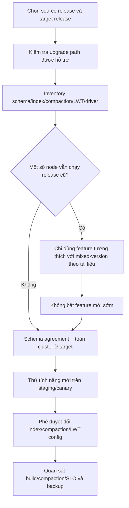
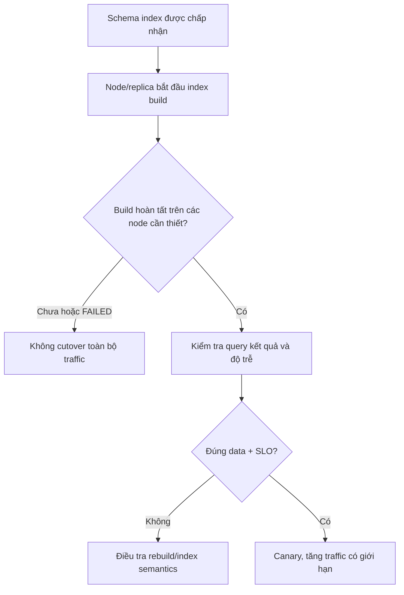
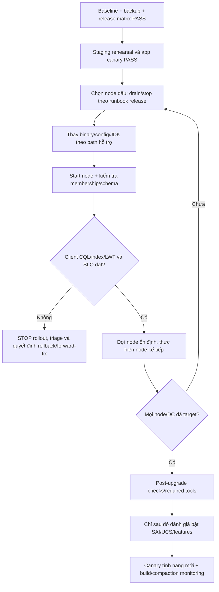

# Đối chiếu chỉ mục, compaction strategy, LWT và các tính năng theo release Apache Cassandra

## 1. Bài toán: nâng cấp node thành công nhưng truy vấn và giao dịch có còn đúng?

Một cụm Apache Cassandra đang chạy ứng dụng Java với ba loại workload:

- Đọc đơn hàng theo tenant và trạng thái bằng một chỉ mục.
- Ghi sự kiện có TTL với chiến lược compaction theo thời gian.
- Chuyển trạng thái đơn hàng qua lệnh có điều kiện `UPDATE ... IF ...`, tức **lightweight transaction (LWT)**.

Đội vận hành muốn nâng cấp Cassandra theo kiểu rolling, từng node một, để tránh dừng dịch vụ. Trước khi thay phiên bản, họ thấy bản mới có tính năng **Storage-Attached Indexing (SAI)**, **Unified Compaction Strategy (UCS)** và những thay đổi tối ưu hóa đường LWT. Câu hỏi không chỉ là “bản mới có tính năng đó không”, mà còn:

1. Cụm **đang** sử dụng chỉ mục/compaction/LWT nào, ở những bảng và ứng dụng nào?
2. Một tính năng có tồn tại trong **release đích** nhưng có hỗ trợ khi cụm đang chạy **nhiều phiên bản song song** hay không?
3. Khi đổi implementation hoặc compaction, có cần **build/rebuild/index backfill/compaction** và bao nhiêu disk/network headroom?
4. Giao dịch có điều kiện vẫn giữ nguyên **ngữ nghĩa đúng-sai** qua đường code và retry của Java Driver không?
5. Khi đổi schema/tính năng mới, **rollback binary** có còn khả thi hay đã vượt điểm không thể hạ cấp an toàn?

Bài thuộc chương **Nâng cấp và tương thích** của mô-đun `DATABASE_ENGINE_WIDE_COLUMN_CASSANDRA`. Bài kết nối kiến trúc phân tán, mô hình wide-column, thiết kế bảng theo truy vấn, consistency, CQL, replication, compaction, repair, xử lý lỗi và Java Driver. Trọng tâm là **đối chiếu khả năng tương thích theo release và kiểm chứng workload thực tế**, không phải xem việc nâng cấp thành công chỉ dựa trên `nodetool status` hiện `UN`.

### Mục tiêu học tập

Sau bài, bạn có thể:

1. Lập **feature inventory** và ma trận so sánh phiên bản nguồn → đích → giai đoạn mixed-version.
2. Đánh giá **legacy secondary index (2i)**, **SAI**, **SASI** và vấn đề xây dựng/chuyển đổi index theo release.
3. Đánh giá **STCS, LCS, TWCS, UCS**, chi phí compaction và sự phù hợp với TTL/write/read workload.
4. Kiểm chứng **LWT/Paxos, SERIAL/LOCAL_SERIAL, CAS contention và retry semantics** qua rolling upgrade.
5. Lập runbook preflight → canary → rolling upgrade → post-upgrade enablement → validation → rollback decision.
6. Kiểm tra bằng CQL, `system_schema`, `nodetool` và Java Driver 4.x, có số liệu baseline/after và điều kiện GO/NO-GO.

## 2. Ba khái niệm tương thích phải tách riêng

| Lớp | Câu hỏi | Ví dụ rủi ro |
| --- | --- | --- |
| **Binary/cluster compatibility** | Node release cũ và mới có được phép giao tiếp trong lộ trình nâng cấp không? | Gossip, messaging, on-disk format và mixed-version restrictions |
| **Schema/feature compatibility** | Mọi node cần đọc/ghi schema/index/SSTable có hiểu tính năng được bật không? | Bật SAI/UCS khi một số node cũ chưa hỗ trợ |
| **Application/protocol compatibility** | Driver, CQL statements và bảo đảm nghiệp vụ còn hoạt động không? | Driver negotiation, LWT retry, pagination, timeout, error mapping |

Một cụm có thể **nâng cấp binary đúng thứ tự** mà ứng dụng vẫn hỏng vì driver/statement, hoặc cluster khỏe nhưng truy vấn chỉ mục p99 tăng do index build chưa xong. Ngược lại, CQL query thành công trên một coordinator mới **không bảo đảm** mọi replica cũ có thể hiểu feature vừa bật.

### 2.1. “Có trong release” không có nghĩa “dùng được giữa rolling upgrade”



**Quy tắc vận hành an toàn:** giữ nguyên schema/tính năng đang dùng trong rolling upgrade, trừ khi tài liệu chính thức của **đúng lộ trình phiên bản** cho phép thay đổi. Chỉ bật feature mới sau khi toàn bộ node liên quan đạt phiên bản tối thiểu và các bước post-upgrade bắt buộc hoàn tất.

## 3. Đọc release notes theo đường nâng cấp, không theo một bài blog

Mỗi thay đổi cần xác định bốn mốc:

1. **SOURCE**: bản Cassandra hiện tại; ví dụ một release 4.x cụ thể.
2. **TARGET**: bản Cassandra định lên; ví dụ một release 5.x cụ thể.
3. **MIXED**: khoảng thời gian có cả binary cũ/mới; tính năng nào bị hạn chế?
4. **AFTER**: khi toàn cluster đã target, có bước SSTable upgrade, rebuild index, sửa driver hay bật config không?

**Không tự suy** lộ trình 3.x → 5.x có thể đi một bước chỉ vì cả hai bản đều tồn tại. Trình tự nâng cấp, compatibility window, yêu cầu JDK, driver, native protocol, công cụ và cách rollback phải lấy từ **upgrade guide/release notes của đúng bản nguồn–đích**. Không tự chọn “bản mới nhất” rồi áp qua mọi nguồn.

### 3.1. Mẫu ma trận release-aware

| Hạng mục | Source | Target | Mixed-version | Bằng chứng cần ghi |
| --- | --- | --- | --- | --- |
| Binary/JDK | Exact patch + JDK đã chạy | Exact patch + JDK được hỗ trợ | Có được chạy song song không? | Upgrade guide, Java compatibility |
| Protocol/driver | Driver version, native protocol | Supported driver/protocol | Negotiation và exception mapping | Driver compatibility test |
| 2i | Index names/kind/options | Được hỗ trợ? Có thay đổi build? | Không đổi ngoài kế hoạch | `system_schema.indexes` + test query |
| SAI | Chưa dùng/đang dùng? | Release có SAI? | **Chặn enable sớm** trừ khi docs cho phép | DDL trên staging + index build |
| SASI | Có implementation tùy chọn? | Hỗ trợ/deprecated? | Kiểm tra kỹ | DDL/config/migration plan |
| STCS/LCS/TWCS | Table-level compaction hiện tại | Tương thích/semantics | Giữ strategy khi mixed | `system_schema.tables`, disk/latency |
| UCS | Không áp dụng nếu source không có | Release có UCS? | Chỉ bật sau tương thích cluster | Config + capacity + compaction test |
| LWT/Paxos | LWT query shape, SERIAL CL | Correctness/latency behaviors | Kiểm tra tương tác giữa nodes | CAS contention tests |
| SSTable format | Current on-disk versions | Supported reader/writer | Hạn chế format khi mixed | SSTable/upgrade guide |
| Auth/security | `system_auth` RF, role settings, TLS | Auth config/caches | Fresh login, role changes | Security canary |

Ma trận trên là **mẫu cần điền**, không phải tuyên bố mọi Cassandra 4.x/5.x đều có đúng các đường chuyển đổi. Các feature và tên option thay đổi theo major/minor, cả bản phân phối thương mại.

## 4. Thu hiện trạng từ cluster mà không sửa dữ liệu

Trước upgrade, lưu inventory **trên tất cả node/DC**, không chỉ node được SSH tới đầu tiên.

```bash
# Lệnh đọc trạng thái, chạy trên node đang kiểm tra.
nodetool version
nodetool status
nodetool describecluster
nodetool tpstats
nodetool proxyhistograms
nodetool compactionstats
nodetool netstats

# Cách dùng option chi tiết thay đổi theo phiên bản.
nodetool help
```

Trong CQL, truy vấn metadata:

```sql
-- Node đang kết nối (local), cần lấy trên từng node đại diện.
SELECT release_version, cluster_name, partitioner
FROM system.local;

-- Replication của keyspace ứng dụng và system_auth.
SELECT keyspace_name, replication
FROM system_schema.keyspaces
WHERE keyspace_name IN ('upgrade_lab', 'system_auth');

-- Kiểm tra index của một bảng.
SELECT index_name, kind, options
FROM system_schema.indexes
WHERE keyspace_name = 'upgrade_lab'
  AND table_name = 'orders_by_tenant';

-- Kiểm tra compaction map của bảng.
SELECT keyspace_name, table_name, compaction
FROM system_schema.tables
WHERE keyspace_name = 'upgrade_lab'
  AND table_name = 'orders_by_tenant';
```

`system.local` chỉ mô tả node đã trả lời. Trong môi trường nhiều phiên bản, **lấy version từng node** từ inventory/`nodetool version` và metadata cluster, không xem một dòng `system.local.release_version` là version của toàn cluster.

### 4.1. Inventory phải có gì?

| Nhóm | Cần ghi |
| --- | --- |
| **Cluster/topology** | Version chính xác mỗi node, DC/rack, seeds/snitch, RF, node UN/DN, topology operations đang chạy |
| **CQL schema** | Keyspace/tables, partition/clustering keys, indexes, materialized views, UDT/UDF, table options |
| **Index workload** | Index type/kind, CQL query shape, read/write RPS, selectivity, index size/build state |
| **Compaction workload** | Strategy theo bảng, SSTable count/size, tombstone, TTL distribution, pending compactions |
| **LWT** | `IF` statements, contention rate, `SERIAL`/`LOCAL_SERIAL`, retry/timeout, concurrent writers |
| **Java** | Driver version, local DC, native protocol/TLS, retry/speculation, request timeout, paging, idempotence |
| **Safety** | Backup/restore test, disk free/headroom, p95/p99, error rate, outstanding repair/streaming |

Không cần dump mọi cấu hình có bí mật vào ticket. Ghi **effective configuration**, phiên bản và nguồn, redact host/password/token khi chia sẻ.

## 5. Các loại chỉ mục: 2i, SAI và SASI khác nhau về tính năng và vận hành

Trong Cassandra, index không thay đổi quy tắc dữ liệu được phân phối theo **partition key**. Nó cung cấp một đường truy vấn bổ sung và có chi phí ghi, đọc, disk, compaction/merge hoặc build.

| Loại | Ý tưởng | Điểm cần kiểm tra trước nâng cấp |
| --- | --- | --- |
| **Legacy secondary index (2i)** | Index cục bộ trên node cho giá trị cột; được Cassandra hỗ trợ từ lâu | Selectivity, fan-out theo cluster, index build/rebuild, read p99, writes |
| **Storage-Attached Index (SAI)** | Index tích hợp với vòng đời lưu trữ SSTable; được giới thiệu trong Apache Cassandra 5.0 | Target release hỗ trợ, cú pháp/class, index build/backfill, disk/CPU, mixed-version restrictions |
| **SASI** | Index implementation tùy chọn/experimental ở các release hỗ trợ | Ranh giới hỗ trợ, cảnh báo production, deprecation và lộ trình thay thế |
| **Materialized view** | Một cấu trúc dữ liệu suy diễn/denormalized được duy trì từ base table | Không phải secondary index; kiểm tra release support và rebuild/repair riêng |
| **Bảng theo truy vấn** | Chủ động duy trì bảng có partition key phù hợp query | Thường cho khả năng định tuyến/latency dễ kiểm soát hơn, nhưng cần đồng bộ writes |

**Không tuyên bố SAI luôn nhanh hơn 2i cho mọi truy vấn.** Hiệu quả phụ thuộc cardinality, selectivity, predicates, số partitions, kết hợp index filters, size, compression, tài nguyên và version. Không phải mọi kiểu dữ liệu/predicate đều có cùng hỗ trợ.

### 5.1. Legacy 2i: tương thích nhưng cần đo fan-out

Ví dụ trong lab:

```sql
CREATE KEYSPACE IF NOT EXISTS upgrade_lab
WITH replication = {
    'class': 'NetworkTopologyStrategy',
    'dc1': 3
};

CREATE TABLE IF NOT EXISTS upgrade_lab.orders_by_tenant (
    tenant_id text,
    order_id uuid,
    status text,
    amount decimal,
    updated_at timestamp,
    PRIMARY KEY ((tenant_id), order_id)
);

-- Legacy secondary index minh họa.
CREATE INDEX IF NOT EXISTS orders_status_2i
ON upgrade_lab.orders_by_tenant (status);
```

Nếu truy vấn cần tất cả đơn có `status='PAID'` **trên mọi tenant**, index có thể phải tìm trên nhiều node và không chắc rẻ. Với cardinality thấp, giá trị status xuất hiện trên nhiều partitions; nhiều request fan-out có thể gây tải cao. Cách truy cập cố định theo tenant có thể được phục vụ tốt hơn bởi table thiết kế theo `(tenant_id,status)` khi workload phù hợp, kèm quy trình bảo trì dữ liệu denormalized.

**Sai lầm thường gặp:** tạo index để “hết cần chọn partition key” nhưng không đo băng thông/quorum/độ chọn lọc và hiệu quả khi node mất.

### 5.2. SAI: tính năng theo release, cần feature gate

Apache Cassandra **5.0** có **Storage-Attached Indexing (SAI)**; các bản phân phối Cassandra khác có thể cung cấp SAI ở phiên bản khác. Ví dụ cú pháp dưới đây **chỉ minh họa trên release hỗ trợ**:

```sql
-- Chỉ chạy sau khi tất cả node liên quan hỗ trợ SAI.
-- Không tạo cùng lúc trên production chỉ để xem syntax.
CREATE CUSTOM INDEX IF NOT EXISTS orders_status_sai
ON upgrade_lab.orders_by_tenant (status)
USING 'StorageAttachedIndex';
```

Trước khi chạy lệnh thật, xác nhận tên class/index options trong **đúng tài liệu bản chạy**. Không giữ hai chỉ mục không cần thiết trên cùng cột chỉ để “so sánh” lâu dài, vì mỗi loại có chi phí disk/write/build riêng.

**Các vấn đề phải giải quyết khi dùng SAI:**

1. Node/replica nào trong rolling upgrade chưa hiểu loại index này?
2. Index có cần **xây dựng trên dữ liệu lịch sử**, mất bao lâu và cần bao nhiêu disk/CPU/I/O?
3. Table có nhiều SSTable, tombstone, TTL hoặc partition size rất lớn không?
4. Query thực có lọc/sắp theo điều kiện SAI hỗ trợ, và index chọn lọc đủ không?
5. Có tiến trình build/rebuild nào lỗi sau restart hoặc khi node streaming/repair?
6. Nếu muốn rollback, index schema/format mới có còn đọc được ở release cũ không?

**Chính sách an toàn:** chưa bật SAI trong **mixed-version window** nếu upgrade guide không nêu hỗ trợ rõ; ưu tiên thử ở staging sau khi toàn cluster đạt release đích.

### 5.3. SASI: không nhầm với SAI

**SASI** và **SAI** khác implementation và phạm vi hỗ trợ. SASI từng được cung cấp như một index tùy chọn/experimental trong các bản Cassandra; không coi nó mặc nhiên là con đường nâng cấp sang SAI hay là lựa chọn mặc định cho production.

Nếu inventory tìm thấy index dùng class/options liên quan SASI:

- Kiểm tra **deprecation/support** của release nguồn và đích.
- Đo lại các truy vấn `LIKE`/range/prefix nếu đang phụ thuộc vào tính năng SASI.
- Thiết kế phương án thay bằng SAI, bảng theo truy vấn hoặc search engine theo khả năng thực tế.
- Không đổi `USING 'SASI'` thành `USING 'StorageAttachedIndex'` bằng sửa trực tiếp bảng metadata.

## 6. Index compatibility không chỉ là CREATE INDEX thành công

Một index có thể được tạo thành công nhưng **chưa sẵn sàng phục vụ dữ liệu lịch sử** ở các replica mới xây dựng hoặc cần rebuild. Đặc biệt khi thêm tính năng index sau khi bảng đã có nhiều dữ liệu, chú ý:



### 6.1. Ba loại kiểm chứng

| Kiểm chứng | Câu hỏi | Bằng chứng |
| --- | --- | --- |
| **Schema** | Index định nghĩa giống nhau trên cluster? | `system_schema.indexes`, schema agreement |
| **Storage/build** | Index historical SSTables được build/rebuild thành công theo release? | Log/index build state, node metrics, disk, failures |
| **Query correctness/SLO** | Dữ liệu cũ/mới/delete/TTL được truy vấn đúng, p99 không vượt budget? | Golden dataset, Java canary, sampling theo node/DC |

**Schema agreement ≠ index build complete.** Một `SELECT` thành công cũng không chứng minh index đã build trên **mọi** replica/token range. Phải kiểm chứng cả correctness, status và node failure/restart.

### 6.2. Không dùng query syntax mới trong lúc rollback còn cần thiết

Driver/application có thể phát truy vấn mà coordinator phiên bản cũ không hiểu. Nếu cả cluster chưa ổn định, hãy giữ CQL query set trong **giao của những gì release nguồn và đích đều hỗ trợ**. Dùng feature flag hoặc application compatibility profiles; bật tính năng mới sau khi rolling upgrade và post-upgrade validation đã hoàn tất.

## 7. Compaction là gì và vì sao strategy quan trọng khi nâng cấp?

Memtable flush tạo **SSTable immutable**. Compaction chọn các SSTable để hợp nhất, loại bỏ dữ liệu dư đã an toàn, hỗ trợ read amplification, disk usage và xử lý TTL/tombstones. Mỗi strategy có trade-off giữa **write amplification, read amplification, space amplification, I/O và tuổi dữ liệu**.

Các thành phần cơ bản:

- **STCS (SizeTieredCompactionStrategy):** nhóm SSTable có kích thước tương đồng; thường phù hợp write-heavy patterns nhưng có thể cần headroom lúc merge và read amplification thay đổi theo số file.
- **LCS (LeveledCompactionStrategy):** tổ chức SSTable theo levels để giảm read amplification ở nhiều workload, đổi lại tăng compaction/write amplification và nhiều hoạt động I/O.
- **TWCS (TimeWindowCompactionStrategy):** nhóm SSTables theo cửa sổ thời gian, hữu ích cho bảng sự kiện **TTL/time-series** với write-time distribution phù hợp; cần tránh trộn thời điểm cũ/mới trong cùng SSTable.
- **UCS (UnifiedCompactionStrategy):** strategy thế hệ mới xuất hiện trong **Apache Cassandra 5.0**, cung cấp khả năng cấu hình trade-off linh hoạt theo workload; phải kiểm tra version, tuning và tương thích mixed cluster.

**Một strategy không “tốt nhất” cho mọi bảng.** Đánh giá theo query shape, tỉ lệ read/write, TTL/delete, partition size và khả năng disk/CPU/network.

## 8. Ma trận STCS, LCS, TWCS, UCS cho migration

| Strategy | Workload thường cân nhắc | Lợi ích kỳ vọng | Nguy cơ/điều kiện nâng cấp |
| --- | --- | --- | --- |
| **STCS** | Ghi đều, append-heavy, không cần read amplification thấp tuyệt đối | Merge theo kích thước, chi phí write thường vừa phải | Số SSTable và space amplification khi merge; p99 read nếu nhiều file |
| **LCS** | Read-heavy, cần giảm số SSTable chạm khi đọc | SSTable theo level và non-overlap ở các level thích hợp | Write amplification/compaction I/O cao; thay strategy có chuyển tiếp dài |
| **TWCS** | Time-series có TTL, dữ liệu đến tương đối đúng cửa sổ | TTL expiration/compaction theo window hiệu quả khi điều kiện phù hợp | Late writes/upserts vào dữ liệu cũ, windows quá lớn/nhỏ, mixed TTL |
| **UCS** | Bảng có trade-off read/write cần tối ưu theo mục tiêu, khi release hỗ trợ | Cấu hình linh hoạt chi phí read/write/space | Feature mới theo release, cấu hình/tuning thay đổi, không bật sớm trong mixed-version |

### 8.1. TWCS: đừng chọn chỉ vì bảng có cột timestamp

TWCS thích hợp khi **thời gian ghi**, TTL và cách dữ liệu được xóa phù hợp cửa sổ; chỉ có `event_time timestamp` trong schema không đủ chứng minh. Một client ghi event lịch sử với write timestamp cũ, sửa row đã rất lâu, hoặc mutation từ backfill có timestamp lệch có thể làm SSTable chứa dữ liệu ở nhiều window không mong muốn.

Khi chọn TWCS, kiểm tra:

- Phân phối **write timestamps** và TTL thực tế, không chỉ event time.
- Tỉ lệ late arrivals, backfill, updates, deletes và thời gian lưu.
- Khả năng hết hạn **cả SSTable** khi cùng nhóm dữ liệu expired.
- `gc_grace_seconds` và repair schedule để không tạo zombie data.
- Disk headroom khi chuyển strategy/rewrite SSTables.

### 8.2. UCS: không dùng option của release khác

Khi release đích có UCS, **tên class, scaling parameter, option và default** phải lấy từ tài liệu đúng release. Không copy cấu hình UCS từ blog về bản phân phối khác mà không đối chiếu.

**Việc một node mới hiểu tên class không chứng minh cluster cũ có thể hiểu nó.** Không chuyển bảng STCS/LCS/TWCS sang UCS khi còn node phiên bản cũ nếu docs không cho phép mixed-mode operation. Hãy tách **binary upgrade** và **compaction strategy migration** thành hai change có checkpoint.

## 9. CQL kiểm tra và đổi compaction trên bảng lab

`system_schema.tables.compaction` cho biết strategy/option đã khai báo:

```sql
SELECT table_name, compaction
FROM system_schema.tables
WHERE keyspace_name = 'upgrade_lab'
  AND table_name = 'orders_by_tenant';
```

Trong lab của một release hỗ trợ STCS và LCS, có thể thay option trên **bảng thử**, một bước riêng sau khi đã đạt điều kiện an toàn:

```sql
-- Ví dụ trên staging, KHÔNG phải thao tác bắt buộc khi nâng cấp binary.
ALTER TABLE upgrade_lab.orders_by_tenant
WITH compaction = {
    'class': 'LeveledCompactionStrategy'
};
```

**Đổi compaction schema không có nghĩa mọi SSTable cũ đã ngay lập tức được tổ chức lại.** Compaction nền xử lý dần theo policy; chuyển strategy có thể gây tăng read/write/disk I/O, số SSTables tạm thời và p99. Trong production phải có capacity headroom, theo dõi migration, dừng khi vượt SLO và hiểu điều kiện rollback.

### 9.1. Cách quan sát

```bash
nodetool tablestats upgrade_lab.orders_by_tenant
nodetool tablehistograms upgrade_lab orders_by_tenant
nodetool compactionstats
nodetool tpstats
nodetool proxyhistograms
```

| Metric | Điều cần theo dõi |
| --- | --- |
| SSTable count / SSTables per read | Read amplification theo node, table |
| Pending compactions / bytes remaining | Tải nền và thời gian hội tụ strategy mới |
| Disk used/free, I/O latency | Headroom trong lúc tạo SSTable mới và xóa tệp cũ |
| Read/write p95/p99 phía Java | SLO end-to-end, không chỉ local table latency |
| Tombstones scanned / TTL expired | Chi phí query/delete và hiệu quả strategy |
| Successful RPS / timeout / retry | Tránh p99 “đẹp” do nhiều request đã bị từ chối |

**Không** chạy major compaction hoặc công cụ chỉnh sửa SSTable chỉ để “ép xong strategy migration” khi chưa có quy trình theo phiên bản và kế hoạch disk/rollback.

## 10. LWT: câu hỏi compatibility không chỉ là chạy được câu lệnh IF

Lightweight transactions (LWT) của Cassandra dùng giao thức **Paxos/compare-and-set (CAS)** để thực hiện cập nhật có điều kiện trên cùng partition theo ngữ nghĩa của Cassandra. Nó có chi phí và đường retry khác so với ghi thông thường.

Ví dụ:

```sql
-- Bảng đã có khóa (tenant_id, order_id) và dòng status='NEW'.
UPDATE upgrade_lab.orders_by_tenant
SET status = 'PAID', updated_at = '2026-11-21T09:00:00Z'
WHERE tenant_id = 'tenant_lab'
  AND order_id = 11111111-1111-1111-1111-111111111111
IF status = 'NEW';
```

Kết quả LWT có cột `[applied]`. Khi `[applied]=true`, điều kiện đã được áp dụng; khi `false`, Cassandra trả trạng thái để ứng dụng quyết định bước tiếp theo. Nếu **timeout**, không được suy rằng điều kiện chưa áp dụng: tác vụ có thể đã commit ở các replica dù response chưa tới client.

### 10.1. Những ràng buộc cần giữ qua nâng cấp

- **Correctness của CAS:** không được để hai request cạnh tranh cùng thấy mình đã chuyển `NEW → PAID` thành công trái với contract.
- **Serial consistency:** `SERIAL` và `LOCAL_SERIAL` có phạm vi khác nhau trong multi-DC; không đổi tùy tiện để giảm latency.
- **Regular consistency:** LWT còn có CL thông thường cho phần read/write tương ứng; phải lưu cả regular và serial CL.
- **Contention:** nhiều writer tranh một partition gây retry/latency; tối ưu binary không sửa được hot partition key.
- **Idempotency/retry:** application và driver phải xử lý unknown outcome và điều kiện `[applied]`, không retry vô hạn/mù.
- **Mixed-version:** giao thức Paxos/schema và những cải tiến trong release phải tuân theo upgrade guide, kể cả cảnh báo cấu hình/feature.

LWT thường **scope theo partition**. Nó không thay thế transaction phân tán giữa nhiều partition/bảng hay hai cluster.

## 11. `SERIAL` và `LOCAL_SERIAL` trong các DC

| Loại CL | Vai trò khái quát | Cần kiểm tra |
| --- | --- | --- |
| `SERIAL` | Serial consistency theo phạm vi toàn bộ replica tương ứng với điều kiện LWT | WAN latency, khả năng chịu DC outage, toàn cluster hỗ trợ |
| `LOCAL_SERIAL` | Serial consistency giới hạn theo data center cục bộ nơi thao tác diễn ra | Yêu cầu nghiệp vụ khi multi-DC writers, routing/local DC và failure mode |
| `LOCAL_QUORUM`/`QUORUM` | Regular consistency cho phần CQL read/write | Không thay cho serial consistency của pha CAS |

**Một ví dụ sai:** ứng dụng cần một trạng thái duy nhất giữa DC1 và DC2 nhưng đội vận hành đổi từ `SERIAL` sang `LOCAL_SERIAL` để giảm p99 mà không phân tích hai writer đồng thời. Dù query vẫn thành công, scope bảo đảm của thao tác đã đổi.

**Cách làm đúng:** ghi rõ business invariant, tập replica/CL, kết quả trong network partition, và test cạnh tranh trên các coordinator/DC. Chỉ đổi khi sản phẩm chấp nhận semantics mới và tài liệu version xác nhận hỗ trợ.

## 12. Chi phí LWT và kiểm chứng khi nâng cấp

LWT có nhiều thông điệp và round trip hơn ghi thường. Theo release, implementation/Paxos optimization và metrics có thể thay đổi. Đừng gắn một số vòng RTT cố định cho mọi phiên bản.

### 12.1. Bộ số liệu cần thu

| Metric | Vì sao |
| --- | --- |
| LWT attempts/s và `[applied]` true/false | Đếm thành công nghiệp vụ khác contention |
| CAS contention/timeout/unavailable | Đo tranh chấp và lỗi thực, kể cả server-side |
| Java p50/p95/p99 của riêng LWT statements | Tách khỏi p99 SELECT/INSERT thường |
| Retry/speculative attempts | Phát hiện attempt amplification và unknown outcomes |
| Coordinator và replica CPU/GC/network | Đo overhead giao thức |
| Regular/serial CL và local DC | Giải thích khác biệt multi-DC |
| Vi phạm business invariant | Tiêu chí correctness quan trọng hơn latency |

### 12.2. Hai case cạnh tranh

**Case A — duy nhất một winner:** hai client cùng `IF status='NEW'` muốn chuyển sang hai trạng thái khác nhau. Với schema/CL phù hợp và không có thay đổi khác, chỉ một thao tác được áp dụng theo contract; lần còn lại thấy `[applied]=false` hoặc lỗi có thể cần reconcile.

**Case B — timeout unknown:** client A timeout sau khi gửi CAS, client B sau đó thấy status đã đổi. A **không được** tự gửi một mutation không điều kiện để “bù”, vì có thể phá invariant. Cần đọc lại bằng CL/serial semantics được phê duyệt và dùng operation ID/state machine để xác định kết quả.

Kiểm tra cả **bình thường, khi một replica chậm, khi node restart và khi cluster mixed-version** theo hướng dẫn an toàn. Không khởi tạo chaos network trong production nếu chưa có phê duyệt.

## 13. Java Driver 4.x: test LWT và kết quả `[applied]`

Ví dụ Java 17+, DataStax/Apache Cassandra Java Driver 4.x. Giả sử `CqlSession session` đã cấu hình local DC, TLS/auth và được quản lý vòng đời:

```java
import com.datastax.oss.driver.api.core.DefaultConsistencyLevel;
import com.datastax.oss.driver.api.core.cql.BoundStatement;
import com.datastax.oss.driver.api.core.cql.PreparedStatement;
import com.datastax.oss.driver.api.core.cql.ResultSet;
import com.datastax.oss.driver.api.core.cql.Row;
import java.time.Instant;
import java.util.UUID;

PreparedStatement cas = session.prepare("""
    UPDATE upgrade_lab.orders_by_tenant
    SET status = ?, updated_at = ?
    WHERE tenant_id = ? AND order_id = ?
    IF status = ?
    """);

BoundStatement statement = cas.boundStatementBuilder()
    .setString(0, "PAID")
    .setInstant(1, Instant.parse("2026-11-21T09:00:00Z"))
    .setString(2, "tenant_lab")
    .setUuid(3, UUID.fromString("11111111-1111-1111-1111-111111111111"))
    .setString(4, "NEW")
    .setConsistencyLevel(DefaultConsistencyLevel.LOCAL_QUORUM)
    .setSerialConsistencyLevel(DefaultConsistencyLevel.SERIAL)
    .build();

long startedNs = System.nanoTime();
try {
    ResultSet rs = session.execute(statement);
    Row row = rs.one();
    long elapsedNs = System.nanoTime() - startedNs;

    if (row != null && row.getBoolean("[applied]")) {
        // CAS applied; ghi latency và trạng thái nghiệp vụ.
    } else {
        // CAS not applied; đây là kết quả cạnh tranh hợp lệ,
        // không phải Cassandra transport failure.
    }
} catch (RuntimeException error) {
    // Lỗi/timeout => outcome có thể UNKNOWN.
    // Không tự retry mutation vô điều kiện.
    throw error;
}
```

**Đọc đúng ví dụ:**

- Regular CL và serial CL là **hai setting khác nhau**.
- `SERIAL` ở đây được chọn để minh họa contract cần coordination phù hợp; ứng dụng có thể dùng `LOCAL_SERIAL` nếu scope được thiết kế/kiểm chứng rõ.
- Cột `[applied]` chỉ có trong kết quả câu lệnh có điều kiện; không dùng nó cho `INSERT` thường.
- Nếu row null hoặc timeout, code mẫu ném lỗi/không có kết quả; production cần state machine xử lý unknown outcome và tracing.
- Không bật retry/speculative execution cho mọi CAS chỉ vì p99 tăng; phải xét driver policy, idempotence và contention semantics.

### 13.1. Một phép thử Java không chứng minh toàn cluster đúng

Chạy mẫu trên một coordinator mới không thay cho test từ **từng DC và nhiều node versions** trong giai đoạn nâng cấp. Đặt canary distribution theo coordinators, theo application build và theo query fingerprint; ghi Cassandra version thực của node thực thi nếu có.

## 14. Tách correctness test với performance test

Một bộ thử tốt có hai nhóm:

### Correctness

1. **Legacy index:** truy vấn theo index khớp giá trị mong đợi ở bản ghi cũ/mới, update, DELETE và TTL.
2. **SAI:** chỉ thử sau khi release/build tương thích; kiểm tra các predicate được hỗ trợ, query results và giai đoạn index build.
3. **TWCS/compaction:** không xuất hiện row đã xóa, không mất row còn sống, TTL còn hiệu lực theo timestamp.
4. **LWT:** không có hai winner trái invariant; timeout được phân loại UNKNOWN; `[applied]` được xử lý.
5. **Client:** prepared statement, types, codecs/UDT, paging, TLS/auth hoạt động ở native protocol đích.

### Performance

- Read/write/LWT p50/p95/p99 theo query shape, **không** gộp tất cả vào một biểu đồ.
- Successful RPS, offered RPS, timeout, unavailable, read failure và CAS contention.
- SSTables per read, disk I/O, compaction backlog, heap/GC, network.
- Index build progress, resource overhead, read p99 khi build/rebuild.
- Recovery/rack/node outage behavior, nếu có môi trường staging diễn tập.

**Correctness là điều kiện bắt buộc**; p99 đẹp hơn không bù được một truy vấn chỉ mục trả thiếu row hoặc một CAS cho hai thay đổi mâu thuẫn cùng thắng.

## 15. Chuẩn bị golden dataset cho kiểm thử tương thích

Tạo tập dữ liệu có thể tái hiện và đủ đặc trưng:

| Nhóm dữ liệu | Mục tiêu |
| --- | --- |
| Bản ghi cũ trước upgrade | Index và SSTable hiện có vẫn đọc đúng |
| Bản ghi mới sau upgrade | Đường ghi mới không tạo khác biệt kết quả |
| UPDATE cùng partition | Index cập nhật đúng giá trị cũ/mới |
| DELETE/TTL | Tombstone và expiry không sinh stale/zombie |
| Partition lớn/nhiều SSTables | Đánh giá latency/compaction dưới read amplification |
| Nhiều tenant/key phân tán | Đánh giá load balancing/replica placement |
| LWT contended key | Đảm bảo chỉ một winner và latency/CAS behavior |
| Multi-DC hoặc mất replica (staging) | Kiểm tra CL, failover, timeouts và sửa lỗi |

Ví dụ CQL khởi tạo một case LWT:

```sql
INSERT INTO upgrade_lab.orders_by_tenant
    (tenant_id, order_id, status, amount, updated_at)
VALUES (
    'tenant_lab',
    11111111-1111-1111-1111-111111111111,
    'NEW', 120.50, '2026-11-21T08:00:00Z'
);

SELECT status, amount, updated_at
FROM upgrade_lab.orders_by_tenant
WHERE tenant_id = 'tenant_lab'
  AND order_id = 11111111-1111-1111-1111-111111111111;
```

Tạo test source/target có cùng dataset, CL và query load. Dùng mã kiểm chứng expected values theo **business primary key**, không chỉ `COUNT(*)`. Đừng thử dữ liệu chứa PII thật bên ngoài môi trường được phê duyệt.

## 16. Preflight rolling upgrade: các điều kiện NO-GO

Trước nâng cấp từng node, bắt buộc xác nhận:

1. **Upgrade path được hỗ trợ:** source/target exact patch, intermediate versions, Java/JDK, SSTable format, driver, native protocol, release notes và bug fixes.
2. **Sức khỏe cụm:** không có node down chưa xử lý, bootstrap/decommission/replace/repair xung đột hoặc schema disagreement.
3. **Dữ liệu và backup:** snapshot/off-host backup được kiểm chứng, rollback/restore drill, đủ disk headroom và lưu SSTables cũ khi cần.
4. **Indexes:** inventory đầy đủ; biết index nào build/rebuild cần thời gian hoặc có API khác.
5. **Compaction:** strategy/options và pending compactions; không nâng cấp giữa major compaction hay thiếu disk.
6. **LWT:** danh sách CAS statements, SERIAL/local SERIAL CL, contention p99, application retry semantics.
7. **Security:** `system_auth` RF phù hợp, fresh login/TLS và permission canary hoạt động.
8. **Application:** driver/version compatibility, CQL statement compatibility, feature flags chưa bật.
9. **Capacity:** đủ sức chịu một node bị drain/restart, có tốc độ traffic giảm/backpressure khi cần.
10. **Observability:** metrics, logs, alert, phân vai GO/NO-GO và điều kiện dừng rõ.

Nếu một điều kiện quan trọng chưa kiểm chứng, ghi **NO-GO**. Không để sự kiện “node hiện UN” lấn át nhu cầu backup, schema/index compatibility hoặc tính đúng của CAS.

## 17. Quy trình rolling upgrade theo checkpoint



**Lưu ý:** thao tác cụ thể `drain`, stop/start service, upgrade packages/JDK và công cụ SSTable phụ thuộc upgrade guide của phiên bản. Bài không đưa một chuỗi lệnh systemd có thể gây outage khi áp dụng sai vào cluster khác.

### 17.1. Sau mỗi node

| Cần kiểm tra | Bằng chứng |
| --- | --- |
| Process/version, DC/rack và node state | `nodetool version`, `status`, startup logs |
| Schema agreement | `describecluster`, schema metadata/node logs |
| Read/write at configured CL | Java canary theo partition key và query shape |
| Index queries | Golden keys, query result và errors |
| LWT | `[applied]` đúng, CAS contention/timeout và uniqueness |
| Resource | CPU/heap/GC/disk, compaction, pending queues |
| Connectivity | Driver contact points/local DC, TLS/auth fresh sessions |
| Rollout safety | Không mất thêm node/replica capacity ngoài budget |

### 17.2. Một node mới UN nhưng cluster vẫn có thể chưa sẵn sàng

`UN` nghĩa Up/Normal theo membership tại thời điểm đo. Node có thể còn index build, compaction, streaming, cache warmup hoặc p99 cao. Kiểm tra **truy vấn ở CL thực** và workload, không chỉ trạng thái.

## 18. Mixed-version window: những gì nên “đóng băng”

Trong giai đoạn Cassandra nodes có nhiều release:

- **Không thêm SAI/UCS hoặc CQL syntax mới** nếu upgrade guide không cho phép.
- Tránh thay đồng thời **RF/topology**, compaction strategy, index implementation và binary.
- Không chạy các công cụ **SSTable rewrite** của release mới lên dữ liệu của node dự kiến rollback, trừ khi được hướng dẫn cụ thể.
- Giữ client Driver 4.x tại cấu hình/native protocol được cả hai phía hỗ trợ, kiểm tra feature negotiation.
- Giữ CL/LWT invariants và kiểm thử requests trên cả node cũ và mới.
- Theo dõi index/compaction/repair backlog; không dựa trên benchmark của một node trống.

**Vì sao khó rollback?** Node mới có thể tạo SSTable/metadata/feature format mà binary cũ không đọc được. Một số upgrade path cho phép dừng và phục hồi từ backup/forward-fix thay vì downgrade trực tiếp. Quyết định rollback phải dựa tài liệu nguồn–đích và trạng thái dữ liệu thực, không phải thao tác “cài lại package cũ”.

## 19. Sau khi toàn cluster đã nâng: đánh giá feature enablement riêng

### 19.1. Chuyển 2i → SAI

Đây **không phải rename index class**. Quy trình:

1. Kiểm tra release, supported column types/predicates và tính tương thích.
2. Lập baseline query index cũ: correctness, p50/p95/p99, write throughput, index size.
3. Tạo SAI index trên staging với dữ liệu/volume tương đương; đo index build, compaction và resource.
4. Tạo feature flag/query compatibility cho application; test golden queries.
5. Nếu production cần chuyển, tạo index mới có kiểm soát và **chờ build hoàn tất**, xác nhận từng node/replica liên quan.
6. Canary reads, so dữ liệu và p99; chỉ sau khi đạt mới bỏ index cũ có kế hoạch.
7. Đánh giá rollback: nếu chỉ mục cũ đã drop, xây lại mất thời gian và I/O.

Trong production, đừng tạo quá nhiều index trùng chỉ để so sánh: cả index build và write amplification có thể làm ảnh hưởng SLO.

### 19.2. Chuyển STCS/LCS/TWCS → UCS

Quy trình tương tự nhưng tác động chủ yếu ở SSTables và disk:

1. Chốt read/write/TTL/late-write pattern và mục tiêu read/write/space amplification.
2. Ghi current compaction options, histograms và các SSTables per read.
3. Trên staging, thử UCS option chính xác của release target.
4. Đo disk headroom, pending compactions, CPU, p99 trong giai đoạn chuyển tiếp và sau ổn định.
5. Phê duyệt trên từng bảng, giới hạn song song.
6. Khi muốn rollback compaction strategy, đánh giá mức SSTable rewrite đã xảy ra; rollback schema option không xóa tác động I/O đã phát sinh.

### 19.3. LWT/Paxos improvements

Ngay cả khi release mới có tối ưu hóa Paxos, ứng dụng không nên mặc định đổi semantics để tận dụng tốc độ. Giữ CL, testing invariant, retry policy và metrics; chỉ thay configuration/protocol mode khi tài liệu hỗ trợ, test contention, mixed-version safety và failover được phê duyệt.

## 20. Java Driver 4.x: chẩn đoán version/protocol compatibility

Đường CQL từ Java đi qua **native protocol**, driver load balancing và prepared statement cache. Một cluster mixed-version có thể cần negotiate protocol phù hợp; thay server không có nghĩa ứng dụng phải thay driver ngay trong cùng bước, nhưng **phải kiểm tra matrix hỗ trợ**.

### 20.1. Những lỗi cần phân loại

| Triệu chứng | Giả thuyết cần kiểm tra | Bằng chứng |
| --- | --- | --- |
| Không mở session mới | Protocol/auth/TLS, node discovery, local DC | Driver errors, handshake logs, version |
| Prepared statement lỗi sau node restart | Prepared metadata/cache invalid hoặc schema change | App logs, schema, reprepare metrics |
| Query index trả lỗi CQL | Coordinator release cũ không hỗ trợ feature/predicate | Coordinator version, query text, feature flag |
| LWT timeout tăng | Contention, latency node/WAN, Paxos behavior, retries | CAS metrics, per-node version |
| Paging fail | Schema/query/page state không tương thích | Query fingerprint, page size, protocol version |
| p99 xấu nhưng node `UN` | Build/compaction, I/O, coordinator skew | `tpstats`, `compactionstats`, driver metrics |

**Đừng vội đổi retry policy hoặc hạ CL** để làm báo động biến mất. Hành vi nghiệp vụ của LWT, đọc dữ liệu mới và tính nhất quán có thể đã bị thay đổi.

### 20.2. Mẫu audit cho mỗi CQL request

```text
application_build / java_driver_version:
cluster_id / coordinator_DC / coordinator_version (nếu xác định):
query_fingerprint / table / index_type:
bind_types / partition_alias:
regular_CL / serial_CL / page_size:
started_at_UTC / elapsed_monotonic_ms:
success_or_error / error_class / retry_count:
business_assertion / expected_key_state:
```

Dùng partition alias/HMAC thay raw PII khi gửi số liệu điều tra. Không đưa password/credential hoặc raw system_auth vào log.

## 21. Sự khác biệt giữa release feature và data migration

Một số nâng cấp tính năng có công việc nền không hiển thị rõ qua việc đổi metadata:

| Thay đổi | Metadata tác động | Dữ liệu/công việc cần bổ sung |
| --- | --- | --- |
| Tạo 2i/SAI | Index schema | Build index từ SSTable lịch sử, theo release |
| Thay compaction strategy | Table options | Background compaction/rewrite và disk headroom |
| Nâng SSTable format | Storage format/node version | Công cụ/version-specific upgrade và kiểm chứng dữ liệu |
| Đổi RF | Keyspace replication map | Full repair/backfill replica placement, không phải index build |
| Đổi partition key để tối ưu query | Bảng mới/data model | Backfill ứng dụng theo token/bucket, CDC/dual-write, cutover |
| Đổi LWT behavior/CL | Statement/driver/config | Correctness, conflict/timeout/unknown outcome tests |

Đừng chạy `nodetool repair` và nghĩ rằng nó sẽ tự tạo SAI index của release mới hoặc chuyển bảng theo query model. **Replica repair, index build, compaction và application backfill là các loại công việc khác nhau.**

## 22. Rollback: phân biệt “trở về binary cũ” với “khôi phục nghiệp vụ”

Rollback phải được thiết kế **trước** khi node đầu tiên nâng cấp.

### 22.1. Trước khi bật tính năng mới

Nếu release hỗ trợ rollback binary và **on-disk format/schema chưa vượt ranh giới tương thích**, có thể có lộ trình hạ cấp được tài liệu cho phép. Nhưng không tự assume. Cần giữ backup, config/JDK cũ, và kiểm tra chính xác lộ trình từ **patch hiện tại**.

### 22.2. Sau khi bật SAI/UCS hoặc chuyển SSTable format

Việc hạ binary có thể **không an toàn hoặc không được hỗ trợ**. Khi đó phương án ưu tiên có thể là:

- Dừng rollout/tắt feature flag ứng dụng và tiếp tục phục vụ bằng query path cũ nếu còn.
- Forward-fix ở release mới, rebuild index hoặc sửa compaction theo hướng dẫn.
- Restore từ backup **đã kiểm thử** vào môi trường tương thích.
- Giữ dữ liệu nguồn/backup đủ lâu và báo rõ RPO/RTO, kể cả write mới sau mốc snapshot.

**Không** xóa trực tiếp SSTable/index components hoặc đổi table UUID để “ép Cassandra cũ đọc được”. Một lỗi tương thích có thể thành lỗi mất dữ liệu.

## 23. Ma trận quyết định GO / NO-GO / ROLLBACK

| Tình huống | Quyết định | Lý do |
| --- | --- | --- |
| Upgrade path chính thức chưa xác nhận | **NO-GO** | Không biết mixed-version/on-disk compatibility |
| Một node chưa healthy hoặc schema disagreement | **NO-GO** | Khó đảm bảo quorum/khả năng rollback |
| Backup có nhưng chưa restore thử | **NO-GO** cho change rủi ro cao | Không chứng minh recovery path |
| Node đầu nâng xong, p99 và CAS correctness đạt | **GO có điều kiện** | Cần tiếp tục monitor trước node kế |
| Query SAI chạy trên node mới, node cũ vẫn tồn tại | **NO-GO enable** nếu docs không cho phép | Chưa chứng minh feature mixed-version |
| Index build chưa hoàn tất trên một replica | **NO-GO cutover** | Dữ liệu lịch sử có thể chưa truy vấn đúng |
| Compaction pending/disk tăng vượt headroom | **PAUSE** | Rủi ro cạn disk và timeout |
| LWT có hai winner vi phạm invariant | **STOP/ESCALATE** | Correctness ưu tiên hơn latency |
| Có SSTable format mới không đọc được bởi binary cũ | **Không rollback binary tùy tiện** | Cần forward-fix/restore theo guide |
| Toàn cluster target, golden tests/SLO đạt | **GO đánh giá tính năng mới riêng** | Upgrade binary và feature enablement là hai change |

## 24. Runbook nâng cấp có thể kiểm chứng

### Giai đoạn A — Chuẩn bị

1. Ghi exact source/target release và upgrade guides, JDK/driver, protocol, SSTable format.
2. Lập inventory indexes/compaction/LWT statements với owner từng bảng, traffic và SLO.
3. Lưu schema, config, backup off-host, restore drill và trạng thái repair/topology.
4. Dựng staging có cùng feature và dữ liệu biểu diễn, chạy correctness/performance baseline.
5. Chốt điều kiện dừng: p99, error, CAS contention, disk free, compaction/index build, node health.

### Giai đoạn B — Rolling binary

1. Chọn node đầu theo DC/rack/failure budget đã phê duyệt.
2. Drain/stop/upgrade theo tài liệu phiên bản, không trộn schema/index change.
3. Khởi động và xác minh node version, membership, schema agreement, client handshake.
4. Chạy CQL golden tests, Java index reads, LWT CAS tests và quan sát SLO/resource.
5. Nếu FAIL, dừng; quyết định forward-fix/restore/downgrade **chỉ** theo path hỗ trợ.
6. Nếu PASS ổn định, lặp từng node còn lại, giữ quorum và availability.

### Giai đoạn C — Post-upgrade

1. Xác nhận mọi node ở target release và mixed-version period đã kết thúc.
2. Thực hiện các bước post-upgrade được docs yêu cầu, nhưng **không tự chạy rewrite SSTable** thiếu phê duyệt.
3. Đánh giá SAI/UCS hoặc tính năng mới ở **change riêng**, có staging/canary/rollback.
4. Theo dõi index build, compaction, LWT contention, data correctness và toàn bộ SLO.
5. Ghi báo cáo trước/sau, known gaps và người sở hữu.

## 25. Mẫu bảng kiểm kê theo release

```yaml
upgrade_id: cassandra-release-a-to-b
service: DATABASE_ENGINE_WIDE_COLUMN_CASSANDRA
language: vi
environment: staging
source_release: "RECORD_EXACT_VERSION"
target_release: "RECORD_EXACT_VERSION"
upgrade_path_verified_against_official_docs: false
java_runtime:
  source: "RECORD_ACTUAL_JDK"
  target_supported: "VERIFY_FROM_RELEASE_NOTES"
driver:
  version: "RECORD_ACTUAL_DRIVER"
  protocol_compatibility: "UNVERIFIED"
mixed_version:
  permitted: "UNVERIFIED"
  blocked_features: [SAI, UCS, new_CQL_syntax]
keyspace:
  name: upgrade_lab
  replication: "NTS dc1=3, verify actual"
tables:
  - name: orders_by_tenant
    indexes_current: [orders_status_2i]
    indexes_proposed: [orders_status_sai]
    index_build_status: "NOT_STARTED"
    compaction_current: "RECORD_ACTUAL_STRATEGY"
    compaction_proposed: "NO_CHANGE_DURING_BINARY_ROLLOUT"
    lwt_statement_count: "MEASURE_ACTUAL"
    serial_cl: SERIAL
checks:
  schema_agreement: "PENDING"
  backup_restore_test: "PENDING"
  index_correctness: "PENDING"
  lwt_invariants: "PENDING"
  read_write_p99: "PENDING"
  disk_headroom: "PENDING"
decision: NO_GO
```

**Mẫu trên là dữ liệu hướng dẫn**, không phải giá trị đã được xác minh. Trong thực tế, ghi đầy đủ table/DC/node, owner, source artifact, timestamps UTC, feature flags, metrics và tài liệu release path được dùng. Không lưu secrets/TLS private keys trong báo cáo.

## 26. Bài tập tình huống

### Bài tập A — SAI trong mixed-version window

Cluster sáu node đang nâng từ một release cũ sang release có SAI. Hai node đã nâng, bốn node còn cũ. Developer muốn tạo SAI index vì test trên node mới chạy nhanh.

1. Tại sao “node mới tạo index thành công” chưa đủ cho phép bật production?
2. Cần kiểm tra feature support/mixed-version restrictions và index build ở những node nào?
3. Hãy lập GO/NO-GO cho canary và tiêu chí rút lui.
4. Vì sao không nên đồng thời drop 2i trước khi hoàn tất kiểm chứng?

### Bài tập B — chuyển TWCS sang UCS

Một bảng event TTL 30 ngày dùng TWCS, thường có late writes và đôi khi backfill dữ liệu lịch sử. Sau nâng Cassandra, DBA muốn đổi UCS vì thấy benchmark đọc nhanh.

1. Những metric và data distribution nào phải đo trước khi so?
2. Tại sao late writes làm đánh giá TWCS phức tạp?
3. Chuyển strategy có tự đổi toàn bộ SSTable ngay lập tức không?
4. Khi p99 giảm nhưng disk space tạm tăng gấp đôi, cần tiêu chí an toàn gì?

### Bài tập C — LWT correctness qua rolling upgrade

Hai Java writers cùng chạy `IF status='NEW'` trên một order. Một writer nhận success, writer còn lại timeout; sau đó application hiện hai thông báo đã chuyển trạng thái.

1. Vì sao timeout không có nghĩa chắc chắn `[applied]=false`?
2. Có thể suy từ hai thông báo client rằng Cassandra đã cho hai CAS cùng áp dụng không?
3. Thiết kế phép thử phân biệt retry/logging bug với vi phạm invariant thực.
4. Regular CL và SERIAL/LOCAL_SERIAL cần được ghi thế nào?

### Bài tập D — compaction tạo nghẽn sau nâng binary

Sau nâng node đầu, pending compactions và SSTables per read tăng; p99 Java xấu nhưng `nodetool status` vẫn `UN`.

1. Vì sao membership không thay cho SLO?
2. Có nên chạy major compaction ngay để “dọn” không?
3. Cần so baseline read/write p99, disk/GC, table histograms thế nào?
4. Khi nào phải pause rollout?

### Bài tập E — rollback sau bật feature mới

Đội vận hành nâng xong toàn cluster, bật index/compaction tính năng mới, rồi phát hiện query correctness bug. Họ muốn hạ binary về release cũ trong một giờ.

1. Những câu hỏi phải trả lời về on-disk/schema compatibility?
2. Khi nào nên dùng feature flag/forward-fix thay vì downgrade?
3. Backup/restore drill phải có bằng chứng gì trước thay đổi?
4. Tại sao không xóa trực tiếp index/SSTable files?

## 27. Câu hỏi tự kiểm tra

1. Khác biệt giữa binary, schema-feature và application-protocol compatibility là gì?
2. Vì sao không áp dụng mọi CQL syntax của release mới ngay trong mixed-version window?
3. 2i, SAI và SASI khác nhau về implementation và vòng đời hỗ trợ thế nào?
4. Tạo index thành công có chứng minh mọi dữ liệu lịch sử đã được index chưa?
5. Khi nào bảng theo truy vấn tốt hơn secondary index?
6. STCS/LCS/TWCS/UCS có trade-off read/write/space amplification khác nhau thế nào?
7. TWCS cần xem write timestamp/TTL hay chỉ cột event_time?
8. Thay compaction strategy có rewrite mọi SSTable lập tức không?
9. Vì sao UCS có thể cần feature gate theo release?
10. `SERIAL` khác `LOCAL_SERIAL` ở phạm vi ra sao?
11. Vì sao cần xử lý `[applied]=false` khác read timeout của LWT?
12. Có thể dùng một LWT để transaction trên nhiều partitions khác nhau không?
13. Vì sao p99 của một coordinator mới không chứng minh cluster hỗn hợp ổn định?
14. Khi nào có thể rollback binary, khi nào phải forward-fix/restore?
15. Bằng chứng tối thiểu để đánh dấu upgrade COMPLETED là gì?

## 28. Tài liệu và nguyên tắc đối chiếu

Các tài liệu cần tra cứu **theo đúng source/target release**, không chỉ tên “Cassandra”:

- [Apache Cassandra Documentation](https://cassandra.apache.org/doc/latest/): kiến trúc, release notes, upgrading, CQL, indexes và operating.
- [Apache Cassandra — Secondary Indexes](https://cassandra.apache.org/doc/latest/cassandra/developing/indexing/indexing-concepts.html): kiến thức nền về index và ranh giới truy vấn.
- [Apache Cassandra — Storage-Attached Indexing](https://cassandra.apache.org/doc/latest/cassandra/developing/indexing/sai/sai-overview.html): SAI, query predicates và build semantics.
- [Apache Cassandra — Compaction](https://cassandra.apache.org/doc/latest/cassandra/managing/operating/compaction/index.html): STCS/LCS/TWCS/UCS theo release.
- [Apache Cassandra — Lightweight transactions](https://cassandra.apache.org/doc/latest/cassandra/developing/cql/dml.html): điều kiện `IF`, LWT và CQL semantics.
- [Apache Cassandra Java Driver 4.x](https://docs.datastax.com/en/developer/java-driver/4.17/): prepared/bound statement, consistency, retry, protocol, codec và migration notes theo phiên bản.

Đường dẫn tài liệu có thể thay đổi theo version hoặc nhà phát hành; khi nâng production, phải đối chiếu **release notes và upgrade guide chính thức** của **exact patch/source/target** và chính sách nội bộ của hệ thống. Không dựa vào một bản blog/benchmark để quyết định mixed-version feature enablement.

## 29. Kết luận

**Nâng cấp Cassandra là thay đổi đồng thời binary, giao thức, dữ liệu lưu trữ và tập tính năng có thể sử dụng — nhưng không nên triển khai tất cả các thay đổi ấy trong cùng một thời điểm.** Chỉ mục `2i/SAI/SASI`, chiến lược `STCS/LCS/TWCS/UCS` và giao dịch `LWT/Paxos` có vòng đời, chi phí và ranh giới hỗ trợ theo release khác nhau. Một tính năng xuất hiện trong target release **chưa chắc an toàn khi cụm còn mixed-version**; thay schema thành công **chưa chứng minh** index build hay compaction đã hội tụ.

Để nâng cấp có thể kiểm soát, lập **release matrix + workload inventory**, xác minh path/JDK/driver/SSTable trước, giữ nguyên feature set khi rolling, kiểm chứng **index query correctness, LWT invariants, p95/p99, disk/compaction và replica availability** sau mỗi node. Chỉ bật SAI/UCS hoặc điều chỉnh semantics sau khi toàn cluster đạt target và một **change riêng** đã qua canary. Nếu lộ trình downgrade chưa được hỗ trợ rõ, không hạ binary tùy tiện; giữ backup/restore hoặc forward-fix. **Thành công kỹ thuật là ứng dụng vẫn đúng dữ liệu và đạt SLO, không chỉ node đã lên phiên bản mới.**
