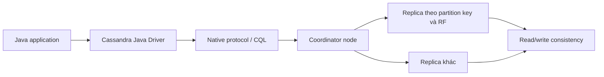

# Driver cho Apache Cassandra: tọa độ dependency và package theo phiên bản

## 1. Vì sao cần phân biệt phiên bản Java Driver?

Trong module **DATABASE_ENGINE_WIDE_COLUMN_CASSANDRA**, Apache Cassandra được tiếp cận như một cơ sở dữ liệu phân tán theo mô hình **wide-column**: dữ liệu được phân bố theo **partition key**, nhân bản giữa các node, đọc/ghi với consistency level và được quản trị thông qua CQL, compaction, repair, backup. Khi ứng dụng Java kết nối đến Cassandra, thành phần trực tiếp tạo session, chuẩn bị truy vấn, định tuyến request và xử lý kết quả là **Java Driver**.

Một nhầm lẫn thường gặp khi bắt đầu dự án hoặc nâng cấp thư viện: **phiên bản máy chủ Cassandra, phiên bản Java Driver, tọa độ Maven/Gradle và tên package để `import` không phải là một thứ**.

Ví dụ, khi chuyển từ Java Driver **3.x** sang **4.x**, bạn không thể chỉ thay `<version>` trong `pom.xml` và giữ nguyên `import com.datastax.driver.core.Cluster`. Còn trong các bản **4.x** được phát hành với nhóm artifact khác, tên package Java **không nhất thiết đổi theo `groupId`**.

Bài này tập trung đúng vào ba câu hỏi:

1. **Dùng driver nào** để ứng dụng Java giao tiếp với Apache Cassandra?
2. **Khai báo dependency chính xác ra sao** theo nhánh/bản phân phối driver?
3. **Import và gọi API của package nào** để mã Java biên dịch và kết nối được?

Sau khi học, bạn có thể phân biệt API cũ/mới, đọc tọa độ artifact, cấu hình `CqlSession`, chạy một truy vấn chuẩn bị sẵn và chẩn đoán các lỗi liên quan dependency, package, protocol hoặc datacenter.

## 2. Java Driver nằm ở đâu trong kiến trúc Cassandra?



Java Driver cung cấp những khả năng phổ biến:

- **Tạo và duy trì kết nối** tới các node của cluster thông qua native protocol.
- **Khám phá metadata** về node, keyspace, token và thông tin định tuyến.
- **Gửi CQL** với simple statement, prepared/bound statement; ánh xạ dữ liệu CQL sang kiểu Java.
- **Điều phối request** bằng load-balancing, policy theo datacenter, timeout và retry trong giới hạn cấu hình.
- **Thực thi đồng bộ hoặc bất đồng bộ**, xử lý phân trang và trả thông tin lỗi/thực thi cho ứng dụng.
- **Thiết lập consistency level** của mỗi thao tác theo hợp đồng nghiệp vụ.

Driver **không** thay thế:

- Việc thiết kế bảng dựa trên mẫu truy vấn và chọn partition key.
- Replication, repair, compaction và phục hồi dữ liệu của cluster.
- Phân quyền/role phía server; driver chỉ đưa credential và request.
- Giao dịch xuyên nhiều partition hay nhiều bảng theo kiểu RDBMS.
- Backpressure nghiệp vụ, quản lý idempotency hoặc logic chống ghi trùng khi timeout.

**Phân biệt với công cụ khác:** `cqlsh` là công cụ dòng lệnh chạy CQL, không phải Java Driver. `java-driver-core` là một thư viện client cho Java, **không phải JDBC driver** theo chuẩn `java.sql.Connection`. Nếu dự án dùng Spring Data Cassandra, framework đó có lớp trừu tượng riêng và còn phải kiểm tra phiên bản driver mà framework hỗ trợ.

## 3. Bốn lớp phiên bản dễ bị nhầm

| Lớp | Ví dụ | Điều nó quyết định |
| --- | --- | --- |
| **Cassandra Server** | Nhánh 3.x, 4.x hoặc 5.x | CQL/schema/tính năng/định dạng dữ liệu và giao thức mà server cung cấp |
| **Java Driver** | Driver 3.x hoặc 4.x | API Java, cách cấu hình session, exception, mapping và logic gửi request |
| **Dependency coordinates** | `groupId:artifactId:version` | Maven/Gradle tải chính xác artifact nào |
| **Java package** | `com.datastax.driver.core` hoặc `com.datastax.oss.driver.api` | Dòng `import` và các class/method trong mã nguồn |

Hai dự án có thể cùng nói “dùng Java Driver 4”, nhưng một dự án lấy artifact từ nhóm tọa độ cũ, dự án kia lấy bản phát hành thuộc nhóm Apache. **Không suy ra package từ tên nhà phát hành artifact**.

Ngoài bốn lớp trên, hãy kiểm **JDK runtime**, Spring Boot/Spring Data nếu có, native protocol, TLS, authentication và driver transitive dependencies. Đây là các ràng buộc độc lập trong bản kiểm kê nâng cấp.

## 4. Ma trận tọa độ dependency và package

Bảng sau là **các ví dụ tọa độ có ý nghĩa về mặt lịch sử/dòng API**, **không phải tuyên bố phiên bản mới nhất hay ma trận tương thích server**. Hãy chọn **một dòng driver** theo support matrix của dự án và xác nhận version thực có trong kho artifact trước khi khóa dependency.

| Dòng Java Driver | Tọa độ Maven/Gradle minh họa | Package Java chính | Khái niệm session |
| --- | --- | --- | --- |
| DataStax Java Driver **3.x** (API cũ) | `com.datastax.cassandra:cassandra-driver-core:3.11.5` | `com.datastax.driver.core.*` | `Cluster` và `Session` |
| DataStax OSS Java Driver **4.x** | `com.datastax.oss:java-driver-core:4.17.0` | `com.datastax.oss.driver.api.*` | `CqlSession` |
| Apache Cassandra Java Driver **4.x** | `org.apache.cassandra:java-driver-core:4.18.1` | `com.datastax.oss.driver.api.*` | `CqlSession` |

Điểm cần nhớ:

- **3.x → 4.x**: đổi artifact, package Java và nhiều API; đây là một lần **migration source code**, không phải thay version thuần túy.
- **DataStax OSS 4.x → Apache-distributed 4.x**: có thể đổi `groupId` mà vẫn dùng package Java `com.datastax.oss.driver.api.*`; kiểm release notes và mức tương thích của bản cụ thể trước khi thay.
- **Server 4.x không đồng nghĩa Driver 4.x là lựa chọn duy nhất.** Hãy dùng ma trận tương thích của chính driver và server; không lấy số major trùng nhau làm quy tắc.
- **Không khai báo hai `java-driver-core` từ hai nhóm 4.x trong cùng runtime** để “phòng thiếu class”: chúng có thể cung cấp các class trùng tên, dẫn đến xung đột classpath và lỗi liên kết.

Trong hệ sinh thái Cassandra, tên artifact, phiên bản được phát hành và yêu cầu JDK có thể thay đổi. Hãy ghi lại chính xác `groupId`, `artifactId`, `version` và nguồn công bố tương thích trong tài liệu phát hành của dự án.

### 4.1. Bản 3.x: package cũ

Mẫu code đặc trưng của Driver 3.x:

```java
import com.datastax.driver.core.Cluster;
import com.datastax.driver.core.Session;

// Mẫu minh họa API 3.x; không dùng chung với CqlSession của 4.x.
try (Cluster cluster = Cluster.builder()
        .addContactPoint("127.0.0.1")
        .build();
     Session session = cluster.connect()) {
    session.execute("SELECT release_version FROM system.local");
}
```

Các lớp `Cluster`, `Session`, `ResultSet` và `PreparedStatement` thuộc `com.datastax.driver.core.*` ở dòng này. Trong Driver 4.x, các lớp này không còn cùng package/API.

### 4.2. Bản 4.x: package API mới

Với Driver 4.x, mẫu cơ bản là:

```java
import com.datastax.oss.driver.api.core.CqlSession;
import com.datastax.oss.driver.api.core.cql.ResultSet;

try (CqlSession session = CqlSession.builder()
        .withLocalDatacenter("dc1")
        .build()) {
    ResultSet rows = session.execute(
        "SELECT release_version FROM system.local");
}
```

Cấu hình trên chỉ minh họa API và phụ thuộc việc driver tìm được contact points từ nguồn cấu hình phù hợp. Trong phần thực hành, chúng ta sẽ cung cấp contact point rõ ràng để code dễ lặp lại trên môi trường lab.

**Vẫn `import com.datastax.oss.driver.api...` khi dùng artifact `org.apache.cassandra:java-driver-core` thuộc dòng 4.x tương ứng.** Đừng tự đổi import thành `org.apache.cassandra.driver.api...` chỉ vì `groupId` mới chứa `org.apache.cassandra`.

## 5. Khai báo Maven: chọn đúng một tọa độ

Với dự án Java thuần hoặc Maven module, thêm **một** dependency core phù hợp. Ví dụ nếu dự án chọn dòng Apache-distributed Driver 4.x:

```xml
<dependencies>
    <dependency>
        <groupId>org.apache.cassandra</groupId>
        <artifactId>java-driver-core</artifactId>
        <version>4.18.1</version>
    </dependency>
</dependencies>
```

Ví dụ thay thế cho dòng DataStax OSS 4.x trước đó:

```xml
<!-- Chọn đoạn này THAY CHO dependency Apache ở trên, không thêm cả hai. -->
<dependencies>
    <dependency>
        <groupId>com.datastax.oss</groupId>
        <artifactId>java-driver-core</artifactId>
        <version>4.17.0</version>
    </dependency>
</dependencies>
```

Nếu dự án thực sự đang dùng API 3.x:

```xml
<!-- Chỉ dùng cho dự án API 3.x đã được kiểm tra tương thích. -->
<dependency>
    <groupId>com.datastax.cassandra</groupId>
    <artifactId>cassandra-driver-core</artifactId>
    <version>3.11.5</version>
</dependency>
```

**Các version ở trên là ví dụ cố định để chỉ ra cấu trúc tọa độ**, không phải khuyến nghị chọn phiên bản mới nhất vào thời điểm bạn triển khai. Khi chuẩn bị production, hãy xác minh release notes, security fixes, server support, JDK và chính sách nâng cấp của tổ chức. Khóa một version cụ thể đã kiểm thử; tránh ký hiệu tự cập nhật động `LATEST` hay dải version không kiểm soát.

### 5.1. Ý nghĩa của từng phần tọa độ

```text
org.apache.cassandra  :  java-driver-core  :  4.18.1
|                        |                    |
groupId                  artifactId           version
```

- `groupId`: danh tính namespace Maven của **artifact được phát hành**, không phải tên Java package.
- `artifactId`: tên module thư viện (core, query builder, mapper,…).
- `version`: bản build được Maven/Gradle resolve, có thể khác phiên bản Cassandra Server.

Khi import lỗi, **kiểm tra cả ba phần và dependency tree**, không chỉ xem `version`.

### 5.2. Module mở rộng: core, query builder, mapper

Ngoài core, driver 4.x còn có những module/tính năng có thể được chọn tùy nhu cầu:

| Module/phần mở rộng | Khi nào dùng | Lưu ý |
| --- | --- | --- |
| `java-driver-core` | Kết nối, CQL, `CqlSession`, prepared statement, sync/async | Thành phần cơ bản |
| `java-driver-query-builder` | Tạo CQL có cấu trúc bằng Java API | Không tự tối ưu partition key hay truy vấn sai |
| `java-driver-mapper-runtime` | Ánh xạ hàng CQL vào đối tượng Java qua mapper | Cần xem yêu cầu processor/cấu hình |
| `java-driver-mapper-processor` | Sinh code mapper tại thời điểm biên dịch | Thường đặt ở annotation-processor path, không thêm bừa vào runtime |

Ví dụ Maven cho query builder **cùng dòng phát hành** đã chọn:

```xml
<dependency>
    <groupId>org.apache.cassandra</groupId>
    <artifactId>java-driver-query-builder</artifactId>
    <version>4.18.1</version>
</dependency>
```

**Không trộn một module 4.x của nhóm Apache với core 4.x từ nhóm cũ** rồi mặc định chúng tương thích. Những module tùy chọn phải dùng nhóm và version đúng theo bộ phát hành; kiểm tra release notes khi một module có thay đổi tên, đóng gói hoặc không có ở bản chọn.

Các framework như Spring Data Cassandra có thể quản lý version driver bằng BOM/dependency management của framework. Nếu vậy, cần xem **effective dependency graph** trước khi override một version trực tiếp, để tránh lỗi classpath.

## 6. Khai báo Gradle

### 6.1. Gradle Groovy DSL

Ví dụ với artifact Apache-distributed Driver 4.x:

```groovy
dependencies {
    implementation 'org.apache.cassandra:java-driver-core:4.18.1'
}
```

Nếu dự án chọn DataStax OSS Driver 4.x trước đó thì dùng **thay thế**, không giữ cả hai:

```groovy
dependencies {
    implementation 'com.datastax.oss:java-driver-core:4.17.0'
}
```

### 6.2. Gradle Kotlin DSL

```kotlin
dependencies {
    implementation("org.apache.cassandra:java-driver-core:4.18.1")
}
```

Với Gradle, `implementation` là cấu hình dependency của ứng dụng; nếu viết một thư viện cung cấp API cho module khác, cách dùng `api`/`implementation` cần tuân theo thiết kế module đó.

**Không nhập cả hai nhóm cùng lúc** chỉ vì IDE chưa nhận `CqlSession`. Khi giải quyết lỗi IDE, hãy refresh Gradle/Maven và đọc classpath thực trước, thay vì thêm nhiều artifact.

## 7. Quy trình lựa chọn dependency an toàn

Trước khi thêm `java-driver-core` vào một hệ thống production, thu thập ít nhất những thông tin này:

| Thông tin | Cần xác nhận |
| --- | --- |
| Cassandra Server | Version cụ thể trên các node, bản phân phối Apache/managed |
| Driver | Dòng 3.x hay 4.x, bản phát hành chính xác |
| Tọa độ artifact | `groupId:artifactId:version` từ kho tin cậy |
| JDK | Version JDK của ứng dụng và JDK được driver hỗ trợ |
| Framework | Spring Boot/Spring Data, dependency management/BOM, version driver đi kèm |
| Native protocol | Khả năng thương lượng protocol với server nguồn/đích |
| CQL features | UDT, collection, LWT, paging, query builder, mapper, tính năng mới |
| Auth/TLS | Tùy chọn authentication, trust material, ciphers và policy bảo mật |
| Deployment | Classpath cuối cùng, dependency tree, packaging shaded/uber-JAR |
| Test | Smoke test kết nối, đọc/ghi thật theo CL, thử failover và query timeout |

**Một cặp driver/server có thể kết nối thành công nhưng vẫn không hỗ trợ một số API hoặc tính năng.** Tương thích cần được đánh giá cho đúng phiên bản và workload, nhất là khi cluster chạy mixed-version trong đợt rolling upgrade.

### Chẩn đoán dependency tree

Với Maven, tại dự án thực tế có thể dùng:

```bash
mvn dependency:tree
```

Với Gradle:

```bash
./gradlew dependencies --configuration runtimeClasspath
```

Các lệnh trên dành cho dự án mẫu của người học, **không phải bước tự chạy trong bài**. Tìm các artifact `java-driver-core` và `cassandra-driver-core` xuất hiện ngoài dự tính, thư viện Netty/SLF4J xung đột, hoặc driver được framework kéo theo nhưng bị bản khai báo thủ công ghi đè.

Nếu deploy kiểu fat JAR/shaded JAR, kiểm tra kết quả đóng gói và service/config resources. Chỉ compile thành công chưa chắc tránh được `NoSuchMethodError` hay `ClassNotFoundException` ở runtime khi có xung đột dependency.

## 8. Thực hành Driver 4.x: CQL, Maven và Java package

### 8.1. Chuẩn bị cluster thử nghiệm

Giả sử Cassandra trong lab có datacenter `dc1` và keyspace `commerce`. Nếu lab chỉ có một node, điều chỉnh RF cho phù hợp (ví dụ RF=1) để các truy vấn thử không đòi nhiều replica hơn thực tế. Không sao chép cấu hình thử nghiệm thành chuẩn production.

CQL khởi tạo:

```sql
-- Ví dụ cho một lab có ít nhất ba node tại dc1.
CREATE KEYSPACE IF NOT EXISTS commerce
WITH replication = {
    'class': 'NetworkTopologyStrategy',
    'dc1': 3
};

CREATE TABLE IF NOT EXISTS commerce.orders_by_id (
    order_id uuid PRIMARY KEY,
    customer_id uuid,
    status text,
    updated_at timestamp
);

INSERT INTO commerce.orders_by_id
    (order_id, customer_id, status, updated_at)
VALUES (
    11111111-1111-1111-1111-111111111111,
    22222222-2222-2222-2222-222222222222,
    'CREATED',
    toTimestamp(now())
);
```

Ghi lại datacenter thực tế trước khi cấu hình Java Driver, ví dụ trong `cqlsh`:

```sql
SELECT data_center, release_version FROM system.local;
```

`system.local` mô tả **coordinator mà cqlsh đang kết nối**; nếu cluster có nhiều DC, xác nhận topology toàn bộ qua công cụ vận hành phù hợp. Code Java phải dùng đúng tên local DC, có phân biệt chữ hoa/chữ thường theo metadata của môi trường.

### 8.2. Dependency cho ví dụ

Chọn **một** tọa độ Driver 4.x trong `pom.xml`. Ví dụ:

```xml
<dependency>
    <groupId>org.apache.cassandra</groupId>
    <artifactId>java-driver-core</artifactId>
    <version>4.18.1</version>
</dependency>
```

Dù `groupId` ở đây là `org.apache.cassandra`, **Java import vẫn bắt đầu bằng `com.datastax.oss.driver.api`**.

### 8.3. Code đọc theo partition key bằng prepared statement

Đoạn mã sau có thể biên dịch với Driver 4.x tương ứng khi dependency được resolve, Cassandra lab hoạt động và biến môi trường đã được thiết lập. Chúng ta dùng **một session dùng chung** trong phạm vi `try-with-resources`. Trong dịch vụ production, `CqlSession` thường được tạo một lần theo vòng đời ứng dụng và đóng khi tắt ứng dụng, không tạo cho từng HTTP request.

```java
import java.net.InetSocketAddress;
import java.time.Duration;
import java.util.UUID;

import com.datastax.oss.driver.api.core.CqlSession;
import com.datastax.oss.driver.api.core.DefaultConsistencyLevel;
import com.datastax.oss.driver.api.core.cql.BoundStatement;
import com.datastax.oss.driver.api.core.cql.PreparedStatement;
import com.datastax.oss.driver.api.core.cql.ResultSet;
import com.datastax.oss.driver.api.core.cql.Row;

public final class ReadOrderDemo {

    public static void main(String[] args) {
        String host = requireEnv("CASSANDRA_HOST");
        String datacenter = requireEnv("CASSANDRA_DC");
        String username = requireEnv("CASSANDRA_USERNAME");
        String password = requireEnv("CASSANDRA_PASSWORD");

        try (CqlSession session = CqlSession.builder()
                .addContactPoint(new InetSocketAddress(host, 9042))
                .withLocalDatacenter(datacenter)
                .withAuthCredentials(username, password)
                .build()) {

            PreparedStatement select = session.prepare(
                "SELECT order_id, status, updated_at " +
                "FROM commerce.orders_by_id WHERE order_id = ?");

            UUID orderId = UUID.fromString(
                "11111111-1111-1111-1111-111111111111");

            BoundStatement bound = select.bind(orderId)
                .setConsistencyLevel(DefaultConsistencyLevel.LOCAL_QUORUM)
                .setTimeout(Duration.ofSeconds(2));

            ResultSet result = session.execute(bound);
            Row row = result.one();

            if (row == null) {
                System.out.println("Không tìm thấy đơn hàng");
            } else {
                System.out.println(
                    row.getUuid("order_id") + ": " +
                    row.getString("status"));
            }
        }
    }

    private static String requireEnv(String name) {
        String value = System.getenv(name);
        if (value == null || value.isBlank()) {
            throw new IllegalStateException("Missing environment: " + name);
        }
        return value;
    }
}
```

**Giới hạn của ví dụ:**

- Đoạn mã giả định cluster **đã bật xác thực bằng username/password**; nếu lab đang dùng `AllowAllAuthenticator`, bỏ `withAuthCredentials` và điều chỉnh biến môi trường cho đúng môi trường đó. Production nên bật authentication, authorization và TLS.
- `LOCAL_QUORUM` chỉ phù hợp khi RF/topology có đủ replica trong local DC và yêu cầu nghiệp vụ chọn CL này. Với **lab một node RF=1**, LOCAL_QUORUM yêu cầu một replica và vẫn hợp lệ; với RF=3 mà chỉ có một node, truy vấn sẽ không đủ replica.
- Kết nối `127.0.0.1:9042` hoặc `CASSANDRA_HOST:9042` cần tới đúng endpoint native protocol; trong container, `localhost` của ứng dụng không nhất thiết là địa chỉ Cassandra.
- Ví dụ không cấu hình TLS để giữ trọng tâm ở dependency/API. Khi chạy production, **không truyền mật khẩu qua kết nối plaintext**; phải cấu hình driver SSL/TLS và trust material phù hợp.
- `String.isBlank()` thuộc JDK 11+; nếu driver/bản build của bạn hỗ trợ JDK thấp hơn và buộc dùng JDK 8, thay bằng `value.trim().isEmpty()` và kiểm compatibility của driver/JDK đã chọn. Không nhầm **JDK của chương trình ví dụ** với phiên bản Cassandra Server.

**Vì sao dùng prepared statement?** CQL cố định được chuẩn bị một lần; giá trị `order_id` được bind theo kiểu `UUID`. Cách này tránh ghép input không tin cậy vào chuỗi CQL, giảm chi phí phân tích lặp lại và cho phép driver tận dụng metadata của statement. Trong dịch vụ thật, giữ `PreparedStatement` để dùng lại, thay vì prepare mỗi request.

### 8.4. Chạy đúng truy vấn, không cố dùng bảng như RDBMS

Với bảng `orders_by_id`:

```sql
-- Truy vấn theo partition key: phù hợp với bảng đã thiết kế.
SELECT order_id, status
FROM commerce.orders_by_id
WHERE order_id = 11111111-1111-1111-1111-111111111111;
```

Trái lại, một truy vấn chỉ lọc `customer_id` không phù hợp với khóa chính hiện tại và có thể bị Cassandra từ chối nếu không có cấu trúc/index tương ứng. Nếu ứng dụng cần liệt kê theo `customer_id`, hãy thiết kế một bảng theo truy vấn đó, chẳng hạn `orders_by_customer`, cùng chiến lược đồng bộ/đối soát dữ liệu.

**Driver đúng phiên bản không sửa được data model sai.** Điều kiện truy vấn, cardinality partition, tombstone, compaction và giới hạn tài nguyên vẫn thuộc trách nhiệm thiết kế và vận hành Cassandra.

## 9. Đồng bộ và bất đồng bộ trong API 4.x

Ở 4.x, `CqlSession` cung cấp cả API đồng bộ và bất đồng bộ. Chọn theo mô hình xử lý của ứng dụng; async không tự tạo thêm throughput vô hạn.

### 9.1. Đồng bộ

```java
ResultSet rs = session.execute(bound);
Row first = rs.one();
```

Đơn giản, phù hợp chương trình nhỏ hoặc luồng background đã được giới hạn. Trên web server có event loop, đừng dùng blocking execute trên thread event loop nếu framework yêu cầu không chặn.

### 9.2. Bất đồng bộ

```java
import java.util.Iterator;
import java.util.concurrent.CompletionStage;

import com.datastax.oss.driver.api.core.cql.AsyncResultSet;
import com.datastax.oss.driver.api.core.cql.Row;

// session và bound là các đối tượng đã tạo ở ví dụ trước.
CompletionStage<String> statusStage =
    session.executeAsync(bound).thenApply((AsyncResultSet result) -> {
        Iterator<Row> rows = result.currentPage().iterator();
        return rows.hasNext() ? rows.next().getString("status") : null;
    });
```

Đoạn này đọc **trang kết quả hiện tại**; truy vấn theo một `order_id` trong ví dụ trả tối đa một hàng. Với truy vấn có nhiều trang, phải xử lý `hasMorePages()`/`fetchNextPage()` có kiểm soát, tránh gọi tải tiếp tất cả trang đồng thời và giữ dữ liệu vô hạn trong RAM.

Thực hành production nên:

- **Giới hạn in-flight request** bằng semaphore/bulkhead hoặc cơ chế request throttling phù hợp; không gửi hàng chục nghìn truy vấn async chỉ vì không chiếm thread chờ.
- Xác định **timeout budget** theo deadline API và độ trễ thực tế của read/write consistency.
- Xử lý exception tại ranh giới dịch vụ, trả mã lỗi phù hợp, không nuốt lỗi thành “không tìm thấy”.
- **Không retry tất cả write sau timeout**: Cassandra có thể đã nhận ghi dù client chưa thấy phản hồi. Thiết kế idempotency và kiểm tra kết quả cho lệnh có tác dụng phụ/LWT.
- Không dùng `CompletionStage.join()` trên event loop để biến truy vấn async thành blocking.

## 10. Gắn dependency với bảo mật và consistency

Java Driver chỉ là client; muốn kết nối an toàn phải thiết kế cả hệ thống:

### 10.1. Authentication và authorization

Ứng dụng Java nên kết nối bằng role `LOGIN=true`, `SUPERUSER=false` có quyền tối thiểu trên bảng cần dùng:

```sql
-- Minh họa chạy bởi principal quản trị đã được ủy quyền.
GRANT SELECT ON TABLE commerce.orders_by_id TO orders_api;
```

Câu lệnh này giả định role `orders_api` đã được tạo. Không dùng credential `cassandra`/superuser mặc định làm tài khoản ứng dụng. Việc Java Driver có thể đăng nhập không có nghĩa role được cấp `SELECT` hay `MODIFY`.

### 10.2. TLS và quản lý bí mật

- Dùng TLS giữa ứng dụng và các Cassandra endpoint theo chính sách cluster, kiểm truststore/certificate hostname.
- Cấp credential từ secret manager hoặc cơ chế tương đương; hạn chế quyền đọc biến môi trường/process secrets.
- Không in password, URI chứa secret hoặc nguyên thông tin xác thực vào log.
- Tách account ứng dụng đọc, worker ghi, migration và công cụ vận hành. Rotating secrets cần tính đến session đang mở.
- Kiểm tra TLS/auth plugin hỗ trợ đúng driver/server version và JDK đang chạy.

### 10.3. Consistency level theo nghiệp vụ

| Nhu cầu ví dụ | Cân nhắc | Điều cần nhớ |
| --- | --- | --- |
| Danh mục cho phép stale read | `LOCAL_ONE` trong phạm vi kiến trúc phù hợp | Latency thấp hơn không bảo đảm đọc mới nhất |
| Đọc/ghi cần giao nhau ở một DC RF=3 | `LOCAL_QUORUM` cho cả đọc và ghi | Hai replica mỗi phía; vẫn cần tính concurrency/failure |
| Ghi có điều kiện `IF` | CL và serial consistency phù hợp LWT | CAS không phải transaction xuyên mọi partition |
| Nhiều DC | `LOCAL_*` vs CL liên DC | Tính mức độ trễ replica và nhu cầu dữ liệu giữa DC |

Không đặt `LOCAL_QUORUM` chỉ vì ví dụ dùng giá trị đó; chọn từ hợp đồng nghiệp vụ, RF, topology và cách vận hành. Nếu truy vấn lỗi `Unavailable`, đừng tự hạ CL trong code mà không đánh giá yêu cầu tính nhất quán.

## 11. Bảng so sánh khi chuyển từ 3.x sang 4.x

Đây là thay đổi API thường gặp khi một dự án cũ chuyển sang Java Driver 4.x. Cần đọc migration guide của **phiên bản driver thực tế**, vì cấu hình, error handling, schema metadata và serialization còn nhiều khác biệt.

| Khái niệm | Driver 3.x | Driver 4.x |
| --- | --- | --- |
| Core artifact | `com.datastax.cassandra:cassandra-driver-core` | `java-driver-core` thuộc nhóm DataStax OSS hoặc Apache tùy bản |
| Root package | `com.datastax.driver.core` | `com.datastax.oss.driver.api` |
| Kết nối | `Cluster` + `Session` | `CqlSession` |
| Khởi tạo session | `Cluster.builder()` và `cluster.connect()` | `CqlSession.builder()` |
| Cấu hình | API `QueryOptions`/policies và configuration dòng 3 | Driver configuration và statement/session API dòng 4 |
| Prepared statement | `com.datastax.driver.core.PreparedStatement` | `com.datastax.oss.driver.api.core.cql.PreparedStatement` |
| Statement có bound values | API bound của 3.x | `BoundStatement` thuộc `core.cql` của 4.x |
| Consistency constants | `com.datastax.driver.core.ConsistencyLevel` | `com.datastax.oss.driver.api.core.DefaultConsistencyLevel` |
| Trả kết quả async | Cơ chế futures theo 3.x | `CompletionStage<AsyncResultSet>` |
| Metadata/metrics | Các API của 3.x | API mới; cần sửa code tích hợp |
| Mapper | Driver mapper của dòng 3 | Mapper runtime/processor theo dòng 4 nếu dùng |

Không dựa vào wildcard import để “vừa chạy 3.x vừa chạy 4.x”. Cần **migration có kiểm thử**, sửa cấu hình, logging/metrics, exception mapping, query paging và đóng session đúng vòng đời.

### Quy trình chuyển dependency an toàn

1. Kiểm kê code/import/`dependency:tree` và nguồn driver do framework kéo vào.
2. Chọn một target driver với **tọa độ chính xác**, kiểm support matrix với Cassandra Server và JDK.
3. Sửa imports từ `com.datastax.driver.core.*` sang API thích hợp ở `com.datastax.oss.driver.api.*`, đồng thời **thiết kế lại phần khởi tạo/session**.
4. Chuyển policies/configuration theo migration guide, tránh sao chép cấu hình cũ mà giả định tên khóa tương đương.
5. Chạy unit/integration tests cho prepared statement, paging, UDT, collections, LWT, consistency, auth/TLS và lỗi.
6. Kiểm trong staging với topology và latency đại diện trước khi rolling deploy.
7. Loại bỏ dependency 3.x/4.x không cần thiết khỏi runtime classpath, xác nhận packaged artifact cuối cùng.

Trường hợp Spring Data Cassandra quản lý driver, hãy **kiểm hỗ trợ nâng framework** trước khi tự ép phiên bản driver mới, vì API mà framework gọi có thể chưa tương thích.

## 12. Lỗi thường gặp và cách xác định nguyên nhân

| Dấu hiệu | Nguyên nhân có thể | Kiểm tra/xử lý |
| --- | --- | --- |
| `package com.datastax.oss.driver.api.core does not exist` | Đang dùng artifact 3.x, dependency 4.x chưa resolve hoặc source set chưa nhận | Xem `pom.xml`/Gradle, refresh dependencies và dependency tree |
| `package com.datastax.driver.core does not exist` | Code 3.x nhưng chỉ có Driver 4.x | Migrate API hoặc chọn đúng driver theo code |
| `NoClassDefFoundError` / `NoSuchMethodError` khi chạy | Version/module xung đột hoặc packaging thiếu class | Kiểm runtime classpath, BOM và bản shaded/JAR |
| Driver 4.x nhưng không tìm `org.apache.cassandra.driver.api...` | Nhầm Java package với Maven `groupId` | Dùng `com.datastax.oss.driver.api.*` cho dòng 4.x tương ứng |
| Không kết nối được contact point | Sai host, port 9042, firewall, network/container | Kiểm native protocol, reachability, DNS và endpoint thực |
| Driver báo không xác định local DC hoặc không định tuyến | Tên datacenter sai/thiếu, contact points không khớp metadata | Kiểm `system.local.data_center`, load-balancing config |
| Authentication failure | Credential/role/`LOGIN` hoặc authenticator không phù hợp | Kiểm quyền role, secret, cấu hình auth và TLS |
| Unauthorized khi `SELECT` | Role chưa có `SELECT` trên bảng/keyspace | Kiểm `GRANT`/membership, không dùng superuser để né lỗi |
| `Unavailable` tại `LOCAL_QUORUM` | RF/replica trong DC không đáp ứng CL | Kiểm `nodetool status`, topology, RF, consistency |
| Timeout dù kết nối vẫn hoạt động | Hot partition, compaction, GC, mạng, CL, request overload | Kiểm p99, in-flight, metrics driver/server, thiết kế truy vấn |
| `InvalidQuery`/unknown column | Schema chưa được deploy/agreement, CQL sai hoặc app/code và DDL lệch | Soát schema migration và câu CQL theo partition key |
| Prepared request thất bại sau failover | Coordinator/schema thay đổi, request retry/batch không phù hợp | Kiểm driver logs, prepared behavior và hạn mức retry |
| Build lỗi sau đổi group | Hai tọa độ core 4.x cạnh tranh hoặc module tùy chọn khác dòng | Chỉ giữ một bộ artifact đồng nhất, khóa version |

**Phương pháp gỡ lỗi theo tầng:** kiểm **dependency thực sự được nạp** → Java import/API → kết nối native protocol và DC → authentication/TLS → CQL/schema → replica/CL → hiệu năng. Cách này tránh “chữa” lỗi thiếu class bằng cách thêm kết nối hoặc giảm consistency.

## 13. Bài tập thực hành: nhận diện phiên bản từ tọa độ và import

Xét ba dự án giả định:

**Dự án A** có:

```xml
<dependency>
  <groupId>com.datastax.cassandra</groupId>
  <artifactId>cassandra-driver-core</artifactId>
  <version>3.11.5</version>
</dependency>
```

**Dự án B** có:

```groovy
implementation 'com.datastax.oss:java-driver-core:4.17.0'
```

**Dự án C** có:

```kotlin
implementation("org.apache.cassandra:java-driver-core:4.18.1")
```

Hãy trả lời:

1. Dự án nào dùng `com.datastax.driver.core.Cluster`? Dự án nào dùng `com.datastax.oss.driver.api.core.CqlSession`?
2. Vì sao dự án C **không** đổi import thành `org.apache.cassandra.driver.api.core.CqlSession`?
3. Nếu dự án C kéo thêm `com.datastax.oss:java-driver-core:4.17.0`, nguy cơ gì xảy ra ở classpath?
4. Dự án B muốn chuyển sang C: cần xác nhận điều gì ngoài việc đổi `groupId`?
5. Một service Java có hai contact points và local DC bị cấu hình sai. Vì sao tăng timeout không phải giải pháp đúng?
6. Với bảng `orders_by_id` có partition key `order_id`, tại sao `WHERE customer_id = ?` không trở thành truy vấn tốt chỉ nhờ thêm query builder?
7. Hãy viết một đoạn Maven dependency 4.x được chọn và những `import` tối thiểu để gửi `PreparedStatement` bằng `CqlSession`.
8. Hãy phân biệt lỗi **compile-time missing package**, **runtime linkage error** và **CQL Unauthorized**. Chúng thuộc ba tầng nào?

**Gợi ý tự kiểm tra:**

- **A** dùng `Cluster`/`Session` ở package 3.x; **B** và **C** dùng `CqlSession` thuộc API 4.x.
- `groupId` là tọa độ Maven, **không phải** namespace Java; artifact Apache Driver 4.x vẫn có API `com.datastax.oss.driver.api`.
- Hai core 4.x khác nhóm có thể chứa class trùng và làm runtime nạp phiên bản không mong đợi.
- Chuyển B → C cần đọc release notes, xác minh compatibility với server/JDK, kiểm module tùy chọn, framework và chạy integration tests.
- Local DC phải khớp cluster; Driver cần định tuyến đúng replica/coordinator. Timeout dài chỉ trì hoãn lỗi.
- Query builder không thay đổi partition key hay token ownership.
- Missing package thuộc tầng **dependency/source code**; linkage error thuộc **runtime classpath**; Unauthorized thuộc **RBAC server** sau xác thực.

## 14. Checklist trước khi đưa Java Driver vào production

- [ ] Đã phân biệt version **Cassandra Server**, version **Java Driver**, Maven/Gradle coordinates và Java package.
- [ ] Đã chọn đúng **một** bộ core driver và module mở rộng đồng nhất, không trộn DataStax OSS/Apache 4.x tùy tiện.
- [ ] Đã xác minh bản driver/server/JDK/framework được hỗ trợ, khóa version cụ thể đã kiểm thử.
- [ ] Đã xem `dependency:tree` hoặc Gradle `runtimeClasspath` và kiểm fat JAR/runtime artifact cuối cùng.
- [ ] Code 3.x đã được migrate đúng khi chọn API 4.x: `CqlSession`, imports, statements, config, paging.
- [ ] Đã cấu hình contact points, local datacenter và native protocol endpoint đúng môi trường.
- [ ] Đã bật authentication, TLS và dùng secret an toàn; principal ứng dụng có quyền tối thiểu.
- [ ] Đã dùng prepared statement, bind type phù hợp, tái sử dụng session và đóng đúng vòng đời.
- [ ] Đã chọn CL theo RF/DC/hợp đồng đọc-ghi, không giảm CL để che lỗi vận hành.
- [ ] Đã giới hạn concurrency, timeout/retry, bảo vệ ghi không idempotent và theo dõi lỗi driver.
- [ ] Đã thử đọc/ghi, paging, LWT, failover, schema changes và node không sẵn sàng trong staging.
- [ ] Đã tách việc nâng driver khỏi thay partition key, table options hoặc nâng server không cần thiết.
- [ ] Đã có metric/log để phân biệt lỗi classpath, connect, TLS/auth, CQL/schema và Cassandra overload.

**Ghi nhớ:** **`groupId:artifactId:version`** xác định artifact được build tool tải; **`package`** xác định các class Java được `import`. Dòng Driver **3.x** thường dùng `com.datastax.driver.core` và `Cluster/Session`; dòng **4.x** dùng `com.datastax.oss.driver.api` và `CqlSession`, kể cả khi artifact mang `groupId` `org.apache.cassandra`. Chọn đúng tọa độ chỉ là bước đầu: ứng dụng còn cần cấu hình đúng datacenter, credential/TLS, CQL theo partition key, consistency và kiểm thử với phiên bản server thực tế.
