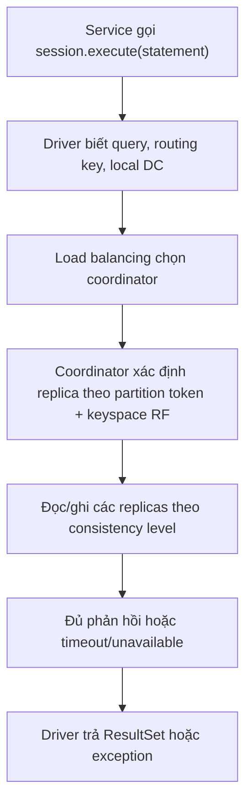
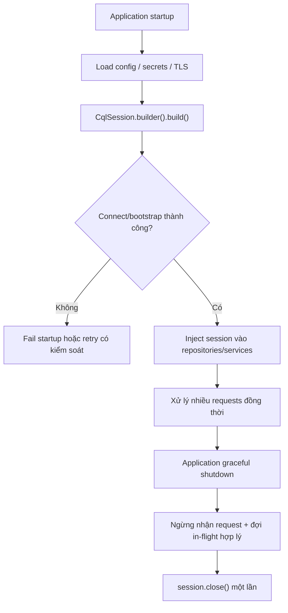

# CqlSession là điểm vào và phạm vi dùng chung cho một cụm

> **Chương:** Java driver cơ bản  
> **Mô-đun:** `DATABASE_ENGINE_WIDE_COLUMN_CASSANDRA` — học Apache Cassandra như cơ sở dữ liệu wide-column phân tán: partition key, thiết kế bảng theo truy vấn, consistency level, CQL, replication, compaction, repair, xử lý lỗi và kết nối từ Java.  
> **Trọng tâm:** Vai trò của `CqlSession` trong Apache Cassandra Java Driver 4.x; cách tạo, dùng chung, cấu hình theo một cụm, quản lý vòng đời và dùng đúng trong ứng dụng Java nhiều thread.

Một ứng dụng Java phục vụ 1.000 HTTP requests/giây không nên mở **1.000 kết nối Cassandra mới mỗi giây**. Cách sử dụng thông thường là tạo **một `CqlSession` dùng chung cho một cụm Cassandra và một bộ thông tin kết nối/xác thực của ứng dụng**, sau đó chia sẻ nó cho các repository, service và request handlers trong cùng tiến trình. Driver chịu trách nhiệm khám phá node, quản lý connection pools, chọn coordinator và thực thi CQL.

Mẫu tư duy đầu tiên:

```text
Ứng dụng Java (một process / một service instance)
    ├── AccountRepository ───┐
    ├── EventRepository ─────┤
    ├── OrderService ────────┼──> CqlSession dùng chung
    └── BackgroundWorker ────┘      │
                                   ├── Driver metadata / topology
                                   ├── Load balancing / token awareness
                                   ├── Connections tới các node phù hợp
                                   ├── Prepared statements / execution
                                   └── Cassandra cluster: dc1, dc2...
```

Điểm quan trọng: **`CqlSession` không phải một socket duy nhất và không phải transaction session kiểu SQL truyền thống**. Nó là **điểm vào cấp ứng dụng** của driver, có thể dùng đồng thời từ nhiều thread; mỗi câu lệnh vẫn có partition key, consistency level, timeout, paging và semantics riêng.

## 1. Mục tiêu học tập

Sau bài này, bạn có thể:

1. Giải thích `CqlSession` là gì, liên quan thế nào với Cassandra nodes, connection pools, metadata, coordinator và Java threads.
2. Tạo `CqlSession` bằng `CqlSession.builder()` với contact point, local datacenter và keyspace tùy chọn.
3. Chọn đúng phạm vi **một session dùng chung theo cluster + security/configuration context**, thay vì mở session theo request hoặc theo bảng.
4. Phân biệt **contact points** với danh sách node được driver khám phá; hiểu vì sao `withLocalDatacenter` quan trọng.
5. Phân biệt **default keyspace** của session với keyspace thực sự được truy vấn, và vì sao không nên dùng `USE` để đổi keyspace trong ứng dụng đa luồng.
6. Tận dụng **prepared statements** và **bound statements**, điều khiển consistency level và idempotency theo từng thao tác.
7. Thực thi CQL đồng bộ/bất đồng bộ, biết giới hạn của paging, timeout và retry.
8. Quản lý vòng đời session qua dependency injection, application startup/shutdown, test và health checks.
9. Nhận diện lỗi authentication, TLS, local DC, kết nối, quorum và schema mà không phản ứng bằng cách tạo thêm session.
10. Viết một ứng dụng Java đơn giản kết nối Cassandra, tạo dữ liệu, truy vấn theo partition key và dùng chung session an toàn.

## 2. CqlSession thực sự đại diện cho cái gì?

### 2.1. Một abstraction cấp cụm, không phải một kết nối TCP

`CqlSession` của Java Driver 4.x là interface trung tâm để:

- Thực hiện CQL với `execute(...)` và `executeAsync(...)`.
- Chuẩn bị CQL với `prepare(...)` và `prepareAsync(...)`.
- Truy cập thông tin driver metadata qua `getMetadata()`.
- Truy cập cấu hình/runtime context và metrics nếu được bật.
- Giữ các tài nguyên driver cần thiết để kết nối tới cluster.
- Đóng các tài nguyên khi ứng dụng không còn sử dụng session.

Một session có thể quản lý **nhiều kết nối mạng** đến nhiều node. Driver thường có cơ chế topology discovery, load-balancing policy, token-aware routing và connection pools theo node; chi tiết cấu hình và số connection thay đổi theo driver version và workload.

**Không đồng nhất**:

| Khái niệm | Ý nghĩa | Có nên tạo mới mỗi CQL request? |
|---|---|---|
| `CqlSession` | Điểm vào driver và vòng đời kết nối tới cluster | **Không** |
| Physical connection | Một kết nối TCP/native protocol đến node | Do driver quản lý |
| Coordinator | Node xử lý một CQL request, chọn/trao đổi với replicas | Có thể khác qua từng request |
| Replica | Node lưu bản sao partition theo token/RF/keyspace | Không do session “sở hữu” |
| `PreparedStatement` | Mẫu CQL đã chuẩn bị và metadata binding | Thường cache/tái sử dụng |
| `BoundStatement` | Một lần bind tham số/tuỳ chọn cho prepared statement | Tạo cho mỗi thao tác |
| `ResultSet` | Kết quả của một request, có thể fetch pages | Không dùng chung tùy tiện giữa threads |
| Keyspace | Namespace CQL với replication strategy | Một session có thể truy vấn nhiều keyspaces |
| Transaction/session SQL | Cơ chế transaction giữ trạng thái qua nhiều queries | **Không phải `CqlSession`** |

### 2.2. Session tốn chi phí khởi tạo

Khi khởi tạo, driver có thể phải:

1. Mở kết nối tới một hoặc nhiều contact points.
2. Thực hiện protocol handshake, TLS nếu bật, và authentication nếu được cấu hình.
3. Tìm hiểu topology, datacenter, token map và schema metadata.
4. Khởi tạo connection pools, event loops và các tài nguyên nội bộ.
5. Chuẩn bị trạng thái cần cho load balancing, request execution và reconnection.

Nếu làm lại công việc này ở mỗi HTTP request, ứng dụng có thể gây ra:

- Connection churn và tăng CPU/TLS handshake.
- Quá nhiều file descriptors/sockets trên app và Cassandra.
- Tăng latency khởi tạo so với latency một query.
- Mất lợi ích tái sử dụng connection pools và prepared statements.
- Tăng GC/memory và tạo áp lực không cần thiết lên native transport.
- Khó dừng ứng dụng sạch khi một số sessions chưa được close.

Vì vậy một guideline thực tế là **tạo session trong startup, giữ suốt vòng đời process/service, close khi shutdown**.

### 2.3. Session không “ôm” một transaction

Ví dụ:

```java
session.execute(updateA);
session.execute(updateB);
```

Hai dòng trên **không** mặc nhiên thuộc cùng một ACID transaction đa bảng như một transaction JDBC. Mỗi statement có semantics của Cassandra, consistency level và khả năng lỗi riêng.

`CqlSession` là **điểm vào kết nối**, không phải biên transaction. Khi cần atomicity/idempotency cho một nghiệp vụ, phải thiết kế trên semantics Cassandra (partition, LWT khi phù hợp, event log và retry policy). Đổi session hoặc đặt nhiều CQL trong một method Java không thay đổi điều đó.

## 3. Vì sao dùng chung trong một ứng dụng nhiều thread?

### 3.1. CqlSession được thiết kế để dùng đồng thời

Trong Driver 4.x, `CqlSession` có thể được chia sẻ an toàn giữa các request-handling threads. Ví dụ:

```text
Thread HTTP-1: SELECT account_id = A ─┐
Thread HTTP-2: SELECT account_id = B ─┤
Thread HTTP-3: INSERT event = C ──────┼──> CqlSession dùng chung
Thread worker:  UPDATE account = D ───┘      │
                                            └── Driver multiplexes requests,
                                                pools connections per node
```

Ứng dụng không cần tạo một session riêng cho mỗi:

- HTTP request.
- Thread trong executor.
- DAO/repository.
- PreparedStatement.
- Keyspace, nếu cùng cluster và cùng auth/config phù hợp.
- Đối tượng domain như tenant, order hoặc account.

**Cần phân biệt thread-safety của session với thread-safety của dữ liệu bên ngoài**. Một repository chứa mutable list/result iterator dùng chung vẫn có thể race dù session được chia sẻ an toàn.

### 3.2. Một session theo cụm là quy tắc thực tế, không phải “cả công ty chỉ được có một”

Phạm vi khuyến nghị:

> **Một session dùng chung cho mỗi application instance, Cassandra cluster và nhóm yêu cầu kết nối/bảo mật/cấu hình nhất quán.**

Có thể cần nhiều sessions hợp lệ khi:

- Ứng dụng nói chuyện với **hai Cassandra clusters khác nhau**.
- Hai phần ứng dụng bắt buộc dùng **CQL credentials/roles khác nhau**, policy hoặc TLS identity khác nhau.
- Workload cần cách ly rõ ràng về cấu hình driver, resource budgets hoặc vòng đời.
- Một quá trình migration dual-cluster cần session **source** và session **target**.
- Một test suite cần kết nối các clusters/containers có lifecycle khác nhau.

Nhưng nhiều sessions **cùng cluster, cùng credentials, cùng cấu hình** chỉ để “mỗi repository tự quản một session” thường là lãng phí.

### 3.3. Ví dụ nhiều microservice instances

Nếu có 10 pods của một Java service và mỗi pod sở hữu một `CqlSession`, toàn hệ có khoảng **10 sessions cấp ứng dụng**, mỗi session có các connection pools riêng. Không phải một session global chia sẻ bộ nhớ xuyên 10 pods.

Khi scale số pods, connection count trên mỗi Cassandra node cũng có thể tăng. Cần lập ngân sách **app instances × connections per session × nodes** thay vì chỉ đo tải query.

## 4. Tạo CqlSession tối thiểu

### 4.1. Ví dụ với một contact point lab

```java
import com.datastax.oss.driver.api.core.CqlSession;
import java.net.InetSocketAddress;

public final class HelloCassandraSession {
    public static void main(String[] args) {
        try (CqlSession session = CqlSession.builder()
                .addContactPoint(
                    new InetSocketAddress("127.0.0.1", 9042))
                .withLocalDatacenter("dc1")
                .build()) {

            System.out.println(
                "Session đã kết nối và sẵn sàng gửi CQL.");
            session.execute(
                "SELECT release_version FROM system.local"
            ).forEach(row ->
                System.out.println(
                    row.getString("release_version")));
        }
    }
}
```

Giả định:

- Một node Cassandra lab đang lắng nghe CQL trên `127.0.0.1:9042`.
- Datacenter được cấu hình thực sự tên `dc1`.
- Cluster cho phép kết nối theo cơ chế authentication/TLS tương ứng. Nếu bật bảo mật, builder cần cấu hình phù hợp.
- `system.local` trả thông tin node phục vụ truy vấn; việc đọc được nó **không chứng minh mọi replica hay keyspace đều khỏe**.

`try-with-resources` sẽ gọi `close()` khi khối kết thúc. Đây là cách phù hợp cho **CLI/test có thời gian sống ngắn**. Trong web service liên tục, giữ session mở qua vòng đời application; không bọc `try-with-resources` quanh **mỗi request**.

### 4.2. Hai contact points giúp bootstrap bền hơn

```java
CqlSession session = CqlSession.builder()
    .addContactPoint(
        new InetSocketAddress("10.10.1.11", 9042))
    .addContactPoint(
        new InetSocketAddress("10.10.1.12", 9042))
    .withLocalDatacenter("dc1")
    .build();
```

Contact points là **điểm bắt đầu khám phá cluster**, không phải danh sách duy nhất của mọi node mà session được phép dùng. Driver thường đọc topology metadata từ cluster rồi thiết lập kết nối phù hợp với load-balancing policy và local DC.

Điều này cũng có nghĩa:

- Không cần liệt kê tất cả node chỉ để có thể query cluster.
- Nên cung cấp một số contact points đáng tin cậy để giảm lỗi startup khi một node Down.
- Contact points phải thuộc cluster dự kiến, có routing/DNS/TLS phù hợp.
- Nếu một contact point là load balancer/proxy, phải hiểu khả năng khám phá địa chỉ node thật; không giả định mọi topology sẽ hoạt động đúng qua một địa chỉ proxy duy nhất.
- Nếu driver nhận metadata node với IP không truy cập được từ app, việc kết nối contact point đầu thành công **chưa đủ**.

### 4.3. Local datacenter là một phần quan trọng của connection context

`withLocalDatacenter("dc1")` chỉ ra local DC mà driver ưu tiên theo policy đang dùng. Đây là **tên DC Cassandra thực tế**, không phải tên vùng cloud hoặc tên hiển thị tùy ý.

Nếu cluster dùng `dc-east` và code cấu hình `dc1`:

- Driver có thể không chọn được node local phù hợp.
- Session xây dựng hoặc query có thể thất bại theo policy/version.
- Ứng dụng có thể kết nối qua WAN nếu policy cấu hình sai, tăng latency và cost.
- Ý nghĩa của `LOCAL_QUORUM` bị hiểu sai nếu coordinator thực tế không ở DC dự kiến.

Cần kiểm tra với:

```bash
nodetool status
```

hoặc metadata do driver nhìn thấy, thay vì đoán DC từ tên hostname.

## 5. Default keyspace của session không phải một session riêng

### 5.1. Khai báo keyspace mặc định

Có thể tạo session với keyspace mặc định:

```java
import com.datastax.oss.driver.api.core.CqlIdentifier;
import com.datastax.oss.driver.api.core.CqlSession;
import java.net.InetSocketAddress;

CqlSession session = CqlSession.builder()
    .addContactPoint(
        new InetSocketAddress("127.0.0.1", 9042))
    .withLocalDatacenter("dc1")
    .withKeyspace(CqlIdentifier.fromCql("lab_driver"))
    .build();
```

Khi đó câu lệnh:

```sql
SELECT account_id, email
FROM accounts_by_id
WHERE account_id = 'user-001';
```

có thể được giải nghĩa trong `lab_driver` nếu context/schema phù hợp. Nhưng việc gắn keyspace mặc định **không hạn chế session chỉ được đọc một keyspace**.

### 5.2. Truy vấn bảng ở keyspace khác

Một session có thể chạy:

```sql
SELECT account_id, email
FROM lab_driver.accounts_by_id
WHERE account_id = 'user-001';

SELECT keyspace_name
FROM system_schema.keyspaces;
```

Để tránh phụ thuộc context và làm code rõ ràng, ứng dụng lớn thường dùng **tên bảng đầy đủ** `keyspace.table` trong query strings. Quyền truy cập vẫn do CQL authenticator/authorizer quyết định.

### 5.3. Không dùng USE như cách đổi keyspace cho request bất kỳ

Một anti-pattern:

```java
// KHÔNG NÊN: đổi state keyspace rồi chạy query
// với giả định một "kết nối cá nhân" thuộc riêng request này.
session.execute("USE tenant_a");
session.execute("SELECT * FROM orders WHERE order_id = ?");
```

Vấn đề: driver quản lý nhiều connections và nhiều requests đồng thời. `USE` không phải cơ chế cô lập một transaction/keyspace riêng cho một thread trong Java Driver 4.x; hơn nữa prepared statement cần keyspace context đúng để binding/routing.

Thay vào đó:

- Dùng `withKeyspace(...)` nếu application có keyspace mặc định cố định.
- Dùng **fully-qualified table names** khi truy vấn nhiều keyspaces.
- Sử dụng statement keyspace context theo API phù hợp khi cần, đặc biệt với prepared statements.
- Không tạo session mới cho mỗi tenant chỉ vì mỗi tenant có một bảng/keyspace, trừ khi có lý do bảo mật/cấu hình riêng.
- Nếu có hàng nghìn keyspaces per tenant, thiết kế multi-tenant Cassandra phải đánh giá **schema/metadata overhead** chứ không chỉ tối ưu số session.

### 5.4. Keyspace được thiết kế bởi CQL, session không tạo replication

`CqlSession` không thay `NetworkTopologyStrategy`, `replication_factor` hay trạng thái replica. Đây là ranh giới quan trọng:

- Java Driver quyết định **gửi request đến coordinator nào**.
- Cassandra server quyết định **partition nằm trên replica nào** theo token + keyspace replication.
- Consistency level quyết định **điều kiện ACK/đọc** cho request.
- Một session có thể gửi query tới nhiều keyspaces với RF khác nhau.

## 6. CqlSession, coordinator và replica placement

### 6.1. Từ statement tới kết quả



Sơ đồ trên mô tả tương tác chính, không thay thế toàn bộ thuật toán read repair, speculative execution và retry của từng phiên bản Cassandra.

### 6.2. Token-aware routing bắt đầu từ partition key

Một prepared statement kiểu:

```sql
SELECT account_id, email
FROM lab_driver.accounts_by_id
WHERE account_id = ?;
```

thường cho driver đủ metadata để tính **routing key** từ giá trị bind, từ đó ưu tiên coordinator phù hợp trong local DC khi policy hỗ trợ token-aware routing.

Ngược lại:

```sql
SELECT COUNT(*)
FROM lab_driver.accounts_by_id;
```

không có partition key ràng buộc và có thể quét rất rộng; việc reuse session **không biến câu query này thành rẻ**. Tối ưu query shape vẫn là trách nhiệm thiết kế bảng theo truy vấn.

### 6.3. Coordinator không phải một socket cố định của session

Đừng suy:

> “Ứng dụng tạo session qua node A nên mọi SELECT đều đọc node A.”

Contact point A giúp bootstrap. Driver có thể gửi request tới node B hoặc C theo load balancing, partition key, tình trạng node và policy. CQL CL quyết định số replica tham gia, không biến session thành “chỉ đọc một replica cố định”.

### 6.4. Một session khi topology thay đổi

Khi cluster bootstrap/decommission/replace node, driver có thể nhận topology events và cập nhật metadata/connection pools. Nhưng:

- Metadata có thể tạm chưa hội tụ.
- Một node vừa Joining chưa chắc đã stream đủ.
- Prepared statements có thể cần chuẩn bị lại trên node mới.
- Một request có thể timeout trong giai đoạn chuyển tiếp.
- App vẫn cần monitoring retry, latency, failed coordinators và repair/streaming phía server.

**Không khởi tạo session mới trong mỗi lỗi transient** để “ép driver khám phá lại”. Driver vốn có reconnection/topology handling; nếu metadata kéo dài không cập nhật, điều tra đúng nguyên nhân và driver config.

## 7. Dùng CqlSession với prepared statements

### 7.1. Vì sao prepare một lần rồi reuse?

Một prepared statement có SQL/CQL với placeholders `?`, và driver/server giữ thông tin metadata binding. Khi một câu query được gọi hàng nghìn lần, prepare mỗi lần:

- Tạo thêm network round trips/metadata work không cần thiết.
- Tăng CPU và allocation.
- Làm code phức tạp.
- Có thể tạo áp lực lên prepared statement cache.

Cách dùng:

```java
PreparedStatement findAccount = session.prepare(
    "SELECT account_id, email, account_state " +
    "FROM lab_driver.accounts_by_id " +
    "WHERE account_id = ?"
);

BoundStatement statement = findAccount.bind("user-001");
ResultSet result = session.execute(statement);
```

Tạo `PreparedStatement` lúc startup/lazy initialization, reuse cho mọi request phù hợp; tạo `BoundStatement` mới khi bind giá trị.

### 7.2. PreparedStatement là mẫu, BoundStatement là lần gọi

| Đối tượng | Dùng để làm gì | Vòng đời đề xuất |
|---|---|---|
| `CqlSession` | Kết nối/metadata/execute vào cluster | Cùng vòng đời ứng dụng |
| `PreparedStatement` | Mẫu CQL và biến bind | Reuse trong repository |
| `BoundStatement` | Mẫu + các values/consistency/idempotence cho request | Tạo mỗi thao tác |
| `ResultSet` | Kết quả một lần thực thi | Xử lý xong và giải phóng tham chiếu |

Trong Driver 4.x, statement API có thiết kế immutable/copy-on-write với các `set...` trả instance mới. Không giả định việc gọi `stmt.setConsistencyLevel(...)` sẽ tự thay instance cũ nếu bạn bỏ qua giá trị trả về.

Ví dụ:

```java
BoundStatement base = findAccount.bind("user-001");
BoundStatement localRead = base.setConsistencyLevel(
    DefaultConsistencyLevel.LOCAL_QUORUM);

session.execute(localRead);
```

Một `PreparedStatement` có thể được chia sẻ nhiều threads; mỗi thread bind ra statement riêng. Tránh lưu bound values của request cuối vào field mutable chung trong singleton repository.

### 7.3. Giữ prepared statements cùng vòng đời session/schema

Khi schema thay đổi hoặc session đóng:

- Đừng giữ `PreparedStatement` cache vượt vòng đời session rồi dùng với session mới mà không xét metadata/binding.
- Tên keyspace/bảng/cột và kiểu dữ liệu có thể đổi làm statement không còn hợp lệ.
- Khi server restart hoặc node chưa biết prepared ID, driver có thể reprepare theo cơ chế hỗ trợ; không biến every `UNPREPARED` thành lý do tạo session mới.
- Schema migration cần deployment/compatibility strategy riêng và đôi khi prepare lại.

## 8. Consistency level là thuộc tính request, không phải session singleton

### 8.1. Ví dụ đọc tại LOCAL_QUORUM

```java
BoundStatement read = findAccount.bind("user-001")
    .setConsistencyLevel(
        DefaultConsistencyLevel.LOCAL_QUORUM);

session.execute(read);
```

Với `NetworkTopologyStrategy` RF=3 ở local DC, `LOCAL_QUORUM` yêu cầu số replica local phù hợp để đạt quorum (thường 2/3 full replicas). Nó không tự bảo đảm mọi replica/remote DC đã đồng bộ tức thời.

### 8.2. Một session thực thi nhiều CL

Trong cùng session:

- Một truy vấn đọc quan trọng có thể đặt `LOCAL_QUORUM`.
- Một truy vấn kiểm thử có thể dùng `ONE` nếu semantics cho phép.
- Một write cần phối hợp tính sẵn sàng/nhất quán theo `LOCAL_QUORUM`.
- LWT cần hiểu **serial consistency** riêng.

Không cần session mới để đổi CL. Cấu hình có thể đặt CL mặc định cho ứng dụng, nhưng **statement-level override** giúp các operations khác nhau thể hiện rõ hợp đồng.

### 8.3. RF/CL và lỗi unavailable

Nếu keyspace RF=3, hai replica Down:

- Session vẫn có thể tồn tại và kết nối coordinator.
- Một `SELECT` tại `LOCAL_QUORUM` có thể không có đủ replica và báo unavailable/timeout.
- Mở thêm một session không tạo thêm replica mới.

Phân biệt **“Java session kết nối được”** với **“query tại CL mong muốn phục vụ được”**.

### 8.4. SERIAL và LWT không phải property global của session

Với `IF NOT EXISTS` hoặc điều kiện CAS, Cassandra dùng LWT/Paxos với semantics chi phí cao hơn regular write. Cần cấu hình normal consistency và serial consistency theo statement/policy; reuse session không giảm đặc tính coordination của LWT.

Không “thử LWT bằng cách bật SERIAL cho mọi query của session” khi ứng dụng không cần.

## 9. Truy vấn đồng bộ và bất đồng bộ

### 9.1. `execute()` là synchronous

```java
ResultSet rs = session.execute(
    findAccount.bind("user-001")
);
Row row = rs.one();
```

Calling thread chờ tới khi driver trả kết quả của thao tác (và có thể fetch pages khi iterate tiếp). Phù hợp tác vụ có concurrency vừa phải, CLI hoặc khi framework đã có thread pool với capacity phù hợp.

Không nên chạy sync blocking query trên một event-loop thread mà framework yêu cầu non-blocking, vì có thể làm nghẽn các request khác của service.

### 9.2. `executeAsync()` trả CompletionStage

```java
import com.datastax.oss.driver.api.core.cql.AsyncResultSet;
import com.datastax.oss.driver.api.core.cql.Row;
import java.util.concurrent.CompletionStage;

CompletionStage<AsyncResultSet> future =
    session.executeAsync(findAccount.bind("user-001")
        .setConsistencyLevel(
            DefaultConsistencyLevel.LOCAL_QUORUM));

CompletionStage<String> emailStage =
    future.thenApply(result -> {
        Row row = result.one();
        return row == null ? null : row.getString("email");
    });
```

Đây là ví dụ đơn giản xử lý **một row**. Với nhiều trang, `AsyncResultSet` chỉ cung cấp trang hiện tại và API fetch tiếp; không tự giả định `one()` của một page là toàn bộ dữ liệu.

### 9.3. Async không có nghĩa vô hạn concurrency

Nếu ứng dụng tung ra 100.000 queries cùng lúc mà không có giới hạn:

- Connection pools, in-flight requests, driver event loops có thể quá tải.
- Cassandra thread pools, memtables, GC và disk có thể bị nghẽn.
- Timeout/retry storms làm tình hình tệ hơn.
- Memory có thể tăng nếu giữ hàng nghìn futures/results.

Cần giới hạn **max in-flight requests**, cơ chế backpressure, caller timeouts, bulkhead per workload và có policy retry. Một session dùng chung giúp driver quản lý kết nối, **không tự bảo đảm workload an toàn**.

### 9.4. Không block trong callbacks chạy trên driver I/O threads

Trong các callback của `CompletionStage`:

- Không làm blocking I/O hoặc xử lý CPU nặng dài.
- Không gọi `join()` để chờ một future phụ thuộc chính callback/event loop nếu có nguy cơ deadlock.
- Dùng `thenApplyAsync`/`thenComposeAsync` với **executor do ứng dụng kiểm soát** cho công việc nặng.
- Gắn exception handling, timeout và cancellation semantics phù hợp.
- Đừng quên shutdown executor ứng dụng khi shutdown service.

Cần coi driver threads là tài nguyên hữu hạn, không biến chúng thành worker pool cho serialization CSV/JSON lớn.

## 10. Phân trang không thay session, nhưng ảnh hưởng tải

### 10.1. Một ResultSet có thể fetch nhiều pages

Ví dụ bảng events theo account/day:

```java
PreparedStatement selectEvents = session.prepare(
    "SELECT event_id, event_type FROM " +
    "lab_driver.events_by_account_day " +
    "WHERE account_id = ? AND event_day = ?"
);

BoundStatement stmt = selectEvents.bind(
        "user-001", java.time.LocalDate.of(2026, 11, 21))
    .setPageSize(200)
    .setConsistencyLevel(
        DefaultConsistencyLevel.LOCAL_QUORUM);

for (Row row : session.execute(stmt)) {
    System.out.println(row.getUuid("event_id"));
}
```

`setPageSize(200)` yêu cầu giới hạn rows/page theo driver/protocol; **không** có nghĩa truy vấn chỉ đọc 200 rows. Khi lặp đến hết `ResultSet`, driver có thể fetch nhiều pages.

### 10.2. LIMIT khác page size

| Cơ chế | Tác dụng |
|---|---|
| `LIMIT 20` trong CQL | Giới hạn số rows trả theo semantics query |
| `setPageSize(200)` | Điều chỉnh kích cỡ mỗi page |
| Partition/clustering restrictions | Thu hẹp dữ liệu thực cần đọc |
| Backpressure/rate limit | Giới hạn số requests hoặc bytes theo thời gian |
| TTL | Dữ liệu tự hết hạn theo timestamp |

Để tránh full-table scans, ưu tiên query với **partition key** đầy đủ thay vì dựa vào paging để “tối ưu”.

### 10.3. Không gom mọi ResultSet vào một List khổng lồ

`ResultSet` đồng bộ có thể tự fetch pages khi iterate. Nếu chuyển tất cả hàng của một bảng lớn thành một `List` rồi mới xử lý, ứng dụng vẫn có thể hết RAM. Giữ bộ nhớ giới hạn bằng stream từng page/chunk, đồng thời đánh giá số rows/bytes cần thiết.

## 11. Cấu hình driver: tách khỏi code nghiệp vụ

### 11.1. Cấu hình mặc định và override

Java Driver 4.x hỗ trợ cấu hình qua HOCON (`application.conf`) và programmatic APIs. Một ví dụ:

```hocon
datastax-java-driver {
  basic {
    load-balancing-policy.local-datacenter = dc1
    request {
      consistency = LOCAL_QUORUM
      timeout = 3 seconds
      page-size = 500
    }
  }
}
```

Những giá trị **là ví dụ lab**, không phải mọi hệ nên dùng timeout 3 giây hay page size 500. Tham số và cú pháp có thể khác theo Driver patch/version/bản phân phối; phải xác minh bằng driver reference tương ứng.

Ưu điểm của cấu hình ngoài code:

- Dễ thay đổi timeout cho từng workload mà không sửa DAO.
- Có thể tách config theo môi trường và service.
- Hỗ trợ connection pools, SSL engine factory, speculative execution, retry, metrics.
- Giảm nguy cơ hardcode credentials/certs.
- Dễ kiểm toán thay đổi cấu hình driver.

### 11.2. Request profile cho nhiều loại workload

Một session có thể áp dụng **execution profiles** với request options khác nhau khi framework/driver version hỗ trợ. Ví dụ khái niệm:

- `interactive`: deadline ngắn, page size nhỏ, ưu tiên p99.
- `batch-ingest`: timeout khác, write CL và concurrency budget có kiểm soát.
- `background-export`: page size/rate và deadline phù hợp job, có guardrails.

Execution profile không tạo session mới, nhưng không thay thế resource isolation khi một job nặng chiếm tài nguyên cluster. Phải đo concurrency và client SLO.

### 11.3. Session là một configuration boundary

Với cùng session, những cấu hình cấp session như:

- Contact points/cluster.
- Authentication credentials.
- TLS trust/key material.
- Local datacenter/load balancing cơ bản.
- Driver metrics/event loops/pools.
- Schema/token metadata source.

được chia sẻ cho nhiều repositories. Một repo **không thể giả định** nó dùng session đó nhưng có identity/TLS/cluster khác. Nếu bắt buộc phải cách ly những yếu tố đó, cần tạo **một session khác có chủ đích**, không phải tự tạo cho mọi DAO.

## 12. TLS, authentication và authorization trong session

### 12.1. Ví dụ cấu hình credential

```java
String user = System.getenv("CASSANDRA_USERNAME");
String password = System.getenv("CASSANDRA_PASSWORD");

if (user == null || password == null) {
    throw new IllegalStateException("Thiếu CQL credentials");
}

CqlSession session = CqlSession.builder()
    .addContactPoint(
        new InetSocketAddress("node-a.dc1.internal", 9042))
    .withLocalDatacenter("dc1")
    .withAuthCredentials(user, password)
    .build();
```

Chỉ làm việc nếu cluster dùng cơ chế tương thích username/password. Nếu ứng dụng dùng mTLS hoặc authenticator khác, cần cấu hình theo policy. Không hardcode passwords vào source control và không log credentials.

### 12.2. TLS là một lớp khác CQL authentication

Khi TLS được bật:

- Driver **xác minh certificate của Cassandra node** qua truststore/hostname validation.
- Cassandra có thể yêu cầu client certificate nếu bật mTLS.
- Sau đó Cassandra có thể yêu cầu CQL auth credentials.
- CQL roles/permissions quyết định quyền truy cập keyspace/table.

Session bootstrap có thể thất bại vì thiếu CA hoặc SAN mismatch dù username/password đúng. Ngược lại, TLS handshake thành công nhưng CQL login hoặc `SELECT` bị từ chối là vấn đề khác.

### 12.3. Contact point đúng chưa có nghĩa mọi discovered node đúng TLS

Một driver kết nối tới `node-a.dc1.internal` thành công nhưng metadata phát hiện node B qua IP `10.10.1.12`. Nếu certificate B chỉ có DNS SAN mà thiếu IP SAN, request mới tới B có thể fail hostname verification.

Do đó cần cấp chứng thư phù hợp **mọi endpoint được driver sử dụng**, không chỉ contact point đầu tiên.

### 12.4. Một session không đại diện mọi Cassandra role

Các câu CQL gửi qua một session thường sử dụng **một authentication context**. Nếu một multi-tenant service cần user A chỉ được phép đọc keyspace A và user B chỉ keyspace B, dùng cùng một session với credentials của account đặc quyền có thể phá ranh giới quyền ở database.

Một session chung phù hợp khi **service account** và policy cho phép nó phục vụ những requests đó. Nếu cần per-user database credentials, phải thiết kế sessions/auth boundary rõ, đồng thời cân nhắc overhead và scalability.

## 13. Vòng đời session trong ứng dụng web

### 13.1. Tạo trong startup, đóng trong shutdown



Session cần tồn tại **ít nhất** trong khoảng code dùng tới nó. Đóng session trước khi tất cả in-flight futures/DAO tasks hoàn tất sẽ tạo lỗi.

### 13.2. Repository nhận session từ constructor

```java
import com.datastax.oss.driver.api.core.CqlSession;
import com.datastax.oss.driver.api.core.DefaultConsistencyLevel;
import com.datastax.oss.driver.api.core.cql.BoundStatement;
import com.datastax.oss.driver.api.core.cql.PreparedStatement;
import com.datastax.oss.driver.api.core.cql.Row;

public final class AccountRepository {
    private final CqlSession session;
    private final PreparedStatement findById;

    public AccountRepository(CqlSession session) {
        this.session = session;
        this.findById = session.prepare(
            "SELECT account_id, email, account_state " +
            "FROM lab_driver.accounts_by_id " +
            "WHERE account_id = ?");
    }

    public String findEmail(String accountId) {
        BoundStatement query = findById.bind(accountId)
            .setConsistencyLevel(
                DefaultConsistencyLevel.LOCAL_QUORUM);
        Row row = session.execute(query).one();
        return row == null ? null : row.getString("email");
    }
}
```

Repository này **không sở hữu** session, nên không gọi `session.close()` khi xong một method. Session được sở hữu bởi application/bootstrap component, đóng **một lần** ở shutdown.

### 13.3. Ví dụ wiring không cần framework

```java
import com.datastax.oss.driver.api.core.CqlSession;
import java.net.InetSocketAddress;

public final class AppMain {
    public static void main(String[] args) {
        try (CqlSession session = CqlSession.builder()
                .addContactPoint(
                    new InetSocketAddress("127.0.0.1", 9042))
                .withLocalDatacenter("dc1")
                .build()) {

            AccountRepository accountRepository =
                new AccountRepository(session);

            OrderService orderService =
                new OrderService(session); // Cùng session.

            System.out.println(
                accountRepository.findEmail("user-001"));
            // Gọi các workflows của app tại đây.
        }
    }
}

final class OrderService {
    private final CqlSession session;

    OrderService(CqlSession session) {
        this.session = session;
    }
}
```

Trong web server thực, `try-with-resources` thường bao quanh **toàn vòng đời server**, không phải logic của từng request. Framework có thể quản lý `CqlSession` dưới dạng singleton bean/resource và gọi close ở shutdown hook.

### 13.4. Spring-style dependency injection

Ví dụ **mang tính minh họa** cho ứng dụng Spring Boot:

```java
@Configuration
public class CassandraConfig {
    @Bean(destroyMethod = "close")
    public CqlSession cqlSession() {
        return CqlSession.builder()
            .addContactPoint(new InetSocketAddress(
                "node-a.dc1.internal", 9042))
            .withLocalDatacenter("dc1")
            .build();
    }
}

@Repository
public class AccountDao {
    private final CqlSession session;

    public AccountDao(CqlSession session) {
        this.session = session;
    }
}
```

Cần imports Spring và Java Driver tương ứng trong project. Nếu Spring Data Cassandra hoặc Spring Boot auto-configuration **đã tạo session bean**, không tạo thêm bean trùng vô ý; dùng bean hiện có hoặc chủ động override theo cấu hình. Đóng/khởi tạo resources một lần theo lifecycle của application context.

## 14. Một CqlSession phục vụ nhiều repository và keyspace

Giả sử app có:

```text
Cluster prod
├── keyspace accounts_ks
│   └── accounts_by_id
├── keyspace orders_ks
│   └── orders_by_tenant_day
└── keyspace audit_ks
    └── events_by_tenant_day
```

Với cùng service account có đủ quyền, các repository có thể dùng:

```java
PreparedStatement accountQuery = session.prepare(
    "SELECT email FROM accounts_ks.accounts_by_id " +
    "WHERE account_id = ?");

PreparedStatement ordersQuery = session.prepare(
    "SELECT order_id, order_state " +
    "FROM orders_ks.orders_by_tenant_day " +
    "WHERE tenant_id = ? AND order_day = ?");
```

**Không cần ba sessions** chỉ vì có ba keyspaces. Tuy nhiên:

- Mỗi keyspace có RF/replication strategy có thể khác.
- Một CQL write có CL tùy request.
- Permission của role dùng chung phải được thiết kế theo nguyên tắc tối thiểu quyền.
- Nếu audit_ks cần identity khác theo compliance, có thể cần session riêng với credentials khác.
- Prepared metadata/routing key cần đúng kiểu và thứ tự partition key của từng table.

## 15. Một CqlSession không nên phục vụ hai clusters khác nhau

### 15.1. Source và target trong migration

Khi ứng dụng chuyển dữ liệu từ cluster A sang B, cần **hai sessions có chủ đích**:

```text
Migration application
    ├── sourceSession → Cluster A, dc=source-dc
    └── targetSession → Cluster B, dc=target-dc
```

Ví dụ skeleton:

```java
try (CqlSession source = CqlSession.builder()
        .addContactPoint(new InetSocketAddress(
            "source-node.internal", 9042))
        .withLocalDatacenter("source-dc")
        .build();
     CqlSession target = CqlSession.builder()
        .addContactPoint(new InetSocketAddress(
            "target-node.internal", 9042))
        .withLocalDatacenter("target-dc")
        .build()) {

    // source.execute(select...)
    // target.execute(insert...)
    // Chú ý: không có transaction nguyên tử giữa 2 clusters.
}
```

Hai clusters có thể khác schema, partitioner, tokens, RF, TLS truststore và credentials. Không dùng một session rồi đổi contact point hoặc keyspace để “trỏ qua cluster khác”.

### 15.2. Failover giữa DC không phải đổi cluster tùy tiện

Một Cassandra cluster có nhiều DC vẫn là **một cluster**. Driver thường ưu tiên local DC; ứng dụng đặt `LOCAL_QUORUM` theo DC của coordinator. Khi failover sang DC khác, phải hiểu:

- Local DC mới đã có RF và dữ liệu cần thiết chưa.
- Driver policy, contact points, endpoints và TLS mới có đúng không.
- Dữ liệu ở DC mới có thể trễ so với write chỉ ACK ở DC cũ.
- Cluster metadata có hội tụ hay không.
- Quorum và application read-your-write semantics sau failover.

Có thể cần tái cấu hình/khởi tạo một session theo DC mới trong một quy trình failover có kiểm soát. Không suy rằng chỉ thêm remote contact point tự tạo cross-DC failover an toàn.

## 16. Lab CQL: chuẩn bị một cluster để kết nối Java

### 16.1. Điều kiện

Lab giả định:

- Cassandra đã cài và chạy trên `127.0.0.1:9042` hoặc contact point thực.
- Snitch/datacenter tên `dc1`.
- Có ít nhất **ba full replicas trong dc1** nếu chọn RF=3.
- Java runtime/JDK và Apache Cassandra Java Driver 4.x thích hợp.
- Người học có quyền tạo keyspace/bảng trong môi trường lab.

Nếu lab chỉ có **một node**, đổi RF xuống 1 chỉ để thực hành cú pháp, đồng thời hiểu rằng các ví dụ `LOCAL_QUORUM` lúc đó không mô phỏng RF=3.

### 16.2. CQL tạo keyspace

```sql
CREATE KEYSPACE IF NOT EXISTS lab_driver
WITH replication = {
    'class': 'NetworkTopologyStrategy',
    'dc1': 3
};
```

`NetworkTopologyStrategy` định nghĩa replica theo DC. `CqlSession` không ghi đè keyspace replication; nó chỉ gửi request cho cluster thực thi.

### 16.3. Bảng theo partition key

```sql
CREATE TABLE IF NOT EXISTS lab_driver.accounts_by_id (
    account_id text PRIMARY KEY,
    email text,
    account_state text,
    updated_at timestamp
);

CREATE TABLE IF NOT EXISTS lab_driver.events_by_account_day (
    account_id text,
    event_day date,
    event_id uuid,
    event_type text,
    PRIMARY KEY ((account_id, event_day), event_id)
);
```

- `accounts_by_id` tối ưu truy vấn bằng account ID.
- `events_by_account_day` tối ưu truy vấn một account trong ngày, với `(account_id, event_day)` là composite partition key.
- `event_id uuid` dùng `UUID.randomUUID()` hợp lệ; khác với `timeuuid` yêu cầu UUID phiên bản 1 phù hợp.

### 16.4. Dữ liệu thử

Trong `cqlsh`:

```sql
CONSISTENCY LOCAL_QUORUM;

INSERT INTO lab_driver.accounts_by_id (
    account_id, email, account_state, updated_at
) VALUES (
    'user-001', 'user001@example.invalid', 'ACTIVE',
    '2026-11-21 08:00:00+0000'
);

INSERT INTO lab_driver.events_by_account_day (
    account_id, event_day, event_id, event_type
) VALUES (
    'user-001', '2026-11-21',
    11111111-1111-4111-8111-111111111111,
    'LOGIN'
);

SELECT email, account_state
FROM lab_driver.accounts_by_id
WHERE account_id = 'user-001';
```

CQL `CONSISTENCY` là lệnh của `cqlsh`, **không phải** SQL/CQL statement nên copy trực tiếp vào `session.prepare()`. Trong Java dùng `setConsistencyLevel(...)` trên statement hoặc cấu hình driver.

## 17. Java hoàn chỉnh: tạo một session và dùng lại

### 17.1. Ứng dụng lab

Ví dụ dưới đây dùng một `CqlSession` duy nhất trong `main`, chuẩn bị hai câu CQL một lần và gọi chúng nhiều lần. Nó phù hợp với schema `lab_driver` ở phần trên.

```java
import com.datastax.oss.driver.api.core.CqlSession;
import com.datastax.oss.driver.api.core.DefaultConsistencyLevel;
import com.datastax.oss.driver.api.core.cql.BoundStatement;
import com.datastax.oss.driver.api.core.cql.PreparedStatement;
import com.datastax.oss.driver.api.core.cql.Row;

import java.net.InetSocketAddress;
import java.time.Instant;
import java.util.UUID;

public final class SharedCqlSessionDemo {
    public static void main(String[] args) {
        try (CqlSession session = CqlSession.builder()
                .addContactPoint(
                    new InetSocketAddress("127.0.0.1", 9042))
                .withLocalDatacenter("dc1")
                .build()) {

            PreparedStatement upsert = session.prepare(
                "INSERT INTO lab_driver.accounts_by_id " +
                "(account_id, email, account_state, updated_at) " +
                "VALUES (?, ?, ?, ?)"
            );

            PreparedStatement findById = session.prepare(
                "SELECT account_id, email, account_state " +
                "FROM lab_driver.accounts_by_id " +
                "WHERE account_id = ?"
            );

            // Các statements bind khác nhau sử dụng CÙNG session.
            writeAccount(session, upsert, "user-001",
                "a@example.invalid");
            writeAccount(session, upsert, "user-002",
                "b@example.invalid");

            readAccount(session, findById, "user-001");
            readAccount(session, findById, "user-002");

            System.out.println(
                "Đã dùng chung một CqlSession, hai prepared statements.");
        }
    }

    private static void writeAccount(
            CqlSession session,
            PreparedStatement upsert,
            String id,
            String email) {

        BoundStatement stmt = upsert.bind(
                id, email, "ACTIVE", Instant.now())
            .setConsistencyLevel(
                DefaultConsistencyLevel.LOCAL_QUORUM);

        session.execute(stmt);
    }

    private static void readAccount(
            CqlSession session,
            PreparedStatement findById,
            String id) {

        BoundStatement stmt = findById.bind(id)
            .setConsistencyLevel(
                DefaultConsistencyLevel.LOCAL_QUORUM);

        Row row = session.execute(stmt).one();
        if (row == null) {
            System.out.println(id + ": NOT FOUND");
            return;
        }

        System.out.println(
            row.getString("account_id") + " => " +
            row.getString("email") + ", " +
            row.getString("account_state"));
    }
}
```

### 17.2. Giải thích từng lớp

1. `CqlSession.builder()` nhận địa chỉ bootstrap và local DC.
2. `build()` tạo session và tài nguyên cần thiết của driver.
3. `session.prepare(...)` tạo metadata cho hai kiểu query, **không** tạo session khác.
4. `upsert.bind(...)` tạo BoundStatement mới cho từng account.
5. `setConsistencyLevel(LOCAL_QUORUM)` áp dụng trên **lần gọi**, không làm đổi global session.
6. `session.execute(stmt)` thực thi qua driver tới coordinator được chọn.
7. `ResultSet.one()` đọc một row nếu có.
8. `try-with-resources` đóng **duy nhất session** khi ứng dụng CLI hoàn tất.

### 17.3. Nếu chạy 10.000 lần?

Không cần đổi thành:

```java
for (int i = 0; i < 10000; i++) {
    // SAI: mở, query, đóng session 10.000 lần.
    try (CqlSession s = CqlSession.builder()
            .addContactPoint(
                new InetSocketAddress("127.0.0.1", 9042))
            .withLocalDatacenter("dc1")
            .build()) {
        s.execute(/* query */);
    }
}
```

Thay bằng tạo **một session** ở ngoài vòng lặp, dùng prepared statements và quản lý concurrency/backpressure. Đo driver pooling, latency và client SLO; không mặc định chạy 10.000 requests song song để benchmark.

## 18. Ví dụ dùng một session từ nhiều threads

```java
import com.datastax.oss.driver.api.core.CqlSession;
import com.datastax.oss.driver.api.core.DefaultConsistencyLevel;
import com.datastax.oss.driver.api.core.cql.PreparedStatement;

import java.net.InetSocketAddress;
import java.util.ArrayList;
import java.util.List;
import java.util.concurrent.Callable;
import java.util.concurrent.ExecutorService;
import java.util.concurrent.Executors;
import java.util.concurrent.Future;

public final class SharedSessionConcurrentReads {
    public static void main(String[] args) throws Exception {
        ExecutorService pool =
            Executors.newFixedThreadPool(4);

        try (CqlSession session = CqlSession.builder()
                .addContactPoint(new InetSocketAddress(
                    "127.0.0.1", 9042))
                .withLocalDatacenter("dc1")
                .build()) {

            PreparedStatement lookup = session.prepare(
                "SELECT email FROM lab_driver.accounts_by_id " +
                "WHERE account_id = ?");

            List<Callable<String>> tasks = new ArrayList<>();
            for (int i = 1; i <= 20; i++) {
                final String key = "user-" + String.format("%03d", i);
                tasks.add(() -> {
                    var row = session.execute(
                        lookup.bind(key)
                            .setConsistencyLevel(
                                DefaultConsistencyLevel.LOCAL_QUORUM)
                    ).one();
                    return key + "=" +
                        (row == null ? "(none)" : row.getString("email"));
                });
            }

            // Threads dùng chung PreparedStatement và CqlSession,
            // mỗi task bind statement và nhận ResultSet riêng.
            List<Future<String>> answers = pool.invokeAll(tasks);
            for (Future<String> answer : answers) {
                System.out.println(answer.get());
            }
        } finally {
            pool.shutdown();
        }
    }
}
```

**Chú ý:** `var` trong đoạn mã cần Java 10+. Ví dụ dùng tối đa 4 application threads để dễ quan sát, không định nghĩa mức concurrency thích hợp cho production. Để giải quyết latency/throughput thực, ưu tiên async execution và backpressure được đo, thay vì tạo nhiều session hoặc tăng threads vô hạn.

## 19. Xử lý exception và retry: session dùng chung không loại bỏ lỗi

### 19.1. Các lớp lỗi thường gặp

| Triệu chứng | Nguyên nhân tiềm năng | Cách điều tra |
|---|---|---|
| Session không build được | Sai contact points, local DC, TLS/auth, network, phiên bản protocol | Logs driver + Cassandra, endpoints, certificate |
| `AllNodesFailedException` hoặc lỗi không tìm thấy node phù hợp | Nodes unreachable, load balancing, TLS/connection | Danh sách node lỗi và nguyên nhân từng node |
| CQL authentication failure | Sai credentials/role, authenticator policy | Auth logs, service identity |
| `InvalidQueryException` | Sai schema/column, query không hợp lệ | `DESCRIBE` schema, prepared statement |
| `UnavailableException` | Thiếu replica đáp ứng CL | `nodetool status`, RF/CL/DC |
| Read/write timeout | Coordinator/replica chậm, tải lớn, disk/GC/network | p99, queues, compaction, node health |
| Driver request timeout | Deadline phía client hết trước phản hồi | Driver timeout + server workload |
| `UNPREPARED` sau restart | Node chưa có prepared ID | Driver reprepare policy/logs |
| `RejectedExecutionException` trong app | Executor/scheduler shutdown hoặc quá tải | Lifecycle và concurrency |
| `ClosedSessionException`/closed resource | App đã close session còn request | Bean lifecycle, shutdown order |

Tên class/exception tùy driver version, nhưng hướng phân loại vẫn quan trọng: **network, authentication, query semantics, replica availability, timeout hay lifecycle** cần cách xử lý khác nhau.

### 19.2. Timeout không luôn đồng nghĩa write chưa diễn ra

Khi `session.execute(insert)` timeout:

- Coordinator có thể chưa gửi mutation.
- Một số replicas có thể đã ghi.
- Đủ replicas có thể đã ghi nhưng response về client bị mất.
- Retry có thể tạo duplicate event/counter increment hoặc ghi timestamp khác.

Đây là lý do statement **idempotence** và mô hình primary key/version quan trọng. Đừng bắt mọi exception rồi **tạo session mới và gửi lại write vô điều kiện**.

### 19.3. Idempotence là thuộc tính thao tác

Một upsert vào cùng primary key với cùng value/timestamp có thể idempotent theo semantics đã thiết kế. Một CQL counter `UPDATE count = count + 1`, thao tác có side effect ngoài CQL hoặc một write dùng timestamp mới khác nhau khi retry có thể không idempotent.

```java
BoundStatement safeRead = lookup.bind("user-001")
    .setConsistencyLevel(
        DefaultConsistencyLevel.LOCAL_QUORUM)
    .setIdempotent(true);
```

`setIdempotent(true)` chỉ là **khai báo cho driver** rằng ứng dụng đã đánh giá thao tác có thể retry an toàn; nó không làm mutation không-idempotent trở thành idempotent. Retry/speculative execution policies còn phụ thuộc cấu hình driver.

### 19.4. Backoff và retry budget

Với sự cố kéo dài:

- Giới hạn số attempts/retry window.
- Tránh retry toàn bộ request đồng thời (thundering herd).
- Có circuit breaker/bulkhead phù hợp service.
- Dùng metrics lỗi theo node/DC/keyspace.
- Không thay đổi consistency level xuống `ONE` chỉ để “làm request thành công” nếu nghiệp vụ yêu cầu `LOCAL_QUORUM`.
- Sau node restart/topology change, để driver reconnection hoạt động và xử lý backoff có kiểm soát.

**Một session lâu dài + retry đúng** khác với **mở session mới mỗi lần retry**. Cách thứ hai thường làm sự cố mạng nặng thêm.

## 20. Health check và observability của CqlSession

### 20.1. “Session đã build” không đồng nghĩa cluster khỏe

Một application startup thành công mới chứng minh driver có thể khởi tạo được trong hoàn cảnh đó. Sau đó:

- Một DC có thể Down.
- RF/CL có thể không đủ để ghi vào keyspace nghiệp vụ.
- Một bảng có thể bị sửa schema làm query fail.
- p99 có thể cao dù TCP vẫn sống.
- Một số replica có thể thiếu dữ liệu cần repair.

Tách **readiness**, **liveness** và **business SLO**.

### 20.2. Kiểm tra metadata đã khám phá

Ví dụ:

```java
session.getMetadata().getNodes().forEach(
    (nodeId, node) -> System.out.println(
        "node=" + node.getEndPoint()
        + " dc=" + node.getDatacenter()
        + " rack=" + node.getRack()
    )
);
```

Metadata ở driver là **góc nhìn client tại một thời điểm**; nó có thể stale tạm thời trong topology changes. Không dùng số lượng nodes của driver một mình làm bằng chứng toàn cluster đủ repair/replica coverage.

### 20.3. Driver metrics và Cassandra metrics khác nhau

| Phía | Ví dụ chỉ số | Câu hỏi |
|---|---|---|
| Java Driver | In-flight requests, connected nodes, request latency, errors/retries | App đang trải nghiệm gì? |
| Cassandra node | Client request read/write latency, timeouts, dropped messages | Server đang chịu tải gì? |
| Storage | SSTables, pending compactions, tombstone scans, disk latency | Read/write có bị nghẽn bởi LSM? |
| Replication | Node Up/Down, streaming/repair, RF/CL | Có đủ replica và dữ liệu đồng bộ? |
| Application | HTTP p99, error budget, domain success | Nghiệp vụ thực sự ổn không? |

`CqlSession.getMetrics()` có thể truy cập metrics driver **nếu được cấu hình/bật**, nhưng không phải mọi metric tự có hoặc tự gửi tới Prometheus. Kiểm tra thư viện metrics và cấu hình driver thực tế.

### 20.4. Nên health check bằng truy vấn nào?

Có thể kiểm tra:

```sql
SELECT release_version FROM system.local;
```

để biết một coordinator có phản hồi. Nhưng ứng dụng thật cần kiểm tra riêng một query **đại diện cho keyspace và CL nghiệp vụ**:

```sql
SELECT account_id
FROM lab_driver.accounts_by_id
WHERE account_id = 'health-sentinel';
```

Nếu row không tồn tại, query có thể thành công nhưng trả empty; việc đó vẫn cho thấy request shape/CL được thực thi, chưa đủ chứng minh dữ liệu quan trọng đã đúng. Không dùng `COUNT(*)` toàn bảng làm health check: rất tốn tài nguyên và không cần thiết.

### 20.5. Cảnh báo khi session lifecycle sai

Dấu hiệu:

- Connection count tăng cùng số HTTP requests thay vì cùng số app instances.
- Nhiều TLS handshakes và auth events lặp liên tục.
- Driver event loops/threads tăng không kiểm soát.
- App logs có `Session already closed` sau một request.
- HTTP p99 tăng mạnh ở khởi tạo session.
- Cassandra native transport overloaded dù QPS ứng dụng không cao.

Hướng điều tra: đếm số `CqlSession.builder().build()` thực được gọi, bean scopes, test resource leaks và quá trình close, không chỉ đổi server timeout.

## 21. Anti-patterns thường gặp

### 21.1. Mỗi request tạo một CqlSession

```java
public String getEmail(String id) {
    try (CqlSession s = openSession()) {
        return s.execute(/* query */).one().getString("email");
    }
}
```

Đây là anti-pattern vì setup/teardown đắt, nhiều connections, dễ làm p99 xấu. Thay bằng inject session singleton theo app lifecycle.

### 21.2. Mỗi repository tự new session

Nếu `AccountRepository`, `OrderRepository`, `AuditRepository` cùng trỏ một cluster và cùng credentials, hãy dùng **cùng một session**. Tránh implicit resource ownership và closing session từ một repository khiến các repo còn lại lỗi.

### 21.3. Đổi keyspace bằng USE giữa threads

Không dùng `USE` như biến context của từng request. Dùng fully qualified names hoặc statement/session keyspace đúng ngữ cảnh.

### 21.4. Tạo session mới sau mỗi timeout

Timeout có thể do replica/disk/CL, không phải do session “hỏng”. Tạo session mới làm reconnect storm. Điều tra root cause và retry budget.

### 21.5. Cache BoundStatement có chứa dữ liệu request

PreparedStatement nên reuse; BoundStatement đại diện values/options của một request. Không lưu/ghi lại cùng một mutable holder để nhiều thread sửa values chồng nhau, và không giữ sensitive bind values quá lâu.

### 21.6. Một session dùng được cho hai clusters bất kể config

Mỗi session có cluster/topology/auth context. Migration source→target cần hai sessions, không “chuyển contact point” cho cùng session đang chạy.

### 21.7. Giả định local datacenter là tên vùng tự đặt

`withLocalDatacenter("asia")` chỉ đúng nếu Cassandra snitch thực sự đặt DC tên `asia`. Sai tên có thể dẫn tới no nodes available hoặc routing không phù hợp.

### 21.8. Session connect thành công là mọi query chắc chắn thành công

Không. Schema, RF/CL, permissions, partition design và replica health vẫn có thể lỗi. Đặt readiness health check và SLO đúng.

### 21.9. Dùng sync execute trên mọi event-loop thread

Có thể làm nghẽn I/O threads của web framework. Với workload concurrency cao, dùng async driver với backpressure hoặc mô hình thread riêng phù hợp.

### 21.10. Tăng page size để chữa query toàn bảng

Page size chỉ đổi độ lớn response/fetch; query không có partition key vẫn có thể quét rất nhiều dữ liệu. Tối ưu schema/query trước.

### 21.11. Coi prepared statement là dữ liệu đã được cache mãi

Prepared metadata phụ thuộc schema và server state. Server restart/alter table có thể đòi reprepare hoặc thay query. Giữ policy schema evolution đúng.

### 21.12. Bỏ TLS verification vì session không connect

Sửa truststore, SAN, endpoint discovery và config; không bỏ hostname validation/trust chain để “session khởi động được”.

## 22. Quy trình thiết kế một service Cassandra Java

### Giai đoạn A — Thiết kế kết nối

- [ ] Xác định cluster đích, DC local, contact points thực và các mạng truy cập.
- [ ] Xác định Cassandra/driver version và tương thích JDK.
- [ ] Chọn authentication, TLS, truststore/keystore theo policy.
- [ ] Chọn một session owner trong application lifecycle.
- [ ] Dự tính số pods × pools/connections và capacity server.
- [ ] Phân biệt các clusters/roles thực sự cần session riêng.

### Giai đoạn B — Thiết kế query

- [ ] Schema được thiết kế theo truy vấn, partition keys rõ.
- [ ] Prepared statements được tạo và reuse.
- [ ] Bind values đúng kiểu (UUID/date/timestamp/text).
- [ ] CL, TTL, idempotency và retry semantics rõ theo thao tác.
- [ ] Không dựa vào `ALLOW FILTERING`/COUNT toàn bảng làm đường đọc thường xuyên.
- [ ] Có page size/limits/backpressure cho truy vấn nhiều rows.

### Giai đoạn C — Vòng đời ứng dụng

- [ ] Session được khởi tạo một lần trong startup.
- [ ] Inject session vào repositories; repository không đóng tài nguyên dùng chung.
- [ ] Nếu session build fail, có startup policy rõ (fail fast hoặc retry có giới hạn).
- [ ] Async tasks/in-flight requests được drain trước shutdown.
- [ ] Session được close một lần khi application kết thúc.
- [ ] Test không tạo sessions trùng hoặc bị leak giữa các cases.

### Giai đoạn D — Vận hành

- [ ] Có driver request/connection/retry metrics.
- [ ] Cassandra node status, compaction, repair, GC và disk latency được theo dõi.
- [ ] Readiness kiểm keyspace/CL quan trọng, không chỉ TCP open.
- [ ] TLS/auth/permission errors được phân loại riêng.
- [ ] Topology/bootstrap/replace/failover có runbook riêng và test reconnect.
- [ ] Không thay global timeout/CL chỉ để che một query xấu.

## 23. Bài tập thực hành

### Bài 1 — Vòng đời

Một REST endpoint có 500 requests/giây. Mỗi request tạo một `CqlSession`, chạy `SELECT` rồi close. Liệt kê ít nhất bốn chi phí không cần thiết và mô tả cách refactor.

### Bài 2 — Phạm vi dùng chung

Một app có ba repositories cùng Cassandra cluster và CQL service account. Có cần ba sessions không? Khi nào ba sessions có thể là lựa chọn hợp lệ?

### Bài 3 — Contact points

Session được tạo qua `node-a`. Tại sao request sau đó có thể đi đến `node-c`? Nếu `node-a` Down sau startup, session có phải luôn hỏng không?

### Bài 4 — Keyspace

`withKeyspace("accounts_ks")` có nghĩa session không thể query `orders_ks`? Nếu không, trình bày cú pháp CQL tránh phụ thuộc default keyspace.

### Bài 5 — Local DC

Cluster snitch báo `dc1` nhưng builder dùng `withLocalDatacenter("prod-west")`. Triệu chứng nào có thể xuất hiện? Cần sửa gì?

### Bài 6 — Prepared statements

Một service gọi cùng `SELECT WHERE account_id=?` 50.000 lần/ngày. Nên gọi `prepare` 50.000 lần hay reuse? Điều gì nên tạo mới mỗi request?

### Bài 7 — Consistency

Keyspace có RF=3 trong dc1, một replica Down. `LOCAL_QUORUM` cần bao nhiêu replica trả lời? Tạo thêm session có giúp đạt quorum không?

### Bài 8 — Async

Một web event-loop thread gọi `session.execute()` rồi block 2 giây. Tại sao điều đó ảnh hưởng những HTTP requests khác? Có cách tổ chức nào tốt hơn?

### Bài 9 — Timeout

Java Driver báo write timeout. Vì sao không được mặc định retry mọi CQL counter increment hoặc tạo session mới? Cần bảo vệ invariant nào?

### Bài 10 — Migration đa cụm

Một ứng dụng cần đọc dữ liệu từ cluster A rồi ghi cluster B. Nên tạo bao nhiêu sessions? Vì sao hai CL `LOCAL_QUORUM` không tạo transaction giữa clusters?

### Bài 11 — Spring

Spring Boot đã tự cấu hình `CqlSession` bean. Một repository mới tự gọi `CqlSession.builder().build()`. Hãy giải thích rủi ro và cách sửa.

### Bài 12 — Truy vấn và paging

Với `pageSize=200`, vòng `for (Row row : resultSet)` xử lý 2 triệu rows. Có phải Cassandra chỉ đọc 200 rows? Làm sao giảm tổng tải thay vì chỉ giảm page size?

### Bài 13 — Health check

Session build được và `SELECT release_version FROM system.local` thành công nhưng business `SELECT` tại `LOCAL_QUORUM` timeout. Có mâu thuẫn không? Vì sao?

### Bài 14 — Bảo mật

Ứng dụng kết nối thành công tới contact point đầu nhưng thất bại khi driver chọn node thứ hai vì thiếu IP SAN. Có nên bỏ hostname validation? Phương án sửa là gì?

### Gợi ý đáp án

1. TLS/auth/metadata handshake, pools, CPU/GC, sockets, latency, leak; tạo một session theo lifecycle app, inject vào handler/repository.
2. Thông thường một; nhiều sessions khi clusters, CQL credentials/TLS identities, cấu hình hoặc isolation/lifecycle khác có chủ đích.
3. Contact point chỉ bootstrap; driver khám phá nodes/load balances. Có thể tiếp tục dùng các nodes khác nếu topology/health cho phép.
4. Không. Dùng `orders_ks.orders_by_tenant_day` trong query với role có permission.
5. No local nodes hoặc startup/query errors; dùng đúng tên DC từ Cassandra topology/snitch.
6. Prepare một lần/cache, mỗi request tạo BoundStatement mới với values/options riêng.
7. Hai full replicas local; session không tạo replica hay khắc phục sự cố quorum.
8. Làm nghẽn web event loop; dùng async driver + backpressure hoặc executor phù hợp.
9. Write có thể đã xảy ra một phần/đủ; cần idempotency, timestamp/version, retry budget và reconciliation.
10. Hai sessions cho A/B; hai operations là độc lập, không có atomic commit xuyên cluster.
11. Tránh tạo session trùng/pool churn, inject bean được quản lý và đóng ở app shutdown.
12. Không; page size giới hạn một lần fetch, không giới hạn tổng rows; thu hẹp partition/clustering, LIMIT phù hợp, rate-limit.
13. Không; một coordinator trả system.local không chứng minh keyspace RF/CL khỏe hoặc p99 tốt.
14. Không; cấp SAN phù hợp IP/DNS advertise hoặc sửa endpoint discovery/routing, giữ xác minh danh tính.

## 24. Tài liệu tham khảo

- [Apache Cassandra Java Driver 4.x — Core manual](https://apache.github.io/cassandra-java-driver/4.19.0/).
- [Apache Cassandra Java Driver — CqlSession và session lifecycle](https://apache.github.io/cassandra-java-driver/4.19.0/core/).
- [Apache Cassandra Java Driver — Connection/init, load balancing và local DC](https://apache.github.io/cassandra-java-driver/4.19.0/core/load_balancing/).
- [Apache Cassandra Java Driver — Prepared statements](https://apache.github.io/cassandra-java-driver/4.19.0/core/statements/prepared/).
- [Apache Cassandra Java Driver — Async programming](https://apache.github.io/cassandra-java-driver/4.19.0/core/async/).
- [Apache Cassandra Java Driver — Driver configuration](https://apache.github.io/cassandra-java-driver/4.19.0/core/configuration/).
- [Apache Cassandra Java Driver — SSL và hostname validation](https://apache.github.io/cassandra-java-driver/4.19.0/core/ssl/).
- [Apache Cassandra — CQL Reference và data modeling](https://cassandra.apache.org/doc/latest/cassandra/developing/cql/).
- [Apache Cassandra — Replication, consistency, nodetool và monitoring](https://cassandra.apache.org/doc/latest/cassandra/).

Các đường dẫn có thể thay đổi theo bản tài liệu. Khi triển khai thật, kiểm tra **đúng artifact group/version của driver 4.x, JDK, Cassandra version, API và cấu hình**; ví dụ ở đây minh họa cách dùng session, không thay thế hướng dẫn tích hợp/build của một dự án cụ thể.

## 25. Kết luận và điều cần ghi nhớ

- **`CqlSession` là điểm vào driver theo cụm/configuration context**, không phải một kết nối TCP, một CQL transaction hay một object phải tạo cho mỗi request.
- **Tạo session một lần trong application startup, inject và dùng chung giữa repositories/threads, đóng khi shutdown**. Trong microservice có nhiều pods, mỗi process thường sở hữu session của riêng nó.
- **Contact points chỉ khởi đầu khám phá**; driver lấy topology và chọn coordinator theo local DC/routing. `withLocalDatacenter` phải khớp tên DC thật.
- **Một session có thể truy vấn nhiều keyspaces** khi cùng cluster/credentials; dùng fully qualified names hoặc keyspace context đúng. Tránh `USE` như state của từng HTTP request.
- **PreparedStatement được reuse, BoundStatement được bind cho mỗi lần gọi.** Mỗi statement có CL, idempotency, paging và timeout phù hợp.
- **Synchronous và asynchronous APIs dùng cùng session**, nhưng async vẫn cần backpressure và không block driver I/O threads.
- **Connection success không chứng minh query correctness/quorum/data freshness**. Theo dõi driver errors, CQL p99, node availability, RF/CL, compaction, repair và TLS/auth.
- **Mở session mới không chữa lỗi schema, query scan rộng, replica Down hay timeout không-idempotent**; cần điều tra đúng lớp lỗi.
- **Chỉ tạo thêm sessions có chủ đích** khi thực sự khác cluster, security principal, TLS/configuration hoặc isolation/lifecycle.
- Mục tiêu của kiến trúc driver tốt là **kết nối ổn định, ít overhead, truy vấn đúng partition key và CL, có vòng đời rõ ràng, tải có giới hạn và xử lý lỗi có thể kiểm chứng**.
