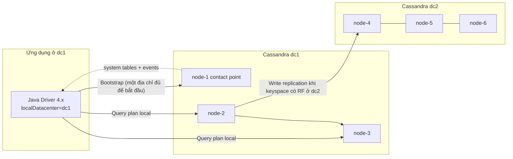
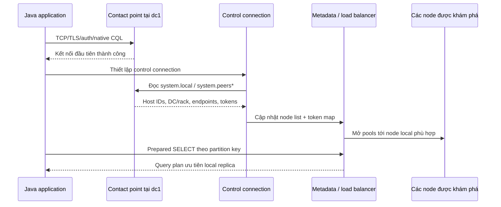
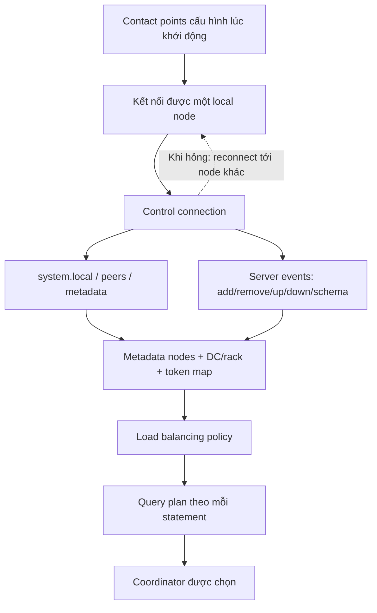
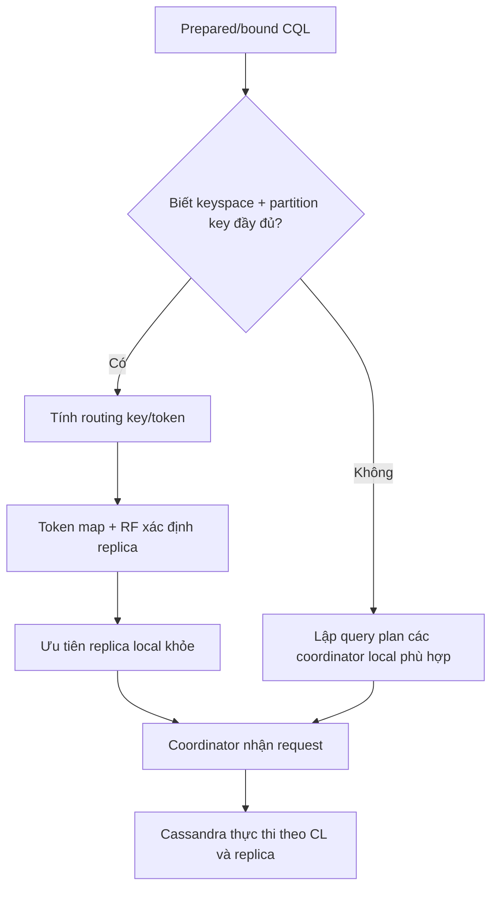
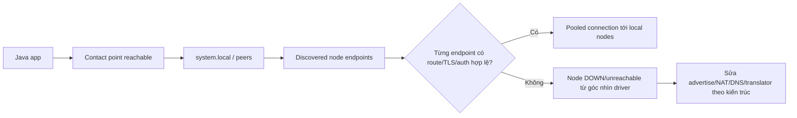
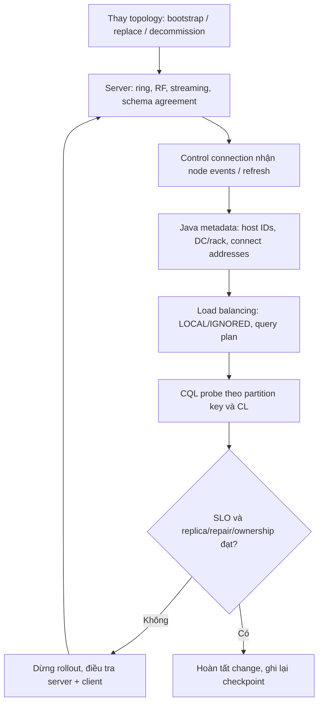

# Contact point, local datacenter và phát hiện topology

> **Chương:** Java driver cơ bản  
> **Học phần:** `DATABASE_ENGINE_WIDE_COLUMN_CASSANDRA` — Apache Cassandra

Một ứng dụng Java muốn kết nối Apache Cassandra thường chỉ có vài địa chỉ IP/hostname ban đầu. Nhưng Cassandra là một **cluster phân tán**, không phải máy chủ SQL đơn lẻ: các node thuộc những **data center (DC)**, rack và token ranges; mỗi partition được nhân bản theo replication strategy; coordinator và replica có thể là những node khác nhau. Java Driver 4.x phải biết **kết nối tới đâu để khởi động**, **DC nào gần ứng dụng**, và **cluster hiện có những node nào** để lựa chọn coordinator tốt cho mỗi truy vấn.

Ba khái niệm thường bị nhầm:

- **Contact point:** địa chỉ seed *cho driver bắt đầu khám phá cluster*, không phải danh sách đầy đủ mọi node, không mặc định là load balancer và không xác định replication factor.
- **Local datacenter:** tên DC mà ứng dụng coi là **gần nhất**; với `DefaultLoadBalancingPolicy`, driver ưu tiên và mặc định chỉ sử dụng node ở DC này làm coordinator.
- **Topology discovery:** driver dùng **control connection**, system tables và sự kiện từ Cassandra để nhận diện, theo dõi trạng thái, DC/rack và token metadata của các node **sau khi đã kết nối thành công lần đầu**.

**Bẫy quan trọng:** Cấu hình `LOCAL_QUORUM` trong câu lệnh không sửa được driver chọn sai DC. Mặt khác, chọn local DC đúng giúp tránh client truy vấn qua WAN, nhưng với keyspace nhân bản ở nhiều DC, **write vẫn có thể được gửi tới các replica ở DC khác**; local routing không tắt replication.

Bài học sử dụng API Java Driver **4.x** (ví dụ nhánh 4.17 với package `com.datastax.oss.driver.api`), CQL và `nodetool` để cài đặt, kiểm tra, giải thích lỗi và thiết kế kết nối an toàn. Từ Java Driver 4.18, dự án driver được Apache Software Foundation duy trì; khi áp dụng trên 4.18+ hoặc môi trường managed/cloud, cần đối chiếu tài liệu của **đúng nhánh driver và phương thức kết nối**.

**Mục tiêu**

1. Giải thích trình tự bootstrap từ contact points, tại sao nhiều contact points không có nghĩa driver chỉ dùng chúng.
2. Cấu hình `withLocalDatacenter` và `application.conf` đúng tên DC.
3. Đọc metadata của driver và phân biệt node được **phát hiện**, node `UP`, node `IGNORED` và node có kết nối thực tế.
4. Hiểu cách control connection, load balancing, token awareness và topology events liên hệ với partition key và CL.
5. Phân biệt phát hiện node với **failover giữa DC**, những giới hạn mặc định và điều kiện riêng theo phiên bản.
6. Điều tra lỗi khởi động, node không kết nối được, metadata stale và cấu hình NAT/Kubernetes không phù hợp.
7. Thiết kế lab và runbook sau khi thêm, thay thế hoặc rút node khỏi cluster.

## 1. Bản đồ khái niệm: client, coordinator, replica, DC

Ví dụ một cluster có hai DC, mỗi DC ba node, keyspace dùng `NetworkTopologyStrategy` với RF=3 tại mỗi DC. Ứng dụng `app-dc1` được triển khai gần dc1 và `app-dc2` gần dc2.



Sơ đồ chỉ minh họa các đường trao đổi logic, không phải số bản sao truyền qua WAN hay danh sách replica cố định. Trên thực tế coordinator có thể là node-1, node-2 hoặc node-3; topology và token xác định replica của mỗi partition, còn load balancing policy chọn coordinator. Một request được gửi tới **coordinator** không nhất thiết khiến coordinator là **replica của partition**, dù token-aware routing thường cố chọn local replica khi đủ thông tin.

Để tránh nhầm, tách các câu hỏi:

| Câu hỏi | Thành phần trả lời | Không nên nhầm với |
| --- | --- | --- |
| Driver có thể mở phiên CQL đầu tiên ở đâu? | **Contact points**, port native transport, TLS/auth | Toàn bộ danh sách replica |
| DC nào là gần ứng dụng? | **Local datacenter** và load balancing policy | Mức nhất quán `LOCAL_QUORUM` |
| Node nào hiện có trong cluster? | **Topology metadata**, system tables và events | Danh sách contact points cấu hình ban đầu |
| Node nào sẽ được thử cho request này? | **Query plan** từ load balancing policy | Tất cả node được phát hiện đều được kết nối |
| Partition X ở replica nào? | Partition key → token map + keyspace RF/strategy | Node có địa chỉ IP đầu tiên trong config |
| Phải chờ bao nhiêu replica ACK? | **Consistency level** và RF, theo DC của coordinator với mức local | Số contact points |
| Có tự sang DC2 khi DC1 hỏng? | **Failover policy** riêng, không tự có chỉ nhờ discovery | Phát hiện node DC2 trong metadata |

## 2. Contact point là hạt giống khởi tạo, không phải danh sách topology cố định

### 2.1. Trình tự bootstrap

Theo API Java Driver 4.x:

1. Ứng dụng khởi tạo `CqlSession` bằng các contact points được chỉ định.
2. Driver thử kết nối tới những contact points (có thể đảo thứ tự/thử lần lượt, không bắt buộc theo thứ tự viết).
3. Một địa chỉ nhận kết nối, vượt qua TCP/TLS/auth/protocol negotiation và trở thành điểm khởi đầu của **control connection**.
4. Driver truy vấn metadata từ system tables để tìm các node còn lại, DC/rack, host ID và topology; nó không chỉ lưu đúng hai địa chỉ đã được nhập.
5. Load balancing policy phân loại các node theo khoảng cách, mở các pool connection cần thiết và xây query plan cho request.
6. Khi có node mới/rút node hoặc thay đổi trạng thái, driver xử lý topology events và refresh metadata phù hợp.



**Contact point không phải Cassandra seed node theo nghĩa gossip.** Trong `cassandra.yaml`, danh sách `seeds` là cơ chế để **node Cassandra** tìm nhau trong ring. `basic.contact-points` là cấu hình **client Java Driver** để mở kết nối CQL. Có thể trùng IP nhưng không cùng vai trò. Cũng không cần contact point phải là node đang giữ dữ liệu của mọi partition.

### 2.2. Nên cấu hình bao nhiêu contact points?

Đối với ứng dụng production thông thường, chọn **hai hoặc ba địa chỉ ổn định, có thể kết nối, thuộc local DC** và nếu được thì trải rack/availability zone. Không có quy tắc Cassandra rằng phải liệt kê tất cả node. Mục tiêu là tránh một địa chỉ duy nhất khiến **session mới không thể bootstrap** khi địa chỉ đó down.

Điều này không thay thế cơ chế khám phá topology và không đồng nghĩa cần giữ kết nối qua mọi contact point:

- **Một contact point duy nhất:** đủ cho lab, nhưng là điểm khởi động đơn nếu node ngừng hoạt động đúng lúc service khởi tạo.
- **Nhiều contact points cùng DC:** tăng cơ hội bootstrap, nhưng các node được khám phá vẫn phải có **địa chỉ client kết nối tới được**.
- **Contact points thuộc nhiều DC:** không phù hợp với mặc định `DefaultLoadBalancingPolicy` + local DC tường minh; driver 4.x yêu cầu các contact points được khai báo thuộc local DC và có thể cảnh báo/khởi tạo lỗi khi cấu hình lệch.
- **Contact point là load balancer chung:** có thể che danh tính node, địa chỉ native và các metadata cần khám phá. Chỉ dùng proxy/LB khi đó là **mô hình kết nối được nền tảng hoặc driver hỗ trợ**, không tự đặt một VIP rồi giả định token-aware/discovery vẫn chuẩn.
- **Tên miền DNS:** DNS có thể cung cấp điểm truy cập ổn định, nhưng `A/AAAA`, TTL và đổi IP không đảm bảo driver tự cập nhật mọi endpoint nếu những địa chỉ mà Cassandra quảng bá vẫn không reach được.

Một contact point đã có thể **biến mất** sau khởi tạo và session vẫn hoạt động nếu driver còn kết nối tới các node khác. Ngược lại, khi **tạo session mới** mà mọi contact point đều không reach được, việc những node khác trong cluster vẫn khỏe **không cứu được quá trình bootstrap** nếu driver chưa học được địa chỉ của chúng.

### 2.3. Không khai báo contact point thì sao?

Theo Java Driver 4.x, khi **không** khai báo contact points, giá trị mặc định là `127.0.0.1:9042`. Trường hợp này chủ yếu dành cho máy lập trình/lab có Cassandra tại localhost; driver có thể lấy tên local DC từ node localhost để tiện bắt đầu.

Trong production, **khai báo explicit contact points và local datacenter**. Không dùng sự tiện lợi của localhost để che lỗi cấu hình DNS, service discovery hoặc thiếu biến môi trường.

## 3. Local datacenter: chọn đúng tên, đúng phía ứng dụng

### 3.1. Định nghĩa

`localDatacenter` là **tên DC ứng dụng coi là cục bộ** để load balancing policy chọn những node có thể làm coordinator. Nó không nhất thiết là DC lớn nhất, DC đầu tiên trong cấu hình RF hoặc DC gần địa chỉ IP trên giấy. Thường chọn DC mà ứng dụng **đặt cùng region/zone mạng** để giảm RTT, phí truyền liên DC và các sự cố phụ thuộc WAN.

Với mặc định `DefaultLoadBalancingPolicy`:

- Các node local được dùng trong query plans và có connection pools phù hợp.
- Các node DC khác vẫn có thể xuất hiện trong **metadata** nhưng thường bị **`IGNORED`**, không được dùng làm coordinator trong chế độ mặc định.
- Nếu một DC remote có RF>0, các write vẫn được Cassandra gửi tới replica trong DC đó; local routing **không xóa replication WAN**.
- Việc `LOCAL_ONE`/`LOCAL_QUORUM` trên request liên quan tới **DC của coordinator**, nên cấu hình sai local DC có thể đổi ý nghĩa và hiệu năng thực tế của truy vấn.

### 3.2. Lấy tên DC ở đâu?

Dùng công cụ chỉ đọc trên node Cassandra:

```bash
nodetool status
nodetool describecluster
```

Trong `cqlsh`, có thể kiểm tra một node:

```sql
SELECT data_center, rack, host_id
FROM system.local;
```

`system.local` phản ánh **node đang nhận câu query**; nếu cqlsh đang kết nối tới node ở dc2 thì dữ liệu sẽ cho ra dc2. Trên các bản Cassandra có system.peers/peers_v2, danh sách peer cung cấp DC/rack/host ID để khám phá các node khác; không nhầm **tên DC theo snitch** với tên cloud region do ứng dụng tự đặt.

Ví dụ `nodetool status` hiện `Datacenter: dc1`, Java Driver phải dùng chính xác `dc1`, không dùng `DC1` hoặc `datacenter1` nếu cluster không công bố những tên đó. Tên DC là cấu hình topology, **không phải tùy chọn dịch sang tiếng Việt**.

### 3.3. Tình huống hai DC

Giả sử:

```sql
-- Chỉ tạo trên lab đã có đủ node cho RF của từng DC.
CREATE KEYSPACE IF NOT EXISTS telemetry
WITH replication = {
    'class': 'NetworkTopologyStrategy',
    'dc1': 3,
    'dc2': 3
};
```

- Service chạy tại dc1: `withLocalDatacenter("dc1")`.
- Service chạy tại dc2: `withLocalDatacenter("dc2")`.
- Một file cấu hình đóng gói chung có thể triển khai ở cả hai vùng, nhưng **giá trị local DC phải lấy từ cấu hình deployment của từng vùng**, không hardcode một giá trị cho tất cả instances.
- `LOCAL_QUORUM` với RF=3 tại DC coordinator cần đa số local replicas (2 ở ví dụ), chứ không cộng 3+3 thành 4 như `QUORUM` toàn keyspace.
- App ở dc1 nhận ACK local không bảo đảm ngay lập tức một app ở dc2 đọc thấy write mới nhất; cần đánh giá semantics cross-DC, repair/hints và yêu cầu nghiệp vụ.

## 4. Hai cách cấu hình Java Driver 4.x

### 4.1. Programmatic builder

Ví dụ cho **Apache Cassandra direct native protocol**, các IP dành cho tài liệu `192.0.2.0/24`, nên phải thay bằng endpoint thực và đúng tên DC:

```java
import java.net.InetSocketAddress;
import com.datastax.oss.driver.api.core.CqlSession;

public final class CassandraSessions {
    private CassandraSessions() {}

    public static CqlSession openDc1() {
        return CqlSession.builder()
            .addContactPoint(new InetSocketAddress("192.0.2.11", 9042))
            .addContactPoint(new InetSocketAddress("192.0.2.12", 9042))
            .withLocalDatacenter("dc1")
            .build();
    }
}
```

Trong ứng dụng thật, địa chỉ/port và tên DC nên lấy từ config đã kiểm soát, credentials từ secret manager và TLS theo security policy. Không hardcode username/password trong mã. Ví dụ không cấp các thông số đó chỉ nhằm tập trung vào **contact point + local DC**.

Một `CqlSession` được thiết kế là đối tượng **dùng chung, thread-safe** trong một ứng dụng/service. Tạo tại lúc startup, dùng cho nhiều request và đóng khi service shutdown. **Không** xây một session mới cho từng HTTP request: việc khởi tạo sẽ phải kết nối/đọc topology/chuẩn bị pools nhiều lần và làm tăng tải không cần thiết.

### 4.2. `application.conf` (HOCON)

Java Driver 4.x có thể nhận cấu hình qua file `application.conf` trên classpath:

```hocon
datastax-java-driver {
  basic {
    contact-points = [
      "192.0.2.11:9042",
      "192.0.2.12:9042"
    ]
    load-balancing-policy.local-datacenter = dc1
  }
}
```

Tương đương với builder ở trên cho hai trường tương ứng. Chỉ cần một con đường cấu hình ổn định; nếu đồng thời cấu hình trong file và builder, **giá trị local DC set programmatically có ưu tiên cao hơn** theo tài liệu driver. Điều này dễ làm production sai khi deployment đổi file nhưng mã vẫn gọi `withLocalDatacenter("dc1")`.

**Kiểm tra khi khởi chạy:** log một sự kiện an toàn gồm ứng dụng/deployment region, **local DC được chọn** và số node metadata; không in credential hay raw query values. Nếu môi trường managed/secure connect bundle có yêu cầu riêng, đừng dùng cùng mô hình IP/port nếu nhà cung cấp hướng dẫn cách khác.

### 4.3. Kết nối có xác thực và mã hóa

Cassandra hỗ trợ cấu hình native transport TLS và authentication; driver phải được thiết lập tương ứng. Một lỗi TLS/truststore, hostname verification hoặc credential có thể khiến **contact points đang sống vẫn không kết nối được**.

Đừng tắt TLS hoặc xác minh certificate chỉ để “sửa” một lỗi startup. Trong quy trình thực, xác minh đúng CA/truststore, SAN/hostname, cơ chế authentication, thời hạn certificate và đồng hồ hệ thống. Nếu có proxy/NAT/SNI, đảm bảo host/port đã được thiết kế theo hướng dẫn connection scheme tương ứng.

## 5. Topology discovery: control connection và metadata

### 5.1. Control connection là gì?

Sau khi kết nối tới một contact point thành công, Java Driver duy trì **control connection** — một kết nối chuyên dùng cho tác vụ quản trị metadata:

- Truy vấn `system.local` và `system.peers` (hoặc cơ chế tương ứng, gồm `peers_v2` ở các bản hỗ trợ) để học host ID, endpoint, DC/rack, version, token và schema.
- Nhận **topology events** (node được thêm/rút), **status events** (UP/DOWN) và **schema events** qua giao thức Cassandra.
- Kích hoạt refresh danh sách node/token map/schema, kiểm tra schema agreement sau DDL khi phù hợp.
- Nếu control node down, tìm node khác theo chính sách reconnect và query plan thay vì buộc ứng dụng tạo session mới ngay.

Control connection **không đồng nghĩa** với các pooled connections dùng thực thi CQL. Metadata có thể được driver biết ngay cả khi chưa mở kết nối tới mọi node; cũng có thể có một node đã down/ignored vẫn nằm trong danh sách metadata.



### 5.2. Driver có thực sự “tự tìm mọi node mới” không?

**Có cơ chế tự động**, nhưng không phải vô điều kiện:

- Cassandra cần công bố địa chỉ node và dữ liệu topology đúng.
- Node mới phải xuất hiện trong system metadata/events và có endpoint mà driver nhận diện được.
- Nếu node không thuộc local DC, chính sách mặc định có thể đánh dấu **`IGNORED`**; phát hiện không đồng nghĩa dùng để query.
- Nếu endpoint quảng bá là IP private không reach được từ app, driver có thể **biết node nhưng không mở được pooled connection**.
- Nếu control connection bị gián đoạn, metadata có thể chưa kịp cập nhật; driver sẽ cố reconnect/refresh. Cần kiểm tra logs và metrics thay vì giả định trạng thái luôn nhất quán tức thì.
- Driver không phải nguồn chân lý độc lập về ring: `nodetool status`, snitch, system tables và network reachability vẫn cần kiểm tra.

**Không cần restart Java service mỗi khi cluster thêm một node** nếu discovery và đường mạng hoạt động đúng. Nhưng sau một topology change lớn, nên xác minh driver đã thấy node mới và request routing/CL đạt yêu cầu, không dựa duy nhất vào trạng thái Cassandra node `UN`.

### 5.3. Sự kiện topology không thay thế repair

Bootstrap, decommission, replace và move có thể thay đổi token ownership/replica. Driver biết một node mới **không** chứng minh dữ liệu của mọi token range đã stream đầy đủ, đã repair hoặc đã có thể phục vụ CL yêu cầu. Những điều đó thuộc quản trị Cassandra: `nodetool status/netstats/repair` và readback ở các partition mẫu.

Vì vậy cần hai lớp kiểm tra:

1. **Server layer:** node/ring/schema/streaming/repair đúng.
2. **Client layer:** driver metadata có node/DC/rack đúng, endpoint reachable, connection pool khỏe, prepared query p99 và CL đạt mục tiêu.

## 6. Đọc topology ngay trong Java

Java Driver 4.x expose `session.getMetadata().getNodes()`. Danh sách này bao gồm cả node **được biết nhưng down** hoặc **ignored**. `Node.getDistance()` phản ánh chính sách load balancing, không phải khoảng cách địa lý tính bằng km.

```java
import java.net.InetSocketAddress;
import java.util.Map;

import com.datastax.oss.driver.api.core.CqlSession;
import com.datastax.oss.driver.api.core.metadata.Node;

public final class TopologyInspector {
    private TopologyInspector() {}

    public static void printMetadata(CqlSession session) {
        Map<InetSocketAddress, Node> nodes =
            session.getMetadata().getNodes();

        System.out.println("Discovered nodes=" + nodes.size());
        for (Node node : nodes.values()) {
            // Production: đưa vào metric/log có quyền, tránh lộ IP/host ID.
            System.out.printf(
                "hostId=%s connect=%s dc=%s rack=%s state=%s " +
                "distance=%s connections=%d%n",
                node.getHostId(),
                node.getConnectAddress(),
                node.getDatacenter(),
                node.getRack(),
                node.getState(),
                node.getDistance(),
                node.getOpenConnections()
            );
        }
    }
}
```

**Cách đọc kết quả:**

| Trường | Diễn giải | Bẫy |
| --- | --- | --- |
| `Host ID` | Định danh node Cassandra được driver biết | Không suy từ IP; khi replace node, IP có thể tái sử dụng nhưng host ID thay đổi. |
| `Connect address` | Endpoint driver định dùng để kết nối native transport | Có thể khác broadcast IP/rpc address của deployment do NAT/translator/proxy. |
| `Datacenter/Rack` | Topology do server/snitch cung cấp | Sai DC/rack dẫn tới load balancing/replication assumptions sai. |
| `NodeState.UP/DOWN` | Cách **driver** nhìn trạng thái node | Không đồng nhất tuyệt đối với `nodetool status` của mọi server tại mọi thời điểm. |
| `Distance.LOCAL` | Nằm trong tập node local mà policy có thể dùng | Không khẳng định node giữ partition của mọi query. |
| `Distance.IGNORED` | Policy không chủ động kết nối tới node | **Không nhất thiết lỗi**, thường là node remote DC theo default policy. |
| `OpenConnections` | Số kết nối driver đang mở tới node | Control connection có thể khiến control node có thêm một kết nối so với pool thường. |

**Chú ý snapshot metadata:** map trả về từ `getNodes()` là snapshot **bất biến về membership của thời điểm lấy**, nhưng từng đối tượng `Node` có thể thay đổi trạng thái. Muốn xem node vừa thêm/rút sau đó, gọi lại `session.getMetadata().getNodes()` thay vì giữ mãi map cũ. Đừng cho một request API bình thường phải duyệt toàn metadata mỗi lần; thu ở metric/diagnostic định kỳ khi cần.

### 6.1. Lắng nghe thay đổi node bằng API công khai

Driver có `NodeStateListener` và lớp tiện ích `NodeStateListenerBase`, cho phép lắng nghe thay đổi mà không sử dụng **internal driver APIs**. Ví dụ:

```java
import com.datastax.oss.driver.api.core.metadata.Node;
import com.datastax.oss.driver.api.core.metadata.NodeStateListenerBase;

public final class NodeEvents extends NodeStateListenerBase {
    @Override
    public void onAdd(Node node) {
        System.out.println("Node added: " + node.getHostId());
    }

    @Override
    public void onUp(Node node) {
        System.out.println("Node up: " + node.getHostId());
    }

    @Override
    public void onDown(Node node) {
        System.out.println("Node down: " + node.getHostId());
    }

    @Override
    public void onRemove(Node node) {
        System.out.println("Node removed: " + node.getHostId());
    }
}
```

Đăng ký tại xây session:

```java
CqlSession session = CqlSession.builder()
    .addContactPoint(new InetSocketAddress("192.0.2.11", 9042))
    .withLocalDatacenter("dc1")
    .addNodeStateListener(new NodeEvents())
    .build();
```

Đoạn trên giả định đã import `CqlSession` và `InetSocketAddress` như ví dụ trước. Listener có thể nhận sự kiện trong **quá trình session đang khởi tạo**, trước khi `build()` trả về, và callbacks có thể chạy trên **nhiều threads**. Đặc biệt, `node.getHostId()` **có thể trả `null` trong lần `onUp` đầu tiên** trước khi driver đọc xong metadata; vì vậy đừng dùng host ID như một giá trị luôn có sẵn trong callback khởi tạo. Không đặt công việc nặng, gọi lại truy vấn Cassandra hoặc phụ thuộc vào session chưa khởi tạo xong bên trong callback. Đưa sự kiện ngắn vào hàng đợi bounded/metrics nếu cần xử lý bất đồng bộ. Với use case đòi hỏi chỉ nhận sự kiện sau khi session sẵn sàng, xem `SafeInitNodeStateListener` của nhánh driver tương ứng.

**Không lạm dụng thông báo `DOWN`:** một node có thể bị một observer đánh dấu down do gossip trong khi driver vẫn có pooled connection còn hoạt động; hoặc driver chưa kết nối tới ignored node nên không có trạng thái “UP” đúng nghĩa health check từ client. Cần nhìn kết quả query và logs/metrics, không biến một event thành lệnh tự động remove node khỏi Cassandra.

## 7. Load balancing, token awareness và consistency level

### 7.1. Node được khám phá chưa chắc sẽ thành coordinator

`DefaultLoadBalancingPolicy` tạo query plan cho từng request. Mặc định nó xét các node **local** có thể xử lý request; với query có đủ routing information, policy **token-aware** sẽ ưu tiên **local replicas** của partition đó. Nếu thiếu routing information, driver có thể phân bố request kiểu round-robin trên các node local thích hợp.



**Điều kiện token-aware routing thường gồm:**

- Driver có **token metadata** và keyspace replication metadata.
- Statement có keyspace và **routing key** xác định được, thường thông qua `PreparedStatement`/`BoundStatement` với đủ thành phần partition key.
- Node sở hữu token được tìm thấy, không bị ignored/down và có đường kết nối thích hợp.
- Với batch, query có thể liên quan nhiều partition; không mặc định route chính xác như một prepared statement đơn-partition.

Token awareness **chọn coordinator hiệu quả**, không biến Cassandra thành single-node query, cũng không thay đổi RF. CQL `ALLOW FILTERING` quét rộng hay thiếu partition key vẫn có thể yêu cầu fan-out đáng kể, dù local DC đúng.

### 7.2. CQL minh họa một truy vấn có routing key rõ ràng

```sql
-- Keyspace 'telemetry' đã tạo ở mục 3 trên LAB.
CREATE TABLE IF NOT EXISTS telemetry.sensor_events_by_day (
    sensor_id text,
    event_day date,
    event_id uuid,
    payload text,
    PRIMARY KEY ((sensor_id, event_day), event_id)
);

INSERT INTO telemetry.sensor_events_by_day
    (sensor_id, event_day, event_id, payload)
VALUES (
    'sensor-07', '2026-11-21',
    11111111-1111-4111-8111-111111111111,
    'demo'
);

SELECT payload
FROM telemetry.sensor_events_by_day
WHERE sensor_id = 'sensor-07'
  AND event_day = '2026-11-21'
  AND event_id = 11111111-1111-4111-8111-111111111111;
```

Partition key vẹn toàn là `(sensor_id, event_day)`; `event_id` là clustering column. Driver có thể tính routing key cho prepared statement khi biết schema/bind values đúng. Nếu client chỉ cung cấp `event_id`, không thể suy ra token partition một cách đáng tin và query còn có thể bị từ chối vì thiếu partition key.

### 7.3. Ví dụ Java Driver 4.x thực thi prepared statement

```java
import java.time.LocalDate;
import java.util.UUID;

import com.datastax.oss.driver.api.core.CqlSession;
import com.datastax.oss.driver.api.core.DefaultConsistencyLevel;
import com.datastax.oss.driver.api.core.cql.PreparedStatement;
import com.datastax.oss.driver.api.core.cql.Row;

public final class SensorEventReader {
    private final CqlSession session;
    private final PreparedStatement read;

    public SensorEventReader(CqlSession session) {
        this.session = session;
        this.read = session.prepare(
            "SELECT payload FROM telemetry.sensor_events_by_day " +
            "WHERE sensor_id = ? AND event_day = ? AND event_id = ?");
    }

    public String find(String sensorId, LocalDate day, UUID eventId) {
        Row row = session.execute(
            read.bind(sensorId, day, eventId)
                .setConsistencyLevel(DefaultConsistencyLevel.LOCAL_QUORUM)
                .setIdempotent(true)
        ).one();

        return row == null ? null : row.getString("payload");
    }
}
```

- `CqlSession` được tạo một lần, local datacenter khớp deployment.
- Câu query chỉ đọc đúng partition và clustering key nên phù hợp đường đọc có phạm vi.
- `DefaultConsistencyLevel.LOCAL_QUORUM` là quyết định consistency; nó không bật/đổi token awareness hoặc phát hiện node.
- `setIdempotent(true)` hợp với SELECT này; không sao chép cờ ấy sang counter `+1` hay thao tác không idempotent chỉ để tăng retry.
- Driver có thể chọn local replica làm coordinator; Cassandra vẫn có thể liên lạc tới các replica khác để đáp ứng CL.
- Không để lộ `sensorId`/payload nhạy cảm trong log diagnostic hoặc metric labels.

### 7.4. Tránh ngộ nhận về “local”

Có ít nhất **ba lớp “local” khác nhau**:

| “Local” | Được định nghĩa ở đâu? | Ảnh hưởng |
| --- | --- | --- |
| **Local DC của Java Driver** | `withLocalDatacenter("dc1")` / load balancing policy | Tập coordinator được driver ưu tiên/kết nối. |
| **LOCAL_* consistency level** | CQL request và RF của keyspace | Số replica ở **DC của coordinator** phải xác nhận. |
| **Local replica/partition owner** | Token map + keyspace RF + node DC/rack | Vị trí lưu bản sao của một partition. |

Ba khái niệm liên hệ nhưng không thay thế nhau. App dùng `LOCAL_QUORUM` với local DC khai báo sai có thể đang đạt quorum ở **DC không mong đợi**, làm WAN latency/chi phí tăng, đồng thời vi phạm giả định về data residency và phục hồi.

## 8. Multi-DC failover: topology discovery không đồng nghĩa tự chuyển DC

Tình huống: dc1 có ba node down, dc2 còn khỏe. Driver `app-dc1` có thể đã khám phá node dc2 qua metadata, nhưng **mặc định không chuyển query sang dc2** chỉ vì dc2 tồn tại.

**Mặc định Java Driver 4.x:** `DefaultLoadBalancingPolicy` chỉ sử dụng local DC, thường gán `IGNORED` cho các node remote. Đây là chủ đích nhằm tránh traffic WAN bất ngờ và để hạ tầng ứng dụng điều phối failover rõ ràng.

**Khác biệt phiên bản quan trọng:** từ Java Driver **4.10** trở lên, driver cung cấp tùy chọn **cross-DC failover** trong chính sách built-in, mặc định **tắt**. Các bản 4.0–4.9 không có tính năng này theo cùng cơ chế.

Ví dụ **chỉ nhằm nhận diện option**, không khuyến nghị bật mặc định:

```hocon
datastax-java-driver {
  advanced.load-balancing-policy.dc-failover {
    # Mặc định là 0: không chọn remote nodes để failover.
    max-nodes-per-remote-dc = 0
    # Khi thật sự dùng LOCAL_* qua remote, còn điều kiện khác.
    # allow-for-local-consistency-levels = false
  }
}
```

Khi đặt `max-nodes-per-remote-dc` lớn hơn 0 trong bản hỗ trợ, driver có thể mở pool tới một số node remote và đưa chúng **sau node local** trong query plan. Tuy nhiên **failover cho local consistency levels** như `LOCAL_ONE`, `LOCAL_QUORUM`, `LOCAL_SERIAL` mặc định cũng không bật; muốn bật cần thiết lập `allow-for-local-consistency-levels = true` và đánh giá hậu quả.

**Vì sao nguy hiểm?** `LOCAL_QUORUM` được thực thi theo **DC của coordinator thật sự được chọn**. Nếu dc1 có RF=3, dc2 có RF=1, quorum local tại dc1 cần 2 bản xác nhận, nhưng khi coordinator ở dc2 thì chỉ cần 1. Điều này thay đổi tính nhất quán và khả dụng một cách không hiển nhiên. Thêm vào đó là WAN RTT, phí egress, bảo mật, data residency và nguy cơ đọc data remote chưa theo kịp.

| Kịch bản | Kết quả mặc định | Phương án vận hành |
| --- | --- | --- |
| Một node dc1 down, node khác dc1 khỏe | Driver chuyển sang node local khác trong query plan/reconnect | Kiểm tra topology, pool, latency, CL và repair theo quy trình. |
| Mọi contact point cấu hình down **trước khi session khởi động** | Không thể bootstrap nếu không có contact point nào dùng được | Cung cấp nhiều contact points local độc lập, service discovery phù hợp. |
| Contact point đầu tiên down **sau khi driver đã khám phá các node khác** | Session thường vẫn có thể hoạt động qua các node còn kết nối | Kiểm tra control connection failover, metadata và request success. |
| Cả dc1 mất, dc2 khỏe | **Không tự failover** với default local-only policy | Thường ưu tiên failover **tầng ứng dụng/hạ tầng sang app-dc2** có session local dc2. |
| Bật remote failover từ 4.10+ | Có thể dùng remote coordinator theo điều kiện config, đặc biệt lưu ý LOCAL_* | Chỉ bật sau diễn tập RF/CL, WAN/latency, data residency và RTO/RPO. |

**Thực hành khuyến nghị:** triển khai **ứng dụng tại mỗi DC**, mỗi nhóm dùng local DC riêng; traffic manager ở tầng hạ tầng có thể chuyển người dùng tới nhóm ứng dụng và Cassandra trong DC khỏe. Điều này thường minh bạch hơn việc một ứng dụng ở region đang suy giảm vẫn cố truy vấn qua WAN.

## 9. Vì sao discovery có node nhưng kết nối không thành công?

Topology discovery dựa vào **những địa chỉ do Cassandra công bố**. Driver có thể kết nối tới một contact point bằng endpoint công khai, đọc system peers và phát hiện các địa chỉ **private IP** không thể đi từ nơi chạy ứng dụng.

Ví dụ:

```text
Ứng dụng ở bên ngoài VPC:
  Contact point public/proxy:   203.0.113.10:9042  -> kết nối OK
  system.peers công bố:         10.0.4.21:9042     -> client không route tới
  system.peers công bố:         10.0.4.22:9042     -> client không route tới

Kết quả:
  - Bootstrap/control connection có thể thành công
  - Node list có thể đủ
  - Pooled connections tới node khác vẫn thất bại
  - Query plan/availability bị giới hạn hoặc request timeout
```

**Mục tiêu sửa:** mọi endpoint driver dự định sử dụng phải **reachable từ ứng dụng** với native CQL protocol, cùng TLS/auth và cách xác thực hostname chính xác. Cần kiểm tra:

- `listen_address` dùng cho **internode communication**, không nhất thiết là CQL endpoint.
- `rpc_address`/`broadcast_rpc_address` (hoặc cơ chế native địa chỉ tương ứng theo phiên bản) liên quan tới endpoint CQL được công bố/đọc trong metadata.
- `native_transport_port` (thường 9042) và network ACL/firewall/security group phải mở đúng chiều; đừng nhầm port gossip/internode với port CQL.
- DNS của contact point và endpoint được khám phá có tên/địa chỉ phù hợp mạng thực của client.
- Với Kubernetes, container IP/Pod IP, Service ClusterIP, node address và headless service có vòng đời khác nhau; **cluster metadata quảng bá endpoint** cần giải pháp service discovery/address translation tương thích.
- Với NAT, proxy, cloud secure connect bundle hoặc SNI routing, sử dụng **address translator/connection strategy được driver hoặc nhà cung cấp hỗ trợ**, không tùy tiện replace chuỗi IP trong CQL hay tắt token metadata.



Nếu một endpoint được nhận diện thuộc **cluster khác** hoặc sai protocol, driver có thể đánh dấu `FORCED_DOWN`/bỏ node để tránh gửi request sai đích. Không ép driver coi node đó `UP` bằng internal API để chữa lỗi cấu hình.

## 10. Theo dõi topology và đường kết nối bằng hai lớp metric

### 10.1. Phía Java Driver

| Metric/tín hiệu | Hỏi gì? | Dấu hiệu bất thường |
| --- | --- | --- |
| Session initialization failures | App có bootstrap được không? | Thất bại ở contact points dù Cassandra khác còn healthy. |
| Số node metadata theo DC | Driver có khám phá đúng topology không? | Node mới không xuất hiện hoặc DC/rack sai. |
| `NodeState`, `NodeDistance` | Local node nào UP/DOWN/IGNORED? | Node thuộc dc1 bị IGNORED bất ngờ; remote DC bị dùng trái policy. |
| `getOpenConnections()` / pool metrics | Driver có pool tới node cần dùng? | Metadata có node nhưng pool không mở, reconnect nhiều. |
| Request timeout/unavailable/retry | Người dùng có chịu lỗi kết nối/CL? | Retry storm, request p99 tăng, timeout theo coordinator. |
| Coordinator distribution và query plans | Request có phân phối trên node local? | Tất cả dồn vào một node hoặc remote coordinator ngoài dự kiến. |
| Token-aware routing | Driver có routing key đủ và ưu tiên local replicas? | Query thiếu partition key hoặc metadata token bị tắt/stale. |
| Control connection status/reconnect | Discovery có thể cập nhật không? | Control connection lặp reconnect; topology stale. |

**Cảnh báo cardinality:** không đưa partition key, tenant ID hay event ID không giới hạn vào metric labels. Dùng `cluster`, `dc`, `node`/host ID, `operation`, `query-template-id` là những nhãn có giới hạn hơn. Log startup có thể chứa IP/host ID thuộc dữ liệu hạ tầng nhạy cảm; phân quyền xem.

### 10.2. Phía Cassandra và hạ tầng

```bash
# Read-only trên node Cassandra, không làm thay đổi ring.
nodetool status
nodetool describecluster
nodetool netstats
nodetool tpstats
```

```sql
-- Trên node thực hiện kết nối cqlsh:
SELECT data_center, rack, host_id FROM system.local;

-- Trên những bản Cassandra có system.peers:
SELECT peer, data_center, rack, host_id FROM system.peers;
```

Trên các bản có `system.peers_v2`, có thể đối chiếu các endpoint/port được lưu tại đó; không suy rằng mọi bản đều có cùng tập cột và cùng format. Kết hợp với kiểm tra TCP/TLS từ **chính máy chạy Java**, chứ không chỉ test port từ node Cassandra khác.

**Lưu ý về góc nhìn:** `nodetool status` là trạng thái qua gossip từ một server; driver `NodeState` là trạng thái **từ ứng dụng**. Một DC có thể nhìn node `UN` nhưng ứng dụng bên ngoài không route được tới native address; hoặc application client vẫn giữ connection tới node mà peer khác đang nghi ngờ. Điều tra hai góc nhìn trước khi kết luận Cassandra node thật sự chết.

## 11. Runbook sự cố kết nối và phát hiện topology

### RB-01 — Không khởi tạo được `CqlSession`

**Triệu chứng:** service startup fail, driver không establish session, connect timeout/refused, authentication/TLS exception hoặc báo thiếu local DC.

**Chẩn đoán:**

1. In/đọc **cấu hình thực tế** (ẩn credentials): explicit contact points? `withLocalDatacenter` hay `basic.load-balancing-policy.local-datacenter` đúng?
2. Kiểm tra network route và native port từ host app tới **mỗi** contact point, không từ server Cassandra đơn thuần.
3. Kiểm tra TLS truststore, certificate SAN/hostname, auth roles/permission, native transport có bật không.
4. Dùng `nodetool status`/`system.local` xác nhận tên DC và trạng thái target.
5. Xác định các contact points có cùng local DC hay một địa chỉ thuộc dc2.
6. Nếu mọi contact point không reachable nhưng cluster còn khỏe, thêm/đổi **địa chỉ local hoạt động** qua config có kiểm soát.

**Không làm:** xóa `withLocalDatacenter` rồi hy vọng driver “tự chọn DC gần nhất” khi có explicit contact points; tắt TLS; thêm remote DC ngẫu nhiên để service boot. **Đóng:** ứng dụng mới tạo session thành công qua ít nhất hai contact points dự phòng, metadata phát hiện nodes local và query theo CL hoạt động.

### RB-02 — Session kết nối ban đầu thành công nhưng chỉ thấy một node

**Triệu chứng:** Java có một pool hoạt động, `getMetadata().getNodes()` không có các node server đã `UN`.

**Chẩn đoán:** control connection và system tables, server gossip, topology events, metadata refresh/reconnection logs. Kiểm tra driver có dùng proxy/SNI/cloud connection model đặc biệt không; những mô hình này có thể có semantics discovery khác direct cluster.

**Hành động:** xác minh `system.peers`/`peers_v2` được cập nhật, source node thuộc cluster đúng, phiên bản driver/server tương thích; sửa cấu hình metadata hoặc endpoint quảng bá. **Không** yêu cầu Java reconnect mọi request hay ép tự tạo danh sách các node bằng tay như cách thay thế topology discovery.

**Đóng:** node list phản ánh cluster, DC/rack đúng và coordinator load được phân bố hợp lý.

### RB-03 — Node được phát hiện nhưng `DOWN`/không có pool

**Triệu chứng:** `nodetool status` cho `UN` nhưng Java thấy node `DOWN` hoặc reconnect thất bại.

**Chẩn đoán:** `Node.getConnectAddress()`, client network routes, DNS/NAT, firewall, TLS/hostname, native port và metrics kết nối. Nếu node ở remote DC và distance là `IGNORED`, **không** coi đó là lỗi pool: default policy cố ý không kết nối remote.

**Hành động:** sửa endpoint/translator và network từ client, không tự sửa token/repair để “mở cổng”. Nếu server quảng bá IP không thể reach qua Kubernetes/NAT, phải cập nhật connection architecture đúng. **Đóng:** các node local cần thiết có pool khỏe, tỷ lệ lỗi/timeout giảm.

### RB-04 — Ứng dụng vô tình truy cập DC xa

**Triệu chứng:** p99 tăng, băng thông WAN/egress tăng, coordinator thực tế nằm ở dc2 khi app ở dc1.

**Chẩn đoán:** đối chiếu `withLocalDatacenter` với tên DC Cassandra, các contact points; cấu hình custom load balancing/`dc-failover`; nguồn của `application.conf`; có logic per-profile override hay không.

**Hành động:** sửa local DC cho đúng deployment, loại remote contact points trong cách kết nối direct, canary và đo lại coordinator distribution; tắt remote failover nếu chưa được duyệt. **Không** chỉ hạ CL để che WAN latency. **Đóng:** query bình thường chọn coordinator local, network cost và SLO đạt, RF/CL chính xác.

### RB-05 — Mới thêm/thay node nhưng Java chưa nhận

**Triệu chứng:** cluster đã có node mới `UN`, metadata Java chưa cập nhật hoặc query vẫn gửi tới host ID đã remove.

**Chẩn đoán:** control connection health, topology notifications, system peers, địa chỉ mới, IP cũ đang cache, DNS, TLS, load balancing; kiểm tra node đang `UJ/UL` hay thật sự `UN` và streaming/ownership đã hoàn tất chưa.

**Hành động:** chờ refresh trong khoảng hợp lý, sửa network/metadata source, rollback topology change nếu cấp quản trị yêu cầu. Nếu khởi động session mới giúp còn session cũ thất bại, cần điều tra refresh/control connection trước khi chọn restart app hàng loạt. **Đóng:** membership/host ID đúng, không route tới removed node, read/write probes sau bootstrap/replace đạt.

### RB-06 — DC cục bộ down, ứng dụng còn chạy và muốn failover

**Triệu chứng:** `NoNodeAvailableException` hoặc request unavailable trong app-dc1, dc2 vẫn khỏe.

**Chẩn đoán:** điều kiện mạng, node health, RF/CL, có `dc-failover` option ở bản driver đang dùng không; ứng dụng có deployment ở dc2 và traffic manager không. Xác định yêu cầu RTO/RPO và visibility của những ghi chưa nhân bản hoàn tất.

**Hành động ưu tiên:** chuyển người dùng sang ứng dụng hoạt động tại dc2 với local DC tương ứng theo kế hoạch hạ tầng, kiểm tra consistency và lag. Chỉ bật driver remote failover từ bản có hỗ trợ sau đánh giá **LOCAL_* semantics**, security, WAN và failure testing; không dùng làm thao tác đột xuất lúc incident. **Đóng:** dịch vụ phục vụ lại trên DC được duyệt, latency/error ổn và có kế hoạch repair/hints khi DC cũ phục hồi.

## 12. Trình tự kiểm chứng sau thay đổi topology

Khi đội vận hành thực hiện bootstrap/decommission/replace node, Java Driver chỉ là **một trong các lớp kiểm chứng**.



**Checkpoint trước thay đổi**

- Chụp baseline `nodetool status`, RF/CL của keyspace, host IDs, endpoints và metadata Java.
- Xác định contact points có bị thay/remove không; giữ ít nhất những địa chỉ local khác sẵn sàng bootstrap cho session mới.
- Kiểm tra bản driver, version server, cert/TLS, rolling upgrade compatibility, mạng và đủ dung lượng streaming.
- Định nghĩa read/write probe gồm **key đã tồn tại trước sự cố** và **key mới ghi sau thao tác**, ở nhiều token ranges, trên từng DC quan trọng.
- Ghi điều kiện STOP: missing metadata, node UN nhưng unreachable, quorum không đủ, latency/error vượt SLO.

**Checkpoint sau bootstrap**

- Node mới xuất hiện ở `nodetool status`, streaming có tiến độ/hoàn tất và ownership hợp kế hoạch.
- Java `getNodes()` phản ánh host ID/endpoint mới; `getDistance()` local cho node đúng dc1.
- Connection pool tới node mới phát triển bình thường; không có TLS/auth/route error.
- Query probe theo partition key và CL thành công; không suy chỉ từ `getNodes()` rằng đã stream đủ toàn bộ SSTables.

**Checkpoint sau replace/decommission**

- Host ID cũ không còn hoặc được thay đúng, driver không cố gửi query tới endpoint cũ.
- Contact points cấu hình không còn trỏ độc quyền vào node đã rời cluster; cập nhật inventory/secret/config deployment.
- Replica ownership, repair/cleanup và read-after-write theo CL đã được xác minh bởi đội Cassandra.
- Theo dõi p95/p99, retry, reconnect, hinted handoff, streaming và disk/compaction sau change.

## 13. Thực hành kiểm tra end-to-end

### Bài lab: 2 DC, mỗi DC 3 node, Java service dc1

**Điều kiện:** Cassandra đã chạy trên lab riêng với `NetworkTopologyStrategy` có RF=3 ở dc1/dc2, native CQL có thể truy cập từ máy Java, driver 4.x, tài khoản và TLS theo chính sách. IP/port sau chỉ là placeholder tài liệu.

**Pha A — Xác minh server**

```bash
nodetool status
nodetool describecluster
```

```sql
SELECT data_center, rack, host_id FROM system.local;
SELECT keyspace_name, replication
FROM system_schema.keyspaces
WHERE keyspace_name = 'telemetry';
```

**Pha B — Khởi tạo một session và quan sát metadata**

- Chọn hai contact points thuộc **dc1**.
- `withLocalDatacenter("dc1")`.
- Gọi `TopologyInspector.printMetadata(session)` sau khi `build()` xong.
- Xác nhận thấy node dc1 và dc2 trong metadata (nếu cluster publish đầy đủ); node dc2 `IGNORED` theo mặc định, không phải Cassandra down.
- Ghi nhận control node có thể có một kết nối thêm; chỉ kết luận pool/error qua metrics tương ứng.

**Pha C — Đọc theo partition key**

Chạy `SensorEventReader.find(...)` với dữ liệu demo. Nếu `SELECT` thành công với `LOCAL_QUORUM`, đó là bằng chứng endpoint/client/CL cơ bản hoạt động — **không phải** bằng chứng tất cả replica/dc2 đã đồng bộ tức thì.

**Pha D — Quan sát node mất tạm thời (chỉ lab)**

- Dùng công cụ lab/chaos được phê duyệt làm **một contact point** không còn reachable trong lúc các node local khác vẫn khỏe.
- Kiểm tra session đang chạy vẫn phục vụ request qua node local khác, và **một session mới** có thể bootstrap qua contact point dự phòng.
- Dùng `NodeEvents`/metrics để thấy state thay đổi, nhưng không tự động gọi `nodetool removenode`.
- Khôi phục node rồi xác minh reconnect, metadata và CL; theo quy trình có thể cần hints/repair.

**Pha E — Kiểm thử một node mới hoặc thay thế**

- Thay đổi topology theo runbook Cassandra của lab, chờ streaming/ownership.
- Kiểm tra Java tự học node mới, node có DC/rack đúng và native address reachable.
- Chạy probe dữ liệu cũ/mới từ client ở DC phù hợp.
- Không yêu cầu điền node vừa thêm vào `basic.contact-points` nếu seed còn đủ và discovery hoạt động; chỉ cập nhật contact points nếu địa chỉ khởi động đã lỗi thời.

### Bảng kết quả mẫu

| Phép thử | Kỳ vọng | Đánh giá |
| --- | --- | --- |
| Startup với CP1 khỏe, CP2 down | Session vẫn có thể bootstrap bằng CP1 | PASS nếu kết nối và metadata ổn |
| Startup khi cả CP1, CP2 down | Session không tự biết node thứ ba trước khi bootstrap | Điều kiện fail cần sửa thiết kế |
| Node dc2 có trong metadata | Có thể hiển thị nhưng distance `IGNORED` | Bình thường mặc định |
| Node dc1 mới gia nhập | Driver cập nhật membership và có pool khi reach được | Theo dõi event/refresh |
| Query thiếu partition key | Không có routing key, có thể bị CQL từ chối/quét rộng | Không phải lỗi topology |
| Node local unreachable từ app | Metadata có node nhưng connection fail | Điều tra network/advertise/TLS |
| Mọi dc1 down, chỉ dc2 khỏe | Không remote failover mặc định | Failover theo tầng hạ tầng/thiết kế |

## 14. Checklist triển khai production

| Hạng mục | PASS khi |
| --- | --- |
| **Driver/server versions** | Driver 4.x và Cassandra/protocol được kiểm tra tương thích; biết option theo bản cụ thể. |
| **Contact points** | 2–3 endpoints local DC reachable, trải miền lỗi, không phụ thuộc IP node sắp remove. |
| **Local DC** | Khớp chính xác snitch và region của từng deployment; không bị builder override sai. |
| **CQL native port** | Port/firewall/TLS/auth reach được **từ máy Java**, không chỉ từ node Cassandra. |
| **Topology metadata** | Node count/host ID/DC/rack đúng; system tables/events được truy cập và cập nhật. |
| **Address translation** | NAT/Kubernetes/proxy/cloud có chiến lược endpoint được hỗ trợ. |
| **Load balancing** | Local coordinator được chọn, remote `IGNORED` trừ khi có failover được duyệt. |
| **Token awareness** | Prepared/bound statements có partition key, schema/token metadata đúng. |
| **Consistency** | RF và `LOCAL_QUORUM`/CL được hiểu theo DC của coordinator. |
| **Session lifecycle** | Session tái sử dụng, đóng khi shutdown; không dựng session/request. |
| **Failover policy** | RTO/RPO, vùng dự phòng, default local-only và opt-in 4.10+ được tài liệu hóa. |
| **Metrics** | Startup failure, pool/reconnect, driver node status, coordinator distribution, errors/p99. |
| **Topology change** | Checkpoint trước/sau node add/replace/decommission, query probes data cũ/mới. |
| **Security** | Secrets qua vault, TLS/hostname validation, metadata/IP logs giới hạn quyền. |

## 15. Câu hỏi tình huống và tự kiểm tra

**Câu 1.** Một ứng dụng cấu hình chỉ một contact point `node-1`. Sau khi session đã hoạt động và khám phá node-2/node-3, node-1 down. Session có buộc ngừng ngay không? Điều gì có thể xảy ra với **một session mới** lúc đó?

**Câu 2.** Tại sao danh sách `contact-points` không nên được hiểu là danh sách đầy đủ node Cassandra?

**Câu 3.** App ở dc1 dùng `withLocalDatacenter("dc2")`. Query `LOCAL_QUORUM` thành công nhưng p99 WAN tăng. Lỗi nằm ở đâu và vì sao CL không tự sửa nó?

**Câu 4.** Java metadata có sáu node, nhưng chỉ thấy pool tới ba node trong dc1. Có thể kết luận dc2 đã down không?

**Câu 5.** Khi không khai báo explicit contact points, driver 4.x thường kết nối đâu? Vì sao cấu hình này chỉ phù hợp một số lab?

**Câu 6.** Bạn có `PreparedStatement` và đủ `(sensor_id, event_day)`. Token-aware policy có thể giúp gì? Điều gì xảy ra nếu truy vấn chỉ có `event_id`?

**Câu 7.** Một contact point công khai cho phép bootstrap, nhưng driver khám phá IP 10.0.x.x không thể reach từ container app. Cần sửa ở tầng nào?

**Câu 8.** Cả dc1 mất, dc2 còn sống và `NodeDistance` của dc2 là `IGNORED`. Vì sao driver không tự chuyển DC? Có cách nào được hỗ trợ từ bản 4.10+ và rủi ro gì?

**Câu 9.** Với RF dc1=3 và dc2=1, failover client `LOCAL_QUORUM` từ coordinator dc1 sang dc2 có thể làm số ACK thay đổi như thế nào?

**Câu 10.** `getMetadata().getNodes()` được gọi một lần trước khi cluster thêm node. Tại sao giữ mãi `Map` ấy có thể không thấy node mới?

**Câu 11.** Một node là `UN` theo `nodetool status` nhưng driver thấy `DOWN`. Nêu ít nhất bốn tầng cần kiểm tra trước khi quyết định restart Cassandra.

**Câu 12.** Java Driver đã nhận event thêm node mới. Có đủ để tuyên bố bootstrap/streaming/repair và dữ liệu trên node mới hoàn tất không? Cần chứng cứ nào?

<details>
<summary>Gợi ý đáp án</summary>

1. Không nhất thiết: driver có thể tiếp tục dùng các node đã khám phá và failover control connection. Session mới cần **contact point cấu hình còn reachable** để bootstrap; nếu chỉ CP1 đã down thì có thể fail.
2. Chúng là điểm khởi tạo; control connection truy vấn system tables và xử lý events để học membership, DC/rack và token map.
3. Local DC khai báo sai khiến load balancing chọn coordinator dc2. `LOCAL_QUORUM` tính theo DC của coordinator, không sửa quyết định load balancing.
4. Không. Default policy gán các node remote `IGNORED`; metadata chứa node nhưng không mở pool tới chúng.
5. `127.0.0.1:9042`; máy production thường không chạy Cassandra trên localhost và cần local DC tường minh.
6. Driver tính routing key/token và ưu tiên local replicas; chỉ có clustering column `event_id` không cho biết partition token, truy vấn còn có thể bị từ chối.
7. Endpoint quảng bá của Cassandra, network routes, NAT/DNS/translator hoặc cơ chế proxy/cloud tương thích. Không sửa bằng cách tăng timeout hay ép node UP.
8. Default local-only nhằm tránh WAN và biến đổi consistency bất ngờ. Từ 4.10+ có tùy chọn dc-failover opt-in; phải xem LOCAL_* semantics, RF, phí và bảo mật.
9. Ở dc1 RF=3, local quorum cần 2; ở dc2 RF=1, local quorum chỉ cần 1. Đó là thay đổi ngữ nghĩa đáng kể.
10. Map membership là snapshot bất biến ở thời điểm lấy; cần gọi lại `getNodes()` hoặc theo `NodeStateListener`.
11. IP/broadcast CQL endpoint, native port/firewall, TLS/auth, DNS/NAT, driver policy, control connection hoặc sự khác biệt quan sát từ node/app.
12. Chưa. Cần `nodetool status/netstats`, ownership/repair/streaming coverage, metadata Java/connection pools và read/write probes từ DC/CL phù hợp.

</details>

## Ghi nhớ

- **Contact point giúp Java Driver khởi động**, không phải danh sách node đầy đủ và không phải Cassandra gossip seed.
- **Local datacenter quyết định coordinator local theo load balancing**, phải trùng tên DC của snitch và đặt riêng theo deployment.
- **Topology discovery qua control connection + system metadata/events** giúp driver học node mới mà không cần thêm IP thủ công vào contact points; tuy nhiên endpoint được công bố phải **reach được từ client**.
- Driver 4.x mặc định ưu tiên **local-only và token-aware**; node remote có thể được biết nhưng **IGNORED**, không có pool.
- **Cross-DC failover không bật mặc định**; từ driver 4.10+ có opt-in với những rủi ro về `LOCAL_*` consistency, WAN và RF theo DC.
- `LOCAL_QUORUM`, local DC của driver và local replica là ba khái niệm khác nhau. Chọn đúng local DC **không tắt replication WAN**.
- Đối chiếu **metadata Java + nodetool/server + network reachability + SLO** để xác minh topology, đặc biệt sau node bootstrap/replace/decommission.

### Tài liệu tham khảo chính thức

- [DataStax Java Driver 4.17 — Core: contact points và local datacenter](https://docs.datastax.com/en/developer/java-driver/4.17/manual/core/index.html)
- [Apache Cassandra Java Driver 4.18 — Load balancing, token-aware routing và cross-DC failover](https://apache.github.io/cassandra-java-driver/4.18.0/core/load_balancing/)
- [DataStax Java Driver 4.17 — Control connection](https://docs.datastax.com/en/developer/java-driver/4.17/manual/core/control_connection/index.html)
- [DataStax Java Driver 4.17 — Node metadata và state](https://docs.datastax.com/en/developer/java-driver/4.17/manual/core/metadata/node/index.html)
- [DataStax Java Driver 4.17 — Reference configuration](https://docs.datastax.com/en/developer/java-driver/4.17/manual/core/configuration/reference/index.html)
- [DataStax Java Driver 4.17 — NodeStateListener Javadoc](https://docs.datastax.com/en/drivers/java/4.17/com/datastax/oss/driver/api/core/metadata/NodeStateListener.html)
- [Apache Cassandra — Dynamic snitch / topology](https://cassandra.apache.org/doc/stable/cassandra/managing/operating/snitch.html)
- [Apache Cassandra — nodetool status](https://cassandra.apache.org/doc/stable/cassandra/managing/tools/nodetool/status.html)

