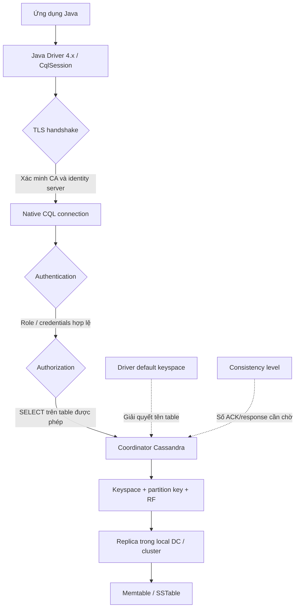

# Thiết lập keyspace, xác thực và TLS

> **Chương:** Java driver cơ bản  
> **Phạm vi:** Kết nối ứng dụng Java tới Apache Cassandra bằng **Java Driver 4.x** để đọc/ghi CQL trên cơ sở dữ liệu phân tán *wide-column*. Bài tập trung vào lựa chọn keyspace, xác thực danh tính, phân quyền và bảo mật TLS cho kết nối client–server.
>
> **Mục tiêu học tập:** Phân biệt **keyspace**, **local datacenter**, **authentication**, **authorization** và **TLS**; thiết lập một `CqlSession` có keyspace mặc định, thông tin đăng nhập và SSL context; kiểm tra CA/chứng chỉ/hostname; thử quyền tối thiểu bằng CQL; chẩn đoán lỗi kết nối và xây quy trình thay đổi an toàn.

## 1. Tình huống: kết nối được chưa có nghĩa là kết nối đúng và an toàn

Một dịch vụ Java xử lý đơn hàng cần đọc một bản ghi theo `order_id` từ Cassandra. Đoạn mã khởi tạo session thử nghiệm đơn giản:

```java
try (CqlSession session = CqlSession.builder().build()) {
    // ...
}
```

Mã này **không đủ làm cấu hình triển khai** vì nó không nói rõ:

- Ứng dụng đang kết nối tới **cluster/datacenter nào**?
- Không có keyspace mặc định thì query `SELECT ... FROM orders_by_id` được giải quyết ở đâu?
- Danh tính nào được dùng để đăng nhập? Role đó có quyền `SELECT` không?
- Mật khẩu có được truyền trong kết nối **đã mã hóa TLS** không?
- Ứng dụng có kiểm tra **CA tin cậy và tên máy chủ** trong chứng chỉ không?
- Khi có nhiều replica, consistency level nào được dùng để đọc/ghi?

Trong lab có thể dùng cấu hình tối giản để hiểu API. Với hệ thống thật, thiếu một trong những thông tin trên có thể dẫn đến lỗi `Unauthorized`, kết nối nhầm môi trường hoặc truy cập qua mạng không được mã hóa.

### Kết quả mong muốn sau bài

Ta cần một session có:

```text
Cluster endpoints:    cassandra-1.internal:9042, cassandra-2.internal:9042
Local datacenter:     dc1
Default keyspace:     lab
Login identity:       lab_reader
Authorization:        SELECT trên đúng bảng cần đọc
Transport:            TLS xác thực máy chủ bằng CA được tin cậy
CQL consistency:      LOCAL_QUORUM cho query demo, nếu RF local phù hợp
Lifecycle:            một CqlSession dùng lại, đóng khi ứng dụng dừng
```

Các host và role là **ví dụ**, không phải giá trị để copy sang production. Cấu hình cụ thể phải khớp RF, node endpoints, chứng chỉ và security policy của cluster thật.

## 2. Bản đồ kết nối và những lớp kiểm soát khác nhau



**Mỗi lớp giải một câu hỏi khác nhau:**

| Thành phần | Câu hỏi nó trả lời | Nó không tự làm |
| --- | --- | --- |
| **Contact points** | Driver bắt đầu khám phá cluster từ host nào? | Giới hạn ứng dụng chỉ kết nối đúng một host |
| **Local datacenter** | Driver nên ưu tiên coordinator ở DC nào? | Thay đổi token ownership hay RF |
| **Keyspace** | Bảng thuộc namespace nào, replication được cấu hình ra sao? | Đăng nhập hoặc cấp quyền |
| **Authentication** | Client đang là danh tính/role nào? | Chứng minh role được đọc mọi bảng |
| **Authorization** | Role có quyền thao tác trên resource này không? | Mã hóa lưu lượng mạng |
| **TLS** | Kết nối có được mã hóa và kiểm tra certificate identity không? | Tự cấp quyền `SELECT`/`MODIFY` |
| **Consistency level** | Cần bao nhiêu replica phản hồi theo RF/DC? | Cấp thêm permission hoặc bảo mật TLS |

Ví dụ một kết nối đã mã hóa và xác thực thành công vẫn có thể bị từ chối `SELECT`. Đó là **hành vi bảo mật đúng**, không phải lỗi TLS.

## 3. Keyspace trong Cassandra là gì?

Keyspace là namespace cho bảng và những đối tượng CQL liên quan. Quan trọng hơn, keyspace xác định **replication strategy** và **replication factor** cho dữ liệu của các bảng thuộc nó.

Trong Cassandra:

- **Partition key** quyết định token và tập replica sẽ lưu một partition.
- **Replication strategy/RF** trong keyspace ảnh hưởng replica placement theo datacenter.
- **Clustering key** sắp thứ tự các row **trong một partition**.
- **Consistency level** của từng request quy định điều kiện phản hồi dựa trên RF/replica.
- **Java session keyspace** chỉ là lựa chọn namespace mặc định khi viết câu CQL không đủ tên.

Vì vậy `CqlSession.withKeyspace("lab")` **không thay** các giá trị replication và **không tăng quyền** cho client. Nó giúp query `FROM orders_by_id` được hiểu là `FROM lab.orders_by_id` khi phù hợp với schema.

### Keyspace khác database trong RDBMS thế nào?

Ở RDBMS, người học có thể quen một “database/schema” chứa bảng và các join có foreign key. Cassandra thiết kế bảng theo **truy vấn**, thường **denormalize** dữ liệu sang nhiều bảng. Keyspace không tạo foreign key, join hay giao dịch ACID xuyên nhiều partition một cách mặc định.

Hãy xem keyspace như **không gian tên có cấu hình replication**, còn câu hỏi “truy vấn có nhanh không?” phụ thuộc chủ yếu vào **partition key, clustering key và cách đọc/ghi**.

## 4. Tạo keyspace và bảng trên cluster lab

Các lệnh trong phần này chỉ dùng trong **môi trường học tập**, bởi một role quản trị có quyền tạo schema. Giả sử cluster lab thực sự có datacenter tên `dc1`, ít nhất ba node phù hợp để dùng RF=3.

```cql
CREATE KEYSPACE IF NOT EXISTS lab
WITH replication = {
    'class': 'NetworkTopologyStrategy',
    'dc1': 3
}
AND durable_writes = true;
```

Điểm cần biết:

- `NetworkTopologyStrategy` phù hợp khi replica placement cần hiểu DC/rack.
- `'dc1': 3` nghĩa là keyspace có ba replica theo DC1, không có nghĩa session Java chỉ được chạy ở DC1.
- `durable_writes = true` là lựa chọn độ bền ghi phù hợp với hầu hết workload; đừng tắt để “tăng tốc” khi chưa hiểu rủi ro.
- `IF NOT EXISTS` không chỉnh keyspace đã tồn tại. Luôn **kiểm tra lại cấu hình thực tế**.

Nếu lab chỉ có một node hoặc topology tên khác, **không copy RF=3/dc1**. Điều chỉnh theo cluster được phép và mục tiêu thử nghiệm; consistency level ở ví dụ sau cũng phải phù hợp với RF local.

Tạo bảng phục vụ query theo mã đơn:

```cql
CREATE TABLE IF NOT EXISTS lab.orders_by_id (
    order_id uuid PRIMARY KEY,
    customer_id uuid,
    status text,
    total decimal,
    updated_at timestamp
);
```

Trong ví dụ, `order_id` là partition key. Ứng dụng tìm một đơn theo ID sẽ truy vấn một partition xác định.

Để tạo dữ liệu mẫu (bằng role có quyền MODIFY):

```cql
INSERT INTO lab.orders_by_id (
    order_id, customer_id, status, total, updated_at
) VALUES (
    11111111-1111-4111-8111-111111111111,
    aaaaaaaa-aaaa-4aaa-8aaa-aaaaaaaaaaaa,
    'PAID',
    250.00,
    '2026-11-21T08:00:00Z'
);
```

Đọc kiểm tra:

```cql
SELECT order_id, status, total
FROM lab.orders_by_id
WHERE order_id = 11111111-1111-4111-8111-111111111111;
```

### Vì sao dùng tên bảng đầy đủ trong CQL quản trị?

`lab.orders_by_id` xác định rõ keyspace. Tránh tình trạng một session quản trị đang ở keyspace khác mà thao tác nhầm bảng cùng tên.

Khi thao tác ngoài Java, người dùng `cqlsh` có thể chạy:

```cql
USE lab;

SELECT order_id, status, total
FROM orders_by_id
WHERE order_id = 11111111-1111-4111-8111-111111111111;
```

Nhưng **`USE` trên một phiên `cqlsh` không cài keyspace mặc định cho ứng dụng Java**. Hai client có connection/session state riêng.

## 5. Cấu hình keyspace mặc định trong Java Driver 4.x

Một `CqlSession` của Java Driver 4.x có thể được tạo với keyspace mặc định:

```java
import com.datastax.oss.driver.api.core.CqlIdentifier;
import com.datastax.oss.driver.api.core.CqlSession;

CqlSession session = CqlSession.builder()
    .withKeyspace(CqlIdentifier.fromCql("lab"))
    .build();
```

Đây chỉ minh họa **API chọn keyspace**; nó chưa chỉ định contact points, local DC, authentication và TLS. Không dùng một mình như mẫu cấu hình production.

Sau khi mở session, có thể kiểm tra:

```java
String keyspace = session.getKeyspace()
    .map(CqlIdentifier::asInternal)
    .orElse("<none>");

System.out.println("Default keyspace = " + keyspace);
```

Ý nghĩa:

- `withKeyspace(...)` chọn keyspace mặc định cho tên bảng không được định danh đầy đủ.
- `getKeyspace()` cho biết keyspace mặc định mà session đang dùng, nếu có.
- Session không tự tạo keyspace; **keyspace phải tồn tại** ở server.
- Role vẫn cần permission thích hợp trên bảng.
- Các câu CQL ghi rõ `lab.orders_by_id` vẫn có thể dùng để tránh nhập nhằng.

### Truy vấn có và không có keyspace mặc định

Khi session đã ở `lab`, hai câu sau nhắm tới cùng bảng:

```cql
SELECT status FROM orders_by_id WHERE order_id = ?;
```

```cql
SELECT status FROM lab.orders_by_id WHERE order_id = ?;
```

Dấu `?` là placeholder của prepared statement khi dùng qua driver. Trong `cqlsh`, cần dùng cú pháp CQL có giá trị cụ thể hoặc binding được công cụ hỗ trợ.

Nếu **không** có default keyspace, query chỉ ghi `FROM orders_by_id` có thể lỗi vì không xác định được namespace; query đủ tên vẫn rõ ràng.

## 6. Keyspace có phân biệt chữ hoa, chữ thường không?

Tên CQL **không đặt trong dấu ngoặc kép** thường được chuẩn hóa về chữ thường. Những định danh được đặt trong **dấu ngoặc kép kép** có thể giữ hoa/thường và ký tự đặc biệt.

Ví dụ về sự khác nhau về định danh:

```cql
-- Dùng keyspace thông thường, tên chuẩn hóa lowercase:
CREATE KEYSPACE IF NOT EXISTS lab
WITH replication = {'class': 'NetworkTopologyStrategy', 'dc1': 3};

-- Nếu một hệ đã tạo keyspace quoted có tên đặc biệt,
-- tên đó phải được tham chiếu đúng nguyên văn.
-- Không tạo thêm keyspace có tên quoted chỉ để thử trên production.
```

Trong Java:

```java
CqlIdentifier ordinary = CqlIdentifier.fromCql("lab");
CqlIdentifier quoted = CqlIdentifier.fromCql("\"LabCase\"");
```

`ordinary` và `quoted` không phải cùng tên. `CqlIdentifier.fromCql(...)` nhận một **CQL identifier**, trong đó chuỗi đã quoted có cú pháp CQL. Không tự dùng `toLowerCase()` trên mọi identifier do người dùng cung cấp.

### Multi-tenant: không ghép tên keyspace trực tiếp từ request

Một anti-pattern:

```java
// KHÔNG dùng code này với input không đáng tin:
String query = "SELECT * FROM " + tenantName
    + ".orders_by_id WHERE order_id = ?";
```

Prepared statement **không bind tên keyspace/table như bind giá trị UUID**. Tên bảng/keyspace phải được lấy từ **allowlist/cấu hình tenant đã kiểm soát**, được xác thực và quote đúng bằng API CQL identifier hoặc câu CQL đã duyệt.

Nếu ứng dụng dùng nhiều keyspace, hãy quyết định rõ:

- Một session/keyspace mặc định với các query fully qualified khác khi cần; hoặc
- Các session theo môi trường/tenant được quản lý với giới hạn pool và vòng đời phù hợp.

Không tạo một `CqlSession` mới cho **mỗi request** chỉ để đổi keyspace. Session có connection pools, metadata và tài nguyên nền, cần được **reuse**.

## 7. Authentication và authorization là hai bước khác nhau

### Authentication: “Bạn là ai?”

Cassandra có thể được cấu hình với authenticator như `PasswordAuthenticator` để xác thực role bằng username/password. Trong các môi trường khác, plugin/authenticator tùy chỉnh có thể dùng cơ chế khác.

Một authentication thành công nghĩa là server đã nhận diện danh tính theo cơ chế của nó — **không** chứng minh role có quyền thao tác trên dữ liệu.

### Authorization: “Bạn được làm gì?”

Khi Cassandra dùng `CassandraAuthorizer` hoặc cơ chế phân quyền khác, role có thể bị giới hạn theo:

- `SELECT`: đọc dữ liệu.
- `MODIFY`: ghi/sửa/xóa dữ liệu theo resource scope.
- `CREATE`, `ALTER`, `DROP`: quản lý schema và resource phù hợp.
- `AUTHORIZE`: cấp/thu hồi quyền theo resource và ngữ cảnh.
- Một số quyền khác như `EXECUTE` cho function theo version và loại resource.

Không phải quyền nào cũng áp dụng cho mọi resource. Với bài này, API chỉ cần đọc một bảng nên `SELECT ON TABLE lab.orders_by_id` là lựa chọn rõ ràng hơn việc cấp superuser.

### Server-side security config phải tồn tại trước

Trong một số bản Apache Cassandra, cấu hình liên quan có dạng:

```yaml
# Trích đoạn KHÁI NIỆM cho lab, không phải cấu hình hoàn chỉnh.
authenticator: PasswordAuthenticator
authorizer: CassandraAuthorizer
```

Các tùy chọn, tên lớp đủ namespace, mặc định, quy trình khởi tạo superuser, cache và restart phụ thuộc Cassandra version/bản phân phối. **Đừng bật authentication/authorization trên production bằng cách sửa hai dòng rồi restart**: cần sẵn sàng role quản trị, credential rotation, quyền JMX/ops, các ứng dụng và rollback để tránh tự khóa cluster.

## 8. Tạo role chỉ đọc và cấp quyền tối thiểu trong lab

Các lệnh dưới đây thực thi bằng role quản trị được cho phép, **sau khi authentication/authorization đã cấu hình đúng**.

```cql
-- Chỉ dành cho lab. Thay mật khẩu demo bằng secret ngẫu nhiên.
CREATE ROLE IF NOT EXISTS lab_reader
WITH PASSWORD = 'LAB_ONLY_CHANGE_ME'
AND LOGIN = true;
```

Không dùng mật khẩu ví dụ ngoài lab; cũng không đưa mật khẩu thật vào tài liệu, source code, pull request, log hay shell history. Trong production, dùng quy trình tạo/rotate secret được phê duyệt.

Cấp đúng quyền cần thiết:

```cql
GRANT SELECT ON TABLE lab.orders_by_id TO lab_reader;
```

Kiểm tra danh sách quyền bằng danh tính được phép xem metadata:

```cql
LIST ALL PERMISSIONS OF lab_reader;
```

Quyền có thể được kế thừa từ role khác; **không chỉ nhìn một dòng grant trực tiếp** khi đánh giá least privilege.

### Negative test rất quan trọng

Đăng nhập bằng `lab_reader` và thử:

```cql
SELECT order_id, status
FROM lab.orders_by_id
WHERE order_id = 11111111-1111-4111-8111-111111111111;
```

Kỳ vọng: đọc thành công nếu role và dữ liệu phù hợp.

Sau đó thử một thao tác mà role không được phép:

```cql
-- Dùng trên lab để kiểm tra quyền bị từ chối.
UPDATE lab.orders_by_id
SET status = 'SHIPPED'
WHERE order_id = 11111111-1111-4111-8111-111111111111;
```

Kỳ vọng: **bị từ chối vì thiếu MODIFY**. Nếu lệnh này thành công, kiểm tra superuser flag, role inheritance, quyền rộng ở keyspace và authorizer thực tế.

Không sử dụng câu UPDATE kiểm thử với dữ liệu thật có thể bị thay đổi.

### Phân quyền đọc so với ghi

Một service cần ghi vào bảng có thể được cấp:

```cql
-- Chỉ khi role thật sự cần ghi vào bảng này:
GRANT MODIFY ON TABLE lab.orders_by_id TO lab_writer;
```

Giả định `lab_writer` đã được tạo trước bằng quy trình thích hợp. **Không dùng một superuser cho mọi microservice**; phân tách quyền đọc, ghi, schema và vận hành.

## 9. TLS dùng để bảo vệ điều gì?

**TLS (Transport Layer Security)** bảo vệ đường truyền giữa client và Cassandra khi native transport được cấu hình TLS. Nó cung cấp các khả năng quan trọng:

1. **Encryption in transit:** bên thứ ba trên đường mạng khó đọc nội dung CQL/credential.
2. **Integrity:** giúp phát hiện thay đổi dữ liệu trong quá trình truyền.
3. **Server authentication:** client kiểm tra chứng chỉ để biết đang nói chuyện với máy chủ được tin cậy.
4. **Mutual TLS (mTLS), nếu cấu hình:** server cũng xác minh client certificate.

TLS không phải một cơ chế cấp quyền CQL. Server vẫn có thể dùng `PasswordAuthenticator` và `CassandraAuthorizer` phía sau TLS.

### Client–server TLS khác internode TLS

```text
Java Driver --TLS/native transport--> Cassandra coordinator
                                         |
                                         | internode communication
                                         | (cấu hình TLS riêng)
                                         v
                                      Replica khác
```

Bật TLS cho **client_encryption_options** không tự chứng minh traffic **giữa các node** đã mã hóa. Cassandra có cấu hình riêng cho internode encryption tùy release. Một security review phải đánh giá cả hai đường nếu dữ liệu qua mạng không tin cậy.

### TLS cũng không mã hóa dữ liệu ở trạng thái lưu trữ

SSTable, commit log, snapshot và backup nằm trên disk/object store có chính sách bảo vệ riêng. TLS là **in transit**; encryption at rest và quyền filesystem/backup là vấn đề khác.

## 10. Truststore, keystore và mTLS

Một kết nối TLS thông thường dùng **server certificate** để Java client xác minh danh tính Cassandra.

| Thành phần | Ai sở hữu? | Vai trò |
| --- | --- | --- |
| **Server certificate** | Node Cassandra hoặc TLS endpoint được phép | Chứng minh danh tính máy chủ |
| **Server private key** | Phía server, cần bảo vệ nghiêm ngặt | Hoàn tất TLS handshake của máy chủ |
| **CA certificate/chain** | Được tin cậy theo chính sách PKI | Cho phép kiểm tra chuỗi chứng chỉ |
| **Client truststore** | Ứng dụng Java | Chứa CA/cert được phép tin cậy |
| **Client keystore** | Ứng dụng Java **nếu mTLS** | Chứa client certificate và private key |
| **Client certificate** | Danh tính client ở tầng TLS khi mTLS | Để server xác thực certificate |
| **Cassandra username/password** | Role/secret store | Authentication ở tầng CQL; không phải private key TLS |

**Truststore và keystore khác nhiệm vụ**: truststore là “tôi tin những CA/certificate nào”, keystore ở client (mTLS) là “tôi trình certificate/key nào để tự nhận diện”.

### Không phải mTLS nào cũng thay password authentication

Ngay cả khi server yêu cầu client certificate, Cassandra có thể vẫn yêu cầu username/password ở tầng native protocol. Việc certificate tự động ánh xạ thành Cassandra role chỉ xảy ra nếu **authenticator tương ứng** hỗ trợ và được cấu hình rõ.

**Không tự bỏ `withAuthCredentials`** chỉ vì cấu hình `require_client_auth=true` khi server vẫn dùng PasswordAuthenticator.

## 11. Điều kiện xác thực chứng chỉ server

Một client TLS an toàn cần kiểm tra nhiều thứ:

- Chứng chỉ được ký bởi **CA được tin cậy**, có chain hợp lệ.
- Chứng chỉ **chưa hết hạn** và có hiệu lực tại thời gian hiện tại.
- **Tên host** mà driver kết nối phải khớp certificate identity, thường ở SAN.
- Certificate/key usage và TLS version/cipher đáp ứng chính sách của tổ chức.
- Các **endpoint mà driver khám phá sau contact point** cũng phải có certificate phù hợp.

Ví dụ driver được cấu hình:

```text
Contact point: cassandra-1.internal
Peer được driver khám phá: cassandra-2.internal
Peer khác: cassandra-3.internal
```

Nếu certificate của `cassandra-2.internal` chỉ có SAN cho `cassandra-1.internal`, client có kiểm tra hostname đúng cách sẽ **từ chối kết nối** đến node 2, dù node 1 vẫn kết nối tốt.

### IP trong contact point và DNS SAN

Nếu driver kết nối bằng IP `10.x.x.x` nhưng certificate chỉ có DNS SAN `cassandra-1.internal`, kiểm tra identity có thể thất bại tùy cấu hình SSL engine.

Giải pháp đúng là cấp certificate có **SAN phù hợp với địa chỉ/hostname sử dụng**, đồng bộ endpoint advertisement và chính sách DNS — không phải tắt hostname verification.

### SSLContext chưa luôn đồng nghĩa hostname verification

Trong Java, một `SSLContext` có trust managers xác minh chuỗi chứng chỉ. Nhưng việc xác thực **hostname/SAN** còn phụ thuộc `SSLEngine`/driver SSL engine factory và cấu hình của release.

**Quan trọng:** ví dụ Java ở phần sau minh họa nạp CA/truststore. Khi đưa vào production, cần **xác minh và bật endpoint/hostname identity verification bằng cách được Java Driver release hỗ trợ**, đồng thời thử negative test với hostname sai. Không dùng cấu hình “trust-all certificates” hoặc vô hiệu hóa hostname verification để làm handshake qua loa.

## 12. Cấu hình phía Cassandra: client encryption

Với bản Apache Cassandra có cấu hình client encryption tương ứng, người vận hành có thể thấy khối đại loại:

```yaml
# SƠ ĐỒ CẤU HÌNH - không copy trực tiếp lên production.
client_encryption_options:
    enabled: true
    optional: false
    keystore: /secure/path/server-keystore
    keystore_password: <server-keystore-secret>
    require_client_auth: false
```

Ý nghĩa ở mức khái niệm:

- `enabled` cho phép TLS trên native transport theo cơ chế của release.
- `optional: false` (nếu release hỗ trợ với cùng nghĩa) nhằm **không chấp nhận client plaintext** qua cấu hình đó.
- `keystore` và private key/certificate server phải được bảo vệ bằng OS permissions/secrets.
- `require_client_auth` liên quan yêu cầu client certificate cho mTLS.

**Các khóa, default, định dạng store, phiên bản TLS và hành vi restart/rolling upgrade có thể thay đổi theo Cassandra release/bản phân phối**. Ví dụ chỉ minh họa cấu trúc, không phải một `cassandra.yaml` hoàn chỉnh hoặc khuyến nghị đổi config ngay.

Trước khi bật TLS thật cần xác minh:

1. Chứng chỉ server và CA đã cấp đúng SAN cho node endpoints.
2. App Java, `cqlsh`, ETL, backup/monitoring clients và các job batch đều có cấu hình TLS mới.
3. Có kế hoạch **chuyển đổi từ plaintext sang TLS** không gián đoạn dịch vụ.
4. Cổng, firewall, load balancer và node advertisement đúng.
5. Có rollback và tài khoản vận hành vẫn kết nối được.
6. Không log private keys, secret hoặc dữ liệu cá nhân.

## 13. Chuẩn bị truststore ở phía Java

Trong môi trường doanh nghiệp, CA có thể được cung cấp ở PEM, JKS hoặc PKCS#12. Java có thể dùng PKCS#12 để chứa các CA/certificate được tin cậy.

Một quy trình an toàn:

1. Lấy **CA certificate từ kênh đã xác minh**, không tự tin certificate vừa nhận từ một kết nối đáng ngờ.
2. Xác minh CA fingerprint với nguồn tin cậy; kiểm tra CA là dành cho đúng cluster/environment.
3. Tạo **truststore client** trong kho secret/cấu hình có quyền tối thiểu.
4. Đặt đường dẫn và mật khẩu truststore bằng secret manager hoặc mounted secret.
5. Cấp quyền đọc truststore cho **service process** cần sử dụng.
6. Tự động hóa rotation trước khi certificate hết hạn.

Ví dụ lệnh **xem** truststore PKCS#12 đã được cung cấp:

```bash
keytool -list \
  -storetype PKCS12 \
  -keystore /run/secrets/cassandra-truststore.p12
```

Lệnh có thể hỏi mật khẩu tương tác; **không ghi mật khẩu thật vào command line**. Nó cho biết file có thể được đọc và liệt kê các entry, nhưng **không tự kiểm chứng certificate thực tế được tin cậy đúng danh tính Cassandra**.

### Khi dùng CA công cộng hay CA nội bộ?

- Nếu server certificate được ký bởi CA mà JVM mặc định tin cậy, có thể không cần thêm custom truststore, tùy cách triển khai.
- Với CA nội bộ/self-managed PKI, ứng dụng cần trust anchor tương ứng.
- **Không biến một chứng chỉ lấy tùy tiện từ mạng thành trusted CA**. Đặt trust anchor là quyết định bảo mật, phải được duyệt.

### Khi dùng truststore riêng

Truststore riêng giúp giới hạn CA tin cậy cho dịch vụ Cassandra so với truststore mặc định rất rộng. Nhưng nếu chỉ chứa CA cũ, việc CA rotation có thể làm ngắt kết nối. Nên có kế hoạch overlap CA trong giai đoạn chuyển đổi theo chính sách.

## 14. Kiểm tra TLS endpoint trước khi chạy ứng dụng

Khi được phép kiểm tra mạng từ môi trường client, có thể dùng:

```bash
openssl s_client \
  -connect cassandra-1.internal:9042 \
  -servername cassandra-1.internal \
  -verify_hostname cassandra-1.internal \
  -verify_return_error \
  -CAfile /secure/path/cassandra-ca.pem
```

Giải thích:

- `-connect`: socket/port phía Cassandra được TLS bảo vệ.
- `-servername`: tên server SNI khi endpoint cần.
- `-verify_hostname`: yêu cầu kiểm tra tên máy chủ theo hỗ trợ của OpenSSL version.
- `-verify_return_error`: báo lỗi khi verification thất bại.
- `-CAfile`: CA được cấp từ kênh đáng tin, không tự lấy CA chưa xác minh.

**Không in private key hoặc mật khẩu**, và không ép client bỏ bước verify để được kết quả “CONNECTED”. Công cụ có thể hiện TLS handshake thành công nhưng vẫn không chứng minh authentication CQL/permission hoặc mọi endpoint khác đều hoạt động.

### Dấu hiệu lỗi thường thấy

| Dấu hiệu | Hướng điều tra |
| --- | --- |
| `certificate verify failed` | CA/chain chưa được tin cậy hoặc thiếu intermediate |
| `hostname mismatch` | SAN không chứa DNS/IP driver thực sự dùng |
| `certificate expired` | Chứng chỉ quá hạn, clock skew hoặc chưa rotate |
| `handshake failure` | TLS version/cipher, client certificate, server config hoặc kết nối sai port |
| `connection refused` | Host/port, firewall, native transport chưa sẵn sàng |
| TLS thành công nhưng CQL auth lỗi | Username/password hoặc authenticator, **không phải CA** |

OpenSSL dùng trust settings khác Java. Một lệnh `s_client` thành công không tự chứng minh **truststore của Java process** đã đúng.

## 15. Thiết lập dependency Java Driver 4.x

Trong project Java, thêm thư viện **Java Driver 4.x** thuộc distribution được môi trường sử dụng hỗ trợ. Tọa độ Maven/group ID, hỗ trợ JDK và release maintenance có thể thay đổi theo dòng phát hành; chọn version cụ thể từ **compatibility matrix được kiểm chứng** với Cassandra server.

Một dependency Maven dạng minh họa:

```xml
<!-- Ví dụ với một dòng artifact Java Driver 4.x.
     Thay phiên bản bằng bản cụ thể đã được duyệt trong project. -->
<dependency>
    <groupId>com.datastax.oss</groupId>
    <artifactId>java-driver-core</artifactId>
    <version>4.x.y</version>
</dependency>
```

`4.x.y` là placeholder, **không phải phiên bản hợp lệ để build**. Với distribution hoặc version mới hơn, tọa độ artifact có thể khác; phải theo hướng dẫn phát hành thực tế.

Kiểm tra resolved dependency trên máy phát triển/CI của chính project:

```bash
mvn dependency:tree
```

Hoặc với Gradle:

```bash
./gradlew dependencyInsight \
    --dependency java-driver-core \
    --configuration runtimeClasspath
```

Không tự kết luận ứng dụng production dùng version X chỉ vì file build khai X; dependency resolution, fat JAR, image cũ hoặc classpath conflict có thể làm runtime khác.

## 16. Java hoàn chỉnh: chọn keyspace, đăng nhập và dùng TLS truststore

Ví dụ này dùng **Java 11+** và Java Driver 4.x. Giả sử:

- Keyspace `lab` và bảng `lab.orders_by_id` đã tồn tại.
- Cluster thật đang dùng native TLS ở `cassandra-1.internal:9042` và `cassandra-2.internal:9042`.
- Cả hai host thuộc một cluster, được trình diện bằng certificate hợp lệ.
- Driver local DC phải là `dc1` theo topology.
- Role `lab_reader` có quyền SELECT bảng.
- Truststore PKCS#12 nằm ở đường dẫn do môi trường cấp.

**Không copy host/credential vào production.** Đường dẫn và biến môi trường được cấu hình bởi deployment/secret manager, không được ghi cứng trong mã.

```java
import java.io.InputStream;
import java.net.InetSocketAddress;
import java.nio.file.Files;
import java.nio.file.Path;
import java.security.KeyStore;
import java.security.SecureRandom;
import java.util.Arrays;
import java.util.UUID;

import javax.net.ssl.SSLContext;
import javax.net.ssl.TrustManagerFactory;

import com.datastax.oss.driver.api.core.CqlIdentifier;
import com.datastax.oss.driver.api.core.CqlSession;
import com.datastax.oss.driver.api.core.DefaultConsistencyLevel;
import com.datastax.oss.driver.api.core.cql.BoundStatement;
import com.datastax.oss.driver.api.core.cql.PreparedStatement;
import com.datastax.oss.driver.api.core.cql.ResultSet;
import com.datastax.oss.driver.api.core.cql.Row;
import com.datastax.oss.driver.api.core.metadata.Node;

public final class SecureCassandraReadDemo {

    private static String requiredEnv(String name) {
        String value = System.getenv(name);
        if (value == null || value.isBlank()) {
            throw new IllegalStateException(
                "Missing required environment variable: " + name);
        }
        return value;
    }

    private static SSLContext loadTlsContext(
            Path truststorePath, char[] truststorePassword)
            throws Exception {

        KeyStore trustStore = KeyStore.getInstance("PKCS12");
        try (InputStream input =
                 Files.newInputStream(truststorePath)) {
            trustStore.load(input, truststorePassword);
        }

        TrustManagerFactory tmf = TrustManagerFactory.getInstance(
            TrustManagerFactory.getDefaultAlgorithm());
        tmf.init(trustStore);

        SSLContext context = SSLContext.getInstance("TLS");
        context.init(null, tmf.getTrustManagers(), new SecureRandom());
        return context;
    }

    public static void main(String[] args) throws Exception {
        String username = requiredEnv("CASSANDRA_USERNAME");
        String password = requiredEnv("CASSANDRA_PASSWORD");
        Path truststorePath = Path.of(
            requiredEnv("CASSANDRA_TRUSTSTORE_PATH"));

        char[] truststorePassword =
            requiredEnv("CASSANDRA_TRUSTSTORE_PASSWORD").toCharArray();

        SSLContext sslContext;
        try {
            sslContext = loadTlsContext(
                truststorePath, truststorePassword);
        } finally {
            Arrays.fill(truststorePassword, '\0');
        }

        // Yêu cầu production: cấu hình/kiểm chứng hostname verification
        // ở SSL engine factory của đúng Java Driver release.
        // SSLContext chứa trust anchors nhưng không tự đảm bảo
        // mọi connection đã kiểm tra SAN/hostname.

        try (CqlSession session = CqlSession.builder()
                .addContactPoint(new InetSocketAddress(
                    "cassandra-1.internal", 9042))
                .addContactPoint(new InetSocketAddress(
                    "cassandra-2.internal", 9042))
                .withLocalDatacenter("dc1")
                .withKeyspace(CqlIdentifier.fromCql("lab"))
                .withAuthCredentials(username, password)
                .withSslContext(sslContext)
                .build()) {

            String keyspace = session.getKeyspace()
                .map(CqlIdentifier::asInternal)
                .orElse("<none>");

            System.out.println("Session keyspace: " + keyspace);

            // Không dùng string concatenation với UUID của người dùng.
            PreparedStatement prepared = session.prepare(
                "SELECT order_id, status, total " +
                "FROM orders_by_id WHERE order_id = ?"
            );

            BoundStatement statement = prepared.bind(
                UUID.fromString(
                    "11111111-1111-4111-8111-111111111111"))
                .setConsistencyLevel(
                    DefaultConsistencyLevel.LOCAL_QUORUM)
                .setIdempotent(true);

            ResultSet result = session.execute(statement);
            Row row = result.one();
            Node coordinator =
                result.getExecutionInfo().getCoordinator();

            System.out.println(
                "Coordinator: " +
                (coordinator == null
                    ? "unknown" : coordinator.getEndPoint()));

            if (row == null) {
                System.out.println("Order not found");
            } else {
                System.out.println("Order status: " +
                    row.getString("status"));
                System.out.println("Order total: " +
                    row.getBigDecimal("total"));
            }
        }
    }
}
```

### Đoạn mã đã làm gì?

1. **Đọc cấu hình nhạy cảm từ môi trường** thay vì viết password vào source.
2. **Nạp truststore PKCS#12** và dựng `TrustManagerFactory`.
3. **Khởi tạo `SSLContext`** với trust managers tin cậy.
4. **Chỉ định contact points và local DC**, tránh phụ thuộc hostname localhost mặc định.
5. **Chọn keyspace `lab`** bằng `CqlIdentifier`.
6. **Gửi credentials** khi server yêu cầu native authentication.
7. Dùng prepared statement, bind UUID, chọn `LOCAL_QUORUM`.
8. Đọc kết quả và ghi coordinator endpoint để chẩn đoán routing.
9. Đóng session bằng `try-with-resources` lúc chương trình kết thúc.

### Những điều code demo **chưa** bảo đảm

- **Hostname/SAN verification:** phải xác minh và cấu hình cụ thể cho SSL engine factory của Java Driver đang dùng như lưu ý trong code. Không coi riêng `withSslContext` là bằng chứng hoàn thành security hardening.
- **Secret isolation hoàn hảo:** API `withAuthCredentials` nhận `String` nên dữ liệu nhạy cảm vẫn nằm trong bộ nhớ process; cách cấp phát secret phải tuân theo chính sách runtime.
- **Monitoring production:** code in trạng thái ra stdout chỉ để dạy học; production cần structured metrics, không log PII, credentials hoặc query nhạy cảm.
- **High availability bằng hai contact points:** contact points chỉ dùng để bắt đầu khám phá, driver còn kết nối các peer; cần TLS/SAN đúng trên **mọi endpoint** được sử dụng.
- **Đủ replica:** `LOCAL_QUORUM` chỉ hoạt động đúng khi RF của local DC và trạng thái replica đáp ứng điều kiện.
- **Permission đầy đủ:** kết nối được không chứng minh role có quyền trên các bảng khác.
- **Thời gian timeout phù hợp:** phải cấu hình driver request timeout, retry và pool theo SLO thực; đừng dùng default như bảo đảm cho mọi workload.

## 17. Thiết lập mTLS (client certificate) khi cần

Một số cluster yêu cầu **client certificate** ở tầng TLS. Khi đó ngoài truststore dùng xác thực server, client cần keystore chứa private key và certificate của nó.

Về Java, `SSLContext` lúc này được khởi tạo với **KeyManagerFactory** và **TrustManagerFactory**:

```java
import java.io.InputStream;
import java.nio.file.Files;
import java.nio.file.Path;
import java.security.KeyStore;
import java.security.SecureRandom;

import javax.net.ssl.KeyManagerFactory;
import javax.net.ssl.SSLContext;
import javax.net.ssl.TrustManagerFactory;

public final class MutualTlsContext {

    public static SSLContext create(
            Path truststorePath, char[] truststorePassword,
            Path clientKeystorePath, char[] clientKeystorePassword)
            throws Exception {

        KeyStore trustStore = KeyStore.getInstance("PKCS12");
        try (InputStream in =
                 Files.newInputStream(truststorePath)) {
            trustStore.load(in, truststorePassword);
        }

        TrustManagerFactory tmf = TrustManagerFactory.getInstance(
            TrustManagerFactory.getDefaultAlgorithm());
        tmf.init(trustStore);

        KeyStore clientStore = KeyStore.getInstance("PKCS12");
        try (InputStream in =
                 Files.newInputStream(clientKeystorePath)) {
            clientStore.load(in, clientKeystorePassword);
        }

        KeyManagerFactory kmf = KeyManagerFactory.getInstance(
            KeyManagerFactory.getDefaultAlgorithm());
        kmf.init(clientStore, clientKeystorePassword);

        SSLContext context = SSLContext.getInstance("TLS");
        context.init(
            kmf.getKeyManagers(),
            tmf.getTrustManagers(),
            new SecureRandom());
        return context;
    }
}
```

Bảo vệ `char[]` passwords theo vòng đời thực tế, không ghi vào log. Với code demo, caller cần xóa các char arrays khi không còn dùng. Ngoài ra:

- Certificate client phải được server chấp nhận theo CA/chính sách mTLS của nó.
- Client cert có hạn dùng, rotation và quyền truy cập private key riêng.
- **mTLS không tự thay thế CQL RBAC**.
- Hostname/SAN của **server** vẫn phải được xác minh.
- Nếu Cassandra yêu cầu password authentication ngoài mTLS, vẫn cấp credentials phù hợp.

Không bật `require_client_auth` trên các node đang serving trước khi toàn bộ clients/ops tools đã được chuẩn bị và canary thành công.

## 18. Cấu hình Java Driver bằng file thay cho hardcode

Java Driver 4.x có thể nhận cấu hình từ file như `application.conf` theo cơ chế driver config loader, giúp tách endpoint/keyspace/DC khỏi source code.

Ví dụ phần **không chứa secret**, dạng HOCON:

```hocon
datastax-java-driver {
  basic {
    contact-points = [
      "cassandra-1.internal:9042",
      "cassandra-2.internal:9042"
    ]
    load-balancing-policy.local-datacenter = "dc1"
    session-keyspace = "lab"
  }
}
```

Cấu hình này **chưa đủ cho TLS/authentication**; những phần nhạy cảm cần lấy từ secret manager hoặc provider đã được duyệt. Tên đường dẫn cấu hình của driver có thể khác theo release/config loader; hãy xác minh file thực sự được nạp.

Có thể dùng builder để bổ sung:

```java
CqlSession session = CqlSession.builder()
    .withAuthCredentials(username, password)
    .withSslContext(sslContext)
    .build();
```

Trong trường hợp này, contact points/local DC/keyspace có thể đến từ cấu hình driver mặc định đã được triển khai, nhưng cần kiểm tra effective configuration và không ghi trùng các giá trị xung đột.

### Khi nào chọn config thay vì builder?

| Hình thức | Hữu ích khi | Cẩn trọng |
| --- | --- | --- |
| Builder trong Java | Demo, service nhỏ, test dễ đọc | Đừng hardcode secrets/endpoints production |
| HOCON/application.conf | Vận hành nhiều môi trường, quản lý theo deployment | Không commit passwords hay truststore private keys |
| Secret provider/custom config loader | Có secret rotation, policy doanh nghiệp | Phải test behavior khi secret/cert thay đổi |
| Secure connect bundle nếu dịch vụ hỗ trợ | Managed Cassandra có cơ chế kết nối riêng | Không trộn tùy tiện với cấu hình self-managed native TLS |

**Không có một config snippet áp dụng được cho mọi dịch vụ tương thích CQL**. Managed provider có thể yêu cầu bundle, port, auth/token và cơ chế TLS khác Apache Cassandra tự quản.

## 19. Session lifecycle: không tạo một session mỗi request

`CqlSession` duy trì metadata, connection pools và các thành phần driver dùng chung. Nó tương đối tốn tài nguyên so với việc chuẩn bị/bind một statement.

Anti-pattern:

```java
// KHÔNG thiết kế mỗi HTTP request đều tạo/đóng session.
public String getOrderStatus(String orderId) {
    try (CqlSession session = CqlSession.builder().build()) {
        // Kết nối/TLS/auth handshake lại liên tục.
        return "...";
    }
}
```

Hướng phù hợp:

```text
Application startup
  |
  +--> Nạp cấu hình, truststore và credentials
  +--> Tạo một CqlSession đã được kiểm chứng
  +--> Prepare các truy vấn thường dùng
  |
Incoming requests
  |
  +--> Bind statements / execute với session dùng chung
  +--> Đo latency, timeout, coordinator/DC
  |
Application shutdown
  |
  +--> Drain theo chính sách và close session
```

Vòng đời một session dài giúp giảm handshake overhead và tận dụng pooling. Khi rotate certificate/credentials, cần xem **driver có nạp lại secrets/SSL context trên các kết nối mới hay phải tạo session mới**, tùy release và cách cấu hình. Không giả định thay file truststore trên đĩa là đủ cho mọi connection đang mở.

## 20. Keyspace, local DC và consistency level phải khớp nhau

Giả sử keyspace `lab` có `NetworkTopologyStrategy` với RF=3 trong `dc1` và RF=3 trong `dc2`.

| Cấu hình | Vai trò |
| --- | --- |
| `withKeyspace("lab")` | Chọn namespace mặc định của câu CQL |
| `withLocalDatacenter("dc1")` | Hướng driver ưu tiên coordinator ở dc1 |
| `LOCAL_QUORUM` | Đợi quorum replica trong DC của coordinator |
| RF `dc1: 3` | Có ba bản sao cho mỗi partition thuộc keyspace ở dc1 |
| RF `dc2: 3` | Có ba bản sao ở dc2 theo keyspace topology |

Với RF=3 trong DC của coordinator, `LOCAL_QUORUM` cần **hai replica local** phản hồi theo quy tắc consistency. Nó không có nghĩa keyspace bị giới hạn vào dc1.

### Một lỗi cấu hình nhiều DC dễ mắc

Ứng dụng ở dc2 dùng `.withLocalDatacenter("dc1")` vì copy file config từ dc1. Hệ quả có thể:

- Driver gửi request tới coordinator ở datacenter xa.
- Latency tăng do WAN và networking.
- Failover hoặc routing không còn khớp ý định.
- Đo read/write p99 và consistency trở nên khó giải thích.

**Đừng dùng keyspace name như cách chọn datacenter.** Keyspace quy định replication; local DC là cấu hình routing của driver.

### Kiểm tra địa chỉ peer và chứng chỉ ở mọi DC

Trong cluster nhiều DC, driver thường cần contact points/local DC phù hợp và endpoints có thể reach được. Certificate SAN phải bao gồm tên mà driver thực sự dùng để kết nối, bao gồm các peer được khám phá sau handshake. Một endpoint ở dc2 có chứng chỉ sai không thể “chữa” bằng cách đổi keyspace.

## 21. Prepared statements, dữ liệu đầu vào và ranh giới bảo mật

Role có `SELECT` trên bảng không có nghĩa ứng dụng nên chấp nhận CQL tự do từ người dùng.

Mẫu an toàn:

```java
PreparedStatement statement = session.prepare(
    "SELECT order_id, status, total " +
    "FROM lab.orders_by_id WHERE order_id = ?"
);

BoundStatement bound = statement.bind(orderUuid)
    .setConsistencyLevel(
        DefaultConsistencyLevel.LOCAL_QUORUM)
    .setIdempotent(true);
```

Dùng bind parameters cho **giá trị dữ liệu**. Đừng nối trực tiếp input vào câu CQL để tạo WHERE, tên bảng hoặc keyspace. Những identifier động phải đến từ allowlist được kiểm soát.

### Không dùng `SELECT *` khi không cần

Một bảng Cassandra có thể chứa payload lớn, collections, PII hoặc các cột không cần cho endpoint. Role SELECT của Cassandra thông thường giới hạn theo table/resource, nhưng application vẫn nên chọn **chỉ cột nghiệp vụ cần trả**; không dựa riêng vào role để bảo đảm không làm lộ dữ liệu nhạy cảm qua API.

### Timeouts và retries không phải giải pháp cho auth/TLS lỗi

Nếu authentication fail, driver không có quyền, hoặc CA không tin cậy, tăng `basic.request.timeout`/retry thường không giải quyết gốc lỗi. Phân biệt lỗi cấu hình và lỗi tải/replica trước khi tinh chỉnh timeout.

## 22. Kiểm tra end-to-end theo từng lớp

Một checklist thực hành nên kiểm tra **từ dưới lên**.

### Tầng 1 — DNS và network

- Host/port có phân giải và reachable từ **container chạy ứng dụng** không?
- Firewall cho phép tới contact points **và** các peer được driver chọn không?
- Mạng có TLS proxy/load balancer không? Endpoint certificate thuộc ai?
- Driver local DC có cùng tên topology thực tế?

### Tầng 2 — TLS

- Certificate chain, CA, SAN, expiry, TLS policy có hợp lệ không?
- Truststore đúng file/version được mount vào process?
- Java SSL engine đang **xác minh hostname** thật không?
- Nếu mTLS, client certificate/private key có đúng và chưa hết hạn?

### Tầng 3 — Authentication

- Server đã bật authenticator dự kiến chưa?
- Role có `LOGIN=true` và credential hợp lệ không?
- Credential rotation đã cập nhật mọi instance/ETL clients chưa?
- Driver truyền credential qua TLS chứ không plaintext chứ?

### Tầng 4 — Authorization

- Role có `SELECT ON TABLE lab.orders_by_id` không?
- Có bị thiếu quyền do keyspace/table khác thực tế không?
- Có role inheritance hoặc superuser gây ra một quyền không chủ đích không?
- Negative test write không có MODIFY có bị từ chối không?

### Tầng 5 — Keyspace/query

- `lab` tồn tại và schema đúng không?
- Query có partition key `order_id` đầy đủ không?
- RF/local DC phù hợp với `LOCAL_QUORUM` không?
- Prepared statement và datatype codec của driver có đúng không?

### Tầng 6 — Hiệu năng

- p95/p99, timeouts, auth errors, TLS failures ra sao?
- Connection pool có ổn định, không handshake lại cho mỗi HTTP request?
- Coordinator có nằm đúng DC?
- Có GC, disk I/O, compaction/repair gây request chậm không?

Một test `SELECT` thành công từ một node không thể thay thế kiểm tra **các endpoint khác**, các lần reconnect và tình trạng sau rotation.

## 23. Bảng lỗi thường gặp: phân biệt chính xác nguyên nhân

| Triệu chứng | Lớp nghi vấn | Bước kiểm tra |
| --- | --- | --- |
| `Unknown keyspace` / không resolve table | Namespace/schema | `DESCRIBE KEYSPACE`, `session.getKeyspace()` |
| `Invalid query: unconfigured table` | Schema/keyspace/case | CQL fully qualified, identifier quoted |
| `Authentication failed` | Username/password/role/login/authenticator | Role thực, secret, server auth logs |
| `Unauthorized` | RBAC | `GRANT SELECT`, role graph, authorizer |
| `PKIX path building failed` | Truststore/CA | Đúng trust anchor/chain trong Java runtime |
| `No subject alternative DNS name` | Hostname/SAN | So endpoint thực với SAN, không disable verification |
| `SSL handshake_failure` | TLS version/cipher hoặc mTLS | Server/client config, certificate, cipher support |
| `Connection refused` | Host/port/service | Native transport, firewall, network route |
| `No node available` / `AllNodesFailed` | Tổng hợp connection failures | Đọc nguyên nhân theo từng host, không đoán từ tên exception |
| `Unsupported protocol` | Native protocol/driver compatibility | Server release, driver artifact, negotiated protocol |
| Query `LOCAL_QUORUM` timeout | Replica/CL/load | RF, `nodetool status`, p99, disk/GC/network |
| Chỉ một node kết nối TLS được | Peer certificate/advertised address | Kiểm tra SAN, CA và endpoint từng peer |
| Sau rotate cert có app lỗi rải rác | Session cũ/mới, truststore/cert version | Image/config digest, connection age, rollout |
| Java app gửi query sang DC xa | Local DC/driver policy | Effective driver config, coordinator metadata |

**Không ghi mật khẩu/token/keystore password khi debug.** Log lỗi TLS thường chứa hostname, chain hoặc metadata đủ để điều tra; cần bảo vệ theo chính sách tổ chức.

## 24. Chẩn đoán tình huống A — TLS handshake thành công, SELECT bị từ chối

### Tín hiệu

- `openssl s_client` xác minh certificate của `cassandra-1.internal` thành công.
- Java driver mở được session và đăng nhập được.
- SELECT bảng `lab.orders_by_id` bị `Unauthorized`.

### Suy luận

TLS và authentication có thể đã **PASS**; lỗi còn ở **authorization**. Không cần thay CA hay tắt TLS. Kiểm tra:

1. Ứng dụng đang dùng đúng role nào?
2. Role có quyền `SELECT` đúng table không?
3. Có keyspace khác do thiếu `withKeyspace` không?
4. Có chính sách authorizer tùy chỉnh không?

Nếu thiếu grant, thực hiện cấp quyền tối thiểu theo phê duyệt rồi chạy lại positive/negative test.

## 25. Chẩn đoán tình huống B — Kết nối contact point được, peer khác lỗi cert

### Tín hiệu

- Ứng dụng khởi động thành công.
- Sau một lúc, driver kết nối một peer khác thì gặp `hostname mismatch` hoặc chain validation fail.
- Có thể chỉ một số query/timeouts tăng.

### Nguyên nhân khả dĩ

Contact point dùng certificate đúng, nhưng peer quảng bá DNS/IP khác hoặc thiếu CA/chứng chỉ chuẩn; load balancing khiến driver đi tới peer đó.

### Hành động

1. Inventory endpoints thực tế do driver khám phá.
2. So SAN và certificate chain cho **từng node**.
3. Xem cert rotation có hoàn tất đồng bộ theo DC/rack không.
4. Sửa PKI/DNS/endpoint advertisement; không tắt hostname verification.
5. Canary kết nối lại và thử failover trong lab trước khi mở rộng traffic.

## 26. Chẩn đoán tình huống C — Đổi mật khẩu nhưng một số pod vẫn hoạt động

### Tín hiệu

- Pod A vẫn SELECT thành công.
- Pod B restart và authentication fail.
- Mật khẩu vừa được rotate.

### Giải thích

Kết nối hiện hữu, auth caching/driver session lifecycle và quá trình cấp secret mới có thể tạo hành vi khác nhau giữa pod cũ và pod mới. Không mặc định credential mới được cập nhật ngay trong mọi process đang chạy.

### Hành động

- Xác định secret version và app image/config version của từng pod.
- Kiểm tra thời điểm rotate, role login/password và connection age.
- Thực hiện kế hoạch rotate theo vòng, có overlap khi cơ chế hỗ trợ.
- Xác minh **tất cả instance có thể mở kết nối mới**, không chỉ tận dụng connection cũ.
- Thu hồi credential cũ sau khi đã xác nhận canary và rollback phù hợp.

Không bật debug logging để in password nhằm “so sánh cho nhanh”.

## 27. Chẩn đoán tình huống D — Local DC hoặc RF sai sau đổi keyspace

### Tín hiệu

Session đã chọn `lab` nhưng query `LOCAL_QUORUM` timeout, trong khi `LOCAL_ONE` đôi khi thành công.

### Nguyên nhân khả dĩ

- Keyspace `lab` có RF local không đúng theo giả định.
- Node replica local down/đang bootstrap/streaming.
- Driver local datacenter cấu hình sai hoặc coordinator lệch DC.
- Cluster quá tải/GC/I/O/network chậm.

### Hành động

Kiểm tra:

```cql
DESCRIBE KEYSPACE lab;
```

Và trên node quản trị:

```bash
nodetool status
nodetool tpstats
nodetool netstats
```

Đối chiếu RF, node health và coordinator. **Không “chữa” timeout bằng việc bỏ authentication/TLS hoặc đổi CL xuống ONE** nếu nghiệp vụ cần LOCAL_QUORUM. Cần giải quyết replica/routing/capacity và đánh giá consistency trade-off có chủ đích.

## 28. Chính sách bảo vệ credential và certificate

Nên triển khai:

| Tài sản | Chính sách tối thiểu |
| --- | --- |
| Password/role credentials | Tạo ngẫu nhiên, bí mật trong secret manager, rotate, scope theo service |
| Truststore/CA | Chỉ tin CA được duyệt, có ownership/version và quy trình rotate |
| Client private key (mTLS) | File permission tối thiểu, không commit vào Git/image public |
| Server private key | Chỉ server process/operator thích hợp đọc, có kiểm toán |
| Driver config | Không chứa plaintext password trong repository |
| TLS endpoint | Hostname/SAN verification, TLS versions/ciphers phù hợp release |
| Cassandra roles | `LOGIN` chỉ khi cần, grant theo table, không dùng superuser cho app |
| Observability | Audit login/permission failures theo hỗ trợ release; không log secrets |
| Backup | Bảo vệ dữ liệu, snapshots và secret backups riêng biệt |

### Vai trò của TLS khi dùng password

Nếu môi trường sử dụng username/password, native authentication **không tự thay thế encryption**. Mật khẩu và dữ liệu cần được trao đổi qua kết nối bảo mật theo policy. Trong một mạng nội bộ, “private subnet” không phải lý do đủ để bỏ TLS khi yêu cầu bảo mật áp dụng.

### Secret trong biến môi trường có đủ an toàn không?

Biến môi trường giúp tránh hardcode trong source nhưng không phải kho bảo mật tuyệt đối: chúng có thể bị lộ qua crash dumps, debug tools hoặc quyền xem cấu hình container. Production nên ưu tiên secret manager/mount được quản lý và quyền process tối thiểu. Code demo dùng env vì dễ học và không phụ thuộc nhà cung cấp cloud.

## 29. Quan sát kết nối và chuẩn bị giám sát

Để biết cấu hình kết nối có ổn định, nên thu:

- **Số connection/session failures** theo loại: TLS handshake, auth, authorization, timeout.
- **Driver requests in flight**, connection pool utilization và reconnects.
- **CQL p95/p99**, timeout, retry rate theo operation.
- Coordinator host/DC được chọn, để phát hiện lệch local DC.
- Certificate expiry và CA/truststore version theo deployment.
- Số instance đang dùng credential/secret version dự kiến.
- Node health, `tpstats` pending/dropped, CPU/GC/disk để phân biệt lỗi driver với replica.
- Kết quả canary sau cert/secret rotation và khi một node rời cluster.

Không tạo nhãn metric bằng **username/password, giá trị order_id, token** hoặc dữ liệu khách hàng nhạy cảm. Coordinator/DC là nhãn có ích nhưng phải kiểm soát cardinality và bảo vệ topology metadata theo policy.

### Không nhầm lỗi cấu hình với lỗi hiệu năng

Một chứng chỉ sai SAN thường gây **handshake failure** trên kết nối; một cluster disk chậm có thể gây **read timeout** sau khi handshake/auth đã xong. Hai trường hợp đòi quy trình xử lý khác nhau.

## 30. Thực hành kiểm thử có kiểm soát trong lab

Một bài lab hữu ích là xây **ma trận positive/negative** thay vì chỉ chạy một SELECT thành công.

| Thử nghiệm | Setup | Kỳ vọng |
| --- | --- | --- |
| T1: đúng keyspace | Session ở `lab` | `FROM orders_by_id` resolve được |
| T2: thiếu default keyspace | Session không keyspace, query không fully qualified | Query có thể bị từ chối vì không resolve table |
| T3: đúng credentials | `lab_reader`, password đúng | Authentication pass |
| T4: password sai | Credential demo sai | Authentication fail, không lộ password trong log |
| T5: role read-only | `SELECT` được grant | SELECT pass |
| T6: role read-only INSERT/UPDATE | Không có MODIFY | Authorization từ chối mutation |
| T7: CA đúng + SAN đúng | Truststore/endpoint hợp lệ | TLS handshake và server identity verification pass |
| T8: CA sai | Truststore không tin server chain | TLS verification fail |
| T9: hostname sai | Endpoint không khớp SAN | TLS hostname verification phải fail |
| T10: mTLS thiếu client cert | Server yêu cầu cert, client không có | TLS handshake bị từ chối |
| T11: local DC sai | Config chỉ định DC không khớp topology | Routing/connectivity không đạt điều kiện thiết kế |
| T12: node restart | Restart một node **trong lab** | Driver reconnect theo policy, SLO đo được |
| T13: certificate rotate | Cấp cert mới đúng chain/SAN | Session mới nối thành công; không cần tắt verify |
| T14: service scale-out | Nhiều pod tái sử dụng session đúng cách | Không tạo handshake storm mỗi HTTP request |

Với test T8/T9, kiểm tra rằng driver **thực sự đang bật hostname verification**. Nếu test sai hostname vẫn PASS, đó là dấu hiệu cấu hình SSL engine chưa đạt yêu cầu an toàn, **không phải một thành công**.

### Bài lab thực tế theo thứ tự

1. Tạo keyspace/table trên cluster lab có RF hợp lệ.
2. Bật và kiểm tra authentication/authorization theo runbook lab.
3. Tạo role `lab_reader` và chỉ grant SELECT bảng.
4. Cấu hình native TLS ở server lab; cấp CA và certificate đúng SAN.
5. Cấp truststore cho Java app, cấu hình endpoint/hostname verification.
6. Chạy Java sample với credentials và keyspace mặc định.
7. Thực hiện positive/negative tests T1–T10.
8. Mô phỏng một node restart hoặc cert rotation trong lab, xem reconnect.
9. Đo p99 cơ bản để có baseline cho thay đổi tiếp theo.
10. Ghi kết quả cùng Cassandra release, Java driver patch, JDK và cấu hình liên quan.

Không thực hiện test bật/tắt TLS hay restart trên cluster production khi không có kế hoạch thay đổi/phục hồi.

## 31. Quy trình triển khai trên production

### Trước khi triển khai

1. Ghi cluster name, địa chỉ contact points, local datacenter và danh sách peer endpoints.
2. Xác nhận keyspace/table đã tồn tại và RF/DC phù hợp.
3. Kiểm tra role LOGIN, quyền SELECT/MODIFY cần thiết và không dùng superuser.
4. Xác minh Cassandra server release, driver artifact version và JDK compatibility.
5. Cấp server certificates có SAN đúng, CA chain hợp lệ; chuẩn bị truststore/mTLS nếu cần.
6. Xác nhận chính sách hostname verification và TLS cipher/minimum version.
7. Cấu hình secrets, mount permissions, rotation/rollback.
8. Có canary test authentication, authorization, prepared CQL và local DC.

### Trong canary rollout

9. Triển khai một tập ứng dụng hạn chế, kiểm tra connection mới từ đầu.
10. Xác nhận keyspace mặc định và câu CQL fully qualified đều đúng.
11. Chạy SELECT bằng role ứng dụng và kiểm tra negative test theo môi trường thích hợp.
12. Đo CQL p95/p99, retry, TLS/auth failures, request timeouts và coordinator DC.
13. Test reconnect/failover trong phạm vi được phép.
14. Dừng rollout nếu hostname validation không hoạt động, secret sai hoặc queries vượt SLO.

### Sau khi triển khai

15. Xác minh mọi instance đã dùng image/secret/truststore version được duyệt.
16. Thu hồi role/credential tạm, bảo đảm không còn quyền quá rộng.
17. Ghi mốc hết hạn certificate và trách nhiệm rotation.
18. Giám sát auth/TLS lỗi mới phát sinh, pool health, node/DC routing và SLO.
19. Lưu thay đổi cấu hình, bằng chứng, rollback và owner vận hành.

**Không cần biết password của role ứng dụng để xác nhận nó có SELECT permission**: vai trò quản trị có thể kiểm tra grants; test đăng nhập được thực hiện qua kênh bảo mật đã kiểm soát.

## 32. Các hiểu lầm thường gặp

**“`withKeyspace("lab")` là lệnh tạo keyspace.”** Sai. Nó chọn namespace mặc định, không tạo schema.

**“Đặt local DC là `dc1` nghĩa là keyspace chỉ có dữ liệu ở dc1.”** Sai. RF/DC thuộc replication strategy, còn local DC thuộc routing policy.

**“Có `SELECT` thì Java được phép INSERT vào bảng.”** Sai. Ghi cần quyền phù hợp như `MODIFY`.

**“Cassandra có authentication nên không cần TLS.”** Sai. Xác thực danh tính và mã hóa kênh truyền là hai lớp khác nhau.

**“Có TLS thì không cần authorization.”** Sai. TLS không thay role permissions.

**“Truststore chứa private key của client.”** Không phải cách dùng thông thường: truststore chứa trust anchors; client keystore giữ certificate/private key trong mTLS.

**“Tự tạo SSLContext là chắc chắn kiểm tra hostname.”** Không nên giả định. Phải xác minh SSL engine factory và endpoint identity validation.

**“Tắt hostname verification giúp kết nối ổn định và vẫn an toàn.”** Sai. Nó làm yếu xác minh danh tính server; sửa SAN/DNS và cấu hình đúng.

**“Một contact point kết nối được chứng minh toàn cluster có TLS tốt.”** Sai. Driver còn khám phá và kết nối peer khác.

**“mTLS tự động biến client certificate thành Cassandra role.”** Không mặc định; phụ thuộc authenticator và mapping được cấu hình.

**“`CqlSession` nên tạo cho mỗi truy vấn để tránh dùng lại connection cũ.”** Sai. Pool/session được thiết kế để tái sử dụng; rotation cần chiến lược riêng.

**“`LOCAL_QUORUM` là tùy chọn TLS.”** Sai. Đó là consistency level, dựa trên RF/replica.

**“Thêm contact points bằng đúng số node là tự giải quyết RF.”** Sai. Contact points phục vụ khám phá, không cấu hình replication.

**“Đổi CA trên disk nghĩa là kết nối Java đang mở đã dùng CA mới.”** Không được giả định. SSL context/connection lifecycle cần được kiểm tra.

**“`cqlsh` đăng nhập được thì Java Driver chắc chắn cũng đăng nhập được.”** Không luôn đúng: hai client có TLS/truststore/hostnames/credential/config riêng.

**“Để password trong application.conf rồi commit private repo là đủ an toàn.”** Không phù hợp với chính sách bảo mật tốt; dùng secret management và kiểm soát quyền.

## 33. Câu hỏi và bài tập

1. Keyspace khác partition key và local datacenter ở những điểm nào?
2. Giải thích vì sao `withKeyspace("lab")` không cấp quyền SELECT hay thay đổi RF.
3. Với RF=3 tại dc1, `LOCAL_QUORUM` cần bao nhiêu replica local phản hồi?
4. Nếu Java không chọn keyspace mặc định, query `FROM lab.orders_by_id` có thể hoạt động không?
5. Vì sao dùng `CqlIdentifier` thay vì nối chuỗi tên keyspace do người dùng cung cấp?
6. Phân biệt authentication và authorization trong lỗi `Authentication failed` và `Unauthorized`.
7. Tạo role chỉ có quyền SELECT bảng `lab.orders_by_id` bằng CQL trong lab.
8. Hãy thiết kế negative test chứng minh role không thể UPDATE bảng đó.
9. Truststore và client keystore khác nhau thế nào? Khi nào cần cả hai?
10. Vì sao CA verification chưa đủ nếu hostname/SAN chưa được kiểm tra?
11. Client kết nối bằng IP nhưng certificate chứa DNS SAN; cần xem những lựa chọn gì?
12. Tại sao mọi peer endpoint phải có certificate đúng, không chỉ contact point đầu?
13. `client_encryption_options` có tự mã hóa traffic internode không?
14. mTLS có tự thay thế PasswordAuthenticator và CassandraAuthorizer không?
15. Java code có `withSslContext` nhưng hostname sai vẫn connect được: đó là tín hiệu gì?
16. Vì sao không nên gửi username/password qua kết nối plaintext?
17. Một role có LOGIN đúng nhưng không có SELECT, phép thử nào phân biệt auth và RBAC?
18. Khi rotate password, vì sao pod đang kết nối có thể hoạt động nhưng pod restart lại lỗi?
19. Vì sao không tạo một `CqlSession` cho mỗi HTTP request?
20. Nếu driver local DC sai, những tác động nào xuất hiện về latency và coordinator?
21. Nếu query `LOCAL_QUORUM` timeout nhưng TLS handshake thành công, bạn ưu tiên điều tra gì?
22. Vì sao prepared statement không dùng `?` để bind tên bảng/keyspace?
23. Một ứng dụng dùng mTLS nhưng client certificate hết hạn: quy trình xử lý an toàn là gì?
24. Làm sao phân biệt mismatch TLS cipher với mismatch native protocol?
25. Hãy viết checklist go/no-go cho đợt chuyển Cassandra client từ plaintext sang TLS bắt buộc.

## 34. Sơ đồ tổng kết

```text
            JAVA SERVICE CẦN TRUY CẬP CASSANDRA
                             |
                  Xác định cluster/DC/port
                             |
                             v
                 KEYSPACE ĐÃ TỒN TẠI?
                       |           |
                      Không        Có
                       |           |
                Tạo schema bởi     v
                role được phép    TLS CONFIG ĐÚNG?
                                   |       |
                                  Không    Có
                                   |       |
                              CA/SAN/SSL   v
                              sửa an toàn  AUTHENTICATION?
                                           |        |
                                          Sai      Đúng
                                           |        |
                                       Secret/role  v
                                       kiểm tra    AUTHORIZATION?
                                                     |      |
                                                    Sai    Đúng
                                                     |      |
                                              Grant tối thiểu
                                                            v
                                            CqlSession + local DC
                                            + default keyspace
                                                            |
                                                            v
                                            Prepared SELECT theo
                                            partition key + CL
                                                            |
                                                            v
                                              Đo p99, errors,
                                              reconnect, cert expiry
```

**Ghi nhớ:** Để ứng dụng Java kết nối Cassandra an toàn, phải thiết lập **đúng keyspace cho CQL**, **đúng local datacenter để chọn coordinator**, **đúng danh tính và quyền CQL**, và **TLS xác minh CA lẫn tên server**. `withKeyspace` chỉ chọn namespace, `withAuthCredentials` phục vụ đăng nhập, `withSslContext` cấu hình TLS trust managers; không cái nào thay thế được lớp còn lại. Một `CqlSession` nên được tái sử dụng, dùng prepared statements, chọn consistency level phù hợp RF và kiểm tra đầy đủ **positive/negative tests, mọi peer endpoints, p95/p99 và rotation** trước khi triển khai.
