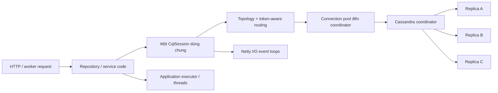
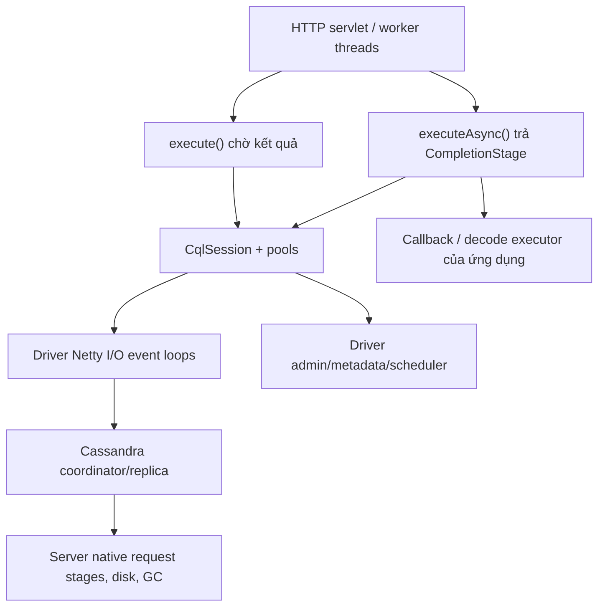
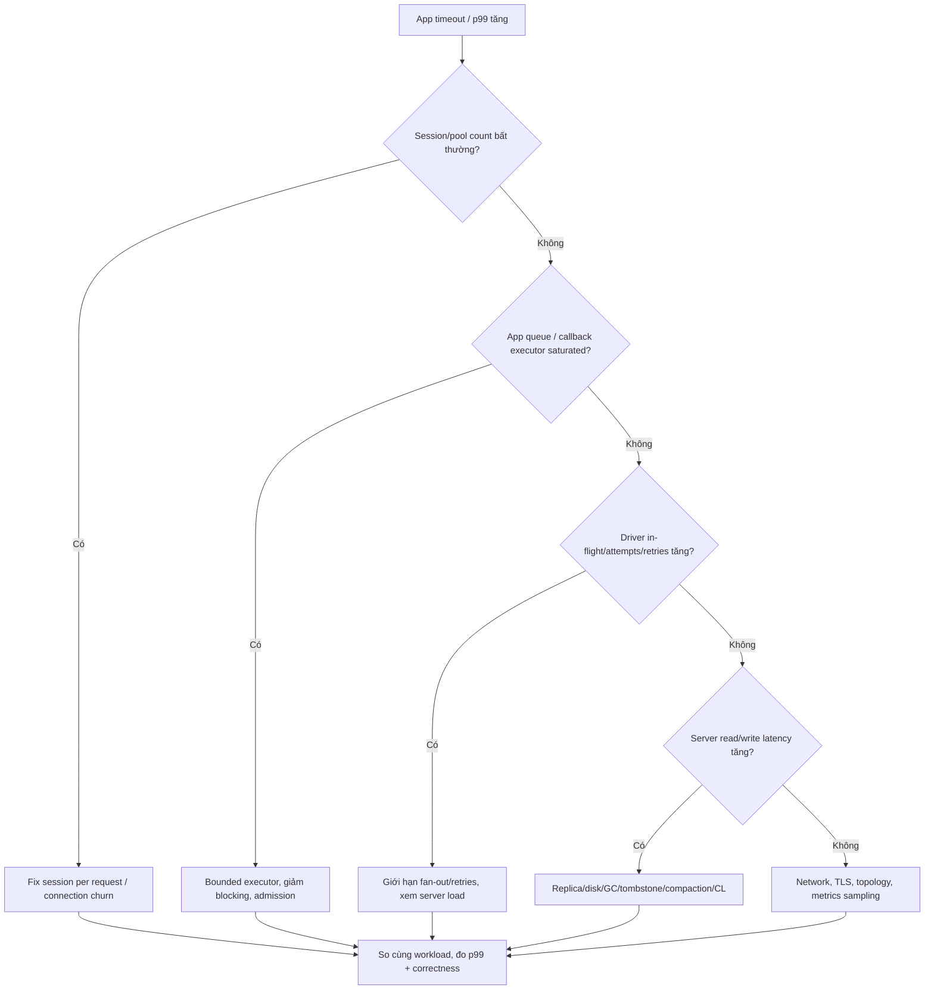

# Quản lý vòng đời session, kết nối và thread pool

Một dịch vụ Java gửi 3.000 truy vấn/giây tới Apache Cassandra không nên tạo 3.000 kết nối mới mỗi giây. Trong Java Driver 4.x, **`CqlSession` là đối tượng dùng chung, thread-safe, có vòng đời dài**, nắm giữ metadata topology, prepared statements, connection pools và tài nguyên thực thi của driver. Tạo session cho từng HTTP request, sử dụng hàng nghìn thread chờ kết quả hoặc để callback chặn Netty I/O threads đều có thể khiến p99 tăng mạnh dù truy vấn CQL được thiết kế tốt.

Bài thuộc chương **Java driver cơ bản** của mô-đun **DATABASE_ENGINE_WIDE_COLUMN_CASSANDRA**. Trong bối cảnh mô hình wide-column phân tán, một client phải chọn coordinator, định vị partition key/token và liên lạc với replica theo consistency level. Quản lý **session – connection – thread pool** đúng cách giúp khai thác các đặc điểm đó mà không khuếch đại timeout, retry hoặc tải lên cluster. Các ví dụ dùng API Java Driver **4.x** (các package vẫn mang tiền tố `com.datastax.oss.driver.api`, kể cả với nhánh Apache); tên config/metric có thể thay đổi theo minor version và môi trường.

> **Quy tắc thực hành:** mở session **một lần cho mỗi kết nối logic cần thiết tới cluster/identity**, tái sử dụng qua nhiều request và đóng khi ứng dụng dừng; không tạo session trong DAO method, không dùng Netty I/O thread để chờ `Future.join()`, và **không** đánh đồng async với “không cần giới hạn tải”.

## 1. Mục tiêu học tập

Sau bài này, bạn có thể:

1. Mô tả vòng đời `CqlSession`: khởi tạo, phát hiện topology, tạo/giữ connection pools, xử lý truy vấn, refresh metadata và đóng.
2. Giải thích quan hệ **session, node, connection, request stream và coordinator**; phân biệt connection pool với thread pool.
3. Chọn mô hình session dùng chung trong ứng dụng Java/Spring, các ngoại lệ khi cần nhiều identity/cluster và tác động của việc tạo quá nhiều sessions.
4. Phân biệt API `execute()` blocking với `executeAsync()` và các threads xử lý callback/serialization.
5. Thiết kế **bounded concurrency, backpressure, deadline, retries** mà không làm bão hòa driver/replica.
6. Sử dụng prepared statements, partition-key routing, `LOCAL_QUORUM` và paging hợp lý.
7. Đóng session và executor đúng trình tự khi deploy, scale-in hoặc shutdown, không cắt ngang các request còn quan trọng.
8. Theo dõi driver/OS/JVM/Cassandra metrics để chẩn đoán timeout, pool saturation, queue và tình trạng node.
9. Hoàn thành lab CQL và ví dụ Java Driver 4.x rồi nêu các kiểm thử vòng đời, lỗi node và graceful shutdown.

## 2. Kiến trúc: một business request đi qua những tài nguyên nào?



Đường đọc minh họa với `NetworkTopologyStrategy` RF=3 ở `dc1` và `LOCAL_QUORUM`. Driver thường chọn **một coordinator** để gửi request; coordinator liên lạc với các replica cần thiết và trả kết quả. **Connection pool của driver tới coordinator không phải một connection riêng cho từng replica.**

### Phân biệt các thành phần

| Thành phần | Vai trò | Không phải |
| --- | --- | --- |
| **`CqlSession`** | Đại diện một cấu hình kết nối logic; giữ topology, pools, resources và API CQL. | Một TCP socket duy nhất. |
| **Node metadata** | Thông tin endpoint, DC/rack, trạng thái và token map mà driver biết. | Bảo đảm dữ liệu trên mọi replica đã repair. |
| **Connection pool** | Tập TCP connections của driver đến một node/coordinator, quản lý khả năng xử lý requests. | Java thread pool hoặc số replica của một partition. |
| **Connection** | Kênh native protocol được dùng để gửi nhiều requests qua các stream IDs khi protocol hỗ trợ. | Một kết nối mới cho mỗi câu SELECT. |
| **Netty I/O group** | Event loops xử lý hoạt động mạng/driver I/O. | Nơi thích hợp để chạy mã nghiệp vụ blocking/CPU nặng. |
| **Application executor** | Threads do ứng dụng quản lý để thực hiện business logic hoặc offload callback nặng. | Thay thế connection pool hoặc giới hạn IOPS server. |
| **Request throttler/admission** | Giới hạn số request đồng thời/đang chờ trước khi gửi xuống cluster. | Cơ chế tự làm một query quét rộng trở nên rẻ. |

**Tỷ lệ không phải 1:1:** một `CqlSession` có thể giữ nhiều connections tới nhiều nodes; một connection có thể xử lý nhiều requests cùng lúc; một request logic có thể có nhiều attempts vì retry/speculative execution; và một request tới coordinator có thể cần phản hồi từ nhiều replica.

## 3. Vì sao `CqlSession` phải sống lâu?

Tạo session không chỉ là tạo một object Java. Driver có thể thực hiện handshake native protocol, authentication/TLS, phát hiện nodes/topology, mở control/pooled connections, khởi tạo event loops/resources và chuẩn bị các cấu trúc quản lý. Việc này tốn thời gian, sockets, heap/native memory và tạo tải kết nối lên Cassandra.

### Ba mô hình

| Mô hình | Ưu điểm | Chi phí/rủi ro | Khuyến nghị |
| --- | --- | --- | --- |
| **Một session sống cùng ứng dụng** cho mỗi cluster/auth context | Tái sử dụng pools, metadata, prepared statements; ít connection churn. | Cần lifecycle/shutdown rõ ràng. | **Mặc định cho hầu hết service.** |
| **Session theo mỗi HTTP/request** | Code nhìn có vẻ “tự đóng” ở cuối request. | Handshake/TLS/auth liên tục, nhiều sockets/event loops, startup latency, quá tải node. | **Tránh.** |
| **Nhiều sessions có mục đích** | Tách cluster, security principal, keyspace/config profile hoặc failure domain đặc biệt. | Nhân pools/threads/memory, phức tạp rotation và metrics. | Chỉ khi có lý do và giới hạn số lượng. |

### Ví dụ anti-pattern cần tránh

```java
// KHÔNG NÊN: mỗi lời gọi DAO xây một session riêng.
public void handleRequest() {
    try (CqlSession session = CqlSession.builder()
        .addContactPoint(new InetSocketAddress("127.0.0.1", 9042))
        .withLocalDatacenter("dc1")
        .build()) {
        session.execute("SELECT release_version FROM system.local");
    }
}
```

Nếu service có hàng trăm concurrent requests, cách này có thể tạo hàng trăm session/pool, nhiều kết nối mở/đóng và cùng khởi tạo metadata. Việc đóng session trong `finally` **không** khiến mô hình theo-request trở nên rẻ.

### Trường hợp thực sự cần hơn một session

- Kết nối tới **hai cluster khác nhau** trong giai đoạn migration/DR.
- **Các identity/credentials riêng** theo ranh giới bảo mật, không được phép dùng chung role Cassandra.
- Workload cần cấu hình riêng mà không thể giải quyết gọn bằng statement execution profiles hoặc driver config.
- Service chạy nhiều JVM/pod: **mỗi process** có session riêng, không có khái niệm một Java object chia sẻ xuyên pod.

Một keyspace khác **không nhất thiết** cần session mới; dùng fully qualified CQL table names và query-specific options/execution profiles khi phù hợp. Đừng tạo một session cho mỗi tenant nếu tất cả tenant cùng dùng một cluster/identity mà chỉ khác partition key.

## 4. Khởi tạo session tại startup và đóng khi shutdown

### Java cơ bản: `try-with-resources`

```java
import java.net.InetSocketAddress;
import com.datastax.oss.driver.api.core.CqlSession;
import com.datastax.oss.driver.api.core.cql.Row;

public final class CassandraLifecycleDemo {
    public static void main(String[] args) {
        // Lab: Cassandra lắng nghe native protocol tại 127.0.0.1:9042.
        // Production: TLS, auth, contact points và dc lấy từ config/secret provider.
        try (CqlSession session = CqlSession.builder()
                .addContactPoint(new InetSocketAddress("127.0.0.1", 9042))
                .withLocalDatacenter("dc1")
                .build()) {

            Row row = session.execute(
                "SELECT release_version FROM system.local").one();
            if (row != null) {
                System.out.println("Cassandra version: "
                    + row.getString("release_version"));
            }
        } // CqlSession.close() được gọi khi ra khỏi scope.
    }
}
```

Đây là ví dụ **ứng dụng CLI ngắn**, ở đó cả chương trình có một session. Trong HTTP service, không đặt `try-with-resources` bao quanh từng request; thay vào đó đặt session ở **application scope** và để framework/lifecycle owner đóng khi process dừng.

### Spring: session thuộc application context

```java
import java.net.InetSocketAddress;
import org.springframework.context.annotation.Bean;
import org.springframework.context.annotation.Configuration;
import com.datastax.oss.driver.api.core.CqlSession;

@Configuration
public class CassandraConfiguration {
    @Bean(destroyMethod = "close")
    public CqlSession cassandraSession() {
        return CqlSession.builder()
            .addContactPoint(new InetSocketAddress("127.0.0.1", 9042))
            .withLocalDatacenter("dc1")
            .build();
    }
}
```

Spring ví dụ giả định đã thêm dependencies tương ứng và **không** có bean/session tự động khác của framework đang được quản lý riêng. Trong sản phẩm thực, đừng hardcode contact points/credentials; dùng configuration binding, SSL context và secret manager, đồng thời xem Spring Data Cassandra có tự tạo session hay không để tránh nhân đôi.

**Ownership rõ ràng:** component nào tạo session phải chịu trách nhiệm đóng. Repository/DAO **nhận session từ dependency injection**, không tự đóng session dùng chung. Khi JVM sống lâu, nên khởi tạo/cached prepared statements một lần sau khi session sẵn sàng.

## 5. Startup readiness: lỗi kết nối không được che thành “ready”

Một session `build()` thành công cho biết driver thiết lập kết nối logic ở thời điểm đó. Nó **không chứng minh** mọi node đều `UN`, RF/CL đang đủ, schema đã được migrate, repair hoàn tất hoặc tất cả read/write queries đạt SLA.

### Gate trước khi service nhận traffic

1. **Config hợp lệ:** contact points, local DC, TLS/truststore, credentials, driver version và profile.
2. **Session tạo thành công:** driver tìm thấy nodes có thể kết nối, authentication/TLS không thất bại.
3. **Schema hợp đồng:** keyspace/table/UDT có cấu trúc dự kiến; prepared statements chuẩn bị được.
4. **Quyền đủ:** service role có SELECT/MODIFY đúng bảng; không dùng Cassandra superuser thường trực.
5. **Request đại diện:** query nhẹ theo partition key và CL thực tế hoạt động trong ngưỡng; không chạy scan rộng làm health check.
6. **Availability:** đã có readiness riêng cho service; lỗi Cassandra tạm thời nên phản ánh `NOT_READY` hoặc degraded có kiểm soát, không gây restart storm.

### Khi startup thất bại

**Phân biệt:** `AllNodesFailedException` khi driver không mở được đường tới các nodes; lỗi auth/TLS khi credentials sai; lỗi CQL `UnauthorizedException` khi role không có quyền; lỗi `UnavailableException` khi request không đạt CL/replica. Chúng không cùng nguyên nhân, nên không sửa bằng việc tăng session count hoặc hạ consistency.

Tái thử startup nếu deployment policy cho phép cần **backoff + jitter + giới hạn tổng thời gian**, log error class/endpoint đã redaction, và cho orchestration quản lý readiness/retry. Không tạo hàng trăm session builders song song khi cluster đang hồi phục.

## 6. Connection pool: một connection phục vụ nhiều requests

Java Driver 4.x dùng native protocol và **request stream IDs**, cho phép multiplex nhiều requests trên cùng một TCP connection trong giới hạn mà driver/protocol cấu hình. Pool thường được quản lý **theo node** với các policy local/remote DC và giới hạn kết nối/requests. Driver có thể mở/thay thế connection khi network lỗi, topology đổi hoặc pool cần cân bằng.

```text
Service process
  CqlSession
    ├── Metadata: nodes, DC/rack, tokens, schema
    ├── Connection pool -> n01 (local DC)
    │       ├── TCP connection #1: request streams A/B/C/...
    │       └── TCP connection khác nếu cấu hình/nhu cầu yêu cầu
    ├── Connection pool -> n02 (local DC)
    ├── Connection pool -> n03 (local DC)
    └── Netty I/O/admin resources, throttling, metrics

Không có:
  1 request = 1 CqlSession
  1 request = 1 TCP connection
  1 connection = 1 Java thread
  1 partition = 1 connection tới từng replica
```

### Pool size khác số request đồng thời

Một connection có nhiều stream IDs, vì vậy tăng `local.size` từ 1 lên 8 **không** có nghĩa throughput tăng tám lần. Ngược lại, nếu đang giới hạn bởi socket/stream capacity hoặc latency mạng, điều chỉnh pool có thể giúp **khi đo lường xác nhận**. Việc tăng connection count cũng làm tăng TCP/TLS/memory/kernel resources và tải node.

| Tham số/khái niệm | Tác động | Rủi ro nếu tăng vô căn cứ |
| --- | --- | --- |
| **Connections per node** | Số kênh TCP driver giữ tới từng node. | Sockets/TLS/heap, churn và tải node tăng. |
| **Max requests/streams mỗi connection** | Khả năng multiplex theo protocol/driver config. | Queue ở node, memory và in-flight pressure; không vượt giới hạn protocol. |
| **Application concurrency** | Số business operations phát cùng lúc. | Requests nhân lên trên nhiều app instances; tăng timeout/retry storm. |
| **Driver throttler queue** | Chỗ đợi trước khi driver gửi hoặc xử lý request. | Queue dài làm tăng tail latency và memory/timeout. |
| **Java worker pool** | Threads thực thi phần blocking/CPU logic. | Context switching, heap stacks, queue tích tụ, CPU saturation. |

**Đừng tính connection pool theo số HTTP threads.** Một session có thể được sử dụng bởi nhiều threads mà không cần một kết nối riêng cho từng thread. Driver tự quản lý multiplexing và selection.

## 7. Local datacenter, contact points và token-aware routing

Một node được khai báo làm **contact point** chỉ giúp driver khởi đầu khám phá cluster; nó **không nhất thiết** là coordinator của mọi request về sau. Driver cần **local datacenter** đúng để chọn nodes theo load-balancing policy.

### Ví dụ DC có RF3

```text
Keyspace: NetworkTopologyStrategy, dc1=3, dc2=3
Java service chạy ở dc1, localDatacenter = dc1
Query key: (tenant-a, 2026-11-21)
CL: LOCAL_QUORUM

  Driver chọn coordinator theo routing/load-balancing
  Coordinator tìm các replica cho token của partition key
  LOCAL_QUORUM ở dc1 cần floor(3/2)+1 = 2 replica dc1

Không suy:
  - chỉ cần 1 node trong dc1 còn Up vì có 3 ở dc2
  - mọi write đã được dc2 xác nhận trước khi trả thành công
  - một contact point dc1 luôn xử lý toàn bộ queries
```

Prepared statements và đầy đủ partition key giúp driver có thể tính routing key/token để ưu tiên coordinator phù hợp. Nếu chỉ query `ALLOW FILTERING` hoặc thiếu partition-key binding, token-aware routing khó phát huy hiệu quả. **Token-aware không thay thế data modeling và không hứa request đi trực tiếp tới mọi replica.**

### Hai lỗi cấu hình phổ biến

1. **Sai local DC:** ứng dụng dc1 được cấu hình dc2 khiến policy chọn endpoint xa hoặc không dùng nodes như mong muốn; p99 và chi phí WAN tăng, semantics `LOCAL_QUORUM` theo coordinator/plan cần được kiểm chứng.
2. **Chỉ có một contact point:** nếu contact point không sẵn sàng lúc startup, app có thể không khám phá cluster dù các node khác đang khỏe; dùng một tập contact points độc lập phù hợp policy, không cần liệt kê tất cả nodes nếu discovery vận hành tốt.

Không cho phép remote DC failover một cách ngầm định khi nghiệp vụ yêu cầu chỉ dữ liệu cục bộ hoặc có RPO/RTO riêng; failover phải là quyết định kiến trúc có test RF/CL, WAN latency và authority.

## 8. Ba nhóm thread: application, driver Netty và Cassandra server

Một hệ thống Java – Cassandra có nhiều nhóm threads độc lập:



### Ý nghĩa của từng nhóm

| Nhóm | Làm việc gì | Có được blocking không? |
| --- | --- | --- |
| **HTTP/server worker** | Nhận request, orchestration/response. | Tùy servlet/reactive model, tránh blocking event-loop; thread-per-request có giới hạn. |
| **Java business executor** | CPU-heavy transform, serialize, validation hoặc blocking I/O của ứng dụng. | Có thể blocking theo thiết kế, nhưng phải có queue/concurrency cap. |
| **Driver Netty I/O group** | Đọc/ghi socket, hoàn tất stages, xử lý protocol events. | **Không** chạy công việc chờ `join()/get()`, sleep hoặc xử lý CPU nặng. |
| **Driver admin/metadata group** | Quản lý cluster metadata, topology và tác vụ điều khiển khác. | Không nên tùy tiện dùng để chạy business callbacks. |
| **Cassandra server threads/stages** | Coordinator/replica xử lý CQL, mutation, read path, disk/network. | Không thuộc JVM service và không tăng khi bạn tạo thêm worker threads ở client. |

**Quan trọng:** callback trong `CompletionStage.thenApply()/whenComplete()` có thể chạy trên **thread hoàn tất stage**, đôi khi là Netty I/O thread. Nếu callback parse JSON lớn, gọi HTTP blocking hoặc `Thread.sleep()`, nó có thể giữ event loop, kéo chậm nhiều requests của session.

### Anti-pattern: chặn callback driver

```java
// KHÔNG NÊN: callback có thể chạy trên driver I/O thread.
session.executeAsync(statement).thenApply(page -> {
    try {
        Thread.sleep(500); // Giả lập I/O blocking trong callback.
    } catch (InterruptedException error) {
        Thread.currentThread().interrupt();
        throw new RuntimeException(error);
    }
    return page;
});
```

Ví dụ là **anti-pattern có cú pháp Java hợp lệ nhưng hành vi không an toàn cho event loop**; tuyệt đối không đưa nó vào production. Cách tốt hơn là `thenApplyAsync(..., applicationExecutor)` với executor được giới hạn, hoặc xử lý rất nhẹ ngay trong callback và chuyển phần nặng tới tầng service.

## 9. Blocking API: đơn giản, nhưng không miễn phí

`CqlSession.execute()` trả `ResultSet` và **chặn thread gọi** cho tới khi nhận kết quả khởi đầu hoặc gặp lỗi. Điều này hợp lý với batch CLI, worker pool hoặc servlet threads có concurrency hữu hạn; không hợp lý khi gọi trực tiếp từ Netty/reactive event-loop.

```java
import java.time.LocalDate;
import com.datastax.oss.driver.api.core.ConsistencyLevel;
import com.datastax.oss.driver.api.core.cql.PreparedStatement;
import com.datastax.oss.driver.api.core.cql.BoundStatement;
import com.datastax.oss.driver.api.core.cql.ResultSet;
import com.datastax.oss.driver.api.core.cql.Row;

// Giả sử CqlSession session dùng chung đã được inject.
PreparedStatement select = session.prepare(
    "SELECT event_id, event_time, event_type " +
    "FROM driver_lab.events_by_tenant_day " +
    "WHERE tenant_id = ? AND event_day = ? LIMIT 25");

BoundStatement query = select.bind("tenant-a", LocalDate.of(2026, 11, 21))
    .setConsistencyLevel(ConsistencyLevel.LOCAL_QUORUM)
    .setPageSize(25)
    .setIdempotent(true);

ResultSet rs = session.execute(query);
for (Row row : rs) {
    // Đừng giữ tài nguyên/worker thread vì thao tác nghiệp vụ chậm trong loop.
    System.out.println(row.getUuid("event_id"));
}
```

### Các giới hạn

- `execute()` có thể chỉ nhận **page đầu tiên**; lặp tiếp `ResultSet` có thể kích hoạt fetch các pages khác và blocking thêm.
- `LIMIT 25` giới hạn **hàng sống trả về**, không đảm bảo server chỉ quét 25 tombstone/SSTable entries.
- Prepared statement nên được **prepare một lần**, không `prepare()` cho mỗi HTTP request; prepared metadata có thể được cache nhưng gửi lệnh prepare vô hạn vẫn gây overhead.
- `BoundStatement` trong API Driver 4.x có kiểu thao tác **immutable**: dùng **giá trị trả về** của `setPageSize`, `setConsistencyLevel`, `setIdempotent`, thay vì giả định chúng sửa object cũ tại chỗ.

## 10. Async API: không chiếm thread chờ I/O, nhưng vẫn tốn tài nguyên

`executeAsync()` trả `CompletionStage<AsyncResultSet>`. Khi network đang chờ, application thread có thể phục vụ request khác; session vẫn giữ **in-flight requests, stream IDs, memory và server work** cho mỗi call.

```java
import java.time.LocalDate;
import java.util.concurrent.CompletionStage;
import java.util.concurrent.Executor;
import com.datastax.oss.driver.api.core.cql.AsyncResultSet;
import com.datastax.oss.driver.api.core.cql.BoundStatement;

// session/select chuẩn bị từ startup; cpuExecutor là pool ứng dụng.
BoundStatement query = select.bind("tenant-a", LocalDate.of(2026, 11, 21))
    .setPageSize(25)
    .setIdempotent(true);

CompletionStage<AsyncResultSet> firstPage = session.executeAsync(query);
CompletionStage<Integer> rowCountInFirstPage =
    firstPage.thenApplyAsync(page -> {
        int count = 0;
        for (var row : page.currentPage()) {
            count++;
        }
        return count;
    }, cpuExecutor);
```

**Không đồng nhất** `rowCountInFirstPage` với tổng kết quả nếu còn page sau. `executeAsync()`/stage đầu tiên chỉ hoàn tất cho page hiện tại; để đọc tất cả pages cần `hasMorePages()` và `fetchNextPage()` hoặc dùng API reactive phù hợp.

### Tại sao `CompletableFuture.join()` có thể phá async?

```java
// Không dùng trên Netty event-loop hoặc Java reactive event-loop.
AsyncResultSet page = session.executeAsync(query)
    .toCompletableFuture()
    .join();
```

Lời gọi này **chặn thread hiện tại**. Nếu nó xảy ra ở thread dùng để hoàn tất các stage, có thể gây deadlock hoặc starvation. Với ứng dụng đang dùng mô hình blocking, sử dụng `execute()` từ một **worker pool đủ giới hạn** sẽ dễ kiểm soát hơn là gọi `join()` tùy tiện trong pipeline async.

## 11. Bounded concurrency: chống bão hòa pool và node

Chỉ việc dùng `executeAsync()` không ngăn application gửi **1 triệu requests cùng lúc**. Các request có thể tràn in-flight streams, driver queue, heap, native socket buffers và Cassandra coordinator queues. Bất kỳ vòng lặp `for (...){executeAsync(...)}` trên một danh sách hàng triệu items đều cần ngân sách.

### Ví dụ repository đọc một partition với semaphore

Mẫu dưới đây minh họa một class Java 17 sử dụng **một session và một prepared statement** cho nhiều request, giới hạn tối đa 128 operations đang xử lý; decoding đẩy sang executor của ứng dụng. Bảng `event_by_id` của lab sẽ được tạo ở mục 19.

```java
import java.time.Instant;
import java.util.Optional;
import java.util.UUID;
import java.util.concurrent.CompletableFuture;
import java.util.concurrent.CompletionStage;
import java.util.concurrent.Executor;
import java.util.concurrent.RejectedExecutionException;
import java.util.concurrent.Semaphore;
import com.datastax.oss.driver.api.core.CqlSession;
import com.datastax.oss.driver.api.core.ConsistencyLevel;
import com.datastax.oss.driver.api.core.cql.BoundStatement;
import com.datastax.oss.driver.api.core.cql.PreparedStatement;
import com.datastax.oss.driver.api.core.cql.Row;

public final class EventByIdRepository {
    public record Event(UUID id, Instant time, String type) {}

    private final CqlSession session;
    private final PreparedStatement byId;
    private final Executor decodeExecutor;
    private final Semaphore inFlight = new Semaphore(128);

    public EventByIdRepository(CqlSession session, Executor decodeExecutor) {
        this.session = session;
        this.decodeExecutor = decodeExecutor;
        this.byId = session.prepare(
            "SELECT event_id, event_time, event_type " +
            "FROM driver_lab.event_by_id " +
            "WHERE tenant_id = ? AND event_id = ?");
    }

    public CompletionStage<Optional<Event>> find(
            String tenantId, UUID eventId) {
        // Không block HTTP/Netty thread khi hết ngân sách.
        if (!inFlight.tryAcquire()) {
            return CompletableFuture.failedFuture(
                new RejectedExecutionException("Cassandra budget exhausted"));
        }
        try {
            BoundStatement query = byId.bind(tenantId, eventId)
                .setConsistencyLevel(ConsistencyLevel.LOCAL_QUORUM)
                .setIdempotent(true);

            return session.executeAsync(query)
                .thenApplyAsync(page -> {
                    Row row = page.one(); // Đầy đủ primary key -> tối đa 1 hàng.
                    if (row == null) return Optional.<Event>empty();
                    return Optional.of(new Event(
                        row.getUuid("event_id"),
                        row.getInstant("event_time"),
                        row.getString("event_type")));
                }, decodeExecutor)
                .whenComplete((ignored, error) -> inFlight.release());
        } catch (RuntimeException error) {
            inFlight.release();
            return CompletableFuture.failedFuture(error);
        }
    }
}
```

### Tại sao ví dụ này kiểm soát được?

1. **Session shared:** mọi call dùng cùng session/pool.
2. **Query bounded:** có đầy đủ partition key `(tenant_id, event_id)`, kết quả tối đa một row.
3. **Application admission:** permit được lấy **trước** `executeAsync()` và trả lại khi stage hoàn tất thành công/thất bại.
4. **Không block khi hết chỗ:** `tryAcquire()` trả ngay, tầng API có thể mapping thành HTTP 429/503 theo policy.
5. **Callback nặng offload:** `thenApplyAsync(..., decodeExecutor)` tránh chạy business decoding trên Netty I/O thread.
6. **Errors là errors:** exception không bị đổi thành “row không tồn tại”.

**Cẩn trọng:** 128 là **con số minh họa**, không có nghĩa Cassandra nào cũng chịu được 128 concurrent requests từ mỗi instance. Tổng tải bằng **số service instances × budgets mỗi instance**, cộng retries/speculation. `whenComplete` ở đây chỉ làm một thao tác rất nhẹ (release permit); nếu cần audit/serialize/remote I/O, offload tiếp.

### Executor cũng cần có queue hữu hạn

`Executors.newFixedThreadPool(4)` sử dụng queue có thể tăng rất lớn khi producer liên tục submit. Để tránh “giới hạn threads nhưng không giới hạn tasks”, có thể dùng `ThreadPoolExecutor` với bounded queue và policy từ chối rõ ràng:

```java
import java.util.concurrent.ArrayBlockingQueue;
import java.util.concurrent.ExecutorService;
import java.util.concurrent.ThreadPoolExecutor;
import java.util.concurrent.TimeUnit;

ExecutorService decodePool = new ThreadPoolExecutor(
    4, 4, 0L, TimeUnit.MILLISECONDS,
    new ArrayBlockingQueue<>(64),
    new ThreadPoolExecutor.AbortPolicy());

// decodePool do application lifecycle quản lý, không tạo trong mỗi request.
// Không chọn CallerRunsPolicy nếu caller có thể là Netty I/O event loop:
// khi queue đầy, nó có thể chạy công việc nặng ngay trên event loop.
```

Khi `decodePool` từ chối task, stage có thể hoàn tất exceptionally; application cần quan sát rejection rate và bảo đảm permit được trả. Trong production, tích hợp admission với HTTP/reactive backpressure và có **global bulkhead** nếu nhiều repositories chia sẻ cluster.

## 12. Driver throttler và application backpressure khác nhau

Java Driver 4.x có thể hỗ trợ các **request throttler** trong cấu hình driver để giới hạn số request đang hoạt động và số request ở queue. Đây là lớp phòng vệ bổ sung, **không thay** giới hạn tại HTTP/gateway, worker queue và number-of-buckets/fan-out.

### HOCON minh họa (xác minh theo driver minor version)

```hocon
datastax-java-driver {
  basic {
    contact-points = [ "127.0.0.1:9042" ]
    load-balancing-policy.local-datacenter = dc1
    request.timeout = 2 seconds
  }
  advanced {
    connection.pool.local.size = 1
    throttler.class = ConcurrencyLimitingRequestThrottler
    throttler.max-concurrent-requests = 256
    throttler.max-queue-size = 128
  }
}
```

**Các giá trị trên chỉ là ví dụ để học cách đặt ngân sách**, không phải khuyến nghị production hay mặc định của driver. Hãy xác nhận chính xác tên khóa, profile precedence, class của throttler và khả năng áp dụng ở phiên bản sử dụng bằng tài liệu/config reference. Những con số giới hạn cần được benchmark với workload RF/CL/partition sizes/node count thực.

### Nơi nên giới hạn tải

| Lớp | Công cụ | Vì sao cần |
| --- | --- | --- |
| **API/gateway** | Rate limit, request quota, timeout, load shedding. | Ngăn user/request không giới hạn vào hệ thống. |
| **Service business** | Semaphore/bulkhead, bounded thread/queue, số partition cần đọc. | Kiểm soát tổng queries và fan-out từ một operation. |
| **Driver session** | Request throttler, connection pool, metrics và timeout. | Ngăn driver chồng quá nhiều in-flight/queue trước khi tới cluster. |
| **Cluster/server** | Đúng schema, RF/CL, capacity, compaction/repair schedule. | Xử lý workload bền vững; client throttling không sửa hot partition. |

Không để **cả ba tầng xếp hàng dài** mà không biết ở đâu đang chờ. Hàng đợi nào cũng làm tăng thời gian request end-to-end. Tốt hơn là **từ chối sớm** khi quá tải có cấu trúc, với metric/HTTP status rõ ràng và backoff ở caller.

## 13. Quản lý các page trong async pipeline

Một câu SELECT có thể trả nhiều pages. `AsyncResultSet.currentPage()` chỉ chứa các rows của **page hiện tại**; muốn đọc tiếp phải gọi `fetchNextPage()`. Việc lấy page tiếp tạo thêm hoạt động driver/network và ảnh hưởng latency, in-flight concurrency.

### Ví dụ đọc hết một query vốn đã giới hạn `LIMIT 50`

```java
import java.util.ArrayList;
import java.util.List;
import java.util.concurrent.CompletableFuture;
import java.util.concurrent.CompletionStage;
import com.datastax.oss.driver.api.core.cql.AsyncResultSet;
import com.datastax.oss.driver.api.core.cql.Row;

static CompletionStage<List<String>> collectBounded(
        AsyncResultSet page, List<String> acc) {
    for (Row row : page.currentPage()) {
        acc.add(row.getString("event_type"));
        if (acc.size() > 50) {
            return CompletableFuture.failedFuture(
                new IllegalStateException("Result budget exceeded"));
        }
    }
    if (page.hasMorePages()) {
        return page.fetchNextPage()
            .thenCompose(next -> collectBounded(next, acc));
    }
    return CompletableFuture.completedFuture(List.copyOf(acc));
}

// Caller: query phải chứa LIMIT 50 và partition/range cụ thể.
// session.executeAsync(query).thenCompose(p -> collectBounded(p, new ArrayList<>()));
```

Đây là ví dụ để hiểu **fetch-next-page tuần tự**. Dù method không block chờ network, callback xử lý từng page có thể chạy trên driver I/O thread; chỉ làm rất ít công việc tại đó. Khi parsing/validation nặng, chuyển tiếp sang bounded application executor. Đừng biến `acc` thành danh sách không giới hạn rồi gọi nó là “async streaming”; tốt hơn dùng reactive/backpressure API hoặc xử lý từng page và ghi ra sink theo batch.

### Paging không thay partition limit

`setPageSize(50)` giới hạn **page truyền về theo cấu hình**, không phải tối đa số rows toàn query hoặc số tombstone server phải xét. Câu SELECT thiếu partition key có thể vẫn quét rộng qua nhiều pages; phải giới hạn query bằng data model, `WHERE` đúng khóa, clustering slice và `LIMIT` phù hợp.

## 14. Timeouts: client deadline khác server timeout

Một request có ít nhất ba khía cạnh thời gian:

1. **Thời gian chờ tại service:** admission queue, task executor, HTTP request processing.
2. **Driver request timeout:** giới hạn chờ response theo cấu hình driver/execution profile, có thể bao gồm nhiều attempts tùy API/chính sách.
3. **Server-side timeout/CL:** coordinator/replica có thể báo read/write timeout hoặc unavailable dựa trên tình trạng cluster.

| Triệu chứng | Cần kiểm tra | Không nên kết luận |
| --- | --- | --- |
| `AllNodesFailedException` khi bootstrap/session | Endpoints, auth/TLS, contact points, mạng, cluster down. | Chỉ là Cassandra query chậm. |
| Driver request timeout | Pool/queue, network, coordinator, server latency, attempts. | Mutation chắc chắn không áp dụng. |
| Cassandra `ReadTimeoutException` | CL, replica response/data availability, disk/GC, tombstones. | `setPageSize` quá nhỏ là nguyên nhân duy nhất. |
| Cassandra `WriteTimeoutException` | CL, replica writes, commit log/disk, network, overload. | Write chắc chắn thất bại ở mọi replica. |
| `UnavailableException` | Không đủ replica đang khả dụng theo CL và token/replica set. | Chỉ cần tăng request timeout. |
| Admission rejected | Semaphore/throttler/queue đầy. | Dữ liệu không tồn tại hoặc node Down. |
| `UnauthorizedException` | CQL role/grants, credential rotation. | Quorum/repair có vấn đề. |

**Cực kỳ quan trọng với write:** client timeout để lại trạng thái kết quả **không chắc chắn**. Nếu retry với `UUID.randomUUID()` mới, bạn có thể tạo **hai business entities**. Dùng idempotency key, statement idempotency đúng ngữ nghĩa và quy trình reconcile/lookup outcome.

## 15. Retry, speculative execution và request multiplication

Một logical operation có thể tạo nhiều attempts. Nếu retry policy/speculative execution cho phép gửi lại hoặc gửi thêm request khác:

```text
Logical HTTP operation: "GET latest events"
  attempt #1 -> coordinator A (slow)
  attempt #2 -> coordinator B (retry/speculation nếu policy cho phép)

HTTP operation count = 1
Driver attempts       = 1 hoặc >1
Server request load   = có thể >1 query
```

**Cần tách trong metrics** số logical operations, attempts, retries, speculative executions và in-flight requests. Ở trạng thái disk/GC/network saturation, retry rộng có thể tạo **retry storm**, khiến cluster không có cơ hội phục hồi.

### Phân loại idempotency

| Statement/workflow | Có thể đánh dấu idempotent? | Giải thích |
| --- | --- | --- |
| SELECT theo khóa, không side effect | Thường **có**. | Gửi lại không làm đổi dữ liệu. |
| INSERT/UPDATE gán **cùng giá trị và cùng entity key** | Có thể, nhưng xét TTL/timestamp, side effects và lịch sử. | Ghi lặp với timestamp/TTL mới có thể khác semantically. |
| Counter `UPDATE c = c + 1` | **Không** theo mặc định. | Retry có thể cộng nhiều lần. |
| Ghi tạo ID mới trong mỗi attempt | **Không**. | Dễ tạo duplicate entity. |
| LWT/CAS với workflow phụ thuộc outcome | Cần thiết kế theo điều kiện và unknown outcome. | Không đánh dấu an toàn chỉ vì có `IF NOT EXISTS`. |
| Batch mutation qua nhiều bảng | Không tự động idempotent chỉ vì `LOGGED BATCH`. | Cần xét từng mutation và tính bất biến business. |

Khi dùng `BoundStatement.setIdempotent(true)`, bạn đang **cung cấp thông tin cho driver retry/speculation policy**, không xin Cassandra bảo đảm giao dịch đúng một lần. Đặt timeout tăng từ hai giây lên ba mươi giây không sửa query quét tombstone hay replica chậm, chỉ làm client giữ tài nguyên lâu hơn.

## 16. Cancellation và orphaned responses

Khi HTTP client ngắt kết nối hoặc deadline của service hết, hủy `CompletableFuture`/stage phía ứng dụng **không luôn hủy được truy vấn đã được Cassandra server bắt đầu xử lý**. Request có thể vẫn chiếm CPU/I/O ở coordinator/replica và response đến trễ so với client deadline.

### Hệ quả

- Driver có thể theo dõi **orphaned requests/responses** (tên metric tùy version).
- Tăng số requests bị cancel rồi retry có thể gây load gấp đôi.
- Không đo Cassandra server QPS bằng số HTTP success; nhiều query vẫn chạy sau khi HTTP hết thời gian.
- Ghi có timeout/cancel cần idempotency/reconciliation thay vì tự động coi transaction bị rollback.

### Hướng xử lý

1. Đặt **timeout tổng end-to-end** ở service, không chỉ per-attempt timeout.
2. Admission trước khi gọi driver; khi quá deadline thì **ngừng phát requests mới** (đặc biệt fan-out).
3. Hạn chế/cân nhắc cancellation propagation theo API/version, không hứa “server không còn làm việc”.
4. Quan sát client timeout, server read/write latency, attempts và orphaned responses cùng timeline.
5. Khi một node bị nghẽn, ưu tiên sửa query/partition/CL/capacity thay vì tăng retries vô hạn.

## 17. Session shutdown: thứ tự đóng quan trọng hơn một dòng `close()`

Một ứng dụng có thể có **HTTP listeners, background workers, producer queue, async callbacks, session và custom executor**. Đóng session ngay khi nhận SIGTERM trong lúc vẫn nhận request mới dễ dẫn tới request lỗi giữa chừng; đóng executor trước khi callbacks được hoàn tất có thể làm callback bị từ chối.

### Vòng đời khuyến nghị

```mermaid
flowchart TD
  boot["Startup: config/secret/TLS"] --> session["Mở CqlSession và chuẩn bị statements"]
  session --> ready["Readiness PASS, bắt đầu nhận traffic"]
  ready --> serve["Xử lý requests qua shared session + admission"]
  serve --> stop["SIGTERM / scale-in / deploy"]
  stop --> reject["Stop accepting new HTTP/jobs, readiness=OFF"]
  reject --> drain["Đợi in-flight hoàn tất trong deadline"]
  drain --> close["Đóng CqlSession để giải phóng driver resources"]
  close --> executor["Shutdown custom executors/callback pools"]
  executor --> end["Process kết thúc; ghi các work chưa xác nhận"]
```

### Các bước

1. **Ngừng nhận request mới** ở HTTP/gateway, stop background producers/schedulers; cập nhật readiness để không nhận thêm traffic.
2. **Đóng cổng admission**: request mới bị từ chối có kiểm soát; không gọi `executeAsync()` thêm.
3. **Đợi in-flight** trong shutdown grace period đủ theo SLA; ghi nhận unfinished operations, không chờ vô hạn.
4. **Đóng session** bằng `close()` hoặc async close API theo version; chấp nhận rằng requests chưa xong có thể fail, **không** hứa close tự chờ mọi writes commit.
5. **Đóng executors do ứng dụng sở hữu** sau khi callbacks quan trọng đã xử lý; `shutdown()` rồi `awaitTermination()` với giới hạn.
6. **Ghi outcome** của async writes chưa xác nhận; job queue/outbox phải có cơ chế resume/idempotency sau restart.
7. Nếu application tự cung cấp Netty event loop groups/executors cho driver, xác định **ai sở hữu** và chịu trách nhiệm dừng chúng; không double-close nhóm được chia sẻ.

### Pseudocode về lifecycle owner

```java
// Pseudocode phụ thuộc framework; không phải class chạy độc lập.
final class AppLifecycle {
    private final CqlSession session;
    private final ExecutorService decodePool;
    private final AtomicBoolean accepting = new AtomicBoolean(true);

    void stop() throws InterruptedException {
        accepting.set(false);
        httpServer.stopAcceptingNewRequests();
        producers.stop();

        // Đợi tracker của business operations đã ghi nhận.
        // Trong production, có deadline tuyệt đối và xử lý unknown outcomes.
        inFlightTracker.awaitQuiescence();

        session.close();
        decodePool.shutdown();
        if (!decodePool.awaitTermination(10, TimeUnit.SECONDS)) {
            // Theo runbook: ghi nhận tasks chưa xong; không im lặng bỏ dữ liệu.
        }
    }
}
```

**Không** suy `try-with-resources` của một request là graceful shutdown của cả service. `close()` trong application context cần gắn với stop accepting/drain sequence. Nếu Kubernetes `terminationGracePeriodSeconds` quá ngắn so với số outstanding operations, process có thể bị kill trước khi flush audit/checkpoint.

## 18. Thread pool tuning: tăng threads không tương đương tăng throughput

### Các bottleneck có thể gặp

| Tình huống | Tín hiệu | Điều phải làm trước |
| --- | --- | --- |
| **Client worker pool hết threads** | Request queue ở service tăng; driver/server latency vẫn thấp. | Chuyển I/O blocking sang async hoặc tăng capacity có giới hạn; xem CPU/network. |
| **Callback executor nghẽn** | `thenApplyAsync` queue/rejections tăng; driver first-page latency không cao. | Giảm parsing, trả result nhỏ, tăng bounded capacity theo CPU. |
| **Driver I/O event loop bị block** | Nhiều requests chậm cùng lúc, event loop stacks có blocking callback. | Loại `join()/get()/sleep`, offload công việc nặng. |
| **Connection pool/streams saturated** | In-flight cao, request queue/available streams giảm, timeout; nhiều apps cùng dồn. | Giới hạn app concurrency, kiểm driver metrics, pool config và node capacity. |
| **Coordinator/replica CPU/GC/disk nghẽn** | Server read/write latency, queue, GC/disk await cùng tăng. | Tối ưu partition/clustering/TTL/tombstone và resource, không tạo thêm threads client. |
| **Compaction/repair tranh I/O** | p99 tăng cùng compaction/streaming; disk/network queue tăng. | Lập lịch/throttle nền theo runbook, không tắt repair vô thời hạn. |
| **Nhiều CqlSession/instance** | Open connections/JVM threads/heap tăng theo replicas/pods. | Kiểm lifecycle và count sessions; đóng sessions dư. |

Nếu driver request throughput tăng ban đầu rồi p99 tăng đột biến sau ngưỡng concurrency, đó có thể là dấu hiệu **saturation**. Thay đổi `advanced.netty.io-group.size` hoặc `connection.pool.local.size` chỉ sau khi có **bằng chứng driver-side bottleneck**; các tên setting/values phụ thuộc driver minor version.

### Virtual threads có làm mất nhu cầu backpressure?

Trên Java 21+, virtual threads giúp application có nhiều concurrent **blocking waits** rẻ hơn platform threads trong nhiều trường hợp. Nhưng Cassandra vẫn có **giới hạn CPU/disk/network/replica**, và driver vẫn có stream/connection capacity. Dùng virtual threads vẫn cần semaphore, deadline và bounded fan-out; không mở 100.000 concurrent queries chỉ vì virtual-thread stack nhẹ.

## 19. Lab CQL: bảng theo khóa để thấy rõ session và pooling

Lab cần một DC tên `dc1` có ít nhất ba node nếu dùng `NetworkTopologyStrategy` RF=3 và `LOCAL_QUORUM`. Nếu lab chỉ có một node, đổi RF **ở lab** cho phù hợp trước khi chạy; không sửa replication production để làm bài.

### Bước 1 — Tạo keyspace và hai bảng

```sql
CREATE KEYSPACE IF NOT EXISTS driver_lab
WITH replication = {
  'class': 'NetworkTopologyStrategy',
  'dc1': 3
}
AND durable_writes = true;

CREATE TABLE IF NOT EXISTS driver_lab.events_by_tenant_day (
  tenant_id text,
  event_day date,
  event_time timestamp,
  event_id uuid,
  event_type text,
  PRIMARY KEY ((tenant_id, event_day), event_time, event_id)
) WITH CLUSTERING ORDER BY (event_time DESC, event_id DESC);

CREATE TABLE IF NOT EXISTS driver_lab.event_by_id (
  tenant_id text,
  event_id uuid,
  event_time timestamp,
  event_type text,
  PRIMARY KEY ((tenant_id, event_id))
);
```

Hai bảng minh họa **denormalization theo query**: một bảng tối ưu sự kiện mới nhất theo ngày, bảng kia tối ưu lookup theo ID. Ứng dụng thật cần cơ chế cập nhật/đối soát hai projection; ghi hai bảng riêng không tự tạo transaction isolation xuyên partitions.

### Bước 2 — Ghi thử dữ liệu

```sql
CONSISTENCY LOCAL_QUORUM;

INSERT INTO driver_lab.events_by_tenant_day
  (tenant_id, event_day, event_time, event_id, event_type)
VALUES ('tenant-a', '2026-11-21', '2026-11-21T08:05:00+0000',
        11111111-1111-4111-8111-111111111111, 'OPEN');

INSERT INTO driver_lab.event_by_id
  (tenant_id, event_id, event_time, event_type)
VALUES ('tenant-a', 11111111-1111-4111-8111-111111111111,
        '2026-11-21T08:05:00+0000', 'OPEN');

SELECT event_time, event_id, event_type
FROM driver_lab.events_by_tenant_day
WHERE tenant_id = 'tenant-a'
  AND event_day = '2026-11-21'
LIMIT 25;

SELECT event_time, event_type
FROM driver_lab.event_by_id
WHERE tenant_id = 'tenant-a'
  AND event_id = 11111111-1111-4111-8111-111111111111;
```

### Bước 3 — Quan sát cluster/driver

```bash
nodetool status
nodetool tpstats
nodetool tablestats driver_lab.events_by_tenant_day
nodetool tablehistograms driver_lab events_by_tenant_day
```

Ghi topology/RF/CL, node còn `UN` hay không, pending requests/tasks và read latency. Song song, bật driver metrics (theo driver config) để thu connection counts/in-flight, timeout, retries, throttling queue và JVM thread/GC. **Đừng suy một snapshot `nodetool status` toàn `UN` là mọi request đều đạt SLA.**

### Bước 4 — Thử hai cách tạo session (chỉ trên lab tải nhỏ)

1. **Long-lived:** một session tại startup, chạy 1.000 lookups tuần tự hoặc với concurrency 8 có giới hạn.
2. **Per-operation anti-pattern:** tạo/đóng session cho một số ít lookups **trên lab** để so startup cost, number of sockets và threads; không chạy bài test kết nối bão hòa vào production.
3. Giữ cùng query/CL, dataset, network và JVM environment; đo application p95/p99, time spent building sessions, open sockets, CPU/GC.
4. Kết luận dựa trên số đo, không coi một giá trị đo giả định là kết quả.

### Bước 5 — Thử bounded async

Sử dụng `EventByIdRepository.find()` ở mục 11, phát số request lab trong các ngưỡng: 8, 32, 128 và 256 (trong đó vượt 128 sẽ nhận rejection nếu tất cả đang in-flight). Đo **accepted/rejected**, driver attempts, p95/p99, threads/queue và server read latency. Con số 128 là quota của repository sample, không phải quota “cứng” cluster; nhiều repository/instances khác vẫn tạo traffic.

## 20. Java: kiểm tra trạng thái session và coordinator đúng cách

Driver metadata có thể giúp đối chiếu những endpoints driver biết, nhưng node có `UP` theo driver không tự chứng minh replica data hội tụ hoặc query p99 đạt SLA.

```java
import com.datastax.oss.driver.api.core.metadata.Node;
import com.datastax.oss.driver.api.core.cql.ExecutionInfo;

// session là session dùng chung, đã tạo tại application startup.
for (Node node : session.getMetadata().getNodes().values()) {
    System.out.printf(
        "hostId=%s dc=%s rack=%s endpoint=%s state=%s%n",
        node.getHostId(), node.getDatacenter(), node.getRack(),
        node.getEndPoint(), node.getState());
}

ExecutionInfo info = session.execute(query).getExecutionInfo();
System.out.println(
    "coordinator=" + (info.getCoordinator() == null
        ? "unknown" : info.getCoordinator().getEndPoint()));
```

`ExecutionInfo.getCoordinator()` nói coordinator đã trả response thành công, **không** liệt kê mọi replica. Khi một request timeout, coordinator info có thể không có. Trạng thái trong driver được cập nhật bất đồng bộ, có thể khác `nodetool status` trong một khoảng thời gian sau topology/network changes.

### Tái tạo session khi cluster đổi topology?

Thông thường **không** cần đóng/recreate session chỉ vì một node tạm Down hoặc một node mới join. Driver có cơ chế discovery/metadata refresh/reconnection. Tuy nhiên sau rotation TLS/credentials/config hoặc sự cố kéo dài, phải hiểu khả năng reload/reconnect của phiên bản và có phương án thay session có kiểm soát, **không** mỗi timeout lại xây một session mới.

## 21. Monitoring: metrics ở client và server phải ghép được

### Dashboard nên có

| Nhóm | Metrics/biểu đồ | Câu hỏi |
| --- | --- | --- |
| **Service** | Logical RPS, p50/p95/p99, error classes, HTTP in-flight/queue/rejections. | Người dùng chờ ở tầng nào? |
| **Driver request** | Attempt count, retries, speculative executions, request timeouts, execution profiles. | Một business operation sinh bao nhiêu attempts? |
| **Driver pools** | Per-node open connections, in-flight requests, available streams, connection failures/orphaned responses (khi exposed). | Pool có thiếu capacity hay chỉ server chậm? |
| **Throttler/admission** | Accepted/rejected/waiting queue, time-in-queue, semaphore permits. | Service có đang overload trước server? |
| **Application executors** | Active threads, bounded queue length/rejections, callback duration. | Callback pool hay HTTP pool nghẽn? |
| **JVM/process** | CPU, heap/RSS, GC pause/time, thread count, socket/file descriptors. | Có session leak/native memory/GC pressure? |
| **Server CQL** | Read/write latency, read/write timeouts, SSTables/read, tombstones scanned, pending tasks. | Replica/coordinator có saturation do query không? |
| **Cluster/background** | Node UP/DOWN, compaction/repair/streaming, disk IOPS/latency, network RTT/retrans. | Có tác vụ nền/lỗi hạ tầng gây tail latency? |

Tên metric cụ thể tùy bản driver 4.x và backend Micrometer/Dropwizard/exporter được cài. **Không tự suy** mọi metric như `pool.in-flight`, `pool.available-streams` được bật sẵn; phải enable đúng metrics/config và xác nhận units/labels.

### Tương quan theo `query_name`, không theo raw partition key

Structured log nên có `query_name` ổn định, operation ID, driver attempt count (khi có), CL, local DC, elapsed_ms, coordinator endpoint (nếu biết) và error_class. Không đưa tenant/order/event IDs, CQL bind values, passwords, TLS secrets vào Prometheus labels. Với p99, cần phân loại hot partition/large-row workload qua bucket được ẩn danh và tuân thủ policy bảo mật.

## 22. Runbook 12 bước khi Java service timeout Cassandra

1. **Xác định scope:** endpoint, query_name, DC, consistency, p95/p99, RPS, tỷ lệ timeout/rejection, thời điểm bắt đầu.
2. **Kiểm tra session ownership:** có bao nhiêu `CqlSession`/process, có session tạo trong request hay không, close khi nào?
3. **Đọc driver topology/pool:** local DC đúng, contact points, nodes UP/DOWN, open connections, in-flight/available streams, connection errors.
4. **Đọc application queues:** HTTP thread pool, decode callback pool, semaphore rejection và driver throttler queue.
5. **So sánh client/server latency:** server xử lý nhanh nhưng app chậm thì tìm ở network/driver/queues; nếu server cũng chậm thì kiểm read path/replica.
6. **Kiểm CL và replica:** RF/DC, node `UN/DN`, coordinator và những replica cần phản hồi theo partition key.
7. **Kiểm query scope:** full partition key, clustering range, LIMIT/page size, tombstones/SSTables per read, fan-out/số query mỗi HTTP operation.
8. **Kiểm retries/cancellation:** một logical operation có bao nhiêu attempts; có timeout rồi tạo duplicate writes không?
9. **Kiểm JVM/OS/server:** GC pauses, per-core CPU, thread stalls, disk await, network retrans, compaction/repair/streaming overlap.
10. **Chọn mitigation có giới hạn:** giảm admission/fan-out, backpressure rõ, sửa query/schema hoặc mở capacity khi đo được; không tăng connections/threads trước khi biết bottleneck.
11. **Xác minh sau thay đổi:** p95/p99, throughput, rejections, driver/server in-flight, pool queue, data correctness, CL không đổi ngoài approval.
12. **Đóng sự cố:** ghi root cause với evidence, rollback, lịch capacity test, alarm để phát hiện session leaks/queue trước khi p99 vượt SLA.

### Cây phân loại nhanh



**Một sự cố có thể có nhiều bottlenecks**: callback CPU cao do row size lớn, trong khi Cassandra disk cũng quét nhiều tombstones. Cây chỉ dùng để tổ chức điều tra, không khẳng định một nguyên nhân duy nhất.

## 23. Những ngộ nhận thường gặp

| Ngộ nhận | Cách hiểu đúng |
| --- | --- |
| “Mỗi HTTP request cần session riêng để thread-safe.” | `CqlSession` **thread-safe**, được thiết kế dùng chung; mở session là việc tốn tài nguyên. |
| “Session chỉ là một socket.” | Session sở hữu metadata, pools tới nhiều nodes và background resources. |
| “Connection pool 1 nghĩa chỉ xử lý một request một lúc.” | Native protocol multiplex nhiều request streams trên connection. |
| “Một query LOCAL_QUORUM thì driver mở hai sockets tới hai replica.” | Driver thường gửi tới một coordinator; coordinator xử lý replica requests. |
| “Tăng connection pool size luôn giảm p99.” | Khi server đã bão hòa, thêm connections/requests có thể làm p99 xấu hơn. |
| “Async không tốn thread hoặc tài nguyên.” | Vẫn dùng event loops, sockets, stream IDs, memory và server work. |
| “`thenApply()` luôn chạy trên HTTP thread.” | Có thể chạy trên driver I/O thread; không làm blocking/heavy work ở đó. |
| “`join()` trên Netty event loop là cách dùng async bình thường.” | Có thể gây deadlock/starvation; dùng continuation nonblocking/offload. |
| “Fixed thread pool luôn có queue hữu hạn.” | `Executors.newFixedThreadPool` có queue không giới hạn mặc định. |
| “Page size 100 nghĩa query chỉ đọc 100 hàng.” | Paging không thay query limit, partition scope hoặc tombstone scan. |
| “Timeout chứng minh mutation chắc chắn thất bại.” | Outcome có thể unknown, retry cần idempotency/business key. |
| “Cứ retry nhiều lần khi cluster chậm.” | Retry storm làm tải xấu hơn; phải có deadline/backoff/budget. |
| “Một contact point sẽ luôn là coordinator.” | Contact point phục vụ bootstrap/discovery; routing chọn node theo policy. |
| “Đổi topology thì phải tạo session mới mỗi phút.” | Driver thường tự cập nhật metadata/reconnect; không recreate theo mỗi lỗi. |
| “Hạ LOCAL_QUORUM xuống ONE là chỉnh driver để nhanh hơn.” | Thay cam kết consistency; cần phân tích nghiệp vụ và phê duyệt. |
| “Đóng session ngay trong SIGTERM là đã graceful.” | Phải stop accepting và drain in-flight trước; close có thể làm pending fail. |
| “UN toàn cluster bảo đảm request nhanh.” | Membership không chứng minh disk/GC/compaction/repair/query health. |
| “Virtual threads cho phép tạo vô hạn Cassandra requests.” | Chỉ làm waits rẻ hơn; server/driver vẫn cần bounded concurrency. |

## 24. Bài tập thực hành

### Bài A — Đếm tài nguyên đúng

Một service có 12 pods, mỗi pod 40 HTTP worker threads. Lập trình viên tạo `CqlSession` cho mỗi HTTP request và đóng sau khi trả response.

1. Giải thích vì sao không nên nhân số sessions với requests dù cuối cùng vẫn `close()`.
2. Thiết kế session application-scoped cho 12 pods, ai chịu trách nhiệm `close()`?
3. Những số liệu sockets/TLS handshakes/driver pool/node connections/GC cần đo trước và sau?
4. Nếu mỗi pod dùng một session với 128 permits, vì sao tổng cluster có thể nhận nhiều hơn 128 requests?

### Bài B — Concurrency có thật sự bị giới hạn?

Một team viết `Executors.newFixedThreadPool(4)` rồi gọi `submit()` cho 1 triệu keys.

1. Thread count tối đa có bao nhiêu? Queue task có thể tăng bao nhiêu?
2. Có cách nào dùng `ArrayBlockingQueue` và `Semaphore.tryAcquire()` để chặn producer không?
3. Khi không lấy được permit, hệ thống trả lỗi gì/đưa vào retry nào?
4. Đề xuất metrics cho rejected tasks, in-flight, p99 và retry attempts.

### Bài C — Blocking trên Netty event loop

Một service dùng `executeAsync()` nhưng `thenApply()` gọi HTTP blocking tới service khác và `Thread.sleep(200)`.

1. Callback có thể chạy trên thread nào? Vì sao cả session chậm lại?
2. Viết lại bằng `thenApplyAsync(..., boundedExecutor)` hoặc async HTTP client.
3. Vì sao `CallerRunsPolicy` có thể nguy hiểm trong ngữ cảnh này?
4. Chọn cách đo event-loop stalls, executor queue và app p99.

### Bài D — Page size không phải total limit

Java gọi `setPageSize(100)` và duyệt một SELECT theo partition có hàng triệu rows, không có `LIMIT`.

1. Server/client có thể fetch bao nhiêu pages?
2. Vì sao `LIMIT 100` cũng không giới hạn số tombstones scanned?
3. Đề xuất truy vấn partition + clustering slice và API max-rows.
4. Với async API, viết vòng `hasMorePages()/fetchNextPage()` có budget.

### Bài E — Replica và local DC

Keyspace có `dc1:3, dc2:3`; service chạy ở dc1 nhưng localDatacenter cấu hình dc2.

1. Load balancing/coordinator/latency có thể khác thế nào?
2. `LOCAL_QUORUM` cần mấy replica trong DC coordinator theo policy?
3. Tại sao chỉ thêm contact point dc1 không đủ sửa mọi sai lệch nếu local DC setting vẫn sai?
4. Khi dc2 WAN lag, ứng dụng cần kiểm gì trước khi hứa RPO/consistency?

### Bài F — Graceful shutdown

Một service đang có 200 async writes; `SIGTERM` khiến service gọi `session.close()` ngay, shutdown callback executor và kill process sau 5 giây.

1. Điều gì có thể xảy ra với writes chưa xác nhận?
2. Thiết kế stop accepting → drain → close → executor shutdown có bounded deadline.
3. Vì sao phải ghi idempotency keys/unknown outcomes để resume?
4. Kiểm thử như thế nào khi node bị Down đúng lúc rolling deploy?

### Bài G — Phân biệt client bottleneck và Cassandra bottleneck

Driver p99 tăng từ 20 ms lên 700 ms. `nodetool status` tất cả `UN`. App callback queue tăng mạnh, nhưng server read latency gần baseline.

1. Tại sao không kết luận “Cassandra disk chậm”?
2. Những thread dumps/metrics nào nên kiểm tra?
3. Nếu workload deserialize hàng lớn, làm gì để giảm payload/callback cost?
4. Khi nào mới cần thay `connection.pool.local.size`?

### Bài H — Timeout và ghi trùng

API `createEvent()` tạo `UUID.randomUUID()` trước mỗi write attempt. Một lần ghi timeout và client retry với UUID khác.

1. Vì sao có thể có hai events dù HTTP caller chỉ thấy một operation?
2. Chọn stable idempotency key và quy trình kiểm unknown outcome.
3. Khi nào `setIdempotent(true)` có thể an toàn và khi nào sai?
4. Vì sao tăng timeout không thay thế thiết kế idempotency?

### Tiêu chí đạt

Học viên phải chứng minh:

1. **Đúng vòng đời:** một session per cluster/auth context per process; startup/prepared statements và shutdown owner rõ.
2. **Đúng resources:** hiểu node pools, multiplexing, Netty I/O vs application executor, bounded queue/backpressure.
3. **Đúng Cassandra semantics:** partition key, DC/RF/CL, retry/idempotency, pagination và topology.
4. **Đúng vận hành:** có baseline, metrics client/server, overload rejection, shutdown recovery và test lỗi.

## 25. Câu hỏi tự kiểm tra

1. Vì sao `CqlSession` nên được dùng chung cho nhiều request và threads?
2. CqlSession có tương đương một TCP connection không?
3. Một TCP connection có nhất thiết chỉ xử lý một CQL request cùng lúc không?
4. Local datacenter khác contact point ở điểm nào?
5. Driver chọn coordinator khác việc coordinator chọn replica thế nào?
6. Vì sao prepared statement nên chuẩn bị/cache ở startup?
7. `BoundStatement.setIdempotent()` có biến một write không idempotent thành idempotent không?
8. `execute()` khác `executeAsync()` ở khả năng chặn calling thread ra sao?
9. Khi nào `thenApply()` có thể vô tình chạy trên Netty I/O thread?
10. Tại sao `thenApplyAsync()` cần executor có queue giới hạn?
11. Semaphore 128 trong một pod có giới hạn toàn cluster ở 128 không?
12. Driver throttler khác API rate limiting như thế nào?
13. Vì sao page size không thay LIMIT hoặc clustering range?
14. `fetchNextPage()` có tạo thêm mạng/I/O không?
15. Khi một request timeout, có thể khẳng định Cassandra chưa ghi không?
16. Retry và speculative execution có thể tạo bao nhiêu server attempts cho một logical operation?
17. Một `AllNodesFailedException` khác `UnavailableException` ở tầng nào?
18. Vì sao driver node UP không chứng minh dữ liệu đã repair?
19. Vì sao không nên recreate session sau mỗi lần timeout?
20. Thứ tự graceful shutdown nên là gì?
21. Java virtual threads có loại bỏ nhu cầu admission limit không?
22. Những metrics nào giúp phân biệt pool saturation và callback CPU saturation?

## 26. Tài liệu tham khảo và tra cứu theo phiên bản

- [Apache Cassandra Java Driver — Manual](https://apache.github.io/cassandra-java-driver/): CqlSession, synchronous/asynchronous/reactive APIs, preparing statements, paging và lifecycle.
- [Apache Cassandra Java Driver — Core](https://apache.github.io/cassandra-java-driver/4.18.1/core/): session, connection pool, threading model, load balancing và metrics theo nhánh 4.x tương ứng.
- [Apache Cassandra Java Driver — Configuration](https://apache.github.io/cassandra-java-driver/4.18.1/core/configuration/): HOCON, execution profiles, throttler, request timeout, Netty threads và pool tuning.
- [Apache Cassandra — Data modeling](https://cassandra.apache.org/doc/latest/cassandra/developing/data-modeling/): partition key, clustering key, query-driven tables và giới hạn quét dữ liệu.
- [Apache Cassandra — Consistency](https://cassandra.apache.org/doc/latest/cassandra/architecture/dynamo.html): replication, quorum/coordinator, failover và mức nhất quán.
- [Apache Cassandra — Metrics](https://cassandra.apache.org/doc/latest/cassandra/managing/operating/metrics.html): server read/write latency, SSTable/tombstone scan, thread pools, GC và background work.
- [Apache Cassandra — nodetool](https://cassandra.apache.org/doc/latest/cassandra/managing/tools/nodetool/): `status`, `tpstats`, `tablestats`, `tablehistograms` và health quan sát.

**Ghi nhớ:** hiệu năng Java Driver không đến từ việc tạo nhiều sessions/threads/connections hơn. **Một `CqlSession` dài hạn, thread-safe**, connection pools theo nodes với request multiplexing, **Netty I/O callbacks không bị blocking**, admission/bounded executor và timeout/retry đúng semantics mới giúp ứng dụng phục vụ tải ổn định. Phải theo dõi **cả driver và server**, sử dụng đúng partition key, DC, RF/CL và đóng tài nguyên **sau khi ngừng nhận traffic, drain in-flight**. Mục tiêu là giới hạn tải có chủ đích, đáp ứng SLA và **không đánh đổi tính đúng đắn của dữ liệu**.
