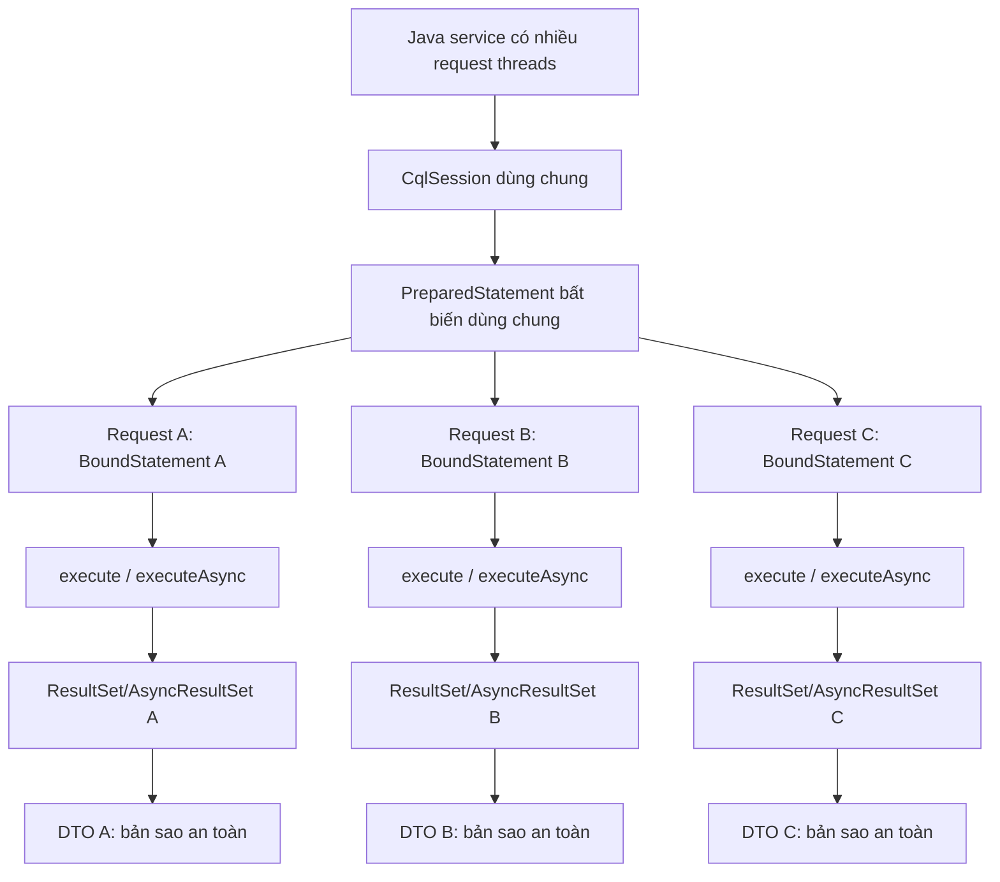
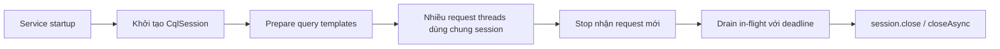
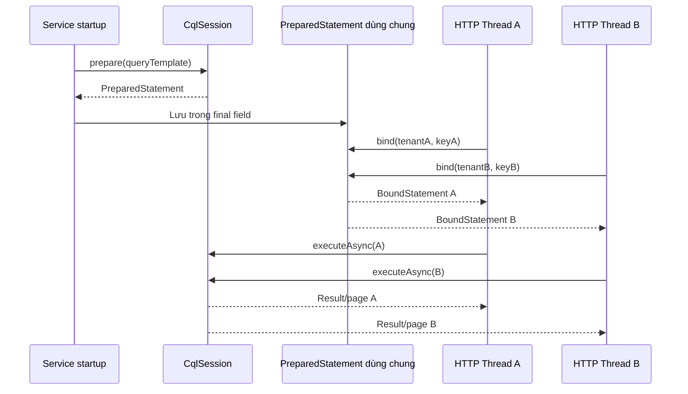

# An toàn đa luồng của session, statement và đối tượng dữ liệu

> **Chương:** Java driver cơ bản  
> **Học phần:** `DATABASE_ENGINE_WIDE_COLUMN_CASSANDRA` — Apache Cassandra

Một service Java có thể đồng thời phục vụ hàng trăm HTTP request, chạy consumer sự kiện và thực hiện nhiều truy vấn tới Apache Cassandra. Nếu mọi request tạo một `CqlSession` riêng, chi phí kết nối và thread pool tăng rất nhanh. Ngược lại, nếu nhiều request cùng sửa một `BoundStatementBuilder` hoặc cùng tiêu thụ một `ResultSet`, chương trình có thể truyền nhầm tham số, đọc thiếu hàng hoặc phát sinh lỗi khó tái hiện.

Java Driver **4.x** được thiết kế để hỗ trợ tải đồng thời lớn, nhưng **không phải mọi đối tượng của driver đều thread-safe**. Quy tắc quan trọng nhất là:

- **Chia sẻ** một `CqlSession` đang hoạt động và những `PreparedStatement` dùng chung theo vòng đời service.
- Các implementation `SimpleStatement`, `BoundStatement`, `BatchStatement` **mặc định của Driver 4.x là immutable**, có thể dùng chung khi nội dung và tham số thực sự giống nhau.
- **Tạo statement đã bind với giá trị riêng cho từng request**; đừng dùng nhầm biến `BoundStatement` của user khác.
- **Không chia sẻ builder có thể thay đổi** giữa các request/thread.
- **Không chuyển việc duyệt `ResultSet` đồng bộ sang nhiều thread**; đối tượng này là một iterator tiêu thụ một lần.
- **`Row` mặc định bất biến**, nhưng **`UdtValue`, `TupleValue`, `ByteBuffer` và một số collection/custom object bên trong có quy tắc sở hữu khác**. Phải tạo snapshot DTO nếu dữ liệu đi qua thread hoặc tầng ứng dụng khác.
- Với API bất đồng bộ, **không gọi hàm đồng bộ trên callback chạy trong thread I/O của driver** và không thực hiện công việc chặn/tốn CPU trong callback.

Bài kết nối các quy tắc trên với kiến trúc Cassandra phân tán và wide-column: partition key, replication, mức nhất quán đọc/ghi, prepared statement, retry/idempotence, paging, giới hạn in-flight và khả năng chẩn đoán bằng metric. Ví dụ tập trung vào Java Driver 4.x với package `com.datastax.oss.driver.api`, thích hợp làm cơ sở trước khi áp dụng Spring hoặc framework reactive.

**Kết quả mong đợi:** có thể phân loại ownership của từng đối tượng, viết repository thread-safe, dùng async không khóa event loop, tránh memory/backpressure failure, kiểm thử request đồng thời và hiểu thread safety ở client **không đồng nghĩa** tính nguyên tử hay nhất quán của dữ liệu trong Cassandra.

## 1. Sơ đồ tư duy: chia sẻ cái gì, sở hữu cái gì?



Driver dùng cùng `CqlSession` để quản lý pool kết nối, discovery/topology, load balancing, token-aware routing, prepared cache và timeout/retry. Sự an toàn của session cho phép **nhiều request gọi đồng thời**; nó không có nghĩa ứng dụng được tự do thay đổi mọi đối tượng nằm bên dưới session.

### Ma trận thread safety thực dụng

| Đối tượng / API | Với implementation mặc định Driver 4.x | Có thể chia sẻ? | Quy tắc |
| --- | --- | --- | --- |
| `CqlSession` | **Thread-safe**; quản lý connection pools và driver resources | **Có**, một instance dùng chung cho mỗi cluster/nhóm cấu hình kết nối | Tạo lúc startup, đóng khi shutdown; tránh đóng giữa request đang chạy. |
| `PreparedStatement` | **Thread-safe**, được chuẩn bị/cached | **Có** | Prepare một lần cho từng query template; mỗi request gọi `bind(...)` riêng. |
| `SimpleStatement` | **Immutable** | Có nếu query và bind values/options phù hợp với tất cả caller | Các setter tạo statement **mới**, không sửa instance cũ. |
| `BoundStatement` | **Immutable** | Có nếu cùng bind values và options, kể cả async | Thực tế nên tạo per-request để tránh lẫn user/partition key. |
| `BatchStatement` | **Immutable** | Có nếu cùng các mutation và options | Batch không cung cấp isolation giao dịch đa partition; không tái sử dụng batch mutable cho nhiều request. |
| `SimpleStatementBuilder`, `BoundStatementBuilder`, `BatchStatementBuilder` | **Mutable, không thread-safe** | **Không** | Tạo builder local cho một luồng/lần dựng, gọi `build()` rồi bỏ. |
| `ResultSet` / `PagingIterable` đồng bộ | **Không thread-safe; tiêu thụ một lần** | **Không** cho nhiều consumers | Duyệt bằng thread đã gọi `session.execute(...)`; không stream song song. |
| `AsyncResultSet` | Mô hình **page hiện tại + fetchNextPage bất đồng bộ** | Không dùng cùng cursor/page cho nhiều consumers cạnh tranh | Mỗi request sở hữu chain riêng; fetch trang kế tiếp có kiểm soát. |
| `Row` mặc định | **Immutable**, có thể đọc song song theo Javadoc | Có điều kiện | Không suy mọi giá trị con lấy ra đều immutable; ưu tiên DTO. |
| `UdtValue`, `TupleValue` mặc định | **Mutable** | Không chia sẻ khi có thể set fields | Copy/chuyển sang DTO bất biến trước khi giao cho nhiều thread. |
| `ByteBuffer` và dữ liệu lấy qua `getBytesUnsafe`/`setBytesUnsafe` | `ByteBuffer` có position/limit/content có thể thay đổi; raw API có thể dùng **chính buffer nội bộ** | Không chia sẻ để thay đổi | Dùng typed getters; deep-copy bytes khi cần độc lập hoàn toàn. |
| Custom statement/codec/listener | Không có bảo đảm chung giống implementation mặc định | Tùy contract | Xem Javadoc, tự đảm bảo không mutable state dùng chung trái phép. |

**Lưu ý về phiên bản:** khác với Java Driver **3.x**, `BoundStatement` built-in trong **4.x là immutable**. Không mang nguyên thói quen “sửa rồi tái dùng BoundStatement” của driver 3.x sang 4.x; cũng không dùng cảnh báo thread safety của bản 3.x để suy diễn sai cho 4.x.

## 2. `CqlSession`: một đối tượng chung, nhiều luồng, một vòng đời

### 2.1. Tại sao session được chia sẻ?

`CqlSession` giữ connection pools tới các node được chọn theo **local datacenter**, quản lý token metadata, request in-flight và executors của driver. Nó an toàn cho các lời gọi đồng thời `execute(...)`/`executeAsync(...)` từ nhiều Java threads.

```java
import java.net.InetSocketAddress;
import com.datastax.oss.driver.api.core.CqlSession;

public final class CassandraSessionFactory {
    private CassandraSessionFactory() {}

    // Chạy một lần ở startup; session được DI container quản lý vòng đời.
    public static CqlSession open() {
        return CqlSession.builder()
            .addContactPoint(new InetSocketAddress("192.0.2.11", 9042))
            .addContactPoint(new InetSocketAddress("192.0.2.12", 9042))
            .withLocalDatacenter("dc1")
            .build();
    }
}
```

Địa chỉ `192.0.2.x` chỉ dùng minh họa. Trong production cần cấu hình đúng contact points, local DC, TLS, authentication và secret manager. Không đặt credential trong mã. Có thể dùng file `application.conf` thay cho builder; cách kết nối không thay đổi quy tắc sở hữu session.

**Vòng đời khuyến nghị:**

1. Tạo **một session** khi service khởi động thành công.
2. Chuẩn bị các query template cần thiết, tạo repository chứa `final CqlSession` và `final PreparedStatement`.
3. Cho tất cả request/worker threads dùng những đối tượng đó, mỗi request tạo statement bind và result riêng.
4. Khi shutdown, **ngừng nhận request mới**, đợi các request in-flight hoàn tất hoặc hết deadline.
5. Sau đó gọi `close()` hoặc `closeAsync()` theo lifecycle, giải phóng connections và event-loop resources.



**Hai lỗi trái ngược:**

- Tạo `CqlSession.builder().build()` **trong từng HTTP request**: connection churn, prepare/metadata work, thread pools, memory và port/socket pressure.
- Đặt `session.close()` ở cuối một request **trong khi session dùng chung**: những request khác đang chạy sẽ thất bại bất ngờ.

Với lệnh Java CLI chạy một lần, `try (CqlSession session = ...)` là đúng. Với server/service có dependency injection, dùng một singleton bean hoặc component tương đương và lifecycle shutdown. Không nên tạo static global session mà không có cơ chế khởi tạo/đóng, test isolation hoặc quản lý credential rotation.

### 2.2. Thread-safe không có nghĩa unlimited concurrency

Một session an toàn cho 1.000 callers không có nghĩa cluster xử lý tốt 1.000.000 in-flight requests. Driver vẫn giới hạn stream IDs, connections và memory; các replica vẫn có CPU, disk, commit log, memtable flush, compaction, GC, network và mức nhất quán RF/CL.

Dùng **backpressure** ở API/event consumer hoặc request throttler của driver. Nếu số request đến liên tục vượt khả năng hoàn thành, pending queues, timeout/retry và p99 sẽ tăng dù mã Java không có data race.

### 2.3. Không nhầm session thread safety với consistency

Giả sử hai threads dùng cùng session ghi vào cùng primary key:

```text
Thread A: UPDATE value = "A"  (write timestamp = 100)
Thread B: UPDATE value = "B"  (write timestamp = 200)
```

Dù `executeAsync` không lỗi và cả hai hoàn tất thành công, Cassandra vẫn hòa giải theo write timestamp/tombstone và consistency semantics. **Thứ tự callback hoàn thành** không phải hợp đồng thứ tự mutation cuối cùng. Nếu nghiệp vụ cần compare-and-set, dùng **LWT/CAS** đúng yêu cầu và cân nhắc contention; session thread-safe không tự làm hai cập nhật thành một transaction có isolation.

## 3. Statement built-in 4.x là immutable: hiểu đúng setter

### 3.1. Sai lầm: gọi setter rồi bỏ kết quả

```java
PreparedStatement prepared = session.prepare(
    "SELECT payload FROM driver_threads.events_by_device_day " +
    "WHERE tenant_id=? AND device_id=? AND event_day=? AND event_id=?");

BoundStatement statement = prepared.bind("tenant-a", "sensor-07",
    LocalDate.of(2026, 11, 21),
    UUID.fromString("11111111-1111-4111-8111-111111111111"));

// SAI: setConsistencyLevel trả statement MỚI,
// không thay đổi object đã có.
statement.setConsistencyLevel(DefaultConsistencyLevel.LOCAL_QUORUM);
session.execute(statement); // Vẫn dùng option của statement gốc.
```

Đúng:

```java
BoundStatement statement = prepared.bind("tenant-a", "sensor-07",
        LocalDate.of(2026, 11, 21),
        UUID.fromString("11111111-1111-4111-8111-111111111111"))
    .setConsistencyLevel(DefaultConsistencyLevel.LOCAL_QUORUM)
    .setIdempotent(true)
    .setPageSize(50);

Row row = session.execute(statement).one();
```

Các setter như `setString`, `setPageSize`, `setConsistencyLevel`, `setIdempotent`, `setTimeout` trả **đối tượng mới** của statement built-in. Nhiều method được đánh dấu `@CheckReturnValue`: có thể dùng static analysis như Error Prone để phát hiện **ignored return value**.

### 3.2. Immutable giúp chia sẻ, nhưng không phải luôn nên chia sẻ

Cùng một `BoundStatement` có giá trị/CL cố định có thể được gửi đồng thời, thậm chí qua `executeAsync`, vì implementation mặc định bất biến. Tuy nhiên:

```java
// Ví dụ KHÔNG NÊN: dùng chung một statement cố định cho nhiều user.
private static BoundStatement lastCustomerQuery; // Dễ giữ sai tenant/key.

// Đúng: chỉ cache PreparedStatement, tạo BoundStatement trong method.
public String readForCustomer(String tenantId, String deviceId,
                              LocalDate day, UUID eventId) {
    BoundStatement oneRequest = prepared.bind(
        tenantId, deviceId, day, eventId);
    // Gửi query này, không ghi oneRequest vào field dùng chung.
    Row row = session.execute(oneRequest).one();
    return row == null ? null : row.getString("payload");
}
```

**Immutable không làm nội dung statement trở nên phù hợp cho mọi người dùng.** Nếu giữ statement đã bind của tenant A rồi dùng cho tenant B, đó là **lỗi rò rỉ phạm vi dữ liệu**, không nhất thiết là data race.

### 3.3. Những điều có thể phá giả định immutable

- **Custom implementation** của `Statement` có thể chọn cách mutable; Javadoc của built-in không bảo đảm cho code tự viết.
- `ByteBuffer` truyền qua các API `setBytesUnsafe`/`getBytesUnsafe` có thể chính là buffer dùng nội bộ. Thay đổi position/limit/content có thể làm những lần dùng statement/row khác gặp kết quả không dự đoán được.
- Mutable nested value hoặc collection do ứng dụng tự giữ có thể bị thay đổi ngoài ý muốn. Hãy tạo bản sao hoặc encode qua typed setters đúng kiểu, tránh giữ tham chiếu unsafe.
- `BatchStatement` built-in bất biến, nhưng **builder chứa danh sách mutation có thể sửa**; không chia sẻ builder.

## 4. `PreparedStatement`: chuẩn bị một lần, bind cho mỗi request

Driver 4.x có prepared-statement cache trong session. Một query template thường được chuẩn bị **một lần ở startup** hoặc lúc khởi tạo repository, sau đó chia sẻ cho tất cả request.



### Vì sao không prepare trong hot path?

- Dù Driver 4.x cache các prepared queries, gọi prepare liên tục có chi phí kiểm tra/cache lookup, ảnh hưởng startup và bảo trì.
- **Tạo vô hạn biến thể CQL** bằng cách nối literal/column name khiến cache phình, nhiều prepare requests, khó route/token-aware và tăng nguy cơ injection.
- Nếu schema thay đổi, prepared metadata và result types cần được quan sát/đối chiếu; không giữ mãi assumptions về `SELECT *` khi cột bị đổi.
- Bind values nên tách khỏi query text. Nếu muốn lọc theo tenant/partition key, truy vấn có đủ key cố định giúp driver tính token/routing và bảo vệ quyền truy cập rõ hơn.

**Thiết kế repository:** hai field `final` được publish an toàn từ constructor; request methods **không chứa mutable shared request state**. Đây là lý do kết hợp “session dùng chung + prepared dùng chung + bound mỗi lần” hoạt động tốt.

## 5. Statement builders: mutable nhưng hữu dụng

Nếu phải đặt nhiều fields/options, chuỗi `setXxx` immutable có thể tạo nhiều object trung gian. Builder hỗ trợ tạo một statement cuối cùng:

```java
// Một builder MỚI và LOCAL cho mỗi lần dựng.
BoundStatementBuilder builder = prepared.boundStatementBuilder()
    .setString(0, tenantId)
    .setString(1, deviceId)
    .setLocalDate(2, day)
    .setUuid(3, eventId)
    .setConsistencyLevel(DefaultConsistencyLevel.LOCAL_QUORUM)
    .setIdempotence(true)
    .setPageSize(50);

BoundStatement statement = builder.build();
session.execute(statement);
```

Đoạn trên giả định `prepared`, `tenantId`, `deviceId`, `day`, `eventId`, `session` có sẵn. Trong driver 4.x, builder dùng tên **`setIdempotence(boolean)`**, còn statement immutable dùng **`setIdempotent(Boolean)`**; đừng nhầm tên hai API.

**Sai:**

```java
// SAI: builder dùng chung; các request có thể ghi đè dữ liệu của nhau.
private final BoundStatementBuilder sharedBuilder =
    prepared.boundStatementBuilder();

public void handle(String tenantId, UUID eventId) {
    sharedBuilder.setString("tenant_id", tenantId)
                 .setUuid("event_id", eventId);
    session.execute(sharedBuilder.build());
}
```

Một interleaving điển hình:

```text
Thread A: builder.setString("tenant_id", "tenant-A")
Thread B: builder.setString("tenant_id", "tenant-B")
Thread A: builder.setUuid("event_id", E1)
Thread A: builder.build()   => có thể chứa tenant-B + E1 (SAI)
```

Không cần thêm `synchronized` vào một shared builder để “tối ưu” bằng mọi giá. Tạo builder local là đơn giản, ít contention, ít nguy cơ và thường đủ nhanh. Nếu dùng `synchronized`, bạn phải bảo đảm cả quá trình set/build được khóa và không giữ builder qua callback; đó là phức tạp không cần thiết.

**Tương tự:** `SimpleStatementBuilder` và `BatchStatementBuilder` cũng `@NotThreadSafe`. Một `BatchStatement` đã build mới là snapshot dùng để execute.

## 6. `ResultSet` đồng bộ: một owner, một chiều tiêu thụ

`ResultSet` được trả từ `session.execute(...)`, triển khai `PagingIterable<Row>`. Nó có thể tự phát thêm truy vấn để fetch các page khi code duyệt qua giới hạn page hiện tại.

**Javadoc khẳng định:**

- Implementation của `ResultSet` / `PagingIterable` **không thread-safe**.
- Chỉ nên **duyệt bởi thread đã gọi `session.execute`**.
- Nó là **single-use iterator**: gọi `iterator()` lại không tạo bộ kết quả độc lập.
- Gọi `one()`, `iterator()`, `all()`, `map()` trên cùng result có thể cùng **tiêu thụ state**.
- `all()` lấy toàn bộ phần còn lại, có thể kéo thêm nhiều page và giữ nhiều dữ liệu trong bộ nhớ.

```java
// ĐÚNG: query và duyệt result trong cùng một worker thread.
ResultSet result = session.execute(bound);
List<UUID> eventIds = new ArrayList<>();
for (Row row : result) {
    eventIds.add(row.getUuid("event_id"));
}
List<UUID> snapshot = List.copyOf(eventIds);
```

```java
// SAI: cả hai threads cùng tiêu thụ một ResultSet.
ResultSet result = session.execute(bound);
executorA.submit(() -> result.one());
executorB.submit(() -> result.one());  // Không có contract an toàn.
```

Kể cả hai thread chỉ muốn “đọc dữ liệu”, **iterator cũng là một state machine** cập nhật cursor và có thể fetch page. Chia sẻ nó là data race/vi phạm contract.

### 6.1. Cách chuyển dữ liệu sang thread khác

**Không chuyển `ResultSet` hoặc iterator**. Trên thread sở hữu result:

1. Duyệt số row có giới hạn.
2. Chuyển `Row` thành DTO bất biến/snapshot của các cột thực sự cần.
3. Gửi danh sách DTO qua queue/future đã đồng bộ hóa hoặc qua `List.copyOf(...)`.
4. Bảo đảm không biến một truy vấn Cassandra trả hàng triệu row thành `result.all()`.

Ví dụ:

```java
List<EventView> views = new ArrayList<>();
for (Row row : result) {
    views.add(toView(row)); // Không giữ result/iterator trong DTO.
}
List<EventView> immutablePage = List.copyOf(views);
// Có thể giao immutablePage cho executor khác để xử lý.
```

`toView` phải **deep-copy những giá trị mutable** mà DTO nắm giữ; chỉ `List.copyOf` phần danh sách **không** làm immutable một `UdtValue` hoặc `ByteBuffer` bên trong.

### 6.2. Page size không cho phép stream song song một result

`setPageSize(100)` chỉ là **gợi ý số row mỗi trang**; không đảm bảo server đọc đúng 100 cell và không thay partition-key access. Khi đọc tiếp, sync result có thể chặn để fetch trang mới. Đừng chuyển `ResultSet` qua `parallelStream()` để “tận dụng CPU” và mong page fetching vẫn an toàn.

Nếu cần xử lý song song, hãy chia **các partition/bucket hoặc task riêng**, mỗi task có statement/result riêng, giới hạn tổng concurrency và kiểm tra thứ tự/tính đúng theo nghiệp vụ.

## 7. `AsyncResultSet`: chain theo page, không chia sẻ cursor cạnh tranh

`session.executeAsync(statement)` trả `CompletionStage<AsyncResultSet>`. Khác sync result, `AsyncResultSet` chỉ expose **page hiện tại** qua `currentPage()`; việc lấy page sau là **bất đồng bộ tường minh** với `fetchNextPage()`.

```java
import java.util.concurrent.CompletableFuture;
import java.util.concurrent.CompletionStage;
import com.datastax.oss.driver.api.core.cql.AsyncResultSet;
import com.datastax.oss.driver.api.core.cql.Row;

public static CompletionStage<Long> countRowsAcrossPages(
        AsyncResultSet page, long prior) {
    long sum = prior;
    for (Row ignored : page.currentPage()) {
        sum++;
    }

    if (!page.hasMorePages()) {
        return CompletableFuture.completedFuture(sum);
    }
    long next = sum;
    return page.fetchNextPage()
        .thenCompose(more -> countRowsAcrossPages(more, next));
}
```

Ví dụ trên nhằm chỉ ra **chaining API** chứ không khuyến nghị dùng Cassandra để đếm cả bảng. Nếu một partition có hàng triệu row, cần ngưỡng giới hạn page/row, error budget và bộ đếm ở tầng nghiệp vụ; thậm chí recursion cho số trang cực lớn cần chuyển sang mô hình vòng lặp bất đồng bộ có kiểm soát hơn để tránh stack/memory pressure.

**Không làm:**

- Truyền **cùng một page/cursor** vào hai consumers và để cả hai cùng gọi `fetchNextPage()` không có chiến lược đồng bộ.
- Gọi `getCurrentPage`/`currentPage()` rồi từ callback I/O chạy xử lý CPU nặng cho từng row.
- Trộn một `AsyncResultSet` của query A với paging state của query B.
- Giả định page đầu chứa đủ mọi hàng theo `LIMIT` hay page size.

Nếu service cần trả trang cho API, mapping page hiện tại thành **DTO bất biến**, sau đó mới trả cursor/paging state theo contract chính xác của statement. Paging state là opaque và **phải gắn với cùng CQL/bind values**; không dùng như offset tổng quát hoặc chia sẻ giữa tenants.

## 8. `Row` mặc định immutable, nhưng giá trị con chưa chắc

### 8.1. Bản thân Row và kiểu dữ liệu đơn giản

Javadoc mô tả implementation `Row` mặc định là **immutable**, có thể serializable; nếu tự viết implementation, ít nhất phải đảm bảo thread safety. Một số giá trị Java thường an toàn để đưa qua thread nếu bản thân bất biến:

| CQL | Java thường gặp | Lưu ý |
| --- | --- | --- |
| `text`, `varchar` | `String` | Bất biến; tránh log PII. |
| `uuid`, `timeuuid` | `UUID` | Bất biến. |
| `date` | `LocalDate` | Bất biến. |
| `timestamp` | `Instant` | Bất biến, nhưng không phải write timestamp cell. |
| `decimal` | `BigDecimal` | Bất biến. |
| `int`, `bigint`, `boolean` | Primitive/wrapper | Nếu CQL NULL, dùng `row.isNull(...)` trước getter primitive. |
| `blob` | `ByteBuffer` | **Mutable buffer state/content**; cần xử lý sở hữu. |
| `list`/`set`/`map` | `List`/`Set`/`Map` | Không giả định mọi implementation/nested value đều immutable. |
| `tuple`/UDT | `TupleValue`/`UdtValue` | Implementation mặc định **mutable**. |

**Phân biệt quan trọng:** `Row` immutable không có nghĩa mọi đối tượng Java **trả về từ getter** đều bất biến. Nếu chuyển `UdtValue` hoặc collection có phần tử mutable sang nơi khác và sửa nó, bạn phá vỡ kỳ vọng dữ liệu ổn định ở tầng ứng dụng.

### 8.2. UDT và tuple có thể thay đổi trường

Ví dụ CQL:

```sql
-- Chỉ trên LAB có local DC dc1 và RF phù hợp.
CREATE KEYSPACE IF NOT EXISTS driver_threads
WITH replication = {'class':'NetworkTopologyStrategy','dc1':3};

CREATE TYPE IF NOT EXISTS driver_threads.event_location (
    city text,
    zone text
);

CREATE TABLE IF NOT EXISTS driver_threads.events_by_device_day (
    tenant_id text,
    device_id text,
    event_day date,
    event_id uuid,
    payload text,
    attributes map<text,text>,
    attachment blob,
    location frozen<driver_threads.event_location>,
    PRIMARY KEY ((tenant_id, device_id, event_day), event_id)
);
```

Javadoc `UdtValue` và `TupleValue` trong Driver 4.17 ghi rõ implementation mặc định **mutable**. Vì vậy:

```java
UdtValue location = row.getUdtValue("location");

// Không dùng chung location rồi để thread khác gọi setString(...).
// Trích đúng phần dữ liệu cần đưa ra tầng ứng dụng:
String city = location == null ? null : location.getString("city");
String zone = location == null ? null : location.getString("zone");
```

Trong đoạn trên giả định `row` có sẵn và import `com.datastax.oss.driver.api.core.data.UdtValue`. Với tuple dùng `getTupleValue(...)` rồi trích từng trường tương tự.

Với map như `attributes`, nếu biết key/value đều là `String`, có thể tạo copy bất biến:

```java
Map<String, String> rawAttributes =
    row.getMap("attributes", String.class, String.class);
Map<String, String> snapshot =
    rawAttributes == null ? Map.of() : Map.copyOf(rawAttributes);
```

`Map.copyOf` là **shallow copy**; trong ví dụ an toàn vì key/value đều là String bất biến. Với `Map<String, UdtValue>` hoặc custom mutable objects, phải deep-copy nội dung đến các Java DTO bất biến, không chỉ copy map ngoài.

### 8.3. `getFormattedContents()` không được tự log

`Row.getFormattedContents()`, `UdtValue.getFormattedContents()` và tương tự có thể in **toàn bộ giá trị** dưới dạng CQL literal, không tự sanitize hay giới hạn kích thước. Đừng gọi chúng trong thông báo lỗi production hoặc metric, nhất là khi row chứa token, email, payment/health data hoặc blob.

Ưu tiên log **query template ID, loại lỗi, duration, DC/coordinator** và correlation ID được chuẩn hóa. Không đưa tenant ID, partition key hay event ID không giới hạn vào metric labels.

## 9. `ByteBuffer` và API `Unsafe`: khi immutable vẫn có thể bị phá

Java `ByteBuffer` có position/limit và đôi khi có vùng bộ nhớ dữ liệu có thể ghi. Javadoc các phương thức `getBytesUnsafe(...)`/`setBytesUnsafe(...)` nêu rằng buffer có thể là **chính instance driver giữ nội bộ** để giảm copy.

Sai lầm:

```java
// SAI: lấy raw internal bytes rồi thay đổi position/content.
ByteBuffer raw = row.getBytesUnsafe("attachment");
raw.get();          // Thay position của buffer được chia sẻ.
raw.put(0, (byte)0); // Có thể thay nội dung, gây kết quả bất định.
```

Nếu chỉ đọc raw và bắt buộc dùng API unsafe, có thể dùng `duplicate()` để tránh thay đổi position/limit của instance gốc, nhưng **duplicate vẫn chia sẻ cùng vùng bytes**. Để tách ownership hoàn toàn, tạo **deep copy**:

```java
import java.nio.ByteBuffer;

public static byte[] copyBlob(Row row, String columnName) {
    ByteBuffer src = row.getByteBuffer(columnName); // Typed getter
    if (src == null) {
        return null;
    }

    ByteBuffer view = src.duplicate(); // Độc lập cursor/position.
    byte[] bytes = new byte[view.remaining()];
    view.get(bytes);                    // Sao chép nội dung thật.
    return bytes;
}
```

Không gọi `src.array()` vì buffer có thể là **direct/read-only/sliced**, hoặc có array offset/position khác 0. Nếu byte array sẽ được giữ trong DTO, **không expose array mutable trực tiếp**: clone khi nhận hoặc trả, tùy ownership contract.

Tương tự khi bind blob, ưu tiên typed API và đảm bảo payload không bị thread khác mutate trước/đang serialize. Không sử dụng `setBytesUnsafe` trên buffer được tái sử dụng/cập nhật giữa requests. Nếu cần tốc độ cực cao, phải benchmark lựa chọn copy vs zero-copy và chứng minh lifetime/ownership trước, không tối ưu bằng cách bỏ qua data safety.

## 10. Repository Java 11+: session/prepared chung, DTO snapshot riêng

Ví dụ hoàn chỉnh kết hợp CQL table ở mục 8.2. Để đơn giản, phương thức đọc **một event** bằng đủ partition key và clustering key; không quét bảng. Một request mới tạo statement mới và map kết quả thành DTO có các field bất biến. Code dùng Java 11+ và Driver 4.x.

```java
import java.nio.ByteBuffer;
import java.time.LocalDate;
import java.util.Map;
import java.util.UUID;

import com.datastax.oss.driver.api.core.CqlSession;
import com.datastax.oss.driver.api.core.DefaultConsistencyLevel;
import com.datastax.oss.driver.api.core.cql.BoundStatement;
import com.datastax.oss.driver.api.core.cql.PreparedStatement;
import com.datastax.oss.driver.api.core.cql.Row;
import com.datastax.oss.driver.api.core.data.UdtValue;

public final class ThreadSafeEventRepository {
    private final CqlSession session;
    private final PreparedStatement select;

    public ThreadSafeEventRepository(CqlSession session) {
        this.session = session;
        this.select = session.prepare(
            "SELECT payload, attributes, attachment, location " +
            "FROM driver_threads.events_by_device_day " +
            "WHERE tenant_id=? AND device_id=? AND event_day=? AND event_id=?");
    }

    public EventView get(String tenantId, String deviceId,
                         LocalDate day, UUID eventId) {
        BoundStatement statement = select.bind(
                tenantId, deviceId, day, eventId)
            .setConsistencyLevel(DefaultConsistencyLevel.LOCAL_QUORUM)
            .setIdempotent(true);
        Row row = session.execute(statement).one();
        return map(row);
    }

    public static EventView map(Row row) {
        if (row == null) {
            return null;
        }
        Map<String, String> raw = row.getMap(
            "attributes", String.class, String.class);
        Map<String, String> attrs =
            raw == null ? Map.of() : Map.copyOf(raw);

        UdtValue location = row.getUdtValue("location");
        String city = location == null ? null : location.getString("city");
        String zone = location == null ? null : location.getString("zone");

        ByteBuffer buffer = row.getByteBuffer("attachment");
        byte[] attachment = null;
        if (buffer != null) {
            ByteBuffer readOnlyView = buffer.duplicate();
            attachment = new byte[readOnlyView.remaining()];
            readOnlyView.get(attachment);
        }
        return new EventView(row.getString("payload"), attrs,
                             city, zone, attachment);
    }

    public static final class EventView {
        private final String payload;
        private final Map<String, String> attributes;
        private final String city;
        private final String zone;
        private final byte[] attachment;

        private EventView(String payload, Map<String, String> attributes,
                          String city, String zone, byte[] attachment) {
            this.payload = payload;
            this.attributes = Map.copyOf(attributes);
            this.city = city;
            this.zone = zone;
            this.attachment =
                attachment == null ? null : attachment.clone();
        }

        public String payload() { return payload; }
        public Map<String, String> attributes() { return attributes; }
        public String city() { return city; }
        public String zone() { return zone; }
        public byte[] attachmentCopy() {
            return attachment == null ? null : attachment.clone();
        }
    }
}
```

**Phân tích thread safety:**

1. `session` và `select` là hai **final fields** khởi tạo trong constructor; chúng được publish qua cơ chế DI chuẩn và không thay thế per request.
2. `select.bind(...)` trả `BoundStatement` **riêng** có các giá trị từ lời gọi hiện tại, nên request A và B không giẫm lên nhau.
3. `session.execute(...)` cho mỗi request trả `ResultSet` riêng, được tiêu thụ ngay trên thread gọi.
4. `map(...)` trích dữ liệu và **copy** map/bytes, không giữ reference đến `ResultSet`, `UdtValue` hoặc buffer mutable.
5. DTO `EventView` không có setter; field byte array private và trả bản sao. Nó có thể được gửi qua executor/HTTP serializer mà không thay đổi nội dung sau khi tạo.
6. Thread safety không làm query rẻ nếu partition key sai hoặc table có tombstone/SSTable pressure; phải vẫn chọn đúng schema và theo dõi Cassandra latency/CL.

**Lưu ý về `null`:** CQL primitive getters có thể trả giá trị mặc định (`0`/`false`) khi cell NULL. Với cột nullable, dùng `row.isNull(...)` hoặc getter trả wrapper; ví dụ này đọc các cột String/Map/UDT/ByteBuffer có thể NULL và xử lý riêng.

## 11. Async API: an toàn đa luồng không có nghĩa được block trong callback

### 11.1. Hai nhóm thread quan trọng

Driver 4.x dùng event loop threads cho **request I/O** và nhóm thread quản trị (**admin**) cho metadata/topology events. Khi đăng ký `thenApply`, `thenCompose` hoặc `whenComplete`, callback có thể chạy **ngay trên thread hoàn thành stage**; đối với CQL response, đó thường là **driver I/O thread**. Nếu stage đã hoàn thành trước khi callback được đăng ký, callback cũng có thể chạy ngay trong **caller thread** theo semantics `CompletionStage`. Vì thế không nên phụ thuộc vào một tên thread cố định.

**Tuyệt đối tránh:**

```java
// SAI: một callback có thể đang chạy trên driver I/O thread.
session.executeAsync(selectStatement)
    .thenApply(rs -> {
        // Gọi sync API trong driver callback: có thể deadlock;
        // driver phát hiện và thường ném IllegalStateException.
        Row second = session.execute(otherStatement).one();
        return second;
    });
```

**Đúng: nối các thao tác bất đồng bộ:**

```java
CompletionStage<String> nameStage =
    session.executeAsync(selectStatement)
        .thenCompose(first -> {
            Row row = first.one();
            if (row == null) {
                return CompletableFuture.completedFuture(null);
            }
            UUID secondId = row.getUuid("related_id");
            BoundStatement next = nextPrepared.bind(secondId)
                .setIdempotent(true);
            return session.executeAsync(next).thenApply(second -> {
                Row found = second.one();
                return found == null ? null : found.getString("name");
            });
        });
```

Đoạn này minh họa callback với `selectStatement`, `otherStatement`, `nextPrepared` và `session` đã có sẵn; nó **không** khớp schema lab ở mục 8 và không phải code chạy độc lập. Ý chính là dùng `thenCompose` cho lời gọi async thứ hai thay vì `execute(...)` đồng bộ.

### 11.2. CPU-heavy mapping: dùng executor riêng có giới hạn

Ngay cả xử lý không gọi Cassandra cũng có thể chặn I/O thread nếu CPU/serialization nặng:

```java
// Tạo bên ngoài hàm, quản lý lifecycle của executor trong ứng dụng.
ExecutorService cpuExecutor = Executors.newFixedThreadPool(4);

CompletionStage<MyDto> viewStage =
    session.executeAsync(statement)
        .thenApplyAsync(
            result -> expensiveMap(result.currentPage()),
            cpuExecutor);
```

Đoạn trên dùng placeholder `MyDto`/`expensiveMap` để minh họa cách chuyển CPU work sang pool riêng, không phải code hoàn chỉnh. Trong production, executor phải có **queue hữu hạn hoặc cơ chế reject/backpressure**, có monitoring và shutdown; `Executors.newFixedThreadPool` dùng **unbounded work queue** trong triển khai thông thường, không phải lựa chọn mặc định cho workload không giới hạn. Có thể dùng `ThreadPoolExecutor` với `ArrayBlockingQueue`, rejection policy và kiểm soát request.

**Không dùng `thenApplyAsync` không có executor một cách máy móc**: nó có thể chạy trong common ForkJoinPool, bị cạnh tranh với code khác trong JVM. Với công việc ngắn, map vài cột ngay trên callback là hợp lý; với xử lý nặng, dùng executor có ngân sách tài nguyên.

### 11.3. Không làm rơi lỗi trong async chain

```java
// SAI: không giữ stage sau thenAccept nên lỗi có thể bị bỏ qua.
session.executeAsync(statement)
    .thenAccept(result -> process(result.one()));

// ĐÚNG: giữ kết quả và truyền lỗi lên tầng gọi.
CompletionStage<Void> stage =
    session.executeAsync(statement)
        .thenAccept(result -> process(result.one()));

stage.whenComplete((ignored, failure) -> {
    if (failure != null) {
        metrics.increment("cassandra_operation_failed");
        // Không log raw CQL/bind values.
    }
});
```

`process` và `metrics` chỉ minh họa. Nếu chính callback `whenComplete` ném ngoại lệ, **stage trả về từ nó cũng có thể failed**; không bỏ mặc chuỗi bên ngoài. Trong API thực, trả `CompletionStage` cho caller hoặc có một terminal observer đã được kiểm thử để luôn xử lý lỗi.

## 12. Giới hạn in-flight: một session chia sẻ không phải queue vô hạn

Nếu 50 worker cùng gọi `executeAsync` mỗi worker 1.000 lần trước khi chờ response, session có thể nhận **50.000 in-flight attempts**. Nếu pool/replica không đáp ứng, nhiều request timeout rồi retry khiến tải tăng thêm.

Một cách giữ giới hạn ở **tầng ứng dụng** là `Semaphore` (thread-safe) với `tryAcquire` không chặn:

```java
import java.time.LocalDate;
import java.util.UUID;
import java.util.concurrent.CompletableFuture;
import java.util.concurrent.CompletionStage;
import java.util.concurrent.RejectedExecutionException;
import java.util.concurrent.Semaphore;

import com.datastax.oss.driver.api.core.CqlSession;
import com.datastax.oss.driver.api.core.DefaultConsistencyLevel;
import com.datastax.oss.driver.api.core.cql.BoundStatement;
import com.datastax.oss.driver.api.core.cql.PreparedStatement;
import com.datastax.oss.driver.api.core.cql.Row;

public final class BoundedAsyncEventReader {
    private final CqlSession session;
    private final PreparedStatement prepared;
    private final Semaphore permits;

    public BoundedAsyncEventReader(CqlSession session, int maxInFlight) {
        if (maxInFlight <= 0) {
            throw new IllegalArgumentException("maxInFlight must be > 0");
        }
        this.session = session;
        this.permits = new Semaphore(maxInFlight);
        this.prepared = session.prepare(
            "SELECT payload FROM driver_threads.events_by_device_day " +
            "WHERE tenant_id=? AND device_id=? AND event_day=? AND event_id=?");
    }

    public CompletionStage<String> find(
            String tenantId, String deviceId,
            LocalDate day, UUID eventId) {
        if (!permits.tryAcquire()) {
            CompletableFuture<String> rejected = new CompletableFuture<>();
            rejected.completeExceptionally(
                new RejectedExecutionException("In-flight limit reached"));
            return rejected;
        }

        try {
            BoundStatement statement = prepared.bind(
                    tenantId, deviceId, day, eventId)
                .setConsistencyLevel(DefaultConsistencyLevel.LOCAL_QUORUM)
                .setIdempotent(true);

            return session.executeAsync(statement)
                .thenApply(page -> {
                    Row row = page.one(); // Chỉ một row theo full PK.
                    return row == null ? null : row.getString("payload");
                })
                .whenComplete((value, error) -> permits.release());
        } catch (RuntimeException e) {
            // Nếu binding hoặc executeAsync ném trước khi trả stage.
            permits.release();
            throw e;
        }
    }
}
```

**Giải thích:**

- `permits` là shared state **được đồng bộ hóa đúng** vì `Semaphore` thread-safe. Mỗi request giữ một permit từ lúc submit đến khi xử lý kết quả hoặc lỗi xong.
- `tryAcquire` từ chối sớm thay vì chặn Netty I/O/HTTP event loop. Caller có thể trả `429`/`503` theo hợp đồng, đưa request vào **bounded queue** có deadline, hoặc giảm tốc producer.
- `whenComplete` trả permit ngay cả khi request fail hoặc mapping ném lỗi. Nếu `bind`/`executeAsync` ném đồng bộ, `catch` cũng trả permit.
- Method chỉ thực hiện **mapping nhẹ** trong callback. Nếu phải parse blob nặng, chuyển mapping sang executor riêng rồi giải phóng permit theo phạm vi được thiết kế.
- Đây là **giới hạn trong một instance Java**, không phải quota toàn cluster. Tổng concurrency phụ thuộc số instances, partition hotspots, RF/CL, retry và speculative execution.
- `setIdempotent(true)` chỉ áp dụng cho `SELECT` này. Không dùng nó để hợp thức hóa retry counter increment, LWT hoặc thao tác có side effects.

### 12.1. Request throttler tích hợp của Driver 4.x

Ngoài `Semaphore`, Driver 4.x cung cấp throttler để giới hạn số request đồng thời. Ví dụ HOCON **chỉ minh họa**, cần benchmark và đối chiếu tài liệu version cụ thể:

```hocon
datastax-java-driver {
  advanced.throttler {
    class = ConcurrencyLimitingRequestThrottler
    max-concurrent-requests = 500
    max-queue-size = 1000
  }
}
```

Các con số **không phải default hay khuyến nghị**. Request vượt queue limit sẽ fail theo cơ chế throttler. Cần monitor `throttling.queue-size`, `throttling.errors`, latency, timeout, pool available streams và tải node. Đừng tạo queue 100.000 request với deadline 2 giây nếu worker không có khả năng xử lý chúng kịp: queue sẽ giữ tài nguyên và biến timeout thành sự cố lan truyền.

## 13. Thread safety, idempotency, ordering và tính nhất quán là bốn chuyện khác nhau

| Thuộc tính | Câu hỏi | Ai chịu trách nhiệm? |
| --- | --- | --- |
| **Thread safety** | Hai Java threads có thể gọi API mà không làm hỏng state của object không? | Driver contract + application ownership. |
| **Idempotency** | Gửi lại cùng thao tác có tạo thêm tác động nghiệp vụ không? | CQL semantics + application event ID/timestamp/TTL/retry policy. |
| **Ordering** | Mutation nào phải được áp dụng sau/trước cho cùng key? | Application sequencer/fencing, timestamp, LWT khi phù hợp. |
| **Consistency level** | Coordinator cần bao nhiêu replica xác nhận/đọc? | Cassandra RF/CL và topology/DC. |

### 13.1. Retry counter không trở nên an toàn vì statement immutable

Một `BoundStatement` chứa `UPDATE counters SET value=value+1` có thể immutable, nhưng **thao tác counter +1 không idempotent**. Nếu client timeout sau khi increment đã thực thi, retry cùng statement có thể cộng hai lần. Không đặt `setIdempotent(true)` chỉ vì Java object không thay đổi.

### 13.2. Write timestamp và TTL có thể biến “retry giống hệt” thành khác nhau

Đối với regular `INSERT`/`UPDATE`:

- Nếu server tạo timestamp mới trong từng attempt, các attempt có thể có thứ tự hòa giải khác dự định.
- Nếu có `USING TTL 3600` tính từ thời điểm ghi mới, retry sau một khoảng thời gian có thể kéo dài thời hạn so với ý định.
- Nếu write timeout, outcome có thể **không biết chắc** dù caller nhận exception.
- Với dữ liệu sự kiện, dùng event ID ổn định, chính sách timestamp/expiry và reconciliation để bảo toàn semantics.

**Vì vậy:** thread-safe statement chỉ nói **không có race trong đối tượng Java**, không bảo đảm “gửi lại cũng không đổi dữ liệu”. Cần đánh dấu idempotency theo từng query nghiệp vụ, không theo class Java.

### 13.3. Logged batch không phải giao dịch SQL tổng quát

`BatchStatement` immutable có thể dùng chung để execute, nhưng Cassandra batch nhiều partition **không cấp isolation giao dịch đa partition** như hệ RDBMS. Đừng dùng batch để giả lập “đặt hàng + trừ tồn kho + ghi ledger” với kỳ vọng rollback toàn bộ khi concurrent requests. Đó là bài toán nghiệp vụ phân tán, có thể cần LWT, event log/outbox, saga, idempotent consumer và đối soát.

### 13.4. Chọn CL và local DC từ ngữ cảnh

Với keyspace `NetworkTopologyStrategy` RF=3 tại dc1, `LOCAL_QUORUM` cần hai local replica xác nhận; Java repository có thể phát nhiều request song song qua cùng session, nhưng nếu một token range chỉ còn một replica khỏe thì request vẫn có thể unavailable. **Tăng thread hoặc thêm session** không thể thay thế việc khôi phục replica, sửa partition hotspot hay repair.

## 14. Kiểm thử đồng thời đúng mục tiêu

Một test chỉ dùng một thread không phát hiện được việc shared builder bị request khác ghi đè. Khi làm integration test trên **cluster lab**:

1. Khởi tạo **một `CqlSession`**, prepare một query và tạo một repository.
2. Tạo các keys khác nhau cho nhiều tenants/partitions, với payload khác nhau và một số key **không tồn tại**.
3. Gửi song song 8–32 task với `ExecutorService`; mỗi task gọi cùng repository với **giá trị bind riêng**.
4. Kiểm tra payload/tenant isolation, lỗi timeout, số kết quả bất ngờ, stack traces và concurrent resource metrics.
5. Thử nhiều iterations, randomized delays và workload mixed read/write; lỗi race có thể chỉ xuất hiện dưới tải.
6. Thử service shutdown khi đang có in-flight requests; xác nhận admission dừng trước khi session đóng.
7. Với result pagination, thử riêng **sync single-consumer** và **async page chains**, không dựa vào timing ngẫu nhiên của một lần chạy.
8. Đối chiếu với RF/CL và hot partition để phân biệt lỗi thread safety trong Java với consistency/network/server timeouts.

Ví dụ harness Java để kiểm tra isolation của **cùng một repository**:

```java
import java.time.LocalDate;
import java.util.ArrayList;
import java.util.List;
import java.util.UUID;
import java.util.concurrent.CompletableFuture;
import java.util.concurrent.ExecutorService;
import java.util.concurrent.Executors;

public final class ParallelReadProbe {
    public static void verify(ThreadSafeEventRepository repository,
                              List<UUID> knownEventIds) {
        ExecutorService pool = Executors.newFixedThreadPool(8);
        try {
            List<CompletableFuture<String>> pending = new ArrayList<>();
            for (UUID id : knownEventIds) {
                pending.add(CompletableFuture.supplyAsync(() -> {
                    ThreadSafeEventRepository.EventView event =
                        repository.get("tenant-a", "sensor-07",
                            LocalDate.of(2026, 11, 21), id);
                    return event == null ? null : event.payload();
                }, pool));
            }
            // So sánh mỗi response với expected mapping theo event ID.
            for (CompletableFuture<String> future : pending) {
                System.out.println(future.join());
            }
        } finally {
            pool.shutdown();
        }
    }
}
```

Đây là **probe minh họa**, không phải bộ test có assertion đầy đủ: production test phải dùng expected map theo từng ID, giới hạn deadline, đo elapsed time, phân loại failure và bảo đảm cleanup. Mã đúng vì mỗi task gọi `repository.get`, tạo `BoundStatement` và `ResultSet` **riêng** trên worker của nó.

### Mẫu test cases cần có

| Test | Kỳ vọng |
| --- | --- |
| 100 tasks cùng gọi `PreparedStatement.bind` với key khác nhau | Không có cross-request bind contamination. |
| Tái sử dụng **cùng immutable BoundStatement** cho hai async reads giống hệt | Hợp lệ về object concurrency, trả kết quả theo CQL semantics. |
| Cố chia sẻ một `BoundStatementBuilder` mutable | **Test âm/anti-pattern**: không dùng trong ứng dụng; phát hiện race hoặc gắn static analysis/rule. |
| Cố chia sẻ một `ResultSet` để `one()` từ hai threads | Vi phạm contract, **không triển khai**. |
| `UdtValue` được share rồi mutate bởi worker khác | Cần DTO/deep copy; không coi bất biến chỉ vì lấy từ Row. |
| Callback gọi `session.execute` đồng bộ | Driver có thể phát hiện và fail nhanh; không chấp nhận trong hot path. |
| Không có backpressure, client burst | Timeout, memory/pool pressure có thể tăng dù API thread-safe. |
| Cluster mất một replica hoặc network DC lỗi | Request có thể fail theo RF/CL, **không phải lỗi BoundStatement race**. |

## 15. Runbook xử lý lỗi thường gặp

### RB-01 — Hai request nhận dữ liệu nhầm tenant/key

**Triệu chứng:** event của tenant A xuất hiện trong response của tenant B, hoặc query đôi khi dùng sai `device_id` dưới tải cao.

**Đầu tiên kiểm tra:** shared `BoundStatementBuilder`, field mutable kiểu `lastStatement`, static `Map` chứa request parameters, custom codec, reuse của buffer và logic bind theo name/position. Xem query template có đủ partition key và validation quyền tenant không.

**Hành động:** không khắc phục bằng synchronized quanh một vài setter; chuyển sang **per-request bind/builder**, immutable DTO, bỏ raw buffers; chạy test đồng thời nhiều tenants và audit phạm vi truy cập. Nếu có rủi ro lộ dữ liệu, kích hoạt quy trình bảo mật.

**Tiêu chí đóng:** không còn cross-tenant mismatch ở stress/integration test, phân quyền/quyền đọc phù hợp và không có shared mutable request state.

### RB-02 — Setter không có tác dụng

**Triệu chứng:** `setConsistencyLevel` hoặc `setPageSize` đã gọi nhưng request vẫn dùng giá trị cũ.

**Nguyên nhân hay gặp:** bỏ qua giá trị trả về của **immutable statement**.

```java
// SAI:
bound.setConsistencyLevel(DefaultConsistencyLevel.LOCAL_QUORUM);

// ĐÚNG:
bound = bound.setConsistencyLevel(DefaultConsistencyLevel.LOCAL_QUORUM);
```

**Hành động:** bật rule `@CheckReturnValue` trong linter/static analysis, dùng fluent chain hoặc builder local; xác minh `bound.getConsistencyLevel()` trong unit test. Đừng đổi server config để che lỗi client code.

### RB-03 — Deadlock/IllegalStateException trong async callback

**Triệu chứng:** callback xử lý request đầu tiên rồi gọi sync `session.execute(...)`, log báo blocking operation trên driver thread.

**Hành động:** thay bằng `thenCompose(session.executeAsync(...))`, chuyển CPU mapping nặng sang bounded executor, không gọi `join/get/sleep` trong Netty callback. Theo dõi I/O event-loop utilization và request latency.

**Tiêu chí đóng:** không có synchronous-driver call trong callback, p99/error giảm và không còn callback queue backlog.

### RB-04 — Bị thiếu row khi duyệt hoặc sử dụng kết quả song song

**Triệu chứng:** gọi `one()`/`iterator()`/`all()` từ các thành phần khác nhau trên cùng `ResultSet`, row count thất thường.

**Hành động:** mỗi query sở hữu một result/iterator trên thread gọi; chuyển dữ liệu sang immutable DTO đã materialize có **kích thước giới hạn**. Với pagination async, một chain quản lý một page/cursor tại một thời điểm, không có hai consumers cạnh tranh.

**Tiêu chí đóng:** các trang không bị tiêu thụ trùng/thiếu, mọi query template có pagination contract và không có shared ResultSet.

### RB-05 — Heap tăng sau khi bật xử lý async

**Triệu chứng:** hàng nghìn `CompletionStage` pending, queue mapping tăng, GC pause và Cassandra timeout tăng.

**Hành động:** giới hạn in-flight/queue, sớm reject/throttle, tách CPU executor, tránh `result.all()` và lưu nguyên blob/row lớn vô thời hạn. Xem retry attempts, pool streams, disk/replica/CL.

**Tiêu chí đóng:** heap/queue ổn định, p99 và error rate đạt SLO, backlog thu hồi và không tạo retry storm.

### RB-06 — Service báo lỗi khi shutdown hoặc deploy

**Triệu chứng:** request đang chạy bị fail vì session bị đóng, hoặc nhiều session liên tiếp tạo ra làm tăng reconnect/CPU.

**Hành động:** xem DI scope là singleton hay request-scoped, tách stop-admission/drain/close, bảo đảm không có repository sử dụng session đã đóng; đo connection counts và thời điểm close. Không dùng static global session vô lifecycle.

**Tiêu chí đóng:** chỉ một session phù hợp cho mỗi cluster/config trong một instance, shut down có deadline rõ ràng và không còn request sử dụng session đã close.

## 16. Checklist review code trước production

| Hạng mục | Điều kiện PASS |
| --- | --- |
| **Session lifecycle** | Một `CqlSession` dùng chung theo cluster; tạo khi startup, drain trước khi close. |
| **PreparedStatement** | Cache theo query template, field `final`, không prepare vô hạn từ literal user. |
| **Immutable statement** | Mọi `setXxx` dùng giá trị trả về; không có mutable shared bound state. |
| **Builders** | `BoundStatementBuilder`/`BatchStatementBuilder` luôn local per request, không publish qua threads. |
| **ResultSet** | Sync result do thread gọi `execute` duyệt; không tái sử dụng iterator giữa consumers. |
| **AsyncResultSet** | Chain riêng theo request, fetch trang kế tiếp rõ ràng, có giới hạn rows/pages. |
| **Row/DTO** | Primitive/immutable fields rõ ràng; UDT/tuple, collections và blob được snapshot khi cần. |
| **Unsafe buffers** | Không mutate `getBytesUnsafe`/`setBytesUnsafe` buffer; deep copy khi chuyển ownership. |
| **Callbacks** | Không sync driver API, blocking, sleep hoặc heavy CPU trên I/O/admin callback. |
| **Executors** | CPU mapping có executor riêng **bounded**, được theo dõi và đóng khi shutdown. |
| **Backpressure** | Giới hạn in-flight/queue, deadline, retry budget, không để unbounded futures. |
| **Idempotency** | Đánh dấu đúng từng operation, không retry counter/LWT/side effect tùy tiện. |
| **CQL & consistency** | Đủ partition key, đúng local DC/CL/RF, không dùng `ALLOW FILTERING` để che lỗi query. |
| **Security** | Không log bind values/`getFormattedContents()` với PII, tenant separation được test. |
| **Testing** | Concurrent requests có values khác nhau, race test, pagination test, load test và shutdown test. |
| **Metrics** | p95/p99, timeouts, retries, in-flight, throttler/pool, server resource/replica health. |

## 17. Bài tập tình huống

**Câu 1.** Có 50 threads cùng gọi `CqlSession.executeAsync(...)`. Có bắt buộc tạo 50 sessions để tránh race không? Cần giới hạn gì thay thế?

**Câu 2.** Repository giữ một `final PreparedStatement` và mỗi HTTP request gọi `prepared.bind(tenantId, key)`. Cách này có an toàn không? Điều kiện nào còn cần kiểm tra?

**Câu 3.** Một developer viết `BoundStatement bound=prepared.bind(...); bound.setPageSize(20); session.execute(bound);`. Vì sao page size có thể không được dùng?

**Câu 4.** Có thể chia sẻ **cùng một BoundStatement** mặc định đã bind cùng key và options cho hai `executeAsync` không? Vì sao lại không nên cache nó cho nhiều tenants?

**Câu 5.** Hai worker threads cùng dùng một `BoundStatementBuilder` mutable và set lần lượt `tenant_id`, `device_id`. Loại lỗi dữ liệu nào có thể xảy ra?

**Câu 6.** `ResultSet` là một `Iterable<Row>`. Vì sao không được chia cho hai thread cùng gọi `one()`, dù `Row` mặc định immutable?

**Câu 7.** `Row.getUdtValue("location")` trả UDT và một thread gọi `setString("city", "...")`. Có an toàn cho thread khác đang đọc UDT ấy không? Cách thiết kế DTO tốt hơn là gì?

**Câu 8.** `getBytesUnsafe(...)` trả `ByteBuffer`. `duplicate()` có tạo bản copy bytes độc lập hoàn toàn không?

**Câu 9.** Trong callback của `executeAsync`, code gọi `session.execute` rồi chờ response. Rủi ro là gì và phải viết lại bằng API nào?

**Câu 10.** Một service dùng `setIdempotent(true)` cho counter `value+1` vì BoundStatement là immutable. Lập luận này đúng ở điểm nào và sai ở điểm nào?

**Câu 11.** Java Driver giới hạn 500 in-flight requests nhưng service có 40 instances. Giới hạn tối đa lý thuyết ở tầng service là bao nhiêu? Vì sao Cassandra vẫn có thể quá tải?

**Câu 12.** Một query với `LOCAL_QUORUM` timeout sau khi một replica down. Điều đó có chứng minh code Java thiếu thread safety không?

**Câu 13.** Vì sao `List.copyOf(rows)` chưa đủ để bảo đảm bất biến sâu nếu mỗi row chứa một `UdtValue` mutable?

**Câu 14.** Khi service deploy và stop, một request bất đồng bộ có thể còn pending. Nếu đóng `CqlSession` trước khi drain, hậu quả gì và quy trình thay thế?

<details>
<summary>Gợi ý đáp án</summary>

1. Không. `CqlSession` thread-safe, dùng chung; giới hạn in-flight, queue, pool streams, retries và tài nguyên Cassandra bằng backpressure.
2. Đúng đối với Driver 4.x built-in, nếu session sống đúng vòng đời, bind per request, statement options/CL/partition key đúng và không chia sẻ mutable nested data.
3. `setPageSize` trả statement **mới**; bỏ return value nên `bound` gốc không đổi.
4. Có, BoundStatement built-in immutable; nhưng cùng bind values có thể trỏ vào tenant/key khác nhu cầu caller. Nên bind per request để bảo vệ dữ liệu.
5. Race có thể trộn `tenant_id` của A với `device_id` của B, tạo truy vấn sai hoặc rò rỉ chéo tenant.
6. `ResultSet` là **stateful single-use iterator**, không thread-safe và bị tiêu thụ khi đọc; bất biến của phần tử Row không làm iterator bất biến.
7. UdtValue built-in **mutable**, không nên chia sẻ để sửa/đọc cạnh tranh. Trích các field thành DTO với String/primitive bất biến.
8. Không. `duplicate()` tách position/limit nhưng **chia sẻ vùng bytes**; deep-copy sang mảng mới nếu muốn độc lập.
9. Có thể deadlock hoặc bị driver phát hiện và ném `IllegalStateException`. Dùng `thenCompose` + `session.executeAsync`; không block callback.
10. Immutable statement đúng về Java state. Counter increment không idempotent về **database effect**; retry có thể cộng hai lần.
11. Tối đa khoảng `500 × 40 = 20.000` request đồng thời (chưa kể retries/speculative executions và cách từng instance giới hạn); hot replicas, disk/GC/network vẫn có thể quá tải.
12. Không. Có thể thiếu quorum, network/replica slow, disk/GC hoặc timeout policy; cần điều tra CL/RF và server metrics.
13. Copy phần list chỉ **shallow**, UdtValue bên trong vẫn mutable; cần chuyển từng giá trị sang DTO hoặc deep-copy.
14. Request có thể fail, future hoàn thành lỗi hoặc callback bị gián đoạn. Ngừng admission, drain với deadline, rồi `close/closeAsync` và cleanup executors đúng lifecycle.

</details>

## Ghi nhớ

- **`CqlSession` và `PreparedStatement` dùng chung an toàn** trong Driver 4.x; tạo session theo vòng đời service và prepared theo query template.
- **Statement built-in immutable**: setter trả object mới; **builder mutable và không thread-safe**.
- **`ResultSet` đồng bộ không thread-safe, single-consumer**, phải do thread gọi `execute` duyệt. `AsyncResultSet` quản lý từng page qua callback/future, không trộn state giữa consumers.
- **`Row` mặc định immutable**, nhưng `UdtValue`, `TupleValue`, `ByteBuffer` và nested collections cần chính sách ownership/copy. Tránh API `Unsafe` khi không thật sự cần.
- **Async callback không được block thread I/O**; dùng `thenCompose` cho request tiếp theo, executor riêng có giới hạn cho CPU-heavy work.
- **Thread safety ≠ idempotency ≠ consistency ≠ transaction isolation**. Counter, TTL, write timestamp, CL và LWT có semantics riêng.
- **Tải đồng thời phải có backpressure**, phép đo p99/error/queue và ranh giới shutdown; nhiều futures hơn không tự làm Cassandra xử lý nhanh hơn.

### Tài liệu tham khảo chính thức

- [Apache Cassandra Java Driver 4.18 — Overview: session thread safety và lifecycle](https://apache.github.io/cassandra-java-driver/4.18.0/core/)
- [Apache Cassandra Java Driver 4.18 — Prepared statements, immutable BoundStatement và builder](https://apache.github.io/cassandra-java-driver/4.18.0/core/statements/prepared/)
- [Apache Cassandra Java Driver 4.18 — Asynchronous programming, I/O callbacks](https://apache.github.io/cassandra-java-driver/4.18.0/core/async/)
- [Apache Cassandra Java Driver 4.18 — Paging, sync vs async](https://apache.github.io/cassandra-java-driver/4.18.0/core/paging/)
- [DataStax Java Driver 4.17 — Statements và immutability](https://docs.datastax.com/en/developer/java-driver/4.17/manual/core/statements/index.html)
- [DataStax Java Driver 4.17 Javadoc — ResultSet/PagingIterable không thread-safe](https://docs.datastax.com/en/latest-java-driver-api/com/datastax/oss/driver/api/core/PagingIterable.html)
- [DataStax Java Driver 4.17 Javadoc — Row immutable](https://docs.datastax.com/en/latest-java-driver-api/com/datastax/oss/driver/api/core/cql/Row.html)
- [DataStax Java Driver 4.17 Javadoc — BoundStatementBuilder không thread-safe](https://docs.datastax.com/en/latest-java-driver-api/com/datastax/oss/driver/api/core/cql/BoundStatementBuilder.html)
- [DataStax Java Driver 4.17 Javadoc — UdtValue mutable](https://docs.datastax.com/en/latest-java-driver-api/com/datastax/oss/driver/api/core/data/UdtValue.html)
- [DataStax Java Driver 4.17 Javadoc — TupleValue mutable](https://docs.datastax.com/en/latest-java-driver-api/com/datastax/oss/driver/api/core/data/TupleValue.html)
- [DataStax Java Driver 4.17 Javadoc — raw ByteBuffer / getBytesUnsafe](https://docs.datastax.com/en/latest-java-driver-api/com/datastax/oss/driver/api/core/data/GettableByIndex.html)
- [Apache Cassandra Java Driver 4.18 — Driver throttling, in-flight và queue](https://apache.github.io/cassandra-java-driver/4.18.0/core/throttling/)

