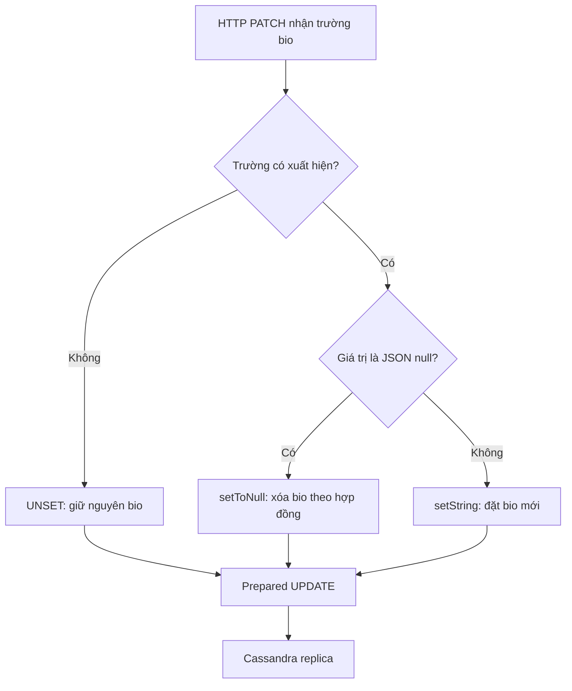

# NULL, UNSET và cách đọc trạng thái thiếu giá trị

> **Chương:** Java driver cơ bản  
> **Phạm vi:** Apache Cassandra, mô hình *wide-column*, CQL và **Java Driver 4.x**. Bài giải thích việc ghi `NULL`, bỏ qua bind variable bằng `UNSET`, đọc cell không có giá trị sống và bảo toàn ý nghĩa của các yêu cầu cập nhật từng phần từ ứng dụng Java.
>
> **Mục tiêu:** Phân biệt **không gửi trường**, **gửi giá trị null**, **gửi một giá trị cụ thể**, **không tìm thấy row**, và **cột không được SELECT**; viết prepared statements an toàn; không vô tình sinh tombstone hoặc xóa dữ liệu khi thực hiện PATCH; kiểm chứng hành vi với TTL, consistency level và các trường hợp biên.

## 1. Tình huống mở đầu: một PATCH làm mất trường hồ sơ

Ứng dụng Java lưu hồ sơ người dùng trong Cassandra:

```text
user_id      = 11111111-1111-4111-8111-111111111111
display_name = "Mai"
bio          = "Thích Cassandra"
age          = 26
```

Client gửi yêu cầu chỉ đổi tên hiển thị:

```json
{
  "display_name": "Mai Nguyễn"
}
```

Nếu tầng API ánh xạ trường `bio` không xuất hiện thành biến Java `null` rồi bind trực tiếp vào câu:

```cql
UPDATE lab.profiles_by_user
SET display_name = ?, bio = ?
WHERE user_id = ?;
```

thì driver có thể gửi **CQL null** cho `bio`. Cassandra hiểu đó là yêu cầu **xóa giá trị của cột**, không phải “bỏ qua vì client không gửi trường”.

Kết quả mong muốn:

```text
display_name = "Mai Nguyễn"
bio          = "Thích Cassandra"   <- giữ nguyên
```

Nhưng nếu `bio` bị bind thành `NULL`, kết quả có thể là:

```text
display_name = "Mai Nguyễn"
bio          = null                <- giá trị cũ bị che bởi tombstone
```

**Giải pháp với prepared statement:** bind `display_name` bằng giá trị mới, bind `bio` là **UNSET** (không cập nhật) và bind `user_id` đầy đủ.

Đó là lý do phải xem `NULL` và `UNSET` là **hai ý nghĩa ghi khác nhau**, không phải hai cách viết một “giá trị rỗng”.

## 2. Năm trạng thái cần tách trong ứng dụng

Thực tế có ít nhất năm tình huống thường bị gộp chung thành Java `null`:

| Tình huống | Ví dụ | Ý nghĩa chính xác |
| --- | --- | --- |
| **Trường không xuất hiện trong request** | JSON không có khóa `bio` | Người dùng **không yêu cầu đổi** `bio` |
| **Trường xuất hiện với JSON null** | `"bio": null` | Theo hợp đồng PATCH, có thể là **yêu cầu xóa giá trị** |
| **Trường có giá trị** | `"bio": "Kỹ sư"` | Ghi giá trị mới |
| **Row không tồn tại** | Không có `user_id` tương ứng | Không thể đồng nhất với row tồn tại nhưng `bio` rỗng |
| **Row tồn tại, cột không có giá trị sống** | `bio` đã delete, expired TTL hoặc chưa được ghi | Cassandra trả giá trị đọc là `null` cho cột được chọn |

Ngoài ra còn trường hợp **cột không nằm trong projection `SELECT`**: ứng dụng không thể đọc nó từ `Row` chỉ vì tên cột có trong schema.

**Nguyên tắc thiết kế:** đừng lấy một `Optional.empty()` hoặc một Java `null` rồi ngầm suy ra tất cả những tình huống trên tương đương nhau.

### Sơ đồ ý định PATCH



Sơ đồ mô tả **hợp đồng PATCH giả định**. Có API định nghĩa `null` là giá trị không hợp lệ, hoặc chỉ dùng lệnh DELETE riêng. Khi ấy cần từ chối request `null`, chứ không tự động biến nó thành tombstone.

## 3. `NULL` trong Cassandra không phải một giá trị lưu trữ thông thường

Trong CQL, `NULL` trên một **regular column** khi `INSERT`/`UPDATE` thường mang ngữ nghĩa xóa giá trị cột. Cassandra dùng cơ chế dấu xóa (*tombstone*) để che các phiên bản dữ liệu cũ trong SSTable và trên replica.

Ví dụ:

```cql
UPDATE lab.profiles_by_user
SET bio = null
WHERE user_id = 11111111-1111-4111-8111-111111111111;
```

Đây **không** phải thao tác “lưu một đối tượng Java null trên đĩa” để rồi sau đó phân biệt được với dữ liệu chưa từng ghi. Nó thể hiện **mutation xóa cột** theo timestamp và quy tắc reconciliation.

### Vì sao Cassandra cần tombstone?

Cassandra sử dụng LSM/SSTable bất biến:

1. Giá trị cũ có thể đã tồn tại trong một hoặc nhiều SSTable.
2. UPDATE/DELETE không sửa tại chỗ mọi SSTable cũ.
3. Tombstone ghi thông tin xóa theo timestamp để ngăn phiên bản cũ xuất hiện khi đọc.
4. Compaction có thể thu hồi dữ liệu chết khi đủ điều kiện, có xét tuổi tombstone và dữ liệu ở các SSTable khác.
5. Repair giúp các replica hội tụ để giảm nguy cơ dữ liệu cũ sống lại (*zombie data*) sau khi một replica bỏ lỡ delete.

**Không đồng nhất** “`SELECT` trả `null`” với “dữ liệu vật lý đã biến mất khỏi SSTable”.

### Không phải mọi `NULL` đều là thao tác ghi

- `SELECT` trả một cột không có giá trị sống: client nhận null.
- `UPDATE` đặt một cột regular thành null: có thể tạo tombstone.
- `INSERT` bind null cho một cột thường: có ngữ nghĩa xóa/che giá trị cũ.
- `WHERE` với primary key null: không hợp lệ.
- Cột không nằm trong `SELECT`: không phải null, mà **không nằm trong kết quả**.

Vì thế luôn hỏi: **NULL ở input của mutation, hay null ở output của query?**

## 4. `UNSET` nghĩa là gì?

**UNSET** là một giá trị đặc biệt dùng ở tầng **native protocol và driver binding** để nói với Cassandra rằng một bind variable không được cung cấp cho mutation này.

Trong ngữ cảnh `INSERT` hoặc `UPDATE` hỗ trợ UNSET:

- **UNSET regular column:** không thay đổi giá trị của cột đó.
- **NULL regular column:** mang ý nghĩa xóa giá trị cột.
- **Non-null value:** ghi giá trị mới theo CQL mutation semantics.

UNSET **không được lưu như một trạng thái dữ liệu thứ tư** trong Cassandra. Nó là chỉ dẫn lúc thực thi prepared statement.

### So sánh trực tiếp

Giả sử `bio` đang là `"Thích Cassandra"`:

| Bind cho `bio` | Thao tác | Giá trị `bio` sau mutation hợp lệ |
| --- | --- | --- |
| `"Đang học Java"` | Ghi đè giá trị | `"Đang học Java"` |
| **CQL null** | Xóa giá trị hiện có | `null` khi đọc |
| **UNSET** | Không cập nhật cột | Giữ `"Thích Cassandra"` |
| Không đưa cột vào câu UPDATE | Không cập nhật cột | Giữ `"Thích Cassandra"` |

Điều kiện quan trọng: mỗi mutation còn có thể chịu ảnh hưởng bởi **ghi đồng thời, timestamp và consistency level**. Bảng trên giả sử không có thao tác cạnh tranh khác.

### `UNSET` không phải literal CQL để lưu trong cột

Không viết:

```cql
-- SAI: không dùng UNSET như một giá trị cột thông thường.
UPDATE lab.profiles_by_user
SET bio = UNSET
WHERE user_id = 11111111-1111-4111-8111-111111111111;
```

Trong bài này, `UNSET` được tạo **bằng API Java Driver**, chẳng hạn `BoundStatementBuilder.unset(index)`. Khả năng truyền UNSET phụ thuộc phiên bản native protocol và server; với Cassandra/Java Driver hiện đại được hỗ trợ, đây là cơ chế phổ biến cho partial updates.

Nếu môi trường cũ không hỗ trợ unset binding, cần dùng **câu UPDATE chỉ chứa các cột thực sự muốn đổi**, không mô phỏng bằng null.

## 5. Bảng đầy đủ: NULL, UNSET, bỏ cột và giá trị thực

| Hành động | Với row mới | Với row đã tồn tại | Tombstone? | Khi đọc có biết thao tác nào đã xảy ra không? |
| --- | --- | --- | --- | --- |
| INSERT chỉ các cột cần ghi | Những cột không nhắc đến không có giá trị | Những cột bị bỏ qua thường không bị thay | Không phải chỉ vì bỏ cột | **Không** |
| INSERT bind một regular column là NULL | Cột đó không có giá trị sống; có thể ghi dấu xóa | Có thể che giá trị cũ | **Có thể có dấu xóa** theo mutation | **Không** |
| INSERT bind một regular column là UNSET | Bỏ qua cột | Giữ giá trị hiện tại | Không do chính cột UNSET | **Không** |
| UPDATE regular column = giá trị | Ghi giá trị, có thể tạo row/cell | Ghi giá trị mới | Không phải lệnh xóa, nhưng có phiên bản cũ | Thấy giá trị sống |
| UPDATE regular column = NULL | Không tạo giá trị sống cho cột | Xóa/che giá trị hiện tại | **Có** | Chỉ thấy null |
| UPDATE regular column = UNSET | Không cập nhật cột đó | Giữ nguyên cột đó | Không do chính cột UNSET | Không có “dấu UNSET” trong row |
| DELETE regular column | Không có giá trị sống sau xóa | Xóa/che giá trị hiện tại | **Có** | Chỉ thấy null |
| TTL hết hạn | Dữ liệu không còn sống | Dữ liệu hết hạn logic | Có metadata hết hạn/tombstone trong cơ chế lưu trữ | Chỉ thấy null hoặc row biến mất |
| SELECT thiếu cột trong projection | Không áp dụng | Không áp dụng | Không | Cột **không có trong Row** |

**Lưu ý về row liveness:** một `INSERT` có thể mang metadata đánh dấu row tồn tại ngay cả khi một số regular column bỏ qua. Một `UPDATE` chỉ chứa null/UNSET vào khóa không có dữ liệu sống có thể không tạo row hiển thị. Không suy ra row tồn tại hay không chỉ từ số bind variables.

## 6. Primary key không được NULL hoặc UNSET

Trong Cassandra, partition key và clustering columns xác định **danh tính và vị trí của row**. Chúng không thể bị bỏ trống trong mutation cần đầy đủ primary key.

Ví dụ table:

```cql
CREATE TABLE IF NOT EXISTS lab.profiles_by_user (
    user_id uuid PRIMARY KEY,
    display_name text,
    bio text,
    age int,
    tags set<text>,
    updated_at timestamp
);
```

`user_id` là partition key duy nhất.

Không hợp lệ:

```cql
-- SAI: thiếu giá trị primary key
INSERT INTO lab.profiles_by_user (user_id, display_name)
VALUES (null, 'Mai');

-- SAI: điều kiện primary key không phải giá trị khóa hợp lệ
UPDATE lab.profiles_by_user
SET bio = 'new bio'
WHERE user_id = null;
```

Với prepared statement, nếu bind `user_id` bằng `NULL` hoặc `UNSET`, request cần bị coi là **invalid**. Driver/server có thể báo lỗi ở thời điểm khác nhau tùy release và loại statement.

Một khóa chính tổng hợp `PRIMARY KEY ((customer_id, event_day), event_time, event_id)` cũng cần các thành phần khóa được chỉ định theo yêu cầu của thao tác. Không được dùng UNSET như cách “bỏ qua một phần partition key”.

### Đừng biến giá trị khóa từ client thành Java null

Ở tầng API:

```java
if (userId == null) {
    throw new IllegalArgumentException("userId là bắt buộc");
}
```

Việc xác thực đầu vào trước khi gọi driver giúp lỗi rõ ràng và tránh tạo request không hợp lệ.

## 7. Thiết lập lab: tạo dữ liệu ban đầu

Giả sử keyspace `lab` đã tồn tại với replication strategy và RF phù hợp topology của cluster thử nghiệm.

```cql
CREATE TABLE IF NOT EXISTS lab.profiles_by_user (
    user_id uuid PRIMARY KEY,
    display_name text,
    bio text,
    age int,
    tags set<text>,
    updated_at timestamp
);
```

Tạo một hồ sơ đủ dữ liệu:

```cql
INSERT INTO lab.profiles_by_user (
    user_id, display_name, bio, age, updated_at
) VALUES (
    11111111-1111-4111-8111-111111111111,
    'Mai',
    'Thích Cassandra',
    26,
    '2026-11-21T08:00:00Z'
);
```

Đọc bằng partition key:

```cql
SELECT user_id, display_name, bio, age, updated_at
FROM lab.profiles_by_user
WHERE user_id = 11111111-1111-4111-8111-111111111111;
```

Kỳ vọng `bio` có giá trị `'Thích Cassandra'` và `age=26`. Mốc thời gian là dữ liệu ví dụ, không dùng làm nguồn xác định mutation timestamp trừ khi CQL viết rõ `USING TIMESTAMP`.

### Thử xóa cột bằng NULL

```cql
UPDATE lab.profiles_by_user
SET bio = null
WHERE user_id = 11111111-1111-4111-8111-111111111111;
```

Đọc lại:

```cql
SELECT user_id, display_name, bio, age
FROM lab.profiles_by_user
WHERE user_id = 11111111-1111-4111-8111-111111111111;
```

`bio` không còn giá trị sống; `display_name` và `age` không bị xóa chỉ vì cùng một row.

Thử gán lại:

```cql
UPDATE lab.profiles_by_user
SET bio = 'Thích Cassandra'
WHERE user_id = 11111111-1111-4111-8111-111111111111;
```

Đây là cách khôi phục dữ liệu lab để kiểm thử tiếp. Trong production, nếu dữ liệu đã bị xóa nhầm, **không tự ghi lại giá trị “đoán được”** mà phải lấy từ nguồn sự thật và xử lý timestamp/tác động nghiệp vụ.

## 8. Java Driver 4.x: ba API phải nhớ

Khi dùng `PreparedStatement` và `BoundStatementBuilder`, ba thao tác quan trọng là:

```java
builder.setString(index, "Giá trị mới"); // Ghi giá trị
builder.setToNull(index);                // Ghi CQL NULL -> xóa cột
builder.unset(index);                    // Không cập nhật cột
```

`index` là vị trí **bind marker** trong prepared statement, tính từ `0`. Nó không phải ordinal của cột trong schema.

Ví dụ:

```cql
UPDATE lab.profiles_by_user
SET display_name = ?, bio = ?
WHERE user_id = ?;
```

Thứ tự bind markers:

| Index | Biến cần bind | Kiểu |
| --- | --- | --- |
| `0` | `display_name` | `text` |
| `1` | `bio` | `text` |
| `2` | `user_id` | `uuid` |

Trong production, nếu sửa thứ tự placeholders mà không cập nhật Java code, có thể ghi nhầm dữ liệu hoặc gặp lỗi type. Dùng hằng số index, các API theo tên khi phù hợp, và integration tests.

### Không dùng Java null như viết tắt cho UNSET

Ví dụ dễ gây hiểu nhầm:

```java
// Dễ sai về ý định: null có thể được bind thành CQL NULL.
BoundStatement statement = prepared.bind(
    "Mai Nguyễn", null, userId
);
```

Để thể hiện ý nghĩa, ưu tiên builder và gọi **rõ ràng** `unset` hoặc `setToNull`. Không phụ thuộc ngầm vào một overload của `bind(...)` để bảo toàn semantic PATCH.

## 9. Ví dụ chuẩn: PATCH không xóa cột bị bỏ qua

Một hợp đồng PATCH có thể biểu diễn bằng hai thành phần cho từng field:

- `present`: client có gửi field không?
- `value`: nếu đã gửi, giá trị là gì? Có thể null nếu muốn xóa.

`Optional<String>` **một mình không đủ**, bởi `Optional.empty()` thường gộp cả “không gửi” lẫn “gửi null”.

Ví dụ Java 17 với record:

```java
import java.util.UUID;

public record ProfilePatch(
    UUID userId,
    boolean displayNamePresent,
    String displayName,
    boolean bioPresent,
    String bio
) {}
```

Định nghĩa:

| `present` | `value` | Ý nghĩa |
| --- | --- | --- |
| `false` | Bất kỳ | Không đổi field |
| `true` | `null` | Xóa field nếu hợp đồng cho phép |
| `true` | Non-null | Ghi field mới |

Trong code, nên xác thực rằng khi `present=false` thì không phụ thuộc nội dung `value`; DTO converter từ JSON phải giữ được dấu hiệu field có xuất hiện.

### Prepared UPDATE với hai cột tùy chọn

```java
import java.util.UUID;

import com.datastax.oss.driver.api.core.CqlSession;
import com.datastax.oss.driver.api.core.DefaultConsistencyLevel;
import com.datastax.oss.driver.api.core.cql.BoundStatement;
import com.datastax.oss.driver.api.core.cql.BoundStatementBuilder;
import com.datastax.oss.driver.api.core.cql.PreparedStatement;

public final class ProfilePatchRepository {
    private final CqlSession session;
    private final PreparedStatement update;

    public ProfilePatchRepository(CqlSession session) {
        this.session = session;
        this.update = session.prepare(
            "UPDATE lab.profiles_by_user " +
            "SET display_name = ?, bio = ? " +
            "WHERE user_id = ?"
        );
    }

    public void patch(ProfilePatch patch) {
        UUID userId = patch.userId();
        if (userId == null) {
            throw new IllegalArgumentException("userId là bắt buộc");
        }

        // Không gửi mutation rỗng: không có gì cần cập nhật.
        if (!patch.displayNamePresent() && !patch.bioPresent()) {
            return;
        }

        BoundStatementBuilder b = update.boundStatementBuilder();
        b.setUuid(2, userId);

        if (!patch.displayNamePresent()) {
            b.unset(0);
        } else if (patch.displayName() == null) {
            b.setToNull(0);
        } else {
            b.setString(0, patch.displayName());
        }

        if (!patch.bioPresent()) {
            b.unset(1);
        } else if (patch.bio() == null) {
            b.setToNull(1);
        } else {
            b.setString(1, patch.bio());
        }

        BoundStatement statement = b.build()
            .setConsistencyLevel(
                DefaultConsistencyLevel.LOCAL_QUORUM);

        session.execute(statement);
    }
}
```

Giả định:

- `CqlSession` đã kết nối đúng cluster, schema, role và local datacenter.
- Keyspace `lab` và bảng ví dụ có tồn tại.
- RF trong local DC đáp ứng `LOCAL_QUORUM`; nếu lab chỉ có một replica, dùng CL phù hợp.
- Mục tiêu PATCH cho phép `null` xóa các cột regular này.
- Không có yêu cầu kiểm soát đồng thời đặc biệt; nếu có, xem phần LWT bên dưới.
- Đoạn ví dụ dùng Java 17 để biểu diễn `record`; có thể thay bằng class thường nếu project dùng phiên bản Java cũ.

**Tác dụng chính:** `bioPresent=false` dẫn tới `unset(1)`, vì vậy **không xóa bio** khi request chỉ sửa display name.

### Vì sao không gọi `setIdempotent(true)` tùy tiện?

Với một UPDATE đặt cùng giá trị, nó thường có tác động logic lặp lại giống nhau trong điều kiện đơn giản. Nhưng retry có thể liên quan timestamp mới, TTL, ghi đồng thời hoặc side effect từ logic ứng dụng. Hãy xác nhận **idempotency ở cấp nghiệp vụ** trước khi bật retry/speculative execution dựa vào cờ này.

## 10. Kiểm chứng ba trạng thái bằng dữ liệu lab

Giả sử đã khởi tạo:

```text
display_name = "Mai"
bio          = "Thích Cassandra"
```

### Case A — Chỉ đổi display_name

```json
{
  "display_name": "Mai Nguyễn"
}
```

DTO:

```text
displayNamePresent = true,  displayName = "Mai Nguyễn"
bioPresent         = false, bio         = null (không xét)
```

Driver gửi:

```text
bind(0) = "Mai Nguyễn"
bind(1) = UNSET
bind(2) = user_id
```

Kết quả mong muốn:

```text
display_name = "Mai Nguyễn"
bio          = "Thích Cassandra"
```

### Case B — Xóa bio theo yêu cầu rõ ràng

```json
{
  "bio": null
}
```

Driver gửi:

```text
bind(0) = UNSET
bind(1) = NULL
bind(2) = user_id
```

Kết quả mong muốn:

```text
display_name = "Mai Nguyễn"
bio          = null
```

### Case C — Đặt bio thành chuỗi rỗng

```json
{
  "bio": ""
}
```

Driver gửi **chuỗi rỗng `""`** cho `bio`, không phải CQL null. Với kiểu `text`, chuỗi rỗng là một giá trị khác với không có giá trị sống.

Kết quả mong muốn:

```text
display_name = "Mai Nguyễn"
bio          = ""
```

**Ba ý định khác nhau ⇒ ba cách bind khác nhau.** Trong API thiết kế tốt, có thể từ chối chuỗi rỗng theo validation; điều đó là quy tắc domain, không phải hành vi tự động của Cassandra.

## 11. `INSERT` với NULL, UNSET và cột không liệt kê

Cassandra dùng `INSERT` có ngữ nghĩa upsert, không hoàn toàn giống một lệnh tạo row trong RDBMS.

Giả sử:

```cql
INSERT INTO lab.profiles_by_user (user_id, display_name)
VALUES (
    22222222-2222-4222-8222-222222222222,
    'Lan'
);
```

Các cột `bio`, `age` và `tags` không được liệt kê nên không có giá trị mới được ghi cho chúng. Khi đọc, các cột đó có thể trả `null`.

Đối với **row đã tồn tại**, INSERT/upsert bỏ qua cột `bio` thường **không xóa** `bio`. Đây là điểm quan trọng khi hệ thống dùng cùng câu INSERT để upsert nhiều lần.

### Trường hợp prepared INSERT

```cql
INSERT INTO lab.profiles_by_user (
    user_id, display_name, bio
) VALUES (?, ?, ?);
```

Với index:

- `0`: `user_id` — bắt buộc.
- `1`: `display_name` — có thể có giá trị.
- `2`: `bio` — có thể UNSET nếu không muốn ghi.

Ví dụ:

```java
PreparedStatement insert = session.prepare(
    "INSERT INTO lab.profiles_by_user " +
    "(user_id, display_name, bio) VALUES (?, ?, ?)"
);

BoundStatementBuilder b = insert.boundStatementBuilder();
b.setUuid(0, userId);
b.setString(1, "Lan");
b.unset(2);                  // Không đụng tới bio
session.execute(b.build());
```

**Cảnh báo:** ngay cả khi mọi regular column bị UNSET, một INSERT có primary key vẫn có thể tạo metadata row liveness; không lấy UNSET để “hủy” toàn bộ statement. Nếu nghiệp vụ không cần ghi gì, tốt nhất **đừng gửi mutation**.

### Câu hỏi “INSERT NULL có tạo tombstone không?”

Với regular column, truyền CQL null mang ngữ nghĩa xóa. Mức metadata/tombstone thực tế tùy phép ghi và phiên bản, nhưng khi tuning cần **xem nó là một nguồn phát sinh dấu xóa**. Đừng dùng null để thay cho “không có dữ liệu mới”.

## 12. Đọc một row: phân biệt row không tồn tại và cột null

Trên Java Driver 4.x, `ResultSet.one()` có thể trả `null` nếu không có row được trả về. Nếu có `Row`, một cột đã được SELECT có thể chứa **CQL null**.

Ví dụ:

```java
import java.util.UUID;

import com.datastax.oss.driver.api.core.CqlSession;
import com.datastax.oss.driver.api.core.cql.PreparedStatement;
import com.datastax.oss.driver.api.core.cql.Row;

public final class ProfileReader {
    private final CqlSession session;
    private final PreparedStatement select;

    public ProfileReader(CqlSession session) {
        this.session = session;
        this.select = session.prepare(
            "SELECT user_id, display_name, bio, age " +
            "FROM lab.profiles_by_user WHERE user_id = ?"
        );
    }

    public void print(UUID userId) {
        Row row = session.execute(select.bind(userId)).one();

        if (row == null) {
            System.out.println("ROW_NOT_FOUND");
            return;
        }

        System.out.println("ROW_FOUND");

        if (row.isNull("bio")) {
            System.out.println("BIO_HAS_NO_LIVE_VALUE");
        } else {
            String bio = row.getString("bio");
            System.out.println("BIO=" + bio);
        }

        if (row.isNull("age")) {
            System.out.println("AGE_HAS_NO_LIVE_VALUE");
        } else {
            int age = row.getInt("age");
            System.out.println("AGE=" + age);
        }
    }
}
```

### Quy tắc cho getter kiểu primitive

Với cột nullable như `age int`, **kiểm tra `row.isNull("age")` trước khi gọi `getInt`**. Dựa vào giá trị primitive mặc định, exception hoặc một hành vi codec cụ thể để suy ra null là nguy hiểm.

Không được gộp:

```text
age = 0
age = NULL
row không tồn tại
```

thành cùng một ý nghĩa. Trong nghiệp vụ, tuổi `0` (nếu hợp lệ) khác dữ liệu chưa được nhập.

### Với getter object

`row.getString("bio")` có thể trả Java `null` khi cột đã được chọn nhưng không có giá trị sống. Nó vẫn **không** giải thích nguyên nhân (chưa ghi, delete hay TTL hết hạn).

## 13. Cột không được SELECT khác với cột trả null

Xem hai truy vấn:

```cql
SELECT user_id, display_name
FROM lab.profiles_by_user
WHERE user_id = 11111111-1111-4111-8111-111111111111;
```

và:

```cql
SELECT user_id, display_name, bio
FROM lab.profiles_by_user
WHERE user_id = 11111111-1111-4111-8111-111111111111;
```

Ở truy vấn đầu:

- `bio` **không có trong kết quả**.
- Gọi `row.isNull("bio")` hoặc `row.getString("bio")` khi cột không nằm trong projection **không phải cách kiểm tra missing value hợp lệ**; API có thể báo không tìm thấy cột trong result metadata.

Ở truy vấn thứ hai:

- `bio` được chọn.
- Nếu Cassandra không có giá trị sống, `row.isNull("bio")` có thể trả `true`.
- Nếu có giá trị text, nó trả `false`.

Một DTO nên giữ rõ:

```text
ROW_NOT_FOUND
ROW_FOUND, COLUMN_NOT_PROJECTED
ROW_FOUND, COLUMN_SELECTED_NULL
ROW_FOUND, COLUMN_SELECTED_WITH_VALUE
```

Tùy API, **không nhất thiết phải đưa mọi trạng thái này tới người dùng cuối**. Nhưng ở repository/mapper, tách chúng giúp không viết nhầm logic cập nhật.

## 14. Có biết vì sao một cột đọc ra null không?

Giả sử `SELECT bio` trả CQL null. Cassandra **không cung cấp “nguyên nhân null” như một phần mặc định của giá trị cell trả về**.

Nó có thể do:

1. Cột chưa từng được ghi.
2. Cột đã bị xóa rõ ràng bằng `DELETE`.
3. Cột đã được `UPDATE ... SET bio = null`.
4. Cột từng được ghi với TTL nhưng đã hết hạn.
5. Cột đã bị xóa theo mutation khác (range/row/partition tombstone).
6. Kết quả có ý nghĩa null do phiên bản dữ liệu/replica tại CL đang đọc.

### CQL metadata giúp gì?

Với một **regular non-collection column** như `bio`, trong trường hợp phù hợp:

```cql
SELECT bio, WRITETIME(bio), TTL(bio)
FROM lab.profiles_by_user
WHERE user_id = 11111111-1111-4111-8111-111111111111;
```

- `WRITETIME(bio)` mô tả timestamp của giá trị đang được xem xét khi có giá trị sống phù hợp.
- `TTL(bio)` mô tả TTL còn lại khi có TTL áp dụng cho cell sống.
- Nếu cột không có giá trị sống, kết quả metadata có thể là null.
- Nếu cột đang sống nhưng không được đặt TTL, `TTL(bio)` thường là null.

**Vì vậy `TTL(bio)=null` không phân biệt được “không đặt TTL” với “không có giá trị sống” nếu không xem thêm `bio` và những dữ kiện khác.** `WRITETIME` cũng không cung cấp lịch sử đầy đủ của mọi mutation cũ.

Không dùng các hàm này như audit log hay nguồn xác minh đã từng có `DELETE`. Nếu ứng dụng cần biết **vì sao** một trường bị xóa, phải có metadata nghiệp vụ riêng, event log hoặc nguồn đối chứng có kiểm soát.

## 15. Thiết kế trạng thái nghiệp vụ nếu NULL không đủ

Có ba ý nghĩa nghiệp vụ khác nhau:

- `bio` **chưa được người dùng cung cấp**.
- Người dùng đã **xóa bio**.
- `bio` **không áp dụng** cho loại tài khoản này.

CQL null không lưu được sự phân biệt đó. Hãy thiết kế trạng thái rõ ràng nếu ứng dụng cần:

```cql
CREATE TABLE IF NOT EXISTS lab.profile_bio_state_by_user (
    user_id uuid PRIMARY KEY,
    bio text,
    bio_status text,
    bio_changed_at timestamp
);
```

Ví dụ những trạng thái domain:

```text
bio_status = 'NEVER_SET'
bio_status = 'CLEARED'
bio_status = 'PRESENT'
bio_status = 'NOT_APPLICABLE'
```

Với mô hình như vậy, cần đảm bảo **cập nhật bio và trạng thái đi cùng quy tắc nhất quán** của nghiệp vụ. Cassandra không tự cung cấp transaction tổng quát xuyên nhiều partition, vì vậy đặt dữ liệu liên quan trong cùng partition/row có thể giúp ghi một mutation gồm nhiều cell; nhưng các client/replica và timestamp vẫn cần được thiết kế.

### Không dùng chuỗi sentinel tùy tiện

Anti-pattern:

```text
bio = "<NULL>"
bio = "N/A"
bio = "(deleted)"
```

Các chuỗi đó có thể trùng dữ liệu hợp lệ của người dùng và khó chuyển đổi về sau. Nếu cần trạng thái, dùng **cột trạng thái riêng với enum/domain validation**.

### Nếu phải lưu lý do xóa

Thêm event:

```text
event_id, user_id, field_name, action='CLEAR',
actor, occurred_at, request_id
```

Hệ thống audit/event log phải tuân thủ quyền riêng tư và retention. **Không coi `WRITETIME` là actor hoặc lý do xóa**.

## 16. JSON request: absent, null và chuỗi rỗng

Giả sử REST API dùng `PATCH /profiles/{id}`:

| JSON body | Ý nghĩa hợp đồng được đề xuất |
| --- | --- |
| `{}` | Không đổi trường nào |
| `{"bio":"Xin chào"}` | Ghi `bio` mới |
| `{"bio":null}` | Xóa `bio` |
| `{"bio":""}` | Ghi chuỗi rỗng, hoặc báo validation error nếu domain cấm |
| `{"bio":0}` | Từ chối sai kiểu |
| `{"age":null}` | Xóa age nếu domain cho phép, nếu không trả validation error |
| `{"age":0}` | Ghi số 0 nếu hợp lệ |

Điểm tinh tế: một DTO Java đơn giản có field `String bio` có thể nhận `null` cho cả **JSON vắng khóa** lẫn **JSON có null**. Trước khi map sang Cassandra, tầng parser/serializer phải bảo toàn presence.

### Hướng làm khi dùng Jackson

Với cây JSON hoặc thư viện DTO hỗ trợ presence tracking, cần kiểm tra:

```java
// Pseudocode về ý nghĩa, không phụ thuộc một bản Jackson cụ thể:
boolean present = json.has("bio");   // Khóa có xuất hiện?
boolean explicitNull = present && json.get("bio").isNull();
String value = explicitNull ? null : ...;
```

Trong Jackson, `has("bio")` với một trường `NullNode` vẫn có thể cho biết khóa hiện diện, trong khi một số phương thức như `hasNonNull` gộp vắng và null. Kiểm tra phiên bản và mapper configuration thực tế trước khi áp dụng.

**Không dùng `Optional<String>` đơn thuần để làm tri-state** nếu tầng JSON đã làm mất thông tin absent vs explicit null.

### PUT khác PATCH

Theo thiết kế API, `PUT` thường biểu diễn thay thế tài nguyên, còn `PATCH` mô tả thay đổi một phần. Nhưng **điều này không tự quyết định** cách bind CQL; mỗi API phải có hợp đồng cụ thể.

Nếu endpoint PUT yêu cầu toàn bộ cấu trúc, field thiếu có thể bị từ chối; không nhất thiết phải xóa bằng CQL null. Tránh lấy semantics HTTP chung để biện minh xóa hàng loạt dữ liệu.

## 17. Tại sao cập nhật nhiều cột bằng UNSET hữu ích?

Một API động có thể cập nhật một trong nhiều cột. Nếu tạo một prepared statement riêng cho **mọi tổ hợp cột**, số dạng query có thể tăng theo cấp số nhân.

Với 10 cột tùy chọn, số tập con không rỗng là:

```text
2^10 - 1 = 1023 cách chọn cột
```

Một prepared `UPDATE` với các bind variables UNSET có thể dùng lại nhiều hơn:

```cql
UPDATE lab.profiles_by_user
SET display_name = ?,
    bio = ?,
    age = ?,
    updated_at = ?
WHERE user_id = ?;
```

Ứng dụng:

- Bind giá trị cho field cần sửa.
- `setToNull` cho field được yêu cầu xóa.
- `unset` cho field không được yêu cầu đổi.
- Bind khóa bắt buộc.
- Không gửi mutation khi không có field nào thay đổi.

### Điều kiện khi dùng mẫu câu UPDATE cố định

- Số cột không quá lớn khiến statement khó quản lý.
- Tên cột và thứ tự bind markers được kiểm soát.
- Server/protocol hỗ trợ UNSET trong vị trí tương ứng.
- Logic không dùng unset để lách những ràng buộc CQL cần giá trị bắt buộc.
- Tính đúng đắn khi có write concurrency, TTL và timestamp đã được kiểm thử.

Một câu UPDATE thường xuyên bind hàng trăm cột UNSET không nhất thiết là tối ưu nhất. Khi schema/query phức tạp, dùng một số shape cố định theo nhu cầu nghiệp vụ có thể tốt hơn.

## 18. NULL, DELETE và tombstone trên đường đọc

Cassandra chọn bản ghi sống bằng cách hòa giải memtable, SSTable và tombstone theo timestamp. Một lần UPDATE ghi null có thể tạo dấu xóa khiến đọc sau đó phải xét thêm metadata.

```text
SSTable A:  bio = "Thích Cassandra"  @ t=100
Memtable:  bio = tombstone           @ t=200
                    |
                    v
SELECT bio -> null
                    |
             compaction/repair
                    |
            Dữ liệu cũ chỉ thu hồi
            khi đủ điều kiện an toàn
```

Số `t=100` và `t=200` chỉ minh họa thứ tự timestamp. Trong hệ thống nhiều replica, consistency level và mutation đang truyền có thể khiến các lần đọc gần thời điểm ghi quan sát các trạng thái khác nhau nếu điều kiện nhất quán không bảo đảm giao nhau theo cấu hình/thời điểm.

### Một PATCH có nhiều null có thể tốn gì?

- Tạo tombstone cho những cột không cần xóa nếu mapper gộp missing thành null.
- Tăng SSTable versions/tombstone cần xét trên đường đọc.
- Tăng read amplification cho hot partitions.
- Tạo compaction/repair pressure và disk I/O.
- Có thể tăng p95/p99 hoặc gây cảnh báo tombstone nếu workload đủ lớn.

**UNSET không phải cách xóa tombstone đã tồn tại**; nó chỉ ngăn mutation hiện tại đụng tới cột không cần thay đổi. Nếu trước đó đã xóa nhầm `bio`, gửi UNSET sau đó **không khôi phục giá trị cũ**.

## 19. TTL: giá trị hết hạn trông giống null khi đọc

Thử trong lab:

```cql
UPDATE lab.profiles_by_user
USING TTL 60
SET bio = 'Giá trị tạm thời'
WHERE user_id = 11111111-1111-4111-8111-111111111111;
```

Đọc ngay:

```cql
SELECT bio, TTL(bio), WRITETIME(bio)
FROM lab.profiles_by_user
WHERE user_id = 11111111-1111-4111-8111-111111111111;
```

Khi `bio` còn sống, `TTL(bio)` cho thời gian sống còn lại theo cơ chế Cassandra. Sau khi TTL hết hạn, `bio` không còn giá trị sống và có thể đọc ra null; cột khác còn sống giúp row tiếp tục xuất hiện.

### Hai điều phải tránh

1. **Không dùng `TTL(bio)=null` để kết luận bio chưa từng được ghi.** Một giá trị sống không có TTL cũng cho TTL null.
2. **Không gọi UPDATE với NULL để “gia hạn TTL”.** NULL là thao tác xóa, không phải refresh.

Khi cần gia hạn TTL, phải ghi giá trị sống mới với TTL mới, theo hợp đồng nghiệp vụ và timestamp/consistency thích hợp.

### PATCH giữ trường bằng UNSET có thay TTL không?

Với cột UNSET, mutation không cập nhật cột đó, vì vậy không làm mới TTL chỉ vì một field khác trong cùng prepared statement được sửa. Đây là ưu điểm quan trọng khi patch một row có các cột retention khác nhau.

Nếu ứng dụng muốn **chủ động gia hạn** TTL của bio, phải ghi lại bio với TTL mong muốn; đó là hành vi riêng, không được diễn ra chỉ vì client không gửi bio.

## 20. Các collection và UDT có những lưu ý đặc biệt

Cassandra hỗ trợ `set`, `list`, `map`, UDT và các dạng `frozen` trong những ngữ cảnh được release cho phép.

### Collection null khác collection được chủ động sửa

Ví dụ:

```cql
CREATE TABLE IF NOT EXISTS lab.user_tags_by_id (
    user_id uuid PRIMARY KEY,
    tags set<text>,
    settings map<text, text>
);
```

Nếu một mutation đặt `tags = null`, đó là một thao tác xóa/che giá trị collection theo ngữ nghĩa CQL; không phải “không đổi tags”.

Nếu muốn **thêm một tag**, có thể dùng cú pháp cập nhật phần tử phù hợp:

```cql
UPDATE lab.user_tags_by_id
SET tags = tags + {'java'}
WHERE user_id = 11111111-1111-4111-8111-111111111111;
```

Nếu muốn **không đụng tới tags**, hãy bỏ cột hoặc bind UNSET ở vị trí cho phép; đừng ghi null.

### Empty collection không nên mặc định bằng null

`[]`, `{}`, Java empty list/set/map và `null` không nên được mapper đối xử giống nhau một cách máy móc. Các collection type, frozen/non-frozen, cú pháp literal và biểu diễn empty có quy tắc phụ thuộc Cassandra release.

Hãy test rõ ba trường hợp cho schema thực:

1. Collection không có giá trị sống.
2. Collection được chủ động đặt thành rỗng.
3. Collection có phần tử.

Đừng áp dụng một kết luận “empty luôn là null” cho mọi kiểu và mọi phiên bản.

### UDT và field null

Một UDT có thể chứa các field không có giá trị; cách cập nhật field riêng lẻ khác giữa frozen và non-frozen UDT. UNSET **cả bind variable** không nhất thiết có cùng nghĩa với “xóa một field bên trong UDT”.

Với nested structures, cần xác định **đơn vị cập nhật**: cả cột, phần tử collection hay một field của UDT; lựa chọn CQL/binding phù hợp và test trên release thật.

## 21. Đồng thời ghi: UNSET không giải quyết lost update

Giả sử hai request đến gần nhau:

```text
Request A: UPDATE display_name = "Mai A", bio = UNSET
Request B: UPDATE display_name = "Mai B", bio = UNSET
```

Cả hai vẫn sửa **cùng cột display_name**. Cassandra hòa giải theo timestamp/tie-break; UNSET không cung cấp optimistic locking cho cột đó.

Một ví dụ khác:

```text
Request A: display_name = "Mai A", bio = UNSET
Request B: display_name = UNSET,    bio = "Nội dung B"
```

Hai mutation chạm các cột khác nhau nên giảm nguy cơ vô tình xóa thay đổi của nhau. Tuy nhiên, nếu ứng dụng có **bất biến xuyên các cột**, cần thiết kế consistency/concurrency phù hợp.

### Nếu yêu cầu compare-and-set

Cassandra hỗ trợ Lightweight Transactions (LWT) cho các thao tác có điều kiện như:

```cql
UPDATE lab.profiles_by_user
SET display_name = 'Mai Nguyễn'
WHERE user_id = 11111111-1111-4111-8111-111111111111
IF display_name = 'Mai';
```

LWT có chi phí Paxos/độ trễ cao hơn mutation thường. Dùng khi thật sự cần CAS, không thêm vào mọi PATCH chỉ vì lo NULL/UNSET.

Không lấy câu `IF display_name = null` làm cơ chế kiểm tra “chưa từng ghi”: semantics null, row liveness và điều kiện CQL phải được thử theo phiên bản, còn business state nên được mô hình hóa rõ nếu cần.

## 22. Consistency level khi ghi null và đọc lại

Cassandra dùng replica placement từ partition key và RF của keyspace. Một DELETE hoặc UPDATE null là **mutation cần replication**, giống các thao tác ghi khác về yêu cầu phản hồi theo consistency level.

Ví dụ RF=3 trong `dc1`:

| Operation | CL | Điều kiện chính |
| --- | --- | --- |
| UPDATE `bio = null` | `LOCAL_QUORUM` | Hai replica local phản hồi theo quy tắc CL |
| UPDATE `bio = UNSET` và field khác | `LOCAL_QUORUM` | Field UNSET không bị đổi, mutation còn lại được gửi |
| SELECT `bio` | `LOCAL_QUORUM` | Đọc từ replica local theo cơ chế CL |
| SELECT `bio` | `LOCAL_ONE` | Có thể đọc từ một replica local |

Với RF=3, `LOCAL_QUORUM` cần hai phản hồi local, khi coordinator ở đúng DC. Nếu ghi và đọc ở cùng DC với quorum giao nhau, có điều kiện mạnh hơn để thấy mutation mới so với `LOCAL_ONE`; vẫn cần xét các ghi đồng thời, timeout và replica health.

### Hai DC có khác biệt

Nếu RF=3 ở `dc1` và RF=3 ở `dc2`, một write `LOCAL_QUORUM` tại dc1 không buộc chờ hai ACK ở dc2. Ngay sau một mutation xóa ở dc1, đọc `LOCAL_QUORUM` từ dc2 có thể chưa thấy delete nếu replication chưa tới.

**UNSET/NULL không thay đổi công thức quorum.** Chúng chỉ quyết định **cột nào** được mutation tác động.

## 23. Retry, timeout và idempotency khi xóa cột

Một write timeout không chứng minh mutation chưa được áp dụng ở bất kỳ replica nào. Nếu ứng dụng retry, có thể có:

- Mutation cũ đã thành công ở một số replica.
- Một retry với timestamp mới.
- Ghi đồng thời từ request khác.
- Tombstone/TTL interaction làm trạng thái cuối phụ thuộc thứ tự timestamp.

### Không retry mù một PATCH nghiệp vụ

Với request `{"bio":null}`, về mặt ý định có thể coi là “đưa bio về trạng thái không có giá trị”. Nhưng:

- Nếu một request khác vừa ghi bio mới, retry xóa với timestamp mới có thể xóa luôn cập nhật đó.
- Nếu xóa còn ghi audit event hoặc phát side effect bên ngoài, retry có thể trùng hành động.
- Nếu có manual timestamps, thứ tự phụ thuộc timestamp logic.

Giải pháp tùy nghiệp vụ:

- Dùng request ID/idempotency key ở tầng service nếu cần chống lặp.
- Dùng CAS/LWT khi cần kiểm soát phiên bản.
- Không tự bật speculative execution cho mutation không được đánh giá an toàn.
- Dùng write/read consistency thích hợp và đối soát khi kết quả timeout không chắc chắn.

**Thao tác SET cùng giá trị không mặc nhiên là idempotent về mọi mặt** khi xét TTL, timestamps, audit và workflow.

## 24. Đọc sai trường hợp null trong mapper DTO

Một mapper không tốt:

```java
// SAI về ý nghĩa nếu 0 là giá trị hợp lệ:
int age = row.isNull("age") ? 0 : row.getInt("age");
```

Nếu API trả `age=0` cho “chưa biết tuổi”, client có thể hiểu đó là tuổi thật.

Đúng hơn:

```java
Integer age = row.isNull("age")
    ? null
    : row.getInt("age");
```

Sau đó domain validation/quy tắc output quyết định trả:

```json
{"age":null}
```

hay **bỏ trường age khỏi response**, hoặc trả một field trạng thái rõ. Đây là **hợp đồng API**, không phải kết quả tự động của Cassandra.

### Phân biệt row not found

Ví dụ trả kiểu kết quả:

```text
ProfileLookupResult =
    NotFound
  | Found {
        displayName: String?
        bio: String?
        age: Integer?
    }
```

Java có thể dùng sealed hierarchy, record hoặc `Optional<Profile>` cho **row existence**, trong khi các field của `Profile` vẫn có thể null/Optional theo contract.

**Một `Optional<Profile>` rỗng nên nghĩa là row không có**, không phải row có `bio` null.

## 25. Kiểm thử đầy đủ: ma trận input và state

Tạo dữ liệu ban đầu và mỗi phép thử trên **một user_id riêng** hoặc reset dữ liệu lab giữa các test. Với Cassandra, timestamp và TTL có thể khiến test chạy nối tiếp rất sát nhau khó phân biệt; nên dùng test isolation và quan sát consistency phù hợp.

| Case | Input cho bio | Binding | Dữ liệu ban đầu | Kỳ vọng |
| --- | --- | --- | --- | --- |
| T1 | Không có field | UNSET | `bio="A"` | Vẫn `"A"` |
| T2 | Explicit null | NULL | `bio="A"` | Đọc ra null |
| T3 | Chuỗi `"B"` | Giá trị | `bio="A"` | Đọc `"B"` |
| T4 | Chuỗi rỗng | Giá trị rỗng | `bio="A"` | Đọc `""` nếu domain cho phép |
| T5 | Không có field | UNSET | `bio=null` | Vẫn null |
| T6 | Explicit null | NULL | `bio=null` | Vẫn không có giá trị sống; có thể thêm dấu xóa |
| T7 | Ghi lần đầu, field thiếu | UNSET/không liệt kê | Row chưa có | Field không có giá trị sống |
| T8 | UPDATE với key NULL | Invalid | Bất kỳ | Bị từ chối |
| T9 | UPDATE với key UNSET | Invalid | Bất kỳ | Bị từ chối |
| T10 | Không field nào present | Không gửi mutation | Bất kỳ | Không thay đổi dữ liệu |
| T11 | TTL của bio hết hạn | Không bind | Bio từng sống | Bio đọc ra null |
| T12 | SELECT bỏ cột bio | Không áp dụng | Bất kỳ | Row result không có cột bio |
| T13 | Row không tồn tại | Không áp dụng | Bất kỳ | `ResultSet.one() == null` |
| T14 | Age = 0 | Giá trị số 0 | Age null | Age đúng bằng 0 |
| T15 | Age explicit null | NULL | Age 27 | Age đọc null |
| T16 | Hai PATCH đồng thời | Các bind trộn | Cùng row | Theo timestamp/CL và bất biến domain |

### Thử với test integration thay vì chỉ mock

Unit test có thể xác nhận JSON-to-DTO và builder chọn `unset`/`setToNull` đúng. Nhưng kết quả tombstone/TTL, read-after-write và consistency phải được kiểm chứng trên **cluster Cassandra lab thật hoặc môi trường test tương thích**.

Không tạo xóa hàng loạt/force compaction ở production chỉ để thử các trường hợp này.

## 26. Quan sát dấu xóa và tối ưu truy vấn

Với workload PATCH liên tục, cần theo dõi:

- Tổng số UPDATE thực hiện.
- Tỷ lệ explicit CLEAR (cột NULL) so với KEEP (UNSET).
- Read/write p95/p99 và timeout theo operation.
- Tombstones scanned khi đọc các partition bị ảnh hưởng.
- SSTable count, compaction backlog, disk I/O.
- Retry count, write timeouts, trạng thái replica.
- Tỷ lệ lỗi validation: PATCH thiếu khóa, sai kiểu, field không cho phép xóa.

Lệnh quan sát trên node được cấp quyền:

```bash
nodetool tablestats lab.profiles_by_user
nodetool tablehistograms lab.profiles_by_user
nodetool compactionstats
nodetool tpstats
```

Tên metric/cột của `nodetool` thay đổi theo Cassandra release. `tombstones scanned` là chi phí đọc từ phía server, không phải “số JSON null client gửi” theo ánh xạ 1:1.

### Vì sao UNSET giúp giảm áp lực?

Giả sử request chỉ đổi display name nhưng mapper gửi NULL cho 12 field khác. Từng request có thể tạo nhiều dấu xóa vô ích. Dùng UNSET loại bỏ những mutation xóa không được yêu cầu.

Tuy vậy:

- UNSET không làm giảm số **row đọc** nếu query vẫn quét partition lớn.
- UNSET không làm tombstone cũ tự biến mất.
- UNSET không thay compaction/repair.
- UNSET không thay thế query-first data modeling.

Nó giải đúng vấn đề **không ghi/xóa cột ngoài ý định**.

## 27. Khi lỗi xảy ra: bảng chẩn đoán

| Triệu chứng | Giả thuyết đầu tiên | Kiểm tra |
| --- | --- | --- |
| PATCH một field làm field khác biến mất | Mapper đổi missing thành NULL | Presence tracking và bind builder |
| `age=0` dù người dùng chưa nhập | Primitive getter/default gây nhập nhằng | `row.isNull("age")` trước `getInt` |
| `bio=null` sau một thời gian | TTL hết hạn hoặc DELETE | `TTL` khi còn sống, history/event log, retention policy |
| Gọi `getString("bio")` lỗi | Query không SELECT bio | Projection/column definitions |
| UPDATE báo invalid/null key | Primary key bị NULL/UNSET | Input validation, bind indexes |
| Statement vẫn xóa cột dù intended KEEP | Đang `setToNull` thay vì `unset` | Log binding semantics không lộ dữ liệu |
| UPDATE “không đổi gì” vẫn tạo request | Không kiểm tra empty patch | Return trước khi gửi |
| Xóa bio ở dc1, đọc dc2 vẫn thấy bio | Replication/CL cross-DC chưa hội tụ | Local DC, RF, CL, replica health |
| UPDATE null gây tombstone warning | CLEAR quá nhiều, partition lớn | Workload, TTL/delete pattern, tablestats |
| Reconnect Java lỗi trên một node | TLS/auth/driver, không liên quan NULL | Driver per-host errors và node configuration |
| Null getter và missing row bị gộp | Repository không trả state row riêng | `ResultSet.one()` trước khi map columns |
| PATCH đồng thời cho kết quả bất ngờ | LWW timestamp race | Domain version, LWT, retry/idempotency |

Đừng “chữa” trường hợp field biến mất bằng cách tăng timeout hoặc chạy repair ngay. Trước hết chứng minh **mutation đã gửi cột NULL ngoài ý định hay chưa**.

## 28. Các mẫu thiết kế đúng và sai

### Sai 1 — Dùng null cho mọi trường không có trong DTO

```java
// Khi API không gửi bio, bio cũng là Java null:
// Sai nếu bind trực tiếp thành CQL NULL.
BoundStatement b = prepared.bind(
    request.displayName(),
    request.bio(),
    request.userId()
);
```

**Thay bằng:** DTO có presence flag, `unset` cho trường không present.

### Sai 2 — Dùng chuỗi `"null"` để biểu diễn thiếu giá trị

```text
bio = "null"
```

Đây là chuỗi text **có giá trị**, không phải CQL null. Truy vấn `row.isNull("bio")` sẽ không đúng với kỳ vọng “thiếu dữ liệu”.

**Thay bằng:** dùng null thật khi muốn delete và trạng thái nghiệp vụ riêng nếu cần lý do.

### Sai 3 — Chuyển NULL thành số 0

```java
Integer age = row.isNull("age") ? 0 : row.getInt("age");
```

**Thay bằng:** `Integer age = null` nếu không có giá trị, để domain quyết định.

### Sai 4 — Dùng UNSET để “khôi phục” cột đã xóa

Sau `UPDATE bio = null`, lần sau `bio = UNSET` chỉ **không đụng tới bio**, không đưa giá trị cũ trở lại.

**Thay bằng:** muốn phục hồi cần nguồn dữ liệu đúng và mutation ghi lại giá trị theo chính sách.

### Sai 5 — Cho phép NULL ở partition key

`PRIMARY KEY` xác định vị trí dữ liệu; không có giá trị khóa hợp lệ thì không biết đọc/ghi partition nào.

**Thay bằng:** validation bắt buộc ở tầng API và repository.

### Sai 6 — Cho rằng read null cho biết lý do

Một lần SELECT không nói cell “chưa ghi” hay “đã bị xóa”. `TTL`/`WRITETIME` chỉ cung cấp metadata giới hạn của dữ liệu sống, không thay event history.

**Thay bằng:** nếu lý do có giá trị nghiệp vụ, lưu trạng thái/audit có kiểm soát.

### Sai 7 — Dùng UPDATE nhiều cột NULL để “reset hàng”

Việc này có thể tạo nhiều tombstone mà không có tác dụng loại bỏ tức thì dữ liệu vật lý. Nếu cần xóa toàn row, dùng DELETE đúng khóa và hiểu tombstone/repair.

**Thay bằng:** thiết kế thao tác domain rõ ràng và xét retention.

### Sai 8 — Dùng một session mới cho mỗi PATCH

Session driver có connection pools; tạo lại liên tục làm tăng handshake/metadata overhead.

**Thay bằng:** tạo `CqlSession` dùng chung theo vòng đời service, reuse prepared statements.

## 29. Runbook khi triển khai semantics PATCH vào production

### Trước triển khai

1. Thống nhất hợp đồng API cho absent, null, empty string, zero và false.
2. Kiểm tra schema và những cột **được phép xóa**.
3. Xác định những cột có TTL, dữ liệu nhạy cảm hoặc ràng buộc với projection khác.
4. Kiểm tra Java Driver version và native protocol có hỗ trợ UNSET theo mô hình ứng dụng.
5. Chọn prepared statements/query shapes được duyệt.
6. Xác minh RF/local DC và consistency level cho read-after-write.
7. Kiểm thử positive/negative cases, gồm primary key null/unset và row không tồn tại.
8. Chạy benchmark ở tải đại diện, theo dõi tombstone/compaction/p99.

### Trong rollout

9. Bật canary trên một phần API/service.
10. Ghi metrics số field KEEP/CLEAR/SET mà **không log giá trị riêng tư**.
11. Đối chiếu dữ liệu trước/sau trên một tập khóa mẫu có nguồn kỳ vọng độc lập.
12. Kiểm tra error rate, read/write latency, GC/disk/tombstone scanned.
13. Dừng rollout nếu tỷ lệ CLEAR tăng bất thường hoặc các field không present biến mất.

### Sau rollout

14. Kiểm tra tính nhất quán giữa bảng chuẩn và các projection theo nghiệp vụ.
15. Xác nhận những trường có TTL không bị làm mới ngoài ý định.
16. Ghi lại semantics của API và hướng dẫn client sử dụng PATCH.
17. Lưu mẫu mutation/key/idempotency để điều tra mà không lộ PII.
18. Chuẩn bị khôi phục từ nguồn tin cậy nếu phát hiện xóa nhầm dữ liệu; không xem repair là cách hoàn tác tombstone nghiệp vụ.

## 30. Bài tập và câu hỏi kiểm tra

1. Khi client không gửi trường `bio` trong PATCH, nên dùng NULL hay UNSET? Vì sao?
2. Khi client gửi `{"bio":null}`, điều gì xảy ra nếu API định nghĩa null là clear?
3. Vì sao CQL NULL ghi vào regular column có thể tạo tombstone?
4. UNSET có được lưu lại như một “giá trị đặc biệt” mà SELECT đọc được không?
5. So sánh `UPDATE bio = null` với `DELETE bio` theo ý nghĩa xóa cột.
6. Vì sao không được dùng NULL hoặc UNSET cho partition key?
7. Với statement có ba placeholders, index 0/1/2 đại diện cho cột nào?
8. Giải thích vì sao một `INSERT` bỏ qua `bio` không nhất thiết xóa `bio` của row đã tồn tại.
9. Vì sao `Optional<String>` không tự bảo toàn hai trạng thái JSON absent và explicit null?
10. Khi `row.isNull("age")` trả true, có thể kết luận age chưa từng được nhập không?
11. Phân biệt `row == null` với `row.isNull("bio")`.
12. Query chỉ SELECT `user_id`, vậy `row.getString("bio")` có phải trả null không? Vì sao?
13. Nếu cột `age` có giá trị 0, tại sao không nên dùng 0 làm sentinel cho missing?
14. Làm thế nào phân biệt chuỗi rỗng với CQL null?
15. Tại sao `TTL(bio)=null` chưa đủ nói bio đã bị xóa?
16. Nếu một field có TTL và được UNSET trong PATCH, TTL có tự bắt đầu lại không?
17. Tại sao UPDATE null liên tục có thể làm tăng read amplification?
18. Một field được SET sau đó CLEAR rồi UNSET. Kỳ vọng cuối cùng là gì nếu không có write cạnh tranh?
19. Hai request đồng thời cùng sửa display_name. UNSET trên bio có ngăn lost update của display_name không?
20. Khi nào nên dùng LWT để bảo vệ bất biến liên quan PATCH?
21. Với RF=3 trong dc1, `LOCAL_QUORUM` cần bao nhiêu replica local?
22. Vì sao hai local quorum ở dc1 và dc2 không tự đảm bảo ngay lập tức cùng giá trị?
23. Làm thế nào tránh retry một PATCH xóa làm ảnh hưởng mutation mới hơn?
24. Nếu business cần lưu lý do “chưa cung cấp”, “đã xóa”, “không áp dụng”, thiết kế dữ liệu thế nào?
25. Vì sao không nên dùng string `"null"` để giả lập cột thiếu?
26. Hãy viết Java code bằng `BoundStatementBuilder` dùng `unset`, `setToNull` và `setString` cho ba trạng thái.
27. Thiết kế một integration test chứng minh PATCH không làm mất giá trị cũ ở field vắng mặt.
28. Nếu lỗi xóa nhầm đã xảy ra, vì sao gửi UNSET hoặc chạy repair không phải giải pháp rollback?
29. Giải thích vì sao GET JSON có thể quyết định bỏ field null khỏi response dù Cassandra SELECT trả null.
30. Trong dashboard, nên theo dõi những metric nào để phát hiện mapper gửi quá nhiều NULL?

## 31. Sơ đồ quyết định tổng kết

```text
          API YÊU CẦU UPDATE MỘT HỒ SƠ
                       |
                       v
             Primary key hợp lệ?
                  |         |
                 Không      Có
                  |         |
             Reject input   v
                     Trường có xuất hiện trong PATCH?
                                |           |
                               Không        Có
                                |           |
                            UNSET           v
                                    Giá trị JSON null?
                                       |          |
                                      Có         Không
                                       |          |
                                    setToNull     v
                                             Bind giá trị
                                       |          |
                                       +-----+----+
                                             |
                                             v
                                   Còn field nào thay đổi?
                                       |          |
                                      Không       Có
                                       |          |
                                  Không gửi       v
                                  mutation     Prepared UPDATE
                                                  |
                                                  v
                                         Replica theo RF/CL
                                                  |
                                                  v
                                        SELECT theo partition key
                                                  |
                                      +-----------+----------+
                                      |                      |
                                  row == null           row tồn tại
                                      |                      |
                                 NOT_FOUND               isNull(col)?
                                                   |           |
                                                  Có          Không
                                                   |           |
                                               No live       Có giá trị
                                               value         sống
```

**Ghi nhớ:** Với Java Driver 4.x, **`setToNull` là yêu cầu ghi CQL null (xóa regular column), còn `unset` là bỏ qua bind variable để không cập nhật cột**. Khi đọc, Cassandra không trả một giá trị “UNSET”: `row.isNull` chỉ cho biết cột được SELECT **không có giá trị sống**, không kể vì chưa ghi, đã xóa hay TTL hết hạn. Luôn phân biệt **row không tồn tại, cột không được chọn, cột null và giá trị rỗng/0**, giữ presence information của API, bind primary key đầy đủ, đo tombstone/latency và kiểm soát ghi đồng thời theo yêu cầu nghiệp vụ.
