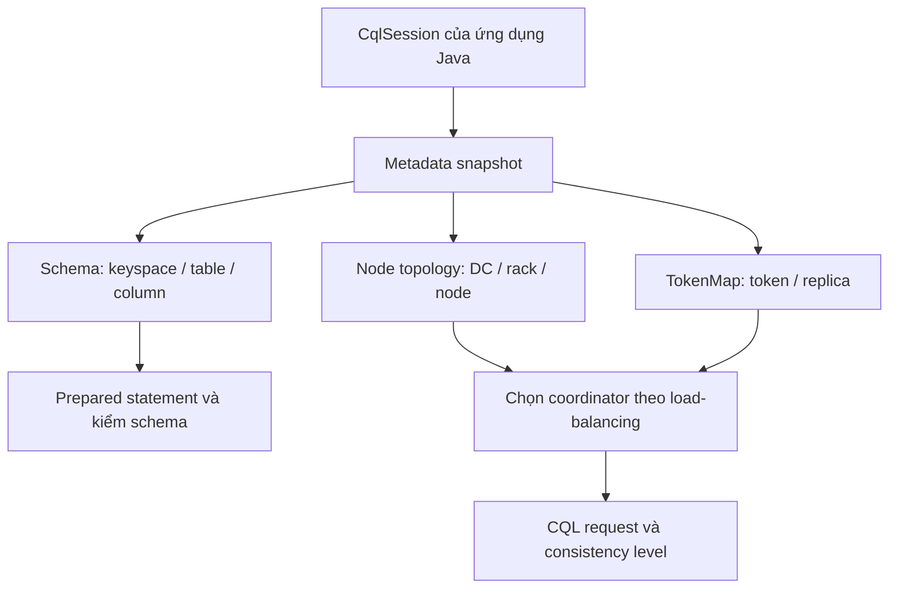
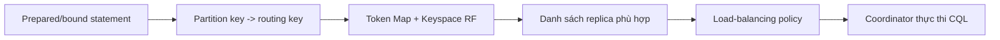

# Metadata schema/topology và điều kiện cập nhật trong Java Driver cho Apache Cassandra

## 1. Vì sao ứng dụng Java phải hiểu metadata của Cassandra?

Trong module **DATABASE_ENGINE_WIDE_COLUMN_CASSANDRA**, Apache Cassandra được học như một hệ quản trị **wide-column phân tán**: dữ liệu được xác định nơi lưu bằng **partition key**, nhân bản theo **replication factor (RF)**, truy vấn bằng CQL và kiểm soát mức nhất quán đọc/ghi bằng consistency level. Khi ứng dụng Java kết nối đến nhiều node, driver cần thông tin về **schema**, **topology** và **token map** để biết bảng/cột hiện có, node nào thuộc datacenter nào, cũng như cách điều phối request.

Nhưng metadata trong Java Driver **không phải một bản sao đồng bộ tức thời của toàn cluster**. Một node có thể vừa được thêm hoặc mất kết nối; một bảng có thể được tạo trên coordinator A nhưng coordinator B chưa nhận schema mới. Nếu ứng dụng giữ một đối tượng metadata quá lâu hoặc giả định driver luôn cập nhật ngay, hậu quả có thể là lỗi `unconfigured table`, đọc bảng chưa thấy, định tuyến kém tối ưu hoặc kiểm tra readiness sai.

Bài học này giúp trả lời:

1. **Schema metadata** gồm những gì, đọc ở đâu và sử dụng để kiểm tra bảng/cột thế nào?
2. **Topology metadata** biểu diễn node, rack, DC và trạng thái kết nối ra sao?
3. **Token metadata** quan hệ thế nào với partition key, replication và token-aware routing?
4. **Khi nào metadata được làm mới?** Sự kiện nào dẫn tới update, cơ chế bất đồng bộ hoạt động thế nào, và khi nào phải đợi schema agreement?
5. **Khi nào không nên tin ngay vào metadata?** Cần xác minh thêm điều gì khi migration, failover, rolling upgrade hoặc topology change?

Ví dụ dùng **Java Driver 4.x** với API `com.datastax.oss.driver.api.*`. Tùy bản phát hành, tọa độ dependency có thể thuộc nhóm DataStax OSS hoặc Apache; API ví dụ cần được kiểm tra theo đúng phiên bản driver và Cassandra Server đang chạy.

## 2. Ba lớp metadata: schema, node/topology và token

`CqlSession.getMetadata()` trả về một đối tượng `Metadata` đại diện cho cái nhìn mà **driver instance** hiện biết về cluster.

| Loại | API tiêu biểu | Trả lời câu hỏi | Không chứng minh điều gì? |
| --- | --- | --- | --- |
| **Schema metadata** | `getKeyspaces()`, `getKeyspace(...)`, `KeyspaceMetadata`, `TableMetadata` | Keyspace, bảng, cột, primary key, index/UDT và định nghĩa hiện được driver biết | Không phải migration history; không chứng minh mọi node đã thống nhất |
| **Node/topology metadata** | `getNodes()`, `Node.getDatacenter()`, `getRack()`, `getState()` | Driver biết những node nào, ở DC/rack nào, trạng thái theo góc nhìn driver | Node xuất hiện trong map không có nghĩa node đang UP hoặc có kết nối usable |
| **Token metadata** | `getTokenMap()`, `TokenMap` | Token/range và quan hệ replica phục vụ token-aware routing | Không chứng minh dữ liệu trên replica đã repair/hội tụ hoặc write đã hoàn tất |



**Phân biệt vai trò:** partition key là một phần của **schema**; token của giá trị partition key và replica placement nằm ở **token map/topology**. Consistency level như `LOCAL_QUORUM` quy định bao nhiêu replica phải đáp ứng, không phải quy tắc chọn keyspace hay khả năng tự sửa schema.

## 3. Điểm cốt lõi: `Metadata` là snapshot bất biến, nhưng `Node` có trạng thái động

Trong Java Driver 4.x, `Metadata` cung cấp một ảnh chụp **nhất quán nội bộ**: node list, schema và token map của một phiên bản metadata tương ứng với nhau. Bản thân các map/đối tượng schema được xem như bất biến; khi driver nhận thông tin mới, nó công bố một `Metadata` mới. Tuy nhiên, **một số thuộc tính của đối tượng `Node` có thể thay đổi tại chỗ**, chẳng hạn `getState()`.

Ví dụ:

```java
import com.datastax.oss.driver.api.core.CqlSession;
import com.datastax.oss.driver.api.core.metadata.Metadata;

Metadata earlier = session.getMetadata();

// ... cluster có thể đã tạo thêm bảng hoặc node khác ...
Metadata later = session.getMetadata();

// Không giữ "earlier" để giả định nó cập nhật bảng/node mới.
// "later" là ảnh chụp metadata mà driver đang có tại lần đọc này.
```

Nguyên tắc sử dụng:

- **Lấy snapshot mới khi cần cái nhìn mới**: gọi lại `session.getMetadata()` thay vì giữ `Metadata` cũ trong singleton hoặc cache ứng dụng nhiều giờ.
- **Đừng tự cache map keyspace/table rồi cho rằng nó tự đổi**: chúng gắn với snapshot nơi được đọc.
- **Không đồng nhất “mới nhất driver biết” với “mới nhất toàn cluster”**: còn độ trễ thông báo/refresh, node không liên lạc được và schema agreement.
- **Không dùng vòng lặp đọc metadata liên tục như một hệ giám sát real-time**: dùng driver listeners/metrics và hệ vận hành cluster thay thế.
- **Đọc topology và token map từ cùng một `Metadata` instance** khi cần tính toán có quan hệ nội bộ, thay vì trộn dữ liệu lấy từ các thời điểm khác nhau.

Thứ tự thời gian quan trọng:

```text
t0  Ứng dụng gọi getMetadata()                -> snapshot M0
t1  DBA tạo bảng mới ở Cassandra
t2  Server gửi thông báo thay đổi schema
t3  Driver xử lý/debounce, xác nhận agreement và refresh
t4  Ứng dụng gọi getMetadata() lần nữa       -> snapshot M1
```

Ở `t1` hoặc `t2`, `M0` không tự biến thành `M1`. Ngay cả khi gọi `getMetadata()` mới tại `t2`, driver có thể vẫn chưa hoàn thành cập nhật. Đây là **eventual visibility của metadata ở client**, không giống consistency level của một truy vấn dữ liệu.

## 4. Đọc schema metadata qua Java Driver 4.x

### 4.1. Ví dụ schema CQL cho dịch vụ đơn hàng

Giả sử cluster có DC thật tên `dc1` và keyspace:

```sql
CREATE KEYSPACE IF NOT EXISTS commerce
WITH replication = {
    'class': 'NetworkTopologyStrategy',
    'dc1': 3
};

CREATE TABLE IF NOT EXISTS commerce.orders_by_id (
    order_id uuid PRIMARY KEY,
    customer_id uuid,
    status text,
    updated_at timestamp
);
```

Đây là schema **lab**: cần sửa RF/DC theo topology thật; không sao chép RF=3 vào một cluster một node. Bảng được thiết kế theo `WHERE order_id = ?`, và `order_id` chính là partition key.

### 4.2. Đọc keyspace, table và primary key

```java
import com.datastax.oss.driver.api.core.CqlIdentifier;
import com.datastax.oss.driver.api.core.CqlSession;
import com.datastax.oss.driver.api.core.metadata.Metadata;
import com.datastax.oss.driver.api.core.metadata.schema.ColumnMetadata;
import com.datastax.oss.driver.api.core.metadata.schema.KeyspaceMetadata;
import com.datastax.oss.driver.api.core.metadata.schema.TableMetadata;

Metadata snapshot = session.getMetadata();

CqlIdentifier keyspaceName = CqlIdentifier.fromCql("commerce");
CqlIdentifier tableName = CqlIdentifier.fromCql("orders_by_id");

snapshot.getKeyspace(keyspaceName).ifPresentOrElse(
    (KeyspaceMetadata keyspace) ->
        keyspace.getTable(tableName).ifPresentOrElse(
            (TableMetadata table) -> {
                System.out.println("Table: " + table.getName().asCql(true));
                System.out.println("Columns: " + table.getColumns().size());
                System.out.println("Partition key:");
                for (ColumnMetadata column : table.getPartitionKey()) {
                    System.out.println(" - " + column.getName().asCql(true));
                }
            },
            () -> System.out.println("Table chưa có trong metadata snapshot")
        ),
    () -> System.out.println("Keyspace chưa có trong metadata snapshot")
);
```

Đây là phần lõi đọc metadata, giả định `session` đã được khởi tạo hợp lệ. `Optional.ifPresentOrElse` có từ Java 9; nếu dự án dùng JDK 8, thay bằng `isPresent()`/`get()` theo hướng an toàn. Driver có thể không trả keyspace/table vì **schema thật chưa có**, **schema metadata bị tắt/lọc**, **driver chưa refresh** hoặc **không đủ khả năng truy xuất metadata**. Đừng kết luận ngay bảng đã bị drop.

`CqlIdentifier.fromCql("commerce")` giúp quản lý tên CQL đúng quy tắc định danh, khác với ghép chuỗi tùy ý. Các tên có dấu nháy/ký tự phân biệt hoa thường cần được biểu diễn chính xác; việc in lại bằng `asCql(true)` giúp thấy tên theo cú pháp CQL.

### 4.3. Đọc toàn bộ keyspace và kiểm sự tồn tại

Một cách gọn hơn để kiểm schema của nhiều bảng:

```java
import com.datastax.oss.driver.api.core.metadata.Metadata;
import com.datastax.oss.driver.api.core.metadata.schema.KeyspaceMetadata;
import com.datastax.oss.driver.api.core.metadata.schema.TableMetadata;

Metadata current = session.getMetadata();
for (KeyspaceMetadata keyspace : current.getKeyspaces().values()) {
    System.out.println("Keyspace: " + keyspace.getName().asCql(true));
    for (TableMetadata table : keyspace.getTables().values()) {
        System.out.println("  Table: " + table.getName().asCql(true));
    }
}
```

**Không dùng metadata dump làm migration ledger**: nó cho biết cấu trúc hiện tại mà driver biết, không cho biết ai đã chạy `ALTER TABLE`, migration `V004` nào đã áp dụng hay lý do thay đổi. Hãy quản lý DDL qua version control và kiểm schema agreement riêng.

## 5. Đọc node và topology metadata

Driver duy trì danh sách các node mà nó biết thông qua cơ chế discovery, control connection và các sự kiện topology. Danh sách này bao gồm cả node chưa có kết nối đang mở hoặc đang ở trạng thái không sẵn sàng.

```java
import com.datastax.oss.driver.api.core.metadata.Metadata;
import com.datastax.oss.driver.api.core.metadata.Node;

Metadata snapshot = session.getMetadata();
for (Node node : snapshot.getNodes().values()) {
    System.out.printf(
        "node=%s dc=%s rack=%s state=%s distance=%s connections=%d%n",
        node.getEndPoint(),
        node.getDatacenter(),
        node.getRack(),
        node.getState(),
        node.getDistance(),
        node.getOpenConnections()
    );
}
```

Những trường cần hiểu:

| Thuộc tính `Node` | Ý nghĩa vận hành | Cảnh báo |
| --- | --- | --- |
| `getEndPoint()` | Endpoint để driver kết nối | Có thể không giống địa chỉ mà một script bên ngoài coi là node ID |
| `getHostId()` | Host ID Cassandra | Hữu ích khi đối chiếu node thay IP |
| `getDatacenter()` / `getRack()` | Vị trí node theo server-side snitch | Sai snitch/topology gây ảnh hưởng routing |
| `getState()` | Driver đang đánh giá UP/DOWN/UNKNOWN như thế nào | Góc nhìn driver; không thay `nodetool status` hoặc monitoring cluster |
| `getDistance()` | LOCAL, REMOTE hoặc IGNORED theo load-balancing policy | Node có mặt trong metadata không đồng nghĩa được dùng làm coordinator |
| `getOpenConnections()` | Số kết nối mở từ driver instance tới node | 0 không nhất thiết node không tồn tại hoặc dữ liệu mất |
| `getSchemaVersion()` | Schema version mà driver biết của node | Không phải version Git migration; khác nhau có thể báo chưa hội tụ |

**Cảnh báo khi xử lý trạng thái:** Node object có các thuộc tính động. Một `Metadata` cũ có thể vẫn chứa tham chiếu tới một `Node` whose `getState()` đã thay đổi, trong khi map **không tự thêm/bớt** node. Do đó, các phép so sánh topology phải lấy lại `getMetadata()`; còn phép đo tình trạng node phải xác định thời điểm lấy mẫu.

### Topology đang thay đổi

Khi node **bootstrap**, **decommission**, **replace** hoặc thay đổi địa chỉ:

1. Cassandra gossip/metadata cho biết cluster đang thay đổi.
2. Driver khám phá/thấy cập nhật trong thời gian không tức thì.
3. Node mới có thể xuất hiện trong metadata trước khi đã sẵn sàng để driver điều phối request.
4. Token placement và replica có thể thay đổi khi topology ổn định.
5. Ứng dụng cần quan sát độ trễ, lỗi và số coordinator có thể dùng; không tự tạo `CqlSession` mới mỗi lần thấy event.

Cần phân biệt **địa chỉ contact point ban đầu** với **danh sách node khám phá được**. Contact point giúp bootstrap việc khám phá; driver không chỉ gửi mọi request tới duy nhất contact point nếu đã biết các node khác và policy cho phép.

## 6. Token metadata, replica placement và token-aware routing

Partition key được hash thành token theo partitioner. Replication strategy, token range và topology quyết định replica của partition. Driver có thể dùng `TokenMap` kết hợp routing key của statement để ưu tiên coordinator thích hợp, giảm hop mạng khi có điều kiện.

```java
import com.datastax.oss.driver.api.core.metadata.Metadata;
import com.datastax.oss.driver.api.core.metadata.token.TokenMap;

Metadata snapshot = session.getMetadata();

if (snapshot.getTokenMap().isPresent()) {
    TokenMap tokenMap = snapshot.getTokenMap().get();
    System.out.println("Có token metadata: " + tokenMap.getClass().getSimpleName());
} else {
    System.out.println("Chưa có token map hoặc token metadata đã bị tắt");
}
```

Khi dùng prepared statement:

```sql
SELECT order_id, status
FROM commerce.orders_by_id
WHERE order_id = ?;
```

Driver có thể suy ra routing key từ bound partition key nếu metadata và statement đủ thông tin. Tuy nhiên:

- Token map là **thông tin định tuyến**, không phải xác nhận rằng replica đã nhận đủ write hay đã repair.
- Một request gửi đến coordinator gần replica không bảo đảm latency thấp nếu partition rất lớn, có tombstone hoặc compaction nặng.
- Nếu dùng chuỗi CQL tùy ý không xác định routing key, token-aware routing có thể không hoạt động như mong đợi.
- Khi disable token metadata, driver vẫn có thể thực thi CQL, nhưng khả năng chọn coordinator tối ưu theo token bị hạn chế.
- Thông tin token theo keyspace phụ thuộc schema metadata; nếu keyspace không được refresh vì filter, những phép tra token gắn với keyspace đó cũng có thể không khả dụng.



Điều kiện **CQL đúng theo partition key và đủ replica đáp ứng consistency level** quan trọng hơn việc nhìn thấy token map trên driver. Một `TokenMap` đầy đủ không sửa được truy vấn sai data model.

## 7. Metadata được cập nhật vào lúc nào?

Driver 4.x tiếp nhận thay đổi từ cluster qua cơ chế quản lý connection và các notification/event của Cassandra. Các thay đổi có thể được **gom (debounce)** để tránh refresh metadata quá nhiều khi có chuỗi sự kiện liên tiếp.

### 7.1. Những tình huống thường dẫn tới làm mới

| Tác nhân | Loại thông tin chịu tác động | Điều cần lưu ý |
| --- | --- | --- |
| Khởi tạo `CqlSession` thành công | Node/topology, schema, token map theo cấu hình | Metadata ban đầu cần discovery; phụ thuộc node có thể truy cập |
| `CREATE/ALTER/DROP TABLE` | Schema metadata | Schema cần lan truyền giữa các node; listener/refresh không chứng minh nghiệp vụ đã migrate |
| `CREATE/ALTER KEYSPACE` hoặc đổi RF | Schema và replica/token mapping | DDL RF không tự hoàn tất streaming/repair dữ liệu |
| Node thêm/bớt, bootstrap/decommission | Node list và token placement | Sự kiện có thể đến trước khi node sẵn sàng phục vụ |
| Node UP/DOWN từ góc nhìn driver | State và quyết định routing | `NodeState` có thể đổi trên cùng Node object |
| Kết nối mất rồi phục hồi, đổi control connection | Discovery/metadata có thể được tái đồng bộ | Cần tính khả năng event bị bỏ lỡ trong lúc disconnect |
| Tắt/bật lại metadata hoặc thay filter | Các mục được driver theo dõi | Metadata có thể rỗng/một phần dù schema trên server còn nguyên |
| Gọi `refreshSchemaAsync()` | Buộc refresh schema trên client | Không thay DDL; không bảo đảm mọi replica dữ liệu hội tụ |

### 7.2. Vì sao có độ trễ?

Cassandra phân tán metadata và trạng thái cluster. Sau khi `ALTER TABLE` được coordinator xử lý, những node khác có thể chưa nhận xong thay đổi. Driver còn phải nhận thông báo, đợi/kiểm schema agreement khi cần, rồi công bố metadata mới.

Ví dụ:

```text
DBA                  node A         node B         Java Driver
 | ALTER TABLE         |              |                |
 |-------------------->|              |                |
 |                    metadata new     |                |
 |                      |----gossip--->|                |
 |                      |              |                |
 |                      |--event----------------------->|
 |                      |              |         debounce/refresh
 |                      |              |                |
 |                      |        schema agree?          |
 |                      |              |                |
 |                      |              |         publish Metadata M1
```

Sơ đồ chỉ biểu diễn **cơ chế khái niệm**; chi tiết event, thông điệp và thời điểm theo version. Không nên định nghĩa SLA “mọi Java session cập nhật metadata trong đúng N mili giây” nếu chưa đo và kiểm cấu hình.

## 8. Schema agreement: điều kiện nào để dùng schema mới?

**Schema agreement** nghĩa là các node mà driver kiểm tra báo schema version tương ứng, theo điều kiện kiểm tra của driver. Trong Java Driver 4.x, driver thường đợi agreement:

- **Trước khi làm mới schema metadata**.
- **Trước khi hoàn tất thành công một câu CQL thay đổi schema** được gửi qua driver, theo cơ chế/timing của driver.

Mục đích: tránh tình huống app vừa `CREATE TABLE` xong trên node A, request kế tiếp tới node B lại gặp `unconfigured table` do B chưa biết bảng mới.

Trong code Java 4.x, có thể kiểm tra khi cần (trên thread ứng dụng/runner được phép blocking):

```java
import com.datastax.oss.driver.api.core.CqlSession;

boolean agreed = session.checkSchemaAgreement();
if (!agreed) {
    throw new IllegalStateException(
        "Schema agreement chưa đạt; không mở rollout đọc schema mới");
}
```

**Giới hạn rất quan trọng:**

1. Agreement kiểm các node mà driver có thể kiểm tra và đánh giá **UP**, không chứng minh node bị cô lập hoặc node DOWN có schema mới.
2. Agreement chỉ nói **schema version tương ứng**, không chứng minh các bảng có **đúng DDL đã review** hoặc data backfill hoàn tất.
3. Trong **cluster mixed-version khi rolling upgrade**, cách tính schema version khác nhau có thể khiến kiểm schema agreement không thành công; nên tránh migration DDL giữa đợt nâng cấp và áp dụng runbook phiên bản.
4. Kiểm tra này có timeout và có thể trả `false`; `false` không tự có nghĩa database đã mất schema, nhưng cần chặn các bước phụ thuộc và điều tra.
5. Gọi đồng bộ như `checkSchemaAgreement()` **không được thực hiện trên thread nội bộ của driver**; tránh chặn event loop.

Nếu một application service chỉ cần đọc/ghi các bảng đã tồn tại, không nên gọi `checkSchemaAgreement()` trên **mọi HTTP request**. Dùng nó tại **deployment gate**, migration runner hoặc kiểm tra có chủ đích với timeout phù hợp.

### 8.1. Kiểm tra sau DDL chạy qua driver

Khi hệ thống có migration runner, một trình tự được khuyến nghị:

```java
// Chỉ ví dụ trong migration runner có quyền DDL, không đặt trong API request.
ResultSet rs = session.execute(
    "ALTER TABLE commerce.orders_by_id ADD status_changed_at timestamp");

boolean agreedForStatement =
    rs.getExecutionInfo().isSchemaInAgreement();

if (!agreedForStatement) {
    // Không tiếp tục ngay các bước dùng cột mới.
    // Quan sát schema hiện tại, đợi hoặc báo lỗi có kiểm soát.
}
```

Ở đây `ResultSet` là `com.datastax.oss.driver.api.core.cql.ResultSet`. Một câu DDL có thể **thành công phía server** dù client timeout hoặc chưa agreement. Không **retry DDL mù quáng**: kiểm schema thật, migration ledger và trạng thái các node trước khi quyết định chạy tiếp.

### 8.2. Schema agreement khác data consistency

| Cơ chế | Xác nhận điều gì? | Không xác nhận |
| --- | --- | --- |
| `checkSchemaAgreement()` | Schema versions ở các node được kiểm tra đồng thuận | SSTable/partition đã cùng dữ liệu, backfill hoàn tất |
| `LOCAL_QUORUM` cho SELECT/WRITE | Số replica đáp ứng phép đọc/ghi trong DC tương ứng | Toàn cluster đồng thuận schema, mọi replica đã repair |
| `nodetool repair` theo quy trình | Đồng bộ/đối soát dữ liệu giữa replica trong phạm vi được repair | Migration DDL đã chạy đủ hoặc rollback dữ liệu |
| Metadata `getKeyspace()` trả bảng | Driver snapshot đã biết schema đó | Node cô lập cũng đã biết hoặc mọi statement sẽ thành công |
| Backup snapshot đã xác thực | Có nguồn vật lý để restore theo manifest | Schema agreement đang đạt tại thời điểm app query |

Không dùng một phép kiểm này thay thế hoàn toàn phép kiểm khác.

## 9. Chủ động yêu cầu refresh schema

Nếu driver chưa nhận event hoặc cần kiểm trạng thái sau thay đổi, Java Driver 4.x cung cấp:

- `session.refreshSchemaAsync()`: làm mới schema **bất đồng bộ**, trả `CompletionStage<Metadata>`.
- `session.refreshSchema()`: biến thể đồng bộ, **block thread gọi**.
- `session.getMetadata()`: đọc snapshot hiện tại, **không tự kích hoạt full refresh**.

Ví dụ cho một công cụ kiểm tra sau migration:

```java
import java.util.concurrent.CompletionStage;
import com.datastax.oss.driver.api.core.metadata.Metadata;

CompletionStage<Metadata> updatedStage = session.refreshSchemaAsync();

updatedStage.thenAccept(updated -> {
    boolean exists = updated.getKeyspace("commerce")
        .flatMap(ks -> ks.getTable("orders_by_id"))
        .isPresent();
    System.out.println("Table xuất hiện sau refresh? " + exists);
}).exceptionally(error -> {
    System.err.println("Metadata refresh thất bại: " + error.getMessage());
    return null;
});
```

Ví dụ dùng helper nhận tên `String` do API 4.x hỗ trợ ở các bản có overload tương ứng; nếu muốn tường minh, dùng `CqlIdentifier.fromCql(...)`. Đoạn `CompletionStage` chỉ minh họa quan sát kết quả; chương trình thực phải **giữ session sống đủ lâu** và propagate lỗi về migration runner, không chỉ in log rồi đánh dấu deploy thành công.

**Không refresh liên tục theo mỗi request**: metadata refresh có chi phí truy vấn hệ thống/điều phối, có thể gây tải và tạo thêm độ trễ. Ưu tiên các sự kiện/listener, kiểm tra metadata mới khi cần và một hệ thống release gate phù hợp.

### 9.1. Schema metadata có thể bị tắt hoặc lọc

Ví dụ cấu hình HOCON của Driver 4.x:

```hocon
datastax-java-driver {
  advanced {
    metadata {
      schema {
        enabled = true
        refreshed-keyspaces = [ "commerce" ]
      }
      token-map {
        enabled = true
      }
    }
  }
}
```

Hãy xem **đây là một ví dụ cấu hình**, không phải mặc định duy nhất. Khi tắt `advanced.metadata.schema.enabled`, `getKeyspaces()` có thể rỗng (nếu tắt từ lúc khởi tạo) hoặc giữ snapshot cuối (khi tắt lúc runtime). Khi lọc keyspace, những keyspace ngoài filter **không được bảo đảm xuất hiện**, kể cả chúng tồn tại trên server.

Nếu cần thay đổi runtime:

- `session.isSchemaMetadataEnabled()` cho biết trạng thái enable.
- `session.setSchemaMetadataEnabled(Boolean)` có thể bật/tắt theo API, trả future để chờ hoàn tất khi trigger refresh.
- `session.refreshSchemaAsync()` có thể buộc refresh theo API ngay cả khi schema metadata tạm tắt; điều đó **không có nghĩa chính sách tự refresh đã được bật lại**.

Tối ưu metadata cần có lý do đo lường: số keyspace/table rất lớn, độ trễ startup/refresh, hoặc ứng dụng chỉ dùng vài keyspace. **Không tắt metadata để che lỗi schema migration** vì có thể ảnh hưởng token-aware routing và các tính năng phụ thuộc metadata.

## 10. Nhận thông báo bằng listener thay vì polling

Java Driver 4.x hỗ trợ đăng ký listener cho sự kiện schema và trạng thái node khi tạo `CqlSession`:

```text
CqlSession.builder()
  .addSchemaChangeListener(schemaListener)
  .addNodeStateListener(nodeListener)
  .build()
```

Đây là minh họa cấu trúc; các đối tượng `schemaListener` và `nodeListener` cần implement interface/listener class đúng với driver version của dự án. API chính xác và danh sách callback nên đọc từ tài liệu và Javadoc của bản đang dùng.

Listener hữu ích để:

- Cập nhật dashboard nội bộ khi table/keyspace thêm, thay đổi hoặc bị xóa.
- Đánh dấu cần làm mới cache metadata của **ứng dụng** sau schema change.
- Ghi nhận node UP/DOWN/add/remove để tăng quan sát tình trạng kết nối.
- Kích hoạt kiểm tra lại **sau** khi driver đã cập nhật metadata tương ứng.

Nhưng listener **không phải event log bền vững**:

1. App bị tắt/disconnect có thể bỏ lỡ notification.
2. Các event có thể bị gom/debounce, không đại diện từng thay đổi CQL đã xảy ra.
3. Không ghi DDL tự động từ listener; dùng migration runner có lịch sử/checksum và khóa.
4. Callback nên **nhẹ, không block, không chạy CQL đồng bộ hoặc network I/O nặng** trên driver thread.
5. Sau reconnect/mất event, đối chiếu lại `session.getMetadata()` với nguồn schema kỳ vọng.

**Event báo “table changed” không có nghĩa data trong table đã backfill hoặc mọi Java service đã deploy phiên bản tương ứng.**

## 11. Điều kiện cập nhật: không phải mọi thay đổi đều giống nhau

Bảng này giúp quyết định ai cập nhật gì và khi nào được phép tiếp tục ứng dụng:

| Thay đổi thực tế | Driver làm gì | Gate trước khi ứng dụng dùng trạng thái mới |
| --- | --- | --- |
| Thêm cột nullable bằng `ALTER TABLE ADD` | Nhận schema event, refresh metadata | Schema agreement, DDL đúng kiểu, code cũ tương thích, dữ liệu cũ có thể null |
| Thêm bảng theo truy vấn mới | Cập nhật `TableMetadata` và token mapping | Bảng tồn tại trên node cần thiết; role có quyền; backfill/dual-write được kiểm chứng |
| Đổi replication factor | Schema/keyspace metadata và token placement có thể đổi | Phải hoàn tất streaming/rebuild/repair theo runbook, không dựa vào DDL alone |
| Node mới bootstrap | Thấy node và token topology thay đổi | Node ready, dữ liệu đã streaming, replica/CL khả dụng, monitoring ổn định |
| Node bị decommission | Loại/đánh dấu node theo discovery | Ownership chuyển đúng, dữ liệu đủ replica và request định tuyến ổn |
| Node tạm DOWN | State có thể đổi, load balancing tránh node không usable | Đủ replica cho CL, không retry vô hạn hoặc giảm CL vô ý |
| Tắt schema metadata | Không refresh keyspace như trước | Chấp nhận ảnh hưởng tới schema lookup và token-aware keyspace mapping |
| Schema migration chạy lúc mixed-version | Agreement có thể không thành công | Tránh DDL; hoàn tất server rolling upgrade rồi mới chạy migration |
| Driver mất control connection | Có thể chậm nhận topology/schema event | Theo dõi reconnect, metadata freshness và probe chức năng |
| Ứng dụng Java đổi data model | Metadata không tự sửa CQL/hành vi đọc/ghi | Release tương thích expand–migrate–contract và integration tests |

Trong Cassandra, **metadata chính xác** là điều kiện cần cho routing/khám phá, nhưng **tính đúng đắn dữ liệu nghiệp vụ** còn phụ thuộc consistency level, mô hình partition key, thiết kế bảng theo truy vấn và các bước migration/backfill.

## 12. Runbook: thêm cột rồi phát hành ứng dụng Java

**Bối cảnh:** ứng dụng `orders-api` đang đọc bảng `commerce.orders_by_id`. Phiên bản mới muốn thêm cột `status_changed_at`. Cluster có nhiều node/DC; schema migration chạy từ một runner riêng, không chạy trong các instance HTTP.

### Pha A — Preflight

1. Xác nhận Cassandra/Driver version tương thích và không có rolling upgrade mixed-version.
2. Kiểm `nodetool status` trên cluster, số node UP, DC/RF, repair/streaming và schema version.
3. Xác nhận DDL dự kiến đã được review trong Git, một migration runner giữ quyền thay đổi schema.
4. Kiểm backup/khả năng phục hồi nếu thao tác có rủi ro; thêm cột nullable thường ít phá vỡ hơn đổi primary key.
5. Kiểm code Java cũ chịu được cột mới; code mới chịu được `null` trên hàng cũ.

### Pha B — Áp dụng DDL có kiểm soát

```sql
ALTER TABLE commerce.orders_by_id
ADD status_changed_at timestamp;
```

Chạy **một lần theo migration ledger**, không để từng pod `CREATE/ALTER TABLE IF NOT EXISTS` ở startup. Nếu request DDL timeout, đọc schema thực tế trước khi retry; có thể coordinator đã áp dụng thay đổi dù client không nhận phản hồi.

### Pha C — Đợi agreement và làm mới metadata

Trong migration runner:

```java
// Chạy trên worker thread, không trên event loop/driver callback.
if (!session.checkSchemaAgreement()) {
    throw new IllegalStateException("Schema chưa đồng thuận");
}

Metadata refreshed = session.refreshSchema();
boolean columnVisible = refreshed.getKeyspace("commerce")
    .flatMap(ks -> ks.getTable("orders_by_id"))
    .map(table -> table.getColumns()
        .containsKey(CqlIdentifier.fromCql("status_changed_at")))
    .orElse(false);

if (!columnVisible) {
    throw new IllegalStateException("Cột mới chưa xuất hiện trong metadata");
}
```

Đoạn này minh họa **hai kiểm tra bổ sung**: agreement và expected column. Để sử dụng, cần import `CqlIdentifier`, `Metadata` và chạy với `session` hợp lệ. Trong production, việc kiểm thử nên còn có truy vấn thực tế qua các coordinator/đường mạng liên quan; chỉ kiểm local client metadata không chứng minh mọi node bị cô lập đã nhận DDL.

### Pha D — Triển khai và xác thực

- Phát hành ứng dụng Java mới từng đợt, dùng prepared statement có tham số `order_id`.
- Cho phép dữ liệu cũ thiếu `status_changed_at`; backfill nếu hợp đồng nghiệp vụ yêu cầu.
- Kiểm logic read/write, role permission, CL, timeout/Unavailable, p95/p99 và lỗi driver.
- Ghi vào ledger: migration ID, checksum, schema gate, bản Java, người triển khai và kết quả.
- Nếu phát sinh `unknown column`, dừng rollout và phân biệt metadata cũ, schema agreement lỗi, version code sai hoặc load balancer tới coordinator chưa sẵn sàng.

**Không hạ consistency level** hoặc “force refresh metadata mỗi request” để che lỗi schema chưa hoàn tất.

## 13. Runbook: node mới và topology thay đổi

**Bối cảnh:** cluster mở rộng từ ba lên bốn node trong `dc1` để phân tải dữ liệu.

Trước khi thay đổi:

- Ghi danh sách node/host ID/DC/rack và trạng thái từ vận hành; kiểm RF/CL và disk/network.
- Đọc `session.getMetadata().getNodes()` để có baseline từ góc nhìn driver.
- Kiểm driver local DC, contact points, load-balancing/connection settings.
- Tránh đồng thời thay schema lớn, compaction strategy, RF và chạy backup cắt ngang topology change nếu không có kế hoạch.

Trong lúc bootstrap:

1. Node mới có thể xuất hiện trong `getNodes()` trước khi mọi token range đã được stream đủ.
2. `Node.getState()`/`getDistance()` phản ánh driver policy và connectivity, không thay quy trình kiểm bootstrap/streaming.
3. Token map có thể được cập nhật theo thông tin topology mới; chỉ định lại dữ liệu cho client phải có cơ chế kiểm tra sức khỏe.
4. Nếu các request timeout tăng, kiểm số connection, coordinator, streaming, compaction và hot partition; không tự tăng concurrency.
5. Sau khi node bootstrap hoàn tất và cluster ổn định, đọc lại metadata snapshot, kiểm token-aware routing qua metrics/tracing được phép.

**Chỉ coi đợt mở rộng hoàn tất** sau khi server-side streaming, dữ liệu/replica coverage, consistency và tình trạng driver đều đạt tiêu chí. Một `getNodes().size() == 4` chưa đủ chứng minh khả dụng.

## 14. Lỗi thường gặp khi làm việc với metadata

| Hiện tượng | Nguyên nhân có thể | Điều tra đúng |
| --- | --- | --- |
| `getKeyspace("commerce")` trống dù bảng có trên cluster | Metadata schema bị tắt/lọc, chưa refresh, node chưa biết schema | Kiểm config/filters, migration, agreement, refresh có kiểm soát |
| Sau DDL, code vẫn dùng metadata cũ | Giữ `Metadata`/`KeyspaceMetadata` trước migration | Gọi lại `session.getMetadata()` hoặc `refreshSchemaAsync()` theo gate |
| Schema agreement trả false | Node còn lệch schema, timeout hoặc mixed-version | Kiểm status/versions, DDL logs, không chạy migration tiếp mù quáng |
| `getNodes()` có node nhưng request không đến | Node DOWN/IGNORED, policy local DC, chưa có connection | Kiểm `getState()`, `getDistance()`, kết nối và topology |
| `TokenMap` trống | Token metadata bị disable/chưa khám phá hoặc dữ liệu thiếu | Kiểm `advanced.metadata.token-map.enabled`, discovery và schema |
| Token-aware routing không hoạt động với một bảng | Không có keyspace schema hoặc bound partition key/routing key | Xem prepared statement, keyspace metadata và cấu hình filter |
| `unknown table` khi vừa create | Schema propagation hoặc coordinator chưa thấy DDL | Đợi agreement, kiểm expected schema, rollout theo gate |
| Node mới không nhận request dù ở metadata | Bootstrap chưa ready, policy bỏ qua hoặc kết nối chưa warm | Kiểm streaming/server readiness và driver connection |
| Ứng dụng báo nhiều DDL events dồn một lần | Driver debounce/refresh gộp sự kiện | Không coi listener là audit log; đọc metadata hiện tại |
| Sau reconnect thiếu sự kiện schema | App không online lúc event diễn ra | Refresh/đối chiếu schema với migration history |
| Schema metadata đúng nhưng dữ liệu replica khác nhau | Repair/replication hoặc consistency vấn đề | Kiểm RF, CL, repair, tombstone/TTL và dữ liệu thực |
| Driver 3.x dùng đoạn code 4.x không compile | API/package khác nhau | Chọn đúng artifact, import và migration guide phiên bản |

### Lỗi do metadata hay do dữ liệu?

Phân tầng để xử lý đúng:

```text
Missing package/class?
  -> Maven/Gradle dependency, Java Driver version, import/API.
Cannot connect?
  -> contact points, DNS, network, native protocol, TLS/auth.
Unknown keyspace/table/column?
  -> schema thật, metadata filter, refresh, schema agreement.
Node absent/DOWN?
  -> discovery, control connection, topology, network, server state.
Unavailable/ReadTimeout/WriteTimeout?
  -> RF/CL, replica health, overload, compaction, hot partition.
Rows stale/inconsistent?
  -> application model, timestamps, write semantics, repair, CL.
```

Đừng biến mọi lỗi CQL thành “metadata cache sai”. Khi bảng tồn tại nhưng query sai partition key, driver refresh bao nhiêu lần cũng không tạo ra index hoặc thay đổi primary key.

## 15. Bài tập thực hành: quan sát một migration và một node event

Trong lab có keyspace `commerce`, bảng `orders_by_id` và ứng dụng Java Driver 4.x:

**Bài 1 — Schema metadata:**

1. Khởi tạo `CqlSession` với contact point/local DC đúng cluster.
2. Ghi nhận danh sách keyspace/table và partition key bằng `getMetadata()`.
3. Lưu đối tượng metadata `before`, rồi thực hiện thêm cột `status_changed_at` bằng migration riêng.
4. So sánh việc đọc từ `before` với một `getMetadata()` mới sau khi refresh và agreement.
5. Nếu cột vẫn chưa thấy, nêu ba nguyên nhân khả dĩ khác nhau.

**Bài 2 — Topology metadata:**

1. In endpoint, DC, rack, `NodeState` và `NodeDistance` của các node driver biết.
2. Nếu một node DOWN, giải thích vì sao map vẫn có thể chứa node đó.
3. Xác định local DC nào được driver ưu tiên và sự khác biệt giữa contact point với danh sách node.
4. Sau khi node khôi phục, so sánh metadata cũ/mới và log/monitoring server.

**Bài 3 — Điều kiện cập nhật:**

1. Viết điều kiện để ứng dụng mới được phép query cột vừa thêm.
2. Vì sao schema agreement thành công vẫn không có nghĩa dữ liệu cũ có giá trị `status_changed_at`?
3. Nếu keyspace `commerce` bị loại khỏi `refreshed-keyspaces`, token-aware routing cho nó có thể ảnh hưởng thế nào?
4. Khi nào nên gọi `refreshSchemaAsync()`, và tại sao không gọi trong mỗi HTTP request?
5. Nếu cluster đang chạy mixed-version Cassandra, nên làm gì với DDL migration?

**Gợi ý đáp án:**

- Lấy lại `session.getMetadata()` sau refresh, không đọc từ `before` và kỳ vọng thay đổi.
- Kiểm `checkSchemaAgreement()`, schema/cột thực tế và khả năng nhìn thấy từ coordinator; nếu chưa đạt thì chặn rollout.
- Node DOWN vẫn có thể tồn tại trong discovery map; `getNodes()` không tương đương danh sách connection active.
- Metadata bị lọc sẽ khiến thông tin keyspace và token map gắn với keyspace có thể thiếu; cần kiểm cấu hình.
- Cột mới tồn tại ở schema nhưng hàng cũ vẫn có `null` cho đến khi dữ liệu được ghi/backfill.
- Trong pha mixed-version, tránh thay đổi schema và hoàn tất nâng server theo runbook rồi mới chạy DDL.

## 16. Checklist dùng metadata trong production

- [ ] Đã xác nhận Cassandra Server/Java Driver/JDK và các API metadata tương thích.
- [ ] Dùng `CqlSession` tái sử dụng; không dựng session mới chỉ để kiểm metadata mỗi request.
- [ ] Phân biệt `Metadata` snapshot bất biến với thuộc tính động của `Node`.
- [ ] Đọc lại `session.getMetadata()` khi cần trạng thái mới; không giữ cache schema vô thời hạn.
- [ ] Hiểu `getNodes()` bao gồm node DOWN/IGNORED, không suy ra node đang có kết nối.
- [ ] Xác nhận local DC, rack, discovery và token-aware routing theo topology thực.
- [ ] Nếu cần schema lookup, không tắt/lọc metadata khiến thiếu keyspace quan trọng.
- [ ] Không dùng `TokenMap` để suy rằng các replica đã hội tụ dữ liệu.
- [ ] Migration runner độc lập có DDL review, ledger/checksum, schema agreement và expected schema check.
- [ ] Không chạy DDL migration trong mixed-version cluster trừ khi tài liệu hỗ trợ cụ thể và quy trình đã phê duyệt.
- [ ] Dùng `refreshSchemaAsync()` có chủ đích; không polling/refresh liên tục.
- [ ] Listener có callback nhẹ và không thay thế audit log, monitoring hoặc migration history.
- [ ] Kiểm sẵn sàng node sau bootstrap/repair/streaming bằng cả server metrics và driver state.
- [ ] Smoke-test CQL theo partition key, role permission, RF/CL và latency sau migration/topology change.
- [ ] Đã xác định cách xử lý false schema agreement, stale metadata, unavailable và client reconnect.

## 17. Tài liệu kỹ thuật để đối chiếu theo phiên bản

- [Apache Cassandra Java Driver — Metadata overview](https://apache.github.io/cassandra-java-driver/4.18.1/core/metadata/): tính bất biến của metadata snapshot và quan hệ schema–token–node.
- [Apache Cassandra Java Driver — Schema metadata](https://apache.github.io/cassandra-java-driver/4.18.1/core/metadata/schema/): refresh, listener, filtering, schema agreement và mixed-version.
- [Apache Cassandra Java Driver — Node metadata](https://apache.github.io/cassandra-java-driver/4.18.0/core/metadata/node/): node discovery, trạng thái động, listener và routing.
- [Apache Cassandra Java Driver — Token metadata](https://apache.github.io/cassandra-java-driver/4.18.1/core/metadata/token/): token map và quan hệ với keyspace schema.
- [Apache Cassandra Java Driver — Session API](https://apache.github.io/cassandra-java-driver/4.18.1/api/com/datastax/oss/driver/api/core/session/Session.html): `getMetadata()`, `refreshSchemaAsync()`, `checkSchemaAgreementAsync()` và các biến thể đồng bộ.

Đây là các tài liệu cho **dòng Driver 4.x**; khi dự án sử dụng bản khác, nhất là 3.x hoặc bản phân phối đặc thù, phải đọc hướng dẫn đúng bản và điều chỉnh class/config tương ứng.

**Ghi nhớ:** `getMetadata()` cung cấp một **snapshot nhất quán nội bộ từ góc nhìn Java Driver**, không phải lời cam kết schema/topology đã đồng bộ tức thì trên toàn cluster. **Schema agreement**, **schema đúng kỳ vọng**, **sự sẵn sàng của node/replica** và **dữ liệu nghiệp vụ sau migration** là bốn điều kiện khác nhau. Chỉ mở rollout hoặc xử lý failover khi các điều kiện liên quan đã được kiểm chứng, thay vì dựa vào một lần đọc metadata hoặc một event đơn lẻ.
