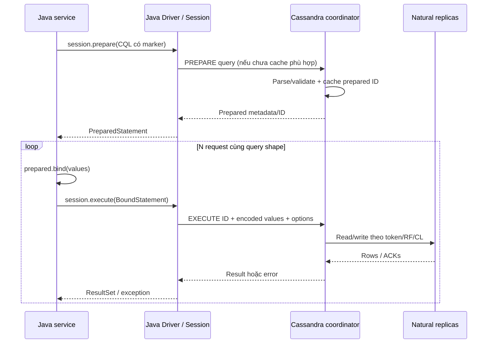

# PreparedStatement, BoundStatement và bước chuẩn bị/bind/thực thi

## 1. Tại sao một câu CQL trong Java thường có hai giai đoạn?

Trong Apache Cassandra, mỗi thao tác CQL được đưa tới một **coordinator**; coordinator xác định partition key/token, chọn các replica theo replication factor (RF) và thu thập phản hồi theo consistency level (CL). Với ứng dụng Java có hàng nghìn request cùng khuôn dạng nhưng giá trị khóa khác nhau, việc ghép một chuỗi CQL mới rồi gửi đi ở mỗi request vừa khó kiểm soát kiểu dữ liệu, vừa lặp công việc phân tích truy vấn.

**Java Driver 4.x** cung cấp ba đối tượng cần hiểu:

- `PreparedStatement`: **khuôn truy vấn đã được chuẩn bị**, kèm metadata tham số và identifier của prepared query phía server.
- `BoundStatement`: **một lần gắn giá trị cụ thể** vào khuôn truy vấn, kèm các thuộc tính thực thi như CL, timeout, page size.
- `ResultSet`/`AsyncResultSet`: kết quả khi thực thi statement; có thể được phân trang hoặc bao gồm thông tin một conditional write.

Quy trình điển hình:

```java
PreparedStatement prepared = session.prepare(
    "SELECT order_id, status FROM java_query_lab_ks.orders_by_id " +
    "WHERE order_id = ?");

BoundStatement bound = prepared.bind(
    UUID.fromString("11111111-2222-4333-8444-555555555555"));

ResultSet results = session.execute(bound);
Row row = results.one();
```

**Mục tiêu bài:** giải thích tường minh **prepare → bind → execute**, viết mã Java đúng kiểu CQL, chọn thuộc tính request theo yêu cầu consistency, phân biệt null/UNSET, dùng sync/async và paging đúng cách, xử lý lỗi/idempotence và tránh việc prepare động vô hạn.

Bài thuộc chương **Truy vấn từ Java**, mô-đun `DATABASE_ENGINE_WIDE_COLUMN_CASSANDRA`: kiến trúc phân tán/wide-column, partition key, bảng theo truy vấn, CL đọc/ghi, CQL, replication, compaction, repair, xử lý lỗi và kết nối Java là các ngữ cảnh áp dụng trực tiếp.

## 2. Sơ đồ vòng đời từ driver tới replica



**Prepare không chạy truy vấn SELECT hay ghi dữ liệu.** Nó giúp server kiểm tra và phân tích câu CQL, xác định marker types và lưu định danh/metadata. **Bind không gửi mạng**: thao tác trong client để điền tham số và tạo statement thực thi. **Execute mới gửi request**, đi qua routing, coordinator, replica, consistency, network và có thể gặp timeout.

| Bước | API chủ yếu | Tạo ra | Chi phí và lưu ý |
| --- | --- | --- | --- |
| Prepare | `session.prepare(cql)` hoặc `prepare(SimpleStatement)` | `PreparedStatement` | Có thể tốn round trip và server parse/cache khi cache miss; chuẩn bị tại thời điểm thích hợp |
| Bind | `prepared.bind(...)`; `boundStatementBuilder()`; `setXxx(...)` | `BoundStatement` | Serialize values theo CQL type/codec; marker phải được điền đúng |
| Execute sync | `session.execute(bound)` | `ResultSet` | Chặn thread gọi đến khi có kết quả ban đầu; việc duyệt có thể tải page tiếp |
| Execute async | `session.executeAsync(bound)` | `CompletionStage<AsyncResultSet>` | Không chặn thread gọi; phải xử lý CompletionStage/error và fetch các trang sau |

## 3. SimpleStatement khác PreparedStatement ở đâu?

```java
// Chuỗi CQL literal cố định: tiện cho DDL hoặc một truy vấn hiếm.
SimpleStatement simple = SimpleStatement.newInstance(
    "SELECT release_version FROM system.local");
ResultSet version = session.execute(simple);

// Cùng một query shape, thay các giá trị khoá nhiều lần.
PreparedStatement getOrder = session.prepare(
    "SELECT status FROM java_query_lab_ks.orders_by_id WHERE order_id = ?");

BoundStatement order1 = getOrder.bind(
    UUID.fromString("11111111-2222-4333-8444-555555555555"));
BoundStatement order2 = getOrder.bind(
    UUID.fromString("22222222-3333-4444-8555-666666666666"));
```

**Prepared** phù hợp truy vấn lặp lại bởi parser/metadata được tái sử dụng. **Simple** có thể phù hợp câu DDL, admin query hiếm hoặc SQL/CQL sinh động thật sự. Nhưng “simple” **không có nghĩa** phải ghép chuỗi bằng user input: Java Driver cũng hỗ trợ bind values vào `SimpleStatement` ở những trường hợp phù hợp. Với dịch vụ OLTP, chuẩn bị những **query shapes ổn định** và truyền giá trị riêng là cách phổ biến.

**Prepared statement không cache dữ liệu trả về.** Nó không biến một `SELECT` tốn nhiều SSTable/tombstone thành truy vấn nhanh chỉ nhờ prepare; thiết kế partition key và query pattern vẫn quyết định đường đọc. Cũng không phải transaction, server-side cursor toàn bộ result hay một câu CQL chạy sẵn tại thời điểm prepare.

### Cái gì nên là marker? Cái gì không?

```sql
-- Hợp lệ: marker đại diện cho giá trị.
SELECT status FROM java_query_lab_ks.orders_by_id WHERE order_id = ?;

-- Hợp lệ: named markers, driver bind theo tên.
SELECT status FROM java_query_lab_ks.orders_by_id WHERE order_id = :id;

-- KHÔNG là cách bind tên bảng/tên cột qua giá trị:
-- SELECT status FROM :table_name WHERE order_id = ?;
-- SELECT :column_name FROM java_query_lab_ks.orders_by_id WHERE order_id = ?;
```

**Tên keyspace, bảng, cột và cấu trúc câu CQL không phải bind values.** Nếu nghiệp vụ thực sự chọn từ nhiều bảng, phải dùng **allowlist** tên hợp lệ, không ghép thẳng chuỗi từ API input. Truy vấn động với nhiều tên bảng/ORDER BY/filter shape tạo thêm prepared IDs và làm kiểm soát quyền phức tạp.

## 4. Chuẩn bị phòng thí nghiệm CQL

Ví dụ chỉ chạy trong **cluster lab** có một datacenter tên `dc1` và đủ node cho RF = 3. Với cluster khác, thay DC/RF phù hợp. Dữ liệu đều là giả lập, không dùng customer IDs thật.

```sql
CREATE KEYSPACE java_query_lab_ks
WITH replication = {'class': 'NetworkTopologyStrategy', 'dc1': 3}
AND durable_writes = true;

-- Một partition cho một đơn hàng; query lấy theo order_id.
CREATE TABLE java_query_lab_ks.orders_by_id (
    order_id uuid PRIMARY KEY,
    customer_id text,
    status text,
    total decimal,
    created_at timestamp,
    note text
);

-- Một partition cho (customer_id, bucket_day); rows được sắp theo thời gian.
CREATE TABLE java_query_lab_ks.events_by_customer_day (
    customer_id text,
    bucket_day date,
    event_ts timestamp,
    event_id uuid,
    event_type text,
    PRIMARY KEY ((customer_id, bucket_day), event_ts, event_id)
) WITH CLUSTERING ORDER BY (event_ts DESC, event_id DESC);

INSERT INTO java_query_lab_ks.orders_by_id
    (order_id, customer_id, status, total, created_at, note)
VALUES
    (11111111-2222-4333-8444-555555555555,
     'synthetic-customer-1', 'CREATED', 125.50,
     '2026-11-21T08:00:00+0000', 'fixture');

INSERT INTO java_query_lab_ks.events_by_customer_day
    (customer_id, bucket_day, event_ts, event_id, event_type)
VALUES
    ('synthetic-customer-1', '2026-11-21',
     '2026-11-21T08:00:00+0000',
     22222222-3333-4444-8555-666666666666, 'CREATED');

INSERT INTO java_query_lab_ks.events_by_customer_day
    (customer_id, bucket_day, event_ts, event_id, event_type)
VALUES
    ('synthetic-customer-1', '2026-11-21',
     '2026-11-21T08:05:00+0000',
     33333333-4444-4555-8666-777777777777, 'PAID');

INSERT INTO java_query_lab_ks.events_by_customer_day
    (customer_id, bucket_day, event_ts, event_id, event_type)
VALUES
    ('synthetic-customer-1', '2026-11-21',
     '2026-11-21T08:10:00+0000',
     44444444-5555-4666-8777-888888888888, 'SHIPPED');
```

**Điểm thiết kế dữ liệu:** `orders_by_id` tối ưu `WHERE order_id = ?`. `events_by_customer_day` dùng compound partition key `(customer_id, bucket_day)`; phải bind **cả hai phần** để định tuyến một partition. Clustering key `(event_ts, event_id)` quyết định thứ tự. Nếu query thiếu partition key và cần `ALLOW FILTERING`, việc dùng prepared statement **không sửa mô hình dữ liệu sai**.

## 5. Tạo CqlSession một lần, không tạo cho từng request

Mã Java minh họa với Driver 4.x, Java 11+ (các API thời gian và `var` nếu dùng), contact point giả theo dải TEST-NET. Phần TLS/secret được triển khai theo môi trường; không ghi password thật vào source code.

```java
import java.net.InetSocketAddress;
import java.time.*;
import java.util.*;
import java.math.BigDecimal;
import java.util.concurrent.*;

import com.datastax.oss.driver.api.core.CqlSession;
import com.datastax.oss.driver.api.core.DefaultConsistencyLevel;
import com.datastax.oss.driver.api.core.cql.*;

// Main/lifecycle startup của ứng dụng, không gọi mỗi HTTP request.
String password = System.getenv("CASSANDRA_LAB_PASSWORD");
if (password == null || password.isBlank()) {
    throw new IllegalStateException("Missing CASSANDRA_LAB_PASSWORD");
}

try (CqlSession session = CqlSession.builder()
        .addContactPoint(new InetSocketAddress("192.0.2.10", 9042))
        .withLocalDatacenter("dc1")
        .withAuthCredentials("app_orders", password)
        .build()) {
    // Prepare một lần trên session, rồi chia sẻ khuôn query.
    PreparedStatement byId = session.prepare(
        "SELECT order_id, status, total " +
        "FROM java_query_lab_ks.orders_by_id WHERE order_id = ?");

    UUID id = UUID.fromString("11111111-2222-4333-8444-555555555555");
    BoundStatement stmt = byId.bind(id)
        .setConsistencyLevel(DefaultConsistencyLevel.LOCAL_QUORUM)
        .setIdempotent(true);

    Row row = session.execute(stmt).one();
    if (row != null) {
        System.out.printf("status=%s total=%s%n",
            row.getString("status"), row.getBigDecimal("total"));
    }
}
```

**Không dùng `192.0.2.10` làm host thực**: nó là IP minh họa. Production thường cần nhiều contact points để discovery, TLS/truststore, secrets manager, authentication/authorization, giới hạn kết nối và policy định tuyến theo local DC. Role `app_orders` phải có quyền `SELECT` tương ứng; lỗi `Unauthorized` khác lỗi replica unavailable.

Một `CqlSession` quản lý kết nối, topology metadata, routing, request processing và cache; giữ **một session dùng chung theo lifecycle** ứng dụng thay vì tạo/đóng mỗi câu query. Session và prepared statement được thiết kế để chia sẻ giữa các request/thread; `BoundStatement` cũng bất biến nên an toàn khi được tạo riêng cho mỗi request.

### Tránh câu `USE keyspace` trong Java

Ưu tiên tên CQL đầy đủ `keyspace.table` trong prepared query. Tên chưa đầy đủ phụ thuộc keyspace đang active và có thể làm cache/migration/phân quyền khó quan sát. Nếu dùng keyspace mặc định cho session, phải thống nhất và kiểm thử; không điều khiển nó bằng `USE` chen giữa các request đồng thời.

## 6. Bước một — prepare: điều gì xảy ra bên client/server?

```java
String cql =
    "SELECT order_id, status, total " +
    "FROM java_query_lab_ks.orders_by_id WHERE order_id = ?";

PreparedStatement prepared = session.prepare(cql);
// PreparedStatement có thể dùng lại cho hàng nghìn UUID.
```

Khi chưa có kết quả trong cache driver, bước prepare gửi PREPARE đến một node để Cassandra phân tích CQL, xác định **types và vị trí biến bind**, tạo identifier và trả metadata. Driver duy trì cơ chế **client-side cache** và có thể chuẩn bị trên các node khác để tránh lỗi khi coordinator thay đổi. Cơ chế chi tiết có thể cấu hình theo version.

### Ba cache không nên đánh đồng

| Bộ nhớ/đối tượng | Ở đâu? | Lưu gì? | Tình huống hết hiệu lực |
| --- | --- | --- | --- |
| `PreparedStatement` của Java | Trong session/driver | Query template, execution defaults, metadata/ID | Session đóng, cache không còn, schema thay đổi |
| Prepared cache ở Cassandra node | Mỗi node server | Parsed statement gắn với prepared ID | Node restart, eviction, schema invalidation |
| Page/row/key cache (nếu có) | Database/server và OS | Hỗ trợ dữ liệu/đường đọc | Memory pressure, cache policy và data changes |

**Chuẩn bị một lần** nghĩa là một query shape được chuẩn bị và tái sử dụng trong lifecycle của session, không phải một PREPARE sống vĩnh viễn trên mọi node kể cả khi node restart.

### Prepare lặp lại có được không?

Driver 4.x có **cache prepared statement phía client** theo query string và các execution parameters được đưa vào lúc prepare. Gọi cùng khuôn query với cấu hình tương ứng nhiều lần thường nhận lại object cache thay vì gửi PREPARE mỗi lần. Tuy nhiên:

1. Vẫn nên **prepare ở startup hoặc cache theo query shape** trong lớp repository; tránh overhead tìm kiếm/cache và lỗi bất ngờ trong request path.
2. Tránh sinh CQL chứa literal hoặc tên keyspace/table biến thiên cho từng user — làm số query shapes/IDs tăng, chiếm bộ nhớ driver/server.
3. Nếu chuẩn bị từ `SimpleStatement`, **thuộc tính thực thi** như CL được truyền sang BoundStatement và tham gia identity cache; không coi hai khuôn khác defaults là một.
4. Prepare có thể trả lỗi ngay nếu bảng/cột chưa tồn tại, role không có quyền hoặc CQL không hợp lệ; không retry vô hạn.

### Schema change và `UNPREPARED`

Một server có thể trả `UNPREPARED` khi chưa có prepared ID, ví dụ do restart/eviction; driver thường có cơ chế tự re-prepare. Nó **không** bảo đảm query còn đúng nếu schema đã `DROP` cột, đổi types hoặc bảng không tồn tại. Trong rolling migration hãy deploy DDL trước, chờ schema agreement, tránh `SELECT *` trên query có result metadata thay đổi và kiểm thử phiên bản app cũ/mới.

## 7. Bước hai — bind theo vị trí: thứ tự quyết định ý nghĩa

Marker dấu hỏi `?` được đánh số từ **0**. Thứ tự bind là thứ tự marker xuất hiện trong câu CQL, **không phải** thứ tự định nghĩa cột trong schema.

```java
PreparedStatement insert = session.prepare(
    "INSERT INTO java_query_lab_ks.orders_by_id " +
    "(order_id, customer_id, status, total, created_at) " +
    "VALUES (?, ?, ?, ?, ?)");

UUID id = UUID.fromString("55555555-6666-4777-8888-999999999999");
BoundStatement bound = insert.bind(
    id,                                // marker 0: order_id (uuid)
    "synthetic-customer-2",            // marker 1: customer_id (text)
    "CREATED",                         // marker 2: status (text)
    new BigDecimal("75.20"),          // marker 3: total (decimal)
    Instant.parse("2026-11-21T10:00:00Z") // marker 4: created_at (timestamp)
);
session.execute(bound);
```

Đối số Java phải phù hợp với **CQL type/codec** mà driver biết từ prepare. Nếu vô tình đảo `customer_id` và `status` (cùng kiểu `text`), codec **không phát hiện được lỗi nghiệp vụ**; chỉ kiểm thử input/output mới bắt được. Do đó với nhiều marker cùng kiểu, named markers hoặc builder thường dễ review hơn.

### Bind bằng setter

```java
BoundStatement s = insert.bind()
    .setUuid(0, id)
    .setString(1, "synthetic-customer-2")
    .setString(2, "CREATED")
    .setBigDecimal(3, new BigDecimal("75.20"))
    .setInstant(4, Instant.parse("2026-11-21T10:00:00Z"));
```

**Đặc biệt ở Java Driver 4.x, setters trả statement mới.** Không được bỏ qua giá trị trả về:

```java
BoundStatement wrong = insert.bind();
wrong.setUuid(0, id); // SAI: giá trị trả về bị bỏ đi.

BoundStatement correct = insert.bind();
correct = correct.setUuid(0, id); // ĐÚNG: nhận instance mới.
```

Điều này giúp các statement **bất biến, thread-safe**; một request khác không thể vô tình sửa tham số của request đang bay trên mạng.

## 8. Bind theo tên: đọc rõ nghĩa và tránh nhầm thứ tự

CQL marker có tên dùng cú pháp `:name`. Tên là **tên bind marker**, không nhất thiết phải trùng tên cột, dù đặt giống giúp dễ đọc.

```java
PreparedStatement named = session.prepare(
    "INSERT INTO java_query_lab_ks.orders_by_id " +
    "(order_id, customer_id, status, total, created_at) " +
    "VALUES (:order_id, :customer_id, :status, :total, :created_at)");

BoundStatement request = named.bind()
    .setUuid("order_id", id)
    .setString("customer_id", "synthetic-customer-2")
    .setString("status", "CREATED")
    .setBigDecimal("total", new BigDecimal("75.20"))
    .setInstant("created_at", Instant.parse("2026-11-21T10:00:00Z"));
```

Driver 4.x có `PreparedStatement.boundStatementBuilder()`, hữu ích khi muốn tập hợp nhiều attributes:

```java
BoundStatement built = named.boundStatementBuilder()
    .setUuid("order_id", id)
    .setString("customer_id", "synthetic-customer-2")
    .setString("status", "CREATED")
    .setBigDecimal("total", new BigDecimal("75.20"))
    .setInstant("created_at", Instant.parse("2026-11-21T10:00:00Z"))
    .setConsistencyLevel(DefaultConsistencyLevel.LOCAL_QUORUM)
    .build();
```

**Named markers đặc biệt có ích** khi câu UPDATE có nhiều cột cùng `text` hoặc `int`. Nếu dùng marker trùng tên nhiều nơi, phải hiểu driver/server diễn giải chúng thế nào; tốt nhất mỗi vị trí nghiệp vụ dùng một tên **rõ nghĩa, không nhập nhằng**, và kiểm tra metadata.

## 9. Kiểu dữ liệu CQL ↔ Java và codec

Driver chọn codec từ **kiểu CQL được prepare** và kiểu Java được gọi trong setter/getter. Bảng ánh xạ thường gặp trong Driver 4.x:

| CQL | Java/Driver 4.x | Ví dụ API | Bẫy |
| --- | --- | --- | --- |
| `uuid`, `timeuuid` | `java.util.UUID` | `setUuid`, `getUuid` | Không bind String UUID trực tiếp khi cần UUID type |
| `text`, `varchar`, `ascii` | `String` | `setString`, `getString` | Chuẩn hóa encoding/case theo contract |
| `int` | `int`/`Integer` | `setInt`, `getInt` | Primitive getters có giá trị mặc định khi NULL; xem `isNull` |
| `bigint`, `counter` | `long`/`Long` | `setLong`, `getLong` | `counter` có semantics update riêng, không phải int tăng thông thường |
| `decimal` | `java.math.BigDecimal` | `setBigDecimal`, `getBigDecimal` | Tiền tệ tránh `double` do biểu diễn nhị phân |
| `timestamp` | `java.time.Instant` | `setInstant`, `getInstant` | Tất cả thời điểm theo quy ước UTC/Instant, tránh đổi timezone âm thầm |
| `date` | `java.time.LocalDate` | `setLocalDate`, `getLocalDate` | Ngày lịch không phải timestamp mang timezone |
| `time` | `java.time.LocalTime` | `setLocalTime`, `getLocalTime` | Thời gian trong ngày, không có ngày |
| `boolean` | `boolean`/`Boolean` | `setBoolean`, `getBoolean` | Phân biệt NULL và false nếu schema cho phép |
| `blob` | `java.nio.ByteBuffer` | `setByteBuffer`, `getByteBuffer` | Quản lý bytes/position, tránh log nhị phân/PII |
| `list<text>` | `List<String>` | `setList`, `getList` | Phải cung cấp type token/class theo API và version |

Với UDT, tuple, collection lồng nhau, custom codecs hoặc mã hóa ứng dụng, cần codec tương ứng. Nếu type Java không phù hợp, driver có thể báo `CodecNotFoundException` hoặc lỗi binding/serialization **trước khi gửi request**; không được “chữa” bằng cách chuyển mọi thứ thành chuỗi literal.

### Phân biệt NULL và UNSET

**NULL** và **UNSET** đặc biệt quan trọng ở `INSERT`/`UPDATE`. Cassandra hỗ trợ UNSET values ở những version/protocol tương ứng:

```java
PreparedStatement change = session.prepare(
    "UPDATE java_query_lab_ks.orders_by_id " +
    "SET status = :status, note = :note WHERE order_id = :id");

BoundStatement preserveNote = change.bind()
    .setString("status", "PAID")
    .unset("note") // Không đụng cột note hiện có.
    .setUuid("id", id);

BoundStatement clearNote = change.bind()
    .setString("status", "PAID")
    .setToNull("note") // Ghi NULL theo semantics CQL; thường tạo tombstone.
    .setUuid("id", id);
```

| Trạng thái marker | Với cột ghi thường | Lưu ý |
| --- | --- | --- |
| Giá trị cụ thể | Ghi giá trị ấy | Có timestamp/TTL theo mutation |
| `setToNull("note")` | Xóa/ghi null theo CQL, có thể phát sinh tombstone | Không dùng tùy tiện nếu dữ liệu cũ phải giữ |
| `unset("note")` | **Bỏ qua marker**, không cập nhật cột tương ứng | Phụ thuộc version/statement; không hợp lệ ở mọi vị trí |

**Không UNSET hoặc NULL primary key trong `WHERE`**: Cassandra cần biết partition key/routing key; request thiếu key thường bị từ chối. Không suy NULL trong Java đồng nghĩa UNSET: phải dùng đúng API và kiểm thử semantics.

## 10. Bước ba — execute đồng bộ: đọc một row, đọc nhiều row

### 10.1. Đọc theo khóa phân vùng

```java
PreparedStatement getById = session.prepare(
    "SELECT order_id, customer_id, status, total, created_at " +
    "FROM java_query_lab_ks.orders_by_id WHERE order_id = ?");

UUID id = UUID.fromString("11111111-2222-4333-8444-555555555555");
BoundStatement query = getById.bind(id)
    .setConsistencyLevel(DefaultConsistencyLevel.LOCAL_QUORUM)
    .setTimeout(Duration.ofSeconds(2))
    .setIdempotent(true);

ResultSet rs = session.execute(query);
Row row = rs.one();
if (row == null) {
    // Không có row: phân biệt với timeout hoặc Unauthorized exception.
    System.out.println("Order not found");
} else {
    UUID orderId = row.getUuid("order_id");
    String status = row.getString("status");
    BigDecimal total = row.getBigDecimal("total");
    System.out.printf("%s %s %s%n", orderId, status, total);
}
```

**Một SELECT không tìm thấy row** không phải là lỗi query/timeout. Hãy định nghĩa API trả 404/null theo nghiệp vụ, còn lỗi kết nối, không đủ replica hoặc unauthorized cần có đường xử lý khác.

### 10.2. Đọc theo partition key kép và clustering order

```java
PreparedStatement events = session.prepare(
    "SELECT event_ts, event_id, event_type " +
    "FROM java_query_lab_ks.events_by_customer_day " +
    "WHERE customer_id = ? AND bucket_day = ? LIMIT 10");

BoundStatement pageQuery = events.bind(
    "synthetic-customer-1", LocalDate.of(2026, 11, 21))
    .setConsistencyLevel(DefaultConsistencyLevel.LOCAL_QUORUM)
    .setPageSize(2)
    .setIdempotent(true);

ResultSet result = session.execute(pageQuery);
int rows = 0;
for (Row event : result) {
    rows++;
    System.out.println(event.getInstant("event_ts") + " " +
        event.getString("event_type"));
}
System.out.println("Total rows consumed=" + rows);
```

Ở đây `LIMIT 10` là **giới hạn tối đa tổng số rows của query**, còn `setPageSize(2)` là **gợi ý kích thước trang**. Nếu dữ liệu trả 3 rows, driver sync có thể fetch nhiều trang khi iterator vượt trang đầu. **Không** lấy việc `session.execute()` trả nhanh làm thời gian đọc hết result.

## 11. Execute ghi dữ liệu, LWT và kết quả không xác định

```java
PreparedStatement update = session.prepare(
    "UPDATE java_query_lab_ks.orders_by_id " +
    "SET status = ? WHERE order_id = ?");

BoundStatement mutation = update.bind(
    "PAID", UUID.fromString("11111111-2222-4333-8444-555555555555"))
    .setConsistencyLevel(DefaultConsistencyLevel.LOCAL_QUORUM);

session.execute(mutation);
```

Cassandra trả ACK theo CL, không phải “đã đồng bộ mọi replica trên mọi DC”. Một write timeout có thể là **unknown outcome**: mutation đã được một số replica ghi nhưng client không nhận đủ ACK. Đừng retry vô hạn một thao tác không idempotent.

### Conditional write: kết quả `[applied]`

```java
PreparedStatement advance = session.prepare(
    "UPDATE java_query_lab_ks.orders_by_id SET status = ? " +
    "WHERE order_id = ? IF status = ?");

BoundStatement guarded = advance.bind(
    "PAID",
    UUID.fromString("11111111-2222-4333-8444-555555555555"),
    "CREATED")
    .setConsistencyLevel(DefaultConsistencyLevel.LOCAL_QUORUM)
    .setSerialConsistencyLevel(DefaultConsistencyLevel.LOCAL_SERIAL);

ResultSet conditionalResult = session.execute(guarded);
boolean applied = conditionalResult.wasApplied();
if (!applied) {
    // Có phiên khác cập nhật trạng thái hoặc điều kiện không đúng.
    System.out.println("Transition not applied");
}
```

**LWT/IF** dùng Paxos với serial consistency theo điều kiện/topology; chi phí cao hơn write thường. `wasApplied() = false` là **điều kiện thất bại**, không mặc định là lỗi mạng. `LOCAL_SERIAL` phải phù hợp với yêu cầu consistency/replication của ứng dụng; không tùy tiện đổi để tăng throughput. LWT vẫn có khả năng **kết quả không xác định khi timeout** nên xử lý retry và xác nhận nghiệp vụ cần thiết.

## 12. Statement attributes: những gì nên đặt ở đâu?

```java
BoundStatement withOptions = getById.bind(id)
    .setConsistencyLevel(DefaultConsistencyLevel.LOCAL_QUORUM)
    .setTimeout(Duration.ofSeconds(2))
    .setPageSize(200)
    .setIdempotent(true)
    .setTracing(false);
```

| Thuộc tính | Ý nghĩa | Lưu ý |
| --- | --- | --- |
| `setConsistencyLevel(LOCAL_QUORUM)` | Cần ACK/read responses theo quorum **trong local DC** | RF, DC và yêu cầu nhất quán phải phù hợp; không tự chọn `ONE` chỉ để “giảm latency” |
| `setSerialConsistencyLevel(LOCAL_SERIAL)` | CL dùng cho phần serial của LWT | Không áp dụng bừa cho SELECT/UPDATE thường |
| `setTimeout(Duration)` | Giới hạn thời gian request theo driver | Không bảo đảm mutation chưa thực hiện khi timeout |
| `setPageSize(N)` | Gợi ý số rows mỗi page | Không phải `LIMIT`, không giới hạn tổng số bytes chính xác |
| `setIdempotent(true/false)` | Cho driver biết có an toàn retry/speculative execution hay không | **Phải dựa vào semantics**, không đánh dấu mọi write true |
| `setTracing(true)` | Bật CQL tracing request có chọn lọc | Tăng chi phí và có thể lộ CQL/partition key; không bật 100% production |
| Execution profile | Gom defaults cho một nhóm truy vấn | Giữ config nhất quán, tránh set rải rác |
| Query timestamp | Kiểm soát write timestamp nếu dùng chuyên biệt | Có thể tạo ghi cũ thắng mới hoặc làm sai tombstones/TTL nếu dùng sai |

**Đặt defaults ở cấu hình/Execution Profile** cho nhóm workload, override trên statement khi có lý do rõ ràng. Nếu prepare từ `SimpleStatement` với options, một số options được sao chép vào bound statement — cần đọc và kiểm tra defaults thay vì cho rằng mọi request đều dùng CL mặc định.

### Idempotence và retry

| Câu CQL | Idempotent? | Lý do |
| --- | --- | --- |
| `SELECT ... WHERE pk = ?` | Thông thường **có** | Đọc lại không làm thay dữ liệu |
| `UPDATE ... SET status = 'PAID'` | Có điều kiện | Ghi cùng giá trị có thể idempotent về trạng thái nhưng timestamps/TTL/side effects phải xét |
| `UPDATE ... SET list_col = ['x'] + list_col` | **Không** | Retry có thể chèn nhiều lần |
| `UPDATE counter SET c = c + 1` | **Không** | Retry có thể cộng trùng |
| `INSERT ... USING TTL ...` | Cần xem xét | Retry muộn có thể làm thay expiry nếu thời điểm ghi/TTL đổi |
| Conditional update `IF ...` | **Không mặc định** | Cần phân tích trạng thái/ngữ nghĩa, timeout và phản hồi Paxos |

Driver 4.x mặc định không tự khẳng định mọi statement idempotent. **Không bật `setIdempotent(true)` để “có retry” nếu chưa chứng minh thao tác lặp lại an toàn.** Retry policy, speculative execution, request timeout và trạng thái write đã ACK cần được xem cùng nhau.

### Token-aware routing cần bind đủ partition key

Từ metadata của prepared statement và giá trị partition key đã bind, driver có thể xác định routing key/token để chọn node phù hợp theo policy. Khi **thiếu hoặc UNSET partition key**, query không thực thi đúng và driver cũng không có đủ thông tin routing.

Prepared statement **không bảo đảm** mọi request tự động đến replica tối ưu nếu custom policy/proxy, local DC cấu hình sai, schema metadata thiếu hoặc partition key không xác định. Quan sát per-node coordinator requests/trace khi debug.

## 13. Phân trang: execute sync và async khác nhau rõ rệt

### Sync: iterator có thể tự tải trang sau

```java
ResultSet rs = session.execute(pageQuery);
long count = 0;
for (Row row : rs) {
    count++;
}
// Trên ResultSet đồng bộ, lặp qua các row có thể phát sinh
// thêm request để lấy page mới. Đừng làm trên I/O event loop.
```

### Async: currentPage và fetchNextPage tường minh

```java
CompletionStage<AsyncResultSet> firstPageStage =
    session.executeAsync(pageQuery);

CompletionStage<Integer> countStage =
    firstPageStage.thenCompose(page -> countEveryPage(page, 0));

// Hàm trợ giúp nằm trong class repository/service:
static CompletionStage<Integer> countEveryPage(
        AsyncResultSet page, int countSoFar) {
    int count = countSoFar;
    for (Row row : page.currentPage()) {
        count++;
    }
    if (!page.hasMorePages()) {
        return CompletableFuture.completedFuture(count);
    }
    final int nextCount = count;
    return page.fetchNextPage()
        .thenCompose(nextPage -> countEveryPage(nextPage, nextCount));
}
```

**Lưu ý:** AsyncResultSet chỉ duyệt **trang hiện tại**, không tự tải hết dữ liệu trong vòng `for`. Cần xử lý `hasMorePages()` và `fetchNextPage()`. Không gọi `session.execute()` hoặc I/O blocking khác **bên trong callback chạy trên driver I/O thread**. Tác vụ CPU nặng như hash toàn bộ rows, JSON serialization hoặc business processing nên chuyển tới executor phù hợp và có backpressure.

### Paging state cho API nhiều trang

Paging state là token mờ mô tả vị trí tiếp tục của cùng query/bind values, **không phải số offset có thể tăng giảm tùy ý**. Khi xây API cursor:

1. Chỉ dùng cùng query shape và các bind values tương ứng.
2. Coi paging state là dữ liệu **không tin cậy** từ client; dùng safe paging-state API/validation khi phù hợp, mã hóa/ký hoặc giữ server-side nếu cần.
3. Tránh log cursor/raw partition keys hoặc để lộ internal topology/params.
4. Không trông chờ paging tạo snapshot xuyên nhiều request khi dữ liệu đang được UPDATE/DELETE/TTL.

## 14. Async prepare và xử lý lỗi bất đồng bộ

Một repository có thể prepare trong lúc khởi động qua `prepareAsync`, sau đó thực thi không chặn:

```java
CompletionStage<PreparedStatement> preparedStage =
    session.prepareAsync(
        "SELECT status FROM java_query_lab_ks.orders_by_id " +
        "WHERE order_id = ?");

UUID orderId = UUID.fromString(
    "11111111-2222-4333-8444-555555555555");

CompletionStage<AsyncResultSet> responseStage =
    preparedStage.thenCompose(prepared ->
        session.executeAsync(
            prepared.bind(orderId)
                .setConsistencyLevel(DefaultConsistencyLevel.LOCAL_QUORUM)
                .setIdempotent(true)));

CompletionStage<String> statusStage = responseStage.thenApply(rs -> {
    Row row = rs.one(); // Trên query theo khóa chính, tối đa một row.
    return row == null ? null : row.getString("status");
});
```

Phải **quan sát completion exceptional** của stage cuối, không bỏ qua nó. Nếu callback ném exception, stage tương ứng hoàn tất lỗi; code gọi phải map sang response/error handling. Trong service thực tế, preparedStage thường là field được tạo **một lần**, không tạo lại cho mỗi HTTP request.

### Những lỗi cần phân biệt

| Lỗi/triệu chứng | Nguồn có thể | Hành động |
| --- | --- | --- |
| `CodecNotFoundException`/bind type mismatch | Java type khác CQL type, thiếu custom codec | Sửa mapping/codec; kiểm tra variable metadata |
| CQL InvalidQuery/UndefinedColumn | Câu CQL không hợp lệ, schema chưa triển khai | Kiểm tra DDL/schema agreement, query shape |
| Authentication/Unauthorized | Credentials/role/SELECT/MODIFY thiếu | Kiểm tra auth/permissions, không đổi CL để “chữa” |
| `UnavailableException` | Không đủ replica khả dụng theo CL | Xem RF, DC, trạng thái node, network |
| `ReadTimeoutException` | Chưa nhận đủ phản hồi đọc trong timeout | Xem coordinator/replicas, tombstones, compaction, CL |
| `WriteTimeoutException` | Chưa nhận đủ ACK ghi trong timeout | **Outcome có thể không rõ**; xem idempotence trước retry |
| Client-side request timeout | Driver/callback/queue/network vượt thời gian | Phân biệt với server timeouts; xem pool/in-flight |
| `UNPREPARED` transient | Server cache không có ID | Driver thường re-prepare; xem restart/eviction và schema change |
| NoNodeAvailable/AllNodesFailed | Không có endpoint phù hợp hoặc mọi attempt thất bại | Kiểm tra topology discovery, TLS/ports, DC và health |

**Không bắt chung Exception rồi luôn retry.** Retry một counter increment, list append hoặc write đã thực hiện một phần có thể gây sai nghiệp vụ. Với LWT, cần đọc kết quả đã áp dụng theo khóa và làm rõ nguyên tắc idempotency nghiệp vụ trước khi quyết định.

## 15. Bảo mật: bind values giúp nhưng chưa đủ

Bind marker và prepared statements giúp tránh việc **ghép literal user input vào CQL**, giảm rủi ro injection trong **vị trí giá trị** và tránh lỗi quote/escape. Tuy nhiên:

- CQL identifiers (table/column/keyspace) **không bind qua marker**: dùng allowlist nếu tạo query nhiều resource.
- Prepared query và bound values có thể xuất hiện trong **driver debug log, full query logging, CQL tracing, exception hoặc request tracker**; không log raw customer ID/token/PII.
- Password/truststore/TLS phải dùng secret manager/ACL; prepared statement **không mã hóa** bytes trên mạng.
- Role Java chỉ cần `SELECT`/`MODIFY` trên đúng table, không dùng `SUPERUSER` hoặc `ALL PERMISSIONS ON ALL KEYSPACES`.
- Prepared statement **không tạo row-level security**: role có `SELECT` trên bảng có thể đọc nhiều partition khác nếu biết keys và không có lớp kiểm soát khác.

### Ví dụ ghi log an toàn

```java
long started = System.nanoTime();
try {
    ResultSet rs = session.execute(query);
    double ms = (System.nanoTime() - started) / 1_000_000.0;
    logger.info("cql_shape=orders_by_id_lookup cl=LOCAL_QUORUM duration_ms={}", ms);
} catch (RuntimeException e) {
    // Không in bound object hoặc raw query params.
    logger.warn("cql_shape=orders_by_id_lookup failure_class={}",
        e.getClass().getSimpleName());
    throw e;
}
```

Trong môi trường ứng dụng, tracing raw UUID/bind values chỉ được phép theo quy trình thu thập/retention riêng. Query shape và error class thường đủ để phát hiện xu hướng; audit đầy đủ cần kiểm soát RBAC và ẩn dữ liệu phù hợp.

## 16. Performance: prepare một lần, đo end-to-end nhiều lần

Khi tối ưu đường Java → Cassandra, phân biệt **chi phí prepare**, **chi phí bind**, **chi phí execute** và **chi phí duyệt toàn bộ result**:

| Pha | Cái gì tiêu tốn? | Cách quan sát |
| --- | --- | --- |
| App/session startup | Session handshake, auth, discovery, prepare cache warmup | Thời gian startup và lần prepare đầu |
| Prepare miss | Round trip + parse/validate/server cache + propagate | Timing prepare, server logs/metrics phù hợp |
| Bind | Client allocation, codec serialization, key extraction | Profiling Java, allocation/CPU |
| Execute | Pool, network, coordinator, replica, CL, retry/timeouts | Driver metrics, tracing mẫu, `nodetool proxyhistograms` |
| Fetch subsequent pages | Nhiều request network, server read path và deserialize | First-page vs full-result latency, page count |

**Không gọi `prepare()` ở mỗi vòng lặp của load test** rồi đo tất cả là “query latency” trừ khi mục tiêu benchmark thật sự bao gồm prepare. Nên warmup session và prepared cache, giữ cùng query shape/CL/page size, kiểm tra correctness và đo p50/p95/p99 cùng error rate khi tăng tải.

### Các metric quan trọng

- **Client:** successful ops/s, timeout/error, retry, in-flight/pool usage, p95/p99 và số page.
- **Coordinator:** client request latency/timeouts, pending tasks, dropped messages theo version.
- **Replica/table:** read/write latency, SSTables per read, tombstones scanned, compaction backlog.
- **Host:** CPU/GC, disk await, network và memory.

Request CQL tại CL `LOCAL_QUORUM` có thể mất thời gian chờ hai local replica (RF3) nhưng còn network và xử lý Java. `PreparedStatement` không bỏ những chi phí này; khi p99 tăng, cần phân biệt lỗi query design, hot partition, compaction/repair hoặc client pool, **không tự tăng số prepared statements**.

### Một phép đo minh họa

```java
long t0 = System.nanoTime();
ResultSet rs = session.execute(pageQuery);
long tFirst = System.nanoTime();
int count = 0;
for (Row row : rs) {
    count++; // Có thể fetch nhiều page.
}
long tDone = System.nanoTime();
System.out.printf("rows=%d firstPageMs=%.2f fullResultMs=%.2f%n",
    count,
    (tFirst - t0) / 1_000_000.0,
    (tDone - t0) / 1_000_000.0);
```

Đây chỉ là **một sample**; không được gọi nó là p99. Để benchmark so before/after, cần nhiều request trên dữ liệu đại diện, cùng offered load, tính đủ failures và paging, tránh warmup/GC/tracing làm sai kết quả.

## 17. Tình huống thực tế và cách chẩn đoán

### Tình huống A — bind nhầm vị trí cùng kiểu

Query:

```java
PreparedStatement ps = session.prepare(
    "INSERT INTO java_query_lab_ks.orders_by_id " +
    "(order_id, customer_id, status) VALUES (?, ?, ?)");

// Biến 'status' và 'customerId' đều là String.
BoundStatement wrong = ps.bind(id, "PAID", "synthetic-customer-1");
```

Câu CQL có thể chạy vì cả hai đều `text`, nhưng khách hàng bị gán trạng thái vào `customer_id` và ngược lại. **Giải pháp:** named markers/typed repository, tests so dữ liệu theo primary key và business semantics, không chỉ kiểm tra không exception.

### Tình huống B — bỏ giá trị trả về của setter

```java
BoundStatement original = ps.bind();
original.setUuid(0, id);
session.execute(original); // Có thể thiếu biến khóa vì setter không sửa tại chỗ.
```

Sửa bằng `original = original.setUuid(0, id)` hoặc dùng `BoundStatementBuilder`. Chạy thử với fixture để xác nhận số markers/values đã đủ.

### Tình huống C — chuẩn bị hàng trăm nghìn query shape

Một dịch vụ ghép literal customer ID và tên bảng vào CQL, sau đó `prepare()` ở mỗi request. Hậu quả: prepared cache pressure, nhiều IDs/metadata, parse/prepare traffic, đôi khi eviction/reprepare thường xuyên. **Sửa:** giữ query shape cố định, marker cho giá trị, allowlist tài nguyên, chuẩn bị vài khuôn hợp lệ. Đừng tạo một prepared query cho mỗi partition key.

### Tình huống D — timeout write và retry nhân đôi

Service chạy `UPDATE counter ... c=c+1`, client không nhận ACK, tự gửi lại ba lần. Dữ liệu có thể tăng nhiều hơn một lần. **Sửa:** không gắn `setIdempotent(true)` cho counter; định nghĩa event ID, dedup/idempotency nghiệp vụ hoặc cách thiết kế không dựa vào retry mù.

### Tình huống E — async chỉ đọc trang đầu

Code duyệt `AsyncResultSet.currentPage()` rồi trả 10 rows dù query có 100 rows. Đây là lỗi **completeness**, không phải data loss Cassandra. Sửa bằng `hasMorePages()/fetchNextPage()` hoặc API cursor rõ ràng; kiểm thử với fixture có nhiều hơn một page.

### Tình huống F — rollback schema và cached metadata

Sau khi drop cột cũ, code Java vẫn prepare `SELECT *`, một số coordinator còn schema metadata chưa hội tụ. Lỗi hoặc mapping sai có thể chỉ xảy ra trên vài node. **Sửa:** expand/contract đúng thứ tự, explicit columns, schema agreement, cache/reprepare monitoring và không contract khi còn app phiên bản cũ.

## 18. Checklist triển khai một repository dùng prepared statements

1. **Schema/query:** Có partition key hợp lệ, projection cần thiết, không phụ thuộc `ALLOW FILTERING` không kiểm soát; bảo đảm RF/DC/CL phù hợp.
2. **Session:** Tạo trong lifecycle ứng dụng, cấu hình contact points/local DC/TLS/auth; không tạo session mỗi request.
3. **Prepare:** Một query shape ổn định, prepare lúc startup hoặc cache theo query; tránh literal interpolation và `SELECT *` với schema biến động.
4. **Bind:** Đúng thứ tự hoặc tên marker, đúng CQL type/codec, xử lý null/UNSET có chủ đích; không bỏ giá trị trả về của setters.
5. **Execute:** Chọn sync hay async phù hợp; cấu hình timeout/CL/serial CL/idempotence theo nghiệp vụ; không retry vô hạn.
6. **Results:** Đọc null/row missing có chủ đích, iterate đầy đủ nếu contract yêu cầu; phân biệt LIMIT/pageSize và `wasApplied` của LWT.
7. **Error path:** Tách errors auth, availability, timeout, unprepared, codec và invalid query; xác nhận outcome của writes trước retry.
8. **Observability:** Metrics p95/p99, successful QPS, error, pages, coordinator/replica, GC/disk; trace có chọn lọc và log an toàn.
9. **Testing:** Unit test types/null/unset/bind order; integration test với Cassandra phù hợp version, RF/CL và đủ page; test negative permissions.
10. **Operational safety:** Migration additive, schema agreement, least privilege, secret handling, rollback tương thích và load canary.

## 19. Bài tập tự kiểm tra

1. Giải thích sự khác nhau giữa `PreparedStatement`, `BoundStatement` và `ResultSet`. Bước nào gửi PREPARE, bước nào gửi EXECUTE?
2. Tại sao `prepare()` một lần thường tốt hơn `prepare()` với chuỗi CQL chứa UUID khác nhau mỗi request?
3. Viết prepared SELECT cho bảng `orders_by_id` với `WHERE order_id = ?`, bind một UUID và đọc `status/total`.
4. Viết cùng truy vấn bằng marker `:id`. Khi nào named markers giúp tránh lỗi hơn positional?
5. Đoạn `stmt.setString(0, "x"); session.execute(stmt);` có thể sai thế nào trong Driver 4.x? Sửa ra sao?
6. Đặt `setToNull("note")` và `unset("note")` tạo khác biệt gì khi UPDATE? Vì sao không dùng UNSET partition key?
7. Nếu CQL có `decimal` và `timestamp`, Java nên dùng các kiểu nào để tránh mất nghĩa/tz?
8. Vì sao prepared statement không thay thế partition key thiết kế tốt hoặc đảm bảo CL?
9. Với `setPageSize(2)` và query trả 3 rows, sự khác biệt giữa sync iteration và async `currentPage()` là gì?
10. Một UPDATE nhận `WriteTimeoutException`. Có được mặc định gửi lại ngay nếu statement không idempotent không?
11. LWT `IF status = 'CREATED'` có kết quả `wasApplied() = false`: đó là chuyện gì, có giống timeout không?
12. Vì sao `setIdempotent(true)` không được dùng mù cho counter increment hoặc list append?
13. Prepared cache trên driver và prepared cache mỗi Cassandra node khác nhau ở đâu? Điều gì xảy ra khi node restart?
14. Vì sao một `SELECT *` chuẩn bị trước migration schema có nguy cơ lỗi mapping?
15. Đề xuất ba metric và ba ca kiểm thử để chứng minh đường prepare/bind/execute hoạt động đúng ở production canary.

### Bài tổng hợp

Hãy tự xây repository Java với hai khuôn: `getOrder(UUID)` và `listEvents(customerId, LocalDate)`. Repository phải:

- dùng một `CqlSession` chung, prepare một lần cho từng query shape;
- bind chính xác các primary-key variables;
- chạy `LOCAL_QUORUM` và đặt timeout có chủ đích;
- trả Optional cho order không tồn tại và phân biệt timeout;
- đọc hết rows của các trang nếu API yêu cầu, hoặc trả cursor khi cần pagination;
- log query shape/latency mà không in raw customer ID;
- có integration test xác thực số row, order, type mapping, idempotence và quyền truy cập.

**Tiêu chí hoàn thành:** người học có thể giải thích cả hai tầng cache prepared statements, viết luồng `prepare → bind → execute` đúng và an toàn cho Java Driver 4.x, phân biệt positional/named bind, null/UNSET, sync/async paging và lựa chọn CL/idempotence/timeout theo nghiệp vụ. Đồng thời người học hiểu prepared statement **không** tự giải quyết query modeling, consistency, lỗi dữ liệu hay bảo mật.

## 20. Tài liệu tham khảo

- [Apache Cassandra Java Driver 4.x — Prepared Statements](https://apache.github.io/cassandra-java-driver/4.19.0/core/statements/prepared/): cơ chế prepare, client/server caching, marker, bind và reprepare.
- [Apache Cassandra Java Driver 4.x — Statement options](https://apache.github.io/cassandra-java-driver/4.18.1/core/statements/): consistency, paging, timeout, idempotence và immutable statements.
- [Apache Cassandra Java Driver 4.x — Paging](https://apache.github.io/cassandra-java-driver/4.18.0/core/paging/): sync iteration, async fetch, paging state.
- [Apache Cassandra Java Driver 4.x — Async programming](https://apache.github.io/cassandra-java-driver/4.18.0/core/async/): CompletionStage và tránh blocking I/O threads.
- [Apache Cassandra Java Driver 4.x — Idempotence](https://apache.github.io/cassandra-java-driver/4.18.1/core/idempotence/): retry/speculative execution và request semantics.
- [Apache Cassandra Java Driver 4.x — Data types](https://apache.github.io/cassandra-java-driver/4.18.1/core/custom_codecs/): các codec và kiểu dữ liệu.
- [Apache Cassandra — CQL SELECT/UPDATE](https://cassandra.apache.org/doc/stable/cassandra/developing/cql/dml.html): điều kiện partition key, LWT, TTL/timestamp và statement.
- [Apache Cassandra — Data Modeling](https://cassandra.apache.org/doc/stable/cassandra/data_modeling/): thiết kế bảng theo truy vấn và partition key.

**Kết luận:** Với Java Driver 4.x, hãy **prepare một query shape ổn định, bind giá trị đúng kiểu rồi execute theo CL/timeout/idempotence được định nghĩa**. Dùng một session chung, cache prepared queries, không ghép literal khách hàng vào CQL, không bỏ giá trị trả về của `BoundStatement.setXxx`, phân biệt NULL với UNSET và đọc đủ các trang khi cần. Prepared statements giúp truy vấn lặp lại hiệu quả và an toàn hơn ở lớp binding, nhưng **tính đúng đắn cuối cùng vẫn phụ thuộc vào schema, partition key, replication, consistency và cách ứng dụng xử lý lỗi/transaction nghiệp vụ**.
