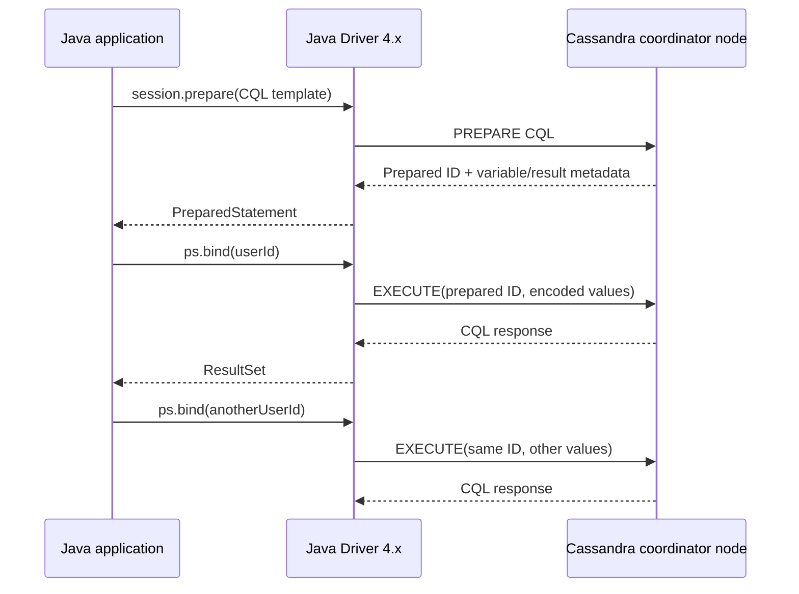
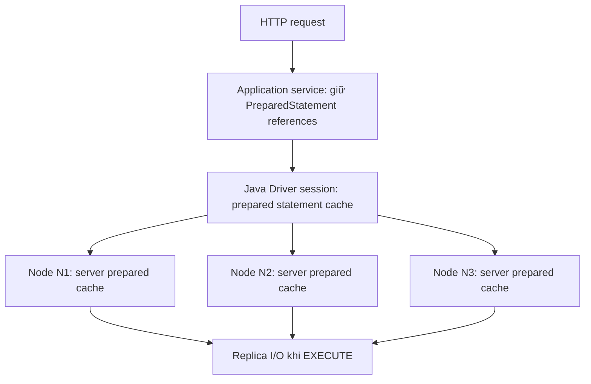
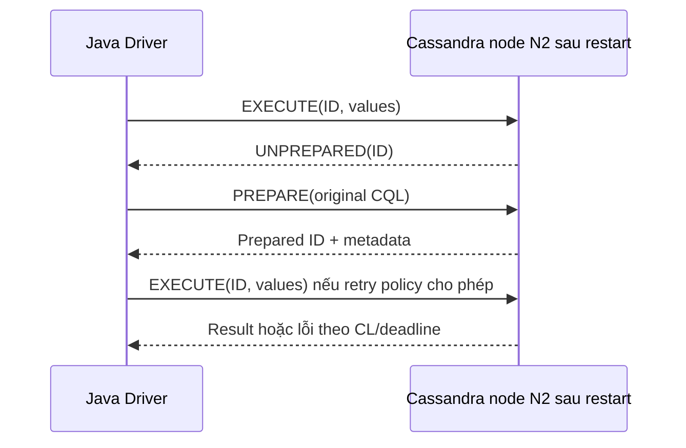

# Cache prepared statement và chi phí chuẩn bị lặp khi truy vấn Apache Cassandra từ Java

## 1. Tình huống: cùng một câu SELECT nhưng ứng dụng liên tục PREPARE

Một dịch vụ Java xử lý 3.000 yêu cầu/giây và thường xuyên chạy truy vấn:

```sql
SELECT display_name, updated_at
FROM java_query_lab.profile_by_user
WHERE user_id = ?;
```

Đội phát triển muốn tránh nối chuỗi giá trị `user_id` vào CQL nên dùng prepared statement. Tuy nhiên, trong mỗi HTTP request, họ lại gọi `session.prepare(...)` rồi mới `session.execute(...)`. Sau khi tăng số pod hoặc restart Cassandra node, CPU, request latency và số sự kiện `PREPARE` có thể tăng. Khi ứng dụng còn tạo chuỗi CQL mới cho từng user, số query shapes bùng nổ và server phải lưu nhiều prepared entries.

**Ba câu hỏi cần tách ra:**

1. `session.prepare(...)` mỗi request có thực sự gửi **PREPARE qua mạng** mỗi lần không? Điều đó phụ thuộc cache của driver, câu CQL và session đang dùng.
2. Vì sao cùng một CQL có thể được **chuẩn bị trên nhiều Cassandra node** hoặc cần chuẩn bị lại sau restart/eviction?
3. Làm thế nào tổ chức PreparedStatement, BoundStatement, query templates và kiểm thử để **giảm overhead** mà không làm sai partition routing, consistency, schema hoặc bảo mật?

Bài thuộc chương **Truy vấn từ Java** của mô-đun `DATABASE_ENGINE_WIDE_COLUMN_CASSANDRA`: kiến trúc phân tán, mô hình wide-column, partition key, thiết kế bảng theo truy vấn, CL đọc/ghi, CQL, replication, compaction/repair, xử lý lỗi và kết nối từ ứng dụng Java. Trọng tâm là **vòng đời prepared statement, cache phía client/server và chi phí chuẩn bị lặp**, không phải chỉ viết một câu `SELECT`.

### Mục tiêu học tập

Sau bài này, bạn có thể:

- Giải thích `PREPARE`, `EXECUTE`, **query ID**, bind marker và metadata của prepared statement.
- Phân biệt cache **trong ứng dụng**, cache **Java Driver** và cache **trên từng Cassandra node**.
- Viết Java Driver 4.x chuẩn bị một lần, bind nhiều lần, tái sử dụng an toàn giữa các luồng.
- Hiểu cache miss, node up/restart, `UNPREPARED`, reprepare và ảnh hưởng của topology/rolling upgrade.
- Nhận diện **dynamic CQL/query shape explosion** và giới hạn biến thể một cách an toàn.
- Lập benchmark/monitoring để đo **prepare rate, distinct query count, p95/p99, error rate và memory**.
- Xử lý schema migration, LWT/paging, retry và bảo mật khi dùng prepared statement.

## 2. Vòng đời PREPARE → BIND → EXECUTE

Trong giao thức CQL native, client có thể gửi câu truy vấn ở dạng **PREPARE** để server phân tích CQL, kiểm tra schema và trả thông tin cần thiết cho việc bind/execution. Các lần chạy tiếp theo dùng **prepared statement identifier** và **giá trị bind đã mã hóa** thay vì gửi toàn bộ CQL text như một simple query.



Sơ đồ là **luồng logic đơn giản hóa**: Java Driver có thể dùng cache local, chuẩn bị trên nhiều node, hoặc xử lý `UNPREPARED`; vì vậy không có quy tắc “mỗi lần gọi `prepare` luôn tương ứng đúng một PREPARE packet”.

### 2.1. Ba đối tượng Java khác nhau

| Đối tượng | Vai trò | Vòng đời nên dùng |
| --- | --- | --- |
| `CqlSession` | Quản lý kết nối, node discovery, routing, prepared cache và request execution | Tạo **ít**, chia sẻ lâu dài, đóng khi ứng dụng kết thúc |
| `PreparedStatement` | Biểu diễn **CQL template đã chuẩn bị**, bind definitions, metadata và identifier | Chuẩn bị **một lần cho mỗi mẫu truy vấn/phiên** rồi tái sử dụng |
| `BoundStatement` | CQL template + **giá trị bind và execution options** cho một lần gọi | Tạo/derive cho **từng request**, không giữ giá trị nhạy cảm trong singleton |

`PreparedStatement` dùng lại được cho nhiều luồng vì là đối tượng bất biến theo API; `BoundStatement` trong Driver 4.x cũng theo kiểu immutable, nhưng **builder chứa các giá trị đang được thiết lập** không nên được chia sẻ mutable giữa các request đồng thời.

### 2.2. Prepared statement **không** phải cache kết quả query

Một prepared statement không lưu `display_name` hay những hàng đã đọc. Nó cache **cấu trúc và metadata thực thi** trên client/server; mỗi lần `EXECUTE` vẫn phải tìm replica, thực hiện read/write theo RF/CL, đọc memtable/SSTable và tạo response.

Nếu query chậm vì hot partition, tombstones, disk I/O hay consistency level, chuẩn bị một lần có thể giảm chi phí parse/metadata nhưng **không tự sửa bottleneck dữ liệu**.

## 3. Ba tầng cache không được nhầm lẫn



| Lớp | Phạm vi | Có thể mất khi nào? | Cách bảo vệ |
| --- | --- | --- | --- |
| **Application references** | Một service/JVM, ví dụ field trong repository | Pod restart, đối tượng bị bỏ tham chiếu | Khởi tạo/reuse từ `CqlSession`, giữ lifecycle nhất quán |
| **Driver prepared cache** | Thường gắn với `CqlSession` và khóa cache do driver định nghĩa | Session đóng, JVM restart, cơ chế cache/GC/eviction theo release | Không tạo session từng request; không tạo quá nhiều query shapes |
| **Server prepared cache** | **Từng Cassandra node** có thể nhận EXECUTE | Node restart, thay node, eviction/giới hạn memory hoặc thay đổi schema liên quan | Driver reprepare khi cần, điều chỉnh cache/query inventory theo version |

Không có **một prepared cache chung toàn cluster** được replication như dữ liệu bảng thông thường. Node N2 không thể mặc định chạy ngay prepared ID chỉ vì N1 đã chuẩn bị; hành vi prepare-on-all-nodes của driver có thể giúp chủ động giảm miss, nhưng đồng thời tạo thêm công việc chuẩn bị.

### 3.1. Driver cache không miễn phí và không bất biến tuyệt đối

Java Driver 4.x có cơ chế tái sử dụng/cache prepared statements trong phiên. Với **cùng template và ngữ cảnh chuẩn bị** phù hợp, gọi `session.prepare(...)` lặp có thể là **cache hit tại client**, không gửi PREPARE mới qua mạng. Nhưng vẫn tồn tại chi phí gọi method, lấy/so khóa, concurrency/cấu trúc dữ liệu, và nguy cơ cache miss khi session khác hoặc CQL thay đổi.

Vì chi tiết cache key, retention/weak references và các tùy chọn phụ thuộc **phiên bản Java Driver**, hãy kiểm tra documentation và `reference.conf` của đúng bản đang triển khai. **Không khẳng định** mọi lời gọi `session.prepare` đều phát sinh network RTT; cũng không dựa vào cache để hợp thức hóa việc thiết kế query/phiên tùy tiện.

### 3.2. Vì sao application vẫn nên giữ PreparedStatement?

Với một tập CQL templates cố định, giữ tham chiếu `PreparedStatement` trong repository/service:

- Tránh mã gọi `prepare` được lặp vô ích ở hot path.
- Đảm bảo template và bind indices được quản lý tập trung.
- Hạn chế chuyện mỗi request dựng query string mới, vô tình khác khoảng trắng/comment/cột.
- Cho phép kiểm soát số query shapes, chuẩn bị lúc startup hoặc lazy-on-first-use.
- Dễ viết test correctness, error handling và thay đổi schema.

**Điều kiện:** prepared object phải được tạo từ **đúng session/cluster/schema context**; không giữ static prepared object toàn process rồi tái sử dụng mù trên `CqlSession` mới kết nối cluster khác.

## 4. Cache key, CQL template và “mỗi user một truy vấn”

Hai câu CQL này khác nhau về **query text**:

```sql
-- Anti-pattern: nhúng giá trị vào câu CQL.
SELECT display_name FROM java_query_lab.profile_by_user
WHERE user_id = 11111111-1111-1111-1111-111111111111;

SELECT display_name FROM java_query_lab.profile_by_user
WHERE user_id = 22222222-2222-2222-2222-222222222222;
```

Trong khi một template cố định chỉ cần thay **bind value**:

```sql
SELECT display_name
FROM java_query_lab.profile_by_user
WHERE user_id = ?;
```

**Điểm chính:** prepared cache hoạt động theo **hình dạng câu CQL và ngữ cảnh chuẩn bị**, không phải theo “ý nghĩa nghiệp vụ trông giống nhau”. Nếu ứng dụng tạo query string khác nhau theo user ID, timestamp, tenant, cột chọn, comment request ID hoặc danh sách literal, nó có thể tạo **nhiều prepared identities** và làm tăng áp lực lên client/server caches.

### 4.1. Những phần có thể bind và không thể bind

| Thành phần | Nên dùng bind marker? | Giải thích |
| --- | --- | --- |
| Giá trị partition key | **Có** | Giảm số query shapes, metadata giúp driver tính routing key khi đủ điều kiện |
| Giá trị clustering range | **Có** | Cùng query shape dùng được cho nhiều khoảng thời gian |
| Giá trị UPDATE/INSERT | **Có** | Encode theo kiểu CQL, tránh nối literal |
| `LIMIT`/`TTL` ở cú pháp/version hỗ trợ marker | **Có thể** | Kiểm tra CQL syntax và type của phiên bản đang dùng |
| Tên keyspace/table/column | **Không** theo nghĩa identifier SQL/CQL | Dùng schema cố định hoặc whitelist tên hợp lệ |
| Điều kiện `WHERE` hoàn toàn khác | Thường cần template khác | Mỗi query shape là một truy vấn có semantics/routing riêng |
| Kiểu clustering order/`ORDER BY` động | Không giả định bind được identifier/keyword | Duy trì tập template đã kiểm chứng |

Không tạo CQL bằng cách nối `user_id.toString()` vào `WHERE` dù giá trị có vẻ là UUID an toàn. Với giá trị text tự do, nối string còn có rủi ro cú pháp và injection. **Bind values** là cơ chế đúng cho data values, nhưng **không tự động** bảo vệ phần identifier động được nối.

### 4.2. Khoảng trắng, comment và normalization

Nếu code sinh hai CQL text khác nhau (thêm khoảng trắng, comment chứa request ID, đổi thứ tự cột hoặc alias), driver/server **có thể** coi đó là những prepared entries khác nhau. Tránh tự chế “canonicalizer” có thể đổi semantics; giải pháp chắc chắn hơn là **định nghĩa một số template tĩnh đã review** và dùng bind markers.

## 5. Cái giá của prepare lặp: nhìn đúng hai tình huống

### Tình huống A — gọi lại `prepare` với **cùng CQL, cùng session**

```java
// Không khuyến nghị: gọi trong hot path dù driver có thể cache.
PreparedStatement ps = session.prepare(
    "SELECT display_name FROM java_query_lab.profile_by_user WHERE user_id = ?");
Row row = session.execute(ps.bind(userId)).one();
```

Với Java Driver 4.x, nếu cache hit, lệnh trên **không nhất thiết** phát sinh PREPARE network lần nữa. Nhưng nó đặt logic tạo/truy xuất prepared entry trong đường hot path và dễ khiến sau này developer chèn thêm literal/khởi tạo session khác, từ đó gây cache churn.

### Tình huống B — tạo **session mới** hoặc **CQL khác nhau cho mỗi request**

```java
// Anti-pattern nặng: không tái sử dụng session và query shape.
try (CqlSession session = newSessionForEveryRequest()) {
    String cql = "SELECT display_name FROM java_query_lab.profile_by_user " +
        "WHERE user_id = " + userId;
    PreparedStatement ps = session.prepare(cql);
    session.execute(ps.bind());
}
```

`newSessionForEveryRequest()` ở đây chỉ là placeholder minh họa một cách thiết kế sai, **không phải method có sẵn trong Java Driver**. Hành vi này có thể tạo:

- Nhiều connection mới, TLS/auth handshake và cluster topology discovery.
- Client cache lạnh do session không được tái sử dụng.
- Nhiều PREPARE/query identities trên server khi literals khác nhau.
- CPU/heap/GC, request latency, authentication load và reconnect storms.

**Không benchmark tình huống B trên production.** Đây là ví dụ về failure mode, không phải API khuyến nghị.

## 6. CQL lab: bảng theo partition key và một tập template nhỏ

Ví dụ trong **lab** có ít nhất ba node ở `dc1` nếu dùng RF=3; sửa RF đúng topology thực nếu khác:

```sql
CREATE KEYSPACE IF NOT EXISTS java_query_lab
WITH replication = {
    'class': 'NetworkTopologyStrategy',
    'dc1': 3
};

CREATE TABLE IF NOT EXISTS java_query_lab.profile_by_user (
    user_id uuid PRIMARY KEY,
    display_name text,
    updated_at timestamp
);

CREATE TABLE IF NOT EXISTS java_query_lab.events_by_tenant_day (
    tenant_id text,
    event_day date,
    event_time timestamp,
    event_id uuid,
    status text,
    PRIMARY KEY ((tenant_id, event_day), event_time, event_id)
) WITH CLUSTERING ORDER BY (event_time DESC, event_id ASC);

INSERT INTO java_query_lab.profile_by_user
    (user_id, display_name, updated_at)
VALUES (
    11111111-1111-1111-1111-111111111111,
    'User A',
    '2026-11-21T08:00:00Z'
);

INSERT INTO java_query_lab.events_by_tenant_day
    (tenant_id, event_day, event_time, event_id, status)
VALUES (
    'tenant_lab', '2026-11-21', '2026-11-21T08:30:00Z',
    22222222-2222-2222-2222-222222222222,
    'CREATED'
);
```

Ba **CQL templates** điển hình:

```sql
-- Template 1: tra profile theo một partition key.
SELECT display_name, updated_at
FROM java_query_lab.profile_by_user
WHERE user_id = ?;

-- Template 2: cập nhật một partition key.
UPDATE java_query_lab.profile_by_user
SET display_name = ?, updated_at = ?
WHERE user_id = ?;

-- Template 3: đọc time range thuộc một partition đầy đủ.
SELECT event_time, event_id, status
FROM java_query_lab.events_by_tenant_day
WHERE tenant_id = ?
  AND event_day = ?
  AND event_time >= ?
  AND event_time < ?
LIMIT 100;
```

Tập query shapes được định nghĩa **theo nhu cầu truy vấn**. Prepared statements giảm parse/metadata và giúp routing khi có đầy đủ partition key, nhưng **không** khiến một query thiếu partition key trở thành truy vấn cục bộ hiệu quả.

## 7. Java Driver 4.x: chuẩn bị một lần, bind nhiều lần

Mẫu Java 17+ sau dùng một `CqlSession` được tạo từ lớp cấu hình ứng dụng. `ProfileRepository` giữ strong references tới hai `PreparedStatement` trong suốt vòng đời service.

```java
import com.datastax.oss.driver.api.core.CqlSession;
import com.datastax.oss.driver.api.core.DefaultConsistencyLevel;
import com.datastax.oss.driver.api.core.cql.BoundStatement;
import com.datastax.oss.driver.api.core.cql.PreparedStatement;
import com.datastax.oss.driver.api.core.cql.Row;
import java.time.Instant;
import java.util.Optional;
import java.util.UUID;

public final class ProfileRepository {
    private final CqlSession session;
    private final PreparedStatement selectProfile;
    private final PreparedStatement updateProfile;

    public ProfileRepository(CqlSession session) {
        this.session = session;
        this.selectProfile = session.prepare("""
            SELECT display_name, updated_at
            FROM java_query_lab.profile_by_user
            WHERE user_id = ?
            """);
        this.updateProfile = session.prepare("""
            UPDATE java_query_lab.profile_by_user
            SET display_name = ?, updated_at = ?
            WHERE user_id = ?
            """);
    }

    public Optional<String> findDisplayName(UUID userId) {
        BoundStatement bound = selectProfile.boundStatementBuilder()
            .setUuid(0, userId)
            .setConsistencyLevel(DefaultConsistencyLevel.LOCAL_QUORUM)
            .build();
        Row row = session.execute(bound).one();
        return row == null
            ? Optional.empty()
            : Optional.ofNullable(row.getString("display_name"));
    }

    public void updateDisplayName(UUID userId, String name, Instant when) {
        BoundStatement bound = updateProfile.boundStatementBuilder()
            .setString(0, name)
            .setInstant(1, when)
            .setUuid(2, userId)
            .setConsistencyLevel(DefaultConsistencyLevel.LOCAL_QUORUM)
            .build();
        session.execute(bound);
    }
}
```

### 7.1. Phân tích vòng đời

1. `ProfileRepository` được khởi tạo một lần **trên mỗi session/application instance**, không tạo trong mỗi HTTP handler.
2. `session.prepare` chạy khi khởi tạo repository. Nếu session/node cache miss, PREPARE được thực hiện theo policy driver.
3. Mỗi `findDisplayName` và `updateDisplayName` tạo một `BoundStatement` mới: **không có state bind chia sẻ giữa các luồng**.
4. `LOCAL_QUORUM` đặt **trên lần execution**, không cần chuẩn bị lại CQL khi CL thay đổi theo chính sách có kiểm soát.
5. `CqlSession` do lớp bootstrap/DI sở hữu; repository **không** đóng nó sau mỗi query.
6. Nếu schema đổi, code và prepared statement cần được quản lý theo **schema version/migration plan**; không dùng object cũ qua thay đổi không tương thích rồi mặc định driver sẽ sửa mọi lỗi.

### 7.2. PreparedStatement không tạo giao dịch giữa các lệnh

Hai lời gọi `UPDATE` liên tiếp vẫn là hai CQL requests riêng. Nếu cần CAS, dùng `IF`/LWT phù hợp; nếu dùng multi-table denormalization, phải có reconciliation/consistency strategy. **Prepared** là optimization cho request format/metadata, **không** là commit transaction hoặc lock.

## 8. Async Java: tái sử dụng prepared statement và giới hạn concurrency

Java Driver 4.x hỗ trợ execution bất đồng bộ. Điều này giúp tránh giữ một blocking thread chờ từng request, nhưng **không** cho phép đẩy vô hạn request tới Cassandra.

```java
import com.datastax.oss.driver.api.core.CqlSession;
import com.datastax.oss.driver.api.core.DefaultConsistencyLevel;
import com.datastax.oss.driver.api.core.cql.AsyncResultSet;
import com.datastax.oss.driver.api.core.cql.BoundStatement;
import com.datastax.oss.driver.api.core.cql.PreparedStatement;
import java.util.UUID;
import java.util.concurrent.CompletableFuture;
import java.util.concurrent.CompletionStage;
import java.util.concurrent.RejectedExecutionException;
import java.util.concurrent.Semaphore;

public final class AsyncProfileReader {
    private final CqlSession session;
    private final PreparedStatement select;
    private final Semaphore slots = new Semaphore(128);

    public AsyncProfileReader(CqlSession session) {
        this.session = session;
        this.select = session.prepare("""
            SELECT display_name, updated_at
            FROM java_query_lab.profile_by_user
            WHERE user_id = ?
            """);
    }

    public CompletionStage<AsyncResultSet> read(UUID userId) {
        if (!slots.tryAcquire()) {
            return CompletableFuture.failedFuture(
                new RejectedExecutionException("Cassandra requests at capacity"));
        }
        try {
            BoundStatement bound = select.boundStatementBuilder()
                .setUuid(0, userId)
                .setConsistencyLevel(DefaultConsistencyLevel.LOCAL_QUORUM)
                .build();

            return session.executeAsync(bound).whenComplete((result, error) -> {
                slots.release();
                // Metrics: latency/error/success, không log userId thật.
            });
        } catch (RuntimeException error) {
            slots.release();
            return CompletableFuture.failedFuture(error);
        }
    }
}
```

`Semaphore(128)` chỉ giới hạn số **logical operations** đồng thời qua instance `AsyncProfileReader`. Nó không phải giới hạn toàn JVM, toàn service nhiều pod hay một Cassandra node. Khi server bão hòa, tăng số connection hoặc in-flight có thể chỉ tạo thêm queue/retry và làm p99 tệ hơn.

**Lưu ý paging:** `AsyncResultSet` đại diện một **page** trả về. Với truy vấn nhiều page, caller cần `hasMorePages()` và `fetchNextPage()` có backpressure; code trên chỉ minh họa request lấy page đầu, không phải scan toàn bảng hoàn chỉnh. `PreparedStatement` vẫn được tái sử dụng giữa các page/attempt, nhưng mỗi page có thể tạo server request riêng.

## 9. Khởi tạo sớm hay lazy prepare?

Hai chiến lược phổ biến:

| Chiến lược | Cách hoạt động | Ưu điểm | Rủi ro |
| --- | --- | --- | --- |
| **Eager / warm-up** | Chuẩn bị các CQL thiết yếu lúc khởi động ứng dụng | Phát hiện syntax/schema lỗi sớm, giảm first-request latency | Tăng startup latency, PREPARE burst khi rất nhiều pod cùng chạy |
| **Lazy / on-demand** | Lần đầu một query shape được dùng mới chuẩn bị | Chỉ tốn chi phí cho query thực sự dùng | Request đầu tiên có cache miss, cần concurrency-safe initialization |

Với **tập 10–100 query shapes quan trọng**, eager preparation có giới hạn trên mỗi `CqlSession` thường dễ vận hành. Với hàng nghìn optional queries, cần cân nhắc lazy/categorized warm-up để không làm cluster nhận một **PREPARE storm** lúc autoscaling.

### 9.1. Chuẩn bị ở startup có bắt buộc thành công mọi node?

Không mặc định. `prepare-on-all-nodes` và `reprepare-on-up` (tên cấu hình/khả năng theo Java Driver version) ảnh hưởng cách driver phân phối PREPARE. Một lời gọi chuẩn bị thành công có thể phản ánh kết quả từ node đã trả lời; không được suy ngay **mọi node đã lưu entry** và không xảy ra `UNPREPARED` sau đó.

Thiết kế startup readiness nên phân biệt:

- **Schema chưa có:** fail fast hoặc giữ service chưa ready.
- **Một node tạm down:** có thể cần retry bounded và không chặn mọi service vô thời hạn nếu SLA cho phép.
- **Driver session creation lỗi:** chẩn đoán DNS/contact points/TLS/auth/local DC, không chỉ chuẩn bị CQL.
- **Query optional không được dùng:** lazy prepare thay vì bắt mọi pod tạo index/query metadata không cần thiết.

## 10. Server cache là per-node: node restart và `UNPREPARED`

Đối với server, prepared statement được lưu **trong cache tại node**, không phải một bảng dữ liệu được replica replication. Node có thể không biết prepared ID khi:

- Vừa restart và cache server bị mất.
- Là node mới bootstrap/replace hoặc vừa được load balancing policy bắt đầu chọn.
- Entry bị eviction hoặc giới hạn memory.
- Truy vấn/metadata thay đổi do migration schema, hoặc node chưa từng nhận PREPARE.

Khi nhận `EXECUTE` với ID chưa biết, server có thể trả `UNPREPARED`. Java Driver 4.x thường có cơ chế **tự gửi PREPARE lại rồi thử thực thi** theo policy và phiên bản, nhưng hành vi đó vẫn có độ trễ và có thể thất bại nếu schema không khớp, node không khả dụng hoặc deadline hết.



**Không** tự bắt mọi `ReadTimeoutException` rồi gọi `prepare` lặp vô hạn: timeout có thể do replica/disk, không phải cache miss. Cần phân biệt **UNPREPARED**, invalid CQL/schema, unavailable, request timeout, authentication và transport failure.

### 10.1. Khi nào reprepare trở thành sự cố?

Nếu mỗi phút server mất nhiều prepared entries, hoặc hàng trăm pod reconnect cùng lúc:

- PREPARE traffic có thể tăng trên các coordinators.
- Latency request đầu tiên trên node có thể tăng.
- CPU/memory trên server/driver tăng, p99 có spike.
- Reprepare-on-up có thể tạo burst chuẩn bị khi node trở lại.
- Nếu schema chưa đồng bộ hoặc query không còn hợp lệ, tự động reprepare **không** cứu được ứng dụng.

Phải thu **node restart log, query distinct count, PREPARE/UNPREPARED metrics/logs, heap/cache usage và latency** để xác định nguồn chứ không chỉ tăng cache size.

## 11. `prepare-on-all-nodes` và `reprepare-on-up`: lợi ích và chi phí

Tùy cấu hình Java Driver 4.x, có thể có các chính sách:

| Cơ chế | Ý nghĩa | Trade-off |
| --- | --- | --- |
| **Prepare on all nodes** | Chủ động gửi PREPARE cho những node trong phạm vi driver quản lý khi chuẩn bị statement | Giảm miss sau routing đổi, nhưng tăng traffic/CPU khi nhiều templates × nodes × pods |
| **Reprepare on node UP** | Chuẩn bị lại những statement liên quan khi node trở lại | Giảm request-time `UNPREPARED`, nhưng có thể tạo startup burst |
| **On-demand reprepare** | Khi server báo `UNPREPARED`, driver chuẩn bị lại | Ít làm việc sớm, nhưng first-hit latency tăng |

Không nên **bật/tắt hàng loạt** các tùy chọn này mà chưa kiểm tra defaults và behavior của đúng Driver 4.x release. Có những phiên bản và chế độ driver chỉ chuẩn bị một tập statement đã được dùng hoặc có phạm vi node phù hợp; mô hình chi phí chính xác phải lấy từ metric thực.

### 11.1. Bài toán “số lượng PREPARE tiềm năng”

Giả sử:

- 40 pod Java;
- mỗi pod khởi tạo một `CqlSession`;
- 60 query templates duy nhất;
- 6 Cassandra nodes có thể nhận prepared statements.

Trong mô hình đơn giản hóa **mỗi pod chuẩn bị mỗi template trên tất cả 6 node**, số lượt server-side preparation tiềm năng trong lúc cold start:

\[
40 \times 60 \times 6 = 14\,400
\]

Đây là **ước lượng minh họa về mức fan-out**, không phải cam kết driver sẽ luôn gửi đúng 14.400 PREPARE requests. Driver cache/policy, concurrency, node selection và thời gian startup thực tế có thể làm con số khác. Nó cho thấy **pod autoscaling + prepare-on-all-nodes + nhiều query shapes** có thể tạo đỉnh tải rất lớn.

Giải pháp thường hữu ích hơn tăng resource mù quáng: giảm số query shapes, chia startup thành đợt, reuse session, chỉ warm-up templates thiết yếu và đo cold-start latency.

## 12. Query shape explosion: nguyên nhân khiến cache bị “ngập”

Các nguồn phát sinh prepared entries quá nhiều:

1. **Nối literal:** giá trị user/tenant/order/timestamp/UUID được đưa thẳng vào CQL.
2. **Tên bảng theo tenant:** `tenant_001.orders`, `tenant_002.orders`... khiến mỗi tên table là CQL khác; còn làm schema và vận hành phức tạp.
3. **Dynamic projection:** mỗi request chọn tập cột và thứ tự tùy ý.
4. **Dynamic `IN`:** sinh chuỗi số dấu `?` thay đổi liên tục, dù logic vẫn tìm cùng loại key.
5. **Dynamic comment:** đưa trace ID/request ID/tenant ID vào comment CQL.
6. **Dynamic keyspace:** gọi `USE` hoặc đổi keyspace vô tổ chức ở nhiều session; identity và metadata có thể khác.
7. **Vô tình nhiều template:** mỗi repository viết lại một câu với alias/whitespace khác nhau.
8. **Mỗi request tạo session riêng:** cache trong session luôn lạnh.
9. **Thử nghiệm nhiều schema/index variants:** mỗi deployment sinh hàng trăm query shapes không dọn.

### 12.1. Giảm cardinality bằng một tập template có kiểm soát

Thay vì tạo mọi tổ hợp cột một cách tự do:

```text
ProfileSummaryById
ProfileDetailsById
EventsByTenantDayAndTime
EventsByTenantDayAndStatus (chỉ khi data model hỗ trợ)
UpdateProfile
InsertEvent
```

Mỗi shape gắn với **một repository method, query fingerprint, unit test và SLO**. Nếu thật sự cần dynamic identifiers, áp **whitelist** schema/cột hợp lệ và giới hạn số tổ hợp; bind markers chỉ dành cho **values**, không phải tên bảng/cột.

### 12.2. Trường hợp `IN` và tập bind markers

Nếu schema/Cassandra version hỗ trợ marker cho collection trong cú pháp `IN` tương ứng, cân nhắc dùng marker đã được driver bind đúng kiểu thay vì nối literal list. Khi buộc phải sinh số placeholders thay đổi, áp **giới hạn tập variant** và đo fan-out/partition count; một `IN` chứa hàng nghìn khóa có thể tốn nhiều replica requests dù nó dùng đúng một prepared statement.

**Prepared không biến truy vấn đa partition thành truy vấn rẻ.** Thiết kế partition key và query model vẫn là yếu tố quyết định.

## 13. BoundStatement và execution options: không cần chuẩn bị lại chỉ vì CL khác

`PreparedStatement` mô tả truy vấn, metadata bind/result. `BoundStatement` mang **giá trị và các execution attributes** như:

- Consistency level `ONE`, `LOCAL_QUORUM`...;
- serial consistency cho LWT khi áp dụng;
- page size, request timeout override, tracing, idempotence flag;
- profile/routing context theo API/version.

Ví dụ:

```java
PreparedStatement ps = session.prepare("""
    SELECT display_name
    FROM java_query_lab.profile_by_user
    WHERE user_id = ?
    """);

BoundStatement fastLocal = ps.boundStatementBuilder()
    .setUuid(0, userId)
    .setConsistencyLevel(DefaultConsistencyLevel.LOCAL_ONE)
    .build();

BoundStatement quorumLocal = ps.boundStatementBuilder()
    .setUuid(0, userId)
    .setConsistencyLevel(DefaultConsistencyLevel.LOCAL_QUORUM)
    .build();
```

Ví dụ yêu cầu các import/biến `session` và `userId` giống phần trước; đây là **hai lựa chọn execution**, không phải khuyến nghị tự hạ CL cho nghiệp vụ. Không cần hai query CQL texts khác nhau chỉ vì muốn chọn CL khác trên bound statement.

**Điều kiện:** CL là bảo đảm đọc/ghi nghiệp vụ, không phải một knob tùy tiện chỉ để cache hit hay giảm p99. Với RF/độ tin cậy replica nhất định, đổi CL có thể thay khả năng đọc dữ liệu mới, chịu node down và timeout behavior.

## 14. Prepared metadata giúp driver định tuyến theo token khi nào?

Với **prepared statement**, server/driver có thể biết **partition key columns** từ metadata, để từ bind values xác định routing key và token. Khi token metadata/routing policy phù hợp, Java Driver có thể ưu tiên coordinator gần replica, giảm hop không cần thiết.

Ví dụ truy vấn định tuyến rõ ràng:

```sql
SELECT display_name
FROM java_query_lab.profile_by_user
WHERE user_id = ?;
```

Ví dụ khác với composite partition key:

```sql
SELECT event_time, event_id, status
FROM java_query_lab.events_by_tenant_day
WHERE tenant_id = ?
  AND event_day = ?
  AND event_time >= ?
  AND event_time < ?;
```

**Phải bind đủ partition key** để suy token của một partition. Nếu thiếu key hoặc query buộc fan-out/range scan, prepared statement không thể luôn định tuyến chính xác tới một replica set. Driver token-aware cũng cần metadata topology, local datacenter, load balancing policy và node health.

Một prepared statement có thể làm **routing hiệu quả hơn** và giảm network overhead, nhưng một key nóng vẫn nằm trên cùng replica set dù có chuẩn bị 1 hay 1.000 lần. Không coi prepare caching là giải pháp cho hot partition.

## 15. Prepared cache sau schema migration

Một prepared statement gắn với **cấu trúc schema mà server/driver đã biết tại lúc chuẩn bị**. Khi thay schema:

- `ALTER TABLE` thêm/bỏ/đổi type cột;
- Drop/recreate table cùng tên nhưng **table ID khác**;
- Thay keyspace/table hoặc schema disagreement tạm thời;
- Rolling upgrade có khác biệt metadata/protocol;

query đang cache có thể không còn hợp lệ hoặc result/variable metadata có thể không còn khớp. Server/driver có thể reprepare trong những tình huống hỗ trợ, nhưng **reprepare không sửa được câu CQL sai về semantics**.

### 15.1. Quy trình expand → migrate → contract

1. **Expand:** thêm schema tương thích với cả ứng dụng cũ/mới (khi release cho phép), chờ schema agreement.
2. **Deploy/canary Java:** cập nhật CQL templates mới, chuẩn bị query mới; log fingerprint/version, kiểm thử bind/result types.
3. **Backfill:** nếu đổi partition key/bảng theo truy vấn, dùng job riêng có checkpoint/delta/validation; prepared cache không tự chuyển dữ liệu cũ.
4. **Switch:** bật query mới theo feature flag, đo correctness và SLO.
5. **Contract:** chỉ drop cột/bảng/index cũ sau khi ứng dụng dùng template cũ đã hết traffic và rollback window đóng.

Không sửa CQL text của repository giữa runtime mà quên xử lý prepared references, type codecs, query fingerprint và migration version. Nếu gặp `InvalidQueryException`/metadata mismatch sau schema change, điều tra lịch deploy/schema thay vì tăng server cache size.

### 15.2. `SELECT *` với prepared statements

`SELECT *` có thể làm result metadata thay đổi khi schema thêm/bỏ cột, gây rủi ro cho application mapping và cache metadata. Ưu tiên **liệt kê các cột cần dùng**. Nếu query result shape cố ý thay, deploy code/prepared statements tương thích và test cả old/new binaries trong rollout.

## 16. Node restart, bootstrap, rolling upgrade và reprepare storm

Một cluster nhiều DC thường có hàng chục pod Java giữ nhiều prepared objects. Sau maintenance, một node mới quay lại:

```text
T0: Cassandra node N4 restart -> server prepared cache lạnh.
T1: N4 được coi là UP, driver có thể đưa request trở lại N4.
T2: Driver chủ động reprepare hoặc nhận UNPREPARED khi EXECUTE.
T3: Nhiều pods × nhiều query shapes cùng tạo PREPARE burst.
T4: PREPARE work cạnh tranh CPU/network với CQL reads/writes.
T5: Sau khi cache ấm, p99 có thể giảm trở lại.
```

Đây là một **giả thuyết chẩn đoán**, không mặc định mọi restart chắc chắn gây sự cố. Để kiểm định, cần so:

- Node startup/UP timestamp;
- `prepare-on-all-nodes`/`reprepare-on-up` settings thực;
- Số distinct templates, Java pods, session count;
- PREPARE/UNPREPARED/reprepare events theo node;
- CPU/GC/connection pool/in-flight và Java p95/p99 cùng cửa sổ.

**Không** vô hiệu hóa reprepare tùy tiện để “giảm tải”: điều đó có thể chuyển công việc sang lần EXECUTE đầu tiên và làm tăng lỗi/latency. Có thể chia startup ứng dụng theo đợt, giảm template count và kiểm tra cache/headroom trước.

## 17. Chênh lệch giữa prepared cache và consistency/retry

Một lỗi do cache miss xảy ra **trước hoặc trong việc thiết lập plan thực thi**, khác với lỗi do replica không đạt CL:

| Triệu chứng | Nguyên nhân cần kiểm tra | Không kết luận vội |
| --- | --- | --- |
| `UNPREPARED` tăng sau restart | Server cache mất/eviction, node chưa được prepare | “Dữ liệu ở replica đã mất” |
| `ReadTimeoutException` với query đã chuẩn bị | Replica/coordinator/WAN/disk/queue, CL | “Prepared cache hết” nếu không có bằng chứng |
| `UnavailableException` | Không đủ replica sống cho CL ở phạm vi đó | “Chỉ cần prepare lại” |
| `InvalidQueryException` sau schema change | Query/table/type/index không tương thích | “Tăng cache size sẽ sửa” |
| Driver queue/in-flight tăng | Offered load > capacity, connection stream pressure | “PREPARE là nguyên nhân duy nhất” |
| Query p99 cao dù cache hit | Data model, partition size/tombstones, CL, read amplification | “Bind values kém tối ưu” |

### 17.1. Retry và idempotency

Khi driver thấy `UNPREPARED`, cơ chế xử lý nội bộ có thể là **reprepare + execute**; khác với việc application retry một mutation mà outcome không rõ. Với `INSERT`/`UPDATE`, thao tác timeout **có thể đã được áp dụng** trên đủ replica; replay có thể ảnh hưởng TTL, timestamps, counters và LWT business invariants.

**Không** tự gắn `idempotent=true` cho mọi statement chỉ vì nó prepared. Một CAS `IF`, counter increment hay business side effect cần chính sách retry/unknown outcome riêng.

## 18. Prepared LWT: tối ưu parse, không làm Paxos biến mất

LWT dùng `IF` (CAS/Paxos) có thể được chuẩn bị:

```sql
UPDATE java_query_lab.profile_by_user
SET display_name = ?
WHERE user_id = ?
IF display_name = ?;
```

Java Driver 4.x:

```java
PreparedStatement cas = session.prepare("""
    UPDATE java_query_lab.profile_by_user
    SET display_name = ?
    WHERE user_id = ?
    IF display_name = ?
    """);

BoundStatement bound = cas.boundStatementBuilder()
    .setString(0, "New name")
    .setUuid(1, userId)
    .setString(2, "Old name")
    .setConsistencyLevel(DefaultConsistencyLevel.LOCAL_QUORUM)
    .setSerialConsistencyLevel(DefaultConsistencyLevel.SERIAL)
    .build();

Row result = session.execute(bound).one();
if (result != null && result.getBoolean("[applied]")) {
    // Conditional update thành công.
} else {
    // Điều kiện sai: kết quả nghiệp vụ hợp lệ, không phải parse/cache error.
}
```

Code dùng biến `session`/`userId` đã khai báo trong ngữ cảnh ứng dụng. Prepared giúp dùng lại query metadata nhưng **vẫn phải chạy pha Paxos**, chịu contention và serial consistency. Nếu timeout, kết quả `[applied]` có thể **không biết**, không tự retry một UPDATE vô điều kiện để “bù”.

Trong multi-DC, `SERIAL` và `LOCAL_SERIAL` có phạm vi semantics khác nhau; lựa chọn phụ thuộc invariant nghiệp vụ, không liên quan trực tiếp số cache entries.

## 19. Observability: phải đo cả “prepare API calls” và “PREPARE traffic”

Để tránh kết luận sai, hãy phân biệt **bốn bộ đếm**:

| Số đo | Phạm vi | Câu hỏi |
| --- | --- | --- |
| `session.prepare()` calls/s | Application/JVM | Code có gọi prepare trong hot path không? |
| **Distinct CQL fingerprints** | Service/version/session | Có bao nhiêu query shapes được sinh? |
| PREPARE requests/s hoặc server prepared-cache metrics | Driver/native transport/server node tùy instrumentation | Thực sự có bao nhiêu lần chuẩn bị qua mạng/cache miss? |
| EXECUTE requests/s và Java end-to-end latency | Driver/server + business app | Tải thực thi có tăng hay chỉ overhead chuẩn bị? |

Một ứng dụng có thể gọi `prepare` 3.000 lần/giây nhưng **chỉ tạo rất ít PREPARE network requests** nhờ cache client. Ngược lại, service có 100 dòng `session.prepare` ở startup nhưng 200 pod × nhiều node có thể tạo nhiều server PREPARE trong một khoảng ngắn.

### 19.1. Bộ metric nên ghép

| Nhóm | Quan sát | Lợi ích |
| --- | --- | --- |
| **Java** | API p50/p95/p99, accepted/successful RPS, error rate | Đánh giá tác động người dùng |
| **App instrumentation** | Prepare calls, distinct normalized CQL shapes, startup warm-up time | Định vị anti-pattern và burst |
| **Driver 4.x** | Per-node request latency, in-flight, connection pools, retries, throttling, prepare/reprepare nếu exporter hỗ trợ | Phân biệt client vs server |
| **Cassandra** | Query request rates, prepared-cache usage/evictions nếu bản có metric, CPU/heap/GC | Xác minh server-side overhead |
| **System** | Network bytes/RTT, disk I/O, compaction, node restarts | Loại trừ bottleneck ngoài cache |
| **Correctness** | Query results, CL, row count, pagination, LWT `[applied]` | Tránh “nhanh” do trả thiếu dữ liệu |

Các **tên metric JMX/driver exporter** thay đổi theo release. Không tự ghi một tên metric “chính thức” nếu chưa xác minh trên Cassandra/Java Driver 4.x đang chạy. Khi xuất từ Micrometer/Prometheus, ghi nhãn **service, cluster, DC, node, query fingerprint**; không dùng raw partition key/SQL literal làm metric label có cardinality khổng lồ và rò rỉ PII.

### 19.2. Vì sao cần đo cold và warm riêng?

- **Cold start:** session mới, driver prepared cache lạnh; server cache có thể nóng hoặc lạnh.
- **Warm steady-state:** request chủ yếu EXECUTE trên templates đã chuẩn bị.
- **Node restart:** server cache của node đó lạnh, app cache có thể vẫn nóng.
- **Application restart:** app/driver cache lạnh, server cache có thể còn.
- **Schema migration:** template/metadata mới, một số entries không còn hợp lệ.

Không lấy p99 của warm steady-state để tuyên bố **không có startup latency**. Chia dashboard và benchmark theo phase, cùng tải và tập query shapes.

## 20. Ước lượng chi phí theo request và số node

Một mô hình đơn giản để suy luận:

\[
T_{\text{first-use}} \approx T_{\text{prepare}} + T_{\text{execute}}
\]

\[
T_{\text{warm}} \approx T_{\text{execute}}
\]

Đây là **mô hình khái niệm**, không phải công thức đo luôn đúng: driver có thể prepare đồng thời nhiều node, cache hit, pipeline requests, có thêm queue và network RTT; phần thời gian có thể chồng lên nhau.

Giả sử một ứng dụng gọi query cố định ở 2.000 RPS, trong một phút:

- Nếu **không cache hiệu quả**, số lần prepare qua mạng có thể cùng bậc với request rate và tốn thêm CPU/network.
- Nếu query đã cache trong driver và server, phần lớn số request chỉ cần EXECUTE.
- Nếu có **500 biến thể CQL khác nhau** vì nối literal/tên bảng, cache warm-up và eviction sẽ tốn nhiều hơn so với 10 templates.

**Không suy** “prepare chậm 5 ms thì p99 sẽ giảm đúng 5 ms” mà không đo. Với RPS cao, hiệu quả chủ yếu có thể là giảm CPU hoặc tail latencies lúc cold start/restart; còn với data read nặng thì SSTable/replica costs chiếm ưu thế.

### 20.1. Thử tính cache cardinality

| Kịch bản | Số template/app session | Sessions/pods | Node có thể prepare | Nhận định |
| --- | ---: | ---: | ---: | --- |
| Template tĩnh | 12 | 40 | 6 | Mức fan-out chuẩn bị ban đầu dễ dự trù |
| Mỗi user một CQL | 100.000+ | 40 | 6 | Cache churn lớn, không thể warm-up hữu hạn |
| Mỗi request session mới | 12 | Rất nhiều | 6 | Driver cache bị lạnh liên tục, thêm connection storm |
| Lazy 12 templates | 12 | 40 | 6 | Phân tán PREPARE theo actual demand, first hit có latency |

Đây là **phân tích định tính**; memory/cache size thực tế phải đo theo release/config. Không so số query shapes bằng cách chỉ đếm số endpoint HTTP.

## 21. Benchmark có kiểm soát để chứng minh giá trị của cache

### 21.1. Bốn phép thử

| Kịch bản | Cách chạy | Mong đợi nếu cache hoạt động |
| --- | --- | --- |
| **A — chuẩn bị một lần** | Một session, repository giữ prepared, bind nhiều user IDs | Warm steady-state ít PREPARE, latency ổn |
| **B — prepare trong mỗi request** | Cùng session và **cùng CQL text**, gọi prepare lặp | Có thể cache hit, chênh lệch nhỏ hơn kỳ vọng |
| **C — CQL dynamic** | Cùng session nhưng template chứa literals/comment biến đổi | Nhiều query identities/PREPARE, memory và latency tăng |
| **D — session mỗi request** | Mở/đóng session cho từng request **trên staging** | Connection/auth/topology/prepare overhead lớn |

Chạy A/B/C/D với **cùng workload source**, RPS/CL/page size và data distribution, mỗi case có thời gian warm-up/đo riêng. Dùng **ngưỡng tải được kiểm soát**, tránh benchmark D tràn connection khiến cả staging mất khả dụng.

### 21.2. Những điều phải giữ cố định

1. **Cassandra version**, số node/RF/DC/rack và node health.
2. **Java Driver version**, execution profile, retry/speculation và local DC.
3. **CQL query shape** (trừ biến được thử), bind types, result columns.
4. **Dataset**: số partition, hot-key distribution, table size, TTL/tombstone/SSTable count.
5. **Offered RPS/concurrency**, số pod và trạng thái cache cold/warm.
6. **CL**, request timeout, page size và payload size.
7. **Compaction/repair/streaming** và network conditions trong thời gian test.

### 21.3. Chỉ số PASS

- Không sai kết quả CQL so với golden dataset.
- Distinct query fingerprints khớp thiết kế.
- PREPARE traffic ở warm steady-state giảm, không chỉ số method calls trong Java.
- p95/p99, CPU/heap/GC và errors ổn định/tốt hơn với RPS tương đương.
- Sau restart node hoặc app, reprepare hoàn tất trong budget mà không gây storm.
- Không tăng đáng kể client in-flight/queue hoặc cache memory không kiểm soát.

**Không** gọi tối ưu thành công nếu p99 giảm vì đã giảm successful RPS hoặc tăng tỷ lệ timeout/rejection.

## 22. Runbook: điều tra “prepare storm” trong 15 phút đầu

### Bước 1 — Khoanh vùng

Ghi **UTC incident window**, app build, driver version, cluster/DC/node, query fingerprints và thời điểm deploy/autoscale/restart.

### Bước 2 — Xem symptom thực

```bash
nodetool status
nodetool tpstats
nodetool proxyhistograms
nodetool clientstats
nodetool compactionstats
```

Các lệnh này giúp quan sát node, native connections, latency/queue và background load, **không tự liệt kê chuẩn xác mọi query đang cache**. Cần driver/server instrumentation và logs tương ứng để kết luận PREPARE storm.

### Bước 3 — Kiểm tra vòng đời Java

- Có tạo `CqlSession` trong HTTP request, scheduled job hoặc per tenant không?
- Có gọi `prepare` ở mọi lần đọc/ghi dù template tĩnh không?
- Có dùng strong reference đến prepared objects cho query thường dùng không?
- Có CQL nối literal, request ID/comment hoặc tên table động không?
- Có hàng trăm pod cùng warm-up nhiều nghìn query shapes trong vài giây không?

### Bước 4 — Phân biệt cache miss hợp lý với churn

| Quan sát | Giả thuyết | Hành động đầu tiên |
| --- | --- | --- |
| PREPARE tăng chỉ ngay khi deploy, sau đó giảm | Cold app cache | Phân đợt warm-up, so startup latency |
| PREPARE tăng sau N2 restart, chỉ ở N2 | Server cache lạnh/reprepare | Kiểm tra reprepare settings và node return policy |
| PREPARE cao liên tục, distinct CQL rất lớn | Dynamic query shape, eviction | Giảm templates, dùng bind markers |
| Connections và PREPARE cùng tăng sau mỗi request | Session lifecycle sai | Reuse `CqlSession`, bounded startup |
| `UNPREPARED` nhiều ở một node mới | Chưa prepared tại node hoặc cache evicted | Xem node logs, cache pressure, driver behavior |
| Query lỗi sau ALTER TABLE | Schema/metadata invalid | Sửa CQL/schema compatibility, không chỉ cache size |
| Latency tăng dù PREPARE gần zero | Replica/partition/CL/IO bottleneck | Xem `tablestats`/`tablehistograms`, query model |

### Bước 5 — Áp thay đổi nhỏ có thể hoàn tác

1. Giới hạn offered load/prepare warm-up concurrency để giảm burst.
2. Đưa `CqlSession` về vòng đời singleton/service-scoped.
3. Đưa các CQL cố định thành repository fields và bind values.
4. Xóa việc nối literal/request ID vào query text.
5. Nếu cần chỉnh server cache config, đánh giá **memory budget, node/release semantics và restart plan**; tránh tăng vô hạn.
6. Đo lại **PREPARE/EXECUTE, p99, successful RPS, memory**.

Đừng chạy `repair`, `cleanup`, thay RF hoặc compaction chỉ vì prepared-cache miss. Chúng giải quyết loại vấn đề khác và có thể gây I/O load lớn.

## 23. Những lỗi thiết kế thường gặp

| Sai lầm | Vì sao sai? | Cách sửa |
| --- | --- | --- |
| “Mọi lần `session.prepare` đều gửi PREPARE qua mạng” | Driver 4.x có cache local, phụ thuộc query/session | Phân biệt API call và network PREPARE |
| “Driver cache nghĩa là không cần reuse PreparedStatement” | Dễ chèn dynamic CQL và tạo lookup/GC churn | Giữ reference cho query shapes cố định |
| “Một node đã prepare nghĩa là mọi node đều biết ID” | Prepared cache trên **từng node** | Xem driver prepare-on-all-nodes/reprepare behavior |
| “Prepared ID là dữ liệu bền trên disk” | Server cache có thể mất sau restart/eviction | Có cơ chế reprepare và monitoring |
| “Prepared cache là query result cache” | Cache metadata/plan, không cache rows | Đánh giá data model/read cache độc lập |
| “Nối tenant ID/UUID vào text cũng tương đương bind” | Tạo query variants và rủi ro injection | Dùng bind markers |
| “Prepared có thể bind tên bảng” | Identifiers không phải data values | Bảng cố định hoặc allowlist |
| “Tăng cache size sẽ sửa mọi query timeout” | Replica/disk/CL vẫn quyết định execution | Chẩn đoán lỗi theo lớp |
| “Bật prepare-on-all-nodes luôn giảm tải” | Có thể tăng fan-out PREPARE khi nhiều pods | Đo startup/restart và nhu cầu |
| “Mỗi request mở CqlSession để tránh state cũ” | Tạo connection/cache churn, chi phí auth/TLS | Session lâu dài, thread-safe |
| “Schema mới tự cập nhật mọi prepared object” | Metadata/type/query semantics có thể đổi | Migrate CQL templates và test |
| “Retry CAS/counter thoải mái vì đã prepared” | Idempotency khác parse caching | Xử lý unknown outcome theo nghiệp vụ |
| “Prepared giúp query thiếu partition key trở nên nhanh” | Không sửa fan-out/hot partition | Thiết kế bảng theo query |
| “P99 tốt lên là đủ, không cần xem error rate” | Latency thành công có thể đẹp do nhiều lỗi | Báo offered/successful RPS + errors |

## 24. Bảo mật: bind markers giúp gì và không giúp gì?

Prepared statement làm việc với **bind values có type**, tránh cách nối CQL literals tùy ý. Điều này giúp giảm lỗi escaping và rủi ro injection **ở vị trí values**, đồng thời giảm query shape cardinality.

Tuy nhiên:

- Không thể bind tùy ý **keyspace/table/column identifiers**; tên động vẫn cần allowlist và xác minh quyền.
- `PreparedStatement` không thay authentication, authorization, TLS hoặc least-privilege roles.
- Driver/server prepared caches có thể giữ **query text** trong memory; đừng nhúng mật khẩu/PII/user ID vào text.
- Khi log slow query, ghi **fingerprint + bind type + kích thước/range đã ẩn danh**, tránh raw token, email, payload hoặc secrets.
- Đối với `system_auth` và dữ liệu bảo mật, không truy vấn trực tiếp credential table chỉ để “kiểm tra prepared cache”; dùng đường role/permissions được hỗ trợ.

Không coi prepared statements là một lớp kiểm soát quyền độc lập: request vẫn phải được Cassandra xác thực/phân quyền và đáp ứng CL đúng.

## 25. Checklist review code Java trước khi triển khai

### Code

- [ ] `CqlSession` được chia sẻ theo application lifecycle, không khởi tạo per request.
- [ ] Mọi query lặp thường xuyên có **CQL template tĩnh** và `PreparedStatement` được giữ tham chiếu.
- [ ] Mỗi request tạo `BoundStatement` mới; builder không bị chia sẻ mutable.
- [ ] Bind markers dùng cho **data values**, query identifiers được kiểm soát.
- [ ] Query có đủ partition key, lựa chọn table theo pattern thực tế.
- [ ] CL, page size, timeout, idempotence và serial CL (nếu LWT) được cấu hình theo contract.
- [ ] Driver retry/`UNPREPARED` handling không tạo vòng lặp retry vô hạn.
- [ ] Không tạo vô hạn dynamic CQL variants hoặc `CqlSession` per tenant.

### Vận hành

- [ ] Có test cold start, warm load, node restart và schema migration.
- [ ] Đã kiểm tra version/behavior của client prepared cache và server-side cache.
- [ ] Ghi distinct query fingerprints, Java PREPARE calls, server PREPARE/UNPREPARED (nếu instrument được).
- [ ] Có benchmark p50/p95/p99, successful RPS, timeout, CPU/heap/network.
- [ ] Kế hoạch rolling upgrade không dùng CQL feature/node chưa hỗ trợ.
- [ ] Có cache/warm-up limits và rollback bằng feature flag khi prepare storm.

## 26. Bài tập thực hành

### Bài tập A — hai phương pháp prepare

Tạo service Java đọc `profile_by_user` theo một PreparedStatement. So:

1. Chuẩn bị một lần ở constructor repository.
2. Gọi `session.prepare` lặp **cùng text và cùng session** mỗi request.

Đo API calls, PREPARE network traffic, p95/p99 và memory. Vì sao số `prepare` method calls có thể chênh hàng nghìn lần nhưng số PREPARE packets không tương đương?

### Bài tập B — 50.000 query shapes

Một worker nối `user_id` vào CQL khiến 50.000 UUID tạo 50.000 CQL texts. Cluster có 6 nodes và 20 pods.

1. Vì sao template count và cache pressure tăng?
2. Viết lại câu bằng `WHERE user_id = ?` và `PreparedStatement` shared.
3. Nếu thêm comment `/* req_id=... */` vào cùng template, vì sao có thể phá cache reuse?
4. Cách đo “distinct fingerprints” không làm lộ raw UUID?

### Bài tập C — restart một Cassandra node

Sau khi node N4 restart, app p99 tăng trong 30 giây và xuất hiện `UNPREPARED`. Các node khác vẫn khỏe.

1. Tại sao prepared objects ở Java vẫn còn nhưng server N4 lại không nhận ID?
2. Driver có thể chuẩn bị lại qua những cơ chế nào?
3. Làm sao phân biệt reprepare storm với disk/GC saturation?
4. Cần giới hạn startup load, prepared shapes và request concurrency ra sao?

### Bài tập D — schema migration và prepared SELECT *

Đội phát triển `ALTER TABLE` rồi ứng dụng có một prepared `SELECT *` cũ.

1. Metadata result và mapping có thể bị ảnh hưởng thế nào?
2. Vì sao schema agreement không có nghĩa CQL Java cũ còn đúng?
3. Thiết kế expand → migrate → contract và golden queries.
4. Trường hợp nào cần phát hành PreparedStatement mới thay vì chỉ đợi driver tự reprepare?

### Bài tập E — prepared LWT và retry

Hai Java writers cùng thực hiện `UPDATE ... IF status='NEW'`. Một writer nhận `[applied]=true`, writer khác timeout.

1. Prepared statement cache có làm mất Paxos/serial consistency không?
2. Timeout có chắc nghĩa condition chưa được apply không?
3. Nếu retry một UPDATE **không có `IF`**, điều gì có thể sai?
4. Cần lưu application operation ID, result và regular/serial CL thế nào?

## 27. Câu hỏi tự kiểm tra

1. `PREPARE` và `EXECUTE` khác nhau ở điểm nào?
2. `PreparedStatement` có giữ kết quả `SELECT` để request sau đọc nhanh hơn không?
3. Có những cache layers nào trong Java application, Java Driver và Cassandra node?
4. Gọi `session.prepare` mỗi request với cùng CQL trong cùng session có chắc gửi PREPARE packet không?
5. Vì sao giữ PreparedStatement reference ở repository vẫn là thiết kế tốt?
6. Vì sao một PreparedStatement thường dùng cho nhiều luồng nhưng một builder mutable không nên chia sẻ?
7. CQL với giá trị literal khác nhau ảnh hưởng cache cardinality thế nào?
8. Điều gì có thể làm server trả `UNPREPARED`?
9. `prepare-on-all-nodes` cải thiện điều gì và có chi phí nào?
10. Tại sao node restart/pod autoscaling có thể gây burst PREPARE?
11. Bind được `user_id` nhưng có bind được tên table không?
12. Prepared metadata giúp token-aware routing khi nào?
13. Vì sao prepared query không sửa vấn đề hot partition hoặc tombstone?
14. Sau `ALTER TABLE`, có thể cần làm gì với CQL templates/bind types?
15. Vì sao cache hit không tự bảo đảm consistency, idempotence hay transaction semantics?
16. Những metrics nào chứng minh giảm overhead thực sự, thay vì chỉ giảm số method calls?
17. Vì sao cần test cả cold startup lẫn warm steady-state?
18. Khi nào phải ưu tiên giới hạn concurrency hơn tăng server cache size?

## 28. Mẫu báo cáo tối ưu prepared cache

```yaml
incident_or_change_id: java-prepared-20261121
service: DATABASE_ENGINE_WIDE_COLUMN_CASSANDRA
language: vi
environment: staging
java_driver_version: "RECORD_ACTUAL_DRIVER_VERSION"
cassandra_version: "RECORD_PER_NODE_VERSION"
cluster:
  dc: dc1
  nodes: 6
application:
  pods: 40
  cql_sessions_per_pod: 1
query_inventory:
  expected_distinct_templates: 12
  observed_distinct_fingerprints: "RECORD_MEASURED"
  binds_values_instead_of_literals: true
  retained_prepared_references: true
driver_prepare_policy:
  prepare_on_all_nodes: "CHECK_EFFECTIVE_CONFIG"
  reprepare_on_up: "CHECK_EFFECTIVE_CONFIG"
observations:
  prepare_api_calls_per_second: "MEASURE"
  server_prepare_requests_per_second: "MEASURE_IF_AVAILABLE"
  unprepared_errors_per_minute: "MEASURE_IF_AVAILABLE"
  execute_requests_per_second: "MEASURE"
  p99_client_ms: "MEASURE"
  successful_rps: "MEASURE"
  request_error_rate: "MEASURE"
tests:
  warm_steady_state: "PENDING"
  cold_app_start: "PENDING"
  cassandra_node_restart: "PENDING"
  schema_change: "PENDING"
decision: NO_GO
reason: "Chưa có benchmark và validation thực"
```

Mẫu chỉ minh họa cấu trúc. Trong báo cáo thực, phải ghi số đo theo **UTC window**, workload và release; không ghi giá trị giả vào trường measured. Dữ liệu fingerprint phải tránh chứa PII/keys; cấu hình cache hiện có phải được kiểm chứng qua tài liệu/đo đạc của phiên bản đang dùng.

## 29. Tài liệu tham khảo và giới hạn theo phiên bản

- [Apache Cassandra Java Driver 4.x — Prepared statements](https://docs.datastax.com/en/developer/java-driver/4.17/manual/core/statements/prepared/): chuẩn bị/bind, cache, reprepare và lựa chọn execution.
- [Apache Cassandra Java Driver 4.x — Core statements](https://docs.datastax.com/en/developer/java-driver/4.17/manual/core/statements/): SimpleStatement, PreparedStatement, BoundStatement.
- [Apache Cassandra Java Driver 4.x — Configuration](https://docs.datastax.com/en/developer/java-driver/4.17/manual/core/configuration/): prepared statement policies, execution profiles và local datacenter.
- [Apache Cassandra — CQL SELECT](https://cassandra.apache.org/doc/latest/cassandra/developing/cql/dml.html): CQL semantics, partition key, bind markers và consistency.
- [Apache Cassandra — Monitoring](https://cassandra.apache.org/doc/latest/cassandra/managing/operating/metrics.html): server metrics, latency, cache và request observability.

Các URL là điểm khởi đầu; **chi tiết cache policy và metric names phụ thuộc đúng Java Driver/Cassandra release** và bản phân phối. Khi nâng cấp từ Driver 4.1x/4.17 hoặc Cassandra 3.x/4.x/5.x, phải đối chiếu release notes, cấu hình `reference.conf`/`cassandra.yaml` thực và behavior của cluster, đặc biệt trong rolling upgrade.

## 30. Kết luận

**Prepared statement là cơ chế tái sử dụng CQL template/metadata, không phải cache hàng dữ liệu hay bảo đảm query luôn nhanh.** Trong Java Driver 4.x, prepared statements có thể được cache trong session; Cassandra nodes giữ prepared state **riêng từng node**. Vì vậy một lời gọi `session.prepare` lặp không mặc định gửi PREPARE qua mạng, nhưng **query shapes động, session tạo liên tục, restart/eviction và reprepare-on-up** vẫn có thể tạo chi phí CPU/network/cache và tăng tail latency.

Thiết kế đúng là **một `CqlSession` lâu dài, một tập CQL templates có kiểm soát, giữ PreparedStatement references, tạo BoundStatement riêng cho mỗi request và bind values thay vì nối literals**. Sau đó đo **prepare calls, thực tế PREPARE network, số query identities, p95/p99, successful RPS, memory và node restart behavior**. Khi schema, topology hoặc release thay đổi, kiểm chứng reprepare, query correctness, CL, LWT và driver compatibility; không chạy `repair` hay hạ consistency để che vấn đề cache. **Chỉ coi tối ưu thành công khi vừa giảm overhead chuẩn bị, vừa giữ đúng dữ liệu và SLO nghiệp vụ.**
