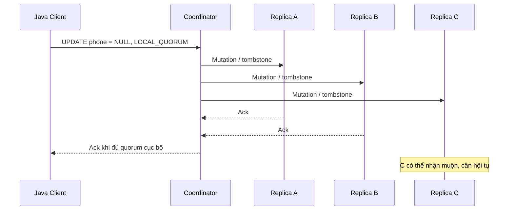

# Chọn NULL hoặc UNSET khi cập nhật cột

Một API Java nhận PATCH `{"city":"Hà Nội"}` cho hồ sơ đang có `phone="0900000000"`. Nếu DTO chuyển các thuộc tính không xuất hiện thành Java `null`, rồi binder ghi `NULL` xuống Apache Cassandra, **số điện thoại có thể bị xóa nhầm**. Trái lại, khi người dùng chủ động gửi `{"phone":null}` theo hợp đồng PATCH, nếu binder bỏ qua `phone`, số điện thoại cũ lại **không bị xóa** như yêu cầu.

Vấn đề nằm ở ba trạng thái của tham số ghi: **giá trị thực**, **CQL `NULL`** và **`UNSET`**. Trong Java Driver 4.x, tham số `NULL` biểu diễn một mutation xóa cell, thường tạo tombstone; tham số `UNSET` nghĩa là **không tác động đến cell đó**. Chúng có thể cho kết quả đọc giống nhau khi cell vốn đã vắng, nhưng không có cùng ý nghĩa. Phải quyết định từ **ý định nghiệp vụ**, không chỉ từ giá trị Java.

Bài thuộc chương **Truy vấn từ Java** của mô-đun **DATABASE_ENGINE_WIDE_COLUMN_CASSANDRA**: tìm hiểu kiến trúc phân tán, partition key/wide-column, truy vấn theo khóa, consistency đọc ghi, CQL, replication, compaction, repair, lỗi timeout và kết nối ứng dụng Java. Chọn đúng `NULL/UNSET` giúp tránh mất dữ liệu, giảm tombstone không cần thiết, và giữ đúng semantics của PATCH, TTL, last-write-wins (LWW) cũng như các read models.

> **Quy tắc mặc định cho PATCH đã định nghĩa hợp đồng ba trạng thái:** **vắng mặt → KEEP/UNSET**; **explicit JSON null → CLEAR/CQL NULL**; **có giá trị hợp lệ → SET/value**. HTTP PUT/replace, bulk import, trường bắt buộc và dữ liệu có quy tắc riêng cần hợp đồng khác; không áp đặt quy tắc PATCH lên mọi workflow.

## 1. Mục tiêu học tập

Sau bài này, bạn có thể:

1. Phân biệt `UNSET`, `NULL`, một giá trị thường, empty string và một trường JSON không có mặt.
2. Giải thích tombstone, TTL, timestamp và hậu quả read amplification của việc vô tình bind NULL hàng loạt.
3. Dùng `PreparedStatement.bind()`, `BoundStatement.setToNull()`, `unset()`, `isSet()` và `BoundStatementBuilder` của Java Driver 4.x.
4. Hiểu `BoundStatement` bất biến trong driver 4.x còn builder mutable; phân biệt chỉ số/tham số có tên.
5. Thiết kế DTO và REST PATCH ba trạng thái KEEP/CLEAR/SET, validate field cấp domain.
6. Phân biệt hành vi `INSERT`, `UPDATE`, `DELETE`, `INSERT JSON DEFAULT NULL/UNSET` và Mapper `NullSavingStrategy`.
7. Xử lý primary key, conditional/LWT, TTL, collection, counter, static column, retries và concurrency.
8. Chạy lab CQL/Java và xây test matrix/readback/monitoring để chứng minh dữ liệu đúng.

## 2. Bảng quyết định: NULL, UNSET, SET(value)

Giả sử row trong bảng `profiles_by_id` hiện có:

```text
tenant_id    = "tenant-a"
profile_id   = 11111111-1111-4111-8111-111111111111
display_name = "Minh"
phone        = "0900000000"
city         = "Đà Nẵng"
status       = "ACTIVE"
```

| Thao tác với marker `phone` | Ý định | Sau UPDATE hợp lệ, không có writer cạnh tranh | Có tạo tombstone cho phone vì thao tác này? |
| --- | --- | --- | --- |
| `setString("phone", "0911111111")` | **SET** giá trị mới. | `0911111111` | Không do hành động gán một giá trị sống. |
| `setToNull("phone")` | **CLEAR** giá trị. | Truy vấn `phone` thường trả null. | **Có**, biểu diễn xóa theo timestamp. |
| `unset("phone")` hoặc không gán marker | **KEEP**, không sửa cột. | `0900000000` vẫn còn. | **Không** tạo tombstone chỉ do UNSET. |

**UNSET không phải NULL “nhẹ hơn”.** Nó không tạo mutation cho cột đó; nếu giá trị đã có thì giữ nguyên, nếu cột chưa có thì vẫn vắng. Ngược lại, NULL là ý định xóa có hiệu lực trên các phiên bản giá trị cũ theo quy tắc timestamp của Cassandra.

### Bốn tầng cần phân biệt

| Tầng | Khái niệm | Ai quyết định? |
| --- | --- | --- |
| HTTP/JSON | Vắng `phone`, `"phone":null`, `"phone":"091..."`. | API contract và parser giữ presence. |
| Java/domain | KEEP, CLEAR, SET(value). | DTO có kiểu ba trạng thái và validation. |
| Driver | UNSET, CQL NULL, typed value. | Prepared/bound statement binder. |
| Cassandra | Bỏ qua column, tombstone, live cell/timestamp/TTL. | Mutation/storage semantics và replication. |

## 3. Vì sao Cassandra dùng tombstone khi ghi NULL?

Cassandra phân tán mutation tới các replica theo token/replication strategy. Khi xóa dữ liệu, việc xóa vật lý tức thì khỏi một replica không đủ: replica khác có thể đang Down và vẫn giữ giá trị cũ. Cassandra dùng **tombstone (deletion marker)** để đảm bảo replica bắt kịp cũng biết giá trị đã bị xóa.



Đây là sơ đồ giải thích, không phải tất cả đường RPC đều theo đúng thứ tự này. Với RF=3 trong DC, `LOCAL_QUORUM` cần hai phản hồi cục bộ cho yêu cầu thông thường; không chứng minh mọi replica/DC đã nhận và lưu mutation. `gc_grace_seconds`, compaction và repair liên quan trực tiếp tới việc xóa tombstone an toàn để tránh **zombie data**.

### Dấu hiệu NULL “không chủ đích”

Một ETL/mapper cập nhật hàng chục cột optional cho mỗi row nhưng hầu hết trường không có trong input. Nếu binder tạo NULL cho chúng, một lượng lớn tombstone không cần thiết có thể hình thành, khiến:

- SSTables giữ thêm dấu xóa và read path phải quét tombstones.
- Truy vấn trả ít live rows nhưng xử lý nhiều deleted/expired cells, tăng p95/p99.
- Compaction/repair cần I/O, và snapshots có thể giữ SSTables cũ lâu.
- Disk, heap/GC hoặc CPU tăng nếu workloads bị đọc khuếch đại.

**Không vì mục tiêu giảm tombstone mà bỏ qua xóa hợp lệ.** Với yêu cầu xóa thông tin cá nhân, NULL/DELETE là thao tác đúng; nhiệm vụ tối ưu là loại bỏ các tombstones **không cần thiết** do mapping sai.

## 4. UNSET ở tầng protocol, không phải giá trị lưu trong bảng

Trong Cassandra, UNSET là **trạng thái của bind variable** được hỗ trợ từ native protocol **v4** (Cassandra 2.2 trở lên), không phải một giá trị text/number có thể `SELECT`. Tham số chưa được gán hoặc được gọi `unset()` trở thành UNSET. Khi dùng ở các regular assignments hợp lệ trong `INSERT`/`UPDATE`, server bỏ qua thao tác tương ứng.

Các phân biệt quan trọng:

- Không gõ `UPDATE ... SET phone = UNSET` như một scalar CQL literal thông thường; dùng **prepared statement** với marker UNSET. Riêng `INSERT JSON ... DEFAULT UNSET` là cú pháp CQL được hỗ trợ.
- `UPDATE ... SET phone = null` là CQL hợp lệ để xóa giá trị.
- Primary key/WHERE conditions không phải optional regular columns; không thể để UNSET/NULL để tự bỏ một điều kiện khóa bắt buộc.
- Với native protocol v3 trở xuống, client phải cung cấp giá trị cho bind variables; **không** giả định unset được hỗ trợ trên server cũ.
- UNSET không làm Cassandra “thêm cột null” và không thể đọc lại như một trạng thái tồn tại trong schema.

### NULL khác absent sau khi đọc

Nếu SELECT trả `phone = null`, có ít nhất các khả năng: cột chưa từng được ghi, một giá trị trước đó đã bị xóa, TTL đã hết hạn, hoặc read response chưa phản ánh mutation mới nhất theo CL/replica. **Từ một SELECT đơn lẻ không thể suy ra** người gọi đã dùng `setToNull` hay `unset`.

## 5. Phạm vi sử dụng của mỗi trạng thái

| Câu lệnh/bối cảnh | UNSET hoặc cột bị bỏ qua | NULL rõ ràng | Ghi chú |
| --- | --- | --- | --- |
| `INSERT` theo cột/VALUES, non-key | Không đụng tới cột. | Xóa cell hiện có/có thể tạo tombstone. | INSERT của Cassandra là upsert. |
| `UPDATE SET regular = ?` | Bỏ qua update cột đó. | Xóa cột theo mutation timestamp. | Nên reject PATCH không có field thay đổi. |
| `DELETE phone FROM ...` | Không phải UNSET; là xóa chủ động. | Xóa có scope đúng. | Không nhầm với DELETE toàn row. |
| `INSERT JSON` | Phải chọn `DEFAULT UNSET` khi muốn giữ field vắng. | **Mặc định** JSON missing thành NULL. | Bẫy quan trọng của ETL. |
| Primary key | Không thể bỏ component bắt buộc. | Không thể dùng NULL để định vị row. | Validate ở API và binder. |
| `IF status = ?`/LWT | Không dùng UNSET để tự loại bỏ predicate. | NULL trong IF có semantics điều kiện riêng. | Query shape/condition phải rõ. |
| Collection/UDT/counter | Tùy loại statement/marker. | Có thể xóa toàn value/element. | Cần phân biệt cả collection và item. |

Không có một hàm mapping `javaValue == null ? UNSET : SET` luôn đúng. Với CLEAR, mapping ấy sẽ **giữ lại dữ liệu** mà người dùng muốn xóa. Cũng không có mapping `javaValue == null ? NULL : SET` luôn đúng, vì một PATCH thiếu field sẽ **xóa nhầm**.

## 6. Lab CQL: tạo bảng với partition key đầy đủ

Ví dụ dùng Cassandra lab có DC tên `dc1`, ít nhất ba nodes nếu chọn RF=3 và CL `LOCAL_QUORUM`. Nếu chỉ có một node, **điều chỉnh RF trên lab** cho phù hợp, không thay RF production để học. Các UUID/giá trị bên dưới là dữ liệu thử.

```sql
CREATE KEYSPACE IF NOT EXISTS java_null_unset_lab
WITH replication = {
  'class': 'NetworkTopologyStrategy',
  'dc1': 3
}
AND durable_writes = true;

CREATE TABLE IF NOT EXISTS java_null_unset_lab.profiles_by_id (
  tenant_id text,
  profile_id uuid,
  display_name text,
  phone text,
  city text,
  status text,
  labels map<text, text>,
  updated_at timestamp,
  PRIMARY KEY ((tenant_id, profile_id))
);

CONSISTENCY LOCAL_QUORUM;

INSERT INTO java_null_unset_lab.profiles_by_id
  (tenant_id, profile_id, display_name, phone, city, status, updated_at)
VALUES (
  'tenant-a',
  11111111-1111-4111-8111-111111111111,
  'Minh', '0900000000', 'Đà Nẵng', 'ACTIVE',
  '2026-11-21T08:00:00+0000'
);

SELECT display_name, phone, city, status
FROM java_null_unset_lab.profiles_by_id
WHERE tenant_id = 'tenant-a'
  AND profile_id = 11111111-1111-4111-8111-111111111111;
```

Partition key `(tenant_id, profile_id)` định vị một partition cho một hồ sơ; phù hợp bài học kiểm mutation cột mà không `ALLOW FILTERING`/quét toàn bảng. Nếu nghiệp vụ cần liệt kê mọi hồ sơ theo tenant, phải có access pattern/data model khác phù hợp, không suy từ ví dụ rằng bảng này hỗ trợ truy vấn ấy.

## 7. CQL viết tay: bỏ cột và xóa cột khác nhau

### A. UPDATE chỉ city

```sql
UPDATE java_null_unset_lab.profiles_by_id
SET city = 'Hà Nội'
WHERE tenant_id = 'tenant-a'
  AND profile_id = 11111111-1111-4111-8111-111111111111;

SELECT display_name, phone, city, status
FROM java_null_unset_lab.profiles_by_id
WHERE tenant_id = 'tenant-a'
  AND profile_id = 11111111-1111-4111-8111-111111111111;
```

Kỳ vọng: chỉ `city` đổi thành `Hà Nội`, `phone` vẫn giữ số cũ. Vì statement không nhắc các cột khác, nó tương đương **ý định** KEEP/UNSET các cột ấy trong một prepared UPDATE có nhiều markers.

### B. Xóa phone bằng NULL

```sql
UPDATE java_null_unset_lab.profiles_by_id
SET phone = null
WHERE tenant_id = 'tenant-a'
  AND profile_id = 11111111-1111-4111-8111-111111111111;

SELECT display_name, phone, city, status
FROM java_null_unset_lab.profiles_by_id
WHERE tenant_id = 'tenant-a'
  AND profile_id = 11111111-1111-4111-8111-111111111111;
```

Kỳ vọng: `phone` đọc ra null. Mutation tạo deletion marker theo timestamp; không có nghĩa byte dữ liệu cũ đã biến mất vật lý trên mọi replica/SSTable/backup ngay lập tức.

### C. DELETE đúng một cột

```sql
DELETE phone
FROM java_null_unset_lab.profiles_by_id
WHERE tenant_id = 'tenant-a'
  AND profile_id = 11111111-1111-4111-8111-111111111111;
```

`DELETE phone` là một cách thể hiện xóa cột có chủ đích, không giống UNSET. Đừng chạy `DELETE FROM ...` khi chỉ muốn xóa một cột, bởi bỏ danh sách cột sẽ có scope xóa khác.

## 8. Prepared statement với sáu markers

Chuẩn bị query một lần và sử dụng lại:

```sql
UPDATE java_null_unset_lab.profiles_by_id
SET display_name = ?,  -- index 0
    phone        = ?,  -- index 1
    city         = ?,  -- index 2
    status       = ?   -- index 3
WHERE tenant_id  = ?   -- index 4
  AND profile_id = ?;  -- index 5
```

Java Driver 4.x cung cấp:

- `ps.bind()`: tạo bound statement với các markers **chưa gán**, sau đó phải bind khóa.
- `ps.bind(Object... values)`: bind tuần tự; có thể truyền ít đối số hơn số marker, phần đuôi **UNSET**. Tránh nhầm varargs Java với `null`.
- `bound.setToNull(index/name)`: gán CQL NULL, **không** phải UNSET.
- `bound.unset(index/name)`: bỏ marker, kể cả trước đó đã gán giá trị.
- `bound.setString()/setUuid()/setLong()`: gán typed values.
- `ps.boundStatementBuilder()`: mutable builder để giảm intermediate bound objects, sau đó `build()`.

### Java: KEEP name/status, CLEAR phone, SET city

```java
import java.util.UUID;
import com.datastax.oss.driver.api.core.ConsistencyLevel;
import com.datastax.oss.driver.api.core.cql.PreparedStatement;
import com.datastax.oss.driver.api.core.cql.BoundStatement;

// Giả định CqlSession session đã được tạo tại application startup.
PreparedStatement ps = session.prepare(
    "UPDATE java_null_unset_lab.profiles_by_id " +
    "SET display_name = ?, phone = ?, city = ?, status = ? " +
    "WHERE tenant_id = ? AND profile_id = ?");

UUID profileId = UUID.fromString(
    "11111111-1111-4111-8111-111111111111");

BoundStatement bound = ps.bind()
    .unset(0)                 // KEEP display_name
    .setToNull(1)             // CLEAR phone
    .setString(2, "Hà Nội")   // SET city
    .unset(3)                 // KEEP status
    .setString(4, "tenant-a")
    .setUuid(5, profileId)
    .setConsistencyLevel(ConsistencyLevel.LOCAL_QUORUM);

session.execute(bound);
```

Nếu không có concurrent writers, `display_name="Minh"` và `status="ACTIVE"` được giữ, `phone` bị xóa, `city="Hà Nội"` được ghi. Không tự `setIdempotent(true)` cho mọi UPDATE mà chưa phân tích retry, TTL/LWW và các side effects nghiệp vụ.

## 9. BoundStatement bất biến trong Driver 4.x

Các setters của `BoundStatement` trong Java Driver 4.x trả về **một statement mới**, không thay đổi object cũ. Nếu bỏ giá trị trả về, bạn có thể gửi query chưa bind primary key hoặc thiếu ý định xóa.

**Sai:**

```java
BoundStatement b = ps.bind();
b.setString(4, "tenant-a"); // Bỏ kết quả, b không thay đổi.
b.setUuid(5, profileId);
b.setToNull(1);
// Không execute b: markers 4, 5 vẫn chưa được gán!
```

**Đúng:**

```java
BoundStatement b = ps.bind();
b = b.setString(4, "tenant-a");
b = b.setUuid(5, profileId);
b = b.setToNull(1);
b = b.unset(0);
b = b.unset(2);
b = b.unset(3);
session.execute(b);
```

Hoặc viết chain như mục 8. **Immutable statement** có thể được chia sẻ cho các lần thực thi với cùng bindings, nhưng khi cần thay một cột phải tạo statement mới. Không cache một mutable builder rồi sửa nó song song trên nhiều HTTP threads.

### Kiểm marker trước execute

```java
BoundStatement check = ps.bind()
    .setToNull(1)
    .setString(4, "tenant-a")
    .setUuid(5, profileId);

System.out.println(check.isSet(0));  // false = UNSET.
System.out.println(check.isSet(1));  // true = bound, dù là NULL.
System.out.println(check.isNull(1)); // true = CQL NULL.
System.out.println(check.isSet(4));  // true = tenant_id bound.
```

`isSet()` là phép kiểm tốt để phân biệt **unset marker** với marker đã gán. Khi đọc `isNull()`, trước tiên kiểm marker đã `isSet()` để không vô tình nhầm trường hợp unset với null trong introspection; metadata của bound statement không thay kiểm chứng kết quả CQL.

## 10. BoundStatementBuilder mutable và an toàn về hiệu năng

Nếu PATCH cập nhật 15 optional fields, việc chain immutable setters tạo nhiều intermediate instances. `BoundStatementBuilder` có thể tiết kiệm allocations và làm code nhánh rõ hơn, nhưng builder **không thread-safe**:

```java
import com.datastax.oss.driver.api.core.cql.BoundStatementBuilder;

BoundStatementBuilder builder = ps.boundStatementBuilder();
builder.setString(4, "tenant-a");
builder.setUuid(5, profileId);
builder.unset(0);
builder.setToNull(1);
builder.setString(2, "Hà Nội");
builder.unset(3);

BoundStatement statement = builder
    .setConsistencyLevel(ConsistencyLevel.LOCAL_QUORUM)
    .build();
session.execute(statement);
```

Đúng lifecycle: **PreparedStatement dùng chung**, **BoundStatementBuilder riêng mỗi operation**, `build()` rồi gửi immutable statement. Không tái sử dụng builder giữa các requests, tránh rò rỉ giá trị cũ/race condition.

### Named setters và positional setters

`builder.setToNull("phone")` và `builder.unset("city")` là API theo tên khi marker metadata xác định được. Nhưng nếu query có **cùng tên cột xuất hiện nhiều lần** (ví dụ cùng một timestamp ở hai predicates), named setters có thể không có semantics bạn mong muốn. Với những câu đó, dùng **indices** hoặc markers được đặt tên rõ, cập nhật tests khi thứ tự query thay đổi.

## 11. Từ HTTP PATCH đến ba trạng thái: không dùng Java null làm sentinel duy nhất

Hai payload:

```json
{"city":"Hà Nội"}
```

```json
{"phone":null,"city":"Hà Nội"}
```

Nếu DTO Java chỉ có `String phone`, cả hai thường được deserialize với `phone == null`. Một cách viết `builder.setString("phone", dto.phone())` sẽ biến **absent thành CLEAR**; ngược lại `if (dto.phone()!=null) ...` sẽ làm **explicit CLEAR thành KEEP**.

| JSON `phone` | Model | Binder | Quyết định |
| --- | --- | --- | --- |
| Vắng | KEEP | UNSET | Không thay cột. |
| `null` | CLEAR | setToNull | Xóa theo yêu cầu. |
| `"0911111111"` | SET(value) | setString | Ghi giá trị. |
| `""` | SET empty hoặc reject | Chỉ theo contract. | Không mặc định NULL. |
| `123` | INVALID | Không gọi Cassandra. | Lỗi type/validation. |

Lựa chọn này cần **API contract rõ ràng**: HTTP PUT/replace có thể yêu cầu khác, còn các field nhạy cảm có thể không cho CLEAR. `Optional.empty()` một mình cũng không biểu diễn được đồng thời **KEEP và CLEAR**.

## 12. Java 17: type-safe PATCH để giữ ý định

Ví dụ sử dụng một `enum` và một `record` tổng quát. Không cho phép `SET(null)`, vì muốn xóa phải gọi rõ `CLEAR`; không cho `KEEP` mang theo giá trị không sử dụng.

```java
import java.util.Objects;

public final class PatchTypes {
    public enum Action { KEEP, CLEAR, SET }

    public record FieldPatch<T>(Action action, T value) {
        public FieldPatch {
            Objects.requireNonNull(action, "action");
            if (action == Action.SET && value == null) {
                throw new IllegalArgumentException("SET needs value");
            }
            if (action != Action.SET && value != null) {
                throw new IllegalArgumentException(
                    "KEEP/CLEAR must not carry value");
            }
        }
        public static <T> FieldPatch<T> keep() {
            return new FieldPatch<>(Action.KEEP, null);
        }
        public static <T> FieldPatch<T> clear() {
            return new FieldPatch<>(Action.CLEAR, null);
        }
        public static <T> FieldPatch<T> set(T value) {
            return new FieldPatch<>(Action.SET,
                Objects.requireNonNull(value));
        }
    }

    public record ProfilePatch(
        FieldPatch<String> displayName,
        FieldPatch<String> phone,
        FieldPatch<String> city,
        FieldPatch<String> status) {
        public ProfilePatch {
            Objects.requireNonNull(displayName);
            Objects.requireNonNull(phone);
            Objects.requireNonNull(city);
            Objects.requireNonNull(status);
        }
    }
}
```

Đây là cú pháp Java **17+**; Java 8/11 có thể dùng class bất biến với cùng semantics. FieldPatch có ba trạng thái để không phải dựa vào marker giả như `"__DELETE__"` hoặc `null` đa nghĩa. Điều đó giúp kiểm thử và kiểm toán ý định theo từng column.

### Parser Jackson phải giữ field presence

```java
import com.fasterxml.jackson.databind.JsonNode;
import com.example.cassandra.PatchTypes.FieldPatch;

static FieldPatch<String> parseTextField(JsonNode root, String key) {
    if (root == null || !root.isObject()) {
        throw new IllegalArgumentException("JSON object required");
    }
    if (!root.has(key)) {
        return FieldPatch.keep();
    }
    JsonNode node = root.get(key);
    if (node.isNull()) {
        return FieldPatch.clear();
    }
    if (!node.isTextual()) {
        throw new IllegalArgumentException(key + " must be text or null");
    }
    return FieldPatch.set(node.textValue());
}
```

Đổi `com.example.cassandra` thành package thật khi tích hợp và đặt `PatchTypes` trong package tương ứng. `root.has(key)` trả true cho field có giá trị JSON `null`; `hasNonNull(key)` **không** phân biệt absent với explicit-null. Jackson là ví dụ parser; các thư viện HTTP/serializer khác cũng phải bảo toàn sự phân biệt này.

**Validation còn cần:** giới hạn kích thước body, field allowlist, phone format, quyền tenant, phân biệt `""` với null, ràng buộc status không thể bị CLEAR và log hành động xóa có kiểm soát. Không để client tự nhập `tenant_id` vượt khỏi authorization context.

## 13. Repository Java Driver 4.x: binder ba trạng thái

Ví dụ dưới đây dùng một `CqlSession` dài hạn của ứng dụng, prepare query một lần, tạo builder riêng cho từng request. Trong ví dụ này `status` chỉ được cập nhật qua workflow trạng thái riêng, `display_name` không cho phép CLEAR, còn `phone/city` có thể CLEAR nếu nghiệp vụ cho phép.

```java
import java.util.Objects;
import java.util.UUID;
import java.util.concurrent.CompletionStage;
import java.util.concurrent.CompletableFuture;
import com.datastax.oss.driver.api.core.CqlSession;
import com.datastax.oss.driver.api.core.ConsistencyLevel;
import com.datastax.oss.driver.api.core.cql.BoundStatement;
import com.datastax.oss.driver.api.core.cql.BoundStatementBuilder;
import com.datastax.oss.driver.api.core.cql.PreparedStatement;
import com.example.cassandra.PatchTypes.Action;
import com.example.cassandra.PatchTypes.FieldPatch;
import com.example.cassandra.PatchTypes.ProfilePatch;

public final class ProfilePatchRepository {
    private final CqlSession session;
    private final PreparedStatement update;

    public ProfilePatchRepository(CqlSession session) {
        this.session = Objects.requireNonNull(session);
        this.update = session.prepare(
            "UPDATE java_null_unset_lab.profiles_by_id " +
            "SET display_name = ?, phone = ?, city = ?, status = ? " +
            "WHERE tenant_id = ? AND profile_id = ?");
    }

    private static void apply(BoundStatementBuilder builder,
                              int marker,
                              FieldPatch<String> patch) {
        switch (patch.action()) {
            case KEEP -> builder.unset(marker);
            case CLEAR -> builder.setToNull(marker);
            case SET -> builder.setString(marker, patch.value());
        }
    }

    public CompletionStage<Boolean> patch(
            String tenantId, UUID profileId, ProfilePatch patch) {
        Objects.requireNonNull(tenantId);
        Objects.requireNonNull(profileId);
        Objects.requireNonNull(patch);
        if (tenantId.isBlank()) {
            throw new IllegalArgumentException("empty tenant");
        }
        if (patch.status().action() != Action.KEEP) {
            throw new IllegalArgumentException(
                "status must use a separate state-machine API");
        }
        if (patch.displayName().action() == Action.CLEAR) {
            throw new IllegalArgumentException(
                "display_name may not be cleared");
        }
        if (patch.displayName().action() == Action.KEEP
                && patch.phone().action() == Action.KEEP
                && patch.city().action() == Action.KEEP) {
            return CompletableFuture.completedFuture(false); // No-op.
        }

        BoundStatementBuilder b = update.boundStatementBuilder();
        b.setString(4, tenantId);
        b.setUuid(5, profileId);
        apply(b, 0, patch.displayName());
        apply(b, 1, patch.phone());
        apply(b, 2, patch.city());
        apply(b, 3, patch.status());

        BoundStatement statement = b
            .setConsistencyLevel(ConsistencyLevel.LOCAL_QUORUM)
            .build();
        return session.executeAsync(statement)
            .thenApply(ignored -> true);
    }
}
```

Đây là ví dụ khởi đầu, không phải một service production đã đủ audit, deadline, rate limit và idempotency. Một response `true` cho UPDATE thông thường **không chứng minh row đã tồn tại trước**: Cassandra UPDATE là upsert. Muốn “chỉ cập nhật nếu row tồn tại” cần contract riêng, có thể dùng LWT `IF EXISTS` với chi phí tương ứng. Nếu API yêu cầu xóa PII qua nhiều bảng/projections, một UPDATE trên bảng này chưa hoàn thành toàn bộ nghĩa vụ đó.

### Bốn bất biến của repository

1. Primary key `tenant_id/profile_id` **luôn có giá trị**, không lấy từ optional PATCH values.
2. Chỉ có thay đổi thực mới gửi CQL; PATCH rỗng không tạo mutation.
3. KEEP → `unset()`, CLEAR → `setToNull()`, SET → setter typed; không gán Java null ngầm.
4. `PreparedStatement` và session dùng chung được, `BoundStatementBuilder` là **per operation**.

## 14. Tests về marker: kiểm ý định trước khi chạm storage

Kiểm tra trạng thái của bound statement giúp bắt lỗi mapping mà chỉ so SELECT kết quả có thể bỏ sót.

```java
BoundStatement candidate = ps.bind()
    .unset(0)                 // display_name = KEEP
    .setToNull(1)             // phone = CLEAR
    .setString(2, "Hà Nội")   // city = SET
    .unset(3)                 // status = KEEP
    .setString(4, "tenant-a")
    .setUuid(5, profileId);

assert !candidate.isSet(0);
assert candidate.isSet(1) && candidate.isNull(1);
assert candidate.isSet(2) && !candidate.isNull(2);
assert !candidate.isSet(3);
assert candidate.isSet(4) && candidate.isSet(5);
```

Đây là biểu diễn các assertions; Java `assert` chỉ chạy khi bật `-ea`. Dùng JUnit/AssertJ trong thực tế. Mỗi trường hợp nên kiểm **input JSON → DTO → bound marker**, không chỉ gọi riêng `unset()` rồi coi đó là test logic.

### Test matrix bắt buộc

| JSON PATCH | display_name | phone | city | Kỳ vọng |
| --- | --- | --- | --- | --- |
| `{"city":"Hà Nội"}` | UNSET | UNSET | VALUE | Không xóa name/phone. |
| `{"phone":null}` | UNSET | NULL | UNSET | Xóa phone. |
| `{"phone":"0911111111"}` | UNSET | VALUE | UNSET | Đổi phone. |
| `{"phone":""}` | UNSET | VALUE rỗng hoặc reject | UNSET | Theo contract. |
| `{}` | UNSET | UNSET | UNSET | Không gửi mutation. |
| `{"display_name":null}` | Reject | — | — | Không vi phạm field constraint. |
| `{"status":null}` | — | — | — | Reject, status dùng workflow riêng. |
| `{"city":42}` | — | — | — | Reject sai kiểu trước CQL. |

### Integration tests trên lab

1. Seed row có **đầy đủ non-key values** trước mỗi test.
2. Call repository PATCH `city`; đọc lại bằng đầy đủ primary key ở `LOCAL_QUORUM`, xác nhận `phone/name/status` không đổi.
3. PATCH `phone=null`; xác nhận phone vắng, các cột khác giữ nguyên.
4. PATCH `phone=value`; xác nhận giá trị mới.
5. PATCH `{}` không gửi CQL theo giả định của repository.
6. Thử two concurrent writers cùng field và đọc kết quả theo LWW; không khẳng định UNSET giải quyết mọi race.
7. Kiểm riêng response khi timeout/retry và khi một replica tạm không sẵn sàng.

Nếu đã chạy lệnh CQL xóa phone ở mục 7, **seed lại số điện thoại ban đầu** trước test KEEP; nếu không, test không thể chứng minh “KEEP không xóa”.

## 15. INSERT bình thường: thiếu cột thì không ghi cột ấy

Cassandra `INSERT` là **upsert** theo primary key: nếu row đã có, chỉ các cells được chỉ định/ghi mới thay đổi theo timestamp. Một câu `INSERT INTO ... (tenant_id, profile_id, city) VALUES (...)` không tự xóa `phone` chỉ vì nó bị bỏ khỏi danh sách cột.

```sql
INSERT INTO java_null_unset_lab.profiles_by_id
  (tenant_id, profile_id, city)
VALUES (
  'tenant-a',
  11111111-1111-4111-8111-111111111111,
  'Huế'
);
```

Prepared INSERT có thể chứa marker cho nhiều cột:

```java
PreparedStatement insert = session.prepare(
    "INSERT INTO java_null_unset_lab.profiles_by_id " +
    "(tenant_id, profile_id, display_name, phone, city) " +
    "VALUES (?, ?, ?, ?, ?)");

BoundStatement b = insert.bind()
    .setString(0, "tenant-a")
    .setUuid(1, profileId)
    .unset(2)
    .unset(3)
    .setString(4, "Huế");
session.execute(b);
```

Trong đó markers 2/3 là UNSET, nên `display_name/phone` không bị thay đổi vì mutation này. Nếu đổi `unset(3)` thành `setToNull(3)`, phone sẽ bị xóa. Hai markers primary key **phải có giá trị**.

Một lời gọi `PreparedStatement.bind(Object... values)` với **ít** đối số hơn số bind markers để những marker cuối UNSET có thể hữu ích, nhưng cũng dễ vô tình **bỏ trống WHERE primary key ở cuối**. `bind()` + typed setters/explicit builder an toàn và dễ review hơn trong một PATCH linh động.

## 16. Bẫy của INSERT JSON: mặc định DEFAULT NULL

**Quan trọng:** `INSERT JSON` có quy tắc về cột vắng mặt **khác** với việc bỏ một cột khỏi danh sách `INSERT INTO (...)`.

```sql
-- Dữ liệu JSON chỉ có keys và city.
-- Nếu không chỉ định khác, Cassandra dùng DEFAULT NULL cho
-- những cột không xuất hiện trong INSERT JSON.
INSERT INTO java_null_unset_lab.profiles_by_id
JSON '{"tenant_id":"tenant-a","profile_id":"11111111-1111-4111-8111-111111111111","city":"Nha Trang"}';

-- Muốn giữ nguyên những cột không xuất hiện:
INSERT INTO java_null_unset_lab.profiles_by_id
JSON '{"tenant_id":"tenant-a","profile_id":"11111111-1111-4111-8111-111111111111","city":"Nha Trang"}'
DEFAULT UNSET;
```

Theo tài liệu CQL JSON của Apache Cassandra, `INSERT JSON` mặc định (hoặc `DEFAULT NULL`) gán NULL cho những cột **không có** trong JSON, có thể xóa giá trị cũ/sinh tombstones. `DEFAULT UNSET` giữ nguyên các cột vắng. Đây là một **nguồn mất dữ liệu lớn** nếu pipeline ETL gửi JSON sparse đến bảng đã tồn tại rows.

| Cách ghi | Không có `phone` trong dữ liệu gửi | Kỳ vọng trên row cũ có phone |
| --- | --- | --- |
| `INSERT INTO ... (pk, city) VALUES ...` | Phone không được chỉ định. | Giữ phone. |
| Prepared INSERT với marker phone=UNSET | Bỏ qua phone. | Giữ phone. |
| Prepared INSERT với marker phone=NULL | Xóa phone. | Phone vắng trên read. |
| `INSERT JSON ...` mặc định | Missing JSON field = NULL. | Có thể xóa phone. |
| `INSERT JSON ... DEFAULT UNSET` | Missing field = UNSET. | Giữ phone. |

**Không áp dụng `DEFAULT UNSET` tùy ý vào mọi UPDATE**: đây là cú pháp dành cho `INSERT JSON`. Kiểm thử chính xác với phiên bản Cassandra và driver đang dùng; tránh gộp các loại INSERT vào một abstraction “save” mà không hiểu semantics.

## 17. Cassandra Java Driver Mapper và NullSavingStrategy

Mapper 4.x tạo DAO/statement từ entity. Nếu Java entity property là null, **NullSavingStrategy** quyết định có bỏ qua hay gửi NULL:

| Chiến lược | Hành vi gần đúng của Mapper | Khi nào có ích | Rủi ro |
| --- | --- | --- | --- |
| **`DO_NOT_SET`** | Không gọi setter cho property null; để marker UNSET. | Entity partial write, tránh tombstones ngoài ý muốn. | Không thể xóa giá trị cũ chỉ bằng property null. |
| **`SET_TO_NULL`** | Gọi setter với null/CQL NULL. | Xóa rõ ràng hoặc replace theo contract. | Sparse PATCH có thể xóa nhiều cột không gửi. |

Tài liệu Apache Java Driver 4.19 mô tả mặc định `DO_NOT_SET` ở DAO/method khi không có override. Tuy nhiên có thể cấu hình `@DefaultNullSavingStrategy` trên DAO hoặc `nullSavingStrategy` riêng trên `@Update/@Insert`. Luôn kiểm mã được generate và version thực tế.

```java
import com.datastax.oss.driver.api.mapper.annotations.Dao;
import com.datastax.oss.driver.api.mapper.annotations.Update;
import com.datastax.oss.driver.api.mapper.annotations.DefaultNullSavingStrategy;
import static com.datastax.oss.driver.api.mapper.entity.saving.NullSavingStrategy.DO_NOT_SET;
import static com.datastax.oss.driver.api.mapper.entity.saving.NullSavingStrategy.SET_TO_NULL;

@Dao
@DefaultNullSavingStrategy(DO_NOT_SET)
public interface ProfileDao {
    @Update
    void updateIgnoringNulls(ProfileEntity entity);

    @Update(nullSavingStrategy = SET_TO_NULL)
    void updateClearingNulls(ProfileEntity entity);
}
```

Đây là ví dụ annotation; cần một `ProfileEntity` có `@Entity` và primary key mapping đúng, annotation processor/builder được cấu hình rồi mới biên dịch. **Không** đổi toàn DAO sang SET_TO_NULL chỉ để hỗ trợ một trường hợp xóa phone: với mọi field khác vắng trên DTO, thao tác có thể gây tombstones/đánh mất dữ liệu. Nếu cần ba trạng thái **trong cùng một PATCH**, ưu tiên DTO có presence và custom bound statement/dedicated DAO method.

### Không đồng nhất Java entity với JSON payload

Mapper chỉ thấy Java properties của entity; nó không nhất thiết biết JSON field nào hiện diện. Việc cập nhật entity đầy đủ lấy từ database khác với deserialize trực tiếp một **sparse PATCH**. Nên tách **command DTO** khỏi **storage entity**, kiểm soát mapping từng field và không dựa vào framework defaults để suy ý định xóa.

## 18. TTL: UNSET giữ cell cũ, SET có thể reset hạn

TTL thuộc về giá trị được ghi theo chính sách CQL/table:

| Hành động với phone | Ảnh hưởng tới TTL đang chạy |
| --- | --- |
| **UNSET** | Không ghi lại cell; TTL cũ tiếp tục giảm bình thường. |
| **SET(value)** | Ghi cell mới theo timestamp/TTL mới; có thể thay thời điểm hết hạn. |
| **NULL/DELETE** | Ghi tombstone; phone không còn được đọc như live value. |
| **SET cùng giá trị cũ với TTL mới** | Có thể gia hạn/đổi hạn tồn tại, dù business value trông không đổi. |

### Lab TTL

```sql
UPDATE java_null_unset_lab.profiles_by_id USING TTL 3600
SET phone = '0912345678'
WHERE tenant_id = 'tenant-a'
  AND profile_id = 11111111-1111-4111-8111-111111111111;

SELECT phone, TTL(phone), WRITETIME(phone)
FROM java_null_unset_lab.profiles_by_id
WHERE tenant_id = 'tenant-a'
  AND profile_id = 11111111-1111-4111-8111-111111111111;

-- Chỉ thay city, phone không bị ghi lại:
UPDATE java_null_unset_lab.profiles_by_id
SET city = 'Cần Thơ'
WHERE tenant_id = 'tenant-a'
  AND profile_id = 11111111-1111-4111-8111-111111111111;
```

`TTL(phone)` trả số giây còn lại, nên hai lần đọc cách nhau một khoảng thời gian sẽ không bằng nhau; `WRITETIME(phone)` trả storage write timestamp (microseconds), **khác** `updated_at` nghiệp vụ. Với cell vắng/đã xóa, hai hàm này không phải công cụ tra cứu lịch sử tombstone.

**Tương tác với `USING TTL`:** trong một UPDATE có nhiều markers, TTL của statement áp dụng cho các giá trị thực sự được ghi, **không làm mới cell UNSET**. `USING TTL 0` theo CQL có nghĩa không đặt TTL cho giá trị mới (hoặc loại bỏ default TTL theo quy tắc), **không** phải lệnh xóa cột.

## 19. LWW: UNSET giảm race không cần thiết, không tạo transaction mới

Cassandra quyết định phiên bản thắng của nhiều cells dựa trên **write timestamp**. Nếu PATCH A chỉ đổi city nhưng gửi lại phone cũ như một SET với timestamp mới, nó có thể ghi đè hành động xóa phone vừa được PATCH B thực hiện.

```text
T0: phone = "0900000000", timestamp 100
T1: writer B xóa phone: NULL, timestamp 200
T2: writer A đọc dữ liệu cũ, gửi phone = "0900000000",
    city = "Hà Nội", timestamp 300

Nếu A gửi cả phone: giá trị cũ có thể hồi sinh.
Nếu A dùng phone = UNSET: A chỉ ghi city,
việc xóa phone của B không bị A vô tình ghi đè.
```

**Nhưng** nếu A và B đều cố ý SET/CLEAR **cùng phone**, UNSET không giải quyết tranh chấp. Cần business version, ordered projector hoặc LWT/CAS trong partition khi phù hợp, đồng thời kiểm tra clock skew, TTL và idempotency. Đừng dùng timestamp tương lai cực lớn để ép mutation thắng, vì có thể ngăn các ghi hợp lệ sau đó.

### Ảnh hưởng nhiều bảng

Nếu một profile được denormalize thành `profiles_by_id` và `profiles_by_city`, PATCH chính xác trên một bảng **không** đảm bảo bảng kia tự cập nhật. Logged batch xuyên partitions không có isolation kiểu giao dịch RDBMS; cần quyền sở hữu mutation, idempotent projector, CDC/outbox hoặc reconciliation để giữ các read models đúng.

## 20. LWT và điều kiện: đừng UNSET marker IF

Nếu nghiệp vụ yêu cầu “xóa phone khi profile vẫn ACTIVE”:

```sql
UPDATE java_null_unset_lab.profiles_by_id
SET phone = null
WHERE tenant_id = 'tenant-a'
  AND profile_id = 11111111-1111-4111-8111-111111111111
IF status = 'ACTIVE';
```

Đây là LWT/conditional update và có overhead Paxos. Kết quả `[applied]=false` nghĩa là condition không đạt; Java Driver thực thi statement mà không gặp exception **không** đồng nghĩa mutation đã được áp dụng.

Nếu chuyển sang prepared form:

```sql
UPDATE java_null_unset_lab.profiles_by_id
SET phone = ?
WHERE tenant_id = ? AND profile_id = ?
IF status = ?;
```

- Marker phone trong `SET` có thể nhận giá trị hoặc NULL khi thực sự muốn xóa.
- WHERE key markers phải được bind đầy đủ.
- `IF status = ?` là **điều kiện**, không được tự “tắt điều kiện” bằng `UNSET`. Nếu request không có điều kiện, dùng query shape/authorization khác.
- `IF status = null` khi được hỗ trợ có nghĩa kiểm trạng thái null theo semantics Cassandra; **không** có nghĩa UNSET.
- CAS bảo vệ điều kiện trong phạm vi phù hợp, không biến mọi thao tác xuyên bảng/thực thể thành ACID transaction.

## 21. Primary key, static columns, collections, UDTs và counters

### A. Primary key

Các thành phần partition key/clustering key định danh hàng. `NULL`/`UNSET` không thể dùng để “bỏ qua một phần WHERE”. Đổi key thường yêu cầu **ghi hàng mới, xóa hàng cũ và reconciliation**, không phải SET NULL cho khóa.

### B. Static columns

Static column là dữ liệu ở cấp **partition**, không phải một clustering row thông thường. CLEAR trên static column có thể ảnh hưởng mọi truy vấn của partition đó; binder generic cần hiểu đúng phạm vi và quyền nghiệp vụ.

### C. Collections / UDTs

`NULL` cho cả `map<text,text>` khác thao tác xóa **một entry**. CQL có các phép thêm/sửa/xóa phần tử tùy kiểu:

```sql
UPDATE java_null_unset_lab.profiles_by_id
SET labels['segment'] = 'trial'
WHERE tenant_id = 'tenant-a'
  AND profile_id = 11111111-1111-4111-8111-111111111111;

DELETE labels
FROM java_null_unset_lab.profiles_by_id
WHERE tenant_id = 'tenant-a'
  AND profile_id = 11111111-1111-4111-8111-111111111111;
```

Lệnh đầu sửa một entry; lệnh sau xóa cả column `labels`. Với frozen collections/UDTs, việc thay một field có thể đồng nghĩa thay toàn giá trị; với non-frozen, có thể sửa từng phần theo loại. **Không** đánh đồng `setToNull("labels")`, `DELETE labels['segment']` và unset marker trong một assignment nếu chưa kiểm schema/version.

### D. Counter

Counter có phép `c = c + delta`, không nên dùng generic mapper `NULL/UNSET` của scalar để mô tả xóa/tăng counter. Retry counter increment có thể thực thi nhiều lần, cần semantic idempotency khác; “bỏ qua một counter field” không tự bù/rollback những increment đã xảy ra.

### E. Empty string, empty map và null

`""` là một giá trị text khác CQL NULL; tùy business domain có thể chấp nhận hoặc reject. Empty collection có semantics khác nhau theo kiểu/frozen/schema; một JSON `{"labels":{}}` không mặc nhiên là CLEAR hay KEEP. Định nghĩa chính xác hành vi cho từng loại thay vì áp dụng một mapper chung thiếu kiểm thử.

## 22. Readback: kiểm kết quả nghiệp vụ, không đọc được “lịch sử UNSET”

Sau mỗi mutation, readback đúng **full partition key** giúp kiểm value cuối của row theo consistency level phù hợp:

```sql
CONSISTENCY LOCAL_QUORUM;

SELECT display_name, phone, city, status,
       TTL(phone), WRITETIME(phone)
FROM java_null_unset_lab.profiles_by_id
WHERE tenant_id = 'tenant-a'
  AND profile_id = 11111111-1111-4111-8111-111111111111;
```

**Giới hạn quan trọng:**

- Truy vấn trả `phone=null` **không phân biệt** cột chưa từng có, đã bị xóa, đã hết TTL hoặc chưa hội tụ qua CL/DC.
- `WRITETIME(phone)` cho metadata giá trị đang đọc nếu có, **không phải nhật ký mọi deletion marker**.
- Đọc tại `LOCAL_QUORUM` xác nhận tập replica cần thiết trong DC tại thời điểm đọc, không tự chứng minh mọi replica/remote DC đã đồng bộ.
- Nếu cần audit ai xóa trường nào, phải có **audit/event log** ở ứng dụng và retention, không dựa vào CQL SELECT thông thường.
- Các field được UNSET **không có “cờ UNSET” lưu trong table** để truy vấn lại.

### Ba loại kiểm thử không được đánh đồng

| Loại | Cách đo | Kết luận phù hợp |
| --- | --- | --- |
| **Intent test** | Kiểm DTO presence và `BoundStatement.isSet/isNull`. | Binder dự định KEEP/CLEAR/SET đúng. |
| **Data outcome test** | SELECT theo key, compare business values, CL. | Kết quả hiện tại đúng ở phạm vi/timing được kiểm. |
| **Storage/performance test** | Table tombstone metrics, SSTables/read, compaction, p95/p99 với workload. | Tác động load/tombstone thay đổi theo điều kiện thử. |

Một intent test PASS không đủ chứng minh Cassandra đã áp dụng mutation; ngược lại data outcome PASS chưa chứng minh binder không phát sinh tombstones thừa trên nhiều requests khác.

## 23. Monitoring: đo CLEAR và KEEP để phát hiện lỗi sớm

Nếu một deploy đột ngột khiến `CLEAR` tăng gấp mười, đây có thể là lỗi mapping JSON absent → null. Cần đo ngay ở **application semantic layer**, không chờ tới khi Cassandra đọc chậm vì tombstone pressure.

| Nhóm | Metric/biểu đồ | Câu hỏi |
| --- | --- | --- |
| **API mutation intent** | Tỷ lệ SET/CLEAR/KEEP theo `query_name`, field category có cardinality hữu hạn. | CLR tăng sau đổi DTO/mapper không? |
| **Validation** | Invalid fields, null-forbidden, empty PATCH, wrong types. | Client có đang gửi payload ngoài contract? |
| **Driver** | Request rate, retries, timeout/unavailable, pool/in-flight, CL. | Một logical PATCH tạo bao nhiêu attempts? |
| **Table read path** | TombstoneScannedHistogram, SSTablesPerReadHistogram, read latency/p99. | Tombstone có ảnh hưởng read không? |
| **Storage** | Disk IOPS/latency, compaction backlog, SSTable count, snapshot retention. | Việc giữ deletion markers có làm tăng áp lực I/O không? |
| **Replica maintenance** | Repair progress/hints, DC/rack/node state. | Xóa có được hội tụ theo mục tiêu không? |
| **Business audit** | Số yêu cầu clear hợp lệ vs observed deletion outcomes. | Dữ liệu nhạy cảm đã được xử lý đủ scope chưa? |

Không log số điện thoại, raw partition key, tenant ID hoặc payload JSON đầy đủ vào Prometheus labels. Các trường `field_name`/`query_name` nên lấy từ tập allowlist nhỏ; operation ID và entity locator đã hash thuộc structured logs được phân quyền, không phải labels time series vô hạn.

### Công cụ Cassandra tham khảo

```bash
nodetool status
nodetool tablestats java_null_unset_lab.profiles_by_id
nodetool tablehistograms java_null_unset_lab profiles_by_id
nodetool tpstats
nodetool compactionstats
```

Lệnh/tên histogram khác theo Cassandra release. `tablestats` có thể cho biết tombstones scanned per read ở cấp bảng nhưng **không phải số tombstones do từng lời gọi setToNull tạo ra**. Đừng suy một snapshot nhỏ sau một UPDATE là benchmark có ý nghĩa; cần dataset và load đại diện, cùng CL/TTL/compaction.

## 24. Timeout, retry và trạng thái ghi chưa chắc chắn

Một mutation DELETE/NULL có thể đã tới một hoặc nhiều replica trước khi driver nhận `WriteTimeoutException`. **Timeout không đồng nghĩa mutation chắc chắn chưa được áp dụng**. Tự retry với timestamp không kiểm soát có thể ảnh hưởng LWW, còn retry business operation tạo UUID mới có thể nhân đôi thực thể.

### Checklist khi PATCH bị timeout

1. Giữ **business key và operation/idempotency key** ổn định; không tạo profile ID mới cho cùng PATCH.
2. Tách HTTP retry khỏi driver retry/speculation; đo số attempts và tổng deadline.
3. Với SET/CLEAR cùng cell, xét concurrent writes/TTL/write timestamps trước khi tuyên bố retry an toàn.
4. Xem RF/CL, coordinator/replica, disk/GC/network, compaction/repair; không chỉ tăng `request.timeout`.
5. Đọc lại theo khóa/CL, đối chiếu version/event ledger khi outcome không rõ; không dùng readback như bằng chứng lịch sử tombstone.
6. Khi không thể xác định kết quả, ghi `UNKNOWN_OUTCOME` và đưa vào reconciliation thay vì báo `SUCCESS`/`FAIL` giả.

### Phân loại lỗi

| Tín hiệu | Hướng điều tra | Không nên làm |
| --- | --- | --- |
| Key marker NULL/UNSET | Request validation, binding indices, profile ID. | Retry CQL không đổi input. |
| CQL `UnauthorizedException` | Role/permission, secret rotation. | Hạ consistency level. |
| `UnavailableException` | RF/CL, replica sống theo partition/DC. | Tăng timeout vô hạn. |
| `WriteTimeoutException` | Replica ack, disk/network, outcome chưa chắc. | Tạo request mới với business ID khác. |
| LWT `[applied]=false` | Điều kiện business không đạt. | Coi đó là success của mutation. |
| Tombstone scans/p99 tăng | NULL mapping, TTL/DELETE, SSTable/compaction. | Giảm `gc_grace_seconds` mù quáng. |

## 25. Những ngộ nhận/anti-pattern thường gặp

| Ngộ nhận | Vấn đề | Giải pháp |
| --- | --- | --- |
| “Java null nghĩa là không cập nhật.” | Có thể gửi CQL NULL xóa nhầm. | Intent ba trạng thái. |
| “Java null luôn nghĩa là clear.” | Bỏ qua trường có thể là PATCH absent. | Parser giữ field presence. |
| “UNSET xóa field mà không tạo tombstone.” | Nó không xóa giá trị cũ. | Dùng NULL/DELETE khi cần xóa. |
| “NULL và UNSET đọc ra giống nhau nên tương đương.” | Cùng kết quả đọc không nghĩa cùng mutation. | Test binder và giá trị. |
| “Cứ đổi mọi NULL thành UNSET sẽ hết p99.” | Vi phạm yêu cầu xóa hợp lệ. | Chỉ bỏ tombstone **không cần thiết**. |
| “BoundStatement setter sửa object cũ.” | Driver 4.x immutable. | Reassign/chain hoặc builder. |
| “Builder dùng chung giữa nhiều HTTP requests được.” | Mutable, dễ race/rò giá trị cũ. | Builder per-operation. |
| “Có thể bỏ marker primary key nếu chưa biết id.” | Không định vị được row. | Validate khóa trước DB. |
| “Một `INSERT` luôn thay cả row.” | Cassandra INSERT là upsert các cột được ghi. | Chỉ rõ replace semantics. |
| “INSERT JSON thiếu field mặc định giữ field cũ.” | Mặc định `DEFAULT NULL`. | `DEFAULT UNSET` khi muốn giữ. |
| “Mapper DO_NOT_SET sẽ xóa cột Java null.” | Nó giữ cell cũ. | Dedicated clear method. |
| “Mapper SET_TO_NULL là lựa chọn tốt cho mọi API.” | Sparse PATCH xóa hàng loạt cells. | DTO/binder theo intent. |
| “`USING TTL 0` nghĩa là xóa cell.” | TTL 0 không phải CQL NULL. | NULL/DELETE theo semantics. |
| “UNSET tự xử lý race/version.” | Chỉ không ghi cell đó. | LWT/ordering khi có concurrent SET/CLEAR. |
| “UPDATE thành công chứng minh row đã tồn tại.” | UPDATE là upsert. | LWT/ownership contract nếu cần. |
| “Repair khôi phục được field bị xóa nhầm.” | Repair hội tụ replica theo dữ liệu hiện tại. | Backup/event log/reconciliation có kiểm chứng. |
| “Giảm grace để xóa tombstones sớm luôn an toàn.” | Nguy cơ zombie khi replica bỏ lỡ deletion. | Tôn trọng repair và điều kiện compaction. |

## 26. Runbook khi deploy làm mất cột optional

**Tình huống:** Sau phiên bản API mới, hàng nghìn người dùng mất `phone` dù họ chỉ đổi `city`; metrics CLEAR tăng và read tombstone scans xấu đi.

1. **Khoanh sự cố:** xác định deployment SHA, query_name, service instances, DC/RF/CL, mốc UTC, các fields bị tác động.
2. **Ngăn xóa tiếp:** rollback binder hoặc feature flag theo change plan, không phát thêm mutation lỗi.
3. **Xác nhận root cause:** lấy mẫu request đã redaction, so JSON absent vs explicit null, DTO/parser và bound marker states.
4. **Đánh giá phạm vi dữ liệu:** danh sách entity keys bị ảnh hưởng, số CLEAR ngoài dự kiến, time window và các projections liên quan.
5. **Đánh giá storage/maintenance:** status/repair/compaction, TTL và khả năng đã tạo tombstone; không xóa SSTables bằng tay.
6. **Giữ bằng chứng:** audit, logs, backups, schema/driver versions, đủ để tái hiện request input và binding.
7. **Tìm nguồn phục hồi tin cậy:** snapshots/CDC/event log/đối soát; xác định user deletion hợp lệ để **không hồi sinh dữ liệu đã bị yêu cầu xóa**.
8. **Sửa có version/authority:** chỉ phục hồi giá trị cũ còn hợp lệ, xét updated_at/TTL/LWW và writers mới.
9. **Kiểm chứng bằng lab/canary:** absent, clear, set, empty, invalid, UPDATE/INSERT JSON, concurrency, unknown outcome.
10. **Rollout từng phần:** giám sát CLEAR/KEEP, p95/p99, tombstone scans, lỗi và feedback người dùng.
11. **Nghiệm thu consistency:** kiểm đúng partition keys và CL ở các DC, repair nếu cần, nhưng không coi repair thay cho restore.
12. **Postmortem:** viết contract PATCH, thêm tests/alerts, xác định owner và thời điểm hoàn thành.

Nếu tombstone có timestamp mới đã ghi, **không** dùng snapshot SSTable cũ để nạp bừa vào production đang có mutation mới. Timestamps và tombstones có thể làm dữ liệu cũ không xuất hiện hoặc làm hồi sinh sai; phục hồi phải được thử trong môi trường cách ly theo runbook.

## 27. Bài tập thực hành

### Bài A — Chọn ba trạng thái

Row ban đầu có `name='An'`, `phone='090...'`, `city='Huế'`. Hãy chọn `KEEP/UNSET`, `CLEAR/NULL` hoặc `SET(value)` cho từng cột khi nhận:

1. `{"city":"Hà Nội"}`.
2. `{"phone":null}`.
3. `{"phone":""}` khi domain cấm số rỗng.
4. `{}`.
5. `{"name":null}` khi domain không cho phép xóa tên.

Giải thích trường hợp nào **reject** thay vì gửi một UPDATE all UNSET hoặc SET NULL không hợp lệ.

### Bài B — Driver 4.x immutable

Sửa đoạn code sau để gán đủ khóa và xóa `phone`:

```java
BoundStatement b = ps.bind();
b.setString(4, "tenant-a");
b.setUuid(5, profileId);
b.setToNull(1);
session.execute(b);
```

Viết lại bằng chain, reassign và builder; thêm test `isSet()/isNull()` tại các marker 0–5. Phân biệt `BoundStatement` và `BoundStatementBuilder` về thread-safety.

### Bài C — Thực hành CQL/Java

1. Tạo schema và seed row ở mục 6.
2. UPDATE `city`, xác minh phone không đổi.
3. Prepared UPDATE với `phone=UNSET`, kiểm kết quả.
4. Prepared UPDATE với `phone=NULL`, kiểm kết quả.
5. Đối chiếu CQL `DELETE phone` và giải thích tombstone/replica.
6. Tại sao một SELECT phone=null không chứng minh lần ghi dùng NULL?

### Bài D — INSERT JSON

1. Seed một row có name/phone/city.
2. Thử `INSERT JSON` chỉ có keys/city, **không có** `DEFAULT UNSET`; kiểm những cột khác.
3. Seed lại; thử cùng JSON với `DEFAULT UNSET`.
4. So với `INSERT INTO (pk,city) VALUES ...`.
5. Thiết kế chính sách ETL để tránh xóa hàng loạt cột optional.

### Bài E — Cassandra Mapper

DAO dùng `@DefaultNullSavingStrategy(DO_NOT_SET)` nhưng người dùng gửi explicit `phone:null`. Kết quả có thể sai ở đâu? Tại sao đổi toàn DAO sang `SET_TO_NULL` lại nguy hiểm cho sparse PATCH? Đề xuất dedicated clear method hoặc tri-state binder, kèm tests âm/dương.

### Bài F — TTL và ngày hết hạn

Phone có `TTL(phone)=2400` giây còn lại.

1. Nếu PATCH chỉ đổi city và phone=UNSET, TTL phone thay đổi thế nào?
2. Nếu SET lại cùng giá trị phone với TTL 3600, rủi ro retention là gì?
3. Nếu phone=NULL, điều gì được ghi và vì sao không xóa vật lý ngay?
4. Tại sao `USING TTL 0` không tương đương DELETE?

### Bài G — Concurrent writers

Writer B xóa phone, writer A đang giữ bản copy cũ của profile rồi cập nhật city và đồng thời ghi lại phone cũ. A có storage timestamp mới hơn B.

1. Vì sao phone có thể xuất hiện lại?
2. Đổi A sang phone=UNSET giúp gì?
3. Nếu A và B **cùng** sửa phone, còn cần cơ chế business version/LWT nào?
4. Vì sao không chỉnh timestamp cực lớn để “cứ thắng”?

### Bài H — Xóa PII theo yêu cầu người dùng

Một API xóa dữ liệu nhạy cảm cần audit và xóa ở nhiều bảng projection. Nhóm đề xuất dùng UNSET để tránh tombstones.

1. Giải thích sai lầm về semantics.
2. Đề xuất workflow CLEAR có authority, event ID, CDC/reconciliation và retention.
3. Phân biệt ghi tombstone, replica hội tụ và physical data removal.
4. Nêu các điều kiện DONE/INCOMPLETE khi một DC đang lag.

### Bài I — Chẩn đoán p99 sau deploy Mapper

Một ứng dụng update 12 optional columns, trung bình chỉ 1 cột được client gửi. Sau khi đổi `DO_NOT_SET` thành `SET_TO_NULL`, số tombstone scanned/read và p99 tăng.

1. Lập giả thuyết về null mapping, TTL, GC/disk và compaction.
2. Thiết kế canary so CLEAR/KEEP ratio, read p99 và tablestats theo cùng workload.
3. Vì sao không tự động chuyển mọi NULL về UNSET?
4. Lập rollback và recovery plan nếu dữ liệu optional đã bị xóa.

### Tiêu chí hoàn thành

Học viên phải chứng minh đồng thời:

1. **Đúng ý định:** JSON absent, explicit null, value giữ được qua DTO và binder.
2. **Đúng Java Driver:** immutable statement, mutable builder, primary key và marker indices/names.
3. **Đúng Cassandra:** TTL/LWW/LWT, tombstone/repair và scope collections/counters.
4. **Đúng nghiệp vụ:** xóa có chủ đích, không xóa do field vắng, domain validation/PII.
5. **Đúng vận hành:** tests, metrics, CL, retry/unknown outcome và incident runbook.

## 28. Câu hỏi tự kiểm tra

1. NULL và UNSET khác nhau thế nào khi UPDATE một regular column đang có dữ liệu?
2. Vì sao NULL có thể tạo tombstone và liên quan đến repair/gc_grace_seconds?
3. Vì sao SELECT ra `null` chưa chứng minh cột từng bị setToNull?
4. Native protocol tối thiểu hỗ trợ UNSET bound variables là phiên bản nào?
5. Khi gọi `PreparedStatement.bind()` không đối số, các markers ở trạng thái gì?
6. Vì sao phải lưu giá trị trả về từ `BoundStatement.setToNull()/unset()`?
7. Builder khác BoundStatement ở tính mutable và thread-safety như thế nào?
8. Lúc nào positional setter rõ hơn named setter?
9. Java `String phone=null` không đủ biểu diễn PATCH vì sao?
10. JSON missing phone và `"phone":null` map thành trạng thái nào?
11. Empty string có mặc định tương đương CQL NULL không?
12. Có được để primary key marker UNSET hay NULL không?
13. Cassandra INSERT thông thường có tự xóa cột không được liệt kê không?
14. `INSERT JSON` mặc định xử lý missing fields ra sao?
15. `DEFAULT UNSET` có thể dùng với mọi UPDATE không?
16. Mapper DO_NOT_SET có xóa cột null không?
17. Mapper SET_TO_NULL gây rủi ro gì với sparse DTO?
18. Khi UNSET một cột đang có TTL, expiry thay đổi ra sao?
19. Vì sao `TTL 0` không phải lệnh xóa?
20. UNSET có ngăn lost update khi hai writer cùng chỉnh phone không?
21. Một `IF status=?` có thể bỏ qua nhờ UNSET status marker không?
22. Xóa toàn map khác xóa một map entry ở điểm nào?
23. Tại sao write timeout không đồng nghĩa mutation chắc chắn không áp dụng?
24. Những metrics nào giúp nhận biết tombstone read pressure?
25. Vì sao repair không khôi phục được giá trị nghiệp vụ bị xóa nhầm hợp lệ?
26. Những ca kiểm thử nào phải có trước khi bật một generic PATCH binder trên production?

## 29. Tài liệu tham khảo và đối chiếu theo phiên bản

- [Apache Cassandra Java Driver 4.19 — Prepared Statements](https://apache.github.io/cassandra-java-driver/4.19.0/core/statements/prepared/): `bind()`, trạng thái UNSET, immutable BoundStatement, builder và named/positional binding.
- [Apache Cassandra Java Driver 4.19 — Bindable API](https://apache.github.io/cassandra-java-driver/4.19.0/api/com/datastax/oss/driver/api/core/cql/Bindable.html): `isSet()`, `unset()` và container state.
- [Apache Cassandra Java Driver 4.19 — SettableByName API](https://apache.github.io/cassandra-java-driver/4.19.0/api/com/datastax/oss/driver/api/core/data/SettableByName.html): `setToNull()` và typed setters.
- [Apache Cassandra Java Driver 4.19 — Mapper Null Saving](https://apache.github.io/cassandra-java-driver/4.19.0/mapper/daos/null_saving/): `DO_NOT_SET`, `SET_TO_NULL`, DAO/method annotations.
- [Apache Cassandra — CQL Data Manipulation](https://cassandra.apache.org/doc/latest/cassandra/developing/cql/dml.html): INSERT/UPDATE/DELETE, TTL, LWT, mutation timestamp.
- [Apache Cassandra — CQL JSON Support](https://cassandra.apache.org/doc/latest/cassandra/developing/cql/json.html): `INSERT JSON` với `DEFAULT NULL/UNSET`.
- [Apache Cassandra — Tombstones](https://cassandra.apache.org/doc/latest/cassandra/managing/operating/compaction/tombstones.html): deletion markers, compaction, grace và zombie risk.
- [Apache Cassandra — Repair](https://cassandra.apache.org/doc/latest/cassandra/managing/operating/repair.html): replica convergence, khác với phục hồi logical values.
- [Apache Cassandra — Monitoring/Metrics](https://cassandra.apache.org/doc/latest/cassandra/managing/operating/metrics.html): tombstone scanned, SSTables per read, latency/compaction.

**Ghi nhớ:** **`UNSET` = không cập nhật cột**, còn **`NULL` = yêu cầu xóa giá trị bằng mutation/tombstone**. Cả hai có thể tạo kết quả SELECT giống nhau khi cột vốn vắng, nhưng **không có cùng semantics ghi**. Hãy bảo toàn ba ý định **KEEP / CLEAR / SET** từ API tới Java Driver, sử dụng đúng immutable `BoundStatement` hoặc builder riêng, phân biệt `INSERT JSON DEFAULT NULL/UNSET`, kiểm primary key/TTL/LWW/LWT, và nghiệm thu bằng **tests dữ liệu, metrics tombstone/read path, consistency và audit**. Không xóa một cột chỉ vì JSON không gửi nó; cũng không dùng UNSET để lảng tránh một yêu cầu xóa thực sự.
