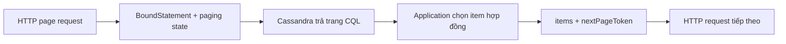

# Timeout, page size và thuộc tính theo từng truy vấn từ Java trong Apache Cassandra

## 1. Tại sao cấu hình theo từng truy vấn lại quan trọng?

Apache Cassandra là cơ sở dữ liệu phân tán **wide-column**: dữ liệu được phân bố theo **partition key**, nhân bản theo replication factor (RF), và được đọc/ghi qua coordinator với consistency level (CL). Trong module `DATABASE_ENGINE_WIDE_COLUMN_CASSANDRA`, thiết kế bảng theo truy vấn, CQL, replication, compaction, repair và xử lý lỗi đều ảnh hưởng đến thời gian một request thực sự hoàn thành.

Một ứng dụng Java thường có nhiều loại thao tác:

- API tra cứu một đơn hàng theo `order_id`, cần trả lời nhanh và ít hàng.
- API liệt kê đơn hàng theo `customer_id`, có thể trả nhiều trang.
- Worker cập nhật trạng thái hoặc ghi sự kiện, cần chọn CL/idempotency cẩn thận.
- Job đọc dữ liệu theo từng partition để đối soát, có ngân sách thời gian dài hơn nhưng phải **giới hạn tải**.

Nếu dùng cùng một timeout, page size và retry policy cho mọi truy vấn, hệ thống dễ gặp hai cực đoan: **timeout quá sớm** với truy vấn có phân trang hợp lệ, hoặc **giữ kết nối/request quá lâu** khi một partition quá lớn hay cluster đang chịu compaction.

Bài học này tập trung vào các thuộc tính của **mỗi statement trong Java Driver 4.x**:

1. **Timeout**: giới hạn thời gian xử lý request từ góc nhìn driver; phân biệt với deadline nghiệp vụ và timeout phía Cassandra.
2. **Page size**: kích thước trang dữ liệu CQL mà driver yêu cầu, không phải kích thước của một HTTP response.
3. **Thuộc tính theo truy vấn**: consistency level, serial consistency cho LWT, idempotence, execution profile, tracing và một số lựa chọn liên quan.

**Kết quả mong đợi:** bạn thiết lập được giá trị mặc định có kiểm soát, override từng statement bằng API phù hợp, hiểu tác động đến replica/CL, thực thi đồng bộ hoặc bất đồng bộ, xử lý timeout mà không gây ghi trùng và kiểm thử đúng yêu cầu hiệu năng.

## 2. Ví dụ nghiệp vụ và hai bảng theo truy vấn

Giả sử cluster có datacenter thực tên `dc1`, keyspace `commerce` với RF=3 tại DC này. Ví dụ schema để học:

```sql
CREATE KEYSPACE IF NOT EXISTS commerce
WITH replication = {
  'class': 'NetworkTopologyStrategy',
  'dc1': 3
};

-- Đọc một đơn hàng theo partition key.
CREATE TABLE IF NOT EXISTS commerce.orders_by_id (
  order_id uuid PRIMARY KEY,
  customer_id uuid,
  status text,
  updated_at timestamp
);

-- Liệt kê các đơn của một khách theo thứ tự thời gian.
CREATE TABLE IF NOT EXISTS commerce.orders_by_customer (
  customer_id uuid,
  created_at timestamp,
  order_id uuid,
  status text,
  PRIMARY KEY ((customer_id), created_at, order_id)
) WITH CLUSTERING ORDER BY (created_at DESC, order_id ASC);
```

**Lưu ý lab:** RF và tên DC phải phù hợp topology thực. Một cluster một node không đáp ứng được `RF=3` với `LOCAL_QUORUM`; muốn luyện tập trong lab một node, dùng RF phù hợp và ghi rõ sự khác biệt với production.

Hai truy vấn:

```sql
-- Truy vấn một partition và một hàng theo order_id:
SELECT order_id, status, updated_at
FROM commerce.orders_by_id
WHERE order_id = ?;

-- Truy vấn một partition có thể chứa nhiều hàng theo customer_id:
SELECT created_at, order_id, status
FROM commerce.orders_by_customer
WHERE customer_id = ?;
```

Đặt `pageSize=100` không biến truy vấn sai partition key thành truy vấn hiệu quả. Nếu partition `customer_id` quá lớn hoặc chứa nhiều tombstone, phải sửa **data model, retention và cách tổ chức partition**, không chỉ tăng timeout.

## 3. Ba tầng cấu hình: mặc định, execution profile, statement

Java Driver 4.x có các mức thiết lập:

| Tầng | Ví dụ | Mục đích |
| --- | --- | --- |
| **Cấu hình mặc định** | `basic.request.timeout`, `basic.request.page-size` | Thiết lập baseline cho các request không override |
| **Execution profile** | Profile `order-list` với page size nhỏ hơn hoặc timeout riêng | Gom các chính sách cho nhóm truy vấn có SLA giống nhau |
| **Thuộc tính statement** | `bound.setTimeout(...)`, `bound.setPageSize(...)` | Override cục bộ cho một request cụ thể |

Ví dụ cấu hình HOCON của Driver 4.x trong dự án Java:

```hocon
datastax-java-driver {
  basic {
    request {
      timeout = 2 seconds
      page-size = 500
      consistency = LOCAL_QUORUM
    }
  }
  profiles {
    order-list {
      basic.request.timeout = 4 seconds
      basic.request.page-size = 100
      basic.request.consistency = LOCAL_ONE
    }
  }
}
```

Đây là **mẫu minh họa**, không phải khuyến nghị chung về SLA/CL. Nếu API danh sách không cho phép stale reads, **không** dùng `LOCAL_ONE` chỉ vì muốn ít latency. Phải dựa trên hợp đồng nghiệp vụ, RF và cách ứng dụng đồng bộ dữ liệu.

Ví dụ chọn profile rồi override timeout ở statement:

```java
BoundStatement query = prepared.bind(customerId)
    .setExecutionProfileName("order-list")
    .setTimeout(Duration.ofSeconds(3))
    .setPageSize(80);
```

Khi thuộc tính có giá trị explicit ở statement, nó được dùng thay cho giá trị tương ứng của profile; với thuộc tính không override, driver tra cứu cấu hình của profile được chọn. Nếu không chọn profile, driver dùng cấu hình mặc định. Kiểm **chính xác các option được hỗ trợ bởi phiên bản driver đang dùng**; không giả định mọi cấu hình nâng cao đều có setter trên statement.

### Không thay đổi global config để xử lý một request đơn lẻ

Nếu chỉ một endpoint cần đọc theo trang 100 hàng, hãy cấu hình trên **statement hoặc profile**, không ép toàn ứng dụng chuyển sang page size 100. Điều này giữ sự tách biệt giữa truy vấn điểm, truy vấn liệt kê và worker.

## 4. Timeout: phải phân biệt bốn đồng hồ

Từ “timeout” không chỉ một cơ chế. Khi ứng dụng Java gửi một request, ít nhất có bốn lớp thời gian cần quan tâm.

| Loại | Nơi đặt | Khi hết thời gian | Cần hiểu |
| --- | --- | --- | --- |
| **Deadline nghiệp vụ** | HTTP/gRPC/worker/job | API không còn được phép chờ hoặc tiếp tục xử lý | Có thể bao gồm nhiều truy vấn Cassandra, logic ứng dụng và mạng |
| **Driver request timeout** | `basic.request.timeout` hoặc `Statement.setTimeout(Duration)` | Driver hoàn tất request với lỗi hết thời gian nếu chưa nhận kết quả hợp lệ | Timeout của client, **không hoàn tác CQL** đã đến server |
| **Server-side read/write timeout** | Cấu hình Cassandra theo version, CL, tình trạng replica | Coordinator trả lỗi `ReadTimeout`/`WriteTimeout` nếu không đủ phản hồi kịp | Có thể xảy ra trước timeout của driver |
| **Connection/initialization timeout** | Driver/network config | Không kết nối được node, mở session hoặc handshake | Khác timeout thực thi mỗi statement |

Ví dụ timeline:

```text
HTTP request           Java Driver               Cassandra
   |                         |                        |
   |-- gọi service --------->|                        |
   |                         |--- gửi CQL ----------->|
   |                         |                        | coordinator/replica đang xử lý
   |                         |<-- chưa có kết quả -----|
   |               [driver timeout]                   |
   |<-- 504/lỗi có kiểm soát--|                        | dữ liệu có thể đã ghi!
   |                         |                        | mutation có thể hoàn tất sau đó
```

Khi timeout xảy ra ở client, **không thể suy ra write chưa thành công**. Timeout nói rằng client chưa nhận được kết quả cần thiết trong ngân sách thời gian, không phải hệ thống có transaction tự rollback.

### 4.1. Đặt timeout theo statement

```java
BoundStatement readOne = selectById.bind(orderId)
    .setTimeout(Duration.ofMillis(700));

BoundStatement readList = selectByCustomer.bind(customerId)
    .setTimeout(Duration.ofSeconds(3))
    .setPageSize(100);
```

Hai timeout trên là **giá trị minh họa**. Một production service nên chọn qua SLO, phân phối latency thực đo, độ trễ mạng giữa DC, CL, lượng retry/speculation và deadline bên ngoài.

- Timeout quá thấp: tăng false failure, request bị retry không cần thiết và áp lực lên cluster.
- Timeout quá cao: giữ tài nguyên lâu, tăng backlog và che nguyên nhân hot partition/compaction.
- Không đặt timeout vô hạn cho request người dùng; phải có giới hạn rõ ràng và hệ thống hủy/đối soát phù hợp.
- Một truy vấn trả nhiều trang có thể dùng **nhiều request CQL riêng**; cần budget cho **toàn thao tác** chứ không chỉ mỗi lần fetch.

### 4.2. Quan hệ với HTTP deadline

Giả sử API có mục tiêu phản hồi trong `1.5 s` và thực hiện hai truy vấn Cassandra liên tiếp. Đặt mỗi truy vấn timeout `2 s` là mâu thuẫn với deadline, vì chỉ một query có thể tiêu hết thời gian API. Thay vào đó, tính **remaining budget**:

```text
API deadline = thời điểm bắt đầu + 1500 ms
Remaining budget trước query 1 = 1300 ms
Remaining budget trước query 2 = 500 ms
Nếu remaining budget <= ngưỡng tối thiểu:
    Dừng hoặc trả lỗi có kiểm soát, không gửi thêm CQL
```

Không chỉ cộng timeout máy móc: log/serialization/network và xử lý nghiệp vụ cũng chiếm thời gian. Nếu ứng dụng đang dùng framework có cancellation, phải biết **việc hủy future/call không đảm bảo dừng mutation đã gửi tới Cassandra**.

### 4.3. Khi timeout là kết quả của overload

Một partition có hàng triệu row, nhiều tombstone hoặc một node bị compaction nặng có thể khiến `ReadTimeout` tăng. Giải pháp gốc có thể là:

- Thiết kế lại partition key/bucket cho bảng time-series hoặc danh sách quá lớn.
- Giảm fan-out và in-flight requests của Java, cân bằng tải và backpressure.
- Kiểm replication/repair, disk I/O, GC, pending compactions, token ownership.
- Điều chỉnh page size dựa trên row size và dữ liệu thực.
- Xem driver/server metrics và xác định nguyên nhân trước khi đổi timeout.

**Tăng timeout không sửa hot partition hoặc node thiếu replica.**

## 5. Page size không phải LIMIT và cũng không phải HTTP pagination

`Page size` trong Driver 4.x là **số hàng mục tiêu cho mỗi lần trả trang ở giao thức CQL**. Nó giúp chia một result set lớn thành nhiều lần fetch thay vì cố đưa tất cả kết quả vào RAM/network trong một lần.

```java
BoundStatement statement = selectByCustomer.bind(customerId)
    .setPageSize(100);
```

Ý nghĩa thực tế:

- Đây là **kích thước trang phía protocol/driver**, không phải cam kết response sẽ có đúng 100 hàng.
- Cassandra có thể trả **ít hơn** tùy tình huống thực thi, kích thước dữ liệu và giới hạn bảo vệ. Cách driver tự động fetch cũng ảnh hưởng số hàng ứng dụng quan sát ở một thời điểm.
- `pageSize` không giới hạn **tổng** số hàng sẽ được đọc; nó chỉ chia quá trình nhận kết quả thành các trang.
- `LIMIT 100` trong CQL giới hạn số hàng CQL trả từ một truy vấn, khác với `pageSize=100` là chia trang dữ liệu. Có thể dùng cả hai tùy ý định.
- Page size không phải cơ chế bảo đảm request nhẹ: scan tombstone, lọc trên server hoặc partition khổng lồ vẫn có thể tốn tài nguyên.
- Không biến `pageSize` thành API contract “mỗi trang HTTP đúng 100 đơn” mà không có lớp xử lý paging state và ranh giới ứng dụng.

### 5.1. So sánh `LIMIT`, page size và business page

| Cơ chế | Điều khiển | Giới hạn tổng kết quả? | Ví dụ |
| --- | --- | --- | --- |
| CQL `LIMIT 50` | Tổng số row tối đa mà query trả theo semantics CQL | **Có** (đối với query đó) | Chỉ cần 50 đơn gần nhất |
| Driver `setPageSize(50)` | Gợi ý kích thước mỗi trang fetch | **Không** | Duyệt nhiều row nhưng fetch theo đợt |
| HTTP `pageSize=50` | Hợp đồng phân trang của API | Tùy implementation | Trả tối đa 50 item và token tiếp tục |
| Backpressure/bulkhead | Số request/row/job song song | Không trực tiếp | Tối đa 16 request Cassandra đang chờ |

Page size nhỏ giảm lượng dữ liệu của một lần fetch nhưng tăng số lượt đi mạng; page size lớn giảm round trips nhưng tăng khả năng đột biến RAM, I/O và latency một trang. Hãy benchmark với **kích thước hàng thực**, không chỉ số row.

### 5.2. Không dùng `ALLOW FILTERING` để “giải quyết” việc paging

Nếu bảng chỉ có partition key `order_id`, truy vấn `WHERE customer_id = ?` thường không phù hợp với thiết kế hiện tại. Việc thêm `ALLOW FILTERING` hoặc `setPageSize(100)` không biến nó thành truy vấn hiệu quả. Trong Cassandra, nên tạo bảng `orders_by_customer` phục vụ chính mẫu truy vấn này, kiểm cách phân vùng khi một customer có thể có số row rất lớn.

## 6. Thực hành Java Driver 4.x: cấu hình statement riêng cho từng truy vấn

Các ví dụ dùng API `com.datastax.oss.driver.api.*` của dòng Driver 4.x. Tọa độ Maven/Gradle và tính tương thích với Cassandra Server/JDK phải được chọn từ bản phát hành thực tế; không giả định mọi phiên bản đều có cùng package hoặc option.

### 6.1. Tạo session một lần

```java
import java.net.InetSocketAddress;
import com.datastax.oss.driver.api.core.CqlSession;

CqlSession session = CqlSession.builder()
    .addContactPoint(new InetSocketAddress("127.0.0.1", 9042))
    .withLocalDatacenter("dc1")
    .build();
```

Đây là lab không bật authentication/TLS. **Production phải cấu hình TLS, credentials/role quyền tối thiểu và secret an toàn**, không dùng endpoint mặc định một cách tùy tiện.

Trong ứng dụng thực, khởi tạo `CqlSession` một lần khi service start và **tái sử dụng**; không tạo session cho từng HTTP request. Đóng session lúc application shutdown.

### 6.2. Một chương trình đầy đủ: hai query, hai chính sách

```java
import java.net.InetSocketAddress;
import java.time.Duration;
import java.util.UUID;

import com.datastax.oss.driver.api.core.CqlSession;
import com.datastax.oss.driver.api.core.DefaultConsistencyLevel;
import com.datastax.oss.driver.api.core.cql.BoundStatement;
import com.datastax.oss.driver.api.core.cql.PreparedStatement;
import com.datastax.oss.driver.api.core.cql.ResultSet;
import com.datastax.oss.driver.api.core.cql.Row;

public final class PerQueryOptionsDemo {

    public static void main(String[] args) {
        UUID orderId = UUID.fromString(
            "11111111-1111-1111-1111-111111111111");
        UUID customerId = UUID.fromString(
            "22222222-2222-2222-2222-222222222222");

        try (CqlSession session = CqlSession.builder()
                .addContactPoint(new InetSocketAddress("127.0.0.1", 9042))
                .withLocalDatacenter("dc1")
                .build()) {

            PreparedStatement getOrder = session.prepare(
                "SELECT order_id, status, updated_at " +
                "FROM commerce.orders_by_id WHERE order_id = ?");

            PreparedStatement listOrders = session.prepare(
                "SELECT created_at, order_id, status " +
                "FROM commerce.orders_by_customer WHERE customer_id = ?");

            BoundStatement singleRead = getOrder.bind(orderId)
                .setConsistencyLevel(DefaultConsistencyLevel.LOCAL_QUORUM)
                .setTimeout(Duration.ofMillis(800))
                .setPageSize(20)
                .setIdempotent(true);

            Row one = session.execute(singleRead).one();
            if (one == null) {
                System.out.println("Order not found");
            } else {
                System.out.println("status=" + one.getString("status"));
            }

            BoundStatement listRead = listOrders.bind(customerId)
                .setConsistencyLevel(DefaultConsistencyLevel.LOCAL_QUORUM)
                .setTimeout(Duration.ofSeconds(3))
                .setPageSize(100)
                .setIdempotent(true);

            ResultSet rs = session.execute(listRead);
            int printed = 0;
            for (Row row : rs) {
                // Chỉ xử lý tối đa 10 hàng trong demo.
                // Với ResultSet đồng bộ, iterator CÓ THỂ tự fetch trang mới.
                System.out.println(row.getUuid("order_id"));
                if (++printed >= 10) {
                    break;
                }
            }
        }
    }
}
```

**Điều kiện và giới hạn:**

- Bảng phải tồn tại; `LOCAL_QUORUM` yêu cầu đủ replica theo RF tại `dc1`.
- `setTimeout` ở đây là **driver-side request timeout cho request thực thi/fetch**, không phải SLA của cả endpoint.
- `setPageSize(20)` ở query một hàng không làm nó nhanh hơn: phần lớn chỉ dùng để minh họa property.
- Vòng lặp `for (Row row : rs)` của **ResultSet đồng bộ** có thể tự fetch các trang tiếp; không nên lầm rằng nó chỉ duyệt trang đầu.
- Giới hạn in hàng của ví dụ **không** là `LIMIT 10` và không bảo đảm server không trả/fetch nhiều hơn; nếu chỉ cần tối đa 10 row, hãy cân nhắc `LIMIT` trong CQL.
- Trong production cần logging, error handling, TLS, kiểm deadline, giới hạn tài nguyên và mapping HTTP response phù hợp; không nên `System.out.println` từng row trên đường xử lý hiệu năng cao.

### 6.3. Immutable/copy-on-write behavior của statement

Các setter như `setTimeout`, `setPageSize`, `setConsistencyLevel` trong Driver 4.x tạo **statement mới hoặc phiên bản được điều chỉnh**, thay vì thay đổi âm thầm mọi nơi dùng statement gốc. Do đó nên **gán lại kết quả**:

```java
BoundStatement original = getOrder.bind(orderId);

// ĐÚNG: lấy đối tượng mới trả về từ setter.
BoundStatement configured = original
    .setTimeout(Duration.ofSeconds(1))
    .setPageSize(100);

// SAI về mặt kỳ vọng: gọi setter mà bỏ giá trị trả về.
// original.setTimeout(Duration.ofSeconds(1));
// session.execute(original); // vẫn có thể dùng giá trị cũ
```

Cách này đặc biệt quan trọng nếu bạn xây utility tạo statement hoặc lưu `PreparedStatement` dùng chung. **PreparedStatement có thể tái sử dụng**; tạo `BoundStatement` riêng cho từng bộ giá trị và request, không trộn thuộc tính của hai request khác nhau.

## 7. Hiểu phân trang đồng bộ: `ResultSet` tự fetch thêm khi duyệt

Ví dụ:

```java
ResultSet rs = session.execute(
    selectByCustomer.bind(customerId).setPageSize(100));

for (Row row : rs) {
    process(row);
}
```

Về mặt ý nghĩa, driver có thể lấy những trang tiếp theo khi iterator tiêu thụ hết số row đang có. Nếu `process(row)` chậm hoặc trả tất cả row thành một `List` không giới hạn, tài nguyên ứng dụng có thể tăng ngoài kiểm soát.

Trong ứng dụng đồng bộ:

- Tránh `rs.all()` trên result set có kích thước chưa biết; phương thức này có thể nạp rất nhiều row vào bộ nhớ.
- `rs.getAvailableWithoutFetching()` nếu sử dụng chỉ nói số row hiện sẵn **không cần fetch mạng**, không phải tổng số row của truy vấn.
- `rs.isFullyFetched()` giúp biết driver đã lấy hết các trang chưa, **không** phải bằng chứng dữ liệu Cassandra không còn có thể thay đổi.
- Thời gian xử lý **toàn vòng lặp** có thể lớn hơn timeout đặt trên statement, vì nhiều lần fetch và xử lý ứng dụng diễn ra qua nhiều giai đoạn.

Nếu một API chỉ muốn trả một trang, cần **phân trang có kiểm soát và token tiếp tục**, không duyệt vô hạn rồi mới cắt kết quả bằng số lượng mong muốn.

## 8. Phân trang bất đồng bộ: `AsyncResultSet` không tự fetch tất cả

Java Driver 4.x cung cấp `session.executeAsync(...)` trả một `CompletionStage<AsyncResultSet>`.

`AsyncResultSet.currentPage()` chỉ đại diện **trang hiện tại**. Khi `hasMorePages()` là `true`, phải gọi `fetchNextPage()` để tiếp tục.

Ví dụ helper giới hạn tối đa ba trang, chỉ đếm row để tránh I/O nặng trong callback:

```java
import java.util.concurrent.CompletableFuture;
import java.util.concurrent.CompletionStage;
import com.datastax.oss.driver.api.core.cql.AsyncResultSet;
import com.datastax.oss.driver.api.core.cql.Row;

public final class AsyncPageCounter {

    public static CompletionStage<Long> countAtMostPages(
            AsyncResultSet page, int remainingPages, long count) {

        long nextCount = count;
        for (Row ignored : page.currentPage()) {
            nextCount++;
        }

        if (remainingPages <= 1 || !page.hasMorePages()) {
            return CompletableFuture.completedFuture(nextCount);
        }

        final long accumulated = nextCount;
        return page.fetchNextPage()
            .thenCompose(nextPage ->
                countAtMostPages(nextPage, remainingPages - 1, accumulated));
    }

    // Ví dụ sử dụng sau khi đã tạo session và statement:
    // CompletionStage<Long> stage = session.executeAsync(statement)
    //     .thenCompose(page -> countAtMostPages(page, 3, 0));
}
```

Đây là mẫu **demand-driven**, mỗi lần chỉ fetch thêm một trang sau khi xử lý trang hiện tại. Nó không phải cách tính `COUNT(*)` toàn bảng; helper chỉ đếm số row đã duyệt tối đa ba trang.

Lưu ý:

- `CompletionStage` có thể chạy callback trên thread dùng bởi driver; không làm I/O chậm, blocking, xử lý JSON lớn hoặc gọi `join()` trong callback.
- Nếu cần xử lý lâu, dispatch công việc sang executor phù hợp và kiểm soát queue, thay vì dồn mọi thứ lên driver I/O threads.
- Chỉ cho phép số trang/in-flight phù hợp với RAM, deadline và SLO của workload.
- **Lỗi ở một lần `fetchNextPage()` không chứng minh các trang trước chưa được đọc**; API phải xác định cách tiếp tục/đối soát nếu pagination bị ngắt.

## 9. HTTP pagination và paging state: không đồng nghĩa với page size

Với API `GET /customers/{id}/orders?pageSize=50`, yêu cầu của client thường là trả **tối đa 50 item** và một `nextPageToken`. CQL driver page size chỉ hỗ trợ việc này; API còn phải quản lý **state tiếp tục**.

Về khái niệm:



Các nguyên tắc:

1. Paging state gắn với **câu CQL, bind values, keyspace và ngữ cảnh truy vấn**. Không tái sử dụng state của `customer A` cho `customer B` hoặc đổi điều kiện lọc/sort giữa chừng.
2. **Không tin token do client tự chế.** Nếu expose paging state qua HTTP, ký/xác thực hoặc mã hóa theo policy, gắn principal/tenant, query fingerprint và hạn dùng. Không coi paging state là bằng chứng phân quyền.
3. Bảo đảm request kế tiếp vẫn kiểm **authentication/authorization** và giới hạn số hàng; paging state không thay việc kiểm quyền ứng dụng.
4. Cassandra paging **không phải transaction snapshot**: nếu row được thêm/xóa/sửa giữa hai trang, kết quả có thể thay đổi. Với yêu cầu "báo cáo nhất quán tại thời điểm T", cần một nguồn dữ liệu hay chiến lược snapshot/đối soát khác.
5. Tùy phiên bản driver và loại API, dùng `PagingState`/execution information theo hướng dẫn tương ứng, tránh hard-code hoặc tự sửa bytes của paging state.
6. Đừng dựa vào paging state làm token bền vững **vượt qua mọi thay đổi schema, driver/native protocol hoặc thay đổi truy vấn**; cần chiến lược version/expiry và hành vi khi token không hợp lệ.

Nếu cần **keyset pagination** ổn định theo clustering columns, có thể thiết kế điều kiện tiếp tục theo khóa và thứ tự dữ liệu phù hợp bảng; cách này cũng cần tính cạnh tranh update, TTL, tombstone và giới hạn partition.

## 10. Những thuộc tính quan trọng khác của từng query

Ngoài timeout và page size, Java Driver 4.x hỗ trợ nhiều thuộc tính ở cấp statement.

| Thuộc tính | API điển hình | Mục đích | Cảnh báo |
| --- | --- | --- | --- |
| **Consistency level** | `setConsistencyLevel(...)` | Chọn số replica phản hồi theo CL | Không tự tăng tính đúng đắn nghiệp vụ xuyên nhiều bảng |
| **Serial consistency** | `setSerialConsistencyLevel(...)` | Dùng cho LWT/CAS với `IF` | Chỉ có ý nghĩa trong thao tác conditional phù hợp |
| **Idempotence** | `setIdempotent(true/false)` | Cho driver biết an toàn hay không khi thử lại/đầu cơ trong các trường hợp chính sách cho phép | Gán sai có thể làm side effect xảy ra nhiều lần |
| **Execution profile** | `setExecutionProfileName("...")` | Chọn nhóm giá trị cấu hình request | Override tường minh tại statement vẫn ưu tiên khi thích hợp |
| **Tracing** | `setTracing(true)` | Yêu cầu server lưu trace để điều tra truy vấn | Tăng overhead; không bật đại trà |
| **Page size** | `setPageSize(n)` | Chọn target row count mỗi trang | Không đồng nghĩa `LIMIT` |
| **Request timeout** | `setTimeout(Duration)` | Deadline từ góc nhìn driver cho request | Không phải transaction rollback hoặc SLA toàn API |
| **Paging state** | `setPagingState(...)` nếu hỗ trợ | Tiếp tục query phân trang cùng ngữ cảnh | Chỉ dùng state hợp lệ cho cùng query/bind values |

### 10.1. Ví dụ cấu hình một truy vấn đọc

```java
BoundStatement read = selectById.bind(orderId)
    .setConsistencyLevel(DefaultConsistencyLevel.LOCAL_QUORUM)
    .setTimeout(Duration.ofMillis(900))
    .setPageSize(200)
    .setIdempotent(true)
    .setTracing(false);
```

`SELECT` thuần đọc thường có thể được đánh dấu idempotent, **nếu** không làm thay đổi trạng thái bên ngoài và nghiệp vụ cho phép retry. `setTracing(false)` minh họa không bật tracing đại trà; production nên sử dụng trace có chọn lọc, kết hợp metrics.

### 10.2. LWT và serial consistency

Một conditional update thường có dạng:

```sql
UPDATE commerce.orders_by_id
SET status = 'PAID'
WHERE order_id = ?
IF status = 'CREATED';
```

Với Driver 4.x:

```java
BoundStatement conditional = updateStatusIfCreated.bind(orderId)
    .setConsistencyLevel(DefaultConsistencyLevel.LOCAL_QUORUM)
    .setSerialConsistencyLevel(DefaultConsistencyLevel.LOCAL_SERIAL)
    .setTimeout(Duration.ofSeconds(3))
    .setIdempotent(false);
```

**Phân biệt:**

- Normal consistency (`LOCAL_QUORUM`) và serial consistency (`LOCAL_SERIAL`) kiểm soát những pha khác nhau của LWT theo thiết kế Cassandra.
- LWT có chi phí/độ trễ khác query thường. Không tăng timeout tùy tiện mà thiếu quan sát contention và replica.
- Nếu client timeout, **CAS có thể đã commit hoặc chưa**; ứng dụng phải kiểm trạng thái/idempotency/decision nghiệp vụ thay vì retry vô điều kiện.
- `setIdempotent(false)` trong ví dụ là lựa chọn bảo thủ khi không có chứng minh retry an toàn. Với một workflow cụ thể có điều kiện/version và bảo đảm chống lặp, có thể áp dụng chính sách riêng đã được kiểm thử.

**Quan trọng:** giá trị `status` là trạng thái nghiệp vụ; nếu có hai worker cạnh tranh, chỉ nhìn timeout không đủ. Cần dùng LWT hoặc quy tắc đồng bộ/version theo thiết kế để tránh cập nhật sai.

### 10.3. Tracing chỉ nên dùng khi điều tra

`setTracing(true)` có thể giúp quan sát việc coordinator/replica xử lý truy vấn, nhưng tracing có chi phí và metadata phát sinh. Không bật cho tất cả request production, đặc biệt với traffic lớn. Cần permission/quy trình quan sát phù hợp và thời hạn thu thập rõ.

## 11. Idempotence, retry và speculative execution

Truy vấn gửi đến Cassandra có thể có ba kết cục từ góc nhìn client:

1. **Thành công rõ ràng:** nhận response hợp lệ.
2. **Thất bại rõ ràng:** server trả lỗi xác định, hoặc không thể kết nối tới đủ node.
3. **Không rõ kết quả:** timeout/đứt mạng trước response; mutation có thể đã được áp dụng.

`Idempotent` nghĩa là lặp lại thao tác không làm sai ý nghĩa kết quả nghiệp vụ đã định nghĩa. Đây là **đặc tính của thao tác**, không phải một “mẹo tăng tốc”.

| Thao tác | Có thể đánh dấu idempotent? | Phải kiểm tra |
| --- | --- | --- |
| `SELECT` theo partition key | Thường có | Không có side effect ngoài CQL; nghiệp vụ chịu được read retry |
| `INSERT/UPDATE` đặt giá trị cố định | Phụ thuộc | Timestamp, TTL, trigger/event bên ngoài, side effect và concurrent writes |
| `UPDATE counter = counter + 1` | **Không** mặc định | Retry có thể cộng nhiều lần |
| Ghi với `TTL` tương đối | Không mặc định | Retry có thể thay thời điểm hết hạn |
| LWT `IF` | Không tự suy là có | CAS result, contention, business decision và retry |
| Batch nhiều mutation | Phải phân tích từng mutation | Logged batch không phải transaction ứng dụng cách ly xuyên mọi partition |

`setIdempotent(true)` không buộc driver retry tất cả exception. **Retry policy** và **speculative execution policy** quyết định khi nào thử lại/đầu cơ, còn idempotency giúp giới hạn những gì có thể thử an toàn. Cấu hình retry quá mạnh khi cluster đang overload thường làm tình hình xấu hơn.

Ví dụ phản ví dụ:

```sql
-- Không được tự retry trên timeout mà không có idempotency:
UPDATE commerce.order_counters
SET total = total + 1
WHERE customer_id = ?;
```

Đây là minh họa ý tưởng counter; bảng counter thực tế phải khai báo đúng kiểu `counter` và khóa tương ứng. Một retry do client không biết mutation đã áp dụng chưa có thể làm tăng `total` thêm lần nữa.

**Không coi hủy request từ Java là bù trừ transaction.** Với hoạt động quan trọng, cần event ID, conditional version, outbox hoặc nguồn sự thật và đối soát nghiệp vụ.

## 12. Timeout và page size khi truy vấn có nhiều trang

Giả sử khách hàng có 12.000 đơn, ứng dụng yêu cầu page size 100. Về mặt gần đúng, việc duyệt tất cả có thể cần nhiều lần fetch. Nếu mỗi request riêng có timeout `2 s`:

- Không có nghĩa toàn bộ quá trình duyệt 12.000 row **phải hoàn tất trong 2 s**.
- Mỗi lần fetch và xử lý ứng dụng cần thời gian, nên có thể vượt deadline HTTP ngay cả khi từng fetch thành công.
- Nếu backend vừa fetch vừa serialize từng row, có thể phải áp dụng timeout cho **toàn công việc** và kiểm sau mỗi trang.
- Khi có retry/hot partition, số lượt và thời gian thực tế tăng.

### Thiết kế ba ngân sách

Ví dụ cho endpoint danh sách:

| Ngân sách | Ví dụ minh họa | Cách áp dụng |
| --- | ---: | --- |
| Deadline HTTP | 1500 ms | Tổng thời gian service được phép tiêu |
| Driver timeout mỗi fetch | 700 ms | Không để một fetch chiếm toàn bộ ngân sách |
| Số trang/row mỗi response | 1–2 trang, tối đa 100 item | Giới hạn RAM và payload |

Các con số **chỉ để minh họa**, không là cấu hình chuẩn. Phải benchmark row size, network, RF/CL, startup cost, p95/p99 và SLO. Nếu muốn **đúng 100 item** cho HTTP, có thể phải xử lý trang CQL chưa đủ 100 row, bộ lọc nghiệp vụ và token tiếp tục; không giả định một trang CQL tương ứng một trang HTTP.

### Không đánh đổi tính đúng đắn lấy latency

Nếu ứng dụng cần đọc dữ liệu mới nhất sau write trong cùng DC, việc đổi CL từ `LOCAL_QUORUM` sang `LOCAL_ONE` chỉ để tránh timeout có thể vi phạm hợp đồng nhất quán. Trước tiên hãy xác định nguyên nhân replica chậm, dữ liệu lớn, timeout budget, sửa lại truy vấn hoặc mô hình.

## 13. Phân biệt các loại lỗi và xử lý an toàn trong Java

Một số lỗi quan trọng theo góc nhìn Java Driver:

| Dấu hiệu | Tầng xảy ra | Khả năng mutation đã được ghi | Hành động |
| --- | --- | --- | --- |
| Driver-side request timeout | Client hết budget chờ | **Có thể** | Log request ID/context, không retry write thiếu idempotency; đối soát |
| `ReadTimeoutException` | Coordinator đọc từ replica không đạt điều kiện kịp thời | Không áp dụng write cho SELECT | Kiểm CL, partition, I/O, tombstone, replica và retry có kiểm soát |
| `WriteTimeoutException` | Coordinator không nhận đủ write acknowledgement | **Có thể** một phần hoặc đủ replica đã xử lý | Dùng idempotency/đối soát, kiểm write type và replica |
| `UnavailableException` | Coordinator nhận thấy không đủ replica cho CL | Thường request chưa đáp ứng điều kiện thực hiện | Kiểm RF/DC/node state; không tự giảm CL |
| Lỗi kết nối/node mất | Network/transport | Có thể không rõ nếu request đã gửi | Đọc driver logs, retry policy và idempotence |
| `InvalidQueryException` | CQL/schema | Thường lỗi cú pháp hoặc query không hợp lệ | Sửa CQL/schema; không giải bằng tăng timeout |
| Lỗi auth/permission | RBAC hoặc TLS/auth | Query bị từ chối | Cấp quyền tối thiểu hoặc sửa thông tin xác thực |

Tên exception có thể khác theo phiên bản driver; bảng nhấn mạnh **loại lỗi và hành động**, không phải một hierarchy class hoàn chỉnh. Không viết catch `Exception` rồi retry mọi request trong vòng lặp.

### Ví dụ pattern xử lý với request bất đồng bộ

```java
CompletionStage<AsyncResultSet> future = session.executeAsync(statement);

future.whenComplete((page, error) -> {
    if (error != null) {
        // Ghi loại truy vấn, logical request ID, deadline và lỗi;
        // KHÔNG ghi password hoặc giá trị dữ liệu nhạy cảm.
        // Không auto-retry mutation khi chưa chứng minh idempotent.
        recordFailure(error);
        return;
    }
    recordSuccess(page);
});
```

`recordFailure` và `recordSuccess` là hàm của ứng dụng **chưa được khai báo trong snippet**, chỉ minh họa ranh giới xử lý. Các callback phải nhẹ; I/O chậm cần chuyển sang executor. Trong production, propagate lỗi và mapping HTTP phù hợp thay vì chỉ log rồi coi request thành công.

## 14. Execution profile: gom cấu hình theo workload

Khi nhiều endpoint cần cùng chính sách, profile giúp code ít lặp và dễ review.

Ví dụ profile `order-point-read` và `order-list`:

```hocon
datastax-java-driver {
  profiles {
    order-point-read {
      basic.request.timeout = 700 milliseconds
      basic.request.consistency = LOCAL_QUORUM
      basic.request.page-size = 100
    }
    order-list {
      basic.request.timeout = 2500 milliseconds
      basic.request.consistency = LOCAL_QUORUM
      basic.request.page-size = 150
    }
  }
}
```

Trong Java:

```java
BoundStatement getOrder = selectById.bind(orderId)
    .setExecutionProfileName("order-point-read");

BoundStatement listOrders = selectByCustomer.bind(customerId)
    .setExecutionProfileName("order-list")
    .setPageSize(80); // Override riêng trường hợp này.
```

**Lợi ích:** logic nghiệp vụ chọn profile mang ý nghĩa rõ ràng, còn các giá trị số có thể được điều chỉnh qua cấu hình được review. Nhưng không nên tạo hàng trăm profile giống nhau chỉ khác vài mili giây; profile cũng phải có owner, mục tiêu SLO và kiểm thử.

Cần phân biệt **driver configuration** với **Cassandra table option** như `compaction`, `compression`, `default_time_to_live`. Việc đổi profile timeout không làm thay đổi SSTable, TTL, replication hay dữ liệu lưu trên server.

## 15. Runbook: tối ưu timeout và page size cho endpoint chậm

Bối cảnh: `GET /customers/{customerId}/orders` gặp p99 cao và `ReadTimeout` lúc cao điểm.

### Pha A — Đặt baseline trước khi đổi

1. **Xác minh query/data model**: `WHERE customer_id = ?` dùng bảng `orders_by_customer`, đo số row/partition, row size, TTL/tombstone.
2. **Kiểm cluster**: node `UP`, RF/CL, compaction backlog, disk I/O, GC, repair và network.
3. **Kiểm Java Driver**: request timeout, page size, execution profile, in-flight count, pool/connection, retry/speculative attempts.
4. **Đo tải thật**: p50/p95/p99 của một page và toàn API, số trang đã fetch, row/bytes, tỷ lệ timeout, retry và HTTP deadline.
5. **Chọn mục tiêu**: giảm p99 mà không tăng dữ liệu stale, lỗi hoặc tải cluster ngoài ngưỡng.

### Pha B — Thử nghiệm có kiểm soát

- Trong staging, thử `pageSize` 50, 100, 200 với dữ liệu đại diện; xem latency/page, số round trips, heap và throughput.
- Thử timeout theo SLO, ví dụ `700 ms` vs `1 s`, nhưng đo tỷ lệ false timeout và số request thực xử lý.
- Giới hạn số request async cùng lúc thay vì tăng concurrency vô hạn.
- Chỉ đổi một nhóm tham số mỗi lần để biết nguyên nhân thay đổi kết quả.
- Giữ nguyên consistency level trừ khi thay đổi CL là một quyết định nghiệp vụ được phê duyệt riêng.

### Pha C — Rollout và quan sát

```text
SLO & baseline
   -> kiểm partition/data model
   -> thử timeout/page size
   -> kiểm backpressure/retry/idempotency
   -> canary một phần traffic
   -> so sánh p99, error, requests/page và cluster health
   -> mở rộng rollout hoặc revert cấu hình
```

Điều kiện dừng: p99 vượt ngưỡng, tỷ lệ `Unavailable`/`ReadTimeout` tăng, in-flight/backlog tăng, hoặc tổng số request/page gây tải nặng hơn. Nếu giảm page size làm tăng round trips quá mức, cân nhắc tối ưu schema và giới hạn HTTP rows thay vì cố thu nhỏ vô hạn.

### Pha D — Viết lại hợp đồng vận hành

Ghi lại:

- Profile và thuộc tính statement nào thay đổi, version code/config, ngày triển khai.
- Deadline HTTP và timeout CQL thực tế, số fetch tối đa, response row size.
- Quy tắc retry/idempotence theo loại thao tác.
- Điều kiện revert và người chịu trách nhiệm.
- Kết quả load test với cùng RF/CL/topology và dữ liệu tương đương production.

## 16. Bảng lỗi cấu hình thường gặp

| Sai lầm | Hệ quả | Cách sửa |
| --- | --- | --- |
| Đặt `setTimeout(10s)` trong API deadline 1s | Request sống lâu hơn ngân sách API | Tính remaining budget và giới hạn driver timeout |
| Cho rằng timeout nghĩa write thất bại | Retry làm ghi trùng, đặc biệt counter/LWT workflow | Idempotency, request ID và đối soát |
| `setPageSize(100)` rồi đọc `ResultSet.all()` | Có thể nạp toàn result set vào RAM | Duyệt theo demand, giới hạn row/page |
| Xem page size là HTTP page size | Response dư/thiếu item, token tiếp tục sai | Thiết kế API pagination riêng |
| Dùng `ALLOW FILTERING` vì đã bật paging | Full scan/overload | Thiết kế bảng theo truy vấn/partition key |
| Lấy một page async rồi coi đã xong | Bỏ sót những trang tiếp theo | Dùng `hasMorePages()` và `fetchNextPage()` |
| Bỏ giá trị trả về của `setTimeout`/`setPageSize` | Statement chưa nhận cấu hình như kỳ vọng | Gán lại BoundStatement mới |
| Đánh dấu counter update idempotent | Retry có thể tăng counter nhiều lần | Mark non-idempotent và dùng thiết kế đối soát |
| Hạ CL để giảm timeout mà không review | Trả dữ liệu stale, đổi hợp đồng nhất quán | Điều tra replica/hiệu năng và phê duyệt CL riêng |
| Bật tracing mọi request | Tăng overhead, ảnh hưởng cluster | Chỉ bật chọn lọc khi điều tra |
| Async callback chạy blocking I/O | Chặn driver threads, tăng latency toàn service | Delegate sang executor với backpressure |
| Tăng timeout để che hot partition | Càng tích tụ request và resource pressure | Sửa schema/bucket, compaction/tombstone, giới hạn tải |

## 17. Bài tập: thiết kế chính sách per-query cho ba endpoint

Một dịch vụ Java có ba workload:

- **A — `GET /orders/{id}`:** đọc một row theo `order_id`, SLA API 800 ms, yêu cầu đọc theo `LOCAL_QUORUM` tại DC có RF=3.
- **B — `GET /customers/{id}/orders`:** trả tối đa 50 item và next-page token, có thể có hàng chục nghìn đơn trong một partition.
- **C — `POST /orders/{id}/paid`:** conditional update trạng thái với `IF status = 'CREATED'`, có thể timeout và bị client gửi lại.

**Câu hỏi:**

1. Với A, page size 5000 có giúp nhanh hơn không? Chọn timeout sao cho còn chỗ cho serialization/network.
2. Với B, `pageSize=50` có đủ bảo đảm HTTP trả chính xác 50 item không? Vì sao?
3. Viết `BoundStatement` cho A với `LOCAL_QUORUM`, timeout 600 ms, `setIdempotent(true)`.
4. Viết `BoundStatement` cho B với page size 100 và profile `order-list`; nêu cách xử lý token tiếp tục an toàn.
5. Với C, vì sao không retry tự động mọi timeout? Cần biết gì về kết quả LWT sau timeout?
6. Phân biệt `DriverTimeout` với `WriteTimeout` và `Unavailable` bằng tình huống cụ thể.
7. Với B có 10.000 row, vì sao `ResultSet.all()` là lựa chọn rủi ro? Viết pseudo-code fetch tuần tự và giới hạn tối đa hai trang.
8. Những metric nào chứng minh page size 100 cải thiện thực sự so với 200 mà không làm cluster quá tải?

**Gợi ý lời giải:**

```java
// A — đọc một row:
BoundStatement a = selectById.bind(orderId)
    .setConsistencyLevel(DefaultConsistencyLevel.LOCAL_QUORUM)
    .setTimeout(Duration.ofMillis(600))
    .setIdempotent(true);

// B — profile + override tại statement:
BoundStatement b = selectByCustomer.bind(customerId)
    .setExecutionProfileName("order-list")
    .setPageSize(100)
    .setIdempotent(true);

// C — LWT: timeout có thể để lại kết quả không xác định ở client.
BoundStatement c = conditionalPaid.bind(orderId)
    .setConsistencyLevel(DefaultConsistencyLevel.LOCAL_QUORUM)
    .setSerialConsistencyLevel(DefaultConsistencyLevel.LOCAL_SERIAL)
    .setIdempotent(false);
```

- A cần đo p99 thực và tính thời gian còn lại cho logic/response; query một row không hưởng lợi từ page size rất lớn.
- B cần bộ điều phối HTTP, xử lý paging state hợp lệ theo đúng query/bind values, giới hạn rows và xác thực token. Page size là target số row/trang CQL.
- C cần xác định mutation đã được áp dụng hay chưa bằng idempotency/version/đọc lại trạng thái nghiệp vụ; timeout không phải rollback.
- So sánh **tổng** latency API, số lượt fetch, bytes/row, in-flight, timeout/error, p95/p99 và CPU/GC/I/O server trước/sau.

## 18. Checklist production

- [ ] Đã phân biệt deadline API, driver request timeout, server-side timeout và connect timeout.
- [ ] Giá trị `setTimeout` được chọn theo SLO và số thao tác/fetch của toàn request.
- [ ] Đã khai báo default/profile có review, chỉ override statement khi cần.
- [ ] `setPageSize` dùng để chia trang CQL, không giả định tự giới hạn tổng hàng hay HTTP response.
- [ ] Truy vấn theo partition key và kiểm hot partition/tombstone, không dùng page size để che sai data model.
- [ ] Không dùng `ResultSet.all()` cho result set chưa giới hạn; có số row/page tối đa và backpressure.
- [ ] Async paging xử lý `currentPage`, `hasMorePages`, `fetchNextPage` đúng và không block callback.
- [ ] HTTP next-page token có xác thực/expiry, gắn cùng principal/query/bind values; không làm lộ state tùy tiện.
- [ ] Đã xem per-statement consistency level và serial consistency cho LWT theo RF/DC thực tế.
- [ ] Đã phân loại idempotent/non-idempotent; không retry mù quáng counter/LWT/mutation sau timeout.
- [ ] Không bật tracing đại trà; có metrics, logging và phân loại timeout từ driver/server.
- [ ] Có chiến lược giới hạn in-flight request, retry/speculation và deadline propagation.
- [ ] Có thử tải thực tế với nhiều row size, nhiều page, CL và failure scenario đại diện.
- [ ] Có kế hoạch rollback cấu hình khi p99/timeout/I/O xấu đi.

**Kết luận:** Trong Java Driver cho Cassandra, **timeout giới hạn ngân sách của request phía client nhưng không hoàn tác ghi**, còn **page size điều tiết việc tải kết quả theo trang chứ không thay `LIMIT` hay sửa mô hình partition**. Từng `BoundStatement` có thể dùng profile và override timeout, page size, CL, serial CL, idempotence/tracing để phù hợp workload. Thiết kế đúng phải đồng thời xét **partition key, RF/CL, SLO ứng dụng, backpressure và khả năng retry an toàn**; các thuộc tính driver là công cụ điều khiển chứ không thay thế thiết kế dữ liệu và quản trị cluster.
