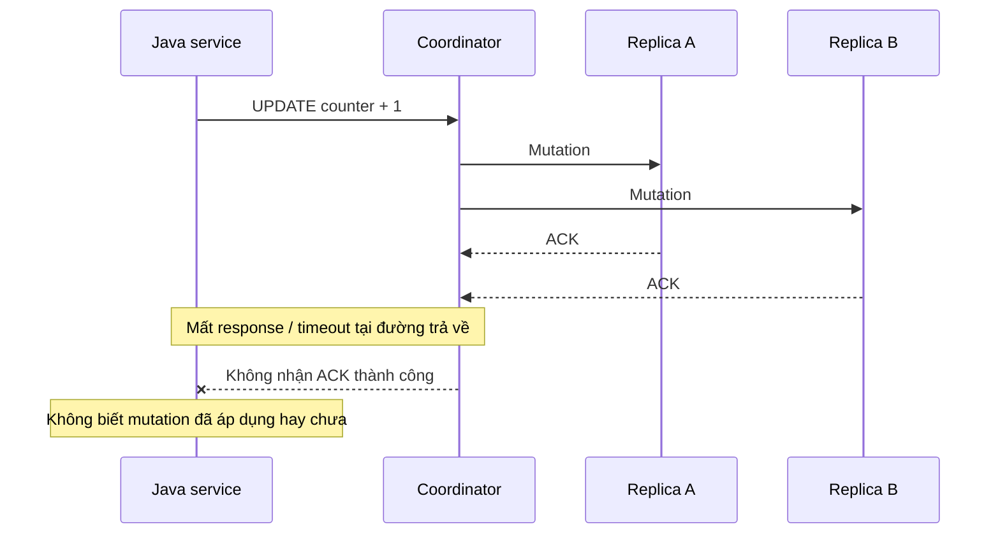
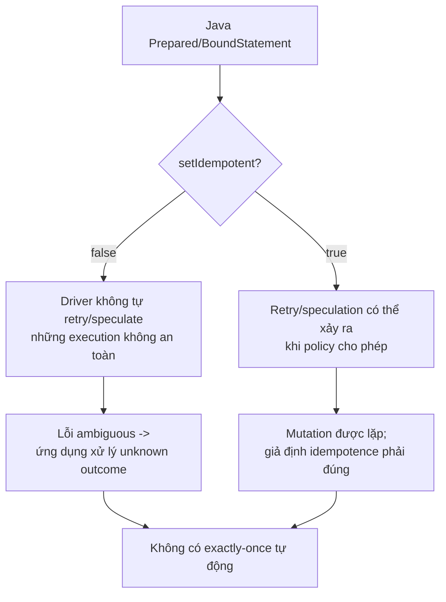

# Cập nhật counter, collection và đánh giá tính lũy đẳng

**Chương:** Truy vấn từ Java  
**Module:** `DATABASE_ENGINE_WIDE_COLUMN_CASSANDRA` — Apache Cassandra

Một dịch vụ Java gọi `UPDATE` vào Cassandra, bị timeout rồi thử lại. Nếu câu lệnh đặt cùng một giá trị cố định vào cùng khóa, kết quả có thể vẫn như một lần thực thi. Nhưng nếu lệnh là **tăng counter thêm 1** hoặc **append một phần tử vào list**, lần gọi lại có thể tạo thêm một thay đổi ngoài ý muốn. Trong hệ phân tán, timeout thường mang nghĩa **không biết kết quả**, chứ không đồng nghĩa server chưa thực hiện gì.

Chủ đề này kết nối mô hình wide-column và thiết kế bảng theo truy vấn của Apache Cassandra với **cú pháp CQL, replication/consistency level, retry/speculative execution của Java Driver 4.x, xử lý lỗi, compaction/tombstone và tính đúng của nghiệp vụ**. Trọng tâm là biết **lệnh nào có thể chạy lại**, lệnh nào không, và lúc nào phải thay đổi mô hình dữ liệu thay vì chỉ sửa chính sách retry.

> **Phạm vi:** Ví dụ dành cho Apache Cassandra 4.1/5.x và Apache Cassandra Java Driver 4.x (API `com.datastax.oss.driver.api.*`). Tên option, bộ retry policy, tính năng CQL và hành vi collection cần đối chiếu theo phiên bản/bản phân phối. CQL/Java chỉ thực hành trên cluster lab, không chạy thử “retry không chắc chắn” trên dữ liệu tài chính hoặc production.

## 1. Kết quả học tập

Sau bài này, bạn có thể:

1. Giải thích **idempotence (tính lũy đẳng)** theo trạng thái dữ liệu và phân biệt với exactly-once, atomicity, durability, linearizability.
2. Nhận diện `UPDATE counter = counter + delta` là **không lũy đẳng**, kể cả khi dùng `LOCAL_QUORUM` hoặc `COUNTER BATCH`.
3. Phân biệt collection `set`, `map`, `list`: thao tác thay toàn bộ, thêm/xóa phần tử và cập nhật theo index.
4. Đánh giá một câu CQL **trên toàn bộ ngữ cảnh**: khóa, giá trị, hàm ngẫu nhiên, timestamp, TTL, sự đồng thời và side effect ngoài Cassandra.
5. Biết cách gắn `setIdempotent(true/false)` **trên từng `BoundStatement`**; không bật true đại trà.
6. Hiểu retry policy và speculative execution của Java Driver dựa vào metadata idempotence nhưng **không** biến counter thành exactly-once.
7. Đề xuất mã hóa sự kiện bằng ID ổn định, bảng facts hoặc read model thay thế list không giới hạn/counter cần chính xác nghiệp vụ.
8. Thiết kế lab CQL có dữ liệu lặp được để quan sát list duplicate, set uniqueness, map overwrite và counter tăng hai lần.
9. Xây dựng xử lý trạng thái **success / failure đã xác nhận / unknown outcome** cho một request Java.
10. Viết kế hoạch fault injection có kiểm soát, metrics, reconciliation và cảnh báo cho các thao tác không lũy đẳng.

## 2. Tính lũy đẳng là gì?

Một phép cập nhật `f` được xem là lũy đẳng theo trạng thái nếu:

\[
f(f(S)) = f(S)
\]

Nói cách khác, thực hiện **cùng thao tác** nhiều lần cho **cùng trạng thái mục tiêu** để lại trạng thái có thể quan sát giống như thực hiện một lần.

### 2.1. Ba phép cập nhật dễ phân biệt

```text
Giả sử ban đầu:
  state = "CREATED"
  counter = 5
  events = ["created"]

A. Gán trạng thái:
  state := "PAID"
  chạy 1 lần -> "PAID"
  chạy 2 lần -> "PAID"                (lũy đẳng về giá trị)

B. Tăng counter:
  counter := counter + 1
  chạy 1 lần -> 6
  chạy 2 lần -> 7                     (không lũy đẳng)

C. Append list:
  events := events + ["paid"]
  chạy 1 lần -> ["created","paid"]
  chạy 2 lần -> ["created","paid","paid"]   (không lũy đẳng)
```

Định nghĩa này đủ cho ví dụ đơn luồng; trong thực tế phải hỏi thêm **“cùng request” bao gồm những gì, có writer khác xen vào không, timestamp/TTL được tính lại không?”**. Lần thực thi thứ hai với cùng CQL text nhưng **UUID/timestamp khác** không còn chắc là cùng mutation.

### 2.2. Idempotence khác exactly-once

| Khái niệm | Câu hỏi giải quyết | Ví dụ |
| --- | --- | --- |
| **Idempotence** | Chạy cùng thao tác hai lần có đổi trạng thái nhiều hơn một lần không? | `SET state='PAID'` trên đúng khóa |
| **At-least-once delivery** | Yêu cầu có thể được gửi lại và xử lý hơn một lần không? | Client/gateway retry sau timeout |
| **At-most-once attempt** | Client chủ động không gửi lại thao tác không an toàn | Một lần `counter + 1`, lỗi thì điều tra |
| **Exactly-once effect** | Một sự kiện nghiệp vụ chỉ được tính đúng một lần dù có retry/crash | Cần mô hình dedup + giao dịch/thiết kế riêng |
| **Atomicity** | Các thay đổi trong phạm vi nào được xem là cùng đơn vị? | Atomicity của batch Cassandra có phạm vi và giới hạn riêng |
| **Consistency level** | Bao nhiêu replica phải phản hồi để thỏa yêu cầu? | `LOCAL_QUORUM` trong một DC RF=3 |
| **Durability** | Mutation đã được chấp nhận chịu được loại sự cố nào? | Commit log và replica ACK |
| **Business correctness** | Số tiền/lượt xem/trạng thái có đúng theo quy tắc sản phẩm? | Không tính tiền hai lần |

**Điểm mấu chốt:** `LOCAL_QUORUM` và việc dùng prepared statement **không** cung cấp exactly-once cho `counter + 1`. `setIdempotent(false)` chỉ tác động hành vi **driver**; không thể ngăn một lớp HTTP retry phía trên hoặc một worker khác gửi lại cùng thao tác.

## 3. Vì sao Cassandra gặp “unknown outcome”?

Trong Cassandra phân tán, một update đi qua coordinator rồi đến replica theo replication strategy:



Đây là kịch bản mô tả, không bảo đảm mọi counter write theo cùng đường xử lý nội bộ. Điều quan trọng là **thành công ở server nhưng phản hồi không đến client** là khả năng thực tế.

Giả sử Java nhận `WriteTimeoutException`/`DriverTimeoutException`/mất kết nối:

- Trường hợp A: mutation chưa được áp dụng.
- Trường hợp B: mutation đã được một số replica áp dụng nhưng chưa đạt CL.
- Trường hợp C: điều kiện ghi đã đạt nhưng response bị mất.
- Trường hợp D: coordinator/driver đã chuyển request theo đường riêng trước khi lỗi được báo.

Không có cách chung chỉ nhìn exception rồi suy chắc counter tăng hay chưa. Đọc lại counter có thể cho một giá trị, nhưng **không chứng minh request cụ thể nào** gây thay đổi nếu có writer cạnh tranh hoặc replication chưa hội tụ.

### 3.1. Vì sao timeout rồi retry nguy hiểm?

```text
Ban đầu counter = 100

Request #A: +1
  Server thực thi -> counter = 101
  Client timeout  -> client không nhận ACK

Client thử lại Request #A:
  Server thực thi -> counter = 102

Nghiệp vụ dự kiến 101; thực tế có thể 102.
```

Nếu nghiệp vụ chỉ cần số lượt xem **xấp xỉ**, có thể chấp nhận rủi ro trong thiết kế được công bố. Với tồn kho chính xác, số dư tài khoản, quota nghiêm ngặt hoặc thanh toán, không nên chọn Cassandra counter + blind retry như một cơ chế exactly-once.

## 4. Các loại mutation và tính lũy đẳng

| CQL thao tác | Trạng thái nếu lặp trên cùng khóa | Đánh giá mặc định | Ghi chú |
| --- | --- | --- | --- |
| `SELECT` thuần | Không đổi database | Có thể đặt true | Không suy từ SELECT có side effect ngoài database |
| `UPDATE ... SET state='PAID'` | Giá trị cuối vẫn là `PAID` | Có điều kiện: true | Cần giá trị/khóa xác định; xem timestamp/TTL và writer khác |
| `INSERT` với **PK và giá trị cố định** | Ghi cùng hàng | Có điều kiện: true | Tránh tạo UUID mới ở mỗi lần retry |
| `DELETE` đúng khóa và deterministic | Hàng logic vẫn bị xóa | Có điều kiện: true | Timestamp/tombstone và writer xen vào vẫn quan trọng |
| `UPDATE ... SET n=n+1` với `counter` | Mỗi lần +1 | **False** | Không lũy đẳng bản chất |
| `UPDATE ... SET history=history+['x']` | Mỗi lần thêm một `x` | **False** | List cho phép trùng |
| `UPDATE ... SET history=['x']+history` | Mỗi lần thêm đầu list | **False** | Vẫn trùng giá trị |
| `UPDATE ... SET tags=tags+{'vip'}` | Set không có phần tử trùng | True **có điều kiện** | TTL/timestamp/concurrent delete có thể thay kết quả |
| `UPDATE ... SET tags=tags-{'vip'}` | Xóa cùng phần tử | True **có điều kiện** | Xem tương tác với add từ writer khác |
| `UPDATE ... SET attrs['region']='VN'` | Gán cùng key/value | True **có điều kiện** | Đồng thời ghi giá trị khác có thể bị ghi đè |
| `UPDATE ... SET history=['x']` | Thay toàn list bằng giá trị cố định | True **có điều kiện** | Khác với append/prepend |
| `DELETE history[0]` | Index sau lần xóa có thể đổi | **False/không an toàn** | Tác động phần tử khác khi lặp |
| `UPDATE ... USING TTL 60` | Thời điểm hết hạn có thể dịch | Cần đánh giá; thường conservative | Replay có thể kéo dài tuổi dữ liệu |
| `INSERT ... VALUES (now(), ...)` | Hàm có thể cho giá trị mới | **False** | Tạo ID một lần bên ngoài rồi bind nếu cần retry |

**Không tự gắn true cho mọi dòng có nhãn “có điều kiện”.** Trạng thái đúng trong một mô hình không có concurrent writer chưa đủ cho một workflow nhiều bước hoặc các ràng buộc nghiệp vụ.

### 4.1. Lặp logic khác lặp mutation vật lý

Ngay cả khi hai lệnh `SET state='PAID'` để lại cùng giá trị logic, các lần ghi có thể có timestamp khác nhau và tương tác với tombstone/TTL, compaction hoặc ghi cạnh tranh. Vì thế tài liệu nói “idempotent” theo cách driver thường dùng: **replay an toàn về kết quả dữ liệu dự kiến dưới những giả định nhất định**, không hứa SSTable bytes, logs, metrics và thời điểm GC hoàn toàn giống nhau.

## 5. Counter là kiểu dữ liệu đặc biệt

### 5.1. Tạo bảng counter riêng

CQL cho phép cột kiểu `counter` — số nguyên 64-bit được tăng/giảm theo delta. Counter **không** dùng làm thành phần primary key; bảng chứa counter không được trộn cột dữ liệu thường ngoài primary key.

Ví dụ:

```sql
CREATE KEYSPACE IF NOT EXISTS lab_java_update
WITH replication = {
  'class': 'NetworkTopologyStrategy',
  'datacenter1': 1
}
AND durable_writes = true;

CREATE TABLE IF NOT EXISTS lab_java_update.views_by_tenant_day (
    tenant_id text,
    bucket_day date,
    metric text,
    views counter,
    PRIMARY KEY ((tenant_id, bucket_day), metric)
);
```

`(tenant_id, bucket_day)` là partition key để đặt replica; `metric` là clustering key. Đây chỉ là thiết kế **lab**; trong production, một tenant/ngày hoặc một metric quá nóng có thể tạo **hot partition/hot counter**. Cần đo phân bố traffic theo partition key.

### 5.2. Counter chỉ cập nhật bằng delta

```sql
CONSISTENCY ONE

UPDATE lab_java_update.views_by_tenant_day
SET views = views + 1
WHERE tenant_id = 'tenant-a'
  AND bucket_day = '2026-11-21'
  AND metric = 'page_view';

SELECT views
FROM lab_java_update.views_by_tenant_day
WHERE tenant_id = 'tenant-a'
  AND bucket_day = '2026-11-21'
  AND metric = 'page_view';
```

Trên bảng thử nghiệm mới, lần UPDATE đầu thường cho giá trị 1; lần lặp thứ hai cho 2 nếu cả hai thao tác hoàn tất và không có writer khác. Không viết:

```sql
-- VÍ DỤ KHÔNG HỢP LỆ CHO counter: chỉ để nhận diện anti-pattern.
-- UPDATE lab_java_update.views_by_tenant_day
-- SET views = 10 WHERE ...;

-- Counter UPDATE không được dùng USING TTL hoặc USING TIMESTAMP
-- theo cơ chế CQL counter.
```

Counter không có TTL theo cách cột thường. Không dùng counter như số liệu có retention tự hết hạn hoặc cố đặt `USING TIMESTAMP` để phục hồi exactly-once.

### 5.3. Counter và thao tác xóa

Một số phiên bản hỗ trợ xóa counter, nhưng vòng đời xóa/rồi tái cập nhật có caveat lớn; tài liệu Cassandra cảnh báo không nên coi counter được xóa rồi ghi lại như một reset an toàn. Khi cần “đưa counter về 0”, **không** mặc định `DELETE` rồi `+1` có semantics ổn định giống số nguyên thông thường.

Thay vào đó:

- Nếu cần đếm theo ngày: tạo **khóa bucket mới** cho kỳ mới.
- Nếu cần tái dựng từ sự kiện: dùng **bảng event facts** và phép tổng hợp có kiểm soát.
- Nếu cần số liệu giao dịch chính xác: cân nhắc hệ thống transaction/source-of-truth riêng hoặc thiết kế có idempotency key + điều kiện nghiệp vụ.
- Nếu chỉ cần số liệu ước lượng: công bố độ chấp nhận sai lệch và quy trình đối soát.

### 5.4. COUNTER BATCH không tạo exactly-once

Cassandra hỗ trợ `BEGIN COUNTER BATCH` để nhóm các cập nhật counter:

```sql
BEGIN COUNTER BATCH
  UPDATE lab_java_update.views_by_tenant_day
  SET views = views + 1
  WHERE tenant_id = 'tenant-a'
    AND bucket_day = '2026-11-21'
    AND metric = 'page_view';

  UPDATE lab_java_update.views_by_tenant_day
  SET views = views + 2
  WHERE tenant_id = 'tenant-a'
    AND bucket_day = '2026-11-21'
    AND metric = 'video_view';
APPLY BATCH;
```

Nếu toàn bộ batch được **gửi lại**, các delta có thể được cộng **lần nữa**. Counter batch không phải cơ chế dedup theo transaction ID; không biến cập nhật nhiều partitions thành một giao dịch SQL với isolation và exactly-once tổng quát. Không trộn counter mutations và DML bình thường trong cùng batch.

### 5.5. RF/CL không giải bài toán đếm đúng một lần

RF=3/`LOCAL_QUORUM` giúp điều chỉnh mức sẵn sàng và yêu cầu replica đáp ứng trong DC, không gắn event ID cho increment. Cùng một request `+1` chạy hai lần tại coordinator khác nhau vẫn có thể đếm hai lượt.

| Cấu hình | Ý nghĩa | Không cung cấp |
| --- | --- | --- |
| RF=3 | Ba replica theo replication strategy | Dedup mỗi business event |
| `LOCAL_QUORUM` | Cần quorum replica local đáp ứng | Exactly-once hay giao dịch đa partition |
| `ALL` | Đòi toàn bộ replica liên quan phản hồi | Bảo đảm không có retry trùng |
| Prepared statement | Parse/metadata/query binding được tái sử dụng | Mã định danh event nghiệp vụ |
| `setIdempotent(false)` | Driver tránh tự retry/speculate mutation nguy hiểm | Ngăn HTTP gateway/app gửi lại |
| `COUNTER BATCH` | Nhóm counter updates theo semantics Cassandra | Tránh cộng lặp cùng batch |

## 6. Collections: set, map và list

### 6.1. DDL một bảng có ba collection

```sql
CREATE TABLE IF NOT EXISTS lab_java_update.profiles_by_id (
    profile_id uuid PRIMARY KEY,
    owner text,
    tags set<text>,
    attributes map<text, text>,
    history list<text>,
    updated_at timestamp
);
```

Các collections **không bị frozen** ở ví dụ này nên có thể cập nhật phần tử. Frozen collection được lưu/được xem như một giá trị duy nhất theo semantics CQL; thường phải thay toàn bộ và không áp dụng mọi cú pháp update từng phần tử.

Thêm một profile với khóa xác định:

```sql
INSERT INTO lab_java_update.profiles_by_id
    (profile_id, owner, tags, attributes, history, updated_at)
VALUES (
    10000000-0000-4000-8000-000000000011,
    'alice',
    {'basic'},
    {'region': 'VN'},
    ['created'],
    '2026-11-21T00:00:00Z'
);

SELECT profile_id, tags, attributes, history
FROM lab_java_update.profiles_by_id
WHERE profile_id = 10000000-0000-4000-8000-000000000011;
```

Đây là bộ dữ liệu **disposable**. Chạy lần đầu sau khi đã chắc chắn bảng sạch hoặc dùng `profile_id` riêng cho mỗi lượt để không nhầm state cũ.

### 6.2. Set: tập các phần tử không trùng

```sql
UPDATE lab_java_update.profiles_by_id
SET tags = tags + {'vip'}
WHERE profile_id = 10000000-0000-4000-8000-000000000011;

-- Chạy lần hai cùng lệnh:
UPDATE lab_java_update.profiles_by_id
SET tags = tags + {'vip'}
WHERE profile_id = 10000000-0000-4000-8000-000000000011;

SELECT tags FROM lab_java_update.profiles_by_id
WHERE profile_id = 10000000-0000-4000-8000-000000000011;
```

Kỳ vọng logic `{'basic', 'vip'}`, không có hai `'vip'`. Bản chất của `set` giúp chống **phần tử trùng**. Nhưng nếu giữa hai lần thêm, writer khác đã xóa `'vip'`, lần gửi lại với timestamp mới có thể thêm lại. Vì vậy tính lũy đẳng của “add fixed element” **không phải quyền tự động retry trong mọi tình huống cạnh tranh**.

Xóa phần tử xác định:

```sql
UPDATE lab_java_update.profiles_by_id
SET tags = tags - {'vip'}
WHERE profile_id = 10000000-0000-4000-8000-000000000011;
```

Xóa một phần tử khỏi set thường được coi là idempotent trong mô hình chỉ xét cùng thao tác, nhưng concurrent add, TTL và timestamp quyết định tác động thực tế.

### 6.3. Map: key duy nhất, value có thể thay

```sql
UPDATE lab_java_update.profiles_by_id
SET attributes['region'] = 'APAC'
WHERE profile_id = 10000000-0000-4000-8000-000000000011;

-- Lặp cùng key/value thường cho cùng trạng thái map:
UPDATE lab_java_update.profiles_by_id
SET attributes['region'] = 'APAC'
WHERE profile_id = 10000000-0000-4000-8000-000000000011;

SELECT attributes FROM lab_java_update.profiles_by_id
WHERE profile_id = 10000000-0000-4000-8000-000000000011;
```

Map assignment xác định có thể an toàn hơn append list. Nhưng nếu lần 1 gán `APAC`, writer khác gán `EU`, rồi retry của lần 1 gán `APAC` với timestamp mới: kết quả nghiệp vụ có thể bị **ghi đè giá trị mới**. Khi cần “chỉ cập nhật nếu version còn bằng X”, dùng cơ chế kiểm soát đồng thời (chẳng hạn LWT ở bảng bình thường, khi phù hợp), không dựa vào idempotence đơn thuần.

Xóa map entry:

```sql
DELETE attributes['region']
FROM lab_java_update.profiles_by_id
WHERE profile_id = 10000000-0000-4000-8000-000000000011;
```

Để xử lý một key-value cụ thể, không phải cứ thay toàn bộ map là tối ưu: full replacement tác động nhiều phần tử và tăng chi phí/tombstone. Chọn cú pháp theo semantics cần thiết.

### 6.4. List: có thứ tự, **cho phép trùng**

```sql
UPDATE lab_java_update.profiles_by_id
SET history = history + ['reviewed']
WHERE profile_id = 10000000-0000-4000-8000-000000000011;

-- Lần thứ hai giả lập application replay:
UPDATE lab_java_update.profiles_by_id
SET history = history + ['reviewed']
WHERE profile_id = 10000000-0000-4000-8000-000000000011;

SELECT history FROM lab_java_update.profiles_by_id
WHERE profile_id = 10000000-0000-4000-8000-000000000011;
```

Kỳ vọng khi bắt đầu với `['created']`: list chứa **hai lần** `'reviewed'` (thứ tự các append trong một luồng tuần tự). Đây là bằng chứng trực tiếp rằng `list = list + [...]` **không lũy đẳng**.

Prepend cũng không lũy đẳng:

```sql
UPDATE lab_java_update.profiles_by_id
SET history = ['urgent'] + history
WHERE profile_id = 10000000-0000-4000-8000-000000000011;
```

### 6.5. Thay toàn bộ list khác với append

```sql
-- Lặp cùng phép gán toàn bộ có thể để lại cùng list logic.
UPDATE lab_java_update.profiles_by_id
SET history = ['created', 'reviewed']
WHERE profile_id = 10000000-0000-4000-8000-000000000011;
```

Gán toàn list là một mutation khác hẳn append. Tuy nhiên nó có thể **ghi đè** phần tử do writer khác thêm, gây tombstone/cost cho collection và làm tăng write amplification. Đừng biến mọi append thành “đọc list → gán toàn list” nếu có nhiều writer cạnh tranh: read-modify-write không có transaction sẽ làm mất cập nhật.

### 6.6. Thao tác list theo index/giá trị

CQL hỗ trợ một số thao tác như:

```sql
-- Thay phần tử ở vị trí 0; vị trí có thể đổi khi writer khác sửa list.
UPDATE lab_java_update.profiles_by_id
SET history[0] = 'opened'
WHERE profile_id = 10000000-0000-4000-8000-000000000011;

-- Xóa theo vị trí (CHỈ LAB): lần sau có thể trúng phần tử khác.
DELETE history[0]
FROM lab_java_update.profiles_by_id
WHERE profile_id = 10000000-0000-4000-8000-000000000011;

-- Xóa mọi lần xuất hiện của một giá trị nhất định.
UPDATE lab_java_update.profiles_by_id
SET history = history - ['reviewed']
WHERE profile_id = 10000000-0000-4000-8000-000000000011;
```

Một số thao tác list (set/delete theo index, remove by value) cần **read-before-write** nội bộ và có thể chậm. Riêng remove-by-value có thể **lũy đẳng theo nội dung** trong điều kiện không có thêm giá trị xen vào, và Query Builder có thể phân loại thao tác remove đã biết là an toàn; nhưng nó vẫn không chứng minh thao tác an toàn trong workflow có writer cạnh tranh. Với delete theo **index**, việc index dịch chuyển khiến lặp lại có thể xóa phần tử khác — hãy đánh dấu non-idempotent.

### 6.7. Đừng dùng collection làm bảng sự kiện không giới hạn

Apache Cassandra khuyến nghị collections dành cho tập dữ liệu **nhỏ, có giới hạn**. Non-frozen collections không được phân trang theo từng phần tử như các hàng clustering trong bảng; đọc một collection lớn có thể kéo cả collection vào một lần truy vấn.

Nếu cần ghi lịch sử vô hạn:

```sql
CREATE TABLE IF NOT EXISTS lab_java_update.events_by_profile_day (
    profile_id uuid,
    bucket_day date,
    event_id uuid,
    event_ts timestamp,
    event_type text,
    payload text,
    PRIMARY KEY ((profile_id, bucket_day), event_id)
);
```

`event_id` là định danh **ổn định** của sự kiện (được tạo một lần trước retry). Nếu yêu cầu đọc lịch sử theo thời gian, có thể đổi clustering key để hỗ trợ thứ tự theo `event_ts` và dùng `event_id` phân biệt các event cùng timestamp. Thiết kế bảng **theo truy vấn**: chọn đúng partition key/bucket để tránh hot/large partition.

Một event được `INSERT` hai lần với cùng PK và nội dung xác định sẽ không tạo **hai hàng khác nhau** như list append. Song nếu ứng dụng tạo event ID mới cho mỗi retry, bạn vẫn có hai hàng; khóa ổn định là yêu cầu bắt buộc.

## 7. So sánh collection theo chức năng

| Tiêu chí | `set<text>` | `map<text,text>` | `list<text>` |
| --- | --- | --- | --- |
| Mô hình dữ liệu | Thành viên duy nhất | Khóa–giá trị | Phần tử có thứ tự, có thể trùng |
| Update phổ biến | Add/remove phần tử | Put/remove entry | Append/prepend/index/remove |
| Lặp thêm cùng giá trị | Không nhân đôi phần tử | Put cùng key có thể overwrite | **Nhân đôi** phần tử |
| Rủi ro read-before-write | Thường tránh được khi add/remove thông thường | Thường tránh được khi put/remove entry | Có một số thao tác cần đọc trước |
| Độ phù hợp cho append-only event log | Không giữ trùng/thứ tự sự kiện | Key định danh nhỏ | Có thứ tự nhưng **không nên tăng vô hạn** |
| Khả năng truy cập theo khóa riêng | Qua nguyên collection và model query | Entry theo key nhưng vẫn có giới hạn collection | Không phải event table có paging nội bộ |
| Cẩn trọng với TTL | TTL phần tử được viết/cập nhật | TTL entry mới được viết | TTL phần tử và thứ tự |
| Cẩn trọng với retry | Chỉ true khi semantics cho phép | Chỉ true khi key/value xác định | Append/prepend false |

**Không nhầm sự “không trùng” của set/map với exactly-once cho mọi nghiệp vụ.** Nếu một request còn gửi email, gọi cổng thanh toán, hoặc sửa một bảng khác, việc `tags + {'vip'}` không nhân đôi phần tử **không** khiến cả workflow idempotent.

## 8. TTL, timestamp, tombstone và sự đồng thời

### 8.1. TTL có thể làm thay đổi ý nghĩa replay

```sql
-- Chỉ lab: gán TTL mới cho entry region.
UPDATE lab_java_update.profiles_by_id
USING TTL 60
SET attributes['region'] = 'VN'
WHERE profile_id = 10000000-0000-4000-8000-000000000011;
```

Nếu chạy lại sau 30 giây, TTL/expiration của entry được viết ở lần thứ hai có thể thay đổi so với một lần ghi. Về mặt **giá trị hiện tại**, hai lần cùng `'VN'` có vẻ lũy đẳng; về mặt “hết hạn vào lúc nào”, chưa chắc. Vì vậy, một request có yêu cầu retention chính xác phải xem TTL/timestamp và thiết kế idempotency riêng, thay vì mặc định `setIdempotent(true)`.

### 8.2. Timestamp và Last-Write-Wins

Cassandra hòa giải các cell/mutation theo timestamp và các quy tắc tombstone/collision của phiên bản. Với hai writers:

```text
T1: Worker A gán state = "PAID".
T2: Worker B gán state = "REFUNDED".
T3: Retry của Worker A gán state = "PAID" với timestamp mới.

Giá trị cuối có thể quay về "PAID" mặc dù nghiệp vụ đã hoàn tiền.
```

Một phép gán cố định chỉ “lũy đẳng” trong nghĩa **lặp riêng phép đó**. Nó không tự bảo vệ **thứ tự chuyển trạng thái** khi có thao tác khác xen vào.

Đối với cập nhật nghiệp vụ cần thứ tự, cân nhắc:

- Version/CAS bằng **lightweight transaction** khi phạm vi/throughput phù hợp.
- Một owner/writer duy nhất cho một aggregate/partition.
- Event ID và dedup store có semantics đủ mạnh.
- Kiến trúc transactional source-of-truth và projection sang Cassandra.
- Không đặt kỳ vọng cập nhật đa partition là ACID transaction tổng quát.

### 8.3. Hàm không xác định có thể tạo tác dụng khác

```sql
-- KHÔNG đánh dấu idempotent nếu mỗi lần chạy lại sinh UUID khác.
-- UPDATE lab_java_update.profiles_by_id
-- SET updated_at = toTimestamp(now()) WHERE profile_id = ...;
```

Muốn replay tạo cùng giá trị, **tạo một UUID/timestamp duy nhất trước vòng retry rồi giữ lại**, không gọi lại `UUID.randomUUID()`/`Instant.now()` ở mỗi attempt. Tuy nhiên việc giữ timestamp cố định cũng không tự giải quyết các counter/list append.

### 8.4. Tombstone và DELETE

Lặp `DELETE` cùng khóa có thể để lại cùng dữ liệu logic trong điều kiện bình thường, nhưng mỗi lần DELETE có thể tạo tombstone với timestamp khác. Trong lúc có ghi xen vào, DELETE được retry muộn có thể che giá trị mới. Không tự đánh dấu mọi DELETE là an toàn trong hệ có nhiều writer; xem version, TTL và mục tiêu nghiệp vụ.

## 9. Java Driver 4.x: metadata idempotence

### 9.1. Driver cần được nói thao tác nào an toàn

Apache Java Driver 4.x không thể phân tích đầy đủ mọi chuỗi CQL và suy ra side effects; mặc định cấu hình `basic.request.default-idempotence` là `false`. Bạn có thể override trên statement:

```java
SimpleStatement read = SimpleStatement
    .newInstance("SELECT tags FROM lab_java_update.profiles_by_id WHERE profile_id = ?",
                 profileId)
    .setIdempotent(true);
```

Với prepared statement, có thể đánh dấu **mỗi lần bind**:

```java
BoundStatement increment = counterPrepared.bind(delta, tenantId, day, metric)
    .setIdempotent(false);

BoundStatement replace = replacePrepared.bind("PAID", profileId)
    .setIdempotent(true);
```

Đoạn minh họa thứ hai giả định `counterPrepared` và `replacePrepared` được định nghĩa phù hợp kiểu dữ liệu; phần thực hành đầy đủ ở mục sau.

**Không bật `basic.request.default-idempotence = true` trên toàn service chỉ để tăng tần suất retry.** Nếu workload chứa counter/list append thì điều đó khiến driver có thể lặp một thao tác không an toàn. Hãy phân loại theo từng query/method.

### 9.2. setIdempotent(true) thực sự làm gì?

Trong Java Driver 4.x, metadata này được các cơ chế **retry** và **speculative execution** dùng để quyết định một request có thể gửi lại khi chính sách cho phép.



**`true` không có nghĩa “retry chắc chắn xảy ra”**: còn retry policy, loại lỗi, request timeout, số attempts và speculative execution policy. **`false` cũng không ngăn application retry**, HTTP request bị phát lại, job queue redelivery hoặc CQL được thực thi bởi một phiên khác.

### 9.3. Speculative execution là gì?

Khi một request chậm, speculative execution (nếu được bật) có thể gửi **cùng request** tới coordinator khác trước khi request đầu tiên kết thúc; mục tiêu là cải thiện tail latency. Với `SELECT` thuần hoặc mutation idempotent thực sự, có thể cân nhắc theo SLA. Với `counter + 1` hoặc `list append`, hai coordinators đều có thể áp dụng mutation, gây **double increment/duplicate append**.

Driver mặc định thường **không bật speculative execution** (chính sách mặc định không khởi chạy speculative request). Không được đánh dấu non-idempotent thành true chỉ vì muốn giảm p99.

### 9.4. Retry và lỗi không đồng nghĩa kết quả

| Sự kiện | Có thể xảy ra ở server? | Hành động khuyến nghị cho counter/list append |
| --- | --- | --- |
| Thành công và ACK đến client | Mutation đã được chấp nhận theo CL | Ghi nhận success, không gửi lại |
| Timeout trước khi nhận ACK | Chưa biết đã thực thi chưa | **Không blind retry**; ghi unknown outcome |
| Mất kết nối giữa request/response | Request có thể đã được xử lý | **Không blind retry** |
| `UnavailableException` | Không đủ replica đáp ứng theo CL | Kiểm tra availability; không suy mọi side effect chắc chắn bằng 0 cho toàn workflow |
| Client shutdown/cancellation | Request có thể đang chạy | Theo dõi và reconcile, không tự phát lại |
| Gateway gửi lại HTTP request | CQL có thể được gửi thêm một lần từ tầng trên | Cần request/event ID, dedup hoặc API idempotency |
| Queue redelivery | Worker có thể đã chạy trước crash | Thiết kế idempotent consumer và reconciliation |

## 10. Lab Java: thiết lập môi trường và schema

### 10.1. Giả định

- Một cluster lab có DC tên `datacenter1`, có thể chỉ một node RF=1; production cần RF/CL theo yêu cầu chịu lỗi.
- Cassandra 4.1/5.x, Java Driver 4.x tương thích phiên bản server.
- Có `cqlsh` và Java process truy cập được cổng native transport.
- Không dùng tài khoản quản trị/superuser trong ứng dụng production; lab dùng credential có quyền đủ dùng.
- Thí nghiệm cố ý **chạy hai lần** một số mutation trên **dữ liệu disposable** để hiểu duplication, không phải benchmark hiệu năng.

Tạo keyspace và hai bảng theo mục 5/6. Có thể tạo thêm bảng sự kiện bất biến để so sánh:

```sql
CREATE TABLE IF NOT EXISTS lab_java_update.event_facts_by_id (
    event_id uuid PRIMARY KEY,
    tenant_id text,
    event_type text,
    occurred_at timestamp,
    payload text
);
```

**Lưu ý:** Bảng `event_facts_by_id` ở đây cho phép lookup theo `event_id`. Nếu ứng dụng thường đọc các sự kiện theo tenant và ngày, cần thêm bảng projection `events_by_tenant_day` thiết kế theo partition key; không dùng `ALLOW FILTERING` để quét toàn bảng trong một endpoint.

### 10.2. Baseline có thể tái lập

Trong `cqlsh`, tạo profile ID riêng cho mỗi lượt chạy; không cần `TRUNCATE`:

```sql
INSERT INTO lab_java_update.profiles_by_id
    (profile_id, owner, tags, attributes, history, updated_at)
VALUES (
    10000000-0000-4000-8000-000000000012,
    'lab-run-012',
    {'basic'},
    {'region': 'VN'},
    ['created'],
    '2026-11-21T00:00:00Z'
);
```

Tạo một metric key riêng (ví dụ `metric='run-012-views'`) cho counter để không lẫn dữ liệu của lượt khác. Không cố reset counter bằng DELETE rồi ghi lại khóa cũ.

## 11. Java Driver: code đầy đủ cho counter và collection

Ví dụ dưới đây sử dụng `BoundStatement.setIdempotent(...)` trên **từng thao tác**. Nó không có vòng retry cho mutation nguy hiểm. Tham số `CqlSession` được tạo bởi ứng dụng và tái sử dụng; đoạn code không chứa password.

```java
import com.datastax.oss.driver.api.core.CqlSession;
import com.datastax.oss.driver.api.core.DefaultConsistencyLevel;
import com.datastax.oss.driver.api.core.cql.BoundStatement;
import com.datastax.oss.driver.api.core.cql.PreparedStatement;
import com.datastax.oss.driver.api.core.cql.ResultSet;
import com.datastax.oss.driver.api.core.cql.Row;
import com.datastax.oss.driver.api.core.data.CqlDate;

import java.time.LocalDate;
import java.util.Collections;
import java.util.List;
import java.util.UUID;

public final class SafeMutationExamples {
    private final CqlSession session;
    private final PreparedStatement incrementCounter;
    private final PreparedStatement addTag;
    private final PreparedStatement putRegion;
    private final PreparedStatement appendHistory;
    private final PreparedStatement readProfile;
    private final PreparedStatement readCounter;

    public SafeMutationExamples(CqlSession session) {
        this.session = session;
        incrementCounter = session.prepare(
            "UPDATE lab_java_update.views_by_tenant_day " +
            "SET views = views + ? " +
            "WHERE tenant_id = ? AND bucket_day = ? AND metric = ?"
        );
        addTag = session.prepare(
            "UPDATE lab_java_update.profiles_by_id " +
            "SET tags = tags + ? WHERE profile_id = ?"
        );
        putRegion = session.prepare(
            "UPDATE lab_java_update.profiles_by_id " +
            "SET attributes['region'] = ? WHERE profile_id = ?"
        );
        appendHistory = session.prepare(
            "UPDATE lab_java_update.profiles_by_id " +
            "SET history = history + ? WHERE profile_id = ?"
        );
        readProfile = session.prepare(
            "SELECT tags, attributes, history " +
            "FROM lab_java_update.profiles_by_id WHERE profile_id = ?"
        );
        readCounter = session.prepare(
            "SELECT views FROM lab_java_update.views_by_tenant_day " +
            "WHERE tenant_id = ? AND bucket_day = ? AND metric = ?"
        );
    }

    public void incrementOnce(String tenantId, LocalDate day, String metric) {
        CqlDate cqlDay = CqlDate.fromDaysSinceEpoch(
            (int) day.toEpochDay()
        );

        BoundStatement statement = incrementCounter.bind(
                1L, tenantId, cqlDay, metric
            )
            .setConsistencyLevel(DefaultConsistencyLevel.LOCAL_QUORUM)
            .setIdempotent(false);

        try {
            session.execute(statement);
            System.out.println("Counter update ACK at selected CL");
        } catch (RuntimeException ex) {
            // Không biết chắc delta đã được áp dụng hay chưa.
            // KHÔNG gọi session.execute(statement) lần nữa tại đây.
            System.err.println("COUNTER_UNKNOWN_OUTCOME: " +
                ex.getClass().getSimpleName());
            // Hệ thống thật: lưu event/request ID và thực hiện đối soát.
        }
    }

    public void addTag(String profileIdText) {
        UUID profileId = UUID.fromString(profileIdText);
        BoundStatement statement = addTag.bind(
                Collections.singleton("vip"), profileId
            )
            .setConsistencyLevel(DefaultConsistencyLevel.LOCAL_QUORUM)
            // Chỉ đúng trong ví dụ: không TTL và không writer xóa/add
            // cùng tag trong thời gian cần bảo toàn thứ tự.
            .setIdempotent(true);
        session.execute(statement);
    }

    public void setRegion(String profileIdText) {
        UUID profileId = UUID.fromString(profileIdText);
        BoundStatement statement = putRegion.bind("APAC", profileId)
            .setConsistencyLevel(DefaultConsistencyLevel.LOCAL_QUORUM)
            // Gán key/value cố định, ví dụ không có writer cạnh tranh.
            .setIdempotent(true);
        session.execute(statement);
    }

    public void appendHistoryOnce(String profileIdText) {
        UUID profileId = UUID.fromString(profileIdText);
        BoundStatement statement = appendHistory.bind(
                Collections.singletonList("reviewed"), profileId
            )
            .setConsistencyLevel(DefaultConsistencyLevel.LOCAL_QUORUM)
            .setIdempotent(false);

        try {
            session.execute(statement);
        } catch (RuntimeException ex) {
            System.err.println("LIST_APPEND_UNKNOWN_OUTCOME: " +
                ex.getClass().getSimpleName());
            // Không tự append lại vì có thể tạo duplicate.
        }
    }

    public void showProfile(String profileIdText) {
        UUID profileId = UUID.fromString(profileIdText);
        BoundStatement statement = readProfile.bind(profileId)
            .setConsistencyLevel(DefaultConsistencyLevel.LOCAL_QUORUM)
            .setIdempotent(true);

        Row row = session.execute(statement).one();
        if (row == null) {
            System.out.println("No profile for " + profileId);
            return;
        }
        System.out.println(
            "tags=" + row.getSet("tags", String.class) +
            ", attrs=" + row.getMap(
                "attributes", String.class, String.class) +
            ", history=" + row.getList("history", String.class)
        );
    }

    public Long readViews(String tenantId, LocalDate day, String metric) {
        CqlDate cqlDay = CqlDate.fromDaysSinceEpoch(
            (int) day.toEpochDay()
        );
        ResultSet result = session.execute(
            readCounter.bind(tenantId, cqlDay, metric)
                .setConsistencyLevel(DefaultConsistencyLevel.LOCAL_QUORUM)
                .setIdempotent(true)
        );
        Row row = result.one();
        return row == null || row.isNull("views")
            ? null : row.getLong("views");
    }
}
```

### 11.1. Tại sao increment không có retry loop?

Đoạn code nhận biết **unknown outcome**, không suy “exception = write chưa thực hiện”. Mọi nhánh catch của counter/list append đều **không tự phát lại**. Đây là nguyên tắc tối thiểu; trong production còn phải thiết kế **business event ID, trạng thái xử lý và reconciliation** để hoàn tất công việc an toàn.

### 11.2. Chú ý khi dùng `setIdempotent(true)` cho set/map

Trong mẫu `addTag` và `setRegion`, điều kiện được ghi rõ: không TTL và không có writer cạnh tranh xóa/ghi khác lên cùng phần tử. Nếu ứng dụng cần đảm bảo thứ tự của các thao tác khác nhau trên cùng key, hãy dùng version/conditional write hoặc luồng owner theo aggregate, thay vì giả định mọi assignment luôn safe replay.

### 11.3. Cơ chế Java không kiểm tra nghiệp vụ hộ bạn

Driver chỉ thấy `BoundStatement`, CL và cờ idempotence. Nó không biết:

- Một event “payment captured” đã được xử lý ở hệ thống thanh toán chưa.
- Phần tử `reviewed` là lịch sử duy nhất hay có thể trùng.
- Client đã tạo request ID mới cho lần retry chưa.
- Một writer khác đã thay `state`/`attributes`.
- Dữ liệu có TTL, tombstone hoặc yêu cầu retention cố định.
- Có email/Kafka/push notification được gửi thêm ở bên ngoài database hay không.

Vì vậy đừng để method Java tên `safeRetry()` tự động gắn `true` cho mọi UPDATE.

## 12. Cách tạo CqlSession và cấu hình retry có kiểm soát

Trong lab một DC, session có thể được tạo một lần:

```java
import com.datastax.oss.driver.api.core.CqlSession;
import java.net.InetSocketAddress;

public final class LabSession {
    public static CqlSession open() {
        return CqlSession.builder()
            .addContactPoint(new InetSocketAddress("127.0.0.1", 9042))
            .withLocalDatacenter("datacenter1")
            .build();
    }
}
```

Đoạn này minh họa **lab không auth/TLS**; production phải dùng credentials từ secret manager, TLS certificate verification, contact points và local datacenter phù hợp. Đừng tạo session cho mỗi request HTTP.

### 12.1. Đừng cấu hình default idempotence toàn cục là true

Cấu hình liên quan của Java Driver 4.x:

```hocon
datastax-java-driver {
  basic.request.default-idempotence = false
}
```

Trong thực tế, giá trị mặc định là `false` nếu không đổi. Đặt nó thành `true` làm các câu CQL chưa được phân loại trở thành đối tượng có thể retry/speculate theo policy. Nếu dịch vụ có counter/list append, đó là một rủi ro dễ bị bỏ sót khi thay config chung.

### 12.2. Retry policy và speculative execution

- **Retry policy** quyết định loại lỗi và số lần/đường thử lại khi mutation an toàn.
- **Speculative execution policy** có thể gửi song song execution bổ sung khi request chậm; mặc định thường tắt.
- Cả hai **phải tôn trọng** metadata idempotence; không dùng custom policy để bypass an toàn.
- `setIdempotent(true)` **cho phép** policy cân nhắc retry, không ép mọi lỗi phải retry.
- `setIdempotent(false)` **không** bảo vệ khỏi request bị ứng dụng hoặc gateway gửi lại.
- Không hạ consistency level khi retry chỉ để đáp ứng latency nếu nghiệp vụ không chấp nhận mất bảo đảm đọc/ghi.

## 13. Event ID ổn định: thiết kế lại thay vì retry counter

Khi nghiệp vụ yêu cầu “mỗi sự kiện tính một lần”, một cách nghĩ tốt hơn là lưu **facts bất biến** với ID độc nhất thay vì cập nhật trực tiếp một counter không có dấu vết nguồn.

### 13.1. Event ID được tạo một lần

Ví dụ một request có `event_id` được tạo bởi client đáng tin cậy, giữ nguyên qua retries:

```sql
INSERT INTO lab_java_update.event_facts_by_id (
    event_id, tenant_id, event_type, occurred_at, payload
) VALUES (
    20000000-0000-4000-8000-000000000011,
    'tenant-a',
    'PAGE_VIEW',
    '2026-11-21T01:00:00Z',
    'landing-page'
) IF NOT EXISTS;
```

Nếu lần đầu được áp dụng, LWT có thể báo `[applied]=true`. Nếu cùng ID đã tồn tại, nó có thể báo `false`; ứng dụng cần đối chiếu payload/version và không coi mọi `false` là thành công nghiệp vụ. LWT có chi phí cao hơn write thường và có semantics/giới hạn riêng.

**Quan trọng:** `IF NOT EXISTS` **không biến một counter update đi kèm thành transaction đúng một lần**. Nó chỉ điều kiện hóa mutation tương ứng với row/key được thao tác.

### 13.2. Tại sao “đánh dấu đã xử lý rồi +1” chưa đủ?

Xét hai bảng khác nhau:

```text
Bước 1: INSERT processed_events[event_id] IF NOT EXISTS
Bước 2: UPDATE counters SET count = count + 1

Crash ở giữa bước 1 và 2:
  event được đánh dấu processed
  counter chưa tăng
  replay thấy event đã processed -> bỏ qua -> thiếu đếm

Đảo thứ tự:
Bước 1: counter +1
Bước 2: đánh dấu processed

Crash ở giữa:
  counter đã tăng
  replay không thấy processed -> tăng lần nữa -> thừa đếm
```

Cassandra không cung cấp **cross-partition ACID transaction tổng quát** để ghép hai bước trên thành exactly-once cho counter. Dùng `LOGGED BATCH` cũng không tự thêm dedup hay giải được tính lũy đẳng của increment; counter batch vẫn lặp delta khi gửi lại.

### 13.3. Mẫu thiết kế thay thế

| Nhu cầu | Thiết kế nên cân nhắc | Điều phải kiểm chứng |
| --- | --- | --- |
| Đếm xấp xỉ số lượt xem | Counter với chính sách sai số chấp nhận được | Retry semantics, reconciliation, hot key |
| Đếm chính xác theo event | Event facts có ID ổn định + aggregate có thể rebuild | Dedup, nguồn sự thật, window, throughput |
| Số dư/quota chính xác | Transactional source of truth hoặc mô hình CAS có bảo đảm | Invariants, contention, failure recovery |
| Lịch sử sự kiện có thứ tự | Bảng clustering theo timestamp/event ID | Partition bucket, query pattern, paging |
| Tập nhãn nhỏ | `set<text>` | Concurrent add/remove, TTL, kích thước |
| Thuộc tính nhỏ | `map<text,text>` | Concurrent put, retention, dữ liệu nhạy cảm |
| Danh sách nhỏ có thể trùng | `list<text>` chỉ khi semantics cần | Duplicate, read-before-write, replay |
| Tất cả thay đổi phải audit | Append-only facts và log ngoài Cassandra nếu cần | Write/retry correlation, retention, GDPR |

**Không có cấu trúc duy nhất đúng cho mọi workload**. Cần thiết kế theo truy vấn, độ chính xác nghiệp vụ, khả năng tái xử lý sự kiện và chi phí hot partitions.

## 14. Lightweight transactions (LWT) có giải được không?

CQL hỗ trợ conditional updates:

```sql
CREATE TABLE IF NOT EXISTS lab_java_update.order_state_by_id (
    order_id uuid PRIMARY KEY,
    state text,
    version int
);

INSERT INTO lab_java_update.order_state_by_id
    (order_id, state, version)
VALUES (
    30000000-0000-4000-8000-000000000011,
    'CREATED',
    1
);

UPDATE lab_java_update.order_state_by_id
SET state = 'PAID', version = 2
WHERE order_id = 30000000-0000-4000-8000-000000000011
IF version = 1;
```

Ở điều kiện không có writer cạnh tranh và dữ liệu ban đầu như ví dụ, lần đầu `[applied]=true`, lần lặp `[applied]=false` vì version đã là 2. Điều này giúp tránh việc cùng một **transition** xảy ra thêm lần nữa ở **một row/partition có điều kiện**.

**Nhưng:**

- LWT là Paxos/CAS, có overhead và consistency semantics riêng.
- Nếu client mất response, có thể không biết lần CAS đầu đã thành công; cần read/reconcile trạng thái và event ID.
- LWT không tự định nghĩa đúng thứ tự nhiều trạng thái nghiệp vụ khi workflow có nhiều partitions/side effects.
- Counter tables **không** được dùng cho conditional increment kiểu `UPDATE counter + 1 IF ...` như một cách tạo exactly-once.
- Chỉ so `state` bằng tên mà không có version/event owner vẫn có thể gặp cạnh tranh ngoài ý muốn.

### 14.1. Kết quả “[applied]” cũng không phải commit log nghiệp vụ

Nếu client timeout sau khi CAS hoàn tất nhưng trước response, một retry cùng điều kiện có thể thấy `[applied]=false`. Điều đó không tự chứng minh lỗi, vì lệnh trước có thể đã áp dụng. Cần đối chiếu trạng thái, định danh request/event và expected version.

## 15. Thiết kế API Java đúng cho unknown outcome

### 15.1. Ba trạng thái tách biệt

Thay vì method API trả duy nhất boolean “ghi thành công”, nên phân loại:

```text
ACKNOWLEDGED
  -> CQL request được ACK tại CL đã chọn.

REJECTED / NOT_APPLIED (có bằng chứng rõ ràng)
  -> Ví dụ conditional update [applied]=false.
  -> Không tự đồng nghĩa event đã được xử lý đúng.

UNKNOWN_OUTCOME
  -> Timeout, mất connection, worker crash trước nhận ACK.
  -> Mutation có thể đã áp dụng hoặc chưa.
  -> Không tự retry counter/list append.
```

Một loại exception cụ thể có thể cung cấp thêm thông tin, nhưng **không xây business logic từ giả định mọi lỗi timeout giống nhau**. Với Kafka/queue, consumer cần giữ correlation ID và chiến lược retry/dead-letter/reconciliation theo semantics của nền tảng.

### 15.2. Pseudocode triển khai

```text
handle(event):
    validate(event.id, event.payload)
    determine mutation semantics

    if mutation is counter increment or list append:
        mark driver statement idempotent = false
        submit once per controlled application attempt

        if ACK:
            record acknowledged
        if timeout/disconnect:
            record unknown outcome with event.id
            DO NOT blindly resubmit
            reconcile from authoritative facts/workflow

    else if mutation is proven idempotent:
        bind exact same key + payload per retry
        mark statement idempotent = true
        rely on bounded retry policy with observability

    never assume "CQL idempotent" means external email/payment
    was executed exactly once.
```

Trong production, logic lưu trạng thái đã xử lý cũng phải bền và có kế hoạch crash recovery; ghi dòng log `UNKNOWN_OUTCOME` rồi mất log khi process chết chưa đủ để bảo vệ nghĩa vụ nghiệp vụ.

## 16. Fault injection trong cluster disposable

Mục tiêu của lab là **hiểu phép gửi lại**. Trước hết thực thi cùng lệnh **hai lần có chủ ý** trên dữ liệu mới; bạn không cần tạo lỗi mạng thật để quan sát non-idempotence.

### 16.1. Ma trận thực nghiệm

| Kịch bản | Thực thi lần 1 | Thực thi lần 2 | Kỳ vọng |
| --- | --- | --- | --- |
| Counter `views + 1` | +1 | +1 | Giá trị tăng hai đơn vị |
| List append `['reviewed']` | Thêm một phần tử | Thêm cùng phần tử | Hai phần tử giống nhau |
| Set add `{'vip'}` | Thêm `vip` | Thêm `vip` | Một `vip` về logic |
| Map assignment `region='APAC'` | Gán `APAC` | Gán `APAC` | Một giá trị `APAC` |
| List replace `['created','reviewed']` | Thay list | Thay list | Cùng nội dung logic |
| Event fact cùng `event_id` | INSERT row | INSERT row cùng PK | Một row logic (nếu payload ổn định) |
| LWT `IF version=1` | Có thể applied | Điều kiện không còn đúng | Lần hai thường `applied=false` |

Với các phép thử trên, **mỗi run dùng khóa mới** và ghi số lượng thao tác. Không dùng `TRUNCATE`/`DELETE counter` để reset dữ liệu production. Đặt đủ phân tách giữa các trường hợp để không nhầm kết quả.

### 16.2. Nếu cần mô phỏng timeout thật

Chỉ trong cluster thử nghiệm có bản backup/hoàn tác và người quản lý môi trường phê duyệt:

1. Chuẩn bị baseline RF, CL, thời gian và IDs.
2. Quan sát request ở client/driver và server logs/metrics.
3. Tạo một tình huống request chậm/mất ACK bằng công cụ network fault injection được phê duyệt.
4. Ghi trạng thái app: exception class, event ID, request attempt, coordinator, thời gian.
5. **Không gửi lại** counter/list append khi kết quả không rõ.
6. Sau khi môi trường ổn, đọc dữ liệu qua CL được xác định, đối chiếu source-of-truth và các writers khác.
7. Hoàn tác fault injection và xác minh node `UN`, ổn định replication/repair.

Không dùng việc hạ RF/CL, tắt authentication hoặc cố ý phá SSTable làm phương pháp gây lỗi cho bài lab này.

### 16.3. “Đọc lại thấy +1” chưa đủ để chứng minh request A

Nếu có ba workers đều tăng metric trong cùng giây, giá trị từ 100 lên 103 không cho biết request A trong số đó đã được áp dụng chưa. Counter không lưu event ID của từng delta. Muốn reconciliation chính xác, phải có **nguồn facts độc lập** và kế hoạch so sánh theo khoảng thời gian/tenant, hoặc chọn mô hình dữ liệu khác.

## 17. Observability và cảnh báo

### 17.1. Phân biệt metric client và server

| Tín hiệu | Cần thu | Vì sao |
| --- | --- | --- |
| Request attempts từ app | Event ID, attempt ID, câu query/type, idempotence flag | Phát hiện app/gateway tự replay |
| Driver retries/speculation | Số attempts, retry decision, speculative executions | Biết có gửi nhiều coordinator không |
| Write ACK/timeout/unavailable | Theo CL, DC và table | Đánh giá unknown outcomes |
| Counter/list divergence | So event facts với tổng hợp | Phát hiện over/undercount |
| Read/write p95/p99 | App + server | Đánh giá thay policy có ảnh hưởng SLO |
| Hot partition / large collection | Partition key phân bố, tablehistograms, memory | Tránh một key chịu mọi increment/list append |
| Tombstone/live cells scanned | Table/read metrics | Theo dõi read amplification do xóa/TTL |
| Repair/hints/streaming | Theo node/DC | Không nhầm replica convergence với dedup |
| CPU/GC/disk I/O | Node | Phát hiện collection lớn hoặc read-before-write đắt |
| Audit/business log | Event ID, source request, version/watermark | Reconstruct quyết định nghiệp vụ |

Không ghi dữ liệu nhạy cảm/PII hoặc partition key thô làm label Prometheus gây cardinality cao. Có thể hash ID trong logs với quyền truy cập phù hợp, và giữ raw event ID trong nơi lưu audit được bảo vệ.

### 17.2. Có thể kiểm tra bằng nodetool

```bash
nodetool status
nodetool tpstats
nodetool tablestats lab_java_update.views_by_tenant_day
nodetool tablestats lab_java_update.profiles_by_id
nodetool tablehistograms lab_java_update profiles_by_id
nodetool compactionstats
nodetool netstats
```

Chạy trên các replica/node phù hợp. Các số liệu ở node là **cục bộ**; một SELECT tại `LOCAL_QUORUM` có thể không phản ánh mọi replica vật lý. Counters/collection có thể có tombstone/compaction và phân bố I/O riêng; không suy “counter chậm là do retry” chỉ từ một request p99.

### 17.3. Warning/timeout trong Java

Trong Java Driver, có thể đọc server warnings ở `ExecutionInfo` cho một execution, nhưng việc không có warning không chứng minh không có duplicate. Cần chủ động log **idempotence decision** theo kiểu thao tác:

```text
event_id=... type=COUNTER_INCREMENT idempotent=false attempt=1
event_id=... outcome=UNKNOWN_OUTCOME reason=driver_timeout
event_id=... reconciliation_required=true

event_id=... type=SET_ADD idempotent=true attempt=1
event_id=... outcome=ACKNOWLEDGED
```

Đây là định dạng minh họa, không phải output mặc định của Driver. Đừng đưa password, token, raw payload vào log.

## 18. Các sai lầm thường gặp và hướng xử lý

### A. Gắn `setIdempotent(true)` vào mọi prepared statement

Driver có thể retry/speculate `counter + 1` hoặc list append. **Sửa:** phân loại theo query, giữ false cho mutation non-idempotent, kiểm kê custom retry policies và cấu hình speculative execution.

### B. Bọc tất cả `session.execute()` trong vòng retry ba lần

Khi timeout xảy ra sau khi server đã thực thi, counter tăng nhiều lần. **Sửa:** tách safe/unsafe mutation, dùng event ID, bounded retries chỉ cho thao tác đã chứng minh idempotent.

### C. Cho rằng `LOCAL_QUORUM` ngăn duplicate

Quorum xác định số replica ACK, không biết HTTP request nào đang retry. **Sửa:** xem consistency và dedup là hai bài toán khác nhau.

### D. Dùng `list<text>` để lưu mọi hoạt động người dùng

List có thể lớn không giới hạn, append không idempotent và một số thao tác cần read-before-write. **Sửa:** bảng event có primary key xác định + clustering theo truy vấn/thời gian, phân bucket hợp lý.

### E. Dùng `set<text>` rồi khẳng định retry an toàn tuyệt đối

Không trùng phần tử ở thời điểm đơn giản, nhưng concurrent delete, TTL hoặc side effect khác có thể bị ảnh hưởng. **Sửa:** xác định invariants, owners, version/conditional updates khi cần.

### F. Replay một map assignment sau khi writer khác đã đổi giá trị

Gán cùng `region` nhưng timestamp mới có thể ghi đè cập nhật mới. **Sửa:** nếu muốn update điều kiện, dùng version/CAS hoặc serialize writes theo aggregate.

### G. Reset counter bằng DELETE rồi bắt đầu đếm lại

Cassandra counter có ràng buộc khi xóa/tái cập nhật; reset không giống integer thường. **Sửa:** đổi bucket/key cho kỳ mới hoặc rebuild tổng từ fact table.

### H. Dùng `COUNTER BATCH` rồi coi là một transaction exactly-once

Gửi lại batch vẫn có thể cộng lại delta. **Sửa:** có event ID, chọn mô hình facts/aggregation hoặc giải pháp transactional theo nghiệp vụ.

### I. Dùng `INSERT ... IF NOT EXISTS` trước counter rồi nghĩ đã an toàn

Crash giữa dedup marker và increment có thể làm thiếu/thừa số đếm. **Sửa:** thiết kế trạng thái được xử lý theo giao dịch phù hợp hoặc build aggregate từ facts, không ghép hai bước không nguyên tử.

### J. Generate UUID mới trong mỗi lần retry

Mỗi retry tạo khóa khác nên `INSERT` sinh nhiều hàng. **Sửa:** tạo UUID một lần, giữ nguyên request ID/payload qua mọi attempt.

### K. Timeout được ghi thành “thất bại chắc chắn”

Server có thể đã áp dụng mutation. **Sửa:** đánh dấu unknown outcome, có quy trình đối soát, không tự bù counter khi chưa có chứng cứ.

### L. Bật TTL cho map/set rồi đánh dấu true không cần đánh giá

Lặp mutation có thể làm entry có thời điểm hết hạn khác, ảnh hưởng retention. **Sửa:** xét yêu cầu thời gian và thử nghiệm riêng; conservative false khi không chắc.

### M. Đọc giá trị counter ở ONE sau timeout rồi suy ra nguồn tăng

Một replica có thể tạm lệch, và nhiều writers cùng đếm. **Sửa:** dùng CL phù hợp và event facts; không dùng một read làm transaction log.

### N. Bật speculative execution để chữa mọi read/write p99

Với mutation non-idempotent, bản sao request có thể tạo double effect; speculative load cũng tăng. **Sửa:** phân loại mutation, chỉ tối ưu theo bằng chứng và ngưỡng SLO.

### O. Đổi mô hình sang frozen collection cho dữ liệu khổng lồ

Frozen thường phải ghi lại cả collection; không tự làm nó được phân trang hoặc chịu lớn vô hạn. **Sửa:** event table + partition bucketing, thiết kế theo query.

## 19. Runbook thiết kế và rà soát một mutation mới

Trước khi merge một phương thức Java ghi Cassandra:

1. **Xác định mutation:** đúng CQL, keyspace/table, partition key và columns.
2. **Phân loại thao tác:** gán giá trị, increment, append/prepend, set/map element, delete/index, LWT hay batch.
3. **Xác định “same request”:** event/request ID, giá trị và timestamp có được giữ cố định qua retry không?
4. **Xem concurrency:** writer khác có thể update cùng key/element không?
5. **Xem TTL/tombstone:** replay có thay thời điểm hết hạn hoặc vượt qua delete không?
6. **Phân loại idempotence:** ghi `true`/`false` và **lý do** trong code review.
7. **Chọn RF/CL:** theo SLA, DC và durability, **không** để chữa duplicate.
8. **Chọn retry/speculation:** chỉ cho phép khi operation thật sự safe, có giới hạn attempts/timeouts.
9. **Chọn xử lý timeout:** ACK, known rejection, unknown outcome; không blindly replay counters/list append.
10. **Đặt observability:** idempotence flag, attempt count, result, request correlation, metrics.
11. **Thử lần 2:** thực thi hai lần trên cùng dữ liệu disposable để kiểm tra expected state.
12. **Thử fault injection có kiểm soát:** chỉ khi có môi trường, phương án hoàn tác và reconciliation.
13. **Đánh giá mô hình dữ liệu:** collection có tăng vô hạn? Counter có phải số liệu nghiệp vụ chính xác?
14. **Ký duyệt:** có người chịu trách nhiệm cho khả năng dữ liệu trùng/mất và kế hoạch recovery.

### 19.1. Template đánh giá

```text
MUTATION_NAME:
OWNER:
CQL_QUERY:
PARTITION_KEY / CLUSTERING_KEY:
RF / DC / READ_CL / WRITE_CL:
REQUEST_ID_GENERATED_ONCE:
PAYLOAD_DETERMINISTIC:
USES_COUNTER:
USES_LIST_APPEND_OR_PREPEND:
USES_COLLECTION_INDEX:
USES_SET_OR_MAP_ELEMENT_UPDATE:
USES_TTL_OR_SERVER_GENERATED_VALUE:
HAS_CONCURRENT_WRITERS:
USES_LWT:
EXTERNAL_SIDE_EFFECTS:
IS_IDEMPOTENT:
WHY:
DRIVER_SET_IDEMPOTENT:
RETRY_POLICY / SPECULATIVE_EXECUTION:
UNKNOWN_OUTCOME_HANDLING:
DEDUPE_OR_RECONCILIATION_SOURCE:
TEST_FIRST_ATTEMPT:
TEST_SECOND_ATTEMPT:
FAULT_INJECTION_RESULT:
METRICS_AND_ALERTS:
REMAINING_RISKS:
```

Không tự coi các trường chưa điền là “false/no risk”. Đặc biệt, `IS_IDEMPOTENT=true` cần dựa trên chứng cứ thiết kế và giả định thực tế, không chỉ vì CQL text có chữ `UPDATE`.

## 20. Bài tập theo tình huống

### Tình huống 1 — Bộ đếm “likes”

Ứng dụng nhận sự kiện “user X like post Y” và gọi `likes = likes + 1`. Gateway retry sau timeout. Nếu mục tiêu là số người like duy nhất, counter này không đủ. Một thiết kế có thể lưu quan hệ `(post_id, user_id)` làm khóa duy nhất rồi tính/read-model likes với phương án aggregate có khả năng rebuild; kiểm tra unlike/concurrency theo nghiệp vụ.

### Tình huống 2 — Số lượt xem chấp nhận sai lệch

Nếu metric “page views trong 1 phút” cho dashboard chỉ cần gần đúng, có thể dùng counter/bucket theo minute, giới hạn retry và đối soát định kỳ. Độ sai lệch chấp nhận được phải được công bố; đừng áp dụng sang billing hoặc quota.

### Tình huống 3 — Lịch sử trạng thái đơn hàng

List append `'PAID'` có thể nhân đôi trạng thái khi retry và làm collection tăng vô hạn. Dùng bảng sự kiện có `event_id` ổn định, `order_id` và timestamp, thiết kế partition theo truy vấn “lịch sử một đơn”; serialize/condition transitions nếu cần.

### Tình huống 4 — Gán cờ “reviewed”

`tags + {'reviewed'}` có vẻ lũy đẳng trong lab. Nhưng nếu writer B “unreview” giữa lần add đầu và retry, add mới có thể làm trạng thái sai. Nếu unreview có ý nghĩa nghiệp vụ, cần version/CAS hoặc một writer chịu trách nhiệm.

### Tình huống 5 — Retry LWT sau timeout

LWT đầu có thể đã đổi version từ 1→2; retry `IF version=1` trả `applied=false`. Điều này có thể là **lệnh trước đã thành công**, không phải lỗi. Đọc version/current state và event ID để phân biệt.

### Tình huống 6 — Ba sự kiện cùng một giây

Counter từ 10 lên 13 nhưng service đã timeout một request. Không thể chỉ từ số 13 suy request A nào thành công nếu nhiều workers đang ghi. Cần event ID/facts hoặc log xử lý với tính bền phù hợp.

### Tình huống 7 — Add map key cùng nội dung ở hai vùng

Hai DC dùng `LOCAL_QUORUM` độc lập. Gán cùng giá trị vào map entry có thể ít nguy cơ duplicate, nhưng read-after-write xuyên DC và concurrent writes với timestamp khác vẫn có thể thấy stale/overwritten state. CL không thay idempotency decision.

### Tình huống 8 — Counter batch update hai loại metric

Retry cùng `BEGIN COUNTER BATCH` có thể tăng cả hai metric lần nữa; nếu một lần trả unknown outcome, cần reconcile thay vì resend toàn batch.

## 21. Câu hỏi tự kiểm tra

1. Viết biểu thức toán học của tính lũy đẳng. Vì sao `counter + 1` không thỏa?
2. Tại sao `SET state='PAID'` thường lũy đẳng theo giá trị nhưng không bảo đảm đúng thứ tự chuyển trạng thái?
3. Thế nào là unknown outcome? Vì sao timeout không chứng minh mutation chưa chạy?
4. `LOCAL_QUORUM` trong RF=3 có cung cấp exactly-once cho counter không?
5. Tại sao bảng counter không nên trộn cột thường ngoài primary key?
6. Counter có hỗ trợ `USING TTL` hoặc `USING TIMESTAMP` như cột bình thường không?
7. Tại sao xóa rồi tái sử dụng cùng counter key là thao tác cần tránh?
8. `COUNTER BATCH` có giải được duplicate replay không?
9. Vì sao hai lần `set + {'vip'}` thường cho một phần tử nhưng vẫn có rủi ro với concurrent remove?
10. Map `attributes['region']='VN'` khác list `history=history+['VN']` thế nào?
11. Vì sao list append/prepend là non-idempotent?
12. Tại sao `DELETE history[0]` có thể tác động phần tử khác khi retry?
13. List remove-by-value có giới hạn hiệu năng/concurrency nào?
14. Khi nào nên chọn bảng event có clustering columns thay vì collection?
15. Vì sao dùng `USING TTL 60` có thể làm replay thay đổi thời điểm hết hạn?
16. Nếu dùng `now()`/`UUID.randomUUID()` trong mỗi attempt, kết quả có thể thay đổi ra sao?
17. `setIdempotent(true)` trong Java Driver 4.x ảnh hưởng retry và speculative execution như thế nào?
18. Mặc định `basic.request.default-idempotence` là gì? Vì sao không đổi global thành true tùy tiện?
19. `setIdempotent(false)` có ngăn HTTP gateway gửi lại request không?
20. Có nên gửi lại counter increment khi nhận `DriverTimeoutException` không? Làm gì thay thế?
21. Vì sao “INSERT dedup event IF NOT EXISTS; UPDATE counter +1” vẫn có thể thiếu/thừa khi crash?
22. LWT `IF version = 1` giúp gì và không giúp gì với workflow nhiều partitions?
23. Khi retry một `INSERT` event fact, cần giữ cố định những giá trị nào?
24. Những metrics/logs nào giúp phân biệt double increment do app retry và replica lag?
25. Hãy lập một bảng phân loại thao tác Cassandra trong service của bạn theo `safe replay`/`unsafe replay` cùng lời giải thích.

### Checklist trước khi merge Java code ghi counter/collection

- [ ] Đã ghi rõ semantics dữ liệu, khóa phân vùng và câu CQL thực tế.
- [ ] Counter increment/decrement được đánh dấu `setIdempotent(false)`.
- [ ] List append/prepend được đánh dấu `setIdempotent(false)`.
- [ ] Các thao tác theo list index đã được đánh giá read-before-write và concurrency.
- [ ] Set/map update có điều kiện rõ về TTL, concurrent writers và timestamp.
- [ ] Không dùng một global default idempotence=true khi còn mutation không an toàn.
- [ ] Retry policy/speculative execution có giới hạn và không bypass metadata.
- [ ] App không có vòng lặp blind retry cho unknown outcome của counter/list append.
- [ ] Event/request ID được tạo **một lần** và giữ nguyên qua attempts.
- [ ] Không coi RF/CL/prepared statement là cơ chế dedup.
- [ ] Không trộn counter với regular columns hoặc TTL.
- [ ] Không dùng counter để giữ số liệu tài chính cần exactly-once.
- [ ] Không dùng list/set/map như một collection tăng vô hạn.
- [ ] Có test hai lần thực thi trên khóa disposable, không thử phá dữ liệu production.
- [ ] Có trạng thái ACK/known rejected/unknown outcome và kế hoạch reconciliation.
- [ ] Nếu dùng LWT, đã đo overhead, xử lý `[applied]` và timeout.
- [ ] Có metrics retries/speculation, errors, counter discrepancy, p95/p99 và hot partition.
- [ ] Có chính sách không log dữ liệu nhạy cảm và không để request ID làm label cardinality cao.
- [ ] Code review có giải thích vì sao mỗi mutation được gắn `setIdempotent(true/false)`.

**Ghi nhớ:** **Counter + delta và list append/prepend không lũy đẳng.** Set/map với key/value xác định có thể lặp về mặt trạng thái nhưng vẫn phải xét TTL, timestamps, concurrent writers và toàn bộ workflow. Java Driver dùng `setIdempotent` để bảo vệ quyết định retry/speculative execution; **nó không cung cấp exactly-once**. Khi nghiệp vụ cần mỗi sự kiện chỉ tính một lần, hãy ưu tiên **ID sự kiện ổn định, facts, kiểm soát điều kiện và reconciliation** thay vì gửi lại một increment không biết đã thành công hay chưa.

## Tài liệu tham khảo theo phiên bản

- [Apache Cassandra — Java Driver 4.x, query idempotence](https://apache.github.io/cassandra-java-driver/4.18.1/core/idempotence/).
- [Apache Cassandra — Java Driver 4.x, retries](https://apache.github.io/cassandra-java-driver/4.18.1/core/retries/).
- [Apache Cassandra — Java Driver 4.x, Query Builder idempotence](https://apache.github.io/cassandra-java-driver/4.18.1/query_builder/idempotence/).
- [Apache Cassandra — CQL counter column](https://cassandra.apache.org/doc/latest/cassandra/developing/cql/counter-column.html).
- [Apache Cassandra — CQL collection types and caveats](https://cassandra.apache.org/doc/stable/cassandra/developing/cql/types.html).
- [Apache Cassandra — Using collections](https://cassandra.apache.org/doc/latest/cassandra/developing/cql/collections/collection-create.html).
- [Apache Cassandra — CQL Data Manipulation and counter batch](https://cassandra.apache.org/doc/stable/cassandra/developing/cql/dml.html).

**Lưu ý về tài liệu:** Phải chọn phiên bản Cassandra/JDK/Driver đúng môi trường và thử truy vấn với schema tương ứng. Các ví dụ cho thấy semantics và cách đánh giá an toàn, **không** chứng nhận tính đúng của dữ liệu hoặc chính sách retry tại một cluster chưa được đo thực tế.

