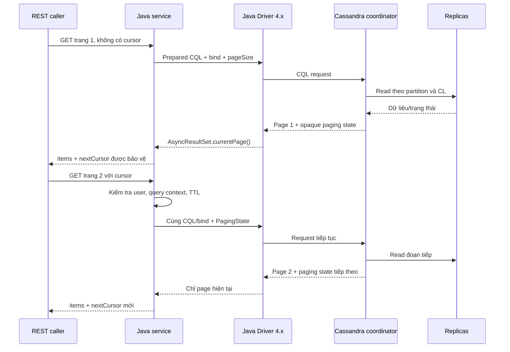
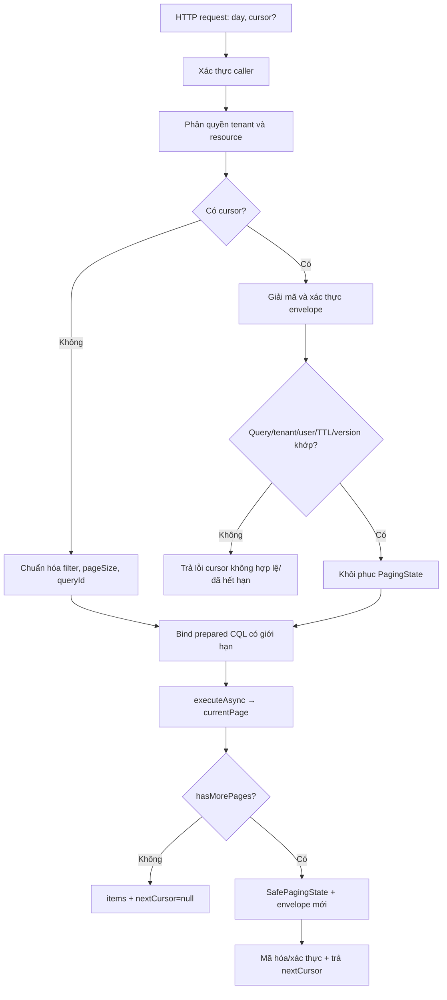

# `PagingState`, khôi phục trang và ràng buộc với truy vấn gốc trong Java Driver Cassandra

## 1. Bài toán: lấy trang tiếp theo mà không chạy lại từ đầu

Apache Cassandra là cơ sở dữ liệu **wide-column phân tán**. Khi ứng dụng Java gửi CQL, **partition key** định vị replica, **clustering columns** xác định thứ tự hàng trong một partition, và coordinator nhận các phản hồi theo **replication factor (RF)**, **consistency level (CL)**. Với tập kết quả lớn, đọc toàn bộ dữ liệu trong một request sẽ làm tăng bộ nhớ, network, thời gian chờ và khả năng timeout.

Giả sử API đơn hàng cần:

```text
GET /tenants/tenant-01/orders?day=2026-11-20&pageSize=20
→ 20 đơn đầu + nextCursor

GET /tenants/tenant-01/orders?day=2026-11-20&pageSize=20&cursor=...
→ trang tiếp theo + nextCursor mới
```

Java Driver 4.x có cơ chế **Cassandra paging** và đối tượng **`PagingState`** giúp tiếp tục một truy vấn từ vị trí xử lý trang trước. Tuy nhiên:

- `PagingState` là **trạng thái tiếp tục nội bộ, opaque**, không phải “offset = 20”.
- Trạng thái này phải gắn với **truy vấn gốc và giá trị tham số tương ứng**.
- Một state hợp lệ **không đảm bảo dữ liệu không đổi** giữa hai lần gọi.
- State **không mang quyền truy cập** và không thay thế authorization cho tenant.
- State **không tự có TTL nghiệp vụ, chữ ký bảo mật hay cam kết ổn định qua upgrade**.

Mục tiêu bài: thiết kế query có partition rõ ràng, lấy một trang bằng Java Driver 4.x, lưu/khôi phục `PagingState` an toàn và xử lý những lỗi thường gặp trong API phân trang có nhiều request độc lập.

## 2. Phân biệt ba khái niệm: page size, LIMIT và cursor

| Khái niệm | Tác động | Không có nghĩa |
| --- | --- | --- |
| `setPageSize(20)` | Yêu cầu driver/server xử lý theo các page với kích thước mục tiêu khoảng 20 hàng | Mỗi page luôn có đúng 20 hàng hoặc toàn bộ query chỉ đọc 20 hàng |
| `LIMIT 100` | Giới hạn tổng số hàng CQL được trả về trong một lần thực thi query logic | Tự tạo API có đúng 5 trang hoặc tự cho biết trang hiện tại |
| `PagingState` | Chứa vị trí tiếp tục kết quả của query/page cụ thể | SQL `OFFSET`, khóa cuối có thể sửa tùy ý, snapshot dữ liệu |
| `hasMorePages()` | Driver biết còn khả năng fetch trang tiếp theo | Trang sau chắc chắn có hàng nghiệp vụ hoặc vẫn còn nguyên dữ liệu |
| `nextCursor` của REST API | Chuỗi ứng dụng trao cho caller để tiếp tục đúng truy vấn | Token xác thực/ủy quyền, session đăng nhập hoặc bản backup |

**Một page có thể ít hơn page size dù vẫn còn trang tiếp theo**, tùy cách server tạo page, tombstone và phiên bản/protocol. Không suy từ `rows.size() < pageSize` rằng đã hết dữ liệu. Hãy dùng thông tin tiếp tục do driver cung cấp.

### `LIMIT` và page size là hai lớp giới hạn

Với `LIMIT 100`, `setPageSize(20)`:

```text
Truy vấn logic: trả tối đa 100 hàng.
Mục tiêu fetch: mỗi lượt khoảng 20 hàng.
Số trang thực tế: phụ thuộc dữ liệu và cách server chia page.
```

Nếu trang đầu có 20 hàng, **đừng đổi `LIMIT 100` thành `LIMIT 80` ở trang hai** rồi áp dụng `PagingState` cũ. Đó đã là một truy vấn khác về mặt contract. Giữ nguyên câu CQL và tham số trong suốt vòng đời cursor.

Nếu endpoint cần phân trang qua hàng triệu hàng, `LIMIT` tổng và số trang tối đa nên được thiết kế theo API. Một `LIMIT` quá lớn không biến việc quét toàn bộ dữ liệu thành truy vấn nhẹ chỉ nhờ page size nhỏ.

## 3. Query phải tốt ngay cả khi không có phân trang

Cassandra tối ưu nhất khi biết **partition key**, sau đó đọc một khoảng clustering hợp lý. Paging chỉ điều tiết cách truyền dữ liệu, **không sửa một mô hình dữ liệu tồi**.

### Schema lab: đơn hàng theo tenant và ngày

Lab giả định datacenter `dc1` có ít nhất ba replica phù hợp RF3. Với cluster ít node hơn, điều chỉnh RF/CL theo hạ tầng lab:

```sql
CREATE KEYSPACE IF NOT EXISTS paging_lab
WITH replication = {
    'class': 'NetworkTopologyStrategy',
    'dc1': 3
}
AND durable_writes = true;

CREATE TABLE IF NOT EXISTS paging_lab.orders_by_tenant_day (
    tenant_id text,
    order_day date,
    created_at timestamp,
    order_id uuid,
    status text,
    total_cents bigint,
    PRIMARY KEY ((tenant_id, order_day), created_at, order_id)
) WITH CLUSTERING ORDER BY (
    created_at DESC,
    order_id ASC
);
```

Partition key `(tenant_id, order_day)` định vị dữ liệu của **một tenant trong một ngày**. `created_at DESC` đưa đơn gần nhất lên trước trong partition; `order_id` phân biệt những đơn trùng thời điểm. Bucket một ngày chỉ phù hợp khi **kích thước partition** được kiểm soát; tenant có lượng đơn quá lớn có thể cần sharding/bucket nhỏ hơn theo thiết kế truy vấn.

Truy vấn có page:

```sql
SELECT created_at, order_id, status, total_cents
FROM paging_lab.orders_by_tenant_day
WHERE tenant_id = 'tenant-01'
  AND order_day = '2026-11-20'
LIMIT 100;
```

Không cần `ALLOW FILTERING` vì có đủ partition key. Mỗi trang trong một truy vấn trả về hàng theo clustering order **trong partition đó**; không được suy ra thứ tự toàn cục giữa các tenant hoặc ngày khác nhau.

### Khi nào query vẫn nguy hiểm dù có paging?

```sql
-- KHÔNG dùng làm mẫu tối ưu: không có partition key rõ ràng.
-- Query có thể bị từ chối hoặc tốn scan/fan-out tùy index/schema.
SELECT created_at, order_id
FROM paging_lab.orders_by_tenant_day
WHERE status = 'PAID'
ALLOW FILTERING;
```

`setPageSize(20)` không làm giảm số replica/token range cần xét, cũng không bảo đảm index/tracing/compaction nhẹ. Phải mô hình bảng theo truy vấn, partition/bucket hoặc index phù hợp trước khi bàn đến cursor.

## 4. Paging diễn ra ở coordinator và driver như thế nào?



Sơ đồ là diễn giải khái niệm, không phải cam kết rằng mọi phiên bản Cassandra liên hệ một tập replica/định dạng message giống nhau. **Mỗi lời gọi API là một request mới**; Cassandra không tự giữ một snapshot transaction của toàn bộ danh sách chờ người dùng click “Next”.

Nếu coordinator/driver thấy dữ liệu thay đổi, replica khác nhau hoặc cache/SSTable khác nhau giữa hai lần gọi, kết quả trang sau có thể chịu ảnh hưởng. Paging không đồng nghĩa **snapshot isolation**.

## 5. Java Driver 4.x: sync iteration dễ tự fetch trang tiếp theo

Trong Java Driver 4.x, `session.execute(statement)` trả về `ResultSet` đồng bộ. Việc lặp qua toàn bộ `ResultSet` có thể **tự fetch các page tiếp theo**:

```java
ResultSet rs = session.execute(boundStatement);
for (Row row : rs) {
    process(row);
}
// Có thể đã fetch nhiều page, không phải chỉ page đầu.
```

Nếu service muốn “một HTTP request = một Cassandra page”, không nên lặp tùy ý trên `ResultSet` rồi tưởng rằng có thể lấy `PagingState` của riêng trang đầu. Có thể dùng `getAvailableWithoutFetching()` với kiến thức đầy đủ về số hàng đang được buffer, nhưng cách đơn giản để **chủ động phân trang** là dùng API bất đồng bộ.

### `AsyncResultSet` tách từng page rõ ràng

Java Driver 4.x có:

- `session.executeAsync(statement)`: trả `CompletionStage<AsyncResultSet>`.
- `asyncResultSet.currentPage()`: duyệt những hàng đã có **trong page hiện tại**, không tự fetch mọi trang.
- `asyncResultSet.hasMorePages()`: kiểm tra còn trang tiếp theo.
- `asyncResultSet.fetchNextPage()`: chủ động lấy page kế trong cùng luồng xử lý.
- `asyncResultSet.getExecutionInfo()`: thông tin thực thi, gồm state của page tương ứng.

Hai cách dùng:

| Mục tiêu | Cách chọn |
| --- | --- |
| Job/batch xử lý **tất cả** hàng, có giới hạn tải | Sync iteration hoặc async fetch lặp có backpressure |
| REST API mỗi lần trả **một** page và cursor | `executeAsync` + `currentPage` + lấy safe paging state |
| Worker stream lâu dài qua hàng loạt page | `fetchNextPage` có kiểm soát, giới hạn concurrency |
| Tiếp tục ở request HTTP khác | Tạo **statement tương đương** rồi áp dụng state đã được bảo vệ |

**Không gọi `fetchNextPage()` chỉ để tính cursor của trang vừa đọc**; trường hợp API chỉ cần trả một page, lấy state từ execution info nếu còn page.

## 6. `PagingState` an toàn và trạng thái raw

Trong các bản Java Driver 4.x có API tương ứng, `ExecutionInfo` có thể cung cấp:

- `getPagingState()`: trạng thái paging ở dạng thấp hơn (thường là `ByteBuffer`), dùng theo contract của driver/protocol.
- `getSafePagingState()`: đối tượng `PagingState` có cơ chế **ràng buộc/kiểm tra với statement tương ứng** khi dùng lại API an toàn.

Mẫu:

```java
import com.datastax.oss.driver.api.core.cql.PagingState;

PagingState safeState =
    result.getExecutionInfo().getSafePagingState();

String serialized = safeState == null
    ? null
    : safeState.toString();
```

Đối tượng `PagingState` có thể được chuyển thành chuỗi để lưu qua hai lần gọi, và được khôi phục bằng `PagingState.fromString(...)` trong API driver hỗ trợ. **Cú pháp và tính tương thích serialized state cần được xác minh với đúng minor version/bản phân phối driver**.

### Tại sao ưu tiên safe state?

Một paging state tùy ý được áp dụng cho truy vấn khác có thể gây kết quả sai, lỗi protocol hoặc truy vấn không thể tiếp tục. Cơ chế safe state giúp phát hiện một số cách tái sử dụng sai, chẳng hạn statement không phù hợp, trước khi gửi request.

Tuy nhiên, **“safe” không có nghĩa token đã được mã hóa, ký xác thực, ràng buộc người dùng hay có thời gian hết hạn**. Ứng dụng REST vẫn phải tự:

- Xác thực caller và xác định tenant được phép truy cập.
- Kiểm tra token thuộc đúng endpoint/query shape/filters.
- Chặn token bị sửa, copy sang user/tenant khác hoặc hết hạn.
- Bảo vệ nội dung token khi lưu và truyền.
- Giới hạn page size, số lần tiếp tục và tải truy vấn.

**Không nhận raw `getPagingState()` từ một người dùng chưa tin cậy rồi áp dụng trực tiếp cho statement bất kỳ.** Tránh sửa byte, đoán cấu trúc hoặc giải mã trường nội bộ: paging state phải được coi là opaque.

## 7. Ràng buộc với truy vấn gốc: những gì phải bất biến?

Để khôi phục một page, service phải tái tạo **đúng ngữ cảnh logic** của trang trước.

| Thành phần | Ví dụ trang 1 | Trang 2 nên làm gì? |
| --- | --- | --- |
| CQL text/query ID | `SELECT ... WHERE tenant_id=? AND order_day=? LIMIT 100` | Dùng cùng prepared query |
| Bound value tenant | `tenant-01` | **Không** đổi thành `tenant-02` |
| Bound value ngày | `2026-11-20` | Giữ nguyên |
| Các filter khác | `status` nếu có trong query/index phù hợp | Giữ nguyên tất cả |
| Clustering order | `created_at DESC, order_id ASC` | Không đổi schema/order đang dùng |
| `LIMIT` | `100` | Không thay thành `80` theo số đã đọc |
| Page size | `20` | Giữ cố định theo cursor/API contract |
| Consistency level | `LOCAL_QUORUM` | Giữ để so sánh semantics; token không tự cưỡng chế |
| Local DC/cluster | `dc1`/cluster A | Không dùng state của cluster A tùy tiện ở cluster B |
| Identity/authorization | User được quyền tenant-01 | Kiểm tra lại trên mỗi request |
| Schema/driver/protocol | Version tại lúc tạo token | Chỉ tiếp tục trong compatibility window đã thử |

**Cốt lõi:** `PagingState` không phải “vị trí của hàng thứ 20” độc lập với query. Nếu caller đổi ngày, tenant hoặc predicate, hãy **bắt đầu truy vấn mới từ trang đầu**, không cố áp dụng state cũ.

### Vì sao page size và CL vẫn cần giữ dù safe state kiểm tra statement?

Không nên khẳng định `getSafePagingState()` kiểm tra **mọi** option nghiệp vụ. Driver có thể kiểm tra ràng buộc mà API của nó định nghĩa, nhưng không thay được policy của dịch vụ. Cần ràng buộc trong cursor envelope cả `queryVersion`, `pageSize`, `CL`, `tenant` và query parameters để không vô tình thay semantics giữa các request.

### Không đưa `PagingState` qua nhiều kiểu query tương đương về chữ

Hai truy vấn cùng lấy đơn hàng nhưng khác `SELECT` fields, `LIMIT`, predicate hoặc clustering schema có thể tạo request khác. Đừng lấy state của:

```sql
SELECT order_id
FROM paging_lab.orders_by_tenant_day
WHERE tenant_id = 'tenant-01'
  AND order_day = '2026-11-20'
LIMIT 100;
```

để tiếp tục truy vấn:

```sql
SELECT order_id, status, total_cents
FROM paging_lab.orders_by_tenant_day
WHERE tenant_id = 'tenant-01'
  AND order_day = '2026-11-20'
LIMIT 100;
```

Ngay cả khi hai query có vẻ cùng số lượng hàng, **serialized paging state không phải cấu trúc để chia sẻ giữa các statement**.

## 8. Ví dụ Java Driver 4.x: một API method trả một page

Ví dụ sau dùng Java 8+ và Java Driver 4.x. Nó giả định bảng CQL mục 3 đã tồn tại, TLS/auth và `CqlSession` được cấu hình bên ngoài. **Cursor chuỗi ở ví dụ chỉ dùng cho tầng repository/lab; không trả nguyên văn ra Internet nếu chưa có lớp bảo vệ ở mục 9.**

```java
import java.time.Instant;
import java.time.LocalDate;
import java.util.ArrayList;
import java.util.Collections;
import java.util.List;
import java.util.UUID;
import java.util.concurrent.CompletionStage;

import com.datastax.oss.driver.api.core.CqlSession;
import com.datastax.oss.driver.api.core.DefaultConsistencyLevel;
import com.datastax.oss.driver.api.core.cql.AsyncResultSet;
import com.datastax.oss.driver.api.core.cql.BoundStatement;
import com.datastax.oss.driver.api.core.cql.PagingState;
import com.datastax.oss.driver.api.core.cql.PreparedStatement;
import com.datastax.oss.driver.api.core.cql.Row;

public final class OrdersPageRepository {
    private static final int PAGE_SIZE = 20;
    private final CqlSession session;
    private final PreparedStatement query;

    public OrdersPageRepository(CqlSession session) {
        this.session = session;
        this.query = session.prepare(
            "SELECT created_at, order_id, status, total_cents " +
            "FROM paging_lab.orders_by_tenant_day " +
            "WHERE tenant_id = ? AND order_day = ? LIMIT 100"
        );
    }

    public CompletionStage<Page> readPage(
            String authorizedTenant,
            LocalDate day,
            String safePagingStateString) {

        BoundStatement stmt = query.bind(authorizedTenant, day)
            .setConsistencyLevel(DefaultConsistencyLevel.LOCAL_QUORUM)
            .setPageSize(PAGE_SIZE)
            .setIdempotent(true);

        if (safePagingStateString != null) {
            PagingState state =
                PagingState.fromString(safePagingStateString);
            // Dùng statement gốc với cùng query và bound values.
            stmt = stmt.setPagingState(state);
        }

        return session.executeAsync(stmt).thenApply(result -> {
            List<OrderItem> items = new ArrayList<>();
            for (Row row : result.currentPage()) {
                items.add(new OrderItem(
                    row.getInstant("created_at"),
                    row.getUuid("order_id"),
                    row.getString("status"),
                    row.getLong("total_cents")
                ));
            }

            String next = null;
            if (result.hasMorePages()) {
                PagingState safeState =
                    result.getExecutionInfo().getSafePagingState();
                if (safeState == null) {
                    throw new IllegalStateException(
                        "Server has more pages but no safe paging state");
                }
                next = safeState.toString();
            }
            return new Page(items, next);
        });
    }

    public static final class OrderItem {
        public final Instant createdAt;
        public final UUID orderId;
        public final String status;
        public final long totalCents;

        public OrderItem(
                Instant createdAt, UUID orderId,
                String status, long totalCents) {
            this.createdAt = createdAt;
            this.orderId = orderId;
            this.status = status;
            this.totalCents = totalCents;
        }
    }

    public static final class Page {
        public final List<OrderItem> items;
        public final String nextPagingStateString;

        public Page(
                List<OrderItem> items, String nextPagingStateString) {
            this.items = Collections.unmodifiableList(
                new ArrayList<>(items));
            this.nextPagingStateString = nextPagingStateString;
        }
    }
}
```

### Cần đọc kỹ từng bước

1. `authorizedTenant` phải được lấy từ **authorization đã kiểm chứng**, không chỉ từ query parameter người dùng tự nhập.
2. `query` được prepare **một lần**, tái sử dụng; mọi request bind đúng thứ tự `tenant_id`, `order_day`.
3. `LOCAL_QUORUM` giữ nguyên CL theo hợp đồng dịch vụ; RF3 trong dc1 cần đủ hai replica địa phương khỏe.
4. `PAGE_SIZE=20` và `LIMIT 100` cố định cho toàn bộ chuỗi truy vấn.
5. `PagingState.fromString(...)` chỉ là bước **giải mã dạng state**, chưa phải bước xác thực cursor của REST API.
6. `result.currentPage()` chỉ lặp page hiện tại, tránh fetch mọi page.
7. Chỉ trả state tiếp khi `hasMorePages()`; nếu hết trang, `nextPagingStateString=null`.
8. `setIdempotent(true)` thích hợp cho `SELECT` thuần đọc; không áp dụng mù cho counter/LWT/write.

Mã mẫu không xử lý exception/cancellation, timeout, bảo mật token và tracing; chúng phải được đưa vào lớp service/HTTP và vận hành production.

### Không tạo session mới cho mỗi trang

`CqlSession` quản lý connections, topology discovery, metadata và prepared statements. Hãy tái sử dụng một session theo vòng đời application, không gọi `CqlSession.builder().build()` trong mỗi `readPage`; session mới vừa tăng độ trễ vừa làm khó kiểm soát pool/credential.

## 9. Thiết kế `nextCursor` dành cho REST API

**Không coi `safePagingStateString` ở mục 8 là cursor production hoàn chỉnh.** Một API công khai cần một **cursor envelope** do ứng dụng kiểm soát, ví dụ:

```json
{
  "version": 1,
  "queryId": "orders-by-tenant-day-v1",
  "tenantId": "tenant-01",
  "orderDay": "2026-11-20",
  "pageSize": 20,
  "consistency": "LOCAL_QUORUM",
  "issuedAt": "2026-11-20T10:00:00Z",
  "expiresAt": "2026-11-20T10:15:00Z",
  "driverPagingState": "<opaque-serialized-state>"
}
```

Đây là **dữ liệu minh họa**, không phải token có thể dùng thật. Trong production:

- Envelope phải được **mã hóa và xác thực** (ví dụ AEAD) hoặc lưu server-side sau một token ID ngẫu nhiên không đoán được.
- Khóa mã hóa/ký được bảo vệ trong hệ thống quản lý bí mật; có `keyId` và quy trình rotate.
- Gắn tenant và authorization scope của caller; nếu cần, gắn user/session/role và query fingerprint.
- Hạn dùng ngắn, định dạng có version và chính sách invalidation sau schema/query upgrade.
- Kiểm tra `issuedAt/expiresAt`, `pageSize`, `queryId`, tenant, user và parameter hash **trước khi** chuyển raw state cho driver.
- Giới hạn độ dài token, ký tự được chấp nhận, số lượt gọi và tải theo caller.
- Không log token đầy đủ: token có thể chứa thông tin nội bộ và hỗ trợ truy cập dữ liệu trong scope của nó.

**Chỉ base64 JSON không phải bảo mật.** Base64 có thể giải mã và sửa dễ dàng; `PagingState` của driver cũng không thay thế cơ chế auth của HTTP.

### Client nên gửi gì?

Hai chiến lược:

**A — Cursor chứa toàn bộ ngữ cảnh:** client chỉ gửi `cursor` ở lần tiếp theo, server giải mã và kiểm tra authorization dựa trên scope trong token.

**B — Cursor + tham số query:** client gửi lại `day`, `pageSize` và `cursor`; server so chúng với envelope và từ chối nếu không khớp.

Cả hai đều hợp lệ nếu được thiết kế rõ. Tránh cách sai: client gửi `tenantId=tenant-B` với cursor của tenant-A rồi server tin rằng state có thể tự điều chỉnh.

### Dùng cursor server-side khi cần thu hồi chủ động

Nếu yêu cầu **revoke ngay** hoặc tránh đưa thông tin nội bộ cho client, có thể lưu `PagingState` và query context ở cache có TTL phía server, trả một token ngẫu nhiên tham chiếu record đó. Đánh đổi là thêm stateful storage, chi phí cleanup và tính sẵn sàng của cache; nếu cache mất, có thể phải yêu cầu client bắt đầu lại từ trang đầu.

## 10. Từ REST endpoint tới repository: kiểm tra đúng thứ tự

Một pipeline request hợp lý:



### Ví dụ hợp đồng endpoint

```text
GET /orders?day=2026-11-20&pageSize=20
Authorization: Bearer <access-token>

200 OK
{
  "items": [
    {"orderId": "11111111-1111-4111-8111-111111111111",
     "status": "PAID",
     "totalCents": 125000}
  ],
  "nextCursor": "<opaque-protected-cursor>"
}
```

Nếu không còn page tiếp theo:

```json
{
  "items": [],
  "nextCursor": null
}
```

Ví dụ response cuối có mảng rỗng chỉ để minh họa **không có cursor tiếp**, không khẳng định mọi trang cuối đều rỗng.

### Phân biệt loại lỗi cho HTTP

| Lỗi | Cách xử lý gợi ý | Không nên làm |
| --- | --- | --- |
| Cursor parse sai, bị sửa, query mismatch | `400 Bad Request` hoặc mã lỗi cursor rõ ràng | Tự bỏ cursor rồi trả trang 1 như thể thành công |
| Cursor hết hạn hoặc version không còn hỗ trợ | Mã lỗi riêng, có hướng dẫn bắt đầu lại | Tiếp tục với state từ phiên bản khác mà chưa kiểm thử |
| Caller không còn quyền tenant | `403 Forbidden`/quy trình auth phù hợp | Tin vào tenant trong cursor mà bỏ qua authorization |
| RF/CL không đáp ứng | Lỗi dịch vụ phù hợp, metrics về Cassandra | Hạ `LOCAL_QUORUM` xuống `ONE` tự động |
| Timeout tạm thời | Retry có điều kiện, backoff, giới hạn số lần | Lặp vô hạn hoặc nhân đôi trang mà không quản lý |
| Schema/query thay đổi | Vô hiệu token cũ theo `queryId`/version | Áp dụng state cũ cho CQL mới rồi đoán kết quả |

Đây là **gợi ý thiết kế API**, không phải chuẩn HTTP bắt buộc cho mọi doanh nghiệp. Với cursor đã hết hạn, có thể chọn `400`, `409` hoặc mã domain khác theo hợp đồng API, nhưng phải thông báo rõ client cần restart pagination.

## 11. Dữ liệu thay đổi giữa các trang: không có snapshot isolation

Giả sử partition chứa bốn đơn theo `created_at DESC`:

```text
Trang 1 lúc T1:  O4, O3  | cursor sau O3
Dữ liệu lúc T2:  tạo O5 mới hơn O4, xóa O2
Trang 2 lúc T3:  query tiếp bằng cursor cũ
```

`PagingState` giúp tìm vị trí tiếp trong đường đọc theo contract Cassandra, **nhưng không khóa toàn bộ partition để tạo snapshot ổn định**. Khi mutation diễn ra giữa T1 và T3:

- Hàng mới chèn **trước vị trí đã đi qua** có thể không xuất hiện trong chuỗi trang đang duyệt.
- Hàng bị xóa có thể biến mất; số hàng một page có thể thay đổi.
- Update clustering key thực chất có thể là **xóa hàng khóa cũ và ghi hàng khóa mới**, ảnh hưởng vị trí.
- TTL hết hạn tạo tombstone và làm tập kết quả thay đổi.
- Replica trả lời ở CL khác hoặc đang chậm hội tụ có thể dẫn đến giá trị quan sát khác nhau.
- Trong một số tình huống, ứng dụng có thể thấy **bỏ sót hoặc trùng lặp** nếu giả định danh sách bất biến.

**Không hứa “exactly-once, không thiếu không trùng qua mọi trang” chỉ nhờ PagingState.** Muốn bảo đảm như vậy phải thiết kế snapshot/version/event log hoặc export pipeline có chốt dữ liệu và kiểm chứng riêng.

### Nên làm gì cho giao diện người dùng?

Đối với danh sách có thể thay đổi, thông thường chấp nhận semantics **best effort/được phân trang tại thời điểm đọc**, hiển thị “dữ liệu có thể đã thay đổi” và cho người dùng refresh từ trang đầu khi cursor hết hạn.

Nếu cần hiển thị ổn định cho một lần tìm kiếm:

- Chụp tập ID kết quả ở một tầng phù hợp với giới hạn lưu trữ, tạo snapshot query có TTL.
- Hoặc dùng **seek/keyset pagination** với mốc clustering và giới hạn phạm vi do nghiệp vụ kiểm soát.
- Hoặc dựng báo cáo/export trên nguồn dữ liệu được đóng băng hoặc đã có version.

Keyset pagination giúp đặt mốc logic nhưng **không tự biến dữ liệu đang ghi thành snapshot nhất quán**. Nếu dùng seek bằng clustering key, phải xử lý tie-breaker `(created_at, order_id)` và quy tắc thứ tự; không chỉ dùng `created_at < lastTime` rồi làm mất hàng trùng timestamp.

## 12. Token không có lời hứa bền vững vĩnh viễn

Một token có thể thất bại hoặc cho semantics không mong muốn khi:

- Query text, filter, bound values hoặc `LIMIT` thay đổi.
- Schema được sửa: thêm/xóa/đổi kiểu cột, đổi partition/clustering key, đổi chiến lược query.
- Phiên bản Cassandra, driver hoặc protocol được nâng và representation state không còn tương thích.
- Token từ cluster A bị gửi sang cluster B hoặc môi trường staging/production khác nhau.
- Dữ liệu được TTL/delete/compaction/repair và đường đọc khác so với lúc tạo token.
- Token bị cắt ngắn, corrupt, sửa, vượt thời hạn hoặc được phát lại từ caller khác.

Do đó nên đặt `queryId` có version, thời hạn hợp lý và cơ chế **restart from first page**. Không lưu paging token trong database để “tiếp tục sau sáu tháng” mà không có bằng chứng thử nghiệm và chính sách retention/compatibility.

### Một lưu ý về coordinator và replica

Client không nhất thiết phải tiếp tục với **cùng coordinator vật lý** nếu driver/protocol hỗ trợ state phù hợp, nhưng cũng **không** đồng nghĩa token có thể chuyển tùy ý sang một cluster khác. Routing, topology, protocol và CL phải được kiểm thử; đừng hard-code IP một node để giữ “vị trí cursor”.

## 13. Paging trên nhiều partition, nhiều DC hoặc với ORDER BY

Cassandra chỉ cung cấp clustering order **trong partition** theo schema/query hợp lệ. Ví dụ muốn lấy 20 đơn mới nhất của tenant qua bảy ngày:

```text
Partition 1: (tenant-01, 2026-11-20)
Partition 2: (tenant-01, 2026-11-19)
...
Partition 7: (tenant-01, 2026-11-14)
```

Không có một `PagingState` của truy vấn ngày 20 nào tự biết **ngày 19** là partition cần tiếp theo. Nếu API ghép dữ liệu từ nhiều partition:

1. Service quản lý **mỗi query/partition một cursor riêng**, hoặc xây bảng truy vấn khác.
2. Merge kết quả theo clustering/time key và tie-breaker để có thứ tự tổng thể.
3. Đặt giới hạn concurrency, số partition, page/byte và độ trễ.
4. Bảo vệ cursor tổng hợp bằng envelope có version/auth/TTL như một cursor đơn.
5. Khi có failure hoặc pagination tiếp, bảo toàn mốc đã trả cho client để tránh mất/trùng do merge.

**Không dùng một paging state duy nhất để thay cho state của nhiều query độc lập.** Query với `IN`, index/SAI hoặc nhiều token ranges có thể có semantics phân phối kết quả riêng; phải benchmark và giữ đúng CQL gốc.

### DC và consistency

Với `NetworkTopologyStrategy` RF3 ở dc1 và dc2:

- `LOCAL_QUORUM` ở dc1 cần hai replica địa phương; một request ở dc2 có thể thấy dữ liệu hơi khác nếu WAN chưa hội tụ.
- `QUORUM` toàn keyspace có phạm vi yêu cầu khác, không được tráo đổi ngầm giữa các trang.
- `PagingState` không sửa consistency và không tạo đồng bộ replica.

Không chuyển một chuỗi paging của API đang ở dc1 sang một DC khác mà **không đánh giá semantics CL và độ tươi dữ liệu**. Trong failover liên DC, có thể phải chấp nhận restart từ đầu hoặc cơ chế dedup/version riêng.

## 14. Giới hạn tài nguyên và backpressure

Paging giúp giảm khối lượng dữ liệu trả mỗi lần, nhưng server/driver vẫn phải tìm, đọc, lọc và hòa giải dữ liệu. Cần kiểm soát:

| Nút điều khiển | Mục tiêu | Rủi ro nếu sai |
| --- | --- | --- |
| Page size | Cân bằng số request và payload/page | Quá lớn: memory/network/latency spike; quá nhỏ: nhiều round trips |
| `LIMIT` | Chặn số hàng tối đa logic | Quá lớn: API vẫn cho phép quét lâu |
| Concurrent requests | Bảo vệ node/driver pool | Retry/fetch storm làm cluster quá tải |
| Request timeout | Giới hạn deadline | Timeout quá thấp khiến retry tăng; quá cao giữ tài nguyên |
| Retry policy | Chỉ retry khi an toàn | Có thể tải gấp nhiều lần và lặp page |
| Cursor TTL | Giới hạn resume window | Quá dài: stale schema/state và khó revoke |
| Response size | Chặn số byte trả HTTP | Hàng lớn có thể vượt ngân sách dù row count thấp |
| Rate limit | Kiểm soát truy vấn từ một user/tenant | Một caller dùng nhiều cursor để quét dữ liệu |

**Không đo hiệu năng chỉ bằng số hàng/page.** Một row chứa collection hoặc blob lớn có thể làm page 20 hàng vẫn rất nặng; partition lớn, tombstones và SSTables/read ảnh hưởng latency.

### Tránh gọi `fetchNextPage` vô hạn

Trong worker backend, một vòng lặp `fetchNextPage` không giới hạn có thể đọc toàn bộ partition/chạy hàng giờ và lấp connection pool. Thiết kế:

- Giới hạn tổng số page/row/byte/thời gian.
- Kiểm tra cancellation và deadline.
- Đặt backpressure theo khả năng xử lý của downstream.
- Kiểm tra `hasMorePages()`, đồng thời bảo vệ trường hợp page rỗng liên tiếp.
- Dừng khi caller hủy hoặc toàn bộ công việc đã đủ.

Không gọi `session.executeAsync` hàng nghìn lần song song chỉ để “đi nhanh hết các trang” của cùng một truy vấn; điều đó khác paging tuần tự và có thể phá thứ tự.

## 15. Quan sát và chẩn đoán khi resume thất bại

Trong ứng dụng Java, metric nên tách:

- `queryId` và version, không log toàn bộ CQL chứa data/secret.
- Page index hoặc số lần tiếp trong request chain (không tin hoàn toàn giá trị từ client).
- Page size, rows returned, bytes serialized và latency.
- Số request tới Cassandra, number of attempts/retries, timeout, auth/TLS failures.
- Tỷ lệ cursor invalid/mismatch/expired và lý do được tổng hợp.
- `hasMorePages` và thời gian hết hạn, không log nguyên token.
- Tenant ở dạng nhãn kiểm soát cardinality hoặc ẩn danh, không dùng tenant ID nhạy cảm làm label tràn lan.

### Các lệnh Cassandra hỗ trợ điều tra

```bash
nodetool status
nodetool tpstats
nodetool compactionstats
nodetool tablestats paging_lab.orders_by_tenant_day
nodetool tablehistograms paging_lab orders_by_tenant_day
```

Thông số từ `nodetool` thường **theo node được hỏi**; không đồng nghĩa latency end-to-end trên Java. Để phân biệt vấn đề paging state với vấn đề tải:

| Triệu chứng | Giả thuyết cần kiểm tra | Hành động đầu tiên |
| --- | --- | --- |
| `PagingState.fromString` lỗi | Chuỗi sai/đã bị sửa/bị cắt | Từ chối cursor, không fallback âm thầm |
| `setPagingState` từ chối | Query/values khác hoặc state không tương thích | So queryId, bound values, driver version |
| Page 2 lặp trang 1 | Client không gửi state mới hoặc server bỏ qua cursor | Kiểm tra request/repository flow và token version |
| Trang trả ít hàng hơn page size | Dữ liệu ít, tombstones, server paging behavior | Dùng `hasMorePages` thay vì suy từ count |
| `hasMorePages` nhưng page rỗng | Tình huống paging/filtering/tombstones tùy query | Giới hạn số lượt thử, không loop vô hạn |
| Chậm khi page 10+ | Partition size, tombstone, SSTables/read, disk | Quan sát tablehistograms, tracing có chọn lọc |
| Resume lỗi sau rollout | Query text/schema/driver/protocol thay đổi | Vô hiệu token phiên bản cũ, restart |
| `Unavailable`/timeout | Replica/CL/DC, không chỉ cursor | Kiểm tra RF, CL, node, network, deadline |
| Thấy ID trùng/mất sau cập nhật | Danh sách biến đổi trong khi paging | Xác định contract snapshot/dedup |

Không vội bật `TRACING ON` cho mọi request production. Tracing có chi phí, nên lấy mẫu và đối chiếu Java API p95/p99, coordinator/replica metrics khi cần.

## 16. Lab từng bước: kiểm chứng state tiếp tục đúng query

### Bước 1 — Nạp dữ liệu có thứ tự

Sau khi tạo `paging_lab` ở mục 3:

```sql
INSERT INTO paging_lab.orders_by_tenant_day (
    tenant_id, order_day, created_at, order_id, status, total_cents
) VALUES (
    'tenant-01', '2026-11-20',
    '2026-11-20 09:00:00+0000',
    11111111-1111-4111-8111-111111111111, 'PAID', 125000
);

INSERT INTO paging_lab.orders_by_tenant_day (
    tenant_id, order_day, created_at, order_id, status, total_cents
) VALUES (
    'tenant-01', '2026-11-20',
    '2026-11-20 08:00:00+0000',
    22222222-2222-4222-8222-222222222222, 'CREATED', 48000
);

INSERT INTO paging_lab.orders_by_tenant_day (
    tenant_id, order_day, created_at, order_id, status, total_cents
) VALUES (
    'tenant-01', '2026-11-20',
    '2026-11-20 07:00:00+0000',
    33333333-3333-4333-8333-333333333333, 'CANCELLED', 99000
);
```

Ba row chưa đủ kiểm chứng page size 20, vì vậy trong lab hãy tạo thêm bản ghi tại những timestamp khác nhau và `order_id` duy nhất, hoặc tạm sửa hằng `PAGE_SIZE` của **code lab** thành 2. Không chỉnh page size giữa **hai request thuộc cùng cursor chain**.

### Bước 2 — Gọi repository trang đầu

```text
readPage("tenant-01", 2026-11-20, null)
→ [O1, O2], nextPagingStateString = "..."
```

`O1, O2` chỉ là nhãn minh họa. Nếu page size=2 và ba hàng, state tiếp theo thường có; nhưng hành vi page size là mục tiêu, **không được viết test giả định mỗi page lúc nào cũng chính xác hai hàng**.

### Bước 3 — Khôi phục trang kế

```text
readPage("tenant-01", 2026-11-20, state-1)
→ [O3], nextPagingStateString = null
```

Kiểm tra **tập ID và thứ tự** theo clustering. Nếu có thêm mutation giữa hai lần gọi, bài test phải nêu rõ kết quả có thể khác như mục 11.

### Bước 4 — Thử sai query context

Từ state của tenant-01, gọi:

```text
readPage("tenant-02", 2026-11-20, state-1)
```

**Kỳ vọng bảo mật:** lớp API từ chối **trước khi** gọi repository nếu token envelope không khớp tenant đã được authorization; khi thử trực tiếp repository với safe paging state, driver có thể phát hiện statement mismatch theo API của bản đang dùng. Không coi exception của driver là cơ chế authorization.

### Bước 5 — Kiểm tra invalid token và version

Thử token rác, token cắt ngắn, token hết hạn, `queryId` v1 dùng với query v2 và token từ cluster khác. Kết quả mong muốn là **lỗi cursor có kiểm soát**, không crash server, không trả dữ liệu của tenant khác và không âm thầm khởi động lại từ trang đầu.

### Bước 6 — Kiểm tra load

Đo page latency với page size 20, 50, 100 trên **những chuỗi query độc lập**, không thay size trong một chuỗi. So sánh:

- API p95/p99, response bytes, driver attempts.
- `currentPage` count và `hasMorePages`.
- Mức sử dụng memory và CPU của service.
- Read latency, SSTables/read và tombstone metrics ở Cassandra.

Chọn mức dựa trên SLO và dữ liệu đại diện, không dựa vào một thử nghiệm với ba row.

## 17. Các tình huống tự đánh giá

### Tình huống A — Đổi tenant khi dùng lại cursor

Trang đầu query tenant-A trả state; trang sau caller đổi tenant-B. Có thể tin cơ chế safe state sẽ luôn bảo đảm không đọc chéo tenant?

**Đáp án định hướng:** Không. Đảm bảo API dựa trên authorization và envelope đã mã hóa/xác thực; safe state chỉ hỗ trợ kiểm tra ràng buộc với statement, không thay được quyền tenant.

### Tình huống B — Dùng `LIMIT 100` rồi giảm xuống 80

Trang 1 lấy 20 row của query `LIMIT 100`. Trang 2 muốn đặt `LIMIT 80` vì “còn 80 hàng”. Có đúng không?

**Đáp án định hướng:** Không. Query text/parameters thay đổi. Giữ nguyên `LIMIT 100` và continuation state của query; server/driver quản lý phần đã xử lý.

### Tình huống C — Mỗi page có 12 hàng thay vì 20

Client thấy trang có 12 hàng và suy ra “đã hết” dù `hasMorePages() == true`. Vì sao có thể sai?

**Đáp án định hướng:** Page size là mục tiêu, không phải cam kết số hàng cố định. Dựa trên tín hiệu state và `hasMorePages()`, không dựa duy nhất vào rows count.

### Tình huống D — Một đơn mới xuất hiện sau trang đầu

Lúc đọc trang 1 có O4, O3; lúc đọc trang 2 xuất hiện O5 mới hơn O4. Có bảo đảm O5 được đưa vào một trang phía sau không?

**Đáp án định hướng:** Không. Paging không khóa snapshot; O5 nằm trước vị trí đã quét và có thể không xuất hiện trong chuỗi hiện tại. Client nên refresh hoặc dùng thiết kế snapshot/version nếu cần kết quả ổn định.

### Tình huống E — App deploy đổi query projection

Cursor sinh từ `SELECT order_id`. Bản deploy sau chuyển thành `SELECT order_id, status` rồi dùng state cũ. Có nên tự retry mãi không?

**Đáp án định hướng:** Không. Token gắn với truy vấn gốc; dùng `queryId` version, vô hiệu cursor cũ và yêu cầu bắt đầu lại khi đổi query không tương thích.

### Tình huống F — Service trả raw state qua Internet

API trả nguyên `safePagingState.toString()` và không kiểm tra user/expiry. Có thể gọi đó là “safe cursor” không?

**Đáp án định hướng:** Không. “Safe” của driver không tương đương mã hóa/xác thực/TTL/authorization. Cần cursor envelope được bảo vệ hoặc server-side cursor ID.

### Tình huống G — Một trang cho bảy ngày

API lấy dữ liệu từ bảy partition theo ngày, mỗi ngày một truy vấn. Developer chỉ lưu `PagingState` của ngày đầu rồi muốn resume toàn bộ bảy ngày. Sai ở đâu?

**Đáp án định hướng:** Mỗi query có state riêng; cần cursor tổng hợp hoặc bảng/query khác theo tiêu chí đọc. Phải giải quyết merge order, dedup và số lượng request.

### Tình huống H — Một node lỗi giữa hai page

RF3, `LOCAL_QUORUM`. Trang đầu thành công; trước trang hai, một replica Down. Có thể tiếp tục không?

**Đáp án định hướng:** Nếu hai replica địa phương còn lại khỏe và cung cấp được dữ liệu, local quorum vẫn có thể đáp ứng. Nhưng p99/timeout có thể thay đổi; `PagingState` không làm tăng số replica hay đổi CL.

## 18. Checklist khi triển khai paging production

**Truy vấn và dữ liệu**

- [ ] Partition key/clustering key khớp query shape; không dùng paging để che `ALLOW FILTERING`/full scan.
- [ ] Phân biệt `LIMIT` tổng với `setPageSize` và giới hạn row/byte/time ở API.
- [ ] Cố định CQL, bound values, filters, `LIMIT` và page size trong cùng cursor chain.
- [ ] Đã xác định thứ tự clustering trong partition và nhu cầu multi-partition merge.
- [ ] Đã định nghĩa rõ paging **không cung cấp snapshot isolation** cho dữ liệu đang thay đổi.

**Java Driver 4.x**

- [ ] Dùng `PreparedStatement` và `BoundStatement`, tái sử dụng `CqlSession`.
- [ ] Dùng `AsyncResultSet.currentPage()` khi mỗi HTTP request chỉ muốn một page.
- [ ] Không lặp toàn bộ sync `ResultSet` rồi tưởng chỉ đã đọc một page.
- [ ] Khi `hasMorePages()` thì lấy `getSafePagingState()` và encode theo API hỗ trợ.
- [ ] Trang sau dùng `PagingState.fromString(...)` và `setPagingState(...)` trên statement tương đương.
- [ ] Không sửa, tái tạo hoặc suy diễn offset từ raw paging bytes.
- [ ] Giữ CL, local DC, driver/protocol compatibility và TTL cursor theo contract.

**Bảo mật, vận hành và tương thích**

- [ ] Authorization tenant và scope được kiểm tra **ở mọi HTTP request**, kể cả resume.
- [ ] Cursor được mã hóa/xác thực hoặc dùng ID server-side; có version/TTL/size limit.
- [ ] Không log raw paging state, bearer token hay dữ liệu nhạy cảm trong response metrics.
- [ ] Token invalid/mismatch/expired phải báo rõ lỗi; không âm thầm bắt đầu lại.
- [ ] Có cách vô hiệu cursor cũ khi schema/query/driver upgrade không tương thích.
- [ ] Có rate limit, backpressure và monitoring page count, latency, timeout, retry.
- [ ] Kiểm tra dữ liệu chèn/xóa/TTL/repair giữa các trang và xử lý duplicate/missing theo nghiệp vụ.
- [ ] Khi cần snapshot chính xác, thiết kế cơ chế snapshot/version riêng thay vì dựa vào `PagingState`.

**Ghi nhớ:** `PagingState` của Java Driver Cassandra là **con trỏ opaque để tiếp tục cùng một truy vấn**, không phải offset SQL, snapshot, token auth hay hợp đồng tương thích vĩnh viễn. Hãy dùng `AsyncResultSet.currentPage()`, `hasMorePages()` và safe state với **đúng CQL + tham số + context**; bao state trong một cursor có xác thực, TTL và ràng buộc tenant/query version. Phân trang đúng chỉ kiểm soát cách đọc kết quả, còn **partition design, RF/CL, dữ liệu biến đổi và authorization** mới quyết định tính đúng và khả dụng của API.
