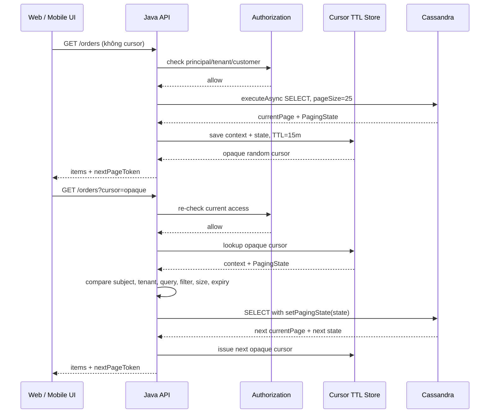

# Bảo vệ token phân trang khi đưa ra giao diện ứng dụng

> **Chương:** Truy vấn từ Java  
> **Phạm vi:** Apache Cassandra và **Java Driver 4.x**, tập trung vào việc biến **paging state nội bộ** thành **cursor phân trang an toàn** cho REST API, web/mobile UI hoặc một dịch vụ nhiều tenant.
>
> **Mục tiêu học tập:** Hiểu Cassandra paging state khác token phân vùng và offset như thế nào; phân biệt `AsyncResultSet.currentPage()` với tự động tải hết trang; không đưa raw paging state ra client; thiết kế opaque cursor khó đoán, có hạn dùng và gắn với danh tính, tenant, truy vấn; biết khi nào dùng mã hóa xác thực AEAD; kiểm thử rò rỉ/đánh tráo token; và hiểu vì sao phân trang Cassandra **không phải snapshot bất biến**.

## 1. Tình huống: phân trang đúng chức năng nhưng rò rỉ dữ liệu

Một API Java cung cấp danh sách đơn hàng theo khách hàng và ngày:

```http
GET /api/orders?customerId=11111111-1111-4111-8111-111111111111&day=2026-11-21&pageSize=25
Authorization: Bearer <access-token>
```

Ứng dụng đọc Cassandra với `setPageSize(25)`. Sau trang đầu, Java Driver trả **paging state** dùng để tiếp tục. Một lập trình viên chọn cách nhanh nhất: chuyển paging state thành một chuỗi và trả nguyên văn cho trình duyệt:

```json
{
  "items": [
    {"orderId": "aaaaaaaa-aaaa-4aaa-8aaa-aaaaaaaaaaaa", "status": "PAID"}
  ],
  "nextPageToken": "<raw-cassandra-paging-state>"
}
```

Giao diện dùng chuỗi đó ở request tiếp theo. Về mặt chức năng, API có vẻ hoạt động. Nhưng đặt ra các rủi ro:

- **Lộ cấu trúc nội bộ:** paging state có thể chứa thông tin định vị như partition/clustering key hoặc chi tiết giao thức; không thiết kế để công khai cho người dùng.
- **Đánh tráo ngữ cảnh:** client gửi token của khách hàng A kèm tham số khách hàng B.
- **Dùng chéo tenant hoặc người dùng:** token được copy từ một tài khoản và gọi bằng tài khoản khác.
- **Sửa hoặc gửi chuỗi không hợp lệ:** API chuyển dữ liệu không tin cậy thẳng tới driver/server.
- **Tồn tại quá lâu:** token có thể bị giữ trong history, analytics, log hoặc URL nhiều ngày.
- **Sai lệch dữ liệu:** khi có ghi/xóa/TTL giữa các trang, người dùng có thể thấy kết quả không như một ảnh chụp cố định.

**Thiết kế tốt:** client chỉ nhìn thấy **application cursor**, còn paging state của Cassandra được giữ an toàn phía server hoặc được đặt trong một phong bì **đã mã hóa và xác thực** theo quy trình phù hợp.

## 2. Trước hết phân biệt ba loại “token”

Trong hệ Cassandra, từ *token* dễ chỉ những thứ khác nhau:

| Tên | Được dùng để làm gì? | Ai tạo/quản lý? | Có nên đưa trực tiếp cho UI? |
| --- | --- | --- | --- |
| **Partition token** | Định vị partition trên token ring bằng partitioner | Cassandra từ partition key | Không phải cơ chế phân trang của API |
| **Paging state** | Tiếp tục đọc CQL result set từ vị trí mà truy vấn trước dừng | Server/driver native protocol | **Không nên lộ trực tiếp** |
| **Application cursor / nextPageToken** | Giao thức phân trang của ứng dụng | Backend API | Có, **nếu được thiết kế bảo vệ** |

Ví dụ `token(customer_id)` trong Cassandra mô tả token ring, **không thể dùng thay paging state** để tiếp tục 25 row tiếp theo trong một partition.

Ngược lại, `PagingState` của Java Driver không phải một JWT đăng nhập hay session cookie người dùng. Nó không chứa một bảo đảm mặc định rằng người đang trình token có quyền đọc dữ liệu.

### Một phép so sánh hữu ích

```text
Partition token:
  "Partition này thuộc vùng nào của ring?"

Cassandra paging state:
  "Truy vấn CQL trước đã đi tới đâu?"

API cursor:
  "Người dùng được ủy quyền này có thể xin trang nào
   của truy vấn nào, với giới hạn và thời hạn nào?"
```

Một API an toàn phải thêm **lớp thứ ba**, không chỉ chuyển mã lớp thứ hai sang Base64.

## 3. Cassandra phân trang thế nào?

Cassandra phân phối dữ liệu theo **partition key**, sắp xếp row trong partition bằng **clustering key**, rồi dùng CQL để đọc theo truy vấn. Khi tập kết quả lớn, server/driver chia thành các **trang ở tầng giao thức** thay vì gửi tất cả row trong một lần.

Ví dụ bảng theo truy vấn:

```cql
CREATE TABLE IF NOT EXISTS lab.orders_by_customer_day (
    tenant_id text,
    customer_id uuid,
    day_bucket date,
    created_at timestamp,
    order_id uuid,
    status text,
    total decimal,
    PRIMARY KEY ((tenant_id, customer_id, day_bucket),
                 created_at, order_id)
) WITH CLUSTERING ORDER BY (created_at DESC, order_id ASC);
```

Giả định keyspace `lab` tồn tại với `NetworkTopologyStrategy` và RF phù hợp cluster lab.

Đọc **đúng partition key đầy đủ**:

```cql
SELECT created_at, order_id, status, total
FROM lab.orders_by_customer_day
WHERE tenant_id = 'tenant-a'
  AND customer_id = 11111111-1111-4111-8111-111111111111
  AND day_bucket = '2026-11-21';
```

Dữ liệu cùng partition được sắp theo `created_at DESC` rồi `order_id ASC`. Với Java Driver, ta có thể đề nghị page size 25 để nhận từng phần của tập kết quả.

### `setPageSize(25)` không phải `LIMIT 25`

| Khái niệm | Chức năng |
| --- | --- |
| `setPageSize(25)` | Gợi ý số row tối đa/tầm cỡ mỗi **protocol page**; chưa có nghĩa tổng query chỉ có 25 row |
| CQL `LIMIT 25` | Giới hạn **tổng số row** được trả trong kết quả của truy vấn đó |
| `nextPageToken` của API | Cho client yêu cầu phần tiếp theo, nếu còn |
| SQL `OFFSET 25` | Mô hình nhảy số hàng; **không phải cách phân trang Cassandra phổ thông** |

Không đặt `LIMIT 25` với hy vọng một paging token sẽ tiếp tục các row nằm ngoài giới hạn tổng đó. Để phân trang API theo protocol page, dùng một **query shape ổn định** và `setPageSize` thích hợp.

**Page size cũng không phải lời hứa luôn có đúng 25 row.** Giới hạn byte, tombstone, phản hồi từ server và những điều kiện khác có thể khiến trang ít hơn mong đợi.

## 4. `PagingState` là gì trong Java Driver 4.x?

Trong API Java Driver 4.x, kiểu `PagingState` đại diện thông tin cho phép tiếp tục một truy vấn từ vị trí đã được server/driver cung cấp.

Một đường đi chuẩn:

```text
Prepared SELECT + bound values + page size
                  |
                  v
         session.executeAsync()
                  |
                  v
             AsyncResultSet
                  |
         +--------+---------+
         |                  |
    currentPage()       hasMorePages()
    rows của trang        |
    hiện tại              |
                       nếu true
                          |
                 ExecutionInfo paging state
                          |
                   request trang kế
```

Điều cần nhớ:

- Paging state liên quan tới **truy vấn cụ thể** và các bound values/protocol context phù hợp.
- Nó **không chứng minh** người gửi đã đăng nhập hoặc được phép xem partition đó.
- Nó **không mang lại snapshot isolation** cho toàn bộ quá trình lật trang.
- Nó có thể bị ảnh hưởng bởi thay đổi schema, query, protocol, version và dữ liệu đang ghi.
- Không được xem là định dạng lưu trữ công khai ổn định hoặc bí mật tự bảo vệ.

Một số API/phiên bản driver có thể kiểm tra paging state có khớp statement hay không. Kiểm tra đó chỉ là **tính hợp lệ chức năng**, không thay thế xác thực/ủy quyền tại backend.

## 5. Vì sao `AsyncResultSet` phù hợp cho REST pagination?

Java Driver có API đồng bộ và bất đồng bộ.

Với API đồng bộ `ResultSet`, khi duyệt iterator, driver có thể **tự động fetch những trang sau** khi cần. Nếu ứng dụng gọi:

```java
// Không dùng để đáp ứng "một HTTP request = một Cassandra page".
ResultSet rs = session.execute(statement);
List<Row> everyRow = rs.all();
```

thì có thể vô tình tải **toàn bộ các trang** của kết quả, làm response lớn, tốn RAM và phá mục tiêu lazy pagination.

Với `AsyncResultSet`:

- `currentPage()` duyệt những row thuộc trang hiện tại.
- `hasMorePages()` báo còn trang tiếp theo theo ngữ cảnh hiện tại.
- `fetchNextPage()` yêu cầu trang tiếp theo **nếu ứng dụng chủ động muốn fetch**.
- `getExecutionInfo().getPagingState()` cung cấp vị trí continuation phù hợp để gắn vào statement của request kế tiếp.

Dùng `AsyncResultSet` giúp backend chủ động trả **một Cassandra page cho một lần gọi API**, thay vì đọc vô hạn tới cuối result set.

### Không gọi `fetchNextPage()` chỉ để lấy cursor

Nếu trang hiện tại đã có paging state trong execution info, backend có thể phát hành cursor tương ứng và kết thúc request. Gọi `fetchNextPage()` ngay lập tức chỉ để lấy token kế sẽ tạo thêm truy vấn mạng và có thể phá giới hạn tài nguyên dự tính.

Chỉ fetch liên tiếp trong cùng request khi **có lý do có kiểm soát** (chẳng hạn loại bỏ một số row sau khi đọc) và áp ngân sách tổng thời gian/số trang.

## 6. Ví dụ tối thiểu: lấy paging state ở backend

Đoạn mã minh họa kỹ thuật Java Driver 4.x, **chưa phải API public an toàn**:

```java
import java.time.LocalDate;
import java.util.UUID;
import java.util.concurrent.CompletionStage;

import com.datastax.oss.driver.api.core.CqlSession;
import com.datastax.oss.driver.api.core.DefaultConsistencyLevel;
import com.datastax.oss.driver.api.core.cql.AsyncResultSet;
import com.datastax.oss.driver.api.core.cql.BoundStatement;
import com.datastax.oss.driver.api.core.cql.PagingState;
import com.datastax.oss.driver.api.core.cql.PreparedStatement;

public final class InternalPagingProbe {
    private final CqlSession session;
    private final PreparedStatement prepared;

    public InternalPagingProbe(CqlSession session) {
        this.session = session;
        prepared = session.prepare(
            "SELECT created_at, order_id, status, total " +
            "FROM lab.orders_by_customer_day " +
            "WHERE tenant_id = ? AND customer_id = ? " +
            "AND day_bucket = ?"
        );
    }

    public CompletionStage<AsyncResultSet> firstPage(
            String tenant, UUID customerId, LocalDate day) {
        BoundStatement statement =
            prepared.bind(tenant, customerId, day)
                .setPageSize(25)
                .setConsistencyLevel(
                    DefaultConsistencyLevel.LOCAL_QUORUM)
                .setIdempotent(true);

        return session.executeAsync(statement)
            .thenApply(result -> {
                for (var row : result.currentPage()) {
                    // Xử lý row của trang này.
                    UUID orderId = row.getUuid("order_id");
                    System.out.println(orderId);
                }

                if (result.hasMorePages()) {
                    PagingState state =
                        result.getExecutionInfo().getPagingState();

                    // Chỉ dùng state trong backend hoặc kho cursor.
                    // KHÔNG trả raw state thẳng cho UI.
                    if (state == null) {
                        throw new IllegalStateException(
                            "Expected a paging state");
                    }
                }
                return result;
            });
    }
}
```

Phần trên cần **Java 10+** vì dùng `var`, cùng Java Driver 4.x. Có thể thay `var` bằng `Row` để dùng Java 8 phù hợp distribution nếu cần.

**Lưu ý:** ví dụ chủ yếu minh họa cách truy cập page và paging state. Production cần xác thực danh tính, giới hạn page size, kiểm tra scope/query context, quản lý timeout, mã hóa TLS và xuất response DTO. Không log dữ liệu đơn hàng nhạy cảm.

## 7. Mối đe dọa khi trả raw paging state

### Lộ thông tin nội bộ

Paging state có thể chứa byte định vị nội bộ, thông tin key hoặc cấu trúc truy vấn. Dù không nhất thiết chứa đầy đủ dữ liệu nghiệp vụ, nó **không được thiết kế như một token công khai, không có ý nghĩa đối với client**.

### Đánh tráo truy vấn

Client lấy paging state từ:

```text
tenant = tenant-a
customer = C1
day = 2026-11-21
```

rồi gửi kèm:

```text
tenant = tenant-b
customer = C2
day = 2026-11-22
```

Nếu backend dùng token mà không gắn với tham số gốc và kiểm tra authorization, hệ thống có nguy cơ truy vấn sai phạm vi hoặc nhận lỗi khó chẩn đoán. **Không dựa vào driver để làm hàng rào phân quyền tenant.**

### Tấn công sửa token

Client có thể cắt ngắn, thay byte, đưa chuỗi quá dài hoặc gửi paging state không tương thích. Nếu backend chuyển chuỗi đó ngay cho driver, nó có thể gây lỗi parse, tạo request không hợp lệ hoặc buộc server xử lý không cần thiết.

### Rò rỉ qua URL/log

Nếu cursor được dùng trong query string:

```http
GET /api/orders?cursor=<secret-cursor>
```

nó có thể được lưu ở access log, APM, browser history, analytics hoặc các cơ chế chia sẻ URL. Khi cursor có thể tiếp tục đọc dữ liệu, nó là **một loại bearer reference nhạy cảm**, dù không phải credential đăng nhập.

### Replay và sử dụng quá hạn

Một token không có expiry có thể tiếp tục được dùng nhiều ngày, trong khi quyền truy cập của người dùng và dữ liệu đã thay đổi. Ngay cả token còn hợp lệ về cấu trúc cũng không nên tự động cho phép đọc.

## 8. Mục tiêu bảo mật của một application cursor

Một cursor public nên có các tính chất:

1. **Khó đoán:** không dựa trên bộ đếm hoặc ID tăng dần có thể quét.
2. **Không lộ paging state:** client không đọc được nội dung nội bộ.
3. **Không chỉnh sửa được ngữ cảnh:** backend phát hiện sai lệch tenant, user, query/filter hoặc page size.
4. **Có thời hạn:** từ chối khi quá expiry hoặc schema/query contract không còn tương thích.
5. **Có kiểm tra quyền ở mỗi lần dùng:** thay đổi authorization phải có tác dụng dù cursor cũ còn hạn.
6. **Giới hạn tài nguyên:** page size, tần suất, số trang và độ dài token được kiểm soát.
7. **Có hành vi lỗi rõ:** tamper/expired/mismatch không dẫn tới đọc dữ liệu ngoài ý định.
8. **Không yêu cầu client hiểu Cassandra:** UI chỉ cầm opaque string.

### Tách xác thực người dùng khỏi phân trang

Một ứng dụng thường có **access token đăng nhập** do IdP hoặc auth service phát hành. Nó là bằng chứng danh tính.

Application cursor chỉ là **vị trí tiếp tục của một truy vấn đã được phép**. API vẫn phải xác minh access token/phiên đăng nhập, resource access, tenant ownership và chính sách dữ liệu ở **mỗi request**.

**Cursor không bao giờ được thay thế authorization.**

## 9. Hai mô hình bảo vệ cursor

| Mô hình | Token UI nhận | Ưu điểm | Đổi lại |
| --- | --- | --- | --- |
| **Stateful opaque reference** | Chuỗi ngẫu nhiên không có ý nghĩa, dùng làm khóa tra state phía server | Dễ giấu raw state, thu hồi/thời hạn trực tiếp, đơn giản hóa cryptography | Cần kho lưu trữ TTL dùng chung và quản trị tải |
| **Stateless encrypted envelope** | Mã hóa xác thực dữ liệu cursor bằng AEAD (ví dụ AES-GCM) | Không cần lưu từng cursor trong Redis/DB | Phải quản trị khóa/nonce/AAD/rotation; khó thu hồi một cursor ngay |

**Khuyến nghị cho hệ thống mới:** bắt đầu với **opaque random cursor + server-side TTL store**, đặc biệt khi cần thu hồi, kiểm soát số phiên và hỗ trợ nhiều môi trường deployment.

Chỉ chọn stateless khi đội ngũ có năng lực quản trị khóa và đã xác định rõ expiry, replay, schema/version compatibility và khả năng kiểm thử mã hóa.

### Những cách không đủ an toàn

- `Base64(rawPagingState)`: chỉ mã hóa biểu diễn, **không bảo mật**.
- `Base64(JSON chứa tenant và state)`: ai cũng có thể đọc/sửa.
- `JWT được ký nhưng không mã hóa`: có thể bảo toàn integrity, **không che nội dung payload**.
- `HMAC(rawPagingState)` đi kèm state rõ: kiểm tra integrity nếu làm đúng nhưng **không bảo mật dữ liệu nội bộ**.
- Hash paging state một chiều mà không có state store: không thể khôi phục continuation từ hash.
- Chỉ kiểm tra `PagingState.matches(statement)`: không giải quyết authorization, expiry và lộ dữ liệu.

## 10. Thiết kế endpoint với hợp đồng cố định

Ví dụ API:

```http
GET /api/v1/orders?customerId=11111111-1111-4111-8111-111111111111&day=2026-11-21&pageSize=25
Authorization: Bearer <access-token>
```

Phản hồi:

```json
{
  "items": [
    {
      "orderId": "aaaaaaaa-aaaa-4aaa-8aaa-aaaaaaaaaaaa",
      "createdAt": "2026-11-21T10:00:00Z",
      "status": "PAID"
    }
  ],
  "nextPageToken": "uZ-n2p4Pz3J....<opaque-random-string>....",
  "hasMore": true
}
```

Ở request tiếp theo:

```http
GET /api/v1/orders?customerId=11111111-1111-4111-8111-111111111111&day=2026-11-21&pageSize=25&cursor=<opaque-random-string>
Authorization: Bearer <access-token>
```

Token mẫu chỉ minh họa cấu trúc; không phải token hợp lệ.

### Các quy tắc API

- `customerId`, `day` và `pageSize` ở request kế phải **khớp ngữ cảnh đã cấp token**.
- Tenant phải lấy từ **authenticated principal**, không tin tenant ID do trình duyệt tự khai.
- Kiểm tra quyền đọc `customerId` ở **mỗi request**.
- `pageSize` phải giới hạn (ví dụ `1..100`), cả lần đầu và lần sau.
- `nextPageToken = null` khi không còn trang.
- Trả cursor mới sau mỗi page; không để UI giải mã hay sửa.
- Response có `Cache-Control: private, no-store` nếu dữ liệu/token nhạy cảm.
- Đảm bảo access logs, APM, analytics và client error reporting **không ghi cursor nguyên văn**.

Khi môi trường không kiểm soát được việc query string bị log, cân nhắc endpoint dạng `POST /api/v1/orders/search-page` với JSON body chứa cursor; phương án này **vẫn cần TLS và log redaction**, vì POST body không tự miễn nhiễm với logging.

## 11. Gắn cursor với những dữ kiện nào?

Một entry lưu phía server nên có tối thiểu:

| Trường | Vì sao cần |
| --- | --- |
| `subjectId` | Chặn reuse bởi tài khoản khác |
| `tenantId` | Chặn chuyển qua tenant khác |
| `queryId` / query contract version | Không dùng state từ một prepared query khác |
| `customerId` | Ràng buộc partition cần đọc |
| `dayBucket` | Ràng buộc phần còn lại của partition key |
| `pageSize` | Không để client thay cỡ trang khi đang tiếp tục |
| `PagingState` | Vị trí continuation nội bộ, không trả cho UI |
| `issuedAt` và `expiresAt` | Quản lý thời gian sống |
| `schema/driver compatibility version` (tùy nhu cầu) | Từ chối state cũ khi query/schema/protocol thay đổi |

Các tham số bộ lọc, sort và feature flags làm thay đổi kết quả truy vấn cũng cần được **đưa vào hợp đồng định danh query**.

### Canonicalization rất quan trọng

Nếu một API nhận:

```text
status=PAID,SHIPPED
sort=createdAtDesc
locale=vi-VN
```

thì phải định nghĩa cách chuẩn hóa giá trị (thứ tự tập trạng thái, chữ hoa/thường, timezone, ngày, sort mode) trước khi so với cursor. Không cho phép hai truy vấn khác nhau bị nhận là “cùng context” chỉ vì hash thiếu một tham số.

Trong ví dụ của bài, query dùng **một partition key và thứ tự clustering xác định** nên việc bind đơn giản hơn.

## 12. Sơ đồ luồng cursor stateful



**Kho cursor là nơi lưu dữ liệu nhạy cảm**: dùng ACL, TLS, TTL, quota và có thể encryption at rest. Không phải vì client chỉ thấy random string mà backend có thể lưu raw state không bảo vệ.

## 13. Java Driver 4.x: ví dụ triển khai opaque cursor

Ví dụ đầy đủ dưới đây dùng **Java 17** (record), **Java Driver 4.x** và một **map trong bộ nhớ** để minh họa rõ thuật toán. Nó phục vụ **lab / một process**; production cần thay map bằng kho trạng thái có TTL, quota và khả năng truy cập dùng chung giữa các instance.

Schema dùng `lab.orders_by_customer_day` ở mục 3. Tenant ID được lấy từ danh tính đã xác thực, không lấy từ query string client.

### Mã Java

```java
import java.security.SecureRandom;
import java.time.Clock;
import java.time.Duration;
import java.time.Instant;
import java.time.LocalDate;
import java.util.ArrayList;
import java.util.Base64;
import java.util.List;
import java.util.UUID;
import java.util.concurrent.CompletableFuture;
import java.util.concurrent.CompletionStage;
import java.util.concurrent.ConcurrentHashMap;
import java.util.concurrent.ConcurrentMap;

import com.datastax.oss.driver.api.core.CqlSession;
import com.datastax.oss.driver.api.core.DefaultConsistencyLevel;
import com.datastax.oss.driver.api.core.cql.AsyncResultSet;
import com.datastax.oss.driver.api.core.cql.BoundStatement;
import com.datastax.oss.driver.api.core.cql.PagingState;
import com.datastax.oss.driver.api.core.cql.PreparedStatement;
import com.datastax.oss.driver.api.core.cql.Row;

public final class SafeOrdersPager {
    private static final int MAX_PAGE_SIZE = 100;
    private static final Duration CURSOR_TTL =
        Duration.ofMinutes(15);
    private static final String QUERY_ID =
        "orders-by-customer-day-v1";

    public record Principal(String subjectId, String tenantId) {}
    public record OrderView(
        UUID orderId, Instant createdAt, String status) {}
    public record Page(
        List<OrderView> items, String nextPageToken) {}

    // Backend phải thực thi rule nghiệp vụ thực:
    // principal có được đọc customer này hay không?
    @FunctionalInterface
    public interface AccessPolicy {
        boolean canRead(Principal principal, UUID customerId);
    }

    private record CursorEntry(
        String subjectId,
        String tenantId,
        String queryId,
        UUID customerId,
        LocalDate dayBucket,
        int pageSize,
        PagingState state,
        Instant expiresAt
    ) {}

    private final CqlSession session;
    private final PreparedStatement select;
    private final AccessPolicy accessPolicy;
    private final Clock clock;
    private final SecureRandom random = new SecureRandom();

    // CHỈ CHO LAB: một instance, không có eviction nền,
    // token không sống qua restart. Production dùng Redis
    // hoặc kho TTL phân tán có mã hóa/quota/ACL.
    private final ConcurrentMap<String, CursorEntry> demoStore =
        new ConcurrentHashMap<>();

    public SafeOrdersPager(
            CqlSession session, AccessPolicy accessPolicy,
            Clock clock) {
        this.session = session;
        this.accessPolicy = accessPolicy;
        this.clock = clock;
        this.select = session.prepare(
            "SELECT created_at, order_id, status " +
            "FROM lab.orders_by_customer_day " +
            "WHERE tenant_id = ? AND customer_id = ? " +
            "AND day_bucket = ?"
        );
    }

    private static CompletionStage<Page> rejected(String reason) {
        return CompletableFuture.failedFuture(
            new IllegalArgumentException(reason));
    }

    private String issueCursor(CursorEntry entry) {
        for (int attempt = 0; attempt < 5; attempt++) {
            byte[] bytes = new byte[32]; // 256-bit random
            random.nextBytes(bytes);
            String token = Base64.getUrlEncoder()
                .withoutPadding().encodeToString(bytes);

            if (demoStore.putIfAbsent(token, entry) == null) {
                return token;
            }
        }
        throw new IllegalStateException(
            "Unable to issue a unique cursor");
    }

    public CompletionStage<Page> page(
            Principal principal,
            UUID customerId,
            LocalDate dayBucket,
            int requestedPageSize,
            String cursorToken) {

        if (principal == null ||
            principal.subjectId() == null ||
            principal.tenantId() == null ||
            customerId == null ||
            dayBucket == null) {
            return rejected("Invalid request");
        }

        if (requestedPageSize < 1 ||
            requestedPageSize > MAX_PAGE_SIZE) {
            return rejected("Invalid page size");
        }

        // BẮT BUỘC kiểm tra quyền MỖI request,
        // cả trang đầu lẫn trang sau.
        if (!accessPolicy.canRead(principal, customerId)) {
            return CompletableFuture.failedFuture(
                new SecurityException("Access denied"));
        }

        Instant now = clock.instant();
        CursorEntry previous = null;
        Instant deadline = now.plus(CURSOR_TTL);

        if (cursorToken != null) {
            if (cursorToken.isEmpty() ||
                cursorToken.length() > 128) {
                return rejected("Invalid or expired cursor");
            }

            previous = demoStore.get(cursorToken);

            if (previous == null ||
                !now.isBefore(previous.expiresAt()) ||
                !previous.subjectId().equals(principal.subjectId()) ||
                !previous.tenantId().equals(principal.tenantId()) ||
                !QUERY_ID.equals(previous.queryId()) ||
                !previous.customerId().equals(customerId) ||
                !previous.dayBucket().equals(dayBucket) ||
                previous.pageSize() != requestedPageSize) {

                // Không tiết lộ trường nào mismatch qua public API.
                return rejected("Invalid or expired cursor");
            }

            // Hạn cuối của chuỗi phân trang: không kéo dài vô hạn.
            deadline = previous.expiresAt();
        }

        BoundStatement statement = select.bind(
                principal.tenantId(), customerId, dayBucket)
            .setConsistencyLevel(
                DefaultConsistencyLevel.LOCAL_QUORUM)
            .setPageSize(requestedPageSize)
            .setIdempotent(true);

        if (previous != null) {
            statement = statement.setPagingState(previous.state());
        }

        final Instant finalDeadline = deadline;

        return session.executeAsync(statement)
            .thenApply(result -> {
                List<OrderView> items = new ArrayList<>();

                // CHỈ currentPage(), không tự fetch tất cả.
                for (Row row : result.currentPage()) {
                    items.add(new OrderView(
                        row.getUuid("order_id"),
                        row.getInstant("created_at"),
                        row.getString("status")
                    ));
                }

                String nextToken = null;

                if (result.hasMorePages()) {
                    PagingState state =
                        result.getExecutionInfo().getPagingState();

                    if (state == null) {
                        throw new IllegalStateException(
                            "Missing server paging state");
                    }

                    CursorEntry next = new CursorEntry(
                        principal.subjectId(),
                        principal.tenantId(),
                        QUERY_ID,
                        customerId,
                        dayBucket,
                        requestedPageSize,
                        state,
                        finalDeadline
                    );

                    nextToken = issueCursor(next);
                }

                return new Page(List.copyOf(items), nextToken);
            });
    }
}
```

### Cách dùng từ controller

Controller sau khi xác thực bearer token/JWT hoặc session của ứng dụng phải tạo một `Principal` tin cậy:

```java
// Pseudocode tầng HTTP: principal phải lấy từ auth middleware.
SafeOrdersPager.Principal principal =
    new SafeOrdersPager.Principal(
        authenticatedUserId,
        authenticatedTenantId
    );

// AccessPolicy phải check quyền customer thật,
// không được luôn trả true trong production.
return pager.page(
    principal,
    customerId,
    LocalDate.parse(dayString),
    pageSize,
    cursorFromHttpRequest
);
```

Không có password, private key hay raw paging state nào được ghi ra response UI.

## 14. Vì sao ví dụ dùng `SecureRandom` 32 byte?

Một cursor như:

```text
cursor=1
cursor=2
cursor=3
```

có thể bị đoán và quét. UUID v4 cũng có độ ngẫu nhiên đáng kể, nhưng một opaque token 32 byte được tạo bằng `SecureRandom` là cách dễ hiểu để cung cấp **không gian giá trị lớn, không tuần tự**.

Với 32 byte:

```text
32 byte × 8 = 256 bit độ dài chuỗi ngẫu nhiên
Base64url không padding -> chuỗi phù hợp cho URL
```

**Base64url ở đây chỉ là biểu diễn của số ngẫu nhiên**, không phải đang che dữ liệu bằng Base64. Bí mật nằm ở **giá trị random không thể đoán hợp lý** và việc kiểm tra ngữ cảnh tại server.

### Cần lưu ý gì với stateful cursor?

- Store phải có **TTL tự động** và quota tránh tích lũy vô hạn.
- Có nhiều instance API ⇒ dùng **kho chia sẻ**, không phụ thuộc sticky session ngầm.
- Store bị restart/mất dữ liệu ⇒ cursor cũ hết hiệu lực; API cần phản hồi cho frontend bắt đầu lại.
- **Không log raw cursor**; dùng request ID độc lập.
- Có thể dùng cơ chế **one-time consume** nếu cần chống replay, nhưng phải giải quyết retry và nút Back của trình duyệt.
- Dữ liệu trong store cần mã hóa và quyền truy cập phù hợp, vì nó chứa paging state/query scope.
- Khi query contract thay đổi, tăng `QUERY_ID` và từ chối cursor cũ.

**Giới hạn demo quan trọng:** `ConcurrentHashMap` trong ví dụ **không tự xóa entry khi hết hạn**; kiểm tra expiry chỉ từ chối sử dụng. Production bắt buộc có TTL/eviction, quota và giới hạn bộ nhớ thật, ví dụ một kho cache phân tán đã cấu hình TTL.

## 15. Cursor gắn với quyền truy cập, nhưng quyền vẫn phải kiểm tra lại

Giả sử người dùng U1 có quyền xem khách hàng C1 và nhận cursor lúc 10:00. Đến 10:05, quyền xem C1 bị thu hồi. Nếu cursor hạn 15 phút:

- **Không được** cho U1 tiếp tục đọc đến 10:15 chỉ vì token chưa hết hạn.
- Backend cần **đánh giá AccessPolicy lại**, dựa trên trạng thái quyền hiện hành.
- Role/permission của Cassandra dùng cho kết nối DB không nhất thiết là quyền của người dùng cuối trong mô hình nhiều tenant. Nếu backend dùng một service account đọc bảng, **application authorization là hàng rào bắt buộc**.

Ngay cả khi cursor gắn với `subjectId`, nếu hệ thống cho phép user đổi tenant đang hoạt động, backend phải xác minh **tenant context hiện tại**.

### Vì sao không lấy tenant từ UI?

Ví dụ request:

```http
GET /api/orders?tenantId=tenant-admin&customerId=...
```

Nếu backend sử dụng tenantId đó thay cho tenant từ access token đã xác minh, người dùng có thể thử tenant khác. Cursor encryption cũng không sửa lỗi authorization này.

**Luôn lấy tenant scope từ danh tính/tư cách thành viên đã xác thực ở server**; nếu endpoint cho phép chọn tenant, phải xác minh người dùng thuộc tenant được chọn.

## 16. Trạng thái cursor phải gắn với query fingerprint

Cùng một `PagingState` không thể tùy tiện áp vào những query sau:

```cql
-- Query A
SELECT created_at, order_id, status
FROM lab.orders_by_customer_day
WHERE tenant_id = ? AND customer_id = ? AND day_bucket = ?;

-- Query B: projection và thứ tự/trường khác
SELECT created_at, order_id, status, total
FROM lab.orders_by_customer_day
WHERE tenant_id = ? AND customer_id = ? AND day_bucket = ?;
```

Ngay cả khi cùng partition key, query shape/result metadata khác nhau. Thay đổi CQL query, clustering projection, schema, paging setting hoặc filters có thể khiến paging state cũ không hợp lệ hoặc trả dữ liệu khác mong đợi.

**Dùng định danh query contract rõ ràng**, chẳng hạn:

```text
orders-by-customer-day-v1
orders-by-customer-day-v2
```

Khi deploy phiên bản v2 có query khác, có hai lựa chọn:

1. Duy trì API cũ/v1 trong thời gian token còn hạn; hoặc
2. Từ chối cursor v1 với thông báo yêu cầu **bắt đầu lại trang đầu**.

Không cố chuyển đổi state v1 sang v2 bằng cách sửa byte token.

### Query fingerprint không chỉ là string CQL

Đối với API phức tạp, fingerprint còn có thể bao gồm:

- Version của query/endpoint.
- Tên keyspace và bảng.
- Partition/clustering key parameters.
- Sort và filters đã chuẩn hóa.
- Page size và consistency policy theo yêu cầu.
- Schema/driver/protocol compatibility version nếu có thay đổi ảnh hưởng state.

Không dùng một hash thiếu tenant/customer/filter rồi cho rằng đã chống token swapping.

## 17. Stateless cursor: khi nào dùng AES-GCM?

Khi không muốn lưu hàng triệu cursor trong Redis, backend có thể lưu paging state trong **encrypted authenticated envelope**.

Ví dụ payload **bên trong envelope, trước mã hóa**, chỉ để giải thích:

```json
{
  "version": 1,
  "queryId": "orders-by-customer-day-v1",
  "subjectId": "user-42",
  "tenantId": "tenant-a",
  "customerId": "11111111-1111-4111-8111-111111111111",
  "dayBucket": "2026-11-21",
  "pageSize": 25,
  "issuedAt": "2026-11-21T10:00:00Z",
  "expiresAt": "2026-11-21T10:15:00Z",
  "pagingStateBytes": "<internal-encoding>"
}
```

**Payload này không được trả ở dạng JSON rõ ra UI.** Nó phải nằm trong ciphertext sau khi áp dụng **AEAD**, ví dụ AES-256-GCM với key do server quản lý.

Một envelope khái niệm:

```text
base64url(
    version || key-id || random-unique-nonce ||
    ciphertext || authentication-tag
)
```

Ở API nhận cursor:

1. Giới hạn độ dài/cấu trúc ngoài cùng trước khi giải mã.
2. Tìm key đang hợp lệ theo `key-id`, không lấy key từ dữ liệu client.
3. Kiểm tra AEAD authentication tag **trước khi tin payload**.
4. Parse payload với giới hạn kích thước/schema rõ ràng.
5. Kiểm tra `expiresAt`, version và query contract.
6. Đối chiếu subject, tenant, customer, filters, sort và page size.
7. **Đánh giá authorization hiện tại** từ request đã xác thực.
8. Chỉ sau đó mới dựng continuation state và gọi Cassandra.

### Vì sao không dùng chỉ HMAC?

HMAC đúng cách giúp phát hiện thay đổi payload nhưng **không giấu nội dung**. Nếu paging state chứa key hoặc metadata nội bộ, ký payload rồi trả Base64 rõ vẫn làm lộ thông tin.

**AEAD = confidentiality + integrity**, phù hợp hơn khi cần giấu state. Nếu doanh nghiệp có thư viện token/envelope chuẩn đã được review, nên dùng nó thay vì tự viết crypto từ đầu.

### Quản trị khóa bắt buộc

- Key lấy từ KMS/secret manager, không hardcode trong source.
- AES-GCM yêu cầu **không tái sử dụng nonce với cùng key**; dùng CSPRNG và quy trình quản trị nonce đúng.
- Có `key-id` để hỗ trợ rotation; giữ key cũ chỉ trong cửa sổ token còn hạn theo policy.
- Không dùng deterministic encryption với nonce cố định.
- Có thể dùng AAD để ràng buộc phiên bản API/đối tượng; nội dung AAD phải chuẩn hóa và dùng giống nhau khi giải mã.
- Token phải bị từ chối nếu authentication tag sai; **không fallback sang Base64 raw paging state**.
- Nếu cần thu hồi một token cụ thể hoặc chống replay cứng, stateless đơn thuần không đủ; cần denylist/state hoặc thời hạn rất ngắn.

Bài học này không triển khai cryptography thủ công trong Java vì các chi tiết nonce/key rotation có rủi ro cao và thuộc thư viện bảo mật đã được duyệt.

## 18. Cursor không phải access token và không phải snapshot

Ba khái niệm không được đánh đồng:

| Khái niệm | Nó bảo đảm gì? | Nó không bảo đảm gì? |
| --- | --- | --- |
| Access token đăng nhập | Danh tính/scope theo auth scheme | Vị trí phân trang Cassandra |
| Application cursor | Có thể tiếp tục query trong ngữ cảnh được backend cho phép | Danh tính hoặc quyền hiện tại tự động |
| Paging state | Vị trí trong luồng kết quả CQL | Snapshot nhất quán của toàn bộ tập kết quả |

**Cassandra không cung cấp snapshot isolation cho một chuỗi nhiều request CQL chỉ vì bạn có paging state.**

Giả sử trang 1 trả các row có `created_at` gần nhất. Sau đó:

- Một đơn mới được ghi ở đầu partition.
- Một đơn ở giữa trang bị DELETE.
- Một cell TTL-expire.
- Một row được cập nhật trạng thái.
- Replica đang trong repair/compaction.

Trang 2 là một request vào **thời điểm khác**. Tập dữ liệu có thể đã đổi; các row có thể bị bỏ qua hoặc xuất hiện khác kỳ vọng, tùy thứ tự clustering, trạng thái replica và cách query/continuation hoạt động.

### Vậy làm sao có phân trang ổn định cho nghiệp vụ?

Các lựa chọn tùy yêu cầu:

1. **Chấp nhận eventual view:** UI hiển thị danh sách gần thời gian thực, có thể đổi khi người dùng lật trang.
2. **Gắn business watermark:** chỉ xem dữ liệu được chốt tới một mốc `created_at <= T` hoặc một checkpoint/sequence đã được xác minh.
3. **Dùng snapshot/export/search index riêng:** nếu phải duyệt chính xác một tập cố định, tạo một kết quả immutable hoặc batch snapshot.
4. **Ứng dụng tự định nghĩa keyset cursor:** lưu khóa cuối đã đọc và query theo clustering order, nếu đáp ứng truy vấn và hiệu quả dữ liệu; vẫn cần bảo vệ cursor và xử lý concurrent writes.

Ngay cả cách đặt `created_at <= T` chưa tạo snapshot đa hàng nếu có sửa/xóa các bản ghi cũ; cần thiết kế domain thực sự cho tính bất biến.

## 19. Tại sao không dùng offset/pageNumber?

Một UI có thể muốn:

```http
GET /api/orders?page=100&pageSize=25
```

Nhưng Cassandra không có mô hình `OFFSET` tổng quát rẻ như một số cơ sở dữ liệu quan hệ. Muốn “nhảy tới trang 100” mà không lưu trạng thái/snapshot, backend có thể phải đọc/bỏ qua nhiều trang trước đó.

Các vấn đề:

- Chi phí tăng theo vị trí trang.
- Hot partitions và tombstone khiến read amplification lớn.
- Thứ tự kết quả có thể thay đổi giữa các request.
- Tạo DoS bằng cách yêu cầu một pageNumber rất lớn.

**Mô hình phù hợp:** forward cursor (`nextPageToken`) từ trang hiện tại sang trang kế tiếp. Nếu cần điều hướng trực tiếp tới trang N, hãy xem giải pháp tìm kiếm/index hoặc materialized view theo nhu cầu sản phẩm.

### Nút “Back” nên làm thế nào?

Các lựa chọn:

- UI giữ **cache những trang đã tải** và các cursor trước, với thời hạn ngắn.
- Backend quản lý cursor history theo session của người dùng, có quota.
- Query theo keyset và thứ tự đảo chiều nếu mô hình clustering cho phép, đồng thời xử lý boundary.
- Không giả định paging state cho phép đọc ngược tùy ý.

Paging state thông thường giúp **tiếp tục tiến**, không phải bookmark hai chiều hoàn chỉnh.

## 20. Cursor có thể bị tái sử dụng và gây tải không?

Có. Một token hợp lệ có thể được gọi lại nhiều lần trong khoảng TTL:

```text
GET /orders?cursor=X
GET /orders?cursor=X
GET /orders?cursor=X
...
```

Mỗi lần có thể tạo read request tới Cassandra. Bind cursor với user vẫn chưa ngăn một user hợp lệ lạm dụng QPS.

Cần bổ sung:

- Rate limit theo authenticated principal/tenant.
- Giới hạn concurrent requests và page size.
- Ngân sách request timeout/total time.
- Giới hạn số trang tối đa trong một browsing session nếu cần.
- Monitoring cursor reuse và error rate **không log raw token**.
- Có thể thu hồi token hoặc dùng one-time consume nếu trường hợp nghiệp vụ yêu cầu.

### One-time cursor và retry

Nếu token X chỉ dùng được một lần, điều gì xảy ra khi:

1. Client gửi X.
2. Server thực thi, đã consume X.
3. Response bị mất do mạng.
4. Client retry X.

Token đã bị dùng, API có thể trả lỗi dù trang kết quả trước đó chưa đến client. Cần thiết kế retry/idempotency hoặc cho phép replay có giới hạn. **Không bật one-time use tự động** mà không xử lý tình huống này.

## 21. Thời hạn cursor và phiên bản triển khai

Ví dụ đặt TTL cursor 15 phút là **giá trị minh họa**, không phải yêu cầu của Cassandra. Thời hạn nên dựa trên:

- UX: người dùng mất bao lâu giữa hai lần kéo trang?
- Quyền truy cập: cursor cần hết hạn nhanh đến đâu khi vai trò thay đổi?
- Tài nguyên: bao nhiêu cursor còn active trong cache?
- Khả năng đổi schema/query và rollout nhiều phiên bản ứng dụng.
- Chính sách lưu trữ dữ liệu, bảo mật và audit.

### Không trộn TTL cursor với TTL cột Cassandra

- **Cursor TTL:** hết thời gian được phép dùng token phân trang.
- **Data TTL:** giá trị trong Cassandra tự hết hạn sau thời gian ghi.

Một cursor còn sống có thể trỏ tới dữ liệu đã TTL-expire và tạo trang ít row. Ngược lại, cursor hết hạn không có nghĩa dữ liệu CQL đã bị xóa.

### Rolling deployment

Trong khi deploy API v2:

- Token v1 có thể vẫn được gửi từ UI.
- Nếu query/schema/protocol thay đổi, token v1 có thể không còn phù hợp.
- Với server-side cursor, cân nhắc giữ handler v1 trong cửa sổ TTL hoặc từ chối để tải lại từ đầu.
- Với AEAD, rollout các server cần cùng key ring/policy trước khi phát token mới.
- Không để một region phát cursor mà region khác không thể giải mã/lookup nếu load balancer có thể chuyển request.

**Đừng thay đổi cấu trúc nội bộ token âm thầm mà không có version.**

## 22. CQL consistency level và cursor

Trong Cassandra, query phân trang vẫn tuân theo **consistency level** được đặt trên statement. Ví dụ:

```java
BoundStatement statement = prepared.bind(
        tenantId, customerId, dayBucket)
    .setConsistencyLevel(
        DefaultConsistencyLevel.LOCAL_QUORUM)
    .setPageSize(25);
```

Với `NetworkTopologyStrategy` RF=3 ở local DC và coordinator đúng DC, `LOCAL_QUORUM` yêu cầu phản hồi phù hợp từ hai replica local.

Nhưng:

- Quorum **không khóa dữ liệu** trong suốt 10 phút người dùng lật trang.
- Query trang 2 có thể đi qua coordinator/replica khác.
- Trong multi-DC, `LOCAL_QUORUM` ở dc1 không chờ đủ quorum của dc2.
- Dữ liệu ghi mới, DELETE/TTL và repair có thể thay đổi tập kết quả giữa các request.
- Thay CL giữa các trang có thể tạo quan sát khác; **bind cursor với query/consistency policy** để tránh hành vi bất ngờ.

**Consistency level là quy tắc phản hồi của từng request, không phải giấy chứng nhận toàn bộ chuỗi trang được chụp tại một thời điểm.**

## 23. Query-first modeling giúp phân trang an toàn và hiệu quả hơn

Một partition quá lớn làm việc phân trang tốn CPU, SSTable reads và tombstone scans; bảo vệ cursor không giải quyết nút thắt schema.

Mô hình:

```cql
PRIMARY KEY ((tenant_id, customer_id, day_bucket),
             created_at, order_id)
```

cho phép:

- Query theo tenant + customer + ngày, không scan toàn keyspace.
- Thứ tự clustering xác định trong một bucket.
- Giới hạn kích thước partition theo thời gian, nếu lưu lượng có mức dự đoán.
- Dùng partition key/tenant ID như một phần auth context.

Nếu một khách hàng có hàng triệu đơn mỗi ngày, bucket ngày vẫn có thể quá lớn. Có thể cần bucket theo giờ hoặc shard được thiết kế theo access pattern — nhưng UI cursor lúc đó phải mang **ngữ cảnh hợp lệ của nhiều bucket** hoặc có logic merge rõ ràng.

### Nếu phải phân trang qua nhiều partition?

Một Cassandra paging state thường gắn với **một CQL query**, không tự đại diện cho tiến độ hợp nhất nhiều query khác nhau. Nếu backend fan-out qua nhiều bucket/partition rồi merge kết quả:

- Cần lưu state của **mỗi nguồn** và vị trí merge.
- Phải giới hạn fan-out và tổng bytes/CPU.
- Phải đặt thứ tự tổng thể ổn định, có tie-break key.
- Cursor cần bảo vệ **toàn bộ state**; một paging state đơn lẻ là không đủ.

Đừng tạo API “trang tất cả đơn của cả tenant” bằng `ALLOW FILTERING` không giới hạn rồi hy vọng cursor sẽ làm nó rẻ.

## 24. Giới hạn page size và tài nguyên

Ví dụ API chọn `1..100` row/page là một mức minh họa. Giá trị tối ưu phụ thuộc:

- Kích thước mỗi row/cột payload.
- Số SSTable, tombstone và độ lớn partition.
- Network latency, kích thước response.
- Memory và request budget của backend.
- p95/p99 Cassandra và API dưới tải.
- Kiểu client mobile/web và nhu cầu cuộn vô hạn.

### Một trang ít hơn pageSize chưa chắc đã hết dữ liệu

Trường hợp:

```text
requested pageSize = 25
currentPage() trả 9 row
hasMorePages() = true
```

Có thể có các điều kiện khiến server trả ít row hơn yêu cầu mà vẫn còn tiếp. **Không lấy `items.size() < pageSize` làm điều kiện dừng**. Dùng `hasMorePages()` và paging state từ execution info.

### Trang rỗng nhưng còn trang kế?

Khi kết quả chịu nhiều tombstone/filter/điều kiện giới hạn backend, cần xử lý khả năng một trang có ít hoặc không có row sống nhưng còn continuation. Frontend phải tin **nextPageToken/hasMore**, không chỉ dựa vào số item.

Nếu UX yêu cầu đầy đủ 25 item, backend có thể chủ động nối nhiều Cassandra pages; nhưng phải đặt **giới hạn số page/bytes/time** để không bị request độc hại khiến query quá nặng.

## 25. Không nên để token trong những nơi dễ rò rỉ

Một cursor public không nên được xem là dữ liệu vô hại. Những vị trí cần kiểm soát:

| Kênh | Nguy cơ | Giảm thiểu |
| --- | --- | --- |
| URL query string | Access log, history, copy link, referrer | Redact log, short TTL, Referrer-Policy, cân nhắc POST body |
| Browser localStorage | XSS/script có thể đọc, tồn tại quá lâu | Ưu tiên memory state, CSP, không lưu lâu |
| Analytics/APM | Tự động thu toàn URL/body/header | Mask cursor, không thu payload nhạy cảm |
| Error report | Exception message chứa token | Log error category và request ID, không log raw |
| CDN/proxy cache | Response có thể bị cache cho user khác | `Cache-Control: private, no-store` và cấu hình cache |
| Mobile crash logs | Chuỗi URL, state bị thu thập | Redact và quản trị retention |
| Redis/shared store | Backend paging state/tenant metadata bị đọc trái phép | ACL, TLS, TTL, encryption at rest, quota |
| Tracing distributed | Span attributes có raw cursor | Không thêm token vào tag/span |

**HTTPS/TLS là bắt buộc cho đường API**, nhưng không đủ nếu token bị log hoặc lưu trong trình duyệt không an toàn.

### Một chính sách response gợi ý

```http
HTTP/1.1 200 OK
Cache-Control: private, no-store
Referrer-Policy: no-referrer
Content-Type: application/json
```

Tùy kiến trúc frontend/proxy, cần kiểm tra cả policy ở gateway, CDN và logging. Đừng dựa vào header response mà bỏ qua hành vi thu thập telemetry.

## 26. Phân biệt các lỗi và HTTP status

| Tình huống | Hướng xử lý backend | Gợi ý response |
| --- | --- | --- |
| Cursor thiếu ở trang đầu | Bắt đầu query mới | 200 |
| Cursor hết hạn | Không truy vấn DB bằng state cũ | 400/410 theo API contract |
| Cursor không tồn tại hoặc sai format | Từ chối, không leak chi tiết | 400 |
| Cursor của user/tenant khác | Từ chối và kiểm tra auth hiện tại | 403 hoặc lỗi chung không tiết lộ ownership |
| Filter/customer/pageSize khác cursor | Từ chối, yêu cầu bắt đầu lại | 400 |
| Cursor AEAD tag sai | Từ chối **trước khi dùng state** | 400 |
| Query/schema/protocol thay đổi | Từ chối cursor cũ, phát trang đầu mới khi client yêu cầu | 400/409/410 theo contract |
| Cassandra timeout | Đánh giá retry/CL/request budget | 503/504 theo policy |
| Paging state invalid/unsupported | Không retry vô hạn cùng state | Lỗi cursor và hướng dẫn restart |
| Quyền khách hàng bị thu hồi | Từ chối dù cursor chưa hết hạn | 403 |
| Hết trang | `nextPageToken = null` | 200 |
| Rate limit vượt | Chặn lạm dụng | 429 |

**Không công khai chi tiết “token này thuộc user X của tenant Y”** trong response lỗi. Một thông báo chung như `INVALID_OR_EXPIRED_CURSOR` thường đủ để UI tải lại trang đầu.

Lựa chọn mã HTTP cụ thể là hợp đồng API; quan trọng là **không chạy câu truy vấn khác scope khi token bị đổi**.

## 27. Kiểm thử bảo mật cursor: ma trận bắt buộc

| Case | Thao tác thử nghiệm | Kỳ vọng |
| --- | --- | --- |
| T1 | Lấy trang đầu không cursor | Dữ liệu trong scope, có cursor khi còn trang |
| T2 | Dùng cursor nguyên vẹn của cùng user/query | Trả trang tiếp |
| T3 | Đổi customerId, giữ cursor | Từ chối |
| T4 | Đổi day bucket, giữ cursor | Từ chối |
| T5 | Đổi page size, giữ cursor | Từ chối |
| T6 | User khác dùng cursor | Từ chối |
| T7 | Tenant khác dùng cursor | Từ chối |
| T8 | Thu hồi quyền sau trang 1 | Trang 2 bị từ chối |
| T9 | Sửa một ký tự cursor | Từ chối; không truy vấn DB ngoài ý định |
| T10 | Cursor dài hàng MB | Từ chối sớm theo length cap |
| T11 | Cursor hết TTL | Không dùng state cũ |
| T12 | Cursor không có trong store | Từ chối |
| T13 | Deploy query v2, gửi cursor v1 | Hành vi migrate/restart đúng contract |
| T14 | Hai request cùng cursor đồng thời | Đúng chính sách replay/concurrency |
| T15 | Cassandra page có ít hơn pageSize | Không kết thúc sớm nếu `hasMorePages` |
| T16 | Trang rỗng nhưng còn state | UI/backend xử lý tiếp có giới hạn |
| T17 | Query nhiều row, tester gọi `all()` nhầm | Test phát hiện auto-fetch không giới hạn |
| T18 | Token xuất hiện trong URL/access log | Log redaction kiểm chứng thành công |
| T19 | Browser refresh/quay lại | UX xử lý token còn hạn/hết hạn |
| T20 | Auth/TLS bị lỗi khi lấy trang 2 | Không fallback sang truy cập không xác thực |
| T21 | Data TTL/delete giữa hai trang | UI chấp nhận view thay đổi hoặc hiển thị cảnh báo |
| T22 | Cursor cùng user nhưng khác sort/filter | Từ chối |
| T23 | API instance A cấp, instance B nhận | Shared store/key ring hoạt động |
| T24 | Rotate AEAD key (nếu dùng) | Token cũ trong TTL có xử lý theo policy |
| T25 | Cố truyền raw Cassandra paging state | Không được nhận như application cursor |

### Cần kiểm thử trên Cassandra thật không?

Có. Unit test kiểm tra token store, tenant binding và expiry; nhưng phải có **integration test** trên cluster Cassandra lab để xác minh paging, prepared statements, clustering order, tombstone/TTL và lỗi khi state không tương thích.

Không chạy benchmark phát sinh hàng triệu token lên production để “kiểm tra bảo mật”. Dùng lab/staging, giới hạn tải và tránh dữ liệu khách hàng thật.

## 28. Java test: chứng minh cursor không dùng chéo context

Pseudocode kiểm thử về ý nghĩa, không phụ thuộc framework:

```java
// principalA: tenant-a/user-A, được xem customer-A
// principalB: tenant-b/user-B, không được xem customer-A

var first = pager.page(
    principalA, customerA, day, 10, null
).toCompletableFuture().join();

String cursor = first.nextPageToken();

// A tiếp tục cùng scope -> thành công nếu còn trang.
var next = pager.page(
    principalA, customerA, day, 10, cursor
).toCompletableFuture().join();

// A đổi pageSize hoặc customerId -> bị từ chối.
assertFails(() -> pager.page(
    principalA, customerA, day, 20, cursor
).toCompletableFuture().join());

// B dùng cursor của A -> bị từ chối.
assertFails(() -> pager.page(
    principalB, customerA, day, 10, cursor
).toCompletableFuture().join());

// Cursor bị sửa 1 byte -> bị từ chối.
assertFails(() -> pager.page(
    principalA, customerA, day, 10, cursor + "X"
).toCompletableFuture().join());
```

`assertFails` là helper của test framework, **không phải API Java chuẩn**; ví dụ chỉ nói rõ kỳ vọng. Trong test cần tạo đủ row (> page size) để có token thật, và xây `AccessPolicy` phản ánh quyền của từng principal.

### Chỉ kiểm tra thrown exception chưa đủ

Đối với T3–T9, còn nên xác nhận:

- Backend **không gọi Cassandra** sau khi context validation thất bại.
- Log không lộ raw cursor/tenant khác.
- Không phát một cursor mới cho yêu cầu bị từ chối.
- Rate limit/metrics ghi đúng error category.
- Trang trước hoặc dữ liệu chưa bị mutate vì request GET.

## 29. Chỉ số vận hành cần đo

Một dashboard phân trang theo API và Cassandra nên có:

| Metric | Dùng để làm gì? |
| --- | --- |
| API request latency p50/p95/p99 theo endpoint | Phát hiện pagination làm chậm trải nghiệm |
| Cursor issuance rate | Biết có bao nhiêu luồng phân trang được tạo |
| Cursor valid/expired/mismatch/tamper count | Phát hiện lỗi UX, client bug hoặc abuse |
| Active cursor count, TTL store memory | Bảo đảm cache không tăng vô hạn |
| Average pages per browsing session | Đánh giá UX và read amplification |
| Requested page size vs returned row count | Phát hiện dữ liệu sparse, tombstone, server limits |
| Cassandra read p95/p99 và timeout | Xác định bottleneck tại DB |
| Driver in-flight, retries, coordinator/DC | Phân biệt client routing và server load |
| Replica SSTable/tombstone/compaction metrics | Hiểu trang ít row hoặc query chậm |
| 401/403/429 theo API | Xem auth/ACL/rate limit có hiệu lực |
| Cursor store hit/miss/latency | Biết shared cache có là bottleneck không |

Không gắn raw cursor, partition key hoặc order ID vào **metric label**. Những nhãn đó có cardinality lớn và có thể làm lộ dữ liệu. Dùng nhóm endpoint, DC, loại lỗi và query contract version.

### Theo dõi hiệu quả không chỉ byte đọc

Một API có thể trả 25 order nhưng Cassandra đọc nhiều SSTable và tombstone để tìm 25 row sống. Nếu p99 tăng khi page 20, vấn đề có thể là **hot partition và read amplification**, không phải mã hóa cursor.

Đặt metrics API cạnh metrics `nodetool tablestats`, `tablehistograms`, `tpstats`, compaction và GC, theo phiên bản Cassandra đang dùng.

## 30. Runbook xử lý sự cố phân trang

### A — Token của customer A được dùng với customer B

**Triệu chứng:** request có cursor hợp lệ nhưng query parameters khác.

**Hành động:** xác thực user; đọc cursor context; so tenant/customer/day/query/page size; từ chối trước khi gọi DB. Kiểm tra frontend có lưu token sai vị trí hay cố tái sử dụng không.

### B — Cursor raw bị lộ trong log gateway

**Triệu chứng:** access log có query string chứa toàn bộ state.

**Hành động:** ngừng ghi token, rà soát log retention/quan hệ truy cập, đánh giá phạm vi phơi lộ, chuyển sang opaque cursor, hủy các token còn active nếu cần. Không cho rằng Base64 đủ che nội dung.

### C — Cursor hết hạn khi user quay lại tab

**Triệu chứng:** API trả `INVALID_OR_EXPIRED_CURSOR` sau 15 phút.

**Hành động:** UI xóa cursor và yêu cầu trang đầu. Không tự kéo dài expiry vô hạn chỉ để giữ trải nghiệm “Back”.

### D — Deploy khiến tất cả cursor cũ lỗi

**Triệu chứng:** sau rollout v2, tỷ lệ invalid state tăng.

**Kiểm tra:** query fingerprint, key ring/store, schema/driver protocol, routing sang app instances còn v1.

**Hành động:** giữ tương thích trong TTL window nếu có thể; nếu không, trả lỗi rõ cho UI restart. Không parse byte paging state bằng custom code để ép tương thích.

### E — Request phân trang kéo dài và OOM backend

**Triệu chứng:** endpoint gọi `ResultSet.all()` hoặc vòng `fetchNextPage()` không có ngân sách.

**Hành động:** chuyển sang `AsyncResultSet.currentPage()`, giới hạn tổng số trang/bytes/time và áp rate limiting. Xem lại partition size.

### F — Trang sau không đủ 25 phần tử

**Triệu chứng:** `items.size()=9` nhưng `hasMorePages()=true`.

**Hành động:** không suy ra hết dữ liệu; trả cursor nếu còn. Đo tombstone/read amplification. Nếu sản phẩm cần đúng 25 item, chỉ ghép thêm trang trong ngân sách rõ.

### G — Dữ liệu đổi khi lật trang

**Triệu chứng:** đơn mới xuất hiện hoặc row bị xóa giữa các trang.

**Giải thích:** paging state không phải snapshot. Nếu cần dữ liệu bất biến, thiết kế watermark/snapshot hoặc quy trình export, không sửa ngầm paging token.

### H — Cursor của một API node không được node khác giải mã

**Triệu chứng:** lỗi ngẫu nhiên khi load balancer thay backend instance.

**Hành động:** dùng shared stateful store hoặc AEAD key ring đồng bộ; kiểm tra key IDs, clock skew, deployment versions và TTL.

### I — Authz thay đổi nhưng cursor cũ vẫn đọc được

**Triệu chứng:** user đã bị thu hồi quyền nhưng vẫn dùng token cũ.

**Hành động:** bảo đảm AccessPolicy chạy ở **mọi request** trước query; không tin scope được cấp trước đó là vĩnh viễn. Đánh giá revoke cache/stale ACL.

### J — Cursor lỗi khi Cassandra nâng cấp

**Triệu chứng:** state không tương thích sau thay driver/server/query.

**Hành động:** kiểm tra đường upgrade/version, dùng cursor versioning và short TTL; từ chối state cũ có kiểm soát, tránh “dịch byte” không có tài liệu.

## 31. Bảo vệ trong kiến trúc nhiều datacenter

Một cluster Cassandra có thể dùng `NetworkTopologyStrategy` với RF riêng ở `dc1` và `dc2`. Java Driver chọn coordinator theo local DC.

Khi backend chạy ở cả hai vùng:

- **App cursor** được tạo ở region A có thể được gửi tới region B nếu load balancer chuyển vùng.
- Nếu dùng stateful store, phải quyết định store có **chia sẻ liên vùng** không, hoặc cursor chỉ có hiệu lực theo region.
- Nếu dùng stateless AEAD, key ring và query contract phải đồng bộ trên các region cần giải mã.
- Cassandra paging state là continuation của query, nhưng **consistency/observed data** có thể khác nếu đọc ở DC khác và replication chưa hội tụ.
- Khi disaster recovery, token cũ có thể cần bị hủy vì topology/query/schema/cluster đã thay đổi.

### Thêm region binding khi cần

Nếu ứng dụng **không** hỗ trợ tiếp tục cùng cursor trên region khác, gắn vào cursor:

```text
region = "ap-southeast-1"
clusterId = "cassandra-primary"
queryContractVersion = "v1"
```

Và từ chối khi region/cluster khác. Tuy nhiên đây là quyết định kiến trúc API: không phát cursor có region metadata rồi tưởng đó là biện pháp phân quyền. Tenant và user auth vẫn phải kiểm tra độc lập.

## 32. Kiểm tra tính đúng đắn với dữ liệu đang thay đổi

Một thử nghiệm tốt cần có các giai đoạn:

1. Chuẩn bị 60 row trong một partition, clustering order xác định.
2. Yêu cầu page size 20, lấy trang đầu/cursor.
3. Trong lúc chờ trang hai, **ghi một row mới** có timestamp nằm ở đầu thứ tự.
4. Lấy trang hai và ghi nhận tập key thực thấy.
5. Lặp lại với DELETE một row ở phần chưa đọc.
6. Lặp lại với TTL ngắn cho một số row.
7. Lặp lại từ hai datacenter với CL được kiểm soát.
8. Đánh giá API có hứa **stable snapshot** không. Nếu có, thiết kế hiện tại không đủ.

Không xem việc “các trang có đủ 60 row đúng mỗi lần” là tiêu chí bắt buộc nếu ứng dụng cho phép dataset live thay đổi. Ngược lại, với báo cáo tài chính cần đúng tập 60 row ở một checkpoint, **phải dùng nguồn snapshot/watermark có thể chứng minh**.

### Đọc không đồng nghĩa khóa bản ghi

Prepared SELECT và paging state không ngăn writer cập nhật row. Thậm chí đọc ở `LOCAL_QUORUM` cũng không tạo transaction snapshot cho toàn chuỗi request.

Nếu cần chống ghi trong lúc xuất dữ liệu, phải thực hiện cơ chế cấp nghiệp vụ như đóng băng nguồn tại checkpoint, lưu bản immutable hoặc truy vấn bảng sự kiện append-only đã chốt mốc.

## 33. Những ngộ nhận cần tránh

**“Paging state là token phân vùng Cassandra.”** Sai. Partition token phục vụ token ring; paging state tiếp tục một kết quả query.

**“Base64 paging state làm token an toàn.”** Sai. Base64 là encoding, không mã hóa hay xác thực.

**“Cursor đã random thì không cần authorization.”** Sai. Người lấy được token có thể thử dùng; backend phải kiểm tra identity/tenant/resource mỗi lần.

**“Có HMAC thì raw paging state không lộ.”** Sai. HMAC bảo vệ integrity, không confidentiality.

**“JWT có chữ ký là đã mã hóa.”** Sai. JWT thông thường là signed, payload vẫn đọc được.

**“Chỉ cần bind `customerId`, không cần kiểm tra cursor query context.”** Sai. Phải ràng buộc tenant, subject, filters, page size và version.

**“Driver chắc chắn từ chối mọi state bị sửa nên API không cần bảo vệ.”** Không được dựa vào giả định này. Driver matching là kiểm tra tương thích, không phải cơ chế authz.

**“`setPageSize(25)` đồng nghĩa query có `LIMIT 25`.”** Sai. Một cái là page, một cái là tổng limit.

**“Trang có ít hơn 25 row nghĩa là hết dữ liệu.”** Sai. Dùng `hasMorePages()`.

**“`ResultSet.all()` trả đúng trang hiện tại.”** Không an toàn để giả định. Với sync paging, nó có thể tải cả các trang tiếp.

**“Một paging state cho phép nhảy về trang bất kỳ.”** Sai. Đó là continuation state, không phải offset index.

**“Cassandra phân trang theo snapshot cố định.”** Sai. Ghi/xóa/TTL giữa các request có thể thay đổi tập kết quả.

**“LOCAL_QUORUM tạo transaction snapshot cho nhiều trang.”** Sai. CL áp dụng từng request.

**“Thời hạn cursor là TTL của dữ liệu Cassandra.”** Sai. Hai thời hạn khác nhau.

**“Chỉ không log response body là đủ bảo vệ cursor.”** Sai. URL, APM, crash logs, analytics và browser history vẫn có thể thu thập.

**“One-time token luôn tốt hơn.”** Không hẳn. Nó ảnh hưởng retry, nút Back và request bị mất response.

**“Một backend instance cấp token là mọi instance dùng được.”** Không nếu map memory riêng hay key ring lệch.

**“Nếu token hết hạn thì cứ thử lại với raw paging state.”** Sai. Đó là bypass kiểm soát; yêu cầu client bắt đầu lại.

**“Chỉ có thể mã hóa chứ không thể dùng stateful cursor.”** Sai. Opaque random reference + TTL store là cách đơn giản và thực tiễn.

## 34. Bài tập và câu hỏi kiểm tra

1. Phân biệt partition token, `PagingState` và application cursor.
2. Vì sao không nên trả raw paging state về trình duyệt?
3. `setPageSize(25)` khác CQL `LIMIT 25` thế nào?
4. Vì sao Java API đồng bộ `ResultSet.all()` dễ gây auto-fetch quá nhiều dữ liệu?
5. `AsyncResultSet.currentPage()` và `hasMorePages()` dùng làm gì?
6. Khi `hasMorePages()=true` nhưng items chỉ có 9 row, API có nên trả nextPageToken không?
7. Thiết kế cursor chứa những thuộc tính nào để chống user dùng token của tenant khác?
8. Vì sao chỉ kiểm tra signature/fingerprint mà không kiểm tra authorization là sai?
9. Khi người dùng mất quyền giữa hai lần gọi API, cần làm gì với cursor?
10. So sánh stateful opaque cursor và stateless AEAD cursor.
11. Vì sao Base64url token ngẫu nhiên có thể an toàn hơn Base64url của raw paging state?
12. Nếu dùng HMAC trên JSON rõ, ai có thể đọc nội dung payload?
13. Vì sao AES-GCM cần nonce không lặp với cùng key?
14. Trong mô hình stateless, làm sao thu hồi ngay một cursor cụ thể trước expiry?
15. Nêu những trường của query context cần canonicalization.
16. Khi client đổi `pageSize` giữa hai trang nhưng giữ cursor, backend xử lý thế nào?
17. Khi query CQL chuyển từ v1 sang v2, vì sao cursor v1 có thể không dùng lại được?
18. Khi API có nhiều instance, cần thay gì trong ví dụ `ConcurrentHashMap`?
19. Giải thích vì sao token bị leak qua URL có thể gây rủi ro dù đã dùng HTTPS.
20. Một cursor one-time bị consume trước khi response đến UI. Retry sẽ gặp vấn đề gì?
21. Vì sao không thể dùng paging state để đảm bảo snapshot isolation?
22. Thử ghi row mới xen giữa hai trang; kỳ vọng đúng của API live view là gì?
23. Khi Cassandra TTL xóa dữ liệu giữa hai trang, số row có thể thay đổi như thế nào?
24. Tại sao `LOCAL_QUORUM` không ngăn dữ liệu thay đổi khi cuộn trang?
25. Một service đọc nhiều bucket rồi merge kết quả. Một paging state có đủ làm cursor không?
26. Vì sao không nên dùng pageNumber=10000 cho Cassandra không có index hỗ trợ?
27. Thiết kế negative test chống token tampering mà không gọi DB khi token sai.
28. Những log/metrics nào có thể làm lộ raw token ngoài ý muốn?
29. Khi region A phát cursor và region B nhận, cần kiểm tra những điều gì?
30. Với bảng có hot partitions và nhiều tombstone, bảo vệ cursor có giúp giảm I/O không?
31. Nêu cách giới hạn replay/rate để cursor hợp lệ không biến thành công cụ DoS.
32. Phác thảo runbook khi token cũ bị lỗi sau nâng cấp schema/driver.
33. Vì sao store TTL cần quota và eviction, không chỉ kiểm tra `expiresAt` khi đọc?
34. Nếu business yêu cầu tập kết quả đúng tại mốc 13:00 UTC, có thể dùng paging state như snapshot không? Đề xuất thiết kế phù hợp.
35. Vì sao API không nên coi `nextPageToken` là credential thay cho access token?

## 35. Runbook triển khai ứng dụng thật

### Trước triển khai

1. Thiết kế query theo partition key, clustering order và page size thực tế.
2. Chọn rõ cursor **stateful** hay **stateless AEAD**; không trả raw paging state.
3. Xác định authenticated principal, tenant scope và kiểm tra quyền trên mỗi request.
4. Liệt kê tất cả filters/sort/page size/query versions cần ràng buộc.
5. Đặt TTL, quota, độ dài token tối đa, rate limit và xử lý replay.
6. Bảo vệ cursor store hoặc key ring; xác lập backup/rotation policy.
7. Viết integration test Java Driver 4.x bằng `AsyncResultSet.currentPage()`.
8. Kiểm thử cross-user, cross-tenant, tamper, expiry, mismatch, schema upgrades.
9. Xem lại chính sách logging, URL, APM, analytics, CORS và cache headers.
10. Định nghĩa rõ API là **live pagination** hay **snapshot pagination**.

### Trong canary

11. Giới hạn traffic và page size; theo dõi p99/API timeouts.
12. Đảm bảo token của A không truy cập được ở B.
13. Kiểm tra cursor có thể dùng giữa các API instances dự kiến.
14. Thử đổi filter và hết hạn ngay trong phiên test.
15. So sánh returned rows với `hasMorePages()`, không kết luận từ count.
16. Kiểm tra metrics/log không chứa raw token hoặc PII.
17. Giám sát Redis/store capacity hoặc khả năng giải mã AEAD/key IDs.

### Sau triển khai

18. Theo dõi invalid/expired rate, cursor reuse, rate limiting và read amplification.
19. Đảm bảo mọi endpoint mới sử dụng cùng query contract/versioning.
20. Kiểm tra thường xuyên ACL thay đổi có vô hiệu hóa quyền đọc trang kế.
21. Thực hiện diễn tập rotate secret/key và failover API region.
22. Có cách cho frontend **restart từ trang đầu** sau khi cursor lỗi.
23. Duy trì rollback khi thay driver/schema và không cố ép state cũ tương thích.
24. Cập nhật tài liệu API: token opaque, thời hạn, binding, tính không-snapshot và chính sách back/refresh.

## 36. Sơ đồ quyết định cuối bài

```text
                UI YÊU CẦU DANH SÁCH ĐƠN HÀNG
                               |
                               v
                    Authentication hợp lệ?
                        |             |
                       Không          Có
                        |             |
                      401             v
                         Authorization tenant/customer?
                                |             |
                               Không          Có
                                |             |
                              403             v
                                   Có cursor được gửi?
                                    |           |
                                   Không        Có
                                    |           |
                               Trang đầu        v
                                    |      Token hợp lệ, TTL?
                                    |           |        |
                                    |          Không     Có
                                    |           |        |
                                    |        400/410     v
                                    |       Context khớp user,
                                    |       tenant, query, filter,
                                    |       pageSize, version?
                                    |           |        |
                                    |          Không     Có
                                    |           |        |
                                    |          Reject    v
                                    |             setPagingState()
                                    |                  |
                                    +------------------+
                                               |
                                               v
                                   session.executeAsync()
                                               |
                                               v
                                   currentPage() only
                                               |
                                      hasMorePages()?
                                        |        |
                                       Không     Có
                                        |        |
                                  next=null      v
                                            Securely store
                                            paging state /
                                            AEAD envelope
                                               |
                                               v
                                          nextPageToken
                                               |
                                               v
                                UI nhận items + opaque cursor
```

**Ghi nhớ:** **`PagingState` là continuation state nội bộ của Cassandra, không phải token public có xác thực quyền hoặc snapshot dữ liệu.** Khi dùng Java Driver 4.x, hãy lấy **chỉ trang hiện tại** bằng `AsyncResultSet.currentPage()`, kiểm tra `hasMorePages()` và **không đưa raw paging state ra giao diện**. Trả **opaque random cursor được tra trong TTL store** hoặc **encrypted authenticated cursor theo AEAD**, gắn với user/tenant/query/filter/pageSize/expiry và **kiểm tra authorization ở mọi request**. Giới hạn tải, tránh rò rỉ token qua URL/log, chuẩn bị xử lý hết hạn và nhớ rằng **dữ liệu Cassandra có thể thay đổi giữa những trang**.
