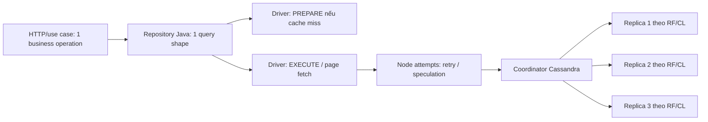
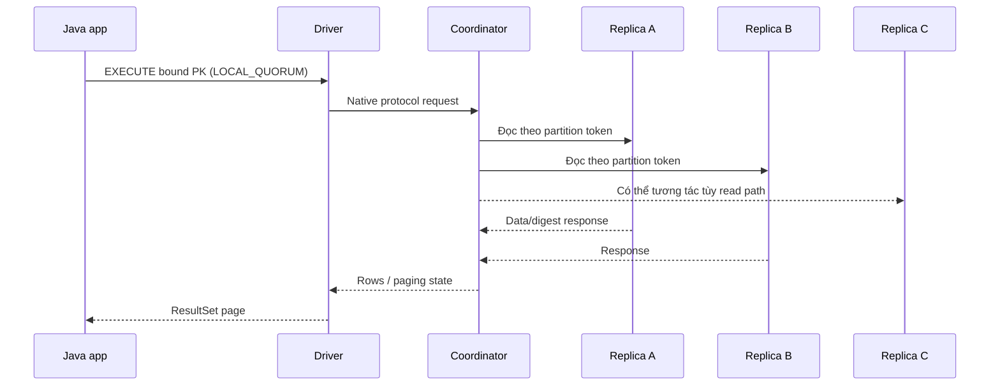

# Kiểm chứng CQL phát sinh, dữ liệu trả về và số lần trao đổi mạng

## 1. Một lời gọi Java có thể che giấu nhiều công việc

Trong ứng dụng Java kết nối Apache Cassandra, một dòng `session.execute(boundStatement)` trông như một câu truy vấn. Tuy nhiên, phía sau nó có thể là **prepare** truy vấn, chọn coordinator theo token, thực thi nhiều trang dữ liệu, retry/speculative execution, các lượt trao đổi coordinator–replica và quá trình giải mã dữ liệu ở client. Nếu chỉ mở source code rồi đếm số dòng `SELECT`, rất dễ đánh giá sai chi phí và tính đúng đắn.

Ví dụ, một API lấy **năm sự kiện** có thể dùng một `PreparedStatement` và nhận đủ năm hàng qua ba trang với page size gợi ý là hai. Đối với API, đó là **một thao tác nghiệp vụ**. Đối với driver, có thể là **ba request lấy trang**. Nếu một trang phải retry, có thể phát sinh **nhiều hơn ba lần thử tới node**. Mỗi coordinator còn tương tác với tập replica theo RF/CL; vì vậy số gói TCP hay thông điệp giữa các node **không bằng** số thao tác nghiệp vụ.

Bài thuộc chương **Truy vấn từ Java** của mô-đun `DATABASE_ENGINE_WIDE_COLUMN_CASSANDRA`. Những phép kiểm chứng gắn với phân vùng theo **partition key**, bảng wide-column thiết kế theo truy vấn, consistency đọc/ghi, replication, compaction, repair, xử lý sự cố và Java Driver 4.x.

Sau bài, người học sẽ:

1. Xác minh **CQL shape thực sự được ứng dụng tạo và gửi**, đồng thời phân biệt chuỗi CQL với marker và bind values trong native protocol.
2. Kiểm chứng dữ liệu trả về: đúng partition, tập hàng, số lượng, thứ tự, kiểu dữ liệu, trang, null và điều kiện ghi.
3. Tách bạch **business operation**, logical CQL request, network attempt, coordinator/replica messages và TCP packets.
4. Dùng `ExecutionInfo`, `ResultSet.getExecutionInfos()`, `RequestTracker`, metrics và tracing có chọn lọc để tìm bằng chứng.
5. Đo trước/sau thay đổi Java/CQL mà không nhầm giảm dữ liệu trả về với tối ưu thành công, không làm lộ dữ liệu nhạy cảm qua logs.

## 2. Năm tầng quan sát: phải đặt tên đúng đơn vị



| Tầng | Đơn vị cần đếm | Ví dụ | Bẫy khi kết luận |
| --- | --- | --- | --- |
| **Nghiệp vụ** | Một API call hoàn tất contract | “Lấy toàn bộ sự kiện hôm nay” | Một API có thể gọi hai bảng, nhiều bucket hoặc nhiều page |
| **CQL logic / shape** | Câu `SELECT ... WHERE pk=?` đã chuẩn bị và các request thực thi | Một template dùng lại cho nhiều key | Template không cho biết đã gọi bao nhiêu lần và bind key nào |
| **Client–coordinator request** | PREPARE, EXECUTE, BATCH, request lấy trang | Trang 1, trang 2, trang 3 | `execute()` đầu tiên có thể chỉ lấy trang đầu |
| **Thử trên node** | Thử gửi một request tới một coordinator cụ thể | Retry trên node khác; speculative execution | Có thể nhiều thử hơn logical requests; không phải mọi thử đều thành công |
| **Coordinator–replica / network wire** | Thông điệp đọc/ghi giữa các node; protocol frames/TCP segments | RF3, `LOCAL_QUORUM` | CL không trực tiếp cho công thức số packet: có read optimizations, speculation, compression, multiplexing |

### Thuật ngữ “round trip”

Một **client-to-coordinator round trip** là một request/response ở mức CQL/native protocol khi có kết quả. Nó **không** có nghĩa “một TCP packet”, vì transport có thể chia/gộp bytes, có TLS/compression và nhiều requests dùng chung connection. Nó cũng không có nghĩa “chờ đúng hai replicas” dù `LOCAL_QUORUM` với RF3 ở một DC thường yêu cầu hai replica responses để đạt quorum.

**Trong báo cáo, tránh nhãn mơ hồ “3 network calls”.** Hãy ghi rõ “3 page requests client→coordinator”, “4 node attempts do một retry”, “không đo replica messages” hoặc “bytes nhận theo protocol”. Những đại lượng khác nhau trả lời những câu hỏi khác nhau.

## 3. Trước khi đếm, phải chốt hợp đồng dữ liệu

Một truy vấn được gọi là hiệu quả khi phục vụ **đúng dữ liệu mà API yêu cầu**. Một thay đổi làm p99 giảm 70% nhưng chỉ trả trang đầu khi contract yêu cầu tất cả hàng là **regression correctness**, không phải tối ưu.

Hợp đồng tối thiểu nên ghi:

| Chiều kiểm tra | Ví dụ hợp đồng rõ ràng |
| --- | --- |
| Keyspace/table | `java_verify_ks.events_by_device_day` |
| Partition key | `(device_id, bucket_day)` phải được bind đủ |
| Phạm vi | `event_ts >= start AND event_ts < end` |
| Projection | `event_ts, event_id, event_type, payload` |
| Thứ tự | Theo clustering `event_ts DESC, event_id DESC` **trong một partition** |
| Cardinality | Trả **đủ N hàng**, không chỉ `LIMIT`/page đầu |
| Kiểu và null | Timestamp là `Instant`; UUID đúng kiểu; `payload` null được xử lý |
| Consistency | `LOCAL_QUORUM` trong local DC của driver, RF phù hợp |
| Lỗi | Timeout, unavailable, unauthorized không bị biến thành “không tìm thấy” |
| SLO | Full-result p99, error rate, successful operations/s và yêu cầu freshness |

Đối với **bảng denormalized** có dữ liệu giống nhau theo những partition keys khác nhau, không được giả định Cassandra tự đồng bộ hai bảng. Kiểm tra theo **business ID và thời điểm/cutoff**, có tính đến backfill/repair/cập nhật trong lúc so sánh.

## 4. Fixture CQL để nhìn thấy từng trang và từng hàng

Thực hành trong cluster lab một DC tên `dc1`, tối thiểu ba node cho RF3; nếu topology khác, điều chỉnh replication strategy/RF theo môi trường. Dữ liệu toàn bộ là giả, không đưa partition key hoặc payload thật lên ticket/log.

```sql
CREATE KEYSPACE java_verify_ks
WITH replication = {'class': 'NetworkTopologyStrategy', 'dc1': 3}
AND durable_writes = true;

CREATE TABLE java_verify_ks.events_by_device_day (
    device_id text,
    bucket_day date,
    event_ts timestamp,
    event_id uuid,
    event_type text,
    payload text,
    PRIMARY KEY ((device_id, bucket_day), event_ts, event_id)
) WITH CLUSTERING ORDER BY (event_ts DESC, event_id DESC);

INSERT INTO java_verify_ks.events_by_device_day
    (device_id, bucket_day, event_ts, event_id, event_type, payload)
VALUES ('device-007', '2026-11-21', '2026-11-21T08:01:00+0000',
        11111111-2222-4333-8444-555555555555, 'E1', 'alpha');

INSERT INTO java_verify_ks.events_by_device_day
    (device_id, bucket_day, event_ts, event_id, event_type, payload)
VALUES ('device-007', '2026-11-21', '2026-11-21T08:02:00+0000',
        22222222-3333-4444-8555-666666666666, 'E2', 'beta');

INSERT INTO java_verify_ks.events_by_device_day
    (device_id, bucket_day, event_ts, event_id, event_type, payload)
VALUES ('device-007', '2026-11-21', '2026-11-21T08:03:00+0000',
        33333333-4444-4555-8666-777777777777, 'E3', 'gamma');

INSERT INTO java_verify_ks.events_by_device_day
    (device_id, bucket_day, event_ts, event_id, event_type, payload)
VALUES ('device-007', '2026-11-21', '2026-11-21T08:04:00+0000',
        44444444-5555-4666-8777-888888888888, 'E4', 'delta');

INSERT INTO java_verify_ks.events_by_device_day
    (device_id, bucket_day, event_ts, event_id, event_type, payload)
VALUES ('device-007', '2026-11-21', '2026-11-21T08:05:00+0000',
        55555555-6666-4777-8888-999999999999, 'E5', 'epsilon');

-- Phân vùng thứ hai để phát hiện lỗi bind nhầm device_id:
INSERT INTO java_verify_ks.events_by_device_day
    (device_id, bucket_day, event_ts, event_id, event_type, payload)
VALUES ('device-008', '2026-11-21', '2026-11-21T08:06:00+0000',
        66666666-7777-4888-8999-aaaaaaaaaaaa, 'OTHER', 'sentinel');
```

**Giải thích schema:** partition key kép là `(device_id, bucket_day)`; timestamp và UUID là clustering columns. Khi truy vấn cố định một partition, thứ tự giảm dần theo timestamp được xác định tại schema. Fixture có đúng **năm hàng** trong `device-007` và **một hàng** trong partition khác để bắt lỗi lọc nhầm. Các timestamps khác nhau nên trong fixture, thứ tự kỳ vọng là `E5, E4, E3, E2, E1`.

### Query oracle từ cqlsh

```sql
CONSISTENCY LOCAL_QUORUM
PAGING 2

SELECT event_ts, event_id, event_type, payload
FROM java_verify_ks.events_by_device_day
WHERE device_id = 'device-007'
  AND bucket_day = '2026-11-21'
  AND event_ts >= '2026-11-21T08:00:00+0000'
  AND event_ts < '2026-11-21T09:00:00+0000'
LIMIT 20;
```

Đọc **hết** các trang cqlsh, không chỉ màn hình đầu. Kết quả mong đợi trên fixture không có ghi đồng thời:

| Vị trí | event_type | Số hàng cộng dồn |
| ---: | --- | ---: |
| 1 | E5 | 1 |
| 2 | E4 | 2 |
| 3 | E3 | 3 |
| 4 | E2 | 4 |
| 5 | E1 | 5 |

`PAGING 2` và driver `setPageSize(2)` đều hướng tới trang nhỏ, nhưng **page size là gợi ý**, không phải cam kết mỗi response có đúng hai hàng. Số trang thực phải quan sát. `LIMIT 20` giới hạn kết quả query, không phải “đọc 20 hàng ở mỗi trang”.

## 5. “CQL phát sinh” trong PreparedStatement là gì?

### Prepared query không phải chuỗi được nối với giá trị

Mã Java:

```java
PreparedStatement read = session.prepare(
    "SELECT event_ts, event_id, event_type, payload " +
    "FROM java_verify_ks.events_by_device_day " +
    "WHERE device_id = ? AND bucket_day = ? " +
    "AND event_ts >= ? AND event_ts < ? LIMIT 20");

BoundStatement request = read.bind(
    "device-007",
    LocalDate.of(2026, 11, 21),
    Instant.parse("2026-11-21T08:00:00Z"),
    Instant.parse("2026-11-21T09:00:00Z")
);
```

**Hình thức CQL đã chuẩn bị** là một query template có bốn markers. Khi bind, driver **mã hóa các giá trị theo CQL type**; ở native protocol, một lần thực thi prepared statement thường gửi **prepared ID + encoded bound values + execution options**, không phải tạo chuỗi `SELECT ... 'device-007' ...` để parser xử lý lại giống lệnh CQL literal.

Vì vậy cần kiểm chứng riêng:

- **Query shape:** cột, bảng, `WHERE`, `LIMIT`, tên marker/thứ tự và statement type.
- **Bound values:** đủ bốn biến, đúng thứ tự và codec (`text`, `date`, `timestamp`).
- **Request options:** `LOCAL_QUORUM`, timeout, page size, idempotence, routing local DC.
- **Actual execution:** số lần gọi `execute`, số trang lấy, retries/speculation và node đã nhận.

Không dùng `BoundStatement.toString()` hay logs in raw bound values như nguồn “CQL cuối cùng” để kiểm chứng dữ liệu production. Log chỉ **shape ID** và các marker categories/độ dài thống kê nếu cần; để so test values thì dùng fixture giả ở lab.

### Trường hợp QueryBuilder hoặc ORM

Nếu repository dùng query builder hoặc mapper:

```text
Java endpoint / repository
    -> query builder / mapper mapping
    -> CQL query string với marker + statement options
    -> BoundStatement hoặc SimpleStatement
    -> driver native protocol frame
    -> coordinator
```

Đặt kiểm thử tại **ranh giới repository–driver**, không chỉ assert method name. Một đoạn builder có thể vô tình bỏ `bucket_day`, thêm `ALLOW FILTERING`, đổi cột projection, thay CL hoặc tạo một query shape khác theo mỗi request.

### Một lỗi bind không bắt được bằng codec

Nếu hai marker đều kiểu `text`:

```java
// Cả status và customer_id đều là text: sai thứ tự có thể vẫn hợp lệ!
BoundStatement wrong = preparedInsert.bind(
    orderId, "PAID", "synthetic-customer-1");
```

Driver không thể tự xác định “PAID” là customer ID sai nghiệp vụ. Kiểm thử **row được trả về** mới phát hiện được. Với nhiều marker cùng kiểu, dùng named markers hoặc builder có tên rõ ràng và test đủ các ca biên.

## 6. Java Driver 4.x: đọc đủ kết quả, đo đúng các trang

Ví dụ sau giả sử đã tạo `CqlSession session` cho lab, có import `java.time.*`, `java.util.*` và Driver 4.x:

```java
import java.time.*;
import java.util.*;
import com.datastax.oss.driver.api.core.DefaultConsistencyLevel;
import com.datastax.oss.driver.api.core.cql.*;

PreparedStatement ps = session.prepare(
    "SELECT event_ts, event_id, event_type, payload " +
    "FROM java_verify_ks.events_by_device_day " +
    "WHERE device_id = ? AND bucket_day = ? " +
    "AND event_ts >= ? AND event_ts < ? LIMIT 20");

BoundStatement stmt = ps.bind(
    "device-007",
    LocalDate.of(2026, 11, 21),
    Instant.parse("2026-11-21T08:00:00Z"),
    Instant.parse("2026-11-21T09:00:00Z")
).setConsistencyLevel(DefaultConsistencyLevel.LOCAL_QUORUM)
 .setPageSize(2)      // Lab cố ý tạo nhiều page.
 .setIdempotent(true);

long started = System.nanoTime();
ResultSet result = session.execute(stmt);
long firstPageReady = System.nanoTime();

List<String> actualTypes = new ArrayList<>();
Set<UUID> seenIds = new HashSet<>();
for (Row row : result) {
    // Đồng bộ: iterator có thể tự lấy page tiếp theo.
    UUID id = Objects.requireNonNull(row.getUuid("event_id"));
    if (!seenIds.add(id)) {
        throw new IllegalStateException("Duplicate event_id");
    }
    Objects.requireNonNull(row.getInstant("event_ts"));
    actualTypes.add(row.getString("event_type"));
}
long fullyConsumed = System.nanoTime();

List<String> expected = Arrays.asList("E5", "E4", "E3", "E2", "E1");
if (!actualTypes.equals(expected)) {
    throw new AssertionError(
        "Wrong order/contents: expected " + expected.size() +
        " events, got " + actualTypes.size());
}

List<ExecutionInfo> pages = result.getExecutionInfos();
System.out.printf(
    "rows=%d pageResponses=%d firstPageMs=%.2f fullMs=%.2f%n",
    actualTypes.size(), pages.size(),
    (firstPageReady - started) / 1_000_000.0,
    (fullyConsumed - started) / 1_000_000.0);

for (int i = 0; i < pages.size(); i++) {
    ExecutionInfo info = pages.get(i);
    System.out.printf(
        "pageIndex=%d previousCoordinatorErrors=%d speculativeStarts=%d%n",
        i + 1,
        info.getErrors().size(),
        info.getSpeculativeExecutionCount());
}
```

### Chính xác phép đo chứng minh điều gì?

1. `actualTypes.equals(expected)` chứng minh **đúng năm nhãn theo thứ tự** của fixture bất biến; `seenIds` phát hiện event ID trùng trong những hàng được trả.
2. `result.getExecutionInfos()` cho biết danh sách execution info của những **page requests đã được thực hiện** trong việc duyệt result. Nó là một quan sát hữu ích ở tầng **client–coordinator request**, không phải số TCP packets.
3. `getErrors().size()` là số **lỗi ở những coordinator thử trước đó** mà execution info ghi nhận. Nó **không** phải tổng node attempts hoặc tổng lỗi business operation.
4. `getSpeculativeExecutionCount()` ghi nhận **bao nhiêu speculative executions đã được khởi động**, không gồm lần thực thi bình thường; không cộng trực tiếp vào page count rồi gọi là số replica messages.
5. `firstPageMs` đo tới lúc có trang đầu; `fullMs` gồm việc nhận các trang sau và Java iteration. Đơn vị của hai phép đo khác nhau; nếu yêu cầu API phải trả toàn bộ kết quả, dùng **full-operation latency**.
6. Code cố tình chỉ in thống kê; không in raw `device_id`, `payload` hoặc trace events nhạy cảm. Fixture lab là nơi thích hợp nếu cần xem hàng thực để debug.

**Đừng viết assertion `pages.size() == 3` như một invariant của Cassandra.** Với năm hàng và page size gợi ý là hai, thường quan sát ba trang khi không có hoạt động khác, nhưng server không cam kết tuyệt đối kích thước trang. Assert điều quan trọng là **tập và thứ tự hàng đúng**, sau đó **ghi lại số trang thực đo được**.

### Đồng bộ không có nghĩa chỉ một request

`session.execute(stmt)` thường trả về khi trang đầu sẵn sàng. Nếu loop `for (Row row : result)` tiếp tục vượt số rows đang có, driver có thể phát thêm request để lấy trang sau. Đây là lý do những benchmark chỉ đo `execute()` rồi kết luận “một query = một round trip” thường đánh giá thấp chi phí.

## 7. AsyncResultSet: số page rõ hơn nhưng vẫn cần đếm attempts

Trong API bất đồng bộ, `executeAsync` trả `CompletionStage<AsyncResultSet>`. Vòng lặp qua `currentPage()` **chỉ xử lý trang hiện tại**. Những trang sau đòi gọi `fetchNextPage()` rõ ràng:

```java
// Hàm có thể đặt trong một class repository.
static CompletionStage<PageAudit> auditPages(
        AsyncResultSet page,
        List<String> collected,
        int pageCount,
        int speculativeCount) {

    for (Row row : page.currentPage()) {
        collected.add(row.getString("event_type"));
    }

    int pages = pageCount + 1;
    int speculative = speculativeCount +
        page.getExecutionInfo().getSpeculativeExecutionCount();

    if (!page.hasMorePages()) {
        return CompletableFuture.completedFuture(
            new PageAudit(List.copyOf(collected), pages, speculative));
    }
    return page.fetchNextPage()
        .thenCompose(next ->
            auditPages(next, collected, pages, speculative));
}

// Java 16+ record; với Java 11 dùng class có fields/getters tương đương.
record PageAudit(List<String> types, int pages, int speculativeStarts) {}

CompletionStage<PageAudit> auditStage =
    session.executeAsync(stmt).thenCompose(
        page -> auditPages(page, new ArrayList<>(), 0, 0));
```

Với Java 11, phần `record` cần thay bằng class; ngoài ra mã dùng `java.util.concurrent.*`, `java.util.*` và Driver 4.x. Đoạn ví dụ **không gọi block trong callback**. Trong ứng dụng thật, phải handle lỗi CompletionStage và chuyển logic CPU nặng sang executor phù hợp.

**Page count không bằng attempts count.** Nếu một lần `fetchNextPage()` retry trên node khác hoặc được speculative execution, đó vẫn là **một trang logic** nhưng có thể có nhiều lượt thử trên mạng.

## 8. Tính đúng đắn: không chỉ có row count

| Ca kiểm thử | Oracle/điều kiện | Lỗi thường bị bỏ qua |
| --- | --- | --- |
| Một partition có 5 rows | 5 event IDs, E5→E1, đủ mọi page | Code chỉ lấy trang đầu nên còn 2 hàng |
| Partition rỗng | Result empty hợp lệ, không biến thành timeout | Catch exception và trả empty list |
| Partition khác | `device-008` chỉ trả OTHER | Bind sai `device_id` nhưng query vẫn chạy |
| Thời gian sát biên | `start` bao gồm, `end` loại trừ | Dùng `<= end` gây dư một sự kiện |
| Hai rows cùng timestamp | Xét thêm `event_id` theo clustering comparator | Dựa vào timestamp đơn lẻ gây thiếu/trùng |
| Null payload | Phân biệt null với chuỗi rỗng | Deserializer đổi nghĩa |
| Có DELETE/tombstone | Hàng xóa không trở lại sau repair/restore | So snapshot cũ với dữ liệu đang thay đổi |
| Có TTL | Cùng cutoff/thời điểm quan sát khi so hai query | TTL hết giữa hai lượt đọc |
| Đổi projection | So đúng những trường API còn yêu cầu | Bỏ cột nhưng vẫn tuyên bố “kết quả giống hệt” |
| `LIMIT` và page size | Tách số row tối đa khỏi rows/page | Giảm `LIMIT` để p99 tốt hơn nhưng làm thiếu dữ liệu |
| LWT `IF ...` | Kiểm `wasApplied()` và state | ACK CQL thành công nhưng điều kiện không được áp |
| Multiple partitions/buckets | So key set; không giả định thứ tự toàn cluster | Ghép results không sort/dedup |

### Nghiệp vụ không nhất thiết cùng một snapshot

Cassandra không tự tạo **transaction snapshot xuyên hai lời gọi SELECT** chạy cách nhau trong lúc dữ liệu đang được ghi, xóa hoặc hết TTL. Để kết quả test có ý nghĩa, dùng fixture bất biến không TTL hoặc cùng cutoff đã được thiết kế; nếu không, ghi nhận **nguồn thay đổi dữ liệu hợp lệ** trước khi gán lỗi cho query rewrite.

Với migrated/denormalized tables, kiểm tra cả **backfill, live writes, delete events và identity mapping**; một câu đọc đúng ở CL cao chưa chứng minh mọi replica hoặc mọi bảng đã đồng bộ.

## 9. Tạo fingerprint: hữu ích nếu biết giới hạn

Khi số hàng lớn, có thể tạo digest từ **serialization ổn định** của các cột nghiệp vụ để so trước/sau:

```java
// Ví dụ độc lập cho fixture lab 1 partition không-null.
// ResultSet chỉ duyệt một lần: tạo kết quả mới cho phép so fingerprint.
MessageDigest sha = MessageDigest.getInstance("SHA-256");
ResultSet freshResult = session.execute(stmt);
for (Row r : freshResult) {
    String canonical =
        r.getInstant("event_ts").toString() + "|" +
        r.getUuid("event_id") + "|" +
        r.getString("event_type") + "|" +
        r.getString("payload") + "\n";
    sha.update(canonical.getBytes(StandardCharsets.UTF_8));
}
byte[] digest = sha.digest();
```

Đoạn này dùng `java.security.MessageDigest`, `java.nio.charset.StandardCharsets` và xử lý checked exception theo cấu trúc chương trình; việc `execute(stmt)` **tạo thêm query/page requests**, nên không dùng số lượt trao đổi từ chính ví dụ này để đo phiên kiểm chứng trước. Đây chỉ là **cách chuẩn hóa trong lab**, không phải canonicalization tổng quát: nếu dữ liệu cho phép null, ký tự delimiter, binary, decimal, UDT hoặc nhiều partition, cần thiết kế encoding có nhãn kiểu, length-prefix/null marker và thứ tự khóa ổn định. Tránh hash raw PII rồi cho rằng đã ẩn danh: với miền giá trị nhỏ, hash không có khóa vẫn dễ bị đoán.

Digest chỉ so được khi:

1. Query before/after trả **cùng phạm vi, cùng projection cần so và cùng dữ liệu nguồn**.
2. Đọc **hết các trang**.
3. Sắp thứ tự ổn định theo primary key khi nguồn là nhiều partition.
4. Cùng kiểu encode/null handling và không có ghi/TTL làm đổi tập dữ liệu trong lúc so.

Hash khớp không chứng minh **p99**, replication khỏe hay tất cả tenant được bao phủ; hash lệch cần điều tra khóa, giá trị, phạm vi và mốc dữ liệu, không mặc định “lỗi mạng”.

## 10. Từ `ExecutionInfo` đến thông tin điều phối thực tế

Java Driver 4.x có `ExecutionInfo` cho một lần thực thi/page. Một số trường hữu ích:

| API | Câu hỏi được trả lời | Không thể kết luận trực tiếp |
| --- | --- | --- |
| `getCoordinator()` | Node nào trả kết quả cho request/page? | Replica nào đã tham gia và có bao nhiêu thông điệp |
| `getErrors()` | Có những lỗi ở các coordinator trước đó không? | Toàn bộ attempts (các lần thành công/đang chạy không ở đây) |
| `getSpeculativeExecutionCount()` | Có bao nhiêu speculative executions đã khởi động? | Tổng retry count hay network byte count |
| `getSuccessfulExecutionIndex()` | Lần thực thi nào trả kết quả cuối? | Tổng request/replica messages |
| `getResponseSizeInBytes()` | Kích thước protocol response đã giải nén nếu có | Tổng TCP/TLS traffic cả request+response |
| `getCompressedResponseSizeInBytes()` | Response bytes nén nếu có | Số round trips hay tổng disk I/O |
| `getWarnings()` | Warnings phía server cho request | Toàn bộ lỗi ẩn trong dữ liệu |
| `getTracingId()` | ID trace khi bật tracing | Không có ID nếu tracing không bật; không phải duration |

```java
ExecutionInfo info = result.getExecutionInfo();
String coordinator = info.getCoordinator() == null
    ? "none" : "present"; // Không in địa chỉ/topology ra public log.

int spec = info.getSpeculativeExecutionCount();
int priorErrors = info.getErrors().size();
int responseBytes = info.getResponseSizeInBytes(); // -1 nếu không có.

System.out.printf(
    "coordinator=%s speculative=%d priorErrors=%d responseBytes=%d%n",
    coordinator, spec, priorErrors, responseBytes);
```

Với `ResultSet` đồng bộ, `getExecutionInfo()` có thể phản ánh **lần thực thi cuối** đã xảy ra tại thời điểm gọi; hãy dùng `getExecutionInfos()` sau khi duyệt đủ rows nếu cần kiểm kê mọi trang. Với API bất đồng bộ, lấy `getExecutionInfo()` từ từng `AsyncResultSet` trước khi gọi `fetchNextPage()`.

**Giới hạn của exceptions:** `DriverException.getExecutionInfo()` có thể không tồn tại hoặc một số trường bị thiếu khi lỗi xảy ra trước khi gửi tới node. Không dùng `null coordinator` để khẳng định không có request nào ra mạng trong mọi trường hợp.

## 11. `RequestTracker`: phân biệt request success/error với node attempts

Driver 4.x cung cấp `RequestTracker`: callbacks khi **request tổng thể** thành công/thất bại và khi một **thử trên node** thành công/thất bại. Nó hữu ích để đếm ở tầng client mà không cần packet capture.

### Ví dụ tracker đơn giản cho Prepared EXECUTE

API minh họa dựa trên Java Driver 4.18.x. Đoạn class độc lập sau dùng các imports nêu rõ:

```java
import java.util.concurrent.atomic.LongAdder;
import com.datastax.oss.driver.api.core.config.DriverExecutionProfile;
import com.datastax.oss.driver.api.core.metadata.Node;
import com.datastax.oss.driver.api.core.session.Request;
import com.datastax.oss.driver.api.core.tracker.RequestTracker;
import com.datastax.oss.driver.api.core.cql.BoundStatement;

public final class SafeAttemptTracker implements RequestTracker {
    public final LongAdder completed = new LongAdder();
    public final LongAdder failed = new LongAdder();
    public final LongAdder nodeSuccess = new LongAdder();
    public final LongAdder nodeError = new LongAdder();

    private boolean isPreparedExecute(Request request) {
        return request instanceof BoundStatement;
    }

    @Override
    public void onSuccess(Request req, long latencyNanos,
            DriverExecutionProfile profile, Node node, String prefix) {
        if (isPreparedExecute(req)) completed.increment();
    }

    @Override
    public void onError(Request req, Throwable error, long latencyNanos,
            DriverExecutionProfile profile, Node node, String prefix) {
        if (isPreparedExecute(req)) failed.increment();
    }

    @Override
    public void onNodeSuccess(Request req, long latencyNanos,
            DriverExecutionProfile profile, Node node, String prefix) {
        if (isPreparedExecute(req)) nodeSuccess.increment();
    }

    @Override
    public void onNodeError(Request req, Throwable error, long latencyNanos,
            DriverExecutionProfile profile, Node node, String prefix) {
        if (isPreparedExecute(req)) nodeError.increment();
    }

    @Override
    public void close() {
        // Không giữ resource riêng trong tracker minh họa.
    }
}
```

Đăng ký **một lần khi tạo session**:

```java
SafeAttemptTracker tracker = new SafeAttemptTracker();
try (CqlSession session = CqlSession.builder()
        .addContactPoint(new InetSocketAddress("192.0.2.10", 9042))
        .withLocalDatacenter("dc1")
        .addRequestTracker(tracker)
        .build()) {
    // Warm-up/prepare trước cửa sổ đo.
    // Sau đó chạy một kịch bản fixture, duyệt hết ResultSet
    // và đọc DELTA counters theo cửa sổ quan sát.
}
```

**Điểm giải thích rất quan trọng:**

- `onSuccess/onError` đo **request-level outcome**; `onNodeSuccess/onNodeError` đo **node-level outcome**. **Không cộng hai nhóm với nhau** vì sẽ đếm hai lần các tầng khác nhau.
- Tracker trên **một session** có thể nhận callbacks từ **nhiều thread** và nhiều query đồng thời. Dùng `LongAdder` và đo **delta trước/sau cửa sổ** khi không có request nền nếu muốn minh họa đếm riêng một flow.
- `isPreparedExecute` cố ý chỉ lấy `BoundStatement` để không trộn các request loại khác; điều đó có nghĩa **không đếm** SimpleStatement, PREPARE, schema/metadata/control requests và traffic ngoài tầng tracker.
- Node-level callbacks thể hiện các attempts **được tracker báo cáo**, không phải bộ đếm tuyệt đối mọi native-protocol frame/TCP segment. Một speculative attempt bị hủy/không kết thúc có thể không tạo một callback success/error trong cửa sổ đã đo.
- `onSuccess` của một page không chứng minh **business operation** đã hoàn tất nếu page sau thất bại. Nên có counter **business success/failure** ở lớp API.
- Đừng dùng callbacks để gọi `session.execute()` hoặc xử lý I/O blocking: dễ recursion, tranh driver threads và tự làm sai latency.

### Kế hoạch đo chắc hơn

Sử dụng ba nhóm counters khác nhau:

1. **Application counters:** request nghiệp vụ bắt đầu/thành công/thất bại, rows thực trả, full-operation duration.
2. **Driver counters:** request-level success/error, node-level success/error, retry/speculative metrics, response bytes, page executions.
3. **Cluster/host counters:** coordinator/replica request counts, client request timeout, SSTables/read, tombstones scanned, CPU/disk/network.

Nếu tổng các counters có lệch, xem **ranh giới đo**, sampling, warmup, concurrency, retries và loại request. Không ép mọi bảng số liệu bằng nhau một cách giả tạo.

## 12. Đếm số request: bài toán mẫu với paging và retries

Đặt một thao tác lấy năm sự kiện trong fixture, `pageSize = 2`, không có concurrent write và server trả 2+2+1 hàng. Các con số dưới đây **chỉ để minh họa**:

| Kịch bản | Business operations | Page requests logic | Node attempts quan sát | Lưu ý |
| --- | ---: | ---: | ---: | --- |
| A. Bình thường | 1 | 3 | 3 | Mỗi trang một lần thử thành công |
| B. Trang hai retry một lần rồi thành công | 1 | 3 | 4 | Một lần thử thất bại/thử lại; business cuối thành công |
| C. Trang đầu speculative thêm một lần | 1 | 3 | Có thể ≥ 4 | Có thể có attempt bị hủy, metric cần đọc đúng ngữ nghĩa |
| D. Trang ba timeout, API không có fallback | 1 thất bại | 3 đã lên lịch | ≥ 3 hoặc không đủ callback do timeout/cancel | Hai trang đầu đã success vẫn **chưa đủ** contract |
| E. A-v1 đọc 1 page rồi tự dừng | 1 bị thiếu dữ liệu | 1 | 1 nếu không retry | p99 trông tốt nhưng trả sai 3 hàng |

**PREPARE và control traffic chưa tính trong cột Page requests.** Nếu query template chưa được chuẩn bị, driver có thể phát sinh PREPARE, có thể cần prepare trên coordinator khác sau restart/eviction. Nếu trace được fetch từ `system_traces`, chính việc thu thập trace cũng tạo requests mới.

### Công thức hạch toán theo các mức

\[
\text{Business operations} \ne \text{CQL page requests}
\]

\[
\text{Node attempts} =
\text{initial attempts} + \text{retry attempts}
+ \text{speculative attempts (đã thực sự khởi động)}
\]

Đây là **khung phân loại**, không phải công thức đo packet. Tầng coordinator–replica chịu ảnh hưởng RF/CL, read digest/data responses, coordinator selection, speculation và read repair trong phiên bản liên quan. Không tính số wire messages bằng cách nhân số page requests với RF.

## 13. Tại sao RF/CL, partition key và driver routing làm thay đổi chi phí?

Cassandra dùng partition key để tìm token và chọn replica set. Driver có thể ưu tiên replica làm coordinator khi có token-aware routing. Một query thiếu partition key hoặc có fan-out nhiều partition làm thay đổi đường đi.



**Sơ đồ chỉ mang tính khái niệm**, không cố định Cassandra phải gửi cùng số message tới mọi replica. Với RF3 ở một DC và `LOCAL_QUORUM`, ngưỡng phản hồi quorum thường là 2; không đồng nghĩa chỉ có đúng hai bản sao lưu trữ dữ liệu hoặc coordinator không bao giờ gửi request tới replica thứ ba.

Điều cần so trong thực nghiệm:

- `device_id`/`bucket_day` được bind đúng nên query đi vào một partition, không quét toàn cluster.
- Local DC của Java Driver, RF/CL và topology giữ nguyên giữa before/after.
- Phân bố hot keys và số rows/partition tương đương; một hot partition có thể làm một nhóm replica bị bão hòa.
- Bảng theo truy vấn trả đúng số bytes và đủ fields; đổi `SELECT *` sang projection nhỏ hơn chỉ hợp lệ khi không bỏ cột API cần.
- Repair/compaction/streaming/backpressure không làm thay đổi bối cảnh test.

## 14. Quan sát tracing từ coordinator: chỉ dùng có chọn lọc

Khi driver thấy p99 cao hoặc node attempts khác kỳ vọng, dùng tracing **mẫu nhỏ** để hiểu bên trong Cassandra:

```java
BoundStatement diagnostic = stmt.setTracing(true);
ResultSet rs = session.execute(diagnostic);
ExecutionInfo info = rs.getExecutionInfo();
UUID tracingId = info.getTracingId(); // null nếu không bật tracing.

// Chỉ lưu tracingId trong công cụ chẩn đoán có phân quyền.
// info.getQueryTraceAsync() có thể tự chạy thêm query đọc system_traces.
```

Từ cqlsh trên **fixture lab**:

```sql
CONSISTENCY LOCAL_QUORUM
TRACING ON

SELECT event_ts, event_id, event_type, payload
FROM java_verify_ks.events_by_device_day
WHERE device_id = 'device-007'
  AND bucket_day = '2026-11-21'
LIMIT 20;

TRACING OFF
```

Traces giúp nhận biết coordinator, replica contacts, thời gian đọc SSTable, hoạt động internal; tuy nhiên:

1. **Bật tracing gây overhead** và có thể ghi CQL/partition key, bind values hoặc topology nhạy cảm tùy đường thực thi/phiên bản.
2. `getQueryTraceAsync()` lấy dữ liệu từ `system_traces.sessions/events`; đó là **những CQL requests bổ sung để chẩn đoán**, không phải một phần chi phí query trước khi trace.
3. Trace duration **không phải** thời gian end-to-end Java (pool wait/network/client deserialize/paging).
4. Một trace cho một page **không mô tả toàn bộ 5 hàng** nếu các page khác được lấy bằng requests riêng.
5. Tracing toàn bộ traffic benchmark có thể làm hỏng phép đo và quá tải cluster; bật trong lab/mẫu được phép rồi tắt ngay.

**Nguyên tắc:** metrics/request tracker đo chi phí **trong trạng thái bình thường**; tracing chỉ trả lời “vì sao” khi cần kiểm tra đường đi một số request.

## 15. Bộ metric theo lớp: đừng lấy một proxy cho mọi thứ

| Nguồn | Chỉ số cần thu | Cách sử dụng |
| --- | --- | --- |
| App/use case | Operations/s thành công, full-operation latency, returned rows, error/timeout | Bằng chứng API contract và SLO |
| Driver RequestTracker | Request outcome, node attempt callbacks theo query class | Đếm client requests/attempts có giới hạn |
| Driver ExecutionInfo | Coordinator, errors, spec starts, response size/page | Điều tra từng page cụ thể |
| Driver metrics session | `cql-requests`, retries/speculation/timeouts nếu bật trong version | Xu hướng toàn session, không tự đại diện một endpoint |
| Driver metrics node | `cql-messages`, connections/in-flight, bytes sent/received | Xem distribution và node attempts gần tầng wire hơn |
| Cassandra coordinator | ClientRequest.Read/Write latency, timeouts, pending tasks | Tìm node chậm/hot coordinator |
| Cassandra table/replica | SSTables per read, tombstones scanned, disk usage, read/write metrics | Lý giải data-path cost |
| Host/process | CPU, GC, disk await/IOPS, network bytes | Phát hiện server hoặc chính load generator bão hòa |
| Tracing | Event nội bộ theo trace ID | Điều tra mẫu, không dùng làm counter toàn hệ thống |

**Cẩn thận histogram:** p99 từ từng instance không thể lấy trung bình số học để cho ra p99 của toàn ứng dụng. Phải dùng histogram có khả năng gộp đúng cách hoặc tổng hợp raw samples trên cùng thời gian/định nghĩa. Counter đã tích lũy từ lâu phải chuyển thành **delta/rate theo cửa sổ** trước khi so.

### Lệnh read-only dùng khi chẩn đoán

```bash
nodetool status
nodetool proxyhistograms
nodetool tablestats java_verify_ks.events_by_device_day
nodetool tablehistograms java_verify_ks events_by_device_day
nodetool tpstats
nodetool compactionstats
```

Những lệnh này chạy **trên node được hỏi**, không tự trở thành thống kê toàn cluster. `proxyhistograms` của coordinator không phải full-operation latency Java; dùng metrics của **tất cả node liên quan** và của ứng dụng ở cùng thời gian đo.

## 16. Kiểm chứng writes: dữ liệu đã ghi hay chỉ đã gửi?

Trên write path, “query đã gửi” khác “mutation đã được xác nhận theo CL” và càng khác “mọi replica ở mọi DC đã có dữ liệu”. Ví dụ:

```java
PreparedStatement update = session.prepare(
    "UPDATE java_verify_ks.events_by_device_day " +
    "SET payload = ? WHERE device_id = ? AND bucket_day = ? " +
    "AND event_ts = ? AND event_id = ?");

BoundStatement write = update.bind(
    "verified",
    "device-007",
    LocalDate.of(2026, 11, 21),
    Instant.parse("2026-11-21T08:01:00Z"),
    UUID.fromString("11111111-2222-4333-8444-555555555555")
).setConsistencyLevel(DefaultConsistencyLevel.LOCAL_QUORUM);

session.execute(write); // ACK theo CL, không phải transaction toàn cluster.
```

Để kiểm chứng:

- Chạy **read-after-write** cùng partition key/CL trong điều kiện kiểm thử xác định; so đúng field, timestamp/TTL và business ID.
- Nếu write **timeout**, outcome có thể không rõ: mutation có thể đã tới một số replica nhưng chưa đủ ACK. Không retry mù những mutation không idempotent.
- Nếu đó là LWT `IF ...`, phải đọc `ResultSet.wasApplied()`; method trả `false` khi điều kiện không thỏa dù request CQL có thể hoàn tất hợp lệ.
- Cassandra **không** tạo transaction atomic giữa nhiều partition tùy ý; một logged batch không thay thế quy trình đối soát/nguồn sự kiện nghiệp vụ cho denormalized tables.

### Test đọc sau khi delete

DELETE tạo tombstone; kết quả “không còn thấy row” qua một query không bảo đảm mọi replica đã repair hoặc dữ liệu không thể xuất hiện lại do restore/quy trình lỗi. Khi kiểm thử thao tác xóa, cân nhắc TTL, tombstone retention, repair coverage và CL; không thực hiện một loạt DELETE trên production chỉ để tạo dữ liệu benchmark.

## 17. Benchmark before/after với cùng công việc

Một báo cáo có ý nghĩa cần có **hai phép đo tách biệt**:

1. **Correctness gate:** so được key set, fields, order, số rows và đủ pages.
2. **Performance gate:** đo requests/pages/attempts, successful ops/s, latency p50/p95/p99, timeout và CPU/disk/network ở cùng tải.

### Những biến cần cố định

| Biến | Giữ tương đương trước/sau |
| --- | --- |
| Dữ liệu | Tổng partition, rows/partition, TTL/tombstone, độ lớn payload và hot keys |
| Query | Projection, partition key, time range, LIMIT, thứ tự mong đợi |
| Client | Java Driver version, connection pooling, retry policy, speculative policy, page size |
| Topology | Cassandra version, RF, CL, local DC, tình trạng node, racks |
| Tải | Offered operations/s, concurrency, query mix và thứ tự keys/seed |
| Warmup | Session creation, prepared cache, JIT/OS cache, schema metadata |
| Đo | Cửa sổ UTC, successful/failed, full-result vs first-page, đơn vị và số samples |
| Tác vụ nền | Compaction, repair, streaming, backup, GC khác thường |

### Ví dụ báo cáo (số giả định, không phải benchmark đã chạy)

Giả sử cùng workload đọc năm hàng, offered 400 business operations/s và toàn bộ hàng phải được trả:

| Phiên thử | Page size | Rows/operation | Page requests/operation (quan sát) | Node attempts/operation (quan sát) | p99 full (ms) | Success ops/s | Error |
| --- | ---: | ---: | ---: | ---: | ---: | ---: | ---: |
| Before | 2 | 5 | 3,0 | 3,1 | 95 | 399 | 0,25% |
| After A | 5 | 5 | 1,0 | 1,1 | 70 | 399 | 0,25% |
| After B | 5 | **2** | 1,0 | 1,0 | 40 | 400 | 0% |

**Diễn giải đúng:**

- **After A** có thể là tối ưu tốt: giảm số page requests và p99 mà **vẫn trả năm hàng**. Nhưng còn phải kiểm tra memory/bytes/page, GC và các partition có hàng lớn hơn.
- **After B** **không đạt correctness**, vì chỉ trả hai hàng. p99 thấp hơn và error=0 **không hợp thức hóa việc thiếu kết quả**.
- 3,1 attempts/operation là giá trị trung bình nhiều phép đo, **không** có một thao tác gửi 0,1 lần thử.
- Đừng dùng bảng này khẳng định bytes over network giảm: page lớn hơn có thể tăng bytes/response, trong khi giảm protocol overhead/round trips; phải đo bytes và CPU thực tế.

### Coordinated omission và load generator

Nếu client gửi request mới **chỉ sau khi** request cũ xong, khi Cassandra chậm nó sẽ tự giảm offered rate, che giấu thời gian queue của người dùng thật. Hãy công bố kiểu workload **open-loop hay closed-loop**, offered vs successful ops/s, concurrency, failures/timeouts và vùng bão hòa. Đừng so p99 ở 400 ops/s before với 100 ops/s after rồi gọi là cải thiện.

## 18. Hướng dẫn bảo vệ dữ liệu khi đo CQL và network

**Đo nhiều hơn không đồng nghĩa phải log nhiều dữ liệu khách hàng hơn.**

| Dữ liệu có nguy cơ lộ | Nguồn dễ xuất hiện | Biện pháp |
| --- | --- | --- |
| Partition key/customer ID | Bound values, CQL trace, query logger | Chỉ lưu query shape/ID, tránh raw marker values |
| Nội dung payload/PII | Result preview, debug log, full query logging | Chỉ dùng fixture giả, hash có khóa nếu cần đối chiếu ID |
| Credentials | Driver config, exception, shell history | Secret manager, redaction, quyền truy cập tối thiểu |
| Topology/node IP | ExecutionInfo/coordinator, logs | Chỉ nội bộ, tách khỏi báo cáo công khai |
| Paging state/cursor | API response/log | Không coi cursor là dữ liệu vô hại; mã hóa/ký nếu cấp ra ngoài |
| Trace/session IDs | `system_traces`, ticket | Thời hạn lưu ngắn, ACL, xóa theo retention |

Driver có **RequestLogger** tùy chọn, có khả năng log bound values. Với workload thật, không bật cấu hình `show-values=true` theo mặc định; nếu chẩn đoán buộc phải thu giá trị thì dùng phê duyệt, masking và kho log hạn chế. Không log toàn bộ `BoundStatement` chỉ để chứng minh “CQL đã phát sinh”.

**CQL tracing và packet capture là công cụ đắt/rủi ro**: chỉ lấy mẫu theo kế hoạch, không thu bừa trên toàn cluster. TLS che nội dung mạng, nên packet capture không phải cách an toàn để giải mã query trong production.

## 19. Runbook kiểm chứng từ Java tới Cassandra

### P0 — Xác định contract và phạm vi

Ghi endpoint/use case, query shape, keyspace/table, primary key, projection, kết quả mong đợi, TTL/cutoff, CL/RF/DC, số trang và SLO. Quy định rõ sẽ đếm **business operations**, **page requests** hay **node attempts**.

### P1 — Chuẩn bị fixture và baseline

Tạo dữ liệu giả có hàng ở nhiều trang, một partition rỗng, một partition khác, dữ liệu null và thời gian sát biên. Warmup session/prepare; đo success/error, rows, p50/p95/p99 và metrics driver/host. Không bật tracing trong benchmark chính.

### P2 — Xác minh CQL shape và bind

Kiểm tra template từ repository/mapper, markers, thứ tự và types, LIMIT, WHERE, page size, CL, timeout/idempotence. Tách query name khỏi raw values. Nếu có query builder động, test các nhánh tạo câu CQL khác nhau.

### P3 — Đọc đủ dữ liệu và ghi execution info

Với sync API, duyệt `ResultSet` tới hết; với async API, lặp `currentPage/fetchNextPage`. So keys/values/order, đếm pages thực qua `getExecutionInfos` hoặc từng AsyncResultSet. Không coi page đầu là đầy đủ nếu API cần mọi hàng.

### P4 — Thu driver attempts và xem coordinator

Bật RequestTracker/driver metrics theo phạm vi an toàn, đo counters **delta** trong cùng cửa sổ. So request-level vs node-level, check `getSpeculativeExecutionCount()`, `getErrors()` và coordinator distribution. Nếu kết quả lệch kỳ vọng, điều tra retries/speculation và request nền.

### P5 — Đối chiếu cluster

Xem `nodetool status/tpstats/compactionstats/proxyhistograms`, table metrics, disk await/CPU/GC/network. Với RF/CL, xác định replicas đang bận. Nếu một node chậm, dùng tracing **mẫu nhỏ** (sau đó tắt) để tìm read-path/tombstone/compaction.

### P6 — Quyết định theo correctness → latency/throughput → cost

Nếu result mismatch, dừng rollout dù latency giảm. Nếu correctness PASS nhưng p99/errors/attempts tăng, kiểm tra page size, hot partitions, driver pools, network và retries. Nếu mọi gate PASS, canary dần, tiếp tục theo dõi p99 và error budget.

### P7 — Thu hồi công cụ chẩn đoán

Tắt tracing/request logging chi tiết, xóa/thu hồi trace và bound data theo retention, giữ lại báo cáo **đã tổng hợp** và query shape IDs. Ghi giới hạn đo: concurrent load, retries chưa quan sát, không có wire-level packet capture, hoặc chỉ một DC.

## 20. Những lỗi đọc số liệu thường gặp

| Nhận định sai | Thực tế | Cách sửa |
| --- | --- | --- |
| “Một session.execute chỉ có một lần đi mạng.” | ResultSet có thể fetch thêm các page khi iterate. | Đếm `getExecutionInfos()` sau khi duyệt hết. |
| “Page size 100 luôn có đúng 100 rows/page.” | Page size là gợi ý. | Quan sát page thực và đảm bảo đủ rows. |
| “CQL đã prepare nghĩa là đã execute.” | Prepare chỉ chuẩn bị template/metadata. | Tách thời điểm PREPARE/EXECUTE và kiểm tra result. |
| “Prepared driver gửi câu SQL đầy literal qua mạng.” | EXECUTE prepared ID + encoded bound values. | Kiểm tra template, marker binding và protocol semantics. |
| “3 pages nghĩa là 3 TCP packets.” | Protocol frames/TLS/TCP packets có thể khác. | Ghi tầng đo; dùng metrics bytes/attempts khi cần. |
| “2 quorum ACK nghĩa là đúng 2 network messages.” | Coordinator/replica path phức tạp hơn. | Xem trace/metrics, không nhân CL thành packet count. |
| “Không thấy previous errors ⇒ chỉ một attempt.” | Speculative/canceled attempts có thể không nằm trong errors. | Kết hợp spec count, node tracking và metrics. |
| “Trace duration là full latency của API.” | Không gồm toàn bộ client/network/page processing. | Đo full-operation từ Java. |
| “p99 giảm vì chỉ đọc trang đầu vẫn là tối ưu.” | Trả thiếu hàng là sai contract. | Correctness gate trước. |
| “SELECT thành công tại ONE chứng minh LOCAL_QUORUM khỏe.” | CL khác nhau, ngưỡng replica khác nhau. | Test đúng RF/CL đã thỏa thuận. |
| “Tracker nodeSuccess + onSuccess là tổng requests.” | Hai lớp callback khác nhau, sẽ đếm trùng. | Báo tách request/page và node attempt. |
| “Hash kết quả đủ chứng minh mọi dữ liệu đều đúng.” | Chỉ chứng minh trong phạm vi/canonicalization đã xét. | Coverage theo key/range và event source. |
| “Để chẩn đoán phải log mọi bound values.” | Có thể lộ PII/credential và làm tăng overhead. | Log query shape, metrics, lấy mẫu có kiểm soát. |

## 21. Bài tập thực hành và câu hỏi kiểm tra

1. Với năm hàng, `pageSize=2`, không retry, hãy phân biệt business operations, page requests, node attempts và replica messages. Con số nào suy ra được, con số nào phải đo?
2. Tại sao `PreparedStatement` không gửi chuỗi `SELECT ... 'device-007'` đã thay literal theo cách `SimpleStatement` tự ghép string?
3. Viết test xác nhận `WHERE device_id=? AND bucket_day=?` không trả hàng từ `device-008`.
4. Giải thích khác biệt `LIMIT 20` và `setPageSize(2)`; vì sao mỗi page không nhất thiết chứa đúng hai hàng?
5. Trong Driver 4.x sync API, tại thời điểm nào có thể phát sinh network request khi đang lặp `ResultSet`?
6. API async chỉ duyệt `currentPage()`. Nó phải thay đổi thế nào để trả đủ kết quả?
7. `getExecutionInfos()` đo cấp nào? Nó có tính luôn số coordinator→replica messages hoặc TCP segments không?
8. `getErrors()` rỗng có bảo đảm không có speculative executions không? Vì sao?
9. Trong tracker, khác nhau giữa `onSuccess` và `onNodeSuccess`; vì sao không cộng các counter?
10. Tại sao PREPARE, trace fetching và topology/control requests phải được hạch toán riêng?
11. Nếu một page timeout sau hai page thành công, API có thể trả 4/5 rows như thể thành công không? Nêu contract/error handling.
12. Kiểm chứng `wasApplied()` cho LWT khác thế nào với kiểm chứng write ACK `LOCAL_QUORUM`?
13. Vì sao full-operation latency có thể cao dù first-page latency thấp?
14. Nêu ba nguyên nhân làm attempts tăng nhưng business operations không tăng.
15. Xây báo cáo A/B đánh giá đổi page size 2→5, giữ cố định partition/data/CL và có correctness gate.
16. Nêu những trường hợp nên tắt tracing/request logger và cách bảo vệ bound values khi có PII.
17. Một bảng được đọc ở hai DC với RF khác nhau. Vì sao không lấy số gói đo ở DC1 suy trực tiếp ra DC2?
18. Nếu after giảm byte per response nhưng số page requests tăng gấp đôi, cần thu thêm metrics nào để quyết định?

### Bài tổng hợp: xác nhận repository Java

Viết một repository có hai API: `findEventsByDeviceDay(deviceId, date, start, end)` và `updatePayload(eventKey, value)`. Thiết kế:

- Hai query shapes prepared cố định; bind đủ partition và clustering keys; dùng `LOCAL_QUORUM` theo fixture.
- Test expected keys, 5 rows E5→E1, 0 row, partition khác, null/empty và date boundaries.
- Một lần đọc sync đủ page và một lần async đủ page; ghi **actual page count** chứ không hard-code 3.
- Thu `ExecutionInfo` theo page; tính request/node-attempt deltas qua RequestTracker khi không có background workload.
- Đo full-operation duration, successful operations/s và error/timeout dưới cùng offered load.
- Đánh dấu idempotence theo semantics; xử lý write timeout là outcome có thể không rõ.
- Chỉ log query shape/aggregates, không in raw customer/device keys hoặc payload.
- Trình bày một bảng phân biệt **logical operations, page requests, node attempts và replica messages**; ghi rõ tầng chưa được đo.

**Tiêu chí hoàn thành:** người học không còn nhầm một câu CQL trong source với một lượt trao đổi mạng; biết chứng minh query shape/bound values đúng, nhận diện và duyệt hết paging, kiểm chứng key/value/order, đọc `ExecutionInfo` và dùng `RequestTracker` đúng tầng. Phép đo phải chỉ ra được chỗ tối ưu đem lại lợi ích thực mà **không đánh đổi tính đúng đắn, consistency, khả năng chịu lỗi và bảo mật**.

## 22. Tài liệu tham khảo

- [Apache Cassandra Java Driver 4.18.x — Paging](https://apache.github.io/cassandra-java-driver/4.18.0/core/paging/): sync iteration, async currentPage/fetchNextPage và page-size hints.
- [Apache Cassandra Java Driver 4.18.x — Request Tracker](https://apache.github.io/cassandra-java-driver/4.18.0/core/request_tracker/): request-level/node-level callbacks và request logging.
- [Apache Cassandra Java Driver 4.18.x — ExecutionInfo API](https://apache.github.io/cassandra-java-driver/4.18.1/api/com/datastax/oss/driver/api/core/cql/ExecutionInfo.html): coordinator, errors, speculative starts, paging state, response size và trace ID.
- [Apache Cassandra Java Driver 4.18.x — ResultSet API](https://apache.github.io/cassandra-java-driver/4.18.1/api/com/datastax/oss/driver/api/core/cql/ResultSet.html): iterate rows, `getExecutionInfos`, `wasApplied`.
- [Apache Cassandra Java Driver 4.18.x — Query Tracing](https://apache.github.io/cassandra-java-driver/4.18.1/core/tracing/): bật trace, lấy trace ID và chi phí đọc `system_traces`.
- [Apache Cassandra Java Driver 4.18.x — Metrics](https://apache.github.io/cassandra-java-driver/4.18.1/core/metrics/): session/node metrics, latency distributions và requests.
- [Apache Cassandra Java Driver 4.18.x — Prepared Statements](https://apache.github.io/cassandra-java-driver/4.18.1/core/statements/prepared/): protocol PREPARE/EXECUTE, bind values, cache/reprepare.
- [Apache Cassandra Java Driver 4.18.x — Retries](https://apache.github.io/cassandra-java-driver/4.18.1/core/retries/): retry policy, idempotence và node attempts.
- [Apache Cassandra — CQL SELECT](https://cassandra.apache.org/doc/stable/cassandra/developing/cql/dml.html): partition key, LIMIT, ORDER BY và kết quả.
- [Apache Cassandra — Metrics](https://cassandra.apache.org/doc/stable/cassandra/managing/operating/metrics.html): coordinator/table read path và observability.

**Kết luận:** Để kiểm chứng Java đang thực thi CQL đúng và dùng mạng hiệu quả, phải đi theo chuỗi **query shape → bound values → result đủ hàng → page requests → node attempts → coordinator/replica behavior**. Một `execute()` không luôn bằng một request mạng, một page không luôn bằng một TCP packet, và một request thành công ở trang đầu không chứng minh API trả đúng toàn bộ kết quả. Dùng **fixture bất biến, ExecutionInfo, RequestTracker, metrics và tracing chọn lọc**, đồng thời giữ RF/CL, bảo vệ dữ liệu nhạy cảm và chỉ công nhận cải thiện khi correctness, p99, error rate và successful throughput cùng đạt yêu cầu.
