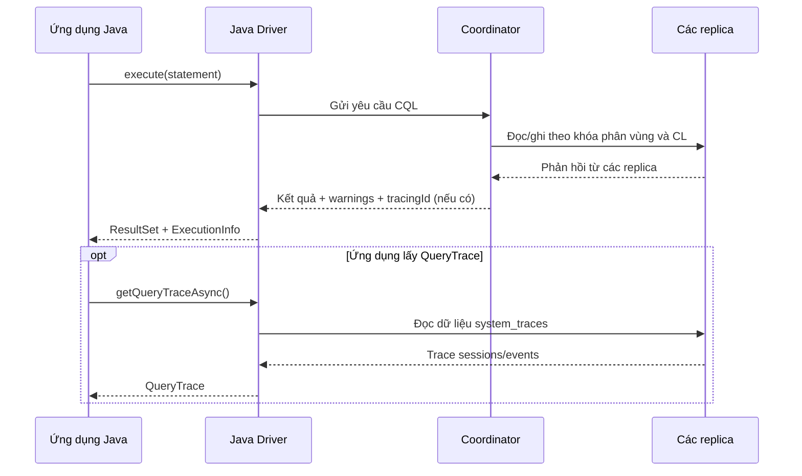

# ExecutionInfo, coordinator, cảnh báo và QueryTrace từ Java Driver

## 1. Vì sao cần xem thông tin thực thi?

Trong Apache Cassandra, một truy vấn CQL gửi từ ứng dụng Java thường được một **coordinator** tiếp nhận, phối hợp với các replica liên quan rồi trả kết quả. Ứng dụng có thể nhận được kết quả đúng nhưng vẫn gặp dấu hiệu bất thường: truy vấn chậm, driver phải thử lại trên node khác, server cảnh báo đọc quá nhiều tombstone hoặc một replica phản hồi chậm. Chỉ nhìn dữ liệu trong `Row` sẽ không thấy các tín hiệu này.

Java Driver 4.x cung cấp `ExecutionInfo` để quan sát **lần thực thi một yêu cầu CQL**, gồm coordinator, cảnh báo, các lỗi đã gặp trước khi hoàn tất, số lần speculative execution và mã truy vết. Khi cần đi sâu vào phía server, bật tracing có chọn lọc rồi lấy `QueryTrace` từ `ExecutionInfo`.

Sau bài này, người học có thể:

- Đọc `ExecutionInfo` từ `ResultSet` hoặc từ lỗi driver; hiểu ý nghĩa và giới hạn từng trường.
- Phân biệt **coordinator** với **replica**, và hiểu vì sao coordinator có thể thay đổi giữa các yêu cầu hoặc giữa các trang kết quả.
- Dùng `getWarnings()` để phát hiện dấu hiệu truy vấn/tables cần xem xét.
- Bật tracing cho **một statement**, lấy `tracingId`, đọc `QueryTrace` và phân tích sự kiện.
- Thu thập tín hiệu chẩn đoán trong ứng dụng Java mà không tạo tải tracing thường trực lên cluster.

> **Phạm vi:** Các ví dụ sử dụng Apache Cassandra và API `com.datastax.oss.driver.api.*` của Java Driver **4.x** (gồm nhánh Apache-maintained 4.18+). Cấu trúc API này khác Java Driver 3.x. Ví dụ giả định `CqlSession session` đã kết nối đúng cluster/keyspace và có quyền truy vấn.

## 2. Luồng thực thi: driver, coordinator, replica



Coordinator là **node nhận và điều phối truy vấn**, không phải “leader” cố định của phân vùng. Cassandra phân tán dữ liệu qua token/partition key; các replica giữ bản sao theo replication strategy. Với một truy vấn đọc tại `LOCAL_QUORUM`, coordinator phải nhận đủ phản hồi cần thiết theo consistency level, nhưng `ExecutionInfo.getCoordinator()` chỉ cho biết node điều phối phản hồi mà driver nhận, **không liệt kê mọi replica đã tham gia**.

Driver chọn node để gửi request dựa trên topology, chính sách cân bằng tải và thông tin routing khi có sẵn; retry hoặc speculative execution có thể khiến một execution khác giành kết quả. Vì vậy, các lần gọi cùng CQL **không bắt buộc** đi qua cùng coordinator. Nếu muốn biết các thao tác phía server, phải dùng tracing (hoặc quan sát server), không suy diễn từ địa chỉ coordinator.

## 3. `ExecutionInfo` chứa những gì?

Trên đường thành công, lấy `ExecutionInfo` từ `ResultSet`. Với kết quả phân trang, `ResultSet.getExecutionInfo()` trả thông tin **lần fetch/truy vấn cuối cùng đã thực hiện**; `ResultSet.getExecutionInfos()` chứa thông tin các lần fetch đã thực hiện cho `ResultSet` đó. Các trang chưa fetch sẽ chưa có thông tin. Với API bất đồng bộ, `AsyncResultSet.getExecutionInfo()` mô tả **trang hiện tại**.

| API (`ExecutionInfo`) | Ý nghĩa | Lưu ý chẩn đoán |
| --- | --- | --- |
| `getCoordinator()` | `Node` đã điều phối phản hồi được nhận | Không đồng nghĩa replica chứa dữ liệu; có thể `null` khi request thất bại trước khi liên hệ node. |
| `getWarnings()` | Danh sách cảnh báo do Cassandra trả về | Truy vấn có thể **thành công dù có warning**; danh sách rỗng không chứng minh truy vấn tối ưu. |
| `getErrors()` | Các lỗi ở những coordinator/execution trước đó | Có thể khác rỗng dù request cuối cùng thành công nhờ retry/speculation; không phải toàn bộ log lỗi cluster. |
| `getSpeculativeExecutionCount()` | Số speculative execution đã được **khởi chạy thêm** | Không tính execution ban đầu; `1` nghĩa là có thêm một lần thực thi. |
| `getSuccessfulExecutionIndex()` | Chỉ số execution mang kết quả cuối (`0` là ban đầu) | Dùng cùng speculative count để biết bản sao execution nào trả kết quả. |
| `getTracingId()` | UUID của trace khi đã bật tracing | Trả `null` khi truy vấn không được bật tracing. |
| `getQueryTrace()` / `getQueryTraceAsync()` | Tải thông tin trace phía Cassandra | Là yêu cầu truy vấn bổ sung đến `system_traces`, không phải dữ liệu có sẵn trong response. |
| `getResponseSizeInBytes()` | Kích thước response protocol sau giải nén | Có thể `-1` khi không có thông tin; không phải số byte dữ liệu nghiệp vụ. |
| `isSchemaInAgreement()` | Kết quả kiểm tra schema agreement sau thao tác đổi schema | Với truy vấn thông thường, giá trị này là `true`; không dùng làm health check tổng quát. |

`getErrors()` trả về `List<Map.Entry<Node, Throwable>>`; danh sách phản ánh các lỗi driver đã xử lý ở lần thực thi trước. Trong speculative execution, các yêu cầu chạy đồng thời nên thứ tự lỗi không nhất thiết là thứ tự node được chọn. Khi thao tác CQL thất bại, `DriverException.getExecutionInfo()` có thể cung cấp thông tin tương tự, nhưng một số giá trị không có do lỗi xảy ra trước khi kết nối tới coordinator.

### Ví dụ Java: đọc thông tin sau truy vấn thành công

Giả sử bảng `shop.orders_by_customer` được thiết kế để truy vấn đơn hàng theo khóa phân vùng `customer_id`:

```cql
CREATE TABLE IF NOT EXISTS shop.orders_by_customer (
    customer_id uuid,
    ordered_at timestamp,
    order_id timeuuid,
    status text,
    total_cents bigint,
    PRIMARY KEY ((customer_id), ordered_at, order_id)
) WITH CLUSTERING ORDER BY (ordered_at DESC, order_id DESC);
```

```java
import com.datastax.oss.driver.api.core.CqlSession;
import com.datastax.oss.driver.api.core.cql.BoundStatement;
import com.datastax.oss.driver.api.core.cql.ExecutionInfo;
import com.datastax.oss.driver.api.core.cql.PreparedStatement;
import com.datastax.oss.driver.api.core.cql.ResultSet;
import com.datastax.oss.driver.api.core.metadata.Node;
import java.util.Map;
import java.util.UUID;

// session là CqlSession đang mở; customerId là UUID do ứng dụng cung cấp.
PreparedStatement prepared = session.prepare(
    "SELECT order_id, status FROM shop.orders_by_customer " +
    "WHERE customer_id = ? LIMIT 20");
BoundStatement statement = prepared.bind(customerId);

ResultSet result = session.execute(statement);
ExecutionInfo info = result.getExecutionInfo();

Node coordinator = info.getCoordinator();
System.out.println("Coordinator: " +
    (coordinator == null ? "không xác định" : coordinator.getEndPoint()));
System.out.println("Speculative executions: " +
    info.getSpeculativeExecutionCount());
System.out.println("Successful execution index: " +
    info.getSuccessfulExecutionIndex());

for (String warning : info.getWarnings()) {
    System.out.println("Server warning: " + warning);
}
for (Map.Entry<Node, Throwable> previousError : info.getErrors()) {
    System.out.println("Previous attempt failed on " + previousError.getKey()
        + " with " + previousError.getValue().getClass().getSimpleName());
}
```

Đây là **đoạn minh họa**, có thể đặt trong một method đang có `session` và `customerId`; các `import` cho thấy đúng kiểu API cần dùng. Truy vấn được ràng buộc tham số và lọc trực tiếp theo partition key để tránh quét không cần thiết. Một khách hàng có lịch sử cực lớn vẫn có nguy cơ tạo partition quá rộng; khi đó cần xem xét bucket theo thời gian dựa trên kiểu truy vấn thực tế.

**Lưu ý về paging:** Ví dụ chỉ lấy metadata ngay sau khi `execute`, thường tương ứng trang đầu tiên. Nếu ứng dụng tiếp tục duyệt đủ nhiều dòng để driver fetch trang khác, gọi lại `getExecutionInfo()` có thể cho coordinator/warnings khác và `getExecutionInfos()` sẽ có thêm phần tử. Không dùng coordinator của trang đầu để kết luận mọi trang đi cùng node.

## 4. Coordinator: đọc đúng tín hiệu, tránh kết luận sai

Ví dụ ba request liên tiếp trả về coordinator A, B rồi A **không đủ chứng cứ** cho thấy dữ liệu di chuyển giữa các node. Điều đó chỉ cho thấy driver/cluster đã dùng các coordinator khác nhau. Một số dấu hiệu cần điều tra thêm:

1. **Một coordinator thường xuất hiện cùng độ trễ cao:** so sánh latency từ ứng dụng, metrics node và trace của các request mẫu; có thể có nghẽn CPU, đĩa, mạng hoặc replica chậm.
2. **`getErrors()` có lỗi trước khi thành công:** xem loại exception, node, retry policy, timeout và hoạt động speculation; request thành công không có nghĩa đường đi không gặp sự cố.
3. **`getSpeculativeExecutionCount()` tăng:** truy vấn đã chạy thêm để giảm tail latency. Với các ghi không idempotent, thiết lập retry/speculation sai có thể gây tác dụng phụ; đảm bảo statement/idempotence phù hợp trước khi bật chính sách này.
4. **Đổi consistency level dẫn đến khác biệt:** `LOCAL_ONE` và `LOCAL_QUORUM` yêu cầu mức xác nhận khác nhau từ replica, nhưng coordinator vẫn chỉ là điểm điều phối; không suy ra một truy vấn “đạt quorum” chỉ từ `Node` trả về.

Tại môi trường production, nên gắn metadata với request ID/correlation ID của ứng dụng, thời gian đo ở phía client, loại truy vấn và consistency level được cấu hình. Không ghi giá trị nhạy cảm của parameter, toàn bộ CQL động hoặc nội dung trace vào log mặc định.

## 5. Server warnings: thành công vẫn có thể có vấn đề

Cassandra có thể trả **warning** trong response khi phát hiện điều kiện đáng chú ý trong lúc thực thi, ví dụ truy vấn phải xử lý nhiều tombstone hoặc truy vấn dữ liệu có đặc điểm gây tốn tài nguyên (phụ thuộc phiên bản Cassandra và loại truy vấn). Java Driver cho phép đọc qua `ExecutionInfo.getWarnings()`. Đây **không phải** `Throwable` và thường **không khiến truy vấn thất bại**.

```java
ExecutionInfo info = session.execute(statement).getExecutionInfo();
if (!info.getWarnings().isEmpty()) {
    for (String warning : info.getWarnings()) {
        // Trong ứng dụng thật, ghi qua logger có giới hạn tần suất.
        System.out.println("Cassandra warning: " + warning);
    }
}
```

Các bước xử lý hữu ích khi gặp warning:

| Tín hiệu | Câu hỏi điều tra | Hành động hợp lý |
| --- | --- | --- |
| Đọc nhiều tombstone | Có xóa/TTL dày đặc không? Truy vấn quét phạm vi clustering quá rộng? | Kiểm tra mô hình dữ liệu, TTL, phạm vi truy vấn, compaction và tình trạng repair; không “chữa” chỉ bằng tăng threshold. |
| Truy vấn chạm nhiều dữ liệu | Có thiếu partition key, dùng `ALLOW FILTERING`, hoặc partition quá lớn? | Thiết kế bảng theo truy vấn và thêm bảng truy cập phù hợp; hạn chế lọc phía server. |
| Cảnh báo lặp lại tại một nhóm truy vấn | Cùng CQL shape/partition có vấn đề hay node cụ thể bất thường? | Gom theo truy vấn mẫu, đối chiếu request ID, metrics server và trace có chọn lọc. |

Nội dung warning **không có một danh mục cố định** cho mọi phiên bản Cassandra; hãy ghi nhận chuỗi thực tế rồi kiểm tra tài liệu/metrics phù hợp. `getWarnings()` chỉ khả dụng khi protocol version từ **V4** trở lên; với protocol cũ hơn, danh sách luôn rỗng. Driver cũng có thể tự log server warnings tùy cấu hình (`advanced.request.log-warnings`), nên lưu ý tránh ghi trùng và gây bão log.

## 6. Query tracing: từ `tracingId` tới `QueryTrace`

`ExecutionInfo` cho biết **request đã chạy qua đâu** ở mức driver; `QueryTrace` đưa ra thông tin server ghi lại để giải thích **các bước xử lý**. Khi tracing được bật trên một statement, Cassandra lưu bản ghi vào `system_traces.sessions` và `system_traces.events`. Dữ liệu này được ghi **bất đồng bộ**, nên đôi lúc chưa có ngay thời điểm request hoàn tất.

### Bước 1 — Bật tracing chỉ cho request cần chẩn đoán

```java
import com.datastax.oss.driver.api.core.cql.BoundStatement;
import com.datastax.oss.driver.api.core.cql.ResultSet;
import com.datastax.oss.driver.api.core.cql.ExecutionInfo;
import java.util.UUID;

BoundStatement tracedStatement = prepared.bind(customerId).setTracing(true);
ResultSet tracedResult = session.execute(tracedStatement);
ExecutionInfo tracedInfo = tracedResult.getExecutionInfo();

UUID tracingId = tracedInfo.getTracingId();
System.out.println("Trace ID: " + tracingId);
```

`getTracingId()` là định danh để liên hệ kết quả từ ứng dụng với bản ghi trace; **`null`** nghĩa là không có tracing ID (chẳng hạn statement không bật tracing). Tracing không được bật mặc định. Không bật `.setTracing(true)` cho toàn bộ request production: tạo thêm công việc ghi/đọc và có thể gây tải lớn cho cluster.

### Bước 2 — Lấy trace và đọc các sự kiện

```java
import com.datastax.oss.driver.api.core.cql.QueryTrace;
import com.datastax.oss.driver.api.core.cql.TraceEvent;

if (tracingId != null) {
    // Chỉ phù hợp với công cụ chẩn đoán chạy trên thread của ứng dụng.
    // getQueryTrace() chặn thread cho tới khi tải xong trace.
    QueryTrace trace = tracedInfo.getQueryTrace();

    System.out.printf("Type=%s, server coordinator=%s, duration=%d µs%n",
        trace.getRequestType(),
        trace.getCoordinator(),
        trace.getDurationMicros());

    for (TraceEvent event : trace.getEvents()) {
        System.out.printf("+%d µs | source=%s | activity=%s%n",
            event.getSourceElapsedMicros(),
            event.getSource(),
            event.getActivity());
    }
}
```

Trong service bất đồng bộ hoặc callback của driver, **không gọi `getQueryTrace()`** vì API này block và không được gọi trên thread của driver. Dùng biến thể không chặn:

```java
if (tracingId != null) {
    tracedInfo.getQueryTraceAsync().whenComplete((trace, error) -> {
        if (error != null) {
            System.err.println("Không tải được trace " + tracingId + ": " + error);
        } else {
            System.out.println("Trace " + tracingId + " có "
                + trace.getEvents().size() + " sự kiện");
        }
    });
}
```

Giữ `CqlSession` mở cho tới khi quá trình tải trace bất đồng bộ kết thúc. Với đường đi đồng bộ, `getQueryTrace()` có thể ném lỗi nếu tracing không bật; cần **kiểm tra ID trước** và vẫn phải xử lý lỗi khi truy vấn đọc `system_traces` thất bại.

### Bước 3 — Hiểu trace đang đo điều gì

`QueryTrace` gồm các thông tin chính:

- `getRequestType()`: loại request được truy vết.
- `getCoordinator()`: địa chỉ coordinator theo thông tin phía Cassandra.
- `getDurationMicros()`: thời lượng phía **server**, đơn vị microsecond.
- `getParameters()`: tham số/mô tả phiên trace do server cung cấp.
- `getEvents()`: danh sách `TraceEvent`, mỗi event có hoạt động, nguồn phát sinh và thời điểm tương đối (`getSourceElapsedMicros()`).

Ví dụ trace của một lần đọc có thể thể hiện lúc coordinator nhận yêu cầu, gửi tác vụ tới replica, chờ phản hồi và tổng hợp kết quả. Các event cụ thể thay đổi theo phiên bản, câu lệnh, workload và trạng thái cluster. Dùng chúng để tạo **giả thuyết** về nút thắt cổ chai, rồi kiểm chứng bằng metrics/log phía node.

**Đừng trộn hai thước đo:** `getDurationMicros()` chỉ mô tả thời lượng server ghi trong trace; tổng thời gian ứng dụng cảm nhận còn gồm xếp hàng, mạng, encode/decode, retry, fetch thêm trang và logic ứng dụng. Trace có thể thiếu sự kiện nếu ghi bất đồng bộ chưa hoàn tất. Mỗi lần gọi `getQueryTraceAsync()` thực hiện một lần fetch mới, vì vậy có thể thử lấy lại trong trường hợp danh sách event thiếu, nhưng phải giới hạn số lần thử.

### Bước 4 — Cấu hình việc lấy trace

Ví dụ cấu hình HOCON minh họa cho Java Driver 4.x:

```hocon
datastax-java-driver.advanced.request.trace {
  attempts = 5
  interval = 3 milliseconds
  consistency = ONE
}
```

Driver dùng các tùy chọn này để lấy dữ liệu `system_traces` khi việc ghi của Cassandra chưa kịp hoàn tất. `consistency = ONE` là **consistency của truy vấn lấy trace**, không tự động thay đổi consistency của CQL nghiệp vụ. Tùy replication và topology của keyspace `system_traces`, việc chọn `LOCAL_ONE` cho truy vấn trace có thể không tìm được replica phù hợp; phải hiểu cách keyspace đó được cấu hình trước khi chỉnh.

## 7. Trường hợp thực tế: API đọc đơn hàng có lúc chậm

Giả sử API `GET /customers/{id}/orders` truy vấn `orders_by_customer` và độ trễ p99 tăng, trong khi phần lớn response vẫn trả HTTP 200.

1. **Quan sát ngoài driver:** đo latency toàn request, thời gian gọi Cassandra, timeout, kích thước kết quả và tần suất theo kiểu truy vấn. Đừng kết luận hiệu năng dựa vào một trace.
2. **Đọc `ExecutionInfo`:** với request mẫu bị chậm, lưu coordinator, số speculative execution, lỗi trước đó và warning (có kiểm soát volume/sensitive data). Nếu speculative count tăng hoặc errors xuất hiện trước thành công, kiểm tra kết nối, node và chính sách retry.
3. **Kiểm tra warning:** nếu xuất hiện tín hiệu tombstone, đối chiếu TTL/xóa, mô hình partition và số hàng phải duyệt; xem compaction, repair và metrics ở những node liên quan. `LIMIT 20` không bảo đảm Cassandra chỉ cần đọc 20 ô dữ liệu khi có nhiều tombstone.
4. **Bật tracing có chọn lọc:** trace một số request lặp lại được trên môi trường kiểm thử hoặc tỷ lệ rất nhỏ tại production khi cần; gắn `tracingId` với request ID của ứng dụng.
5. **Đọc `QueryTrace`:** xem các event liên quan việc đọc replica/chờ phản hồi, so với metrics disk/CPU/network/tombstone trên node. Nếu có nhiều trang, phân tích trace theo **từng lần fetch**, không gán toàn bộ query cho metadata của trang đầu.
6. **Sửa nguyên nhân:** có thể cần thu hẹp dải clustering, thiết kế bucket, điều chỉnh TTL/compaction hợp lý hoặc xử lý node chậm; sau đó so sánh p95/p99 và warning rate trước/sau.

Kết luận đúng phải dựa trên **nhiều nguồn bằng chứng**. Ví dụ “request chậm và coordinator là N1” chưa chứng minh N1 gây chậm; replica mà N1 phải chờ, network hoặc partition chứa nhiều tombstone cũng có thể là nguyên nhân.

## 8. Sai lầm thường gặp và nguyên tắc vận hành

| Nhầm lẫn | Cách hiểu đúng |
| --- | --- |
| “Coordinator là node đang sở hữu partition.” | Coordinator điều phối; replica được xác định theo token và replication strategy. |
| “`getWarnings().isEmpty()` nghĩa là query tốt.” | Chỉ nghĩa không có server warning được trả qua protocol; vẫn cần xem latency, thiết kế bảng và metrics. |
| “Request thành công nên không có retry/lỗi.” | `getErrors()` có thể ghi nhận lỗi tại attempt trước; speculative executions có thể đã xảy ra. |
| “`getTracingId()` tự mang toàn bộ event.” | ID có sẵn trong response; `getQueryTrace*()` cần truy vấn thêm tới `system_traces`. |
| “`getQueryTrace()` phù hợp mọi callback.” | Hàm này block; dùng `getQueryTraceAsync()` trên luồng bất đồng bộ/driver. |
| “Trace phản ánh chính xác end-to-end latency.” | Trace đo phía server; cần số đo phía client để xem tổng độ trễ. |
| “Một `ExecutionInfo` mô tả mọi trang kết quả.” | Truy vấn phân trang có nhiều execution/fetch, có thể khác coordinator và trace ID. |

### Bài tập tự thực hành

1. Dùng bảng có khóa phân vùng rõ ràng, chạy một `SELECT` bằng `PreparedStatement`; in coordinator, warnings, speculative count và errors. Ghi lại điều gì thay đổi khi chạy nhiều lần.
2. Bật tracing **cho một lần** truy vấn mẫu; lấy `tracingId`, `QueryTrace` và ba event đầu tiên (nếu có). So sánh duration phía server với latency đo tại Java.
3. Giải thích vì sao warning liên quan tombstone cần xem xét cả thiết kế truy vấn, TTL và compaction; vì sao không thể suy ra nguyên nhân từ coordinator đơn lẻ.
4. Nếu truy vấn được phân trang, duyệt thêm một vài trang và so sánh kích thước `getExecutionInfos()` trước/sau. Giải thích tại sao danh sách có thể dài ra.

## Tài liệu tham khảo

- [Apache Cassandra Java Driver 4.18 — Tracing](https://apache.github.io/cassandra-java-driver/4.18.1/core/tracing/): cách bật tracing, lấy `QueryTrace` và cấu hình fetch.
- [Apache Cassandra Java Driver 4.18 — `ExecutionInfo` API](https://apache.github.io/cassandra-java-driver/4.18.1/api/com/datastax/oss/driver/api/core/cql/ExecutionInfo.html): coordinator, errors, warnings, tracing ID và các method khác.
- [Apache Cassandra Java Driver 4.18 — Paging](https://apache.github.io/cassandra-java-driver/4.18.0/core/paging/): cơ chế các trang kết quả và paging state.
- [Apache Cassandra Java Driver 4.19 — `PagingIterable` API](https://apache.github.io/cassandra-java-driver/4.19.0/api/com/datastax/oss/driver/api/core/PagingIterable.html): ý nghĩa `getExecutionInfo()` và `getExecutionInfos()`.
