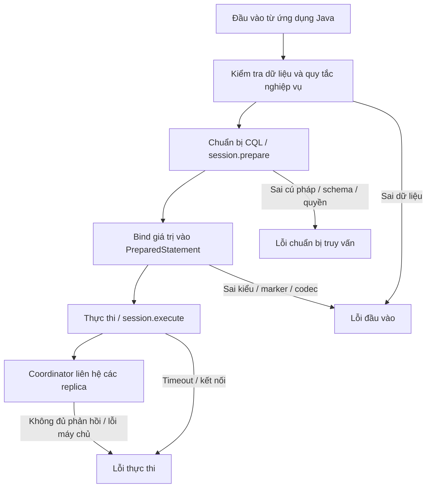

# Phân loại lỗi chuẩn bị truy vấn, lỗi đầu vào và lỗi thực thi trong Java với Cassandra

Khi ứng dụng Java truy cập **Apache Cassandra**, cùng một thao tác `SELECT` hoặc `INSERT` có thể thất bại vì ba nhóm nguyên nhân rất khác nhau: **câu CQL hoặc lược đồ không hợp lệ**, **dữ liệu đầu vào/bind tham số sai**, hoặc **yêu cầu không hoàn thành khi được thực thi**. Phân loại đúng giúp chọn hành động khắc phục: sửa mã hoặc schema, từ chối dữ liệu không hợp lệ, hay xử lý sự cố tạm thời của cụm. Không nên coi mọi exception là tín hiệu để retry.

Bài học thuộc chương **Retry và lỗi Java** của module `DATABASE_ENGINE_WIDE_COLUMN_CASSANDRA`. Bối cảnh là Cassandra có kiến trúc phân tán, lưu trữ dạng **wide-column**, phân phối dữ liệu theo **partition key** và thiết kế bảng theo truy vấn. Vì vậy, việc chọn partition key, replication, consistency level, kết nối Java và trạng thái các replica đều ảnh hưởng tới lỗi mà ứng dụng nhìn thấy.

## 1. Mô hình ba giai đoạn



| Nhóm | Dấu hiệu thường gặp | Nơi phát hiện | Cách xử lý chính |
| --- | --- | --- | --- |
| **Chuẩn bị truy vấn** | CQL sai cú pháp, dùng cột không tồn tại, điều kiện truy vấn trái quy tắc khóa, thiếu quyền | Khi `prepare()` hoặc khi máy chủ phân tích một câu CQL gửi trực tiếp bằng `execute()` | Sửa truy vấn/schema/quyền; không retry mù |
| **Đầu vào / binding** | ID rỗng, sai kiểu Java–CQL, thiếu tham số bắt buộc, vi phạm kiểm tra nghiệp vụ | Trong ứng dụng, trước lúc gửi truy vấn hoặc lúc bind | Trả lỗi dữ liệu, chuẩn hóa giá trị hoặc sửa mapping; không retry |
| **Thực thi** | Không đủ replica, read/write timeout, node mất kết nối, quá tải | Khi gửi yêu cầu, chờ phản hồi hoặc xử lý ở coordinator/replica | Xem loại thao tác, consistency level, tính idempotent và phạm vi ảnh hưởng trước khi retry |

**Lưu ý quan trọng:** Đây là cách chia theo *nguyên nhân và giai đoạn*, không phải ba superclass exception độc lập của driver. Ví dụ, `InvalidQueryException` có thể xuất hiện khi `session.execute()` gửi **simple statement** vì Cassandra chỉ phân tích CQL lúc đó. Hãy ghi nhận cả **phase** (`prepare`, `bind`, `execute`) lẫn loại exception, thay vì phân nhóm chỉ bằng tên class.

## 2. Ví dụ xuyên suốt: truy vấn theo partition key

Giả sử keyspace `app` đã tồn tại và có bảng sau:

```sql
CREATE TABLE app.orders_by_customer (
    customer_id uuid,
    created_at timestamp,
    order_id uuid,
    total decimal,
    PRIMARY KEY ((customer_id), created_at, order_id)
) WITH CLUSTERING ORDER BY (created_at DESC, order_id ASC);
```

- `customer_id` là **partition key**: đơn hàng của cùng một khách hàng được đặt trong cùng một partition logic.
- `created_at`, `order_id` là **clustering columns**: hỗ trợ duyệt đơn hàng theo thời gian trong một partition.
- Một truy vấn đọc đúng mô hình dữ liệu là `WHERE customer_id = ? AND created_at >= ?`. Cassandra có thể xác định partition từ `customer_id`.

```sql
SELECT order_id, created_at, total
FROM app.orders_by_customer
WHERE customer_id = :customer_id
  AND created_at >= :since;
```

Đặt cạnh đó, hai câu CQL có lỗi khác nhau:

```sql
-- Lỗi cú pháp: SELECT bị viết sai.
SELEC order_id FROM app.orders_by_customer WHERE customer_id = ?;

-- Truy vấn không phù hợp với primary key của bảng:
SELECT order_id FROM app.orders_by_customer WHERE order_id = ?;
```

Câu thứ hai chỉ lọc bằng `order_id`, không có `customer_id` để định vị partition; Cassandra thường từ chối truy vấn như vậy nếu không có cơ chế truy vấn phù hợp. **Không** xem `ALLOW FILTERING` là cách sửa mặc định: nó có thể dẫn đến đọc nhiều partition và độ trễ khó dự đoán. Hãy thiết kế bảng/truy vấn theo access pattern cần phục vụ; nếu cần tra đơn hàng theo ID, cân nhắc một bảng riêng có partition key phù hợp.

## 3. Nhóm A — lỗi chuẩn bị truy vấn và xác thực CQL

Với Java driver 4.x, `session.prepare(cql)` gửi yêu cầu chuẩn bị truy vấn tới Cassandra và nhận metadata cho các bind marker. Nếu CQL không hợp lệ, lỗi có thể nổi lên **trước khi tạo được** `PreparedStatement`.

| Exception/hiện tượng | Ý nghĩa điển hình | Kiểm tra đầu tiên |
| --- | --- | --- |
| `SyntaxError` | CQL sai ngữ pháp, sai dấu hoặc keyword | Câu CQL thực sự gửi đi, dấu ngoặc, placeholder, keyword |
| `InvalidQueryException` | Truy vấn không hợp lệ về ngữ nghĩa: cột/bảng không tồn tại, điều kiện khóa không được hỗ trợ, kiểu CQL không khớp | Keyspace hiện hành, schema đã triển khai, partition/clustering key, kiểu cột |
| `UnauthorizedException` | Tài khoản kết nối không có quyền cần thiết | Role, `GRANT`, keyspace/table đích; kiểm tra chính sách phân quyền |
| Lỗi kết nối/timeout ngay lúc `prepare()` | Chưa liên lạc được với node hoặc yêu cầu chuẩn bị không hoàn tất | Trạng thái node, mạng, phiên kết nối, timeout; đây là sự cố **thực thi thao tác prepare**, không chứng minh CQL sai |

Không nên xem mọi lỗi ở `prepare()` là lỗi cố định của câu truy vấn. Cần kiểm tra **exception gốc**. `SyntaxError` và `InvalidQueryException` thường đòi sửa mã/schema; timeout tại thời điểm prepare lại cần chẩn đoán hạ tầng.

**Thực hành khi gặp `InvalidQueryException`:**

1. Xác định tên keyspace và bảng mà session đang nhắm tới; đối chiếu migration đã chạy.
2. Đọc `PRIMARY KEY` để xác nhận phần `WHERE` đáp ứng partition/clustering key.
3. Kiểm tra cột và kiểu dữ liệu trong cả câu CQL lẫn các bind marker.
4. Nếu schema vừa thay đổi, kiểm tra trạng thái triển khai và độ đồng bộ schema giữa các node trước khi kết luận mã sai.

Prepared statement giúp giảm thao tác parse/prepare lặp lại và cho phép bind tham số có kiểu, nhưng **không làm câu CQL sai trở thành hợp lệ**. Không nối dữ liệu người dùng trực tiếp vào chuỗi CQL để né lỗi bind.

## 4. Nhóm B — lỗi đầu vào và bind tham số

Các lỗi này nên được phát hiện càng sớm càng tốt ở biên ứng dụng. Ví dụ: API nhận `customer_id` là chuỗi nhưng chuỗi đó không parse được thành UUID; giá trị `since` thiếu; giá trị của `total` không đáp ứng quy tắc nghiệp vụ.

| Tình huống | Vấn đề | Cách xử lý |
| --- | --- | --- |
| `UUID.fromString(rawCustomerId)` thất bại | Giá trị đầu vào không phải UUID | Báo lỗi validation cho caller; không gửi truy vấn |
| `customerId == null` cho điều kiện `WHERE customer_id = ?` | Thiếu partition key để xác định partition | Yêu cầu trường bắt buộc, không cố truy vấn với giá trị null |
| Bind sai kiểu, ví dụ dùng `setString` cho cột/marker kiểu `uuid` | Không khớp Java type với CQL type | Dùng `setUuid`, `setInstant`, `setBigDecimal`... tương ứng |
| `CodecNotFoundException` hoặc lỗi codec | Driver không tìm được codec phù hợp giữa kiểu Java và CQL | Kiểm tra kiểu cột, kiểu tham số, custom codec khi thực sự cần |
| Sai tên/vị trí bind marker | Truy vấn và phần bind không khớp | Đối chiếu tên `:customer_id`, `:since` và statement đã prepare |

Trong driver 4.x, một số vi phạm có thể biểu hiện bằng `IllegalArgumentException`, `NullPointerException` hoặc ngoại lệ codec tùy API được gọi. Đừng dùng loại exception chung này để suy ra lỗi Cassandra nếu chưa biết nó phát sinh từ lệnh nào.

### Java driver 4.x: kiểm tra, prepare và bind tách bạch

```java
import com.datastax.oss.driver.api.core.CqlSession;
import com.datastax.oss.driver.api.core.cql.BoundStatement;
import com.datastax.oss.driver.api.core.cql.PreparedStatement;
import com.datastax.oss.driver.api.core.cql.ResultSet;
import com.datastax.oss.driver.api.core.DefaultConsistencyLevel;
import com.datastax.oss.driver.api.core.servererrors.InvalidQueryException;
import com.datastax.oss.driver.api.core.servererrors.SyntaxError;
import java.time.Instant;
import java.util.UUID;

public final class OrderReader {
    private static final String FIND_BY_CUSTOMER =
        "SELECT order_id, created_at, total " +
        "FROM app.orders_by_customer " +
        "WHERE customer_id = :customer_id AND created_at >= :since";

    private final CqlSession session;
    private final PreparedStatement prepared;

    public OrderReader(CqlSession session) {
        if (session == null) {
            throw new IllegalArgumentException("session is required");
        }
        this.session = session;

        // Giai đoạn chuẩn bị: lỗi cú pháp / lược đồ cần sửa truy vấn.
        try {
            this.prepared = session.prepare(FIND_BY_CUSTOMER);
        } catch (SyntaxError e) {
            throw new IllegalStateException("CQL syntax is invalid", e);
        } catch (InvalidQueryException e) {
            throw new IllegalStateException("CQL does not match schema", e);
        }
    }

    public ResultSet find(UUID customerId, Instant since) {
        // Giai đoạn đầu vào: trả lỗi cho caller trước khi gọi Cassandra.
        if (customerId == null || since == null) {
            throw new IllegalArgumentException(
                "customerId and since are required");
        }

        // Giai đoạn bind: dùng đúng setter cho kiểu CQL của từng marker.
        BoundStatement statement = prepared.boundStatementBuilder()
            .setUuid("customer_id", customerId)
            .setInstant("since", since)
            .setConsistencyLevel(DefaultConsistencyLevel.LOCAL_QUORUM)
            .setIdempotent(true) // SELECT này có thể thực hiện lại an toàn.
            .build();

        // Giai đoạn execute: có thể xuất hiện timeout, replica thiếu,
        // hoặc lỗi mạng, dù truy vấn và tham số hoàn toàn hợp lệ.
        return session.execute(statement);
    }
}
```

`LOCAL_QUORUM` trong ví dụ chỉ hợp lý nếu replication của keyspace, cấu hình datacenter và yêu cầu nghiệp vụ hỗ trợ mức nhất quán này. Đây là lựa chọn minh họa, không phải mức cố định cho mọi ứng dụng. `ResultSet` cũng cần được tiêu thụ/phân trang hợp lý; partition có nhiều bản ghi có thể khiến việc lấy tất cả dữ liệu vào bộ nhớ trở nên đắt đỏ.

**Chú ý:** Phần `catch` trong constructor nhận diện hai lỗi CQL phổ biến. Những lỗi khác khi `prepare`, chẳng hạn mất kết nối hoặc timeout, sẽ tiếp tục lan lên caller và phải được phân loại riêng. Nếu ứng dụng gửi `SimpleStatement` qua `execute()` mà không `prepare()`, lỗi cú pháp/ngữ nghĩa có thể được phát hiện ở bước execute.

## 5. Nhóm C — lỗi trong quá trình thực thi phân tán

Một yêu cầu Cassandra thường đi tới **coordinator**, sau đó coordinator làm việc với các replica phù hợp với partition key và consistency level. Câu CQL đúng và input đúng **không đảm bảo** yêu cầu sẽ thành công nếu node, mạng hoặc tài nguyên cụm gặp vấn đề.

| Exception trong Java driver 4.x | Điều đang xảy ra | Hướng chẩn đoán |
| --- | --- | --- |
| `UnavailableException` | Tại thời điểm xử lý, số replica sẵn sàng không đủ để đáp ứng consistency level | Replication factor, datacenter, số replica live, CL được chọn |
| `ReadTimeoutException` | Không nhận đủ phản hồi đọc trước timeout phía server | Node chậm, mạng, truy vấn đọc quá nặng, bảng/partition lớn, CL |
| `WriteTimeoutException` | Không nhận đủ xác nhận ghi trước timeout phía server | Replica chậm/mất kết nối, tải ghi, compaction, CL; trạng thái ghi **có thể chưa xác định** |
| `ReadFailureException` / `WriteFailureException` | Có replica báo lỗi xử lý yêu cầu, không đơn thuần là hết thời gian chờ | Log server, tài nguyên node, loại lỗi, số replica thành công/thất bại |
| `OverloadedException` | Node đang quá tải, từ chối hoặc không thể tiếp nhận yêu cầu | Throughput, queue, CPU, GC, compaction và giới hạn concurrency |
| `DriverTimeoutException` | Driver phía client không nhận được kết quả trước thời hạn của request | `basic.request.timeout`, mạng, độ trễ, quá tải; phân biệt với server timeout |
| `AllNodesFailedException` | Driver đã thử các node có thể dùng nhưng không node nào hoàn tất yêu cầu; chứa nguyên nhân theo node | Kiểm tra **các lỗi bên trong**, DNS, TLS, xác thực, kết nối, trạng thái node |

Tên class trên dùng theo **Java driver 4.x** (`com.datastax.oss.driver.api.core...`). Ví dụ cũ dùng driver 3.x có thể nhắc `NoHostAvailableException` hay API khác; không nên bê nguyên code bắt exception của 3.x sang 4.x.

### Server timeout khác client timeout

- `ReadTimeoutException` / `WriteTimeoutException`: server/coordinator trả về thông tin yêu cầu đọc/ghi không đạt điều kiện đúng hạn. Có thể cần xem số phản hồi nhận được và consistency level yêu cầu.
- `DriverTimeoutException`: đồng hồ timeout ở phía **driver/client** hết hạn. Ứng dụng không đủ thông tin để kết luận server không thực hiện thao tác, đặc biệt với ghi.
- Timeout không đồng nghĩa với việc dữ liệu chắc chắn chưa được đọc/ghi. Với **write timeout**, một phần replica có thể đã ghi thành công trước khi caller nhận lỗi.

Ví dụ: keyspace có replication factor bằng 3 tại một datacenter, và truy vấn dùng `LOCAL_QUORUM`. Thông thường cần 2 replica trong datacenter đó đáp ứng yêu cầu. Nếu chỉ có 1 replica khả dụng, có thể nhận `UnavailableException`. Nếu đủ replica được xem là khả dụng nhưng phản hồi trễ, có thể gặp read/write timeout. Kết quả cụ thể còn tùy thời điểm và trạng thái node.

### Đừng chỉ log thông điệp của `AllNodesFailedException`

Đây là lỗi **tổng hợp**: một node có thể lỗi kết nối, node khác bị timeout. Hãy xem danh sách nguyên nhân theo node (driver 4.x cung cấp `getAllErrors()`), đồng thời đối chiếu metric/log phía Cassandra. Nếu chỉ ghi `e.getMessage()`, nguyên nhân quan trọng dễ bị bỏ sót.

## 6. Quyết định retry theo loại lỗi và tính idempotent

**Idempotent** nghĩa là gửi lại cùng thao tác không làm thay đổi kết quả mong muốn theo cách ngoài dự kiến. Một `SELECT` thuần đọc thường idempotent. Một câu `UPDATE` tăng counter, `list` append hoặc thao tác phát sinh hiệu ứng phụ có thể **không** idempotent. Với ghi có TTL hoặc timestamp tự sinh, tính lặp lại an toàn cần đánh giá kỹ; đừng tự động gắn `setIdempotent(true)` cho mọi câu ghi.

| Loại lỗi | Có nên retry tự động? | Lý do và hành động |
| --- | --- | --- |
| Sai cú pháp, sai schema, thiếu quyền | **Không** | Cùng request vẫn sai; sửa CQL, migration hoặc quyền |
| Input thiếu/sai kiểu/không hợp lệ | **Không** | Cần sửa dữ liệu từ caller hoặc mapping |
| `UnavailableException` | **Thường không retry ngay với cùng CL** | Chưa đủ replica; chờ hồi phục hoặc áp dụng quyết định fallback do nghiệp vụ phê duyệt |
| Read timeout / kết nối gián đoạn | **Có thể**, với điều kiện | Chỉ khi thao tác idempotent, retry có giới hạn, backoff/jitter và không vượt deadline |
| Write timeout / client timeout trong ghi | **Rất thận trọng** | Không biết chắc đã ghi được một phần hay toàn bộ; thiết kế ghi idempotent hoặc kiểm tra trạng thái trước khi thử lại |
| Quá tải (`OverloadedException`) | **Có thể trì hoãn có kiểm soát** | Retry lập tức hàng loạt làm tăng tải; dùng backoff, giới hạn concurrency, circuit breaker thích hợp |

Java driver có **retry policy** và có thể thử lại theo chính sách cấu hình. Trước khi thêm vòng lặp retry ở service, xác định driver đã thực hiện bao nhiêu lần thử, tránh việc ứng dụng nhân số request ngoài dự kiến. `setIdempotent(true)` cung cấp tín hiệu cho driver; nó **không** biến một câu ghi vốn không an toàn thành idempotent.

Hạ consistency level để tránh timeout/`UnavailableException` là quyết định về **tính nhất quán của dữ liệu** chứ không chỉ xử lý exception. Đặc biệt với replication, repair và read/write consistency, fallback từ `LOCAL_QUORUM` xuống `LOCAL_ONE` có thể thay đổi khả năng quan sát dữ liệu mới ghi. Chỉ làm khi yêu cầu nghiệp vụ cho phép, có log/metric và được thiết kế rõ ràng.

## 7. Quy trình xử lý lỗi thực tế

Khi nhận lỗi từ một lời gọi Cassandra:

1. **Ghi lại bước đang thực hiện:** validation, `prepare`, `bind` hay `execute`. Nếu dùng async API, bảo đảm đọc nguyên nhân thực thay vì chỉ nhìn wrapper của future.
2. **Nhận diện ngoại lệ gốc:** phân biệt lỗi CQL (`SyntaxError`, `InvalidQueryException`), codec/đầu vào, lỗi server consistency, timeout phía driver và lỗi nhiều node.
3. **Thu thập ngữ cảnh an toàn:** tên thao tác/query template, keyspace/table, partition-key category (không ghi trực tiếp dữ liệu nhạy cảm), consistency level, datacenter, thời điểm, latency, số lần retry và trace/request correlation ID.
4. **Chọn hành động:** lỗi cố định → sửa mã/schema hoặc thông báo dữ liệu không hợp lệ; lỗi tạm thời → đánh giá idempotence, deadline, backoff và sức khỏe cụm.
5. **Đối chiếu metric của Cassandra:** độ trễ đọc/ghi, dropped requests, CPU/GC, compaction backlog, tình trạng replica, mạng và kết quả repair khi sự cố liên quan tới dữ liệu/nhất quán.
6. **Giới hạn lỗi lan truyền:** đặt request timeout hợp lý, giới hạn lượng request đồng thời, quan sát tỷ lệ lỗi; trả trạng thái API phù hợp mà không lộ thông tin schema/tokens trong phản hồi cho người dùng.

Không log giá trị bind có thể chứa dữ liệu cá nhân hoặc bí mật. Đối với lỗi có thể tái hiện, lưu **query template** và mã loại lỗi thường là đủ để điều tra. Tránh log stack trace trùng lặp ở mọi tầng.

### Các tình huống kiểm tra nhanh

| Thử nghiệm | Kỳ vọng quan sát | Kết luận |
| --- | --- | --- |
| Đổi `SELECT` thành `SELEC` trong câu được prepare | `SyntaxError` khi prepare | Sửa CQL; không retry |
| Chỉ lọc `order_id` khi bảng phân vùng bằng `customer_id` | `InvalidQueryException` (tùy câu truy vấn và schema) | Xem lại access pattern và primary key |
| Nhập `customerId` là chuỗi không parse được UUID | Exception khi parse/validation trong Java | Sửa input, không gửi Cassandra |
| Bind kiểu Java không tương ứng với CQL marker | Exception codec/argument ở bước bind | Sửa mapping Java–CQL |
| Tắt đủ replica để không đạt `LOCAL_QUORUM` | Có thể gặp `UnavailableException` | Kiểm tra RF, node và CL |
| Replica phản hồi chậm trong khi còn kết nối | Có thể gặp server read/write timeout hoặc driver timeout | So sánh timeout hai phía và xem latency |
| Mất đường kết nối tới nhiều node | Có thể gặp `AllNodesFailedException` | Xem các nguyên nhân per-node |

Các thử nghiệm liên quan tới node hoặc mạng chỉ nên thực hiện trên **môi trường phát triển/thử nghiệm**, vì kết quả còn phụ thuộc topology và policy của driver.

## 8. Những nhầm lẫn thường gặp

- **“Lỗi phát sinh ở `execute()` thì chắc chắn là lỗi hạ tầng.”** Sai. Simple statement có thể gây `SyntaxError` hoặc `InvalidQueryException` ngay trong `execute()`.
- **“Có `PreparedStatement` nghĩa là mọi bind đều hợp lệ.”** Sai. Kiểu hoặc tên marker không đúng vẫn có thể khiến bind thất bại; giá trị đầu vào còn phải qua validation nghiệp vụ.
- **“Write timeout nghĩa là ghi thất bại hoàn toàn.”** Sai. Cassandra có thể đã áp dụng ghi ở một số replica; retry lặp một thao tác không idempotent có thể gây tác dụng ngoài ý muốn.
- **“Retry nhiều hơn sẽ hết `UnavailableException`.”** Không nhất thiết. Nếu cụm không có đủ replica cho CL, thêm request chỉ gia tăng tải.
- **“Tất cả lỗi timeout đều từ Cassandra server.”** Sai. Driver có timeout riêng; cần biết ai đã hết hạn trước.
- **“Hạ CL là sửa được lỗi.”** Giảm CL có thể đổi bảo đảm nhất quán và độ mới của dữ liệu; chỉ là trade-off có chủ đích.

## 9. Tự kiểm tra sau bài học

1. `session.prepare()` báo `InvalidQueryException` sau một đợt đổi schema. Bạn sẽ kiểm tra những gì trước khi sửa mã?
2. Vì sao ứng dụng phải kiểm tra `customerId` và kiểu dữ liệu **trước** khi bind vào `PreparedStatement`?
3. Một thao tác ghi nhận `WriteTimeoutException` khi dùng `LOCAL_QUORUM`. Bạn có thể khẳng định dữ liệu chưa được ghi không? Vì sao?
4. Khi `AllNodesFailedException` xuất hiện, vì sao cần xem lỗi theo từng node?
5. Điều kiện nào cho phép một `SELECT` được retry? Khi nào một `UPDATE` có thể không an toàn nếu retry?

**Ghi nhớ:** Trước khi quyết định retry, hãy xác định **lỗi thuộc bước nào**, **lỗi cố định hay tạm thời**, **yêu cầu có idempotent không**, và **consistency level/replication đang đòi hỏi điều gì**. Đây là nền tảng để ứng dụng Java xử lý lỗi Cassandra một cách có kiểm soát.
