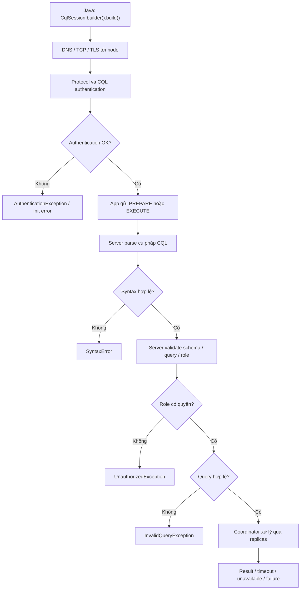
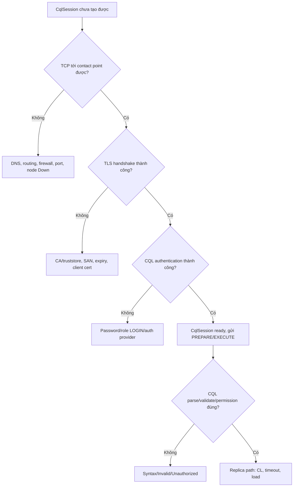

# Authentication/Unauthorized, SyntaxError và InvalidQuery

> **Chương:** Retry và lỗi Java  
> **Mô-đun:** `DATABASE_ENGINE_WIDE_COLUMN_CASSANDRA` — tìm hiểu Apache Cassandra, kiến trúc wide-column phân tán, khóa phân vùng và bảng theo truy vấn, CQL, replication, mức nhất quán đọc/ghi, compaction, repair, xử lý lỗi và kết nối ứng dụng Java.  
> **Trọng tâm:** Phân biệt **authentication**, **authorization**, **syntax validation** và **semantic query validation** trong Apache Cassandra Java Driver 4.x, từ đó xác định nguyên nhân, phân loại sự cố, quyết định khi nào **không retry**, viết CQL/Java có kiểm soát và khôi phục an toàn.

Trong ứng dụng Java, bốn hiện tượng sau có thể đều bị ghi chung thành “Cassandra query failed”:

- Không tạo được `CqlSession` vì credentials sai.
- Kết nối được và đăng nhập thành công, nhưng role không có quyền `SELECT`.
- Query có lỗi cú pháp: `SELEC` thay vì `SELECT`.
- Query đúng cú pháp nhưng trái quy tắc Cassandra, ví dụ lọc một regular column khi thiếu partition key và không có đường truy vấn phù hợp.

Cách giải quyết **không giống nhau**. Đổi mật khẩu không sửa được `InvalidQuery`. Cấp quyền `SELECT` không sửa được lỗi CQL syntax. Và **retry thêm 50 lần** không làm một câu lệnh sai cú pháp trở nên hợp lệ. Bài này sử dụng hệ phân cấp exception của **Apache Cassandra Java Driver 4.19.0** để xây dựng quy trình chẩn đoán cụ thể.

**Nguyên tắc cốt lõi:** Đầu tiên xác định **lỗi ở giai đoạn nào**, **ai phát hiện**, và **dữ liệu nào có thể đã bị thay đổi**; sau đó mới quyết định xử lý hay retry.

## 1. Kết quả học tập

Hoàn thành bài học, bạn có thể:

1. Phân biệt failure khi **khởi tạo/kết nối**, khi **xác thực**, khi **ủy quyền truy vấn**, và khi **kiểm tra cú pháp/ngữ nghĩa CQL**.
2. Nhận biết đúng Java class và package: `AuthenticationException`, `UnauthorizedException`, `SyntaxError`, `InvalidQueryException`.
3. Hiểu vì sao `AuthenticationException` thường xuất hiện **bên trong `AllNodesFailedException`** khi khởi tạo session, thay vì được bắt trực tiếp ở `session.execute(...)`.
4. Hiểu hierarchy `QueryValidationException` và vì sao ba lỗi query-validation không đi qua `RetryPolicy` của driver.
5. Sử dụng role, `LOGIN`, `GRANT SELECT`, `GRANT MODIFY`, `LIST PERMISSIONS` để tạo và sửa phạm vi quyền tối thiểu.
6. Xác định query sai **ngữ pháp** khác gì query **hợp lệ về ngữ pháp nhưng không hợp lệ trên schema/data model**.
7. Sử dụng prepared statements, typed bind values và `CqlSession` dùng chung để giảm lỗi không đáng có.
8. Phân biệt validation errors với `UnavailableException`, `ReadTimeoutException`, `WriteTimeoutException`, `DriverTimeoutException` và lỗi TLS.
9. Thiết kế mapping lỗi sang HTTP/gRPC và logs mà không lộ CQL, secrets hay topology.
10. Viết bài lab, Java code và test để **fail fast** khi lỗi cố định; retry có kiểm soát khi lỗi tạm thời và idempotent.
11. Thực hiện runbook xử lý lỗi từ driver, Cassandra logs, schema/permissions và metrics.

## 2. Một request CQL có nhiều điểm có thể thất bại

### 2.1. Pipeline từ application tới replica



**Ghi chú:** Sơ đồ đơn giản hóa để học. Thứ tự chi tiết giữa các bước kiểm tra schema/quyền có thể khác theo truy vấn, phiên bản và implementation. Không dựa vào sơ đồ để đoán chắc lỗi nào sẽ được ném trước nếu **một query đồng thời sai cú pháp, sai quyền và sai schema**.

### 2.2. Bốn trường hợp cần phân loại

| Lớp lỗi | Pha thông thường | Java class chính | Ví dụ | Có retry cùng input/cấu hình không? |
|---|---|---|---|---|
| **Authentication** | Kết nối / CQL authentication | `com.datastax.oss.driver.api.core.auth.AuthenticationException` | Sai username/password, role không thể login | **Không**, cần sửa identity/credentials/config |
| **Authorization** | Validate/execute CQL trên server | `servererrors.UnauthorizedException` | Đã login nhưng thiếu `SELECT` | **Không**, cần sửa quyền hoặc query |
| **Syntax** | Parse CQL trên server | `servererrors.SyntaxError` | `SELEC`, thiếu cú pháp | **Không**, sửa CQL |
| **Invalid query** | Validate schema/cách truy vấn | `servererrors.InvalidQueryException` | Thiếu PK/không hỗ trợ lọc, cột sai | **Không**, sửa schema/query/kiểu |
| **Availability/timeout** | Chọn coordinator/replica/thực thi | `UnavailableException`/timeouts/driver errors | RF/CL thiếu replica, node chậm | Tùy **idempotency, policy và lỗi cụ thể** |

Ở hàng *Authentication*, tên package là `com.datastax.oss.driver.api.core.auth`, **không phải** `core.servererrors`. Ở ba hàng tiếp theo, package đầy đủ là `com.datastax.oss.driver.api.core.servererrors`.

### 2.3. Authentication và Authorization là hai phép kiểm khác nhau

```text
Authentication:   "Bạn là ai? Có được mở connection không?"
Authorization:    "Identity đã login có được SELECT/INSERT/ALTER tài nguyên này không?"
Syntax:           "CQL có theo ngữ pháp Cassandra không?"
Invalid query:    "CQL parse được, nhưng có được thực thi trên schema/quy tắc này không?"
```

TLS certificate validation là một lớp **bên dưới** CQL authentication. TLS handshake fail do CA/SAN không có nghĩa password CQL sai. Tương tự, mã hóa TLS thành công không tạo quyền đọc bảng.

## 3. Hệ phân cấp exception trong Java Driver 4.x

### 3.1. Query-validation là nhánh server errors

Trong Driver 4.19:

```text
java.lang.RuntimeException
└── DriverException
    └── CoordinatorException
        └── QueryValidationException
            ├── SyntaxError
            ├── InvalidQueryException
            ├── UnauthorizedException
            ├── AlreadyExistsException
            └── InvalidConfigurationInQueryException
```

Ba exception tiêu điểm là **các lớp ngang hàng**, đều kế thừa `QueryValidationException`. Không có quan hệ `SyntaxError extends InvalidQueryException` hoặc ngược lại.

Ví dụ imports:

```java
import com.datastax.oss.driver.api.core.servererrors.QueryValidationException;
import com.datastax.oss.driver.api.core.servererrors.SyntaxError;
import com.datastax.oss.driver.api.core.servererrors.InvalidQueryException;
import com.datastax.oss.driver.api.core.servererrors.UnauthorizedException;
```

Mỗi exception đến từ **coordinator node** trả lời query. Có thể dùng `getCoordinator()` (API từ `CoordinatorException`) để gắn mã endpoint vào logs/metrics có kiểm soát. Nó không tự chứng minh coordinator là nguyên nhân của query sai; syntax/schema/permission thường là do **câu lệnh và context**.

### 3.2. AuthenticationException nằm ở nhánh khác

```text
java.lang.RuntimeException
└── com.datastax.oss.driver.api.core.auth.AuthenticationException

com.datastax.oss.driver.api.core.DriverException
└── AllNodesFailedException
    └── (chứa lỗi theo từng node từ quá trình bootstrap/query)
```

`AuthenticationException` của Driver 4.19 **extends RuntimeException**, không kế thừa `QueryValidationException` và không phải `DriverException`. Authentication chạy khi **mở một connection** tới Cassandra node. Khi startup, lỗi có thể nằm bên trong **`AllNodesFailedException`**, vì driver đã cố kết nối một số endpoints mà không thành công.

Ví dụ:

```text
CqlSession.builder().build()
  └── AllNodesFailedException
       ├── node A: AuthenticationException (bad credentials)
       └── node B: AuthenticationException (bad credentials)
```

Đây là ví dụ cấu trúc logic, không phải stack trace đầy đủ. Một node cũng có thể thất bại vì `ConnectionInitException`, TLS, network hoặc protocol khác; kiểm tra **mọi errors theo node** thay vì kết luận từ tên `AllNodesFailedException`.

### 3.3. Cấu trúc lỗi cần nhận biết

| Exception | Package chính | Ý nghĩa |
|---|---|---|
| `AuthenticationException` | `core.auth` | Lỗi ở pha authentication khi khởi tạo connection |
| `AllNodesFailedException` | `core` | Các coordinator/contact points thử đều thất bại; có `getAllErrors()` |
| `NoNodeAvailableException` | `core` | Không có coordinator được thử; subclass của `AllNodesFailedException` |
| `UnauthorizedException` | `core.servererrors` | User/role đã login không được phép thực hiện CQL |
| `SyntaxError` | `core.servererrors` | Query sai ngữ pháp CQL |
| `InvalidQueryException` | `core.servererrors` | Query parse được nhưng không hợp lệ |
| `UnavailableException` | `core.servererrors` | Coordinator biết không đủ replicas cho CL yêu cầu |
| `ReadTimeoutException` | `core.servererrors` | Replica không phản hồi đủ/đúng hạn khi đọc |
| `WriteTimeoutException` | `core.servererrors` | Write timeout; mutation **có thể đã áp dụng** |
| `DriverTimeoutException` | `core` | Deadline của driver hết; không giống timeout server |
| `ClosedConnectionException` | `core.connection` | Kết nối đang thực thi bị đóng do sự kiện khác |

**Không** bắt mọi `DriverException` rồi coi là “lỗi tạm thời”. Trong Driver, `SyntaxError`, `UnauthorizedException`, `InvalidQueryException` đều là subclasses của `DriverException` và thuộc nhóm lỗi không retry.

## 4. Authentication: lỗi danh tính khi kết nối

### 4.1. Authentication cần những thành phần nào?

Một Cassandra cluster có thể cấu hình:

- `authenticator` (ví dụ `PasswordAuthenticator`) để xác thực đăng nhập.
- `authorizer` (ví dụ `CassandraAuthorizer`) để xác định quyền CQL.
- `role_manager` và role metadata để quản trị users/roles.
- `client_encryption_options` để mã hóa native protocol TLS.
- `network_authorizer`/role restrictions tùy phiên bản để hạn chế DC/CIDR.

Không được tự suy rằng Cassandra **mặc định yêu cầu username/password**. Nhiều môi trường thử nghiệm dùng `AllowAllAuthenticator` và `AllowAllAuthorizer`. Bài lab về quyền chỉ có ý nghĩa khi cluster **thực sự bật authentication và authorization** theo cấu hình tương ứng.

### 4.2. Ví dụ tạo session với credentials

```java
import com.datastax.oss.driver.api.core.CqlSession;
import java.net.InetSocketAddress;

String username = System.getenv("CASSANDRA_USERNAME");
String password = System.getenv("CASSANDRA_PASSWORD");

if (username == null || password == null) {
    throw new IllegalStateException(
        "Missing Cassandra service credentials");
}

try (CqlSession session = CqlSession.builder()
        .addContactPoint(new InetSocketAddress(
            "node-a.dc1.internal", 9042))
        .withLocalDatacenter("dc1")
        .withAuthCredentials(username, password)
        .build()) {
    // Chỉ sau khi session build thành công mới chạy CQL.
}
```

Credentials này là **CQL service identity**, không nên lấy trực tiếp từ HTTP caller. Dùng secret manager/config injection, không hardcode password trong repository hoặc log. Nếu cluster dùng SASL/AuthProvider khác, dùng provider phù hợp thay `withAuthCredentials(...)`.

### 4.3. Vì sao startup thất bại?

Các khả năng:

- Sai username hoặc password.
- Secret đã rotate ở Cassandra nhưng container app còn secret cũ.
- Role không tồn tại, `LOGIN = false` hoặc bị vô hiệu theo policy.
- Server dùng authenticator không tương thích `PlainTextAuthProvider`.
- Driver chưa cấu hình AuthProvider nhưng server yêu cầu.
- Một số nodes dùng cấu hình auth/role metadata chưa đồng bộ hoặc đang gặp sự cố.
- Role bị hạn chế datacenter/CIDR theo network authorizer ở phiên bản hỗ trợ.
- TLS handshake, certificate/SAN hoặc network lỗi trước khi tới authentication (lỗi khác, **không suy là sai password**).

### 4.4. Vì sao có thể chỉ phát hiện sau khi app đã chạy?

Cassandra Driver xác thực **mỗi khi mở connection mới**. Session có thể chạy nhiều giờ trên connection cũ; đến khi node restart hoặc pool cần mở connection mới, **credential cũ** hoặc secret đã đổi có thể khiến lần authentication mới thất bại.

Tình huống:

```text
T0  App đã mở connection bằng password cũ, queries vẫn OK
T1  CQL role password được rotate
T2  Một node restart, driver mở connection mới
T3  AuthenticationException trong driver connection logs
T4  Request có thể thất bại nếu không còn đường kết nối phù hợp
```

**Không** kết luận mật khẩu mới đã áp dụng thành công chỉ vì một query trên connection cũ hoạt động. Test bằng **connection mới** trên staging/canary, với secret và certificate đã cập nhật.

### 4.5. Một số thao tác khắc phục đúng

1. Xác định **service account** và nguồn secret được phép kiểm tra.
2. Xác minh username, login permission, authenticator và địa chỉ cluster.
3. Kiểm tra secret version được app đang sử dụng, không in giá trị ra logs/ticket.
4. Kiểm tra TLS/transport và endpoint reachability riêng.
5. Nếu sai secret, cập nhật secret/config theo change plan; reload/restart application sessions đúng vòng đời.
6. Kiểm tra các nodes/DC sau rotation, tránh connection storm.
7. Phân biệt login fail do role không hợp lệ với kết nối fail do SSL/TCP.

**Không** sửa bằng cách bật `AllowAllAuthenticator` trong production, dùng mặc định superuser hoặc tăng quyền database. Cũng không retry connection vô hạn mỗi request; sử dụng driver reconnection/startup policy với backoff có kiểm soát.

## 5. Unauthorized: login được nhưng thiếu quyền

### 5.1. Vai trò của Authorizer

`UnauthorizedException` biểu diễn trường hợp **query không được thực hiện do ràng buộc authorization của role đã đăng nhập**. Ví dụ:

- Role chỉ có `SELECT` nhưng cố `INSERT`.
- Role chỉ có `MODIFY` nhưng cố `SELECT`.
- Role không có `CREATE` mà chạy `CREATE TABLE`.
- Role không có quyền cần thiết trên keyspace/table/function.
- Role không có `AUTHORIZE` nhưng cố `GRANT` cho role khác.
- Quy tắc role inheritance hoặc resource scope khác ý định.

**Việc đăng nhập thành công không cấp tự động quyền trên mọi bảng**. Nếu dùng `CassandraAuthorizer`, quyền cụ thể thường được cấp bằng `GRANT` tại scope nhỏ nhất đủ cho nghiệp vụ.

### 5.2. CQL ví dụ: role đọc nhưng không ghi

Giả sử admin lab đã tạo bảng:

```sql
CREATE KEYSPACE IF NOT EXISTS lab_java_errors
WITH replication = {
    'class': 'NetworkTopologyStrategy',
    'dc1': 3
};

CREATE TABLE IF NOT EXISTS lab_java_errors.accounts_by_id (
    account_id text PRIMARY KEY,
    display_name text,
    account_state text,
    updated_at timestamp
);
```

Tạo role **chỉ trong lab được bật PasswordAuthenticator và CassandraAuthorizer**:

```sql
-- Thực hiện bởi account quản trị có quyền CREATE ROLE.
-- Thay placeholder bằng password lab do secret store cung cấp;
-- không đưa giá trị thật vào Git, transcript hay ticket.
CREATE ROLE IF NOT EXISTS lab_read_only
WITH PASSWORD = '<LAB_PASSWORD_FROM_SECRET_STORE>'
AND LOGIN = true
AND SUPERUSER = false;

GRANT SELECT
ON TABLE lab_java_errors.accounts_by_id
TO lab_read_only;
```

Role này được cấp `SELECT` trên một bảng, **không** có `MODIFY` theo cấu hình lab dự kiến. Khi đăng nhập bằng `lab_read_only`:

```sql
-- Được phép nếu bảng tồn tại, role không bị hạn chế thêm.
SELECT account_id, display_name
FROM lab_java_errors.accounts_by_id
WHERE account_id = 'user-001';

-- Bị từ chối khi thiếu MODIFY:
INSERT INTO lab_java_errors.accounts_by_id (
    account_id, display_name, account_state
) VALUES ('user-002', 'Demo', 'ACTIVE');
```

Ở query thứ hai, Cassandra có thể trả `UnauthorizedException` trong Java Driver 4.x. Điều kiện: **authorizer thực sự enforcing** và role không thừa kế quyền rộng hơn từ role khác. Nếu role có quyền `MODIFY` ở scope keyspace/ALL KEYSPACES, truy vấn có thể thành công — phải kiểm tra quyền hiệu dụng.

### 5.3. GRANT quyền đúng, không cấp tràn lan

Nếu service thực sự cần ghi:

```sql
-- Admin/phê duyệt bảo mật chạy, KHÔNG cho app tự nâng quyền.
GRANT MODIFY
ON TABLE lab_java_errors.accounts_by_id
TO lab_read_only;
```

Lệnh trên minh họa thay đổi quyền, **không khuyến nghị mở rộng role đọc** nếu không có yêu cầu nghiệp vụ. Tốt hơn là dùng một role ghi riêng khi cần tách trách nhiệm.

Quyền cần biết:

| CQL permission | Mục đích thường gặp |
|---|---|
| `SELECT` | Đọc dữ liệu từ table/resource phù hợp |
| `MODIFY` | Các thao tác ghi/đổi/xóa dữ liệu theo scope |
| `CREATE` | Tạo keyspace/table và tài nguyên phù hợp |
| `ALTER` | Thay schema |
| `DROP` | Xóa tài nguyên |
| `AUTHORIZE` | Cấp/thu hồi quyền trên resource phù hợp |
| `DESCRIBE` | Xem một số metadata/quyền theo phiên bản |
| `EXECUTE` | Chạy UDF/functions tương ứng khi áp dụng |

Các permission và resource scopes thay đổi chi tiết theo Cassandra version. Không suy `MODIFY` thay cho `SELECT`. Quyền quản trị role/table nên tách khỏi service identity xử lý request nghiệp vụ.

### 5.4. Kiểm tra quyền hiệu dụng

Từ phiên quản trị có quyền phù hợp:

```sql
LIST ALL PERMISSIONS OF lab_read_only;
LIST ALL PERMISSIONS ON lab_java_errors.accounts_by_id OF lab_read_only;
LIST ROLES OF lab_read_only;
```

Các câu trên thuộc CQL quản trị Cassandra. Mục tiêu là kiểm tra **quyền hiệu dụng** và role inheritance, không chỉ duy nhất một dòng `GRANT` gần nhất. Cú pháp và quyền xem metadata có thể thay đổi theo phiên bản. Không giả định ứng dụng thường có quyền `LIST ALL PERMISSIONS`.

### 5.5. Unauthorized không nên được retry

Nếu đã xác nhận role không có quyền `MODIFY`, gửi lại cùng `INSERT` 100 lần chỉ:

- Tăng network/CPU/log pressure.
- Tạo cảnh báo bảo mật và che nguyên nhân.
- Có thể khiến hệ bảo mật đánh giá là abuse.
- Không tạo được quyền từ logic retry.

**Xử lý đúng:** dừng thao tác, kiểm yêu cầu nghiệp vụ và mapping service role → resource. Nếu quyền thiếu vì deployment/migration, cấp quyền tối thiểu qua admin change; kiểm lại sau đó. Không biến lỗi này thành lý do tắt `CassandraAuthorizer`.

### 5.6. Lỗi quyền của service account khác HTTP 403 của người dùng

Ví dụ một app đã xác thực end-user Alice và dùng **service account** để query Cassandra. Nếu service account thiếu `SELECT`, bản thân Alice chưa chắc là người không được phép.

Mapping hợp lý:

- End-user bị chặn theo **authorization của ứng dụng** → HTTP 403.
- End-user chưa xác thực → HTTP 401, với semantics của API.
- Service account Cassandra thiếu `SELECT` do cấu hình server/app → thường **lỗi nội bộ/service unavailable** cho caller, báo động vận hành và che chi tiết schema/role.
- Không trả raw exception message từ Cassandra cho HTTP client; thông điệp có thể chứa table/keyspace/user metadata nhạy cảm.

**Không máy móc map mọi `UnauthorizedException` từ Cassandra thành HTTP 403.** Phải hiểu **ai bị từ chối và ở tầng nào**.

## 6. SyntaxError: cú pháp CQL không hợp lệ

### 6.1. Đặc điểm

`SyntaxError` nghĩa là CQL **không thể parse theo ngữ pháp**. Ví dụ:

```sql
-- Sai keyword:
SELEC account_id
FROM lab_java_errors.accounts_by_id
WHERE account_id = 'user-001';
```

Một ví dụ khác:

```sql
-- Sai: thiếu cú pháp hợp lệ sau SELECT.
SELECT FROM lab_java_errors.accounts_by_id;
```

Server có thể trả thông tin vị trí parser gặp lỗi. Driver 4.19 sẽ biểu diễn dưới `com.datastax.oss.driver.api.core.servererrors.SyntaxError`. Lỗi này **không đi qua RetryPolicy** và được trả trực tiếp cho code gọi.

### 6.2. Nguyên nhân thường gặp

- Gõ sai keyword, thiếu `FROM`, thừa dấu phẩy, thiếu đóng ngoặc.
- Nối string động khiến dấu nháy đơn trong value làm hỏng literal.
- Đưa cả lệnh `CONSISTENCY LOCAL_QUORUM;` của `cqlsh` vào `session.prepare(...)` (đây là lệnh `cqlsh`, không phải truy vấn CQL gửi tới server).
- Dùng SQL syntax không được Cassandra hỗ trợ như `JOIN` tùy ý, `OFFSET` theo SQL, hoặc statement syntax của DB khác.
- Dùng reserved keyword hoặc identifier case-sensitive sai cách.
- Dùng cú pháp CQL mới trên server version chưa hỗ trợ.
- Tạo query text từ template có lỗi dấu `?` hoặc câu lệnh dang dở.

### 6.3. Bind markers tránh lỗi quote

**Sai:**

```java
String raw = "SELECT account_id FROM "
    + "lab_java_errors.accounts_by_id "
    + "WHERE account_id = '" + inputFromApi + "'";
session.execute(raw);
```

**Đúng:**

```java
PreparedStatement find = session.prepare(
    "SELECT account_id FROM lab_java_errors.accounts_by_id "
    + "WHERE account_id = ?");

session.execute(find.bind(inputFromApi));
```

Nếu `inputFromApi` có dấu `'` hoặc dấu chấm phẩy, nó vẫn là **giá trị đã bind**, không phải phần syntax. Bind **không** tự bảo vệ tenant authorization hoặc trường hợp caller truyền key ngoài phạm vi; xác minh identity và validation vẫn cần.

### 6.4. Kiểm thử cú pháp ở deployment/CI, không thử bằng retry production

- Viết CQL cố định và kiểm tra schema tương ứng.
- `session.prepare(...)` các query trọng yếu ở staging hoặc trong startup có kiểm soát.
- Với query động, tạo danh sách biến thể hợp lệ và chạy integration tests.
- Dùng `QueryBuilder` nếu structure thay đổi, nhưng vẫn bind values và kiểm dữ liệu đầu vào.
- Chỉ sau khi cú pháp được xác nhận mới triển khai, không chờ traffic production phát hiện sai.
- Nếu code release vừa đổi CQL và tất cả requests gặp `SyntaxError`, **rollback/fix release**, không tăng retry count.

## 7. InvalidQuery: cú pháp đúng nhưng Cassandra không chấp nhận

### 7.1. Đặc điểm

`InvalidQueryException` biểu diễn một câu **đã parse được** nhưng không hợp lệ theo kiểm tra semantic/schema/loại query. Nó không đồng nghĩa “hệ Cassandra đang Down”.

Ví dụ trên bảng:

```sql
CREATE TABLE lab_java_errors.accounts_by_id (
    account_id text PRIMARY KEY,
    display_name text,
    account_state text,
    updated_at timestamp
);
```

Truy vấn thông thường:

```sql
SELECT account_id, display_name
FROM lab_java_errors.accounts_by_id
WHERE account_id = 'user-001';
```

Còn truy vấn dưới đây không có đường tìm hiệu quả theo primary key:

```sql
-- Parse được, nhưng thiếu partition-key restriction
-- và chưa có bảng/index phù hợp:
SELECT account_id, display_name
FROM lab_java_errors.accounts_by_id
WHERE display_name = 'Demo';
```

Ở các bản Cassandra thông dụng, server từ chối hoặc yêu cầu điều kiện/query strategy khác (ví dụ filtering/index nếu hợp lệ), và Java có thể nhận `InvalidQueryException`. Không tự thêm `ALLOW FILTERING` cho API production chỉ để hết lỗi: Cassandra có thể phải scan một lượng dữ liệu rất lớn.

### 7.2. Các nhóm nguyên nhân điển hình

| Nhóm | Ví dụ | Cách sửa |
|---|---|---|
| Sai/thiếu schema object | Table/column không tồn tại ở version hiện tại | Xác minh keyspace/table, schema agreement và migration |
| Không ràng buộc PK đúng | `WHERE` thiếu partition key hoặc clustering restriction không hợp lệ | Thiết kế query-first schema, dùng đầy đủ PK |
| Unsupported filtering | Lọc regular column không có đường truy vấn | Bảng denormalized/index/search hợp lý |
| Type semantics không hợp lệ | So điều kiện theo kiểu/operation không được hỗ trợ | Typed bind và xem CQL type |
| Clustering/ORDER BY | `ORDER BY` trên regular column, thứ tự không tương thích | Dùng clustering key đúng/đổi bảng |
| Data model/rule constraints | Tạo table hoặc query với option không hợp lệ | Sửa CQL/options/schema |
| Version/API incompatibility | CQL server chưa hỗ trợ statement/feature | Kiểm version và feature rollout |
| Schema vừa thay | App prep query dựa schema cũ | Expand/contract, schema agreement, prepare lại đúng lúc |

Không mọi lỗi kiểu Java đều thành `InvalidQueryException`. Một số lỗi bind sai Java type có thể được driver phát hiện **trước khi gửi CQL** dưới dạng `IllegalArgumentException` hoặc codec-related exceptions; hãy kiểm tra stack/cause.

### 7.3. Sai partition key phải sửa data model

Ví dụ cần xem events theo tenant và ngày:

```sql
CREATE TABLE lab_java_errors.events_by_tenant_day (
    tenant_id uuid,
    event_day date,
    event_time timestamp,
    event_id uuid,
    event_type text,
    PRIMARY KEY ((tenant_id, event_day), event_time, event_id)
) WITH CLUSTERING ORDER BY (event_time DESC, event_id DESC);
```

Query đúng:

```sql
SELECT event_time, event_id, event_type
FROM lab_java_errors.events_by_tenant_day
WHERE tenant_id = 11111111-1111-1111-1111-111111111111
  AND event_day = '2026-11-21';
```

Sai về data model:

```sql
-- Muốn tìm toàn bộ events theo event_type mà không biết tenant/day:
SELECT event_time, event_id
FROM lab_java_errors.events_by_tenant_day
WHERE event_type = 'LOGIN';
```

Nếu use case thật cần truy vấn theo loại, tạo **bảng theo query** (ví dụ `events_by_tenant_type_day`) hoặc index/search phù hợp và load-test. Không biến mỗi `InvalidQueryException` thành “cứ thêm ALLOW FILTERING”.

### 7.4. Schema agreement và rollout nhiều DC

Một rollout có `ALTER TABLE`/thêm bảng mới có thể làm app mới bắt đầu gửi query tới node còn chưa hội tụ metadata/schema. Tùy Cassandra version và cách deployment, app có thể thấy `InvalidQueryException`/schema-related errors tạm thời.

Runbook đúng:

1. Dùng migration tool triển khai schema **trước** code đòi schema mới.
2. Kiểm tra schema agreement và các node/DC liên quan.
3. Dùng **expand → migrate → contract** để app version cũ/mới đồng tồn tại.
4. Chuẩn bị query/health checks trên staging.
5. Nếu release sai, rollback app hoặc sửa migration; **không** dùng retry vô hạn che schema drift.

**Không nhầm** một schema convergence window có thể khắc phục bằng deployment orchestration với việc retry `InvalidQueryException` như chiến lược chung. Driver mặc định **không retry** exception này.

## 8. Bẫy phân loại: cùng triệu chứng, khác giai đoạn

### 8.1. “Access denied” có hai tầng

```text
CqlSession.build() failed:
  AllNodesFailedException
    └── AuthenticationException
         → identity chưa đăng nhập thành công với node

session.execute(SELECT) failed:
  UnauthorizedException
         → identity đăng nhập được nhưng thiếu quyền truy vấn
```

Nếu log chỉ ghi `"Access to Cassandra denied"` thì không đủ để quyết định:
- Có phải đổi secret?
- Có phải GRANT SELECT?
- Có phải TLS mTLS?
- Hay app đang đi nhầm cluster/DC?

### 8.2. “Invalid request” không đủ cụ thể

Hai query:

```sql
-- 1. Sai ngữ pháp:
SELEC * FROM lab_java_errors.accounts_by_id;

-- 2. Ngữ pháp hợp lệ, sai ràng buộc truy vấn:
SELECT account_id
FROM lab_java_errors.accounts_by_id
WHERE account_state = 'ACTIVE';
```

Lỗi thứ nhất có thể ném `SyntaxError`, thứ hai thường ném `InvalidQueryException`. Cả hai yêu cầu sửa query/source code/schema, **không** dùng backoff retry. Nếu app map cả hai thành “database unavailable” thì dễ dẫn SRE tới sai runbook.

### 8.3. CQL query validation khác server capacity

```text
QueryValidationException (Syntax/Invalid/Unauthorized)
   └── Sửa cú pháp, thiết kế truy vấn hoặc quyền

UnavailableException / ReadTimeout / WriteTimeout
   └── Điều tra RF, CL, replicas, tải, network;
       chỉ retry khi semantics/idempotence cho phép

DriverTimeoutException / AllNodesFailedException
   └── Điều tra deadline, nodes, pool, TLS, authentication;
       không mặc định cùng một nguyên nhân
```

## 9. RetryPolicy: ba lỗi kiểm tra truy vấn không được retry

### 9.1. Mặc định driver xử lý thế nào?

Theo tài liệu Apache Cassandra Java Driver 4.19:

- `QueryValidationException` **và toàn bộ subclasses** (bao gồm `UnauthorizedException`, `SyntaxError`, `InvalidQueryException`) được **rethrow trực tiếp**.
- Chúng **không đi qua** `RetryPolicy` để quyết định retry.
- `FunctionFailureException` và `ProtocolError` cũng thuộc nhóm hard-coded rethrow.
- Default retry policy chỉ retry **một số lỗi thực thi** với điều kiện cụ thể và chỉ khi retry có khả năng thành công/đủ an toàn.
- Với write không-idempotent, nhiều đường retry bị driver chặn; gắn nhãn idempotent bừa có thể làm dữ liệu sai.

Đây là lý do xử lý ngoại lệ theo **loại lỗi** quan trọng hơn việc “bật retry mặc định”.

### 9.2. Retry application vẫn có thể gây hại

Một vòng:

```java
// ANTI-PATTERN: retry không phân biệt nhóm exception.
for (int attempt = 1; attempt <= 50; attempt++) {
    try {
        session.execute(statement);
        break;
    } catch (RuntimeException anyError) {
        // sleep rồi retry...
    }
}
```

đã **vượt ra ngoài RetryPolicy** của driver. Với `UnauthorizedException`, nó biến lỗi thiếu quyền thành hàng chục requests bị từ chối. Với `SyntaxError` nó tăng traffic vô ích. Với `InvalidQueryException` do thiếu partition key, nó không sửa data model.

**Đúng:** nhận diện và **fail fast** cho validation; retry một số lỗi transient theo policy/idempotency riêng, có budget và observability.

### 9.3. Ma trận quyết định

| Tình huống | Driver retry? | Application nên làm |
|---|---|---|
| Bad CQL password (Authentication) | Không nên cố query lại vô hạn; connection reconnection theo policy riêng | Sửa secret, TLS, authenticator, session lifecycle |
| `UnauthorizedException` | **Không** qua retry policy | Kiểm role, permission, scope; fail fast |
| `SyntaxError` | **Không** qua retry policy | Fix query/version/parser; fail fast |
| `InvalidQueryException` | **Không** qua retry policy | Fix schema/data model/type/query; fail fast |
| `UnavailableException` | Policy có thể retry next node một lần nếu thích hợp | Kiểm RF/CL, node health, idempotency, error budget |
| `ReadTimeoutException` | Tùy phản hồi data/CL và policy | Có thể retry bounded đọc an toàn; đo tải |
| `WriteTimeoutException` | Mutation có thể đã áp dụng; default thường không retry SIMPLE write | Chỉ retry khi truly idempotent; đối soát |
| `DriverTimeoutException` | Deadline hết ở client; trạng thái write có thể không chắc | Xác định outcome, giới hạn retry |
| TLS certificate failure | Thông thường lỗi cấu hình trust/SAN/cert | Sửa cert/endpoint, không tắt verification |
| Schema convergence trong deploy | Không phải lý do để blanket retry InvalidQuery | Dừng rollout/đợi schema hợp lệ rồi thử lại theo process |

### 9.4. Không hạ consistency level để che query validation

`LOCAL_QUORUM`, `QUORUM` hoặc `ONE` chỉ thay **điều kiện nhất quán/khả dụng** của request hợp lệ. Nó không sửa:

- Wrong password.
- Permission thiếu.
- Syntax parser error.
- Column/table không tồn tại.
- Query không có partition-key restrictions phù hợp.

Thậm chí với lỗi availability, tự hạ CL có thể phá invariant read-your-write hoặc RPO. Không bật `ConsistencyDowngradingRetryPolicy` trừ khi đã đánh giá đầy đủ hậu quả.

## 10. Chuẩn bị CQL lab phân biệt bốn loại lỗi

### 10.1. Yêu cầu an toàn

Dùng **cụm Cassandra lab**, không thay authenticator/authorizer production để phục vụ thử nghiệm. Lab cần:

- Cassandra 4.x/5.x và Java Driver 4.x phù hợp.
- Local DC có tên đúng `dc1`, tối thiểu 3 full replicas nếu dùng RF=3.
- `PasswordAuthenticator` và `CassandraAuthorizer` được bật/cấu hình ở các nodes theo hướng dẫn phiên bản nếu muốn thực nghiệm `AuthenticationException` và `UnauthorizedException`.
- Một role admin có quyền tạo keyspace/table/role và cấp quyền.
- Cấu hình Java Driver TLS, credentials và contact points đúng; không log password thật.
- Công cụ `cqlsh`/Java Driver, quyền xem logs và node status.
- Có thể điều chỉnh keyspace RF=1 trên cluster **một node duy nhất** nếu mục tiêu chỉ là cú pháp/exception, nhưng không coi đó là lab quorum RF=3.

### 10.2. Admin tạo schema và dữ liệu

```sql
CREATE KEYSPACE IF NOT EXISTS lab_java_errors
WITH replication = {
    'class': 'NetworkTopologyStrategy',
    'dc1': 3
};

CREATE TABLE IF NOT EXISTS lab_java_errors.accounts_by_id (
    account_id text PRIMARY KEY,
    display_name text,
    account_state text,
    updated_at timestamp
);

INSERT INTO lab_java_errors.accounts_by_id (
    account_id, display_name, account_state, updated_at
) VALUES (
    'user-001', 'Người dùng thử nghiệm',
    'ACTIVE', '2026-11-21 08:00:00+0000'
);
```

Bảng này được thiết kế cho `WHERE account_id = ?`. Cột `account_state` là regular column; lọc trực tiếp theo nó không dùng partition key của bảng.

### 10.3. Admin tạo role và cấp SELECT

```sql
-- Chỉ thực hiện khi authenticator và authorizer của lab
-- đã được thiết lập đúng, bằng admin identity.
CREATE ROLE IF NOT EXISTS lab_reader
WITH PASSWORD = '<LAB_PASSWORD_FROM_SECRET_STORE>'
AND LOGIN = true
AND SUPERUSER = false;

GRANT SELECT
ON TABLE lab_java_errors.accounts_by_id
TO lab_reader;
```

Nếu role đã tồn tại với quyền rộng hơn do lab cũ, dùng admin kiểm tra quyền hiệu dụng trước khi thử `Unauthorized`; không tự `REVOKE` trên môi trường dùng chung.

### 10.4. Bốn phép thử

| Bài thử | Cách chạy | Kỳ vọng chính |
|---|---|---|
| A — Authentication | Java session với role có password sai | Bootstrap/connection auth thất bại; `AllNodesFailedException` có thể chứa `AuthenticationException` |
| B — Unauthorized | Login đúng dưới `lab_reader` rồi `INSERT` | `UnauthorizedException` nếu role thiếu `MODIFY` |
| C — SyntaxError | Login hợp lệ, chạy `SELEC ...` | `SyntaxError` |
| D — InvalidQuery | Login role có `SELECT`, query `WHERE account_state = 'ACTIVE'` không PK | `InvalidQueryException`/server rejection của query shape tùy version |

**Không được kết luận test A thất bại nếu app không đến được node vì TLS/network**. Sự kiện mong muốn là authentication bị từ chối; cần xem per-node cause. Test B cần thật sự bật authorizer và không có inherited `MODIFY`.

### 10.5. Các lệnh CQL cụ thể cho B/C/D

```sql
-- B: đăng nhập bằng lab_reader (đã được GRANT SELECT,
-- chưa có MODIFY). Truy vấn này phải thiếu quyền ghi.
INSERT INTO lab_java_errors.accounts_by_id (
    account_id, display_name, account_state
) VALUES ('user-002', 'Không được ghi', 'ACTIVE');

-- C: cố tình sai cú pháp để học parser error.
SELEC account_id
FROM lab_java_errors.accounts_by_id
WHERE account_id = 'user-001';

-- D: query parse được nhưng thiếu đường truy cập hợp lệ.
SELECT account_id, display_name
FROM lab_java_errors.accounts_by_id
WHERE account_state = 'ACTIVE';
```

Nếu không muốn làm bẩn bảng, chỉ thực hiện trong lab. Không áp dụng cùng test với admin superuser cho Unauthorized; superuser thường có quyền và kết quả sẽ không biểu diễn lỗi dự kiến.

## 11. Java: xử lý theo loại lỗi tại thời điểm chạy CQL

### 11.1. Repository dùng prepared statements

```java
import com.datastax.oss.driver.api.core.CqlSession;
import com.datastax.oss.driver.api.core.DefaultConsistencyLevel;
import com.datastax.oss.driver.api.core.cql.PreparedStatement;
import com.datastax.oss.driver.api.core.cql.Row;

public final class AccountReader {
    private final CqlSession session;
    private final PreparedStatement find;

    public AccountReader(CqlSession session) {
        this.session = session;
        this.find = session.prepare(
            "SELECT account_id, display_name " +
            "FROM lab_java_errors.accounts_by_id " +
            "WHERE account_id = ?");
    }

    public String findDisplayName(String accountId) {
        Row row = session.execute(
            find.bind(accountId)
                .setConsistencyLevel(
                    DefaultConsistencyLevel.LOCAL_QUORUM)
        ).one();
        return row == null ? null : row.getString("display_name");
    }
}
```

Bảng và keyspace phải tồn tại trước khi chuẩn bị query. `session.prepare(...)` cũng có thể gây `UnauthorizedException`/`SyntaxError`/`InvalidQueryException` tùy câu CQL và quyền; đừng chỉ đặt catch ở `session.execute(...)` nếu query được prepare tại startup.

### 11.2. Bắt ba validation exceptions riêng

```java
import com.datastax.oss.driver.api.core.servererrors.SyntaxError;
import com.datastax.oss.driver.api.core.servererrors.InvalidQueryException;
import com.datastax.oss.driver.api.core.servererrors.UnauthorizedException;
import com.datastax.oss.driver.api.core.servererrors.QueryValidationException;

public final class QueryFailureClassifier {
    public enum Category {
        ACCESS_DENIED,
        BAD_CQL_SYNTAX,
        BAD_CQL_SEMANTICS,
        OTHER_QUERY_VALIDATION,
        NONE
    }

    public static Category classify(Throwable error) {
        if (error instanceof UnauthorizedException) {
            return Category.ACCESS_DENIED;
        }
        if (error instanceof SyntaxError) {
            return Category.BAD_CQL_SYNTAX;
        }
        if (error instanceof InvalidQueryException) {
            return Category.BAD_CQL_SEMANTICS;
        }
        if (error instanceof QueryValidationException) {
            return Category.OTHER_QUERY_VALIDATION;
        }
        return Category.NONE;
    }
}
```

**Lưu ý:** `QueryValidationException` là supertype, nên catch/check nó **sau** ba subtype nếu muốn đo các lỗi riêng. Đoạn mã trên **không tự thử lại** bất kỳ query nào; nó chỉ phân loại.

### 11.3. Ví dụ fail fast

```java
try {
    session.execute(statement);
} catch (UnauthorizedException e) {
    // Lỗi quyền DB service identity hoặc query path.
    // Không retry, không log password hay raw input.
    alertSecurityConfiguration("db.unauthorized");
    throw new IllegalStateException(
        "Database operation is not permitted", e);

} catch (SyntaxError e) {
    // Lỗi query text hoặc version/CQL template.
    alertDeployment("db.syntax_error");
    throw new IllegalStateException(
        "Database statement is invalid", e);

} catch (InvalidQueryException e) {
    // Lỗi schema, PK restrictions, query shape, data type...
    alertDeployment("db.invalid_query");
    throw new IllegalStateException(
        "Database query does not match schema", e);
}
```

`alertSecurityConfiguration(...)` và `alertDeployment(...)` là **các hàm minh họa**, không phải API của Java Driver. Trong ứng dụng thật, định nghĩa metrics/alerts tương ứng hoặc đơn giản log category có kiểm soát.

Không gửi `e.getMessage()` trực tiếp ra HTTP response. Dữ liệu exception có thể chứa tên bảng/cột, CQL fragments hoặc chi tiết role không cần public.

## 12. Java: giải mã lỗi Authentication trong AllNodesFailedException

### 12.1. Vì sao không chỉ catch AuthenticationException?

`AuthenticationException` thường xuất hiện khi driver cố mở một connection mới. Ở thời điểm `CqlSession.builder().build()`, driver thử contact points; nếu các lựa chọn đều thất bại, exception cấp ứng dụng thường là `AllNodesFailedException` chứa **các lỗi theo node**.

Vì vậy đoạn sau có thể **không bắt được nguyên nhân auth khi startup**:

```java
// Không đủ để chẩn đoán startup:
try (CqlSession session = CqlSession.builder()
        .addContactPoint(new InetSocketAddress(
            "127.0.0.1", 9042))
        .withLocalDatacenter("dc1")
        .withAuthCredentials(user, password)
        .build()) {
    // ...
} catch (AuthenticationException e) {
    // Lỗi có thể đã nằm trong AllNodesFailedException.
}
```

Cần xét `AllNodesFailedException.getAllErrors()`, nơi Driver 4.19 trả về `Map<Node, List<Throwable>>`. **Mỗi node có thể có nhiều lỗi**. Không dùng API deprecated `getErrors()` khi có thể dùng `getAllErrors()`.

### 12.2. Mẫu chẩn đoán bootstrap an toàn

```java
import com.datastax.oss.driver.api.core.AllNodesFailedException;
import com.datastax.oss.driver.api.core.CqlSession;
import com.datastax.oss.driver.api.core.auth.AuthenticationException;
import com.datastax.oss.driver.api.core.metadata.Node;

import java.net.InetSocketAddress;
import java.util.List;
import java.util.Map;

public final class SessionBootstrapDiagnostics {

    public static CqlSession open(String username, String password) {
        try {
            return CqlSession.builder()
                .addContactPoint(
                    new InetSocketAddress("127.0.0.1", 9042))
                .withLocalDatacenter("dc1")
                .withAuthCredentials(username, password)
                .build();

        } catch (AllNodesFailedException failure) {
            boolean foundAuthFailure = false;

            for (Map.Entry<Node, List<Throwable>> entry
                    : failure.getAllErrors().entrySet()) {

                for (Throwable root : entry.getValue()) {
                    // Truy vết cause ở mức TYPE, không log raw message
                    // vì có thể lộ cấu hình hoặc thông tin nhạy cảm.
                    if (hasCause(root, AuthenticationException.class)) {
                        foundAuthFailure = true;
                    }

                    System.err.println(
                        "Cassandra bootstrap category="
                        + root.getClass().getSimpleName());
                }
            }

            if (foundAuthFailure) {
                System.err.println(
                    "At least one node rejected authentication");
            }

            // Không tự gọi open() vô hạn trong catch.
            throw failure;
        }
    }

    private static boolean hasCause(
            Throwable error,
            Class<? extends Throwable> kind) {

        for (Throwable current = error;
                current != null;
                current = current.getCause()) {
            if (kind.isInstance(current)) return true;
        }
        return false;
    }
}
```

**Giới hạn mẫu:** Hàm `hasCause` giả định cause chain không tự tạo vòng; với exception bình thường của Driver/JDK điều này phù hợp. Production có thể dùng utility có giới hạn độ sâu, xử lý suppressed causes và metrics có cardinality hữu hạn. Đoạn mã chỉ **phân loại exception type**, không chứng minh credentials sai; một node bị network/TLS error có thể làm session fail do nguyên nhân khác. Nếu vừa auth vừa network failure, phải giải quyết từng node cụ thể.

### 12.3. `getAllErrors()` có thể chứa những gì?

Ví dụ diễn giải:

```text
node-A  AuthenticationException : login rejected
node-B  ConnectionInitException : TLS handshake failed
node-C  ClosedConnectionException : network disconnected
```

Không thể khẳng định “chỉ sai password” khi có **ba nguyên nhân khác nhau**. Kiểm tra:

1. Credentials/version thực dùng trên từng app instance.
2. Authentication config và role login trên từng Cassandra node.
3. TLS keystore/truststore/hostname validation.
4. DNS, firewall, advertised node endpoints và local DC.
5. Driver version/handshake protocol và Cassandra logs.
6. Connection pool/reconnection behavior nếu lỗi chỉ xuất hiện sau một thời gian.

Đừng log username/password, certificate private key, full URI có credential hoặc raw `AllNodesFailedException` message cho public client.

### 12.4. Application startup và readiness

Khi session không thể khởi tạo:

- Service có thể **fail startup** nếu chức năng nghiệp vụ phụ thuộc bắt buộc vào Cassandra.
- Hoặc sử dụng controlled startup retry với exponential backoff/jitter và deadline, nếu policy triển khai cho phép.
- Không nhận HTTP traffic báo healthy rồi mỗi request tự tạo session thất bại.
- Không tự tạo hàng nghìn sessions chỉ để thử nhiều contact points.
- Liveness không nên tự giết service liên tục khi đang chỉ thiếu một phụ thuộc tạm thời; readiness và restart policy phải có chủ đích.

**Auth failure thường là sự cố cấu hình cố định cho đến khi có thay đổi**: cần alert rõ, không coi nó như một timeout có thể tự khỏi sau vài milliseconds.

## 13. Java: nơi bắt lỗi có thể là PREPARE hoặc EXECUTE

### 13.1. Query validation có thể xảy ra khi prepare

Ví dụ:

```java
PreparedStatement p = session.prepare(
    "SELEC account_id FROM lab_java_errors.accounts_by_id "
    + "WHERE account_id = ?"
);
```

Server cần parse/validate CQL ngay tại `PREPARE`. Vì vậy `SyntaxError` có thể ném **trước** khi code tới `session.execute(...)`.

Tương tự, nếu chuẩn bị:

```java
PreparedStatement p = session.prepare(
    "SELECT no_such_column "
    + "FROM lab_java_errors.accounts_by_id "
    + "WHERE account_id = ?"
);
```

có thể bị từ chối ở `PREPARE` do column không tồn tại. Nếu repository tạo prepared statements trong constructor và ứng dụng inject repository ở startup, một query sai có thể làm **ứng dụng không khởi động**. Đây là hành vi **hữu ích** nếu startup được thiết kế fail fast, nhưng cần log loại lỗi và phiên bản schema rõ.

### 13.2. SimpleStatement có thể làm lỗi xuất hiện muộn hơn

```java
session.execute(
    "SELECT account_id "
    + "FROM lab_java_errors.accounts_by_id "
    + "WHERE account_id = 'user-001'"
);
```

Khi gửi CQL text trực tiếp, server kiểm tra lúc thực thi. Không phải do `SimpleStatement` “kém an toàn” nếu text cố định; khác biệt là validation xảy ra **khi câu query được gửi**, không có `PREPARE` riêng trước.

### 13.3. Bind type errors đôi khi thuộc client

Ví dụ CQL `account_id uuid` nhưng Java bind `String` qua API không phù hợp có thể lỗi **trước khi query đến coordinator**:

```java
// Nếu marker yêu cầu UUID, bind String có thể tạo
// lỗi kiểu/codec ở client, không mặc định là InvalidQueryException.
BoundStatement s = prepared.bind("not-a-uuid");
```

Kiểm tra:

- `PreparedStatement` metadata/types.
- Java codec mapping, `UUID.fromString`, `LocalDate` và `Instant`.
- Index/typed setter đúng vị trí marker.
- Phân biệt `null`, `unset` và giá trị không hợp lệ.
- CQL syntax/query shape độc lập với việc Java serialization thành công.

Đừng catch `InvalidQueryException` rồi bỏ qua mọi `IllegalArgumentException`: hai lớp lỗi có thể cùng phản ánh bug trong application nhưng xuất phát từ những tầng khác nhau.

## 14. Java bất đồng bộ: unwrap CompletionStage đúng cách

### 14.1. Exception đi trong future

`session.executeAsync(...)` trả một `CompletionStage<AsyncResultSet>`. Nếu server trả `UnauthorizedException`/`SyntaxError`/`InvalidQueryException`, stage được hoàn tất **exceptionally**. Qua `join()`/`get()` hoặc qua một tầng framework, exception có thể được bọc trong `CompletionException` hoặc `ExecutionException`.

```java
import com.datastax.oss.driver.api.core.cql.AsyncResultSet;
import com.datastax.oss.driver.api.core.cql.BoundStatement;
import java.util.concurrent.CompletionStage;

BoundStatement request = prepared.bind("user-001");
CompletionStage<AsyncResultSet> stage =
    session.executeAsync(request);

stage.whenComplete((result, error) -> {
    if (error != null) {
        Throwable actual = unwrapAsync(error);
        System.err.println(
            "query-error=" + actual.getClass().getSimpleName());
        // Không thực hiện blocking I/O nặng trên driver thread.
    } else {
        System.out.println(
            "first-page-size=" + result.currentPage().spliterator()
                .getExactSizeIfKnown());
    }
});
```

Đoạn mẫu trên chỉ minh họa luồng xử lý future; `getExactSizeIfKnown()` có thể trả `-1` tùy Spliterator, **không phải tổng số row của query**. Với data thật, xử lý page/next pages theo async API và backpressure.

### 14.2. Hàm unwrap một số wrapper thường gặp

```java
import java.util.concurrent.CompletionException;
import java.util.concurrent.ExecutionException;

static Throwable unwrapAsync(Throwable error) {
    Throwable current = error;
    while ((current instanceof CompletionException
            || current instanceof ExecutionException)
            && current.getCause() != null) {
        current = current.getCause();
    }
    return current;
}
```

Hàm này dùng cho wrapper async phổ biến, **không** duyệt toàn bộ cause chain của mọi framework. Nếu cần hỗ trợ Reactor/Spring/gRPC, bổ sung error-mapping ở adapter layer. Không dùng `throw actual;` một cách tùy tiện trong callback rồi coi future gốc tự được xử lý; phải có contract trả future lỗi/propagate có kiểm soát.

### 14.3. Async không làm lỗi trở thành retryable

Một `UnauthorizedException` trong `CompletionStage` vẫn là **lỗi quyền cố định**. Không viết:

```java
// SAI: mỗi exceptional completion đều gọi executeAsync() lại.
stage.exceptionally(err -> {
    session.executeAsync(request);
    return null;
});
```

Đoạn này còn bỏ kết quả future mới và có thể tạo retry storm. Hãy phân loại actual cause, propagate lỗi và xử lý đúng tại service boundary. Nếu retry cho transient errors, dùng thư viện có **bounded attempts, jitter, deadline, idempotency** và không retry query validation.

## 15. Phân biệt Authentication với TLS và mạng

### 15.1. Tầng lỗi



### 15.2. Vì sao lỗi SSL không được “sửa” bằng mật khẩu?

Lỗi ví dụ:

```text
SSLHandshakeException:
  PKIX path building failed
```

thường cho biết client không dựng được đường tin cậy cho server certificate. Đổi CQL password không sửa được CA chain/SAN. Một số triển khai mTLS còn yêu cầu certificate client, tách biệt với CQL user/pass. Nếu TLS handshake chưa thành công thì CQL authentication **chưa bắt đầu**.

Khắc phục đúng: kiểm tra certificate expiry, issuer/chain, truststore, hostname verification và endpoint mà driver discovery sử dụng. **Không tắt TLS verification** hoặc bật plaintext để “làm hết lỗi”.

### 15.3. Authentication success không đồng nghĩa resource access

Một diagnostic có thể có:

```text
Session opened: OK
SELECT system.local: OK
SELECT lab_java_errors.accounts_by_id: UnauthorizedException
```

Không mâu thuẫn: hệ thống đã xác thực identity, nhưng quyền trên bảng nghiệp vụ vẫn khác. Không dùng việc đọc được `system.local` để kết luận service role có đủ quyền trên mọi bảng.

## 16. REST/gRPC mapping không để lộ trạng thái nội bộ

### 16.1. Mapping theo **nguồn gốc lỗi**, không chỉ tên exception

| Lỗi nội bộ | Người chịu trách nhiệm | Kết quả API gợi ý |
|---|---|---|
| End-user chưa xác thực ở API | Caller | HTTP 401 hoặc gRPC UNAUTHENTICATED |
| End-user bị policy API cấm | Caller | HTTP 403 hoặc gRPC PERMISSION_DENIED |
| Cassandra service credential sai | Backend config/secret | 503/500 tùy contract; alert SRE, **không trả 401 cho user** |
| `UnauthorizedException` do DB role thiếu `SELECT` | Backend RBAC/config | 500/503, lỗi nội bộ an toàn; alert/security |
| `SyntaxError` trong query cố định | Code/deployment | 500, không retry |
| `InvalidQueryException` do schema/query sai | Code/data model/deploy | 500, không retry |
| Input business sai đã bị validate ở API | Caller | HTTP 400 hoặc gRPC INVALID_ARGUMENT |
| `UnavailableException` vì thiếu replica | Hạ tầng/CL | 503 hoặc contract tương đương, retry có giới hạn nếu an toàn |
| Timeout query | Hạ tầng/tải/network | 504/503 tùy deadline/contract, không mặc định write chưa áp dụng |

**Quan trọng:** Một `InvalidQueryException` do backend tự sinh câu CQL sai **không** nên tự động trả HTTP 400. HTTP caller có thể gửi dữ liệu hợp lệ; lỗi thật nằm ở SQL/CQL template, data model hoặc deployment. Ngược lại, nếu API tự validate đầu vào không hợp lệ trước CQL, HTTP 400 là đúng.

### 16.2. Ví dụ response không lộ CQL

```json
{
  "error_code": "DATA_STORE_OPERATION_FAILED",
  "message": "Không thể hoàn thành yêu cầu.",
  "request_id": "req-demo-001"
}
```

Không trả:

```json
{
  "error": "User lab_reader has no SELECT on secret_ks.internal_table",
  "query": "SELECT * FROM ...",
  "password": "..."
}
```

Ví dụ thứ hai là **anti-pattern** minh họa, không dùng cho sản phẩm thật. Dù log server có thể cần chẩn đoán, vẫn phải tuân thủ phân quyền log và chính sách không ghi secrets/PII.

### 16.3. Không bắt exception ở controller rồi tiếp tục business workflow

Nếu một câu `INSERT` bị `UnauthorizedException` hoặc `InvalidQueryException`:

- Không trả HTTP 200 như thể đã persist.
- Không đánh dấu event đã xử lý khi chưa có write được xác minh.
- Không commit source offset/checkpoint như thể target write thành công.
- Với các bước khác đã thực thi trước lỗi, xác định partial side effects và compensation/repair.
- Không mặc định đồng bộ các bảng khác trong cùng CqlSession là một transaction.

Trong Cassandra, mỗi CQL request có semantics riêng và một session không là ACID transaction đa bảng.

## 17. Security: tránh biến quyền sai thành quyền quá rộng

### 17.1. Nguyên tắc tối thiểu

Một service chỉ đọc bảng `accounts_by_id` nên thường chỉ cần:

```sql
GRANT SELECT
ON TABLE lab_java_errors.accounts_by_id
TO lab_reader;
```

Không giải quyết lỗi Unauthorized bằng:

```sql
-- ANTI-PATTERN: cấp quyền quá rộng chỉ để qua một bài kiểm tra.
GRANT ALL PERMISSIONS ON ALL KEYSPACES TO lab_reader;
```

Lệnh anti-pattern được hiển thị **để nhận diện lỗi**, tuyệt đối không chạy trong production/lab dùng chung. Nó mở quyền vào những bảng khác và có thể tạo đường leo thang nếu credential của service bị lộ.

### 17.2. Kiểm tra role inheritance và grants

Một role có thể thừa kế permissions từ role khác. Khi đánh giá “vì sao user vẫn ghi được” hoặc “vì sao user không đọc được”:

1. Kiểm CQL role đang login thực tế.
2. Liệt kê quyền hiệu dụng nếu admin có quyền.
3. Kiểm quyền cấp ở table, keyspace và phạm vi lớn hơn.
4. Kiểm role membership/inheritance.
5. Kiểm đang truy cập cluster/keyspace **đúng môi trường** không.
6. Kiểm schema/table đã DROP/CREATE lại hoặc rename/identity thay đổi không.
7. Kiểm authorizer cache/propagation theo phiên bản và node configuration.

### 17.3. Rotate secrets có thể tạo lỗi sau một khoảng thời gian

Quy trình password rotation:

- Tạo/update secret theo policy.
- Phân phối tới mọi app pods/worker trước hoặc phối hợp thời điểm thay role password.
- Test **new connections** trong canary.
- Giữ thời gian transition/rollback phù hợp cách quản lý roles của tổ chức.
- Theo dõi authentication failures theo app instance/node/DC.
- Không bật global retry storm khi một secret version sai.
- Không đưa password/secret version có tính nhạy cảm vào public logs.

Nếu secret không thể cập nhật atomically cho cả cluster và apps, có thể dùng **role chuyển tiếp** được phê duyệt, với quyền hẹp và thời gian sống ngắn. Không tự ý tạo superuser thay thế.

## 18. Quan sát và cảnh báo: tách mã lỗi theo loại

### 18.1. Đặt tên metric nhất quán

Ví dụ **metric do ứng dụng tự phát hành**, không phải tên metric có sẵn trong Cassandra:

```text
app_cassandra_errors_total{
  operation="FindAccountById",
  category="syntax_error",
  environment="prod"
}

app_cassandra_errors_total{
  operation="FindAccountById",
  category="unauthorized",
  environment="prod"
}

app_cassandra_connection_failures_total{
  category="authentication",
  environment="prod"
}
```

Đừng dùng `username`, raw query text, account ID, full endpoint path hoặc exception message làm Prometheus label: cardinality và rủi ro tiết lộ dữ liệu sẽ tăng.

### 18.2. Quan sát từ driver và Cassandra

| Nguồn | Quan sát | Dùng để xác minh |
|---|---|---|
| App exception classifier | Rate mỗi exception subclass | Fix query/role hay điều tra tải |
| Driver connection logs | Authentication failure, SSL, reconnection | Bootstrap/connection state |
| Driver request metrics | p95/p99, retries, in-flight, timeouts | Tác động request |
| Cassandra authentication logs/audit | Login failures, role/permission events | Identity/security policy |
| Cassandra query validation logs | Syntax/invalid query messages có kiểm soát | Server parser/schema |
| `nodetool status` | Node Up/Down/Normal | Availability của cluster |
| `nodetool tpstats` | Thread pools/queued/dropped requests | Resource pressure |
| `nodetool tablestats` | Table stats | Context về workload/data |
| Schema metadata | Table/columns/PK, schema agreement | App query khớp schema chưa |
| Deployment audit | App image/config/secret/schema version | Regression sau rollout |

### 18.3. Cách viết log có ích mà an toàn

Một log minh họa:

```text
level=ERROR
component=AccountRepository
operation=FindAccountById
error_category=invalid_query
driver_version=4.19.0
schema_version=deployment-2026-11
request_id=req-demo-001
retryable=false
```

Có thể bổ sung coordinator DC hoặc endpoint identifier **khi log access policy cho phép**, nhưng không dùng raw CQL values. Nếu app log stacktrace, quyền xem log phải giới hạn theo chính sách, tránh đưa CQL literals có PII trong message.

### 18.4. Alerts theo mức độ

- **Authentication failures sau secret rotation:** alert vận hành ngay, so secret versions.
- **Unauthorized tăng sau thay role/permissions:** alert security/config, so deployment.
- **SyntaxError tăng sau app release:** ưu tiên rollback/fix query.
- **InvalidQuery tăng sau schema migration:** kiểm schema, query shapes và staging tests.
- **Timeout/unavailable tăng:** kiểm SLO, RF/CL, disk/compaction/network; không kết luận auth.
- **Một node lỗi, các node khác bình thường:** kiểm per-node config/drift, không tái tạo session vô hạn.

### 18.5. “Không có retry” là dữ kiện để chẩn đoán

Nếu metrics có `SyntaxError` mỗi giây nhưng retry counter của driver bằng 0, **đó là điều mong đợi**: driver không retry query-validation. Đừng tăng cấu hình retry chỉ để counters “có hoạt động”. Điều đúng là đưa lỗi tới owner của CQL template/schema/deployment.

## 19. Runbook ứng phó sự cố

### Giai đoạn A — Giữ phạm vi lỗi

1. Ghi cluster, keyspace/table, môi trường, app/deployment version và **thời điểm đầu tiên** xảy ra lỗi.
2. Phân loại giai đoạn: session bootstrap, prepare, execute, async completion.
3. Lưu **exception class chính xác và cause chain type**.
4. Nếu là `AllNodesFailedException`, liệt kê nhóm lỗi **theo node** qua `getAllErrors()`.
5. Ghi operation name và một request ID không nhạy cảm.
6. Kiểm tra vừa có rollout app/schema/roles/TLS/secret/topology hay không.

**Đừng** thử sửa bằng cách tạo nhiều session, tắt TLS hoặc cấp `ALL PERMISSIONS`.

### Giai đoạn B — Nhánh Authentication

- [ ] Cluster và contact points/local DC đúng.
- [ ] TCP/TLS handshake thành công; SAN/CA phù hợp.
- [ ] Password/auth provider và secret version đúng.
- [ ] Role tồn tại, `LOGIN=true`, network/DC restrictions phù hợp.
- [ ] Cassandra nodes có cùng auth configuration và membership bình thường.
- [ ] Test login bằng **new connection** trong canary được cấp quyền.
- [ ] Rollout secret được kiểm soát, không gây connection storm.

### Giai đoạn C — Nhánh Unauthorized

- [ ] Xác định CQL role thực sự của app, không dựa vào tên pod.
- [ ] Table/keyspace/operation nào bị từ chối, permission nào cần.
- [ ] Kiểm `GRANT`, `LIST PERMISSIONS`, role membership và scope.
- [ ] Phê duyệt quyền tối thiểu; không cấp superuser.
- [ ] Chạy lại **một** query trên staging/canary sau sửa quyền.
- [ ] Audit mọi thay đổi role; đóng quyền tạm sau incident.

### Giai đoạn D — Nhánh SyntaxError

- [ ] So query text **không chứa PII** và CQL syntax version.
- [ ] Kiểm keyword, placeholders, quotes, schema object names.
- [ ] Không đưa lệnh `cqlsh` như `CONSISTENCY` vào Java session.
- [ ] Replace raw string concatenation bằng bind markers.
- [ ] Integration test `PREPARE`/`EXECUTE` trên Cassandra thật.
- [ ] Rollback query code nếu release mới tạo lỗi.

### Giai đoạn E — Nhánh InvalidQuery

- [ ] So schema thật, keyspace/table/column và Cassandra version.
- [ ] Xác minh partition key, clustering columns, index/query-first model.
- [ ] Kiểm `WHERE`, `ORDER BY`, type restrictions và TTL/LWT constraints.
- [ ] Kiểm schema agreement và thứ tự rollout migrations.
- [ ] Không bật `ALLOW FILTERING` như một patch không load-test.
- [ ] Nếu app mới chạy khi schema chưa sẵn, dừng rollout/expand schema trước.

### Giai đoạn F — Kiểm chứng sau sửa

- [ ] Prepared statements trọng yếu được xác minh.
- [ ] Role CQL có quyền đúng và không vượt quyền.
- [ ] Error rate của category tương ứng giảm về baseline.
- [ ] CQL queries đọc/ghi theo CL nghiệp vụ thành công.
- [ ] Driver reconnect/secret rotation không còn lỗi.
- [ ] p95/p99, retry rate, replica health và backlog trong SLO.
- [ ] Postmortem có nguyên nhân, thiếu kiểm thử/guardrails và hành động phòng ngừa.

## 20. Lỗi thường gặp và phương án xử lý nhanh

### 20.1. App vừa deploy xong, mọi request báo SyntaxError

**Khả năng:** query template mới sai CQL syntax, dùng SQL syntax không được Cassandra hỗ trợ hoặc lỗi string concatenation.

**Hướng xử lý:** rollback/fix code, chạy integration test với schema thật. Không tăng timeout hay retry.

### 20.2. App vừa deploy, chỉ bảng mới báo InvalidQuery

**Khả năng:** migration schema chưa chạy/hội tụ, cột chưa tồn tại, query thiếu partition key hoặc dùng một feature không hỗ trợ.

**Hướng xử lý:** đối chiếu schema và token-key/query restrictions; triển khai expand schema trước app, hoặc rollback code. Không coi đó là Cassandra Down nếu các query khác vẫn OK.

### 20.3. Sau GRANT SELECT, vẫn nhận Unauthorized khi INSERT

**Khả năng:** role thiếu `MODIFY`; `SELECT` không bao hàm quyền ghi.

**Hướng xử lý:** xác nhận nghiệp vụ có cần ghi không; nếu cần, admin cấp `MODIFY` đúng bảng/role, không `ALL PERMISSIONS`.

### 20.4. Sau đổi password, session cũ vẫn đọc được nhưng session mới lỗi

**Khả năng:** connections đã xác thực trước đó còn tồn tại; kết nối mới dùng secret không khớp.

**Hướng xử lý:** canary connection mới, kiểm secret versions/role, rolling restart hay config reload phù hợp. Không dựa vào query qua connection cũ làm tiêu chí duy nhất.

### 20.5. `AllNodesFailedException` từ startup nhưng logs có nhiều lý do

**Khả năng:** contact point A có TLS mismatch, B từ chối auth, C unreachable. Một exception bên ngoài che nhiều nguồn lỗi.

**Hướng xử lý:** xem `getAllErrors()` và nested causes theo node; không tự kết luận tất cả là sai password.

### 20.6. Java báo InvalidQuery khi cqlsh chạy query tương tự được

**Khả năng:** khác keyspace/session, CQL credentials, bind types/markers, schema version, quoted identifier hoặc CL/config. Query có thể **không thật sự giống nhau**.

**Hướng xử lý:** so exact normalized query shape, typed bindings và schema/context ở hai clients; đừng paste raw user values vào logs.

### 20.7. App bắt tất cả RuntimeException rồi HTTP 400

**Khả năng:** ứng dụng nhầm lỗi nội bộ DB/deploy với input sai của caller.

**Hướng xử lý:** validate request ở API trước khi gọi Cassandra; phân loại server errors ở DB adapter, map backend faults sang response an toàn và metrics.

### 20.8. Security scanner báo repeated Unauthorized spikes

**Khả năng:** app retry sai, role drift, caller abuse hoặc deployment gọi chức năng mới chưa được cấp quyền.

**Hướng xử lý:** dừng retry validation, xác minh authorized operation paths và caller policy, audit permissions, chống abuse bằng rate limit tại API.

## 21. Kiểm thử tự động mà không cần phá production

### 21.1. Unit test classifier

Giả lập exceptions ở level adapter để kiểm logic mapping. Lưu ý constructor của server errors cần `Node coordinator`, nên unit tests có thể dùng mock framework hoặc test adapter nhận `Throwable`; không nhất thiết dựng node Cassandra thực chỉ để test enum.

```java
// Pseudocode theo JUnit; kiểm thử logic nên tách khỏi driver.
assertEquals(
    Category.BAD_CQL_SYNTAX,
    classifier.classify(mockSyntaxError)
);
assertEquals(
    Category.ACCESS_DENIED,
    classifier.classify(mockUnauthorizedError)
);
assertEquals(
    Category.BAD_CQL_SEMANTICS,
    classifier.classify(mockInvalidQueryError)
);
```

Đây là **pseudocode**: biến mocks, `Category` và `classifier` phải được khởi tạo phù hợp test framework.

### 21.2. Integration tests trên cluster lab

| Test | Thiết lập | Kỳ vọng |
|---|---|---|
| Auth không đúng | Session mới với password sai | `AllNodesFailedException` chứa auth cause nếu node reachable và auth enabled |
| Login được | Session mới với role hợp lệ | CQL SELECT theo quyền hoạt động |
| Unauthorized ghi | Role `SELECT`-only chạy INSERT | `UnauthorizedException` |
| Query sai keyword | `SELEC ...` | `SyntaxError` |
| Query thiếu PK | Lọc `account_state` không index/PK | `InvalidQueryException` hoặc rejection phù hợp version |
| Prepared query đúng | `WHERE account_id = ?` | Prepare và bind thành công |
| Typed bind sai | Bind String cho UUID marker | Driver/type error, không mặc định SyntaxError |
| Permission đã GRANT | Admin cấp `MODIFY` đúng scope | INSERT chạy được, quyền khác vẫn bị chặn |
| TLS trust fail | Client test không trust CA | TLS handshake error, **khác auth** |
| Node Down/CL thiếu | Cluster lab phù hợp để tạo failure | Unavailable/timeout, **khác query validation** |

### 21.3. Test query validation có giữ cluster data nguyên không?

`SyntaxError` thường từ chối query trước khi có mutation. `UnauthorizedException` biểu diễn server từ chối thao tác theo quyền. Nhưng **không** suy từ một error class rằng **mọi side effect trước đó trong workflow** đều đã rollback.

Ví dụ:

```text
Step 1: UPDATE table_A thành công
Step 2: INSERT table_B bị UnauthorizedException
Step 3: App fail
```

`Step 1` đã có thể persist. Không có transaction giữa hai CQL calls chỉ vì chúng dùng một `CqlSession`. Khi business workflow gồm nhiều tables/events, cần idempotency/compensation và test failure paths.

### 21.4. Kiểm thử an ninh

- Không cho user HTTP tự chọn tên keyspace/table tùy ý.
- CQL values đi qua prepared/bind markers.
- Role service account chỉ có quyền thực sự cần.
- Log không chứa password, auth tokens, CQL values nhạy cảm.
- Thử một role không quyền ở lab; được từ chối đúng.
- Thử input có dấu nháy Unicode; query vẫn parse/bind bình thường.
- Thử role secret rotation qua **new connections**.
- Khi map HTTP errors, không tiết lộ tên internal table/role hoặc stacktrace.

## 22. Bài tập tình huống

### Bài 1 — Mật khẩu sai lúc build session

`CqlSession.builder().withAuthCredentials(...)` thất bại. Log cuối có `AllNodesFailedException`. Có thể kết luận network Down không? Nên kiểm tra API nào của exception để phân tích?

### Bài 2 — Login thành công, không đọc được dữ liệu

Service role đã login, đọc `system.local` được, nhưng `SELECT app.orders_by_id` bị `UnauthorizedException`. Lỗi nằm ở authentication hay authorization? Nên kiểm tra gì?

### Bài 3 — Sai cú pháp

Java execute `"SELEC * FROM ks.tbl"`. Exception nào hợp lý? Driver có nên thử lại qua RetryPolicy không?

### Bài 4 — Query đúng cú pháp nhưng thiếu PK

`SELECT account_id FROM accounts_by_id WHERE account_state='ACTIVE'`. Vì sao lỗi này khác `SyntaxError`? Cách sửa phù hợp Cassandra là gì?

### Bài 5 — GRANT SELECT nhưng INSERT vẫn bị chặn

Role `reader` có `SELECT` trên bảng. Có nên cấp `ALL PERMISSIONS ON ALL KEYSPACES` không? Hãy đề xuất phương án tối thiểu.

### Bài 6 — HTTP mapping

Backend dùng service account Cassandra; `UnauthorizedException` từ database. Có nên trả ngay HTTP 403 cho mọi end-user không? Vì sao?

### Bài 7 — Exception hierarchy

`SyntaxError`, `UnauthorizedException`, `InvalidQueryException` có superclass chung nào? `AuthenticationException` có nằm dưới superclass đó không?

### Bài 8 — Sau password rotation

Ứng dụng đang chạy bình thường; sau khi một node restart mới xuất hiện authentication failures. Tại sao lỗi có thể xuất hiện muộn?

### Bài 9 — PREPARE

Một repository prepare query trong constructor rồi fail trước khi phục vụ HTTP. Vì sao có thể nhận `InvalidQueryException` ngay tại startup?

### Bài 10 — Async

`executeAsync` future fail, callback chỉ nhìn thấy `CompletionException`. Cần làm gì để xác định lỗi gốc trước khi phân loại/retry?

### Bài 11 — Write timeout

Một write `LOCAL_QUORUM` timeout. Có thể khẳng định mutation chưa được áp dụng không? Tại sao lỗi này khác query-validation?

### Bài 12 — DriverTimeout vs ReadTimeout

`DriverTimeoutException` và `ReadTimeoutException` có cùng nguồn phát hiện không? Nêu cách kiểm tra phía app/coordinator.

### Bài 13 — Default retry policy

Nhóm phát triển bật retry policy và muốn mọi `InvalidQueryException` được retry để chống deployment lag. Vì sao cách này không hoạt động đúng theo Driver 4.19?

### Bài 14 — Auth vs TLS

Log có `PKIX path building failed`. Đổi password CQL có chữa được không? Cần kiểm CA/SAN/truststore ở đâu?

### Bài 15 — CQL role inheritance

Bạn đã cấp `SELECT` trên bảng nhưng `lab_reader` vẫn có thể `INSERT`. Hãy nêu ít nhất ba nguyên nhân có thể xảy ra.

### Bài 16 — Canary

Sau sửa role grants, cần kiểm những gì để khẳng định đã xử lý xong? Có đủ nếu một lần login/SELECT thành công không?

### Bài 17 — Đầu vào dấu nháy

User ID có ký tự `'`. Vì sao nối trực tiếp thành `WHERE id='...'` có thể tạo `SyntaxError`? Cách phòng tránh?

### Bài 18 — Phân loại failure stage

Lỗi `AuthenticationException` được ghi trong driver connection logger, nhưng HTTP request tiếp theo ném `AllNodesFailedException`. Cần thu thêm dữ liệu nào trước khi restart toàn bộ app?

### Bài 19 — Schema migration

App mới query column `status_v2` trong khi một số nodes chưa có schema mới. Nên sửa retry policy hay sửa quy trình rollout? Giải thích.

### Bài 20 — SLO

Sau một release, `SyntaxError` tăng từ 0 lên 500 lỗi/phút nhưng `driver_retries_total` vẫn bằng 0. Điều này có bất thường không? Cần action nào?

### Gợi ý đáp án

1. Không. `AllNodesFailedException` có thể do auth/TLS/network; xem `getAllErrors()` theo từng node và nested causes.
2. Authorization. Kiểm role, `LIST PERMISSIONS`, scope table/keyspace, inheritance và service identity.
3. `SyntaxError`; không retry, sửa query.
4. Parser hiểu được câu, nhưng nó vi phạm đường truy cập của bảng; thiết kế bảng/index phù hợp hoặc yêu cầu partition key.
5. Không. Chỉ cấp `MODIFY` trên resource thực cần nếu business yêu cầu, có admin phê duyệt/audit.
6. Không tự động. Nếu là lỗi cấu hình role backend, map thành 500/503 an toàn và alert; 403 chỉ phù hợp khi API caller không được phép.
7. `QueryValidationException`; `AuthenticationException` ở `core.auth` kế thừa RuntimeException riêng.
8. Driver xác thực khi tạo connection mới; connection cũ có thể còn hoạt động.
9. Server parse/validate ngay ở `PREPARE`, trước `EXECUTE`.
10. Unwrap `CompletionException`/`ExecutionException`; giữ nguyên category và không retry validation.
11. Không. Một phần hoặc đủ replicas có thể đã ghi; timeout là execution/availability, cần idempotency.
12. Khác: driver deadline ở client, read timeout do coordinator trả theo replica responses.
13. QueryValidationException được hard-coded rethrow, không vào RetryPolicy; cần sửa schema rollout/query.
14. Không. Kiểm TLS certificate chain, CA/truststore, SAN/hostname và endpoint.
15. Có quyền `MODIFY` từ keyspace/ALL KEYSPACES, role inheritance hoặc đang dùng superuser/role khác, hoặc CassandraAuthorizer chưa bật.
16. Kiểm query ở CL đúng, permissions tối thiểu, các app instances/nodes, error rate và audit; một query chỉ chứng minh một đường thực thi.
17. Nó phá literal text khi nối chuỗi; dùng prepared statement và bind marker.
18. Per-node errors, secret version, TLS/network, DC/topology, connection pool/reconnect và timeline rotation.
19. Sửa expand/contract migration + schema agreement, rollback release nếu cần; không dùng retry validation làm che lỗi.
20. Không bất thường. Driver không retry syntax; alert rollback/fix CQL template và integration tests.

## 23. Checklist code review và incident readiness

**Application code**

- [ ] Phân loại exception bằng **class**, không chỉ tìm chuỗi `"failed"` trong message.
- [ ] Phân biệt `AuthenticationException` ở connection bootstrap với `UnauthorizedException` khi query.
- [ ] Bắt `SyntaxError`/`InvalidQueryException`/`UnauthorizedException` trước `QueryValidationException` nếu cần taxonomy riêng.
- [ ] Không catch `RuntimeException` rồi retry mọi lỗi.
- [ ] Kiểm `AllNodesFailedException.getAllErrors()` khi connection fail.
- [ ] Async future được unwrap có kiểm soát, không block driver I/O threads.
- [ ] Prepared statements được kiểm tra ở CI/staging, schema được expand trước app.
- [ ] CQL values dùng bind markers; không nối input thành query text.
- [ ] Các writes/retries có idempotency và deadline rõ ràng.

**Security và CQL roles**

- [ ] Authentication và authorization thực sự được bật theo policy.
- [ ] Service role chỉ có permissions tối thiểu.
- [ ] `GRANT` ở đúng table/keyspace, có phê duyệt và audit.
- [ ] Secrets/TLS material nằm trong secret manager/volume bảo vệ.
- [ ] New connections được thử sau secret rotation.
- [ ] End-user HTTP permission khác backend DB service permission.
- [ ] Không lộ raw CQL query, password, role metadata trong public response.
- [ ] Không mở superuser/AllowAllAuthorizer để che lỗi quyền.

**Cassandra/data model**

- [ ] Mọi query có partition key/clustering restrictions phù hợp.
- [ ] Không dùng `ALLOW FILTERING` làm cách mặc định khắc phục InvalidQuery.
- [ ] Keyspace/table/columns/type/schema version đã kiểm tra.
- [ ] Cassandra node status, RF/CL, local DC được quan sát riêng.
- [ ] Timeout/Unavailable không bị nhầm với validation errors.
- [ ] Không thay đổi consistency level chỉ để “làm lỗi biến mất”.

**Ops và QA**

- [ ] Metrics cho auth, unauthorized, syntax, invalid query riêng.
- [ ] Có alerts sau rollout app/schema/role/secret.
- [ ] Log lưu operation name, request ID, deployment version và error category.
- [ ] Có test auth fail, unauthorized, syntax, invalid query và TLS fail trong lab.
- [ ] Incident owner và rollback/secret recovery paths được biết rõ.
- [ ] Không đánh dấu sự cố đã xử lý chỉ vì retry counter giảm; kiểm CQL operations và SLO thật.

## 24. Tài liệu tham khảo chính thức

- [Apache Cassandra Java Driver 4.19 — Server errors package](https://apache.github.io/cassandra-java-driver/4.19.0/api/com/datastax/oss/driver/api/core/servererrors/package-summary.html): hệ exception trên coordinator và `QueryValidationException`.
- [Java Driver 4.19 — QueryValidationException](https://apache.github.io/cassandra-java-driver/4.19.0/api/com/datastax/oss/driver/api/core/servererrors/QueryValidationException.html): superclass lỗi parse/query/authorization.
- [Java Driver 4.19 — UnauthorizedException](https://apache.github.io/cassandra-java-driver/4.19.0/api/com/datastax/oss/driver/api/core/servererrors/UnauthorizedException.html): thiếu quyền, rethrow.
- [Java Driver 4.19 — SyntaxError](https://apache.github.io/cassandra-java-driver/4.19.0/api/com/datastax/oss/driver/api/core/servererrors/SyntaxError.html): cú pháp sai, rethrow.
- [Java Driver 4.19 — InvalidQueryException](https://apache.github.io/cassandra-java-driver/4.19.0/api/com/datastax/oss/driver/api/core/servererrors/InvalidQueryException.html): cú pháp đúng nhưng query không hợp lệ, rethrow.
- [Java Driver 4.19 — AuthenticationException](https://apache.github.io/cassandra-java-driver/4.19.0/api/com/datastax/oss/driver/api/core/auth/AuthenticationException.html): auth khi thiết lập connection.
- [Java Driver 4.19 — AllNodesFailedException](https://apache.github.io/cassandra-java-driver/4.19.0/api/com/datastax/oss/driver/api/core/AllNodesFailedException.html): `getAllErrors()` theo node.
- [Java Driver 4.19 — Retries](https://apache.github.io/cassandra-java-driver/4.19.0/core/retries/): policy và hard-coded nonretryable errors.
- [Java Driver 4.19 — Authentication](https://apache.github.io/cassandra-java-driver/4.19.0/core/authentication/): AuthProvider và session builder.
- [Apache Cassandra — Database Roles và Permissions](https://cassandra.apache.org/doc/latest/cassandra/developing/cql/security.html): role, `LOGIN`, `GRANT`, `LIST PERMISSIONS`.
- [Apache Cassandra — CQL và data modeling](https://cassandra.apache.org/doc/latest/cassandra/developing/cql/): query grammar và restrictions.
- [Apache Cassandra — Security](https://cassandra.apache.org/doc/latest/cassandra/managing/operating/security.html): client TLS, authentication, authorization và audit.

Tài liệu `latest` và API 4.19 có thể không tương ứng chính xác với Cassandra/Driver version của cụm đang vận hành. Đối chiếu **driver artifact/JDK/Cassandra release, authenticator/authorizer settings, schema và security policy** trước khi đưa lệnh vào môi trường thật.

## 25. Những điều cần ghi nhớ

- **`AuthenticationException`:** lỗi **xác thực khi thiết lập connection**, có thể nằm bên trong `AllNodesFailedException` lúc `CqlSession` khởi tạo. Kiểm per-node errors và secret/TLS/auth provider.
- **`UnauthorizedException`:** đã xác thực identity nhưng **không có quyền** trên resource/query. Kiểm quyền hiệu dụng, role inheritance và cấp quyền tối thiểu; không retry.
- **`SyntaxError`:** câu CQL **sai ngữ pháp**. Sửa template/keyword/placeholders; không retry.
- **`InvalidQueryException`:** CQL parse được nhưng **không phù hợp schema/quy tắc/query plan**. Sửa data model, partition key, column/type hoặc schema rollout; không bật `ALLOW FILTERING` tùy tiện.
- **Cả ba lỗi validation** kế thừa `QueryValidationException` và được Driver 4.19 **rethrow trực tiếp, không đưa qua RetryPolicy**.
- **Lỗi authentication khác lỗi TLS**, và lỗi authorization của service account khác HTTP 403 của end-user.
- **Một session còn hoạt động không chứng minh credential mới đúng**; authentication diễn ra khi mở kết nối mới.
- **PREPARE có thể lỗi trước EXECUTE**; đặt validation/tests ở đúng giai đoạn.
- **Timeout/Unavailable không giống query-validation**; retry write phải xét khả năng mutation đã xảy ra, idempotency và CL.
- **Đo error categories riêng**, log an toàn, alert theo release/schema/role/secret; không tự tăng retries để chữa lỗi cố định.
- Runbook đúng bắt đầu bằng **xác định giai đoạn → exception class → nguyên nhân → thay đổi nhỏ nhất → kiểm chứng trên canary → giám sát SLO**, không phải “cứ kết nối lại thử”.

