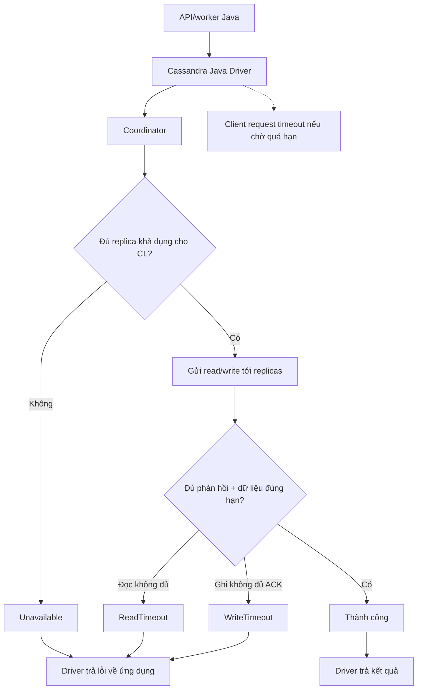
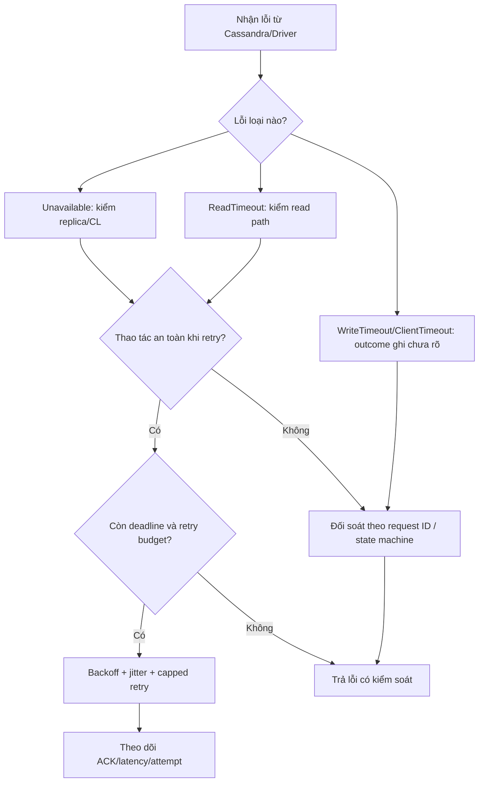

# Unavailable, ReadTimeout, WriteTimeout và phạm vi kết quả chưa rõ trong Cassandra Java Driver

## 1. Bối cảnh: lỗi trả về không đồng nghĩa thao tác đã hoặc chưa xảy ra

Trong module `DATABASE_ENGINE_WIDE_COLUMN_CASSANDRA`, Apache Cassandra được xem là cơ sở dữ liệu **wide-column phân tán**: bảng được thiết kế theo truy vấn, partition key định vị dữ liệu, mỗi partition có nhiều replica theo replication factor (RF), còn consistency level (CL) quyết định số phản hồi cần thiết cho một thao tác đọc hoặc ghi. Ứng dụng Java dùng **Cassandra Java Driver** để gửi CQL qua coordinator.

Giả sử một API Java cập nhật trạng thái đơn hàng:

```sql
UPDATE commerce.orders_by_id
SET status = 'PAID'
WHERE order_id = ?;
```

Nếu Java nhận lỗi `WriteTimeout`, câu hỏi quan trọng nhất không chỉ là “thử lại mấy lần?” mà là:

**Đã có bao nhiêu replica ghi? Ghi đã thành công về mặt nghiệp vụ chưa? Có thể retry mà không làm sai kết quả không?**

Đối với Cassandra, ba lỗi cần phân biệt ngay:

- **`Unavailable`:** coordinator đánh giá số replica hiện khả dụng **không đủ** để đáp ứng CL yêu cầu.
- **`ReadTimeout`:** thao tác đọc đã được xử lý nhưng coordinator **không có đủ phản hồi/dữ liệu cần thiết trước thời hạn** để trả kết quả thành công.
- **`WriteTimeout`:** thao tác ghi đã được gửi/xử lý nhưng coordinator **không nhận đủ xác nhận cần thiết đúng hạn**; dữ liệu *có thể* đã được áp dụng ở một hoặc nhiều replica.

Bên cạnh đó còn lỗi **timeout phía Java Driver**: client chờ quá thời gian, nhưng chưa chắc đã nhận được lỗi từ coordinator. Cần phân biệt **thất bại quan sát được** với **trạng thái dữ liệu thật**.

Bài học thuộc chương **Retry và lỗi Java**, tập trung vào ý nghĩa từng lỗi, **phạm vi kết quả chưa rõ** (*ambiguous outcome*), tương tác RF/CL, cách Java Driver 4.x phân loại lỗi, quyết định retry, idempotency, kiểm tra/đối soát và các runbook vận hành.

### Mục tiêu học tập

Sau bài học, bạn có thể:

1. Giải thích khác nhau giữa **Unavailable**, **ReadTimeout** và **WriteTimeout** theo luồng coordinator–replica.
2. Tính số replica tối thiểu theo CL và xác định khi nào lỗi xuất hiện trong cluster một hoặc nhiều DC.
3. Nói rõ kết luận nào **được phép** và **không được phép** rút ra từ một lần timeout.
4. Phân loại thao tác idempotent, counter update, batch, LWT và side effect ngoài Cassandra trước khi retry.
5. Viết Java bắt lỗi theo từng nhóm, giữ giới hạn số lần retry, budget thời gian và giám sát.
6. Thiết kế runbook điều tra, đối soát kết quả không xác định và phòng ngừa retry storm.

## 2. Luồng CQL: biết lỗi phát sinh ở lớp nào

Thông thường một request Java đi qua các giai đoạn:



Đây là sơ đồ **khái niệm**, không mô tả mọi nhánh nâng cao như read repair, transient replication, speculative execution, LWT và các kiểu write đặc biệt. Trong hệ thống thật, client có thể thử lại ở coordinator khác, có lỗi mạng, hoặc server tiếp tục xử lý sau khi client đã dừng chờ.

### Ba loại kết luận phải tách biệt

| Điều đang hỏi | Có thể biết từ lỗi không? | Cần thêm bằng chứng |
| --- | --- | --- |
| **Request có đạt CL đúng hạn không?** | Thường biết theo loại lỗi coordinator trả về | `Unavailable`, `ReadTimeout` hoặc `WriteTimeout` |
| **Một replica có dữ liệu mới không?** | **Không** suy chắc từ `WriteTimeout` | Read-back, trạng thái mutation, tracing/metrics, đối soát |
| **Nghiệp vụ đã hoàn thành một lần hay chưa?** | **Không** suy chắc từ timeout, nhất là có side effect | Idempotency key, record trạng thái, log nghiệp vụ và hệ thống liên quan |

**Nguyên tắc:** “Tôi chưa nhận được thành công” khác với “Cassandra chưa thực hiện” và còn khác với “nghiệp vụ chưa thực hiện”.

## 3. RF, CL và ngưỡng phản hồi: đọc đúng trước khi xử lý lỗi

Cassandra nhân bản partition trên nhiều node. Với keyspace dùng `NetworkTopologyStrategy` và `RF(dc1)=3`, số replica cần trong **một DC** cho các CL thông dụng là:

| Consistency level | Số phản hồi cần ở DC có RF=3 | Hệ quả với một node DOWN |
| --- | ---: | --- |
| `LOCAL_ONE` | 1 | Vẫn có thể phục vụ qua replica còn lại |
| `LOCAL_QUORUM` | 2 | Vẫn có thể phục vụ nếu hai replica kia khỏe |
| `ALL` | 3 (tất cả replica liên quan) | Không đáp ứng nếu một replica cần thiết DOWN |
| `ONE` | 1 replica theo ngữ nghĩa CL | Có thể đáp ứng nhưng không bảo đảm đọc giá trị mới nhất |

Với **RF=3**, quorum là:

\[
\mathrm{quorum}=\left\lfloor\frac{RF}{2}\right\rfloor+1=2.
\]

Nếu hai datacenter cùng có RF=3, `LOCAL_QUORUM` ở `dc1` yêu cầu **hai replica tại dc1**, không lấy ACK từ `dc2` để bù cho replica thiếu ở `dc1`. CL liên datacenter như `EACH_QUORUM` có điều kiện riêng.

**Cẩn thận:** phép tính trên nói về **số replica đáp ứng**, không bảo đảm mọi thao tác luôn hoàn thành nếu đủ node UP. Node UP vẫn có thể chậm, GC dài, quá tải, có đứt mạng một chiều hoặc không trả về **data response** cần thiết.

### Ví dụ theo trạng thái node

```text
dc1: A, B, C — RF=3
Truy vấn: SELECT ... WHERE order_id = ?
CL: LOCAL_QUORUM -> cần 2 đáp ứng phù hợp

Tình huống 1: A và B UP, C DOWN
  Có thể đủ 2 -> không tự động Unavailable
  Nhưng A/B chậm -> vẫn có thể ReadTimeout

Tình huống 2: A UP, B và C DOWN
  Chỉ 1 replica mà coordinator biết đang khả dụng
  -> có thể nhận Unavailable với LOCAL_QUORUM

Tình huống 3: A/B/C UP, nhưng request đến chậm
  Trước khi coordinator đánh giá thiếu phản hồi có thể vẫn đủ live replicas
  -> có thể nhận ReadTimeout/WriteTimeout
```

Cần tính đúng **replica của partition**, không chỉ đếm số node đang UP trong toàn cluster. Một cluster có hàng trăm node vẫn có thể thiếu replica cho một partition cụ thể.

## 4. `UnavailableException`: chưa đủ replica khả dụng

### 4.1. Ý nghĩa chính xác

Khi coordinator nhận request với CL cụ thể, nó cần đủ replica khả dụng để có cơ hội thỏa CL. Nếu theo thông tin sống/chết mà coordinator có, số replica không đáp ứng được yêu cầu, server trả lỗi `Unavailable`.

Ví dụ:

```sql
CONSISTENCY LOCAL_QUORUM;

SELECT order_id, status
FROM commerce.orders_by_id
WHERE order_id = 11111111-1111-1111-1111-111111111111;
```

Nếu RF(dc1)=3 và chỉ một replica của partition đang được coordinator xem là available, yêu cầu cần hai nên không thể đáp ứng.

### 4.2. Có thể suy luận điều gì?

- Tại **attempt này**, coordinator đánh giá **không đủ replica sẵn có** cho CL.
- Lỗi thường phản ánh availability/topology/DC, không phải query SQL cú pháp sai.
- Lỗi **không phải** bằng chứng dữ liệu đã mất vĩnh viễn.
- Đối với request ghi thông thường bị từ chối ngay khi preflight CL không đủ, coordinator thường **chưa bắt đầu gửi mutation của attempt đó**. Tuy nhiên **không suy rộng** thành “toàn bộ logical operation chắc chắn không có side effect” nếu trước đó đã có attempt khác, client đã gọi hệ thống ngoài hoặc retry policy đã hoạt động.

### 4.3. Phân tích nguyên nhân

1. Kiểm tên **local datacenter** trong Java Driver; sai DC có thể dẫn đến chọn coordinator/replica không như dự kiến.
2. Kiểm `nodetool status` và topology, node UP/DOWN của **replica liên quan**.
3. Kiểm RF thực tế của keyspace, token ownership, rack/DC và quá trình bootstrap/decommission.
4. Kiểm network partition, gossip, storage, compaction/GC và node mới thay thế.
5. Kiểm CL đang được áp dụng từ statement/execution profile; không chỉ xem config mặc định.

**Không tự động hạ `LOCAL_QUORUM` xuống `ONE`** để tránh `Unavailable` nếu nghiệp vụ yêu cầu đọc/ghi giao nhau ở quorum. Đổi CL có thể đổi hợp đồng dữ liệu, không phải xử lý lỗi kết nối thuần túy.

## 5. `ReadTimeoutException`: còn replica, nhưng đọc không đủ phản hồi

### 5.1. Khác `Unavailable` ở đâu?

`ReadTimeout` cho biết coordinator **đã có đủ replica được xem là khả dụng để thử thực hiện**, nhưng trước deadline đọc không thu đủ phản hồi cần thiết để trả kết quả. Tùy đường xử lý đọc, coordinator có thể nhận một số **digest responses** nhưng **chưa có full data response** cần thiết.

Đối với Cassandra, read path có thể dùng:

- Phản hồi **data** chứa nội dung hàng đọc.
- Phản hồi **digest** để so khớp dữ liệu mà không truyền toàn bộ row.
- Đọc thêm/reconciliation khi dữ liệu giữa các replica chưa đồng nhất.

Do đó, không thể kết luận “đã nhận đủ số ACK thì chắc chắn trả được dữ liệu”. Một số tình huống cần **data response** thích hợp nhưng data chưa đến đúng hạn.

### 5.2. Ví dụ

```text
RF=3, CL=LOCAL_QUORUM -> cần 2
Replica A: phản hồi digest
Replica B: phản hồi chậm
Replica C: đang bận compaction / network delay

Khi deadline đọc hết:
  Không đủ phản hồi hợp lệ -> ReadTimeout
```

Nếu server đã có hai phản hồi nhưng thiếu data response phù hợp, lỗi vẫn có thể là read timeout theo cách Cassandra báo nhận dữ liệu. Quan sát trường “received/required/data present” ở exception/driver metrics theo phiên bản, **không chỉ một con số ACK**.

### 5.3. `ReadTimeout` có nghĩa không tồn tại hàng không?

**Không.** Không nên biến `ReadTimeout` thành HTTP `404 Not Found`. “Không tồn tại hàng” là kết quả truy vấn đọc thành công nhưng không có row. Timeout nghĩa là **chưa nhận được kết quả đủ tin cậy trong hạn**.

Cũng không được tự tạo giá trị `null`/rỗng rồi cache nó như kết quả đã truy vấn thành công.

### 5.4. Điều tra hướng nào?

- Latency và timeout theo coordinator, replica và DC.
- Hot/wide partition, tombstones, TTL, số SSTable trên lần đọc, compaction backlog.
- GC pauses, disk I/O, network saturation, dropped messages, read repair.
- Consistency level thực tế và giới hạn deadline của Java/HTTP.
- Ảnh hưởng của speculative execution/retry đang chạy đồng thời.

Tăng timeout có thể làm giảm tỉ lệ lỗi bề mặt, nhưng nếu nguyên nhân là **partition quá lớn, tombstone hoặc quá tải**, phải sửa workload và giới hạn đồng thời thay vì cứ chờ lâu hơn.

## 6. `WriteTimeoutException`: chưa nhận đủ ACK, kết quả ghi có thể mơ hồ

`WriteTimeout` là lỗi **nguy hiểm nhất nếu ứng dụng định retry ngay** vì client không biết những replica nào đã ghi thành công hoặc còn tiếp tục xử lý.

### 6.1. Ví dụ RF=3, LOCAL_QUORUM

```text
Java client       Coordinator      A         B         C
    |                   |          |         |         |
    |--- UPDATE ------->|          |         |         |
    |                   |----mut--->|         |         |
    |                   |----mut------------->|         |
    |                   |----mut----------------------->|
    |                   |<--- ACK ---|         |         |
    |                   |          |      (chậm)      (chậm)
    |<-- WriteTimeout --|          |         |         |
    |                   |          |         |         |
    |                   |          |     ACK đến muộn/có thể hoàn tất
```

Trong ví dụ, có thể có ít nhất một replica áp dụng mutation dù coordinator chỉ nhận **một ACK trong hạn**, không đủ hai ACK của `LOCAL_QUORUM`.

Các kết quả thực tế có thể xảy ra:

1. Mutation được ghi tại một số replica, chưa đạt CL đúng hạn.
2. Nhiều replica đã ghi nhưng ACK mất hoặc đến trễ.
3. Một số replica sẽ nhận mutation sau khi client đã thấy timeout.
4. Đường ghi phức tạp hơn (batch, LWT, counter) có các giai đoạn/side effect riêng.

**Không có cách suy ra trạng thái nghiệp vụ chính xác chỉ từ chuỗi “WriteTimeout”.**

### 6.2. Write type và ngữ nghĩa lỗi

Cassandra có các loại ghi/`write type` được server báo trong lỗi (ví dụ ghi đơn giản, batch log, counter, CAS tùy phiên bản và đường xử lý). Trường này hỗ trợ chẩn đoán, nhưng:

- Không biến timeout thành xác nhận “chưa ghi”.
- Không chứng minh tất cả mutation của logged batch xuất hiện nguyên tử ở mọi thời điểm.
- Không cho phép tự retry counter, CAS hoặc gọi API thanh toán ngoài mà không có thiết kế idempotency.
- Cần đối chiếu **type, CL, ACK nhận/ACK yêu cầu và ngữ cảnh request** với tài liệu của phiên bản Cassandra/Driver thật.

### 6.3. Ghi thành công ở CL khác có phải “đã xong” không?

Giả sử chỉ một replica ghi trước thời hạn, client dùng `LOCAL_QUORUM` sẽ nhận `WriteTimeout`. Về mặt dữ liệu, replica đó **có thể giữ mutation** rồi chuyển tiếp/hội tụ khi repair hoặc các cơ chế cập nhật khác hoạt động. Nhưng ứng dụng đã **không nhận một kết quả thành công tại CL mong muốn**. Không tự thay đổi outcome thành `200 OK` chỉ vì phỏng đoán rằng dữ liệu sẽ hội tụ sau đó.

Ngược lại, nếu đọc ngay ở `LOCAL_QUORUM` thấy trạng thái mong muốn, phải xét **ghi cạnh tranh**, timestamp, điều kiện LWT và logic nghiệp vụ: một lần read-back thành công trên một trường **chưa nhất thiết chứng minh side effect ngoài Cassandra đã hoàn thành đúng một lần**.

## 7. Timeout phía Java Driver khác timeout từ coordinator

Java Driver 4.x có giới hạn request timeout từ client, chẳng hạn `basic.request.timeout` hoặc `setTimeout(Duration)` trên statement. Khi driver hết hạn chờ, ứng dụng có thể nhận `DriverTimeoutException` mà **không nhận được** thông báo `ReadTimeout`/`WriteTimeout` từ coordinator.

| Tình huống | Lỗi quan sát ở Java | Điều suy ra |
| --- | --- | --- |
| Coordinator cho rằng thiếu live replicas ngay theo CL | `UnavailableException` | Attempt không có đủ replica đáp ứng CL theo nhìn nhận server |
| Coordinator xử lý đọc nhưng thiếu phản hồi/dữ liệu đúng hạn | `ReadTimeoutException` | Read chưa có kết quả thành công tại CL trong hạn |
| Coordinator xử lý ghi nhưng thiếu ACK đúng hạn | `WriteTimeoutException` | Write outcome không đủ xác nhận tại CL; có thể đã áp dụng |
| Driver hết request deadline trước khi có kết quả | `DriverTimeoutException` hoặc nhóm lỗi client-timeout tương đương theo phiên bản | **Không biết chắc** coordinator đã nhận/xử lý mutation hay chưa |
| Transport đứt trong khi request đang in flight | Lỗi kết nối/nhóm lỗi driver | Tùy đã gửi tới server chưa; outcome write cũng có thể mơ hồ |

Một request có thể gặp **server timeout** ở thời điểm khác với **driver timeout**. Đừng dựa vào tên exception rồi cộng thêm timeout bất chấp tình trạng cluster.

### Deadline tổng thể và số attempts

Trong Driver 4.x, request timeout được thiết kế cho **logical driver request**, bao gồm các cơ chế attempt/retry/speculative execution liên quan theo chính sách. Vì vậy:

- Nếu mỗi request timeout `2 s` và API cho phép `1 s`, cấu hình thiếu nhất quán.
- Retry policy không nên kéo request vô thời hạn.
- Ở application level, thêm một vòng retry riêng có thể tạo nhiều **logical requests**, mỗi cái có deadline mới: **dễ tạo retry storm**, ngay cả khi từng request của driver có timeout.

Khi timeout, việc hủy future hoặc ngừng chờ **không bảo đảm mutation đã được thu hồi khỏi coordinator/replica**.

## 8. Ma trận lỗi: nên trả về gì và có retry hay không?

Không có một hàm duy nhất `isRetryable(Throwable)` đủ cho tất cả nghiệp vụ. Quyết định phụ thuộc **lỗi, CL, loại thao tác, idempotency, timeout budget và trạng thái cluster**.

| Lỗi | Read đơn giản | Write đặt giá trị | Counter increment | LWT / side effect nghiệp vụ |
| --- | --- | --- | --- | --- |
| `Unavailable` | Có thể thử lại có giới hạn nếu sự cố thoáng qua và đủ budget; ưu tiên phục hồi replica | Chỉ khi xác định an toàn/đường xử lý không làm sai dữ liệu; không hạ CL tự động | Không retry mù quáng | Không retry mù quáng; kiểm tình trạng trước |
| `ReadTimeout` | Có thể retry có giới hạn khi idempotent, chính sách cho phép | Không áp dụng trực tiếp nếu là request đọc | Không áp dụng trực tiếp | Nếu read-back kiểm trạng thái timeout, vẫn chưa đủ kết luận nghiệp vụ |
| `WriteTimeout` | Không phải lỗi của SELECT thường | **Không biết kết quả**; chỉ retry khi idempotency được chứng minh | **Không tự retry** | **Không tự retry**; đối soát/CAS response có thể chưa về |
| `DriverTimeout` | Có thể retry đọc với deadline/backoff | **Không biết request đã tới server chưa**; cần idempotency/đối soát | **Không tự retry** | Cần reconciliation, request ID và trạng thái bền vững |
| `ReadFailure` / `WriteFailure` | Xác minh replica/server failures | Tương tự: phân loại khả năng đã có side effect | Cần đặc biệt thận trọng | Cần xác minh riêng |

**“Có thể retry” không nghĩa là “nên retry ngay”.** Khi node không đủ hoặc bị overload, retry ngay có thể làm timeout tệ hơn. Áp dụng bounded retries, backoff có jitter, concurrency cap và circuit breaker/bulkhead theo nhu cầu.

Nếu tính đúng đắn đòi `LOCAL_QUORUM`, việc đổi sang `LOCAL_ONE` là **quyết định nhất quán nghiệp vụ** phải được phê duyệt, không phải fallback mặc định của retry policy.

## 9. Idempotency: điều kiện tiên quyết khi muốn thử lại ghi

Một thao tác được coi là **idempotent** nếu lặp lại không làm thay đổi thêm kết quả cuối cùng theo mô hình đã định nghĩa. Trong Cassandra, cần xét timestamp, TTL, counter, sự kiện ngoài hệ thống và ghi cạnh tranh.

### 9.1. Phân loại thao tác

| CQL hoặc nghiệp vụ | Có thể an toàn khi retry? | Lý do |
| --- | --- | --- |
| `SELECT` theo partition key | Thường có | Không phải mutation; vẫn cần giữ timeout/CL |
| `UPDATE ... SET status = 'PAID'` | **Có điều kiện** | Các giá trị có thể giống nhau, nhưng timestamp, concurrent writes và side effect cần xét |
| `INSERT` có ID ổn định và dữ liệu bất biến | **Có điều kiện** | Duplicate cùng primary key có thể không tăng số row, nhưng TTL/timestamp/side effect vẫn cần kiểm |
| `UPDATE ... SET total = total + 1` trên counter | **Không** | Retry có thể cộng hai lần |
| `INSERT/UPDATE ... USING TTL` tương đối | **Không mặc định** | Retry có thể làm thay đổi hạn hết hiệu lực |
| LWT `IF NOT EXISTS` hoặc `IF version = ?` | Cần thiết kế workflow riêng | Retry có thể thấy `[applied]=false` vì lần trước đã thành công |
| Ghi xong rồi gọi cổng thanh toán/email | **Không mặc định** | Database mutation không transaction với hệ thống bên ngoài |
| Logged batch qua nhiều partition | Không suy ra idempotent chỉ từ `LOGGED` | Không cung cấp giao dịch ACID cô lập xuyên partition |

Ngay cả khi bạn biết một CQL statement có cùng text/bind values, **không đủ** để tuyên bố mọi retry là idempotent trong nghiệp vụ.

### 9.2. Tránh nhầm SET lặp lại với exactly-once

```sql
UPDATE commerce.orders_by_id
SET status = 'PAID'
WHERE order_id = ?;
```

Cùng câu lệnh gửi hai lần thường để lại giá trị cuối `PAID`. Nhưng nếu sau lần đầu, một worker khác ghi `REFUNDED` rồi retry `PAID` đến sau với timestamp lớn hơn, retry có thể **ghi đè trạng thái mới hợp lệ**. Cassandra giải quyết xung đột theo timestamp và quy tắc dữ liệu, không theo ý định business state machine.

Nếu cần đảm bảo chuyển trạng thái theo version, dùng **LWT/CAS** phù hợp trên một partition hoặc một phương pháp đồng bộ nghiệp vụ được thiết kế rõ.

### 9.3. `setIdempotent` không phải phép màu

Trong Driver 4.x:

```java
BoundStatement read = selectById.bind(orderId)
    .setIdempotent(true);

BoundStatement counterWrite = updateCounter.bind(customerId)
    .setIdempotent(false);
```

`setIdempotent(true)` cung cấp thông tin cho **driver retry/speculative execution policies**; nó **không** làm mutation trở nên idempotent và cũng không tạo transactional deduplication phía server. Phải đánh dấu sau khi phân tích nghiệp vụ, không theo phỏng đoán rằng mọi `UPDATE` đều an toàn.

## 10. Ví dụ CQL: đối soát với request ID và LWT

Giả sử dịch vụ nhận yêu cầu thanh toán chứa `request_id` ổn định từ bên ngoài. Chúng ta có thể tạo một bảng theo request ID để **ghi nhận một lần tiếp nhận logic**:

```sql
CREATE KEYSPACE IF NOT EXISTS commerce
WITH replication = {
    'class': 'NetworkTopologyStrategy',
    'dc1': 3
};

CREATE TABLE IF NOT EXISTS commerce.payment_requests_by_id (
    request_id uuid PRIMARY KEY,
    order_id uuid,
    state text,
    created_at timestamp
);

-- Trên luồng thử nghiệm, thao tác này chỉ ghi một partition.
INSERT INTO commerce.payment_requests_by_id
    (request_id, order_id, state, created_at)
VALUES (
    33333333-3333-3333-3333-333333333333,
    11111111-1111-1111-1111-111111111111,
    'RECEIVED',
    toTimestamp(now())
)
IF NOT EXISTS;
```

LWT `IF NOT EXISTS` kiểm sự tồn tại của record ở **một partition**. Nếu request đầu tiên timeout, lần tiếp theo có thể gặp:

- `[applied]=true`: record được tạo thành công ở lần hiện tại.
- `[applied]=false`: record đã tồn tại; phải **đọc và kiểm nội dung** khớp request ID, order ID và trạng thái kỳ vọng.
- Timeout/lỗi tiếp: vẫn chưa có câu trả lời chắc chắn từ client.

**Không kết luận `[applied]=false` nghĩa là yêu cầu “thất bại”.** Nó có thể là bằng chứng của một lần thực hiện trước đó. Cần quyết định workflow dựa trên trạng thái được lưu và các side effect.

**Giới hạn cốt lõi:** Cassandra LWT bảo đảm điều kiện cho mutation theo mô hình CAS của Cassandra, **không tạo atomic transaction giữa Cassandra và ngân hàng, email hoặc message broker**. Muốn hạn chế phát hành hiệu ứng ngoài hai lần, thiết kế idempotency key tại bên nhận, durable workflow/outbox phù hợp và reconciliation.

## 11. Java Driver 4.x: bắt đúng loại lỗi

Ví dụ dùng `com.datastax.oss.driver.api.*` của Java Driver 4.x. Trước khi dùng, chọn dependency tương thích với phiên bản Cassandra Server/JDK đang chạy và kiểm API thực của bản driver.

### 11.1. Schema đơn hàng và statement

```sql
CREATE TABLE IF NOT EXISTS commerce.orders_by_id (
    order_id uuid PRIMARY KEY,
    status text,
    updated_at timestamp
);
```

Mã Java sau minh họa đọc một row và phân loại lỗi:

```java
import java.net.InetSocketAddress;
import java.time.Duration;
import java.util.UUID;

import com.datastax.oss.driver.api.core.CqlSession;
import com.datastax.oss.driver.api.core.DefaultConsistencyLevel;
import com.datastax.oss.driver.api.core.DriverTimeoutException;
import com.datastax.oss.driver.api.core.cql.BoundStatement;
import com.datastax.oss.driver.api.core.cql.PreparedStatement;
import com.datastax.oss.driver.api.core.cql.Row;
import com.datastax.oss.driver.api.core.servererrors.ReadTimeoutException;
import com.datastax.oss.driver.api.core.servererrors.UnavailableException;
import com.datastax.oss.driver.api.core.servererrors.WriteTimeoutException;

public final class CassandraFailureDemo {

    public static void main(String[] args) {
        UUID orderId = UUID.fromString(
            "11111111-1111-1111-1111-111111111111");

        // Lab minh họa: chưa cấu hình credentials/TLS.
        try (CqlSession session = CqlSession.builder()
                .addContactPoint(new InetSocketAddress("127.0.0.1", 9042))
                .withLocalDatacenter("dc1")
                .build()) {

            PreparedStatement select = session.prepare(
                "SELECT status FROM commerce.orders_by_id WHERE order_id = ?");

            BoundStatement statement = select.bind(orderId)
                .setConsistencyLevel(DefaultConsistencyLevel.LOCAL_QUORUM)
                .setTimeout(Duration.ofSeconds(2))
                .setIdempotent(true);

            try {
                Row row = session.execute(statement).one();
                System.out.println(row == null
                    ? "Not found"
                    : row.getString("status"));

            } catch (UnavailableException e) {
                System.err.println("Không đủ replica tại CL đã yêu cầu");
                // Không tự hạ CL; đưa vào nhánh degraded/unavailable.

            } catch (ReadTimeoutException e) {
                System.err.println("Read không đủ dữ liệu/phản hồi kịp hạn");
                // Có thể xem retry có giới hạn với SELECT idempotent.

            } catch (WriteTimeoutException e) {
                System.err.println("Write timeout: outcome có thể chưa rõ");
                // Nhánh này dành cho mutation, không kỳ vọng ở SELECT thuần.

            } catch (DriverTimeoutException e) {
                System.err.println("Java Driver hết request deadline");
                // Không khẳng định server chưa xử lý.
            }
        }
    }
}
```

**Lưu ý thực hành:**

- Ví dụ `CqlSession` chưa bật TLS/auth, chỉ dùng cho lab; production cần TLS, secret manager và role quyền tối thiểu.
- `LOCAL_QUORUM` với RF=3 cần hai replica tại DC tương ứng. Tên `dc1` phải khớp topology thật.
- `WriteTimeoutException` không có ý nghĩa thông thường ở `SELECT` thuần; nhánh catch ở đây để minh họa phân loại chung cho một service có cả đọc/ghi.
- Các exception có thể xuất hiện trong **cause** nếu dùng CompletableFuture/CompletionStage. Phải unwrap lớp hoàn thành bất đồng bộ phù hợp khi log/điều phối.
- Mẫu chỉ **bắt** lỗi, chưa áp dụng retry chính sách nào; không nên bắt rồi trả kết quả thành công giả.

### 11.2. Ghi có kết quả không xác định

```java
PreparedStatement update = session.prepare(
    "UPDATE commerce.orders_by_id " +
    "SET status = ?, updated_at = ? WHERE order_id = ?");

BoundStatement mutation = update.bind(
        "PAID", java.time.Instant.now(), orderId)
    .setConsistencyLevel(DefaultConsistencyLevel.LOCAL_QUORUM)
    .setTimeout(Duration.ofSeconds(2))
    .setIdempotent(false); // Bảo thủ vì chưa chứng minh retry an toàn.

try {
    session.execute(mutation);
    // Chỉ đánh dấu kết quả CQL đã trả thành công tại CL mong đợi.
} catch (WriteTimeoutException | DriverTimeoutException e) {
    // Không gọi session.execute(mutation) lần nữa theo phản xạ.
    // Đưa logical request_id sang quy trình read-back/reconciliation
    // đã được thiết kế với sự cạnh tranh ghi và bên ngoài Cassandra.
    markForReconciliation(orderId, e);
}
```

`markForReconciliation` là hàm giả định của ứng dụng, **không phải API Driver**. Trong sản phẩm thực, cần queue/workflow bền vững và ghi nhận request ID để sau restart vẫn có thể xử lý.

**Cảnh báo:** dòng `Instant.now()` mang timestamp nghiệp vụ của lần ghi thử. Nếu tạo lại thời gian trên mỗi retry, mutation không còn giống nhau về nội dung. Khi thiết kế retry an toàn, phải cân nhắc cố định input/timestamp và quy tắc concurrent writes; đừng chỉ giữ `orderId`.

## 12. Java xử lý bất đồng bộ: unwrap lỗi và không tự retry trên callback

`session.executeAsync(statement)` trả `CompletionStage<AsyncResultSet>` trong Java Driver 4.x. Một exception ở tầng async có thể được bọc qua `CompletionException` khi xử lý/cầu nối các future.

Mẫu minh họa:

```java
import java.util.concurrent.CompletionException;
import java.util.concurrent.CompletionStage;

import com.datastax.oss.driver.api.core.cql.AsyncResultSet;

// session, readStatement có sẵn; đây là SELECT idempotent.
CompletionStage<AsyncResultSet> stage = session.executeAsync(readStatement);

stage.whenComplete((result, error) -> {
    if (error == null) {
        recordReadSuccess(result);
        return;
    }

    Throwable cause = error;
    while (cause instanceof CompletionException
            && cause.getCause() != null) {
        cause = cause.getCause();
    }

    if (cause instanceof UnavailableException) {
        recordUnavailable(cause);
    } else if (cause instanceof ReadTimeoutException) {
        recordReadTimeout(cause);
    } else if (cause instanceof DriverTimeoutException) {
        recordClientTimeout(cause);
    } else {
        recordUnexpectedFailure(cause);
    }
});
```

`recordReadSuccess`, `recordUnavailable` và các hàm `record...` là hàm ứng dụng giả định, không phải thư viện. Callback nên **nhẹ**, không block và không thực hiện network I/O nặng trên driver thread. Không gọi `join()` hoặc loop retry vô hạn ở đây.

Nếu muốn application-level retry, hãy làm ở **service boundary**, với policy rõ cho từng thao tác, có request ID, giới hạn budget và metrics. Không chồng một retry loop vô hạn lên retry policy của driver.

## 13. Thiết kế retry: bounded, có backoff và giữ nguyên hợp đồng dữ liệu

### 13.1. Năm nguyên tắc

1. **Phân loại lỗi trước:** read timeout khác write timeout; unavailable khác driver timeout.
2. **Phân loại thao tác:** SELECT/idempotent hay counter/LWT/external side effect.
3. **Giữ deadline tổng thể:** tối đa số attempt và thời gian còn lại, không khởi động chuỗi request dài hơn SLA.
4. **Giảm tải khi lỗi hàng loạt:** exponential backoff có jitter, concurrency cap, circuit breaker, admission control.
5. **Không đổi CL mù quáng:** retry khác coordinator không làm giá trị cũ thỏa hợp đồng nhất quán mới.



### 13.2. Tránh retry storm

Một API nhận 10.000 request/s, mỗi request tự retry ba lần trong khi cluster đang quá tải, có thể gây tới 40.000 attempts/s (tùy chính sách/đầu cơ) thay vì giải tỏa áp lực. Với timeout, các attempts đầu **có thể vẫn đang được xử lý ở server**, nên mức tải thực còn lớn hơn số response client nhìn thấy.

Biện pháp:

- Giới hạn số in-flight CQL per service và dùng hàng đợi bounded.
- Đặt giới hạn retry thấp theo từng request, có jitter để tránh đồng bộ các client.
- Không retry trên mọi lỗi bằng nhau; ưu tiên sửa replica/overload.
- Ưu tiên giảm tải client, tắt feature tốn tài nguyên hoặc giảm job nền theo runbook khi cluster thiếu headroom.
- Theo dõi retry counts, speculative executions, timeout ratio, p95/p99 và dropped mutation.
- Có circuit breaker/degraded mode khi Cassandra không đủ replica; không làm sập cả hệ thống do retry chồng.

### 13.3. Retry policy mặc định không thay cho chính sách nghiệp vụ

Driver có retry policy và các chiến lược thực thi. Chính sách mặc định xử lý có chọn lọc một số lỗi theo tính chất statement; **không phải** cam kết “mọi timeout được retry đúng một lần” hay “ghi counter an toàn”. Chi tiết phụ thuộc **version driver, retry policy, isIdempotent và loại lỗi**.

Khi kiểm thử hãy ghi:
- Driver version và tên retry policy đang hoạt động.
- Statement idempotency, CL, timeout, execution profile.
- Số request attempts thực, coordinator, retry lý do và speculative execution.
- Tỷ lệ operations vẫn ở trạng thái chưa xác định sau khi client dừng chờ.

**Không nên viết custom retry policy chỉ để luôn `RETRY`**. Sai lầm này nguy hiểm với counter, LWT và thao tác bên ngoài Cassandra.

## 14. Reconciliation: xử lý trạng thái chưa rõ như một trạng thái chính thức

Với tác vụ quan trọng (thanh toán, đặt hàng, ghi ledger), backend nên thiết kế ba trạng thái:

| Trạng thái logic | Khi nào ghi nhận | Hành động |
| --- | --- | --- |
| `CONFIRMED` | Đã nhận bằng chứng thành công đủ theo hợp đồng | Trả kết quả và lưu audit |
| `REJECTED/FAILED` | Có bằng chứng rõ ràng thao tác bị từ chối và không gây side effect tương ứng | Trả lỗi phù hợp; không suy từ timeout |
| `UNKNOWN/PENDING_RECONCILIATION` | Timeout/đứt mạng, chưa chứng minh outcome | Ghi request ID, đối soát, tránh chạy side effect mới |

### 14.1. Quy trình khi ghi trạng thái đơn bị `WriteTimeout`

1. Ghi một **logical request ID** duy nhất trong hệ thống theo phương án bền vững.
2. Không lập tức phát lại tác động ngoài Cassandra (ví dụ gọi thanh toán) nếu chưa xác minh.
3. Đọc lại trạng thái đơn và record request theo keyspace/bảng thiết kế phù hợp, với CL được yêu cầu.
4. Đối chiếu phiên bản/timestamp/business invariant và các hệ thống liên quan; một read-back có thể phản ánh mutation của writer khác.
5. Nếu phát hiện request đã được xử lý đúng, hoàn tất `CONFIRMED`; nếu có chứng cứ chưa xử lý, mới cân nhắc áp dụng/retry theo contract.
6. Nếu vẫn mơ hồ, giữ `UNKNOWN` và đưa vào reconcile job hoặc human review theo SLA; không silently assume success/failure.

Đối với Cassandra, một read-back tại `LOCAL_QUORUM` có thể cung cấp bằng chứng mạnh hơn `LOCAL_ONE` tùy RF/CL và concurrent writes, nhưng **không đảm bảo không có writer đồng thời** hoặc xác nhận side effect đã xuất hiện ngoài cluster.

### 14.2. LWT: `[applied]=false` sau retry có thể là thành công cũ

Với `INSERT ... IF NOT EXISTS`:

- Lần đầu có thể áp dụng nhưng client nhận timeout.
- Lần hai, do record đã tồn tại, trả `[applied]=false`.
- Nếu chỉ dựa vào `false` để báo “thanh toán thất bại”, service có thể ra quyết định sai.

Cần so nội dung record theo `request_id`, không chỉ bool applied. Nếu record tồn tại nhưng `order_id`/payload khác, đây là **idempotency-key collision/conflict** cần được xử lý an toàn, không ghi đè.

LWT cũng không bảo đảm exactly-once cho hệ thống bên ngoài. Việc gọi ngân hàng rồi ghi kết quả vào Cassandra cần orchestration riêng; không thể “bọc trong CQL batch” để có transaction xuyên hệ thống.

## 15. Quan sát lỗi: không đủ nếu chỉ log tên exception

Khi vận hành production, mỗi lỗi cần thông tin đủ để tái hiện mà không lộ dữ liệu nhạy cảm.

| Trường nên ghi/metric | Vì sao |
| --- | --- |
| Logical request ID / trace ID | Liên kết attempts và đối soát nghiệp vụ |
| Tên operation, loại CQL (read/write/LWT/counter) | Đánh giá khả năng retry |
| Keyspace/table, kiểu partition key (không log giá trị nhạy cảm) | Liên hệ hot partition/table option |
| CL, serial CL, idempotency, timeout | Hiểu hợp đồng thao tác |
| Driver/server version, execution profile | Phân biệt API/config theo môi trường |
| Coordinator/DC/rack khi biết | Khoanh vùng network/replica lỗi |
| Error class, write type, ACK nhận/yêu cầu nếu có | Tách Unavailable/ReadTimeout/WriteTimeout |
| Latency driver/server và số attempts | Định lượng retry storm/overload |
| In-flight, pending compactions, dropped messages, GC | Liên hệ lỗi ứng dụng với sức khỏe cluster |
| Request state `UNKNOWN/CONFIRMED` | Tránh bỏ sót đối soát |

**Không log** credential, CQL bind values nhạy cảm, payment token hoặc thông tin nhận dạng cá nhân không cần thiết. Khi dùng tracing Cassandra, bật có chọn lọc và theo chính sách bảo mật; tracing có overhead.

### 15.1. Câu lệnh vận hành để kiểm hiện trạng

Với quyền phù hợp, các lệnh chỉ đọc thường dùng:

```bash
nodetool status
nodetool describecluster
nodetool tpstats
nodetool compactionstats
nodetool netstats
```

Kết hợp với hệ metrics/logs cluster và driver: `nodetool status` là cái nhìn theo node được hỏi; node UP không chứng minh read/write từ Java sẽ đạt CL. Cần đối chiếu replica theo partition, network giữa các DC, latency từng node, disk và backpressure.

### 15.2. Lúc nào cần trace?

Một request `ReadTimeout` lặp lại trên cùng partition có thể cần quan sát các bước đọc coordinator–replica. Tuy nhiên, bật tracing cho mọi truy vấn trên production có thể tăng tải. Ưu tiên lấy mẫu điều tra, dùng request ID và đo SLO trong cửa sổ được phép.

## 16. Runbook xử lý một đợt Unavailable/ReadTimeout/WriteTimeout

### Pha A — Phân loại trong những phút đầu

1. Đọc mã exception và xác định **đó là lỗi server hay driver timeout**.
2. Xác định CQL là **SELECT, mutation, LWT, counter hay batch**; ghi CL, deadline và idempotency.
3. Kiểm tỉ lệ theo node/DC/endpoint và thời điểm lỗi; có phân bố toàn cụm hay tập trung vào vài partition?
4. Dừng application-level retry không kiểm soát nếu có; áp concurrency limit/degraded mode đã được thiết kế.
5. Với mutation chưa rõ outcome, **đánh dấu pending reconciliation**; không chuyển thành “chưa ghi” hoặc “đã ghi” tùy ý.

### Pha B — Điều tra cluster

- **Unavailable:** kiểm live replicas theo partition, RF/DC, node DOWN, network, gossip và consistency level.
- **ReadTimeout:** kiểm disk/compaction/tombstone/hot partition, read latency, GC, read repair và network.
- **WriteTimeout:** kiểm write latency, commit log/memtable, disk, dropped messages, hinted handoff theo version và loại write, CL/ACK.
- **DriverTimeout:** kiểm end-to-end latency, driver request deadline, overload/routing, kết nối, retry attempts và server logs.
- **LWT:** kiểm contention, serial consistency, CAS contention, timeouts và trạng thái đã ghi trước retry.

**Không đồng thời thay RF, compaction, schema và retry policy trong một sự cố** nếu chưa có kế hoạch, vì sẽ làm khó tìm nguyên nhân và tăng rủi ro dữ liệu.

### Pha C — Khôi phục có gate

1. Đưa replica/node cần thiết trở lại trạng thái phục vụ, hoặc giảm tải I/O theo runbook.
2. Kiểm CL không bị hạ ngoài ý muốn, trạng thái schema và topology ổn định.
3. Thử **đọc/ghi kiểm chứng có giới hạn**, dùng partition/test data phù hợp và quyền tối thiểu.
4. Theo dõi p95/p99, error rate, retry ratio, queue depth, pending compactions và số case UNKNOWN.
5. Chỉ tăng traffic khi các tiêu chí đạt; không tuyên bố phục hồi chỉ vì dashboard xanh trong vài giây.
6. Đóng vòng reconciliation cho các request kết quả chưa rõ, có audit và SLA.

### Pha D — Phòng ngừa

- Thiết kế bảng theo query, kiểm hot partition và tombstone/TTL.
- Lập lịch repair, backup, compaction và change management để tránh dồn tải.
- Dùng driver execution profile phù hợp endpoint, budget timeout, CL, backpressure.
- Thiết kế idempotency key và workflow xử lý UNKNOWN cho mutation quan trọng.
- Kiểm thử lỗi node DOWN, node slow, network partition, timeout và replay trong staging/chaos test có kiểm soát.

## 17. Các sai lầm phổ biến

| Sai lầm | Vì sao sai | Cách đúng |
| --- | --- | --- |
| Coi `WriteTimeout` là “chưa ghi” | Mutation có thể đã áp dụng ở một số replica | Reconcile trước khi retry ngoài kiểm soát |
| Coi `ReadTimeout` là “không tìm thấy” | Đọc chưa trả kết quả thành công | Trả lỗi phù hợp, không cache dữ liệu rỗng giả |
| Coi `Unavailable` là “dữ liệu đã mất” | Thường do thiếu live replicas cho CL | Khôi phục replica/topology; kiểm data riêng |
| Giảm mọi query sang `ONE` khi lỗi | Phá hợp đồng nhất quán | Xử lý nguyên nhân hoặc phê duyệt thay CL riêng |
| Retry tất cả mutations ba lần | Counter/LWT/external side effect có thể lặp | Phân loại idempotency và giới hạn retries |
| Mark `setIdempotent(true)` cho mọi UPDATE | API không tạo idempotency | Kiểm timestamp, TTL, concurrent writes và business semantics |
| Xóa `UNKNOWN` khỏi hệ thống khi API timeout | Mất tác vụ chưa biết outcome | Durable reconciliation và audit |
| Đưa mọi exception thành HTTP 404 | Che lỗi hệ thống thành không có bản ghi | Tách not found thành kết quả SELECT thành công |
| Tăng driver timeout để chữa disk đầy | Giữ request lâu và tăng hàng chờ | Xử lý disk/compaction/overload và backpressure |
| Bật tracing cho mọi request | Overhead và tăng tải khi cluster đang lỗi | Sampling/targeted tracing |
| Đọc ở CL thấp rồi khẳng định mutation thất bại | Có thể đọc replica chưa nhận dữ liệu | Đối soát theo contract, CL và request ID |
| Coi logged batch là transaction ACID | Batch không cô lập xuyên nhiều partition | Thiết kế workflow và idempotency riêng |

## 18. Bài tập thực hành: phân loại lỗi và thiết kế xử lý

**Bối cảnh:** cluster có hai DC, mỗi DC `RF=3`. API Java dùng `LOCAL_QUORUM` cho đọc/ghi; một worker xử lý thanh toán, một worker tăng counter; service có giới hạn 1.2 giây cho HTTP request.

### Tình huống A — Unavailable

`dc1` có ba replica `A, B, C` cho một partition. `B` và `C` DOWN, `A` UP. Java gửi `SELECT` tại `LOCAL_QUORUM` và nhận `Unavailable`.

1. Cần bao nhiêu replica để đọc thành công?
2. `dc2` đang khỏe có giúp request `LOCAL_QUORUM` tại `dc1` đạt CL không?
3. Có nên tự chuyển sang `LOCAL_ONE`? Khi nào quyết định này phải qua review?

**Gợi ý:** `LOCAL_QUORUM` của RF=3 cần 2 replica cùng DC; chỉ `A` UP không đủ. `LOCAL_ONE` là sự thay đổi hợp đồng nhất quán, không phải retry mặc định.

### Tình huống B — ReadTimeout

Cả ba replica UP. Coordinator nhận digest từ một replica nhưng data response còn thiếu; Java nhận `ReadTimeout`.

1. Vì sao không nhận `Unavailable`?
2. Có thể trả HTTP 404 không?
3. Nêu bốn nguyên nhân/hệ metrics cần kiểm.
4. Với một `SELECT` idempotent, khi nào có thể retry giới hạn?

**Gợi ý:** đủ node được xem là available nhưng không có đủ kết quả đọc trong hạn; cần xem GC, I/O, compaction, tombstone, routing/timeout và retry budget.

### Tình huống C — WriteTimeout và counter

Một worker gọi:

```sql
UPDATE commerce.customer_counter
SET total_orders = total_orders + 1
WHERE customer_id = ?;
```

Coordinator gửi mutation, client nhận `WriteTimeout`.

1. Có thể đảm bảo counter chưa tăng không?
2. Nếu retry ngay, lỗi nghiệp vụ gì có thể xảy ra?
3. Giải pháp nào giúp đối soát theo event ID hoặc chuyển hướng thiết kế ghi?

**Gợi ý:** không đảm bảo; retry counter có thể tăng hai lần. Phải thiết kế xử lý event idempotent ở tầng nghiệp vụ, materialized aggregation có nguồn sự thật/đối soát hoặc cách lưu sự kiện phù hợp; không dùng counter như điểm duy nhất bảo đảm exactly-once.

### Tình huống D — LWT sau timeout

Một request `INSERT ... IF NOT EXISTS` cho `request_id` bị client timeout. Lần retry trả `[applied]=false`.

1. Có nên kết luận yêu cầu thất bại?
2. Cần kiểm những trường nào?
3. Nếu request trùng ID nhưng payload khác, phải xử lý thế nào?

**Gợi ý:** có thể lần đầu đã ghi thành công; đọc record có cùng request ID và so order ID/payload/version/state. Payload khác là conflict cần chặn, không tự ghi đè.

### Tình huống E — Driver timeout vs server timeout

Java đặt `statement.setTimeout(Duration.ofMillis(800))`, API có deadline 1.2 giây. Một lần coordinator vẫn đang xử lý và driver hết 800 ms, không có server error được trả.

1. Java quan sát lỗi lớp nào?
2. Có thể biết mutation đã tới replica chưa?
3. Nếu middleware tự retry request mới với timeout 800 ms, nó có thể phá deadline API không?
4. Đề xuất một chiến lược retry và observability an toàn.

**Gợi ý:** driver-side timeout; outcome có thể mơ hồ. Retry phải dùng remaining budget, giới hạn attempts, backoff và idempotency; nếu mutation không chắc an toàn, chuyển sang reconciliation.

## 19. Checklist production cho retry và kết quả chưa rõ

- [ ] Phân biệt `Unavailable`, `ReadTimeout`, `WriteTimeout` với timeout do Java Driver/network.
- [ ] Xác định CL và RF **theo replica/DC của partition**, không chỉ đếm node trong cluster.
- [ ] Không coi `ReadTimeout` là not found hoặc `WriteTimeout` là write chưa xảy ra.
- [ ] Phân loại CQL thành SELECT, mutation đặt giá trị, counter, LWT, batch và side effect ngoài Cassandra.
- [ ] Từng statement có idempotency đúng bản chất nghiệp vụ; không tự đánh dấu mọi `UPDATE` là idempotent.
- [ ] Driver retry policy và application retry không chồng nhau thành vòng lặp không giới hạn.
- [ ] Có deadline tổng thể, capped retries, backoff/jitter và concurrency limits.
- [ ] Không hạ consistency level khi gặp lỗi nếu chưa được phê duyệt theo yêu cầu dữ liệu.
- [ ] Các operation quan trọng có request ID, durable state `UNKNOWN` và reconciliation.
- [ ] LWT/`IF NOT EXISTS` được giải thích dựa trên record hiện có, không chỉ boolean `[applied]` sau retry.
- [ ] Đã kiểm xử lý timeout trong async callback và không block driver I/O thread.
- [ ] Có log/metric cho error class, CL, coordinator/DC, write type, ACK và số attempts khi hỗ trợ.
- [ ] Không log dữ liệu nhạy cảm, credential hoặc CQL bind values quá mức.
- [ ] Có runbook sửa replica, compaction/disk/hot partition và quan sát cluster.
- [ ] Đã kiểm thử network partition, node DOWN, slow read, write timeout, counter retry và LWT timeout.
- [ ] Đã xác nhận kế hoạch đối soát và kết thúc UNKNOWN sau sự cố.

**Kết luận:** Trong Cassandra, **`Unavailable` nói về thiếu replica khả dụng cho CL**, **`ReadTimeout` nói về đọc không đủ phản hồi/dữ liệu trong hạn**, còn **`WriteTimeout` nói về ghi chưa đủ xác nhận trong hạn — không phải ghi chắc chắn thất bại**. Timeout của Java Driver còn có thể che khuất kết quả server. Vì vậy, xử lý đúng không chỉ là `catch` rồi `retry`: phải kết hợp **RF/CL, data model theo partition key, idempotency, deadline, backpressure và reconciliation có request ID**. Đây là nền tảng để ứng dụng Java phục hồi an toàn mà không biến một lỗi tạm thời thành ghi trùng hoặc sai lệch dữ liệu nghiệp vụ.
