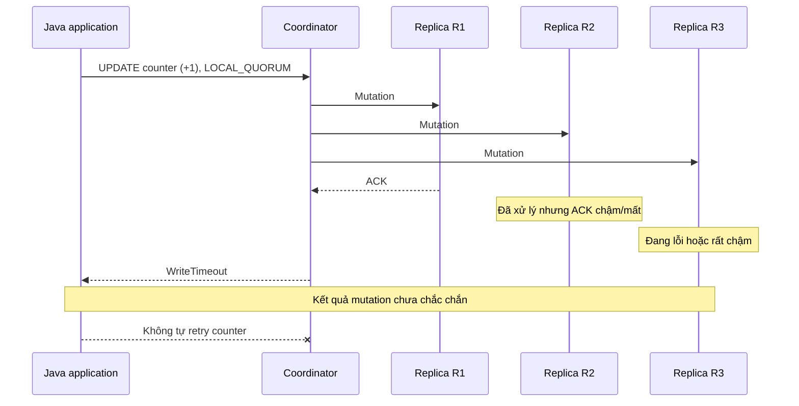
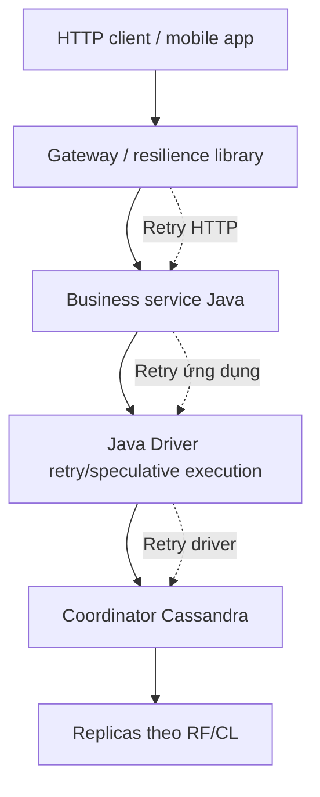
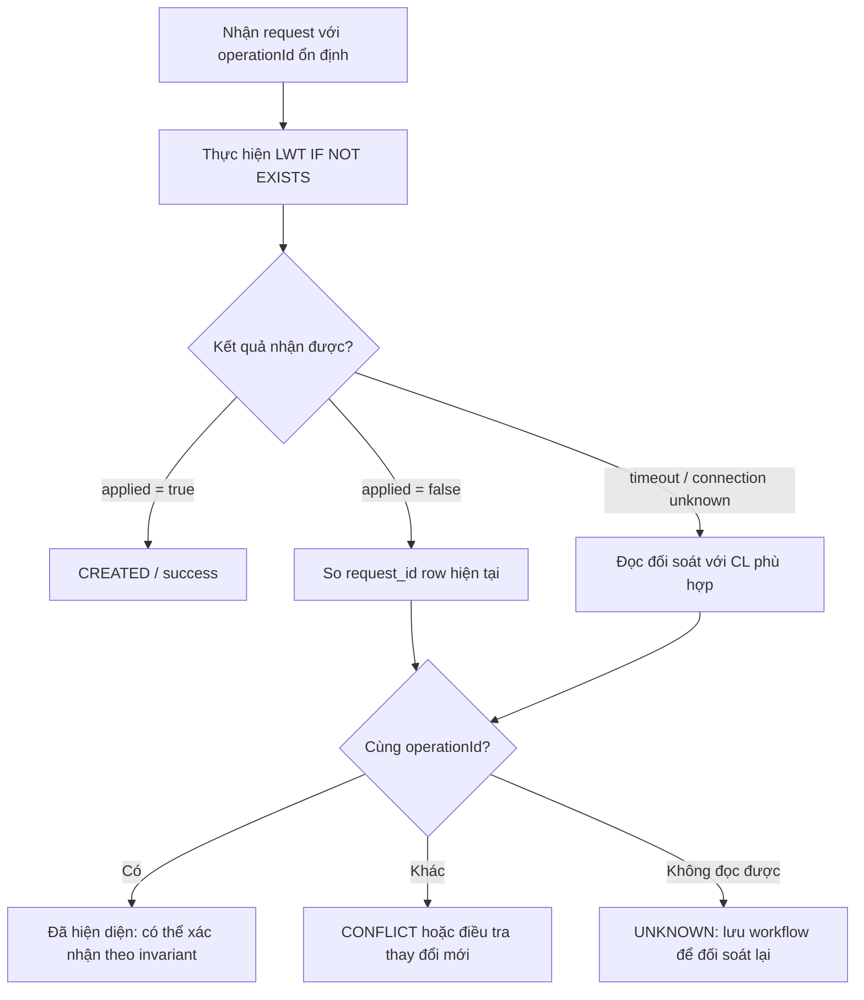
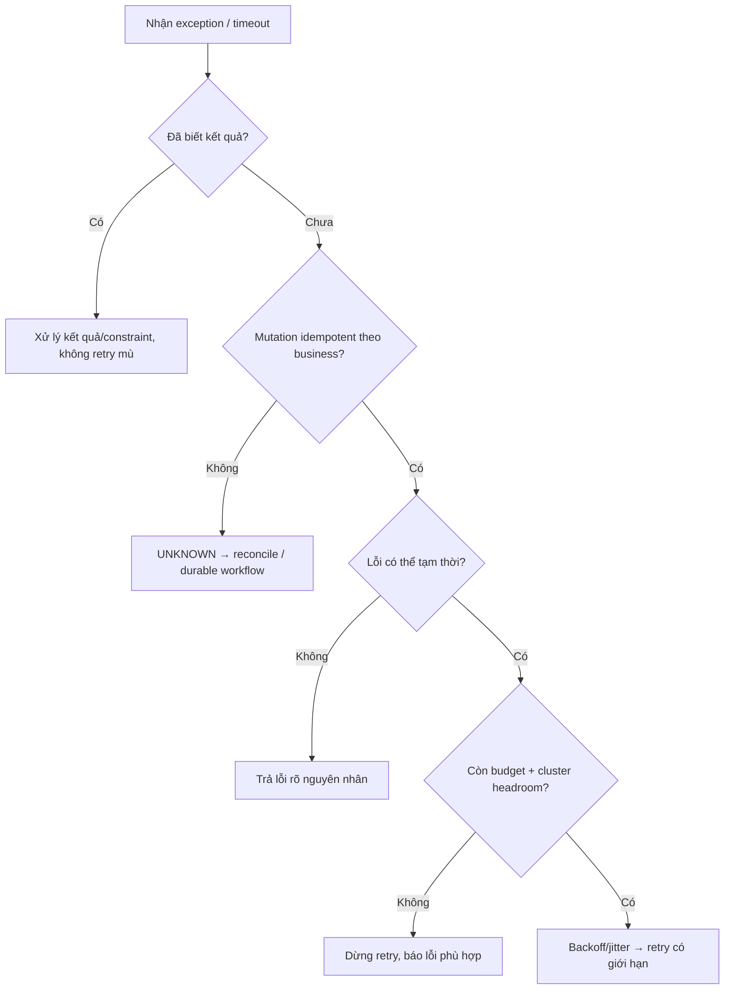

# Giới hạn retry với counter, list, TTL và cập nhật có điều kiện trong Java Driver Cassandra

## 1. Bài toán: một lần timeout có thể đã ghi thành công

Apache Cassandra là hệ quản trị **wide-column phân tán**. Ứng dụng Java gửi CQL tới **coordinator**; mutation được gửi đến các **replica** theo **partition key** và **replication factor (RF)**, sau đó coordinator đợi đủ xác nhận theo **consistency level (CL)**. Trong môi trường thực tế, request có thể timeout do mạng, GC, disk I/O, compaction hoặc replica phản hồi chậm.

Giả sử `payments-api` muốn tăng bộ đếm lượt truy cập:

```sql
UPDATE retry_lab.views_by_tenant_day
SET views = views + 1
WHERE tenant_id = 'tenant-01' AND view_day = '2026-11-20';
```

Ứng dụng Java chờ rồi nhận `WriteTimeoutException`. Điều đó **không chứng minh phép cộng chưa được áp dụng**. Có thể một hoặc nhiều replica đã xử lý mutation, nhưng coordinator không thu đủ ACK đúng deadline. Nếu client gửi lại, lượt xem có thể bị cộng **hai lần**.

Tương tự:

- `list = list + ['item']` có thể thêm phần tử lần nữa khi retry.
- `USING TTL 600` gửi lại muộn hơn có thể thay đổi thời điểm hết hạn.
- `INSERT ... IF NOT EXISTS` có thể đã thành công ở lần đầu, rồi retry trả `[applied] = false` vì hàng **đã tồn tại do chính lần đầu tạo**.

**Chủ đề bài này:** giới hạn retry dựa trên **semantics mutation**, không phải chỉ dựa trên việc exception “có vẻ tạm thời”. Mục tiêu là giữ tính đúng đắn của dữ liệu, độ trễ ứng dụng và tải cluster khi xử lý lỗi từ Java Driver 4.x.

### Kết quả học tập

1. Phân biệt **request idempotent**, **outcome unknown** và **operation identity**.
2. Nhận biết counter, thao tác list, TTL và conditional update nào **không thể retry mù**.
3. Đọc đúng ý nghĩa lỗi Cassandra và kết quả `[applied]` của LWT.
4. Dùng `PreparedStatement`, `BoundStatement.setIdempotent(...)`, CL/serial CL và giới hạn retry trong Java.
5. Thiết kế **đối soát, operation ID, dedup và retry budget** thay vì nhân đôi tác động nghiệp vụ.

## 2. Idempotency là thuộc tính của thao tác, không phải của câu lệnh `UPDATE`

Một thao tác **idempotent** theo nghĩa cần cho retry tạo cùng trạng thái/hiệu ứng quan sát được khi thực hiện nhiều lần, dưới những giả định đã xác định về dữ liệu, timestamp và concurrency.

Ví dụ tư duy:

```text
Đặt status = 'PAID' một lần       → status = PAID
Đặt status = 'PAID' lần nữa      → thường vẫn PAID

Tăng views = views + 1 một lần   → views tăng 1
Tăng views = views + 1 lần nữa  → views tăng 2
```

Nhưng câu `SET status = 'PAID'` **không tuyệt đối an toàn trong mọi hệ thống**. Nếu có writer khác đổi status sang `CANCELLED` giữa hai lần retry, request lặp với **timestamp mới hơn** có thể ghi đè trạng thái mới. Nếu có TTL hoặc một trigger/side effect ngoài Cassandra, việc gửi lại còn có hậu quả khác.

Vì thế cần phân biệt:

| Cấp độ | Câu hỏi | Ví dụ |
| --- | --- | --- |
| **CQL-level effect** | Mutation lặp có thay đổi dữ liệu khác không? | Counter tăng lần nữa |
| **Concurrency-level effect** | Có ghi đè một update mới hơn không? | Retry `status=PAID` sau khi status đổi |
| **Temporal effect** | TTL, timestamp và thời hạn có đổi không? | Gửi lại `TTL 600` sau 1 phút |
| **Business-level effect** | Có nhân đôi tiền, sự kiện, thông báo không? | Ghi CQL rồi gọi thanh toán ngoài DB |
| **Transport-level outcome** | Client biết server đã làm gì chưa? | Write timeout sau một phần ACK |

Driver chỉ biết một phần về thao tác. Nó **không tự hiểu** yêu cầu “mỗi đơn chỉ thanh toán đúng một lần” hay “mỗi lượt xem chỉ cộng một đơn vị”.

## 3. Timeout không đồng nghĩa “Cassandra rollback”

Một request `LOCAL_QUORUM` với RF3 ở `dc1` thường cần **2/3 phản hồi** địa phương. Minh họa:



Sơ đồ mô tả một **trường hợp có thể xảy ra**, không phải thứ tự nội bộ cố định cho mọi loại mutation. Với counter và LWT, đường xử lý cụ thể khác ghi thường; điều quan trọng là **ACK không đủ không chứng minh tác động bằng 0**.

Ba loại kết luận cần phân biệt:

- **CONFIRMED:** client nhận kết quả đã được server xác nhận theo CL. Với LWT còn phải đọc `[applied]`.
- **DEFINITIVELY REJECTED:** một loại lỗi cho biết request **không được thực hiện** do validation/authorization cụ thể và đã xác minh ngữ cảnh; không dùng nhãn này cho mọi network error.
- **UNKNOWN:** không có đủ thông tin để khẳng định mutation được áp dụng hay không. Timeout, mất kết nối sau khi gửi hoặc lỗi coordinator có thể thuộc nhóm này.

**Không tự quy đổi `UNKNOWN` thành `FAILED`** chỉ vì HTTP gateway phải trả lỗi cho caller. Trong API nghiệp vụ, cần một trạng thái chờ xác minh hoặc hướng dẫn retry với **operation ID ổn định**.

## 4. Các tầng có thể lặp lại cùng một request



Một lệnh CQL có thể bị nhân đôi từ:

1. HTTP caller nhấn lại hoặc client SDK retry.
2. API gateway/service mesh/resilience library retry.
3. Worker/job queue giao lại message sau timeout.
4. Business code gọi `session.execute(...)` lần nữa.
5. Java Driver thực hiện retry theo chính sách.
6. **Speculative execution** gửi thêm một execution để giảm tail latency, khi cấu hình cho phép.

Ngay cả khi tắt retry của Java Driver, **HTTP request hoặc queue message vẫn có thể bị giao lại**. Không tuyên bố “exactly once” chỉ từ `setIdempotent(false)`; nó là một hàng rào trong nhiều tầng cần kiểm soát.

### Retry budget toàn chuỗi

Nếu gateway cho 3 attempts, service cho 2, driver cho 2, trong trường hợp xấu có thể tạo tới **3 × 2 × 2 = 12** attempts ở một số mô hình retry lồng nhau, chưa tính speculative execution. Đây là minh họa upper-bound theo cấu hình, không phải hành vi mặc định của driver.

Hãy đặt **một nơi chịu trách nhiệm quyết định retry**, biết rõ retry cấp dưới, có deadline chung, backoff và giới hạn tổng attempts. Không để nhiều tầng độc lập đều “retry 3 lần” mà không có telemetry.

## 5. Bảng quyết định nhanh theo loại mutation

| Mutation | Có thể retry tự động? | Lý do | Hướng xử lý ưu tiên |
| --- | --- | --- | --- |
| `SELECT` thuần đọc | Thường có thể, **giới hạn** | Không làm thay đổi dữ liệu, nhưng tốn tải/read latency | Idempotent true, deadline và backoff |
| `SET status=?` cố định, không TTL | **Có điều kiện** | Timestamp/concurrent writers có thể đổi kết quả | Version/operation ID, tránh ghi đè |
| `counter = counter + 1` | **Không retry mù** | Mỗi lần có thể cộng thêm | Event/dedup architecture, đối soát |
| `list = list + [?]` | **Không retry mù** | Append có thể tạo phần tử mới lần nữa | Danh tính phần tử ổn định, set/map/table khác |
| `list = [?] + list` | **Không retry mù** | Prepend có thể nhân đôi, thay thứ tự | Thiết kế dữ liệu phù hợp |
| `list[index] = value` | **Không mặc định** | Vị trí có thể đổi khi concurrent mutation | Đọc/version/ràng buộc cập nhật |
| `SET x=? USING TTL 600` | **Không mặc định** | Replay có thể đổi thời điểm hết hạn | Deadline/expiry tuyệt đối, kiểm chứng |
| `INSERT ... IF NOT EXISTS` | Không retry mù nếu timeout | Lần 1 có thể thành công, lần 2 báo false | Đọc `[applied]`, operation ID, đối soát |
| `UPDATE ... IF version=?` | Không retry mù nếu timeout | Compare-and-set có thể đã chuyển version | Kiểm tra version/trạng thái sau timeout |
| Write ngoài Cassandra có side effect | **Không** chỉ dựa vào CQL idempotent | DB retry không bảo vệ dịch vụ bên ngoài | Transactional outbox/durable workflow tùy thiết kế |

“Có điều kiện” nghĩa là **đã chứng minh** cùng operation/data/timestamp không tạo hậu quả sai, kể cả khi cạnh tranh và khi server phản hồi chậm. Không dùng tên CQL `INSERT` hay `UPDATE` để tự suy ra idempotency.

## 6. Counter: phép cộng mang hiệu ứng tích lũy

Trong Cassandra, cột `counter` đọc như `long` qua Java Driver nhưng mutation có semantics riêng. Ví dụ:

```sql
CREATE TABLE IF NOT EXISTS retry_lab.views_by_tenant_day (
    tenant_id text,
    view_day date,
    views counter,
    PRIMARY KEY ((tenant_id), view_day)
);

UPDATE retry_lab.views_by_tenant_day
SET views = views + 1
WHERE tenant_id = 'tenant-01'
  AND view_day = '2026-11-20';
```

Giả sử counter ban đầu là 100:

```text
Attempt A: +1 áp dụng, phản hồi bị mất → client timeout.
Attempt B: +1 gửi lại và áp dụng.
Counter có thể là 102 thay vì 101.
```

### Vì sao không dùng counter cho giao dịch tài chính chính xác từng lần?

- Counter increment không phải `SET value = ?` và không có ID bất biến cho từng phép cộng theo mặc định.
- Trên write timeout, retry có thể đếm lại cùng sự kiện.
- Cassandra counter có những giới hạn riêng về mutation, TTL, batch và idempotency.
- Một consumer nhận sự kiện ít nhất một lần (*at-least-once*) sẽ càng dễ làm số tăng trùng nếu mỗi delivery đều increment.

Nếu đòi “mỗi `page_view_event_id` chỉ đếm một lần”:

1. Giữ **event ID duy nhất** ở nguồn và một durable event record.
2. Có bước **dedup** được đảm bảo theo ranh giới atomic phù hợp.
3. Tính/điều chỉnh projection tổng hợp từ tập event đã được xác nhận.
4. Chấp nhận eventual consistency và khả năng rebuild số đếm nếu kiến trúc phù hợp.

**Không dùng mẫu “`SELECT processed_event` → `UPDATE counter` → `INSERT processed_event`” rồi gọi là exactly-once.** Ba bước đó không trở thành một transaction nguyên tử xuyên nhiều partition chỉ vì đặt trong một CQL batch. Cần thiết kế tính nguyên tử và khả năng phục hồi end-to-end.

### Java Driver: counter phải đánh dấu không idempotent

```java
PreparedStatement increment = session.prepare(
    "UPDATE retry_lab.views_by_tenant_day " +
    "SET views = views + 1 " +
    "WHERE tenant_id = ? AND view_day = ?"
);

BoundStatement stmt = increment.bind("tenant-01", day)
    .setConsistencyLevel(DefaultConsistencyLevel.LOCAL_QUORUM)
    .setIdempotent(false);

session.execute(stmt); // Timeout => outcome UNKNOWN, không retry mù.
```

Đây là trích đoạn nằm trong method có `session` và `day`. `setIdempotent(false)` truyền thông tin quan trọng cho driver, nhưng **không chặn** việc caller hoặc HTTP gateway gọi method lần nữa.

## 7. List: append/prepend khác ghi đè danh sách

Một `list<text>` thường hỗ trợ giữ thứ tự, nhưng thao tác danh sách không giống một phép `SET` đơn giản.

```sql
CREATE TABLE IF NOT EXISTS retry_lab.carts_by_id (
    cart_id uuid PRIMARY KEY,
    items list<text>
);

UPDATE retry_lab.carts_by_id
SET items = items + ['sku-A']
WHERE cart_id = 11111111-1111-4111-8111-111111111111;

UPDATE retry_lab.carts_by_id
SET items = ['sku-B'] + items
WHERE cart_id = 11111111-1111-4111-8111-111111111111;
```

Nếu append `'sku-A'` đã thực hiện nhưng phản hồi thất lạc, một retry có thể thêm **'sku-A' lần thứ hai**. Trong Cassandra, các phần tử list được quản lý bằng cơ chế nội bộ giúp hỗ trợ thứ tự/vị trí; application **không** được giả định một câu append lặp mang cùng identity phần tử.

### Các kiểu thao tác list cần phân biệt

| CQL pattern | Nguy cơ retry |
| --- | --- |
| `SET items = items + ['A']` | Có thể append thêm một phần tử `A` mới |
| `SET items = ['A'] + items` | Có thể prepend nhiều lần và đổi thứ tự |
| `SET items[0] = 'A'` | Vị trí `0` có thể đã đổi khi người khác thêm/xóa |
| `SET items = items - ['A']` | Kết quả phụ thuộc phần tử đang có và thao tác đồng thời; cần kiểm thử semantics |
| `SET items = ['A','B']` | Có thể lặp ra cùng danh sách trong môi trường tĩnh, nhưng có thể ghi đè thay đổi mới |

**Không mặc định rằng “remove theo giá trị” hoặc “set index” an toàn khi có concurrent writers**. Tính lặp lại còn phụ thuộc thời điểm, dữ liệu mới, write timestamp và cách Cassandra hòa giải mutation.

### Nếu nghiệp vụ cần thêm một item duy nhất

Hãy cân nhắc thiết kế bảng **mỗi item một hàng**:

```sql
CREATE TABLE IF NOT EXISTS retry_lab.cart_items_by_cart (
    cart_id uuid,
    item_id uuid,
    sku text,
    quantity int,
    PRIMARY KEY ((cart_id), item_id)
);

INSERT INTO retry_lab.cart_items_by_cart (
    cart_id, item_id, sku, quantity
) VALUES (
    11111111-1111-4111-8111-111111111111,
    22222222-2222-4222-8222-222222222222,
    'sku-A', 1
);
```

Nếu `item_id` là ID ổn định của **cùng logical operation**, một retry `INSERT` tương đương có khả năng ghi lại cùng row thay vì sinh một phần tử list mới. Dù vậy, **concurrent update và timestamp** vẫn cần chính sách rõ; nếu caller tạo `item_id` khác ở mỗi retry thì hệ thống vẫn nhân đôi.

Khi chỉ cần membership không trùng, `set<text>` cũng có thể phù hợp hơn list. Khi cần khóa cho mỗi item, `map<id,value>` hoặc bảng riêng giúp định danh tốt hơn. Chọn dựa vào query shape, thứ tự và cardinality, không chỉ để “né lỗi retry”.

## 8. TTL: gửi lại có thể thay đổi thời điểm hết hạn

TTL (time to live) của Cassandra gắn giới hạn sống cho cell/row data được ghi theo semantics CQL; dữ liệu hết TTL không được xóa tức thì khỏi mọi SSTable, mà có tombstone và compaction/repair.

Ví dụ:

```sql
CREATE TABLE IF NOT EXISTS retry_lab.sessions_by_id (
    session_id uuid PRIMARY KEY,
    state text,
    owner_id text
);

UPDATE retry_lab.sessions_by_id
USING TTL 600
SET state = 'ACTIVE'
WHERE session_id = 33333333-3333-4333-8333-333333333333;
```

Hai lần ghi cách nhau một phút:

```text
11:00 Attempt A: TTL 600 giây → hạn gần 11:10 theo thời điểm ghi.
11:01 Attempt B retry: TTL 600 giây lần nữa → có thể dời hạn gần 11:11.

Nếu hệ thống cần hết hạn chính xác theo quy tắc nghiệp vụ,
retry như vậy có thể sai dù state cuối cùng vẫn là ACTIVE.
```

Thời điểm xóa/hết hạn thực tế tùy thời gian ghi/TTL, timestamp của mutation và hành vi phiên bản; ví dụ trên minh họa **rủi ro làm trôi expiration** chứ không cam kết một công thức chung cho mọi conflict.

### “Đặt lại cùng giá trị” chưa chắc idempotent theo thời gian

```sql
UPDATE retry_lab.sessions_by_id
USING TTL 600
SET state = 'ACTIVE'
WHERE session_id = 33333333-3333-4333-8333-333333333333;
```

Không chỉ kiểm tra `state = ACTIVE` trong test. Cần đo `TTL(state)` và `WRITETIME(state)` để hiểu semantics thực:

```sql
SELECT state, TTL(state), WRITETIME(state)
FROM retry_lab.sessions_by_id
WHERE session_id = 33333333-3333-4333-8333-333333333333;
```

`TTL(state)` trả số giây còn sống theo cơ chế CQL cho cell tương ứng; có thể là `null` nếu không đặt TTL hoặc khi cell không hiện diện. `WRITETIME` biểu diễn timestamp mutation (thường microsecond); **không phải trực tiếp wall-clock expiry**.

### Dùng hạn tuyệt đối ở tầng nghiệp vụ

Nếu hệ thống thực sự cần `expires_at = 11:10:00Z` không đổi qua retry, một thiết kế dễ kiểm chứng hơn là:

1. Ghi `expires_at timestamp` như **dữ liệu nghiệp vụ bất biến theo operation ID**.
2. Reader/API kiểm tra `Instant.now() < expiresAt` theo quy tắc session.
3. Dùng TTL Cassandra để cleanup/storage **phụ trợ**, không làm nguồn duy nhất quyết định quyền phiên.
4. Nếu tính TTL remaining từ hạn tuyệt đối, kiểm soát clock/rounding và **không để retry gia hạn quyền** ngoài ý định.

Đừng giả định cung cấp `USING TIMESTAMP` cố định tự động làm **TTL expiry** bất biến: timestamp để hòa giải cell và thời gian hết hạn lưu trữ không phải hai khái niệm hoàn toàn tương đương. Cần test đúng phiên bản.

## 9. LWT: `IF NOT EXISTS` và cập nhật có điều kiện

LWT (lightweight transaction) hỗ trợ conditional mutation bằng Paxos trong phạm vi được Cassandra hỗ trợ. Một thao tác:

```sql
INSERT INTO retry_lab.orders_by_id (
    order_id, request_id, status
) VALUES (
    44444444-4444-4444-8444-444444444444,
    55555555-5555-4555-8555-555555555555,
    'CREATED'
) IF NOT EXISTS;
```

trả cột `[applied]`:

- `[applied] = true`: điều kiện thành công, mutation được chấp nhận theo semantics LWT.
- `[applied] = false`: điều kiện không thỏa tại lần thực thi đó; có thể có dữ liệu hiện tại trả về.
- Timeout/transport error: **chưa biết chắc** lần thực thi có hoàn thành hay không.

### Vấn đề retry sau kết quả chưa xác định

```text
Attempt A: INSERT IF NOT EXISTS được chấp nhận,
           nhưng client timeout và không nhận [applied]=true.

Attempt B: client gửi lại cùng INSERT IF NOT EXISTS.
           Server thấy hàng đã tồn tại → [applied]=false.

Kết luận sai: “Thao tác thất bại.”
Kết luận đúng: Cần đối chiếu request_id / trạng thái đã lưu.
```

**`[applied]=false` không đủ để xác định một request đã thất bại ở cấp nghiệp vụ** nếu có retry trước đó. Phải kiểm tra **ID của logical operation** và dữ liệu hiện hữu.

### LWT không cho phép transaction tùy ý xuyên nhiều partition

Không dùng `INSERT IF NOT EXISTS` vào bảng `processed_requests` rồi `UPDATE counter` và coi hai lệnh là một transaction atomic. LWT giúp bảo vệ **điều kiện cập nhật được nó áp dụng**; nó không biến những tác động sang bảng/partition khác hay API ngoài Cassandra thành một giao dịch ACID tổng thể.

## 10. Compare-and-set: `UPDATE ... IF` và xung đột phiên bản

Giả sử bảng có cột `version int`:

```sql
CREATE TABLE IF NOT EXISTS retry_lab.order_status_by_id (
    order_id uuid PRIMARY KEY,
    status text,
    version int,
    request_id uuid
);

UPDATE retry_lab.order_status_by_id
SET status = 'PAID', version = 8,
    request_id = 66666666-6666-4666-8666-666666666666
WHERE order_id = 44444444-4444-4444-8444-444444444444
IF version = 7;
```

Đây là CAS (compare-and-set). Nếu version trước là 7 và attempt A đã được áp dụng nhưng client không thấy phản hồi, retry attempt B thường gặp version 8 và trả `[applied]=false`. Điều đó không chứng minh A không thành công.

Một hướng đối soát:

1. Đọc row bằng CL phù hợp để xác định `version`, `request_id` và trạng thái nghiệp vụ.
2. Nếu `version=8` và `request_id` bằng **ID của request**, có cơ sở xác nhận thao tác đã hiện diện.
3. Nếu `version=8` nhưng `request_id` khác, cần phân loại **conflict**, không tự ghi đè.
4. Nếu version vẫn 7, có thể cân nhắc thực thi lại **qua một quy trình biết rõ race**; không chỉ retry vô hạn.
5. Nếu không thể xác định vì replica không sẵn sàng, giữ kết quả **UNKNOWN** và trì hoãn/đối soát.

Read-after-timeout cũng có giới hạn: replica có thể chưa hội tụ, row có thể tiếp tục thay đổi; **không lấy một câu `SELECT` ở `ONE` làm bằng chứng toàn cục**. Với hệ thống cần chứng cứ chắc hơn, dùng event/operation log được thiết kế chuyên biệt.

### Serial consistency có vai trò riêng

LWT dùng serial CL như `SERIAL` hoặc `LOCAL_SERIAL` cho quá trình Paxos, cùng CL bình thường cho các pha tương ứng. Ví dụ Java Driver 4.x:

```java
PreparedStatement preparedCas = session.prepare(
    "UPDATE retry_lab.order_status_by_id " +
    "SET status = ?, version = ?, request_id = ? " +
    "WHERE order_id = ? IF version = ?"
);

BoundStatement cas = preparedCas.bind(
        "PAID", 8, requestId, orderId, 7)
    .setConsistencyLevel(DefaultConsistencyLevel.LOCAL_QUORUM)
    .setSerialConsistencyLevel(DefaultConsistencyLevel.LOCAL_SERIAL)
    .setIdempotent(false);
```

`LOCAL_SERIAL` phải phù hợp replication/traffic giữa DC và yêu cầu nghiệp vụ; không coi nó là lựa chọn phổ quát. **Không tự tăng retry LWT** chỉ vì có Paxos: timeout có thể xảy ra ở nhiều pha, vẫn cần kiểm tra kết quả.

## 11. Phân loại lỗi trong Java Driver 4.x

Không có quy tắc “mọi timeout retry 3 lần”. Loại lỗi cho biết **một phần** về điều đã xảy ra:

| Dạng lỗi | Ý nghĩa điển hình | Định hướng đối với write không idempotent |
| --- | --- | --- |
| `ReadTimeoutException` | Read không đủ phản hồi đúng hạn | Với đọc thuần, có thể retry giới hạn; không làm mutation lại |
| `WriteTimeoutException` | Ghi không đủ xác nhận đúng hạn | **UNKNOWN**, không lặp counter/list/TTL/LWT mù |
| `WriteFailureException` | Replica/bộ phận xử lý ghi báo lỗi; trạng thái phụ thuộc write type | Không tự giả định không replica nào áp dụng |
| `UnavailableException` | Không đủ replica khả dụng để thỏa CL tại thời điểm quyết định | Không giải quyết bằng việc hạ CL trái yêu cầu; có thể chờ phục hồi |
| `DriverTimeoutException` | Driver hết thời hạn chờ request | Có thể request vẫn đang/đã được xử lý ở server |
| `AllNodesFailedException` | Không node nào hoàn tất request theo driver; chứa nguyên nhân theo node | Kiểm tra nguyên nhân cụ thể, không kết luận “chưa gửi” |
| Lỗi `InvalidQuery`/type/authorization | CQL/schema/permission có vấn đề | Sửa code/config/schema; retry không hữu ích |
| Lỗi TLS/authentication | Không xác thực/kết nối an toàn thành công | Sửa credential/cert/network; tránh reconnect storm |
| `[applied]=false` | LWT được trả lời, điều kiện không thỏa | Không phải transport failure; xử lý conflict/dedup |

Tên class/exception và chi tiết API phải được kiểm tra theo **minor version Java Driver 4.x** đang dùng. Với `AllNodesFailedException`, phải xem nguyên nhân theo từng node và khả năng request đã được gửi; không suy diễn từ tên tổng quát.

### Lỗi nào cho phép retry?

Chỉ retry tự động nếu **đồng thời** có:

- Thao tác đã được phân loại **idempotent trong ngữ cảnh nghiệp vụ**.
- Lỗi thuộc nhóm có khả năng tạm thời mà retry hợp lý.
- Còn budget về attempts và deadline.
- Có backoff/jitter phù hợp và capacity cluster còn đủ.
- Không có dấu hiệu retry storm hay sự cố hạ tầng kéo dài.

Nếu một điều kiện không đạt, **dừng tự động retry**, ghi nhận outcome và đưa sang luồng đối soát/thông báo phù hợp.

## 12. Retry policy của Java Driver và `setIdempotent`

Java Driver 4.x cho phép statement công bố liệu nó **idempotent** qua:

```java
BoundStatement nonIdempotent = prepared.bind(arg1, arg2)
    .setConsistencyLevel(DefaultConsistencyLevel.LOCAL_QUORUM)
    .setIdempotent(false);

BoundStatement readOnly = selectPrepared.bind(arg1)
    .setConsistencyLevel(DefaultConsistencyLevel.LOCAL_QUORUM)
    .setIdempotent(true);
```

Các tên `prepared`, `arg1`… là placeholder của code trích đoạn.

### Cần hiểu chính xác phạm vi

- `setIdempotent(false)` là metadata mà **retry/speculative execution policy của driver** có thể dùng để bảo vệ request; không biến server thành exactly-once.
- `setIdempotent(true)` **không chứng minh** thao tác thật sự idempotent. Nó là lời cam kết từ ứng dụng, vì vậy đánh dấu sai có thể gây nhân đôi tác động.
- Hành vi retry mặc định, số attempts, xử lý từng `WriteType`, logging và policy extension **phụ thuộc phiên bản/cấu hình driver**. Không sao chép cấu hình của 3.x sang 4.x rồi cho rằng tương đương.
- Cơ chế retry cấp HTTP, message broker, worker và code gọi lại `session.execute` nằm **ngoài** bảo vệ của cờ driver.
- Speculative execution có thể gửi thêm attempt khi chưa có phản hồi, nên chỉ bật cho các request đã được xác nhận idempotent và được benchmark kỹ.

**Không tự viết retry policy “bất kỳ `WriteTimeoutException` nào cũng retry”**, kể cả khi lệnh ban đầu có vẻ nhỏ. Cần xét `WriteType`, CL, tính idempotent, năng lực còn lại và kết quả có thể đã áp dụng.

## 13. CQL lab: tạo bảng cho bốn loại tình huống

Chạy trên **cluster lab cô lập**, không trên production. Ví dụ dùng `NetworkTopologyStrategy`, DC `dc1`, RF3 và client `LOCAL_QUORUM`; nếu lab có ít replica hơn, điều chỉnh RF/CL cho thực tế thay vì coi `Unavailable` là lỗi Java Driver.

```sql
CREATE KEYSPACE IF NOT EXISTS retry_lab
WITH replication = {
    'class': 'NetworkTopologyStrategy',
    'dc1': 3
}
AND durable_writes = true;

CREATE TABLE IF NOT EXISTS retry_lab.views_by_tenant_day (
    tenant_id text,
    view_day date,
    views counter,
    PRIMARY KEY ((tenant_id), view_day)
);

CREATE TABLE IF NOT EXISTS retry_lab.carts_by_id (
    cart_id uuid PRIMARY KEY,
    items list<text>
);

CREATE TABLE IF NOT EXISTS retry_lab.sessions_by_id (
    session_id uuid PRIMARY KEY,
    state text,
    owner_id text,
    expires_at timestamp
);

CREATE TABLE IF NOT EXISTS retry_lab.orders_by_id (
    order_id uuid PRIMARY KEY,
    request_id uuid,
    status text
);

CREATE TABLE IF NOT EXISTS retry_lab.order_status_by_id (
    order_id uuid PRIMARY KEY,
    status text,
    version int,
    request_id uuid
);
```

Khi thực hành `cqlsh`, có thể chọn:

```text
CONSISTENCY LOCAL_QUORUM;
```

### Thí nghiệm 1 — Counter

```sql
UPDATE retry_lab.views_by_tenant_day
SET views = views + 1
WHERE tenant_id = 'tenant-01' AND view_day = '2026-11-20';

SELECT views
FROM retry_lab.views_by_tenant_day
WHERE tenant_id = 'tenant-01' AND view_day = '2026-11-20';
```

Nếu chủ động chạy UPDATE hai lần, giá trị sẽ tăng hai lần **trong điều kiện các mutation thành công**. Điều này minh họa tại sao không retry trên timeout. **Không tạo lỗi node hoặc network trên cluster dùng chung** chỉ để ép timeout.

### Thí nghiệm 2 — List

```sql
UPDATE retry_lab.carts_by_id
SET items = items + ['sku-A']
WHERE cart_id = 11111111-1111-4111-8111-111111111111;

UPDATE retry_lab.carts_by_id
SET items = items + ['sku-A']
WHERE cart_id = 11111111-1111-4111-8111-111111111111;

SELECT items
FROM retry_lab.carts_by_id
WHERE cart_id = 11111111-1111-4111-8111-111111111111;
```

Kỳ vọng có thể thấy **hai phần tử `sku-A`** do hai thao tác append độc lập. Nếu cần danh tính ổn định và tránh trùng, thử bảng `cart_items_by_cart` ở mục 7.

### Thí nghiệm 3 — TTL

```sql
UPDATE retry_lab.sessions_by_id
USING TTL 600
SET state = 'ACTIVE'
WHERE session_id = 33333333-3333-4333-8333-333333333333;

SELECT state, TTL(state), WRITETIME(state)
FROM retry_lab.sessions_by_id
WHERE session_id = 33333333-3333-4333-8333-333333333333;
```

Đợi một khoảng nhỏ rồi lặp lại trong **lab**; xem TTL remaining, không kỳ vọng hai lần gửi luôn có cùng deadline. Nếu cập nhật state theo TTL nhưng `expires_at` là quy tắc nghiệp vụ, cần ghi thời hạn tuyệt đối riêng để quyết định quyền truy cập.

### Thí nghiệm 4 — LWT

```sql
INSERT INTO retry_lab.orders_by_id (
    order_id, request_id, status
) VALUES (
    44444444-4444-4444-8444-444444444444,
    55555555-5555-4555-8555-555555555555,
    'CREATED'
) IF NOT EXISTS;

-- Chạy lại nguyên câu INSERT để xem [applied] của lần hai.
SELECT request_id, status
FROM retry_lab.orders_by_id
WHERE order_id = 44444444-4444-4444-8444-444444444444;
```

Chạy lần đầu có thể `[applied] = true`; lần hai nếu row còn tồn tại thường trả `false`. **Không diễn giải false của lần hai là bằng chứng thao tác ban đầu thất bại.**

## 14. Java Driver 4.x: repository đánh dấu từng mutation rõ ràng

Mã sau dùng namespace Java Driver 4.x `com.datastax.oss.driver.api.core`. Nó giả định `CqlSession` đã kết nối đến lab qua TLS/auth nếu môi trường yêu cầu, có `localDatacenter` và session được tái sử dụng.

```java
import java.time.LocalDate;
import java.util.UUID;

import com.datastax.oss.driver.api.core.CqlSession;
import com.datastax.oss.driver.api.core.DefaultConsistencyLevel;
import com.datastax.oss.driver.api.core.cql.BoundStatement;
import com.datastax.oss.driver.api.core.cql.PreparedStatement;
import com.datastax.oss.driver.api.core.cql.Row;

public final class RiskAwareMutationRepository {
    private final CqlSession session;
    private final PreparedStatement incrementViews;
    private final PreparedStatement appendCartItem;
    private final PreparedStatement setSessionStateWithTtl;
    private final PreparedStatement insertOrderIfAbsent;

    public RiskAwareMutationRepository(CqlSession session) {
        this.session = session;
        incrementViews = session.prepare(
            "UPDATE retry_lab.views_by_tenant_day " +
            "SET views = views + 1 " +
            "WHERE tenant_id = ? AND view_day = ?");
        appendCartItem = session.prepare(
            "UPDATE retry_lab.carts_by_id " +
            "SET items = items + ? WHERE cart_id = ?");
        setSessionStateWithTtl = session.prepare(
            "UPDATE retry_lab.sessions_by_id USING TTL ? " +
            "SET state = ? WHERE session_id = ?");
        insertOrderIfAbsent = session.prepare(
            "INSERT INTO retry_lab.orders_by_id " +
            "(order_id, request_id, status) VALUES (?, ?, ?) " +
            "IF NOT EXISTS");
    }

    public void incrementView(String tenantId, LocalDate day) {
        BoundStatement stmt = incrementViews.bind(tenantId, day)
            .setConsistencyLevel(DefaultConsistencyLevel.LOCAL_QUORUM)
            .setIdempotent(false);
        session.execute(stmt);
        // Nếu timeout: trả UNKNOWN cho caller, không gọi lại mù.
    }

    public void appendSku(UUID cartId, String sku) {
        BoundStatement stmt = appendCartItem.bind(
                java.util.Collections.singletonList(sku), cartId)
            .setConsistencyLevel(DefaultConsistencyLevel.LOCAL_QUORUM)
            .setIdempotent(false);
        session.execute(stmt);
    }

    public void setTemporaryState(
            UUID sessionId, String state, int ttlSeconds) {
        if (ttlSeconds <= 0 || ttlSeconds > 3_600) {
            throw new IllegalArgumentException("TTL outside policy");
        }
        BoundStatement stmt = setSessionStateWithTtl.bind(
                ttlSeconds, state, sessionId)
            .setConsistencyLevel(DefaultConsistencyLevel.LOCAL_QUORUM)
            .setIdempotent(false);
        session.execute(stmt);
    }

    public ConditionalInsertResult createOrderOnce(
            UUID orderId, UUID requestId, String status) {
        BoundStatement stmt = insertOrderIfAbsent.bind(
                orderId, requestId, status)
            .setConsistencyLevel(DefaultConsistencyLevel.LOCAL_QUORUM)
            .setSerialConsistencyLevel(DefaultConsistencyLevel.LOCAL_SERIAL)
            .setIdempotent(false);

        Row row = session.execute(stmt).one();
        if (row == null) {
            throw new IllegalStateException("Missing LWT result");
        }
        if (row.getBoolean("[applied]")) {
            return ConditionalInsertResult.CREATED;
        }
        UUID existing = row.isNull("request_id")
            ? null : row.getUuid("request_id");
        return requestId.equals(existing)
            ? ConditionalInsertResult.ALREADY_APPLIED
            : ConditionalInsertResult.CONFLICT;
    }

    public enum ConditionalInsertResult {
        CREATED, ALREADY_APPLIED, CONFLICT
    }
}
```

Trong ví dụ:

- Các statement **counter/list/TTL/LWT** đều được đánh dấu `setIdempotent(false)` để không tuyên bố nhầm an toàn cho retry tự động.
- `appendCartItem` dùng marker cho `list<text>`; mỗi invocation mới tạo một mutation append.
- `setTemporaryState` có giới hạn TTL và **không** giả định retry giữ nguyên expiry.
- `createOrderOnce` phân biệt `CREATED`, `ALREADY_APPLIED` (cùng `requestId` đã tồn tại) và `CONFLICT` (request khác).
- Nếu `session.execute(stmt)` **ném timeout/transport error**, method chưa phân loại được kết quả; tầng service phải ghi nhận **UNKNOWN** và đối soát.

**Điều kiện quan trọng của `ALREADY_APPLIED`:** code minh họa dựa trên giả định một row `orders_by_id` được bảo vệ bởi chính `IF NOT EXISTS`, `request_id` bất biến và không có workflow khác tự sửa/delete hàng rồi tái sử dụng khóa. Production cần chứng minh invariant này; nếu không, không thể kết luận chỉ từ UUID trong một snapshot.

### Lưu ý về exception và việc nhận kết quả

Đoạn Java **không bắt mọi `RuntimeException` rồi gọi là UNKNOWN**. Validation error, unauthorized hoặc schema mismatch cần được phân loại đúng. Những lỗi **timeout, mất kết nối hoặc kết quả coordinator không chắc chắn** mới phải đi vào nhánh reconcile; lỗi rõ ràng không thể sửa bằng retry phải được trả về có nguyên nhân.

## 15. Đối soát LWT sau timeout bằng request ID

Một pattern thực tế:



### Ví dụ đọc đối soát trong Java

```java
PreparedStatement findOrder = session.prepare(
    "SELECT request_id, status FROM retry_lab.orders_by_id " +
    "WHERE order_id = ?");

BoundStatement read = findOrder.bind(orderId)
    .setConsistencyLevel(DefaultConsistencyLevel.LOCAL_QUORUM)
    .setIdempotent(true);

Row current = session.execute(read).one();
if (current != null && requestId.equals(
        current.getUuid("request_id"))) {
    // Chỉ khi invariant request_id bất biến được bảo đảm.
    // Có cơ sở nói operation đã hiện diện.
}
```

Mã này là trích đoạn có `session`, `orderId` và `requestId` từ caller. Với các cạnh tranh hoặc replica chưa hội tụ, một lần đọc không luôn đủ chứng minh trạng thái cuối cùng; cần deadline/đối soát lại hoặc một durable workflow.

### Khi nào được retry LWT có kiểm soát?

Có thể cân nhắc một retry **có giới hạn**, sau khi hiểu semantics CAS và đã đảm bảo ID/cùng condition ổn định. Tuy nhiên:

- Lần retry có thể trả false vì **lần đầu đã thành công**.
- LWT có thêm chi phí Paxos; retry đồng loạt dễ làm contention tăng.
- Condition có thể đã đổi do writer khác, khiến semantics khác với ý định ban đầu.
- Với operation có side effect ngoài Cassandra, retry LWT vẫn không bảo đảm exactly-once cho side effect.

Do đó, **đối soát trước hoặc sau retry** phải là phần của workflow, không chỉ xét exception.

## 16. Thiết kế retry budget và deadline trong service Java

Với những request **đã được chứng minh idempotent**, service có thể áp dụng retry budget nhỏ:

```text
Deadline request tổng: 1.000 ms (ví dụ, không phải cấu hình mặc định).
Attempt 1: tối đa 350 ms.
Backoff: 50–100 ms có jitter.
Attempt 2: chỉ nếu còn thời gian và loại lỗi phù hợp.
Tối đa: 2 attempts, tính cả attempt đầu.
Nếu hết budget: trả trạng thái phù hợp, không loop vô hạn.
```

Con số chỉ là minh họa để hiểu phân bổ thời gian. Một request `LOCAL_QUORUM` qua WAN, một request LWT và một read trong DC có budget hợp lý khác nhau.

### Một decision flow tổng quát



**Backoff không sửa được tính không idempotent.** Chờ 100 ms trước khi gửi lại counter vẫn có nguy cơ cộng hai lần; yếu tố quyết định là semantics/dedup, không phải độ dài sleep.

### Đừng đánh đồng ghi “thành công” với “đã nhân bản mọi DC”

Với RF3 ở dc1 và dc2, `LOCAL_QUORUM` tại dc1 thường chỉ cần hai ACK địa phương; các replica dc2 có thể chậm hội tụ nếu WAN lỗi. Một retry từ dc2 của cùng operation không mặc nhiên có cùng tính đúng đắn, đặc biệt với LWT và các yêu cầu global uniqueness.

Giữ local DC, CL và serial consistency trong contract. Nếu ứng dụng dùng cả `LOCAL_SERIAL` tại nhiều DC, phải hiểu phạm vi bảo đảm theo tài liệu Cassandra và ranh giới unique/linearization của workload. **Không dùng một policy local rồi khẳng định global exactly-once.**

## 17. Idempotency key ở tầng API: làm đúng ranh giới

Một HTTP API có thể nhận:

```text
POST /orders
Idempotency-Key: 6a111111-1111-4111-8111-111111111111

Body: {"orderId":"44444444-4444-4444-8444-444444444444",
       "status":"CREATED"}
```

Service cần:

1. Gắn **operation ID ổn định** với principal, endpoint, canonical request payload và thời hạn giữ.
2. Kiểm tra cùng key + cùng payload là một logical operation; cùng key khác payload là conflict.
3. Lưu trạng thái xử lý trong một durable ledger có semantics phù hợp.
4. Định nghĩa trạng thái `PENDING`, `CONFIRMED`, `CONFLICT`, `UNKNOWN` và cách reconciliation.
5. Chỉ trả response “đã hoàn tất” nếu có chứng cứ mà contract yêu cầu.
6. Cân nhắc retention cho idempotency record so với khả năng client gửi lại.

### Caveat: chỉ thêm idempotency key vào header chưa đủ

Nếu handler:

```text
if (!seen(idempotencyKey)) {
    incrementCounter();
    markSeen(idempotencyKey);
}
```

thì crash giữa `incrementCounter()` và `markSeen()` vẫn có thể gây nhân đôi khi retry. Ngược lại, `markSeen()` trước rồi crash trước increment có thể **mất lượt đếm**.

Cassandra không cung cấp transaction ACID xuyên hai thao tác/partition như trên chỉ vì cùng ứng dụng Java. Nếu yêu cầu exactly-once mạnh, hãy dùng kiến trúc event/ledger và projection có thể rebuild, hoặc một hệ thống transaction phù hợp để giữ ranh giới atomic; đừng dùng counter + check-then-set không atomic làm lời hứa chính xác tuyệt đối.

## 18. Lỗi vận hành, metrics và runbook xử lý

### Những số liệu cần ghi

| Tín hiệu | Tại sao cần? |
| --- | --- |
| Logical request count và driver attempt count | Thấy số lần gửi thêm có đang tăng |
| Outcome `CONFIRMED / UNKNOWN / CONFLICT` | Không đánh đồng timeout với thất bại |
| Retry count theo loại CQL/idempotency | Phát hiện counter/list/LWT bị retry sai |
| Driver `WriteTimeout`, `ReadTimeout`, `Unavailable` | Tách lỗi replica/quorum khỏi codec/auth |
| Request p95/p99, deadline, pool saturation | Retry tăng tail latency và giữ kết nối |
| Node `tpstats`, dropped messages | Có queue overload không |
| `compactionstats` và disk await | Foreground chậm do I/O nền hay không |
| RF/CL/serial CL, DC và node health | Có đủ replica và đúng quorum không |
| Counter vs event ledger mismatch | Có nhân đôi/bỏ sót tác động không |
| TTL còn lại, expiry drift | Session/rule hết hạn có bị kéo dài do replay không |
| LWT contention và false/timeout | Có CAS race hoặc tranh chấp nóng không |

Không đưa password, token, raw idempotency key hoặc dữ liệu nhạy cảm vào log/metric label. Theo dõi theo **query template**, loại operation, CL, DC và trạng thái; giữ cardinality ở mức quản lý được.

### Lệnh quan sát Cassandra

```bash
nodetool status
nodetool tpstats
nodetool compactionstats
nodetool tablestats retry_lab.views_by_tenant_day
nodetool tablehistograms retry_lab views_by_tenant_day
```

Các số liệu `nodetool` thường theo node kết nối. `UN` không có nghĩa mọi replica phản hồi đủ nhanh theo CL. Nếu cluster đã quá tải, **không tăng retry** vì thấy `WriteTimeout` nhiều; retry tạo thêm work cho đúng những node đang quá tải.

### Runbook khi thấy retry bất thường

1. Xác định query template và phân loại **counter/list/TTL/LWT/normal read-write**.
2. Kiểm tra driver/application/gateway/queue có bao nhiêu tầng retry, speculative executions và số attempts thực.
3. Nếu non-idempotent đang retry, **tắt đường retry mù theo change process**; giữ dữ liệu phục vụ điều tra.
4. Tách `UNKNOWN` khỏi `CONFLICT` và lỗi validation rõ ràng.
5. Kiểm tra RF, CL, replica health, disk, network, GC, compaction và p99.
6. Đối soát theo operation ID/event ledger/điều kiện nghiệp vụ; không sửa counter bằng một số đo thiếu căn cứ.
7. Phục hồi dần traffic, đặt budget và canary cho retry mới.
8. Thêm alert trên duplicate/TTL drift/LWT contention, viết test regression.

**Không dùng `nodetool repair`, `flush` hay major compaction như một thao tác “rollback lần retry thừa”.** Chúng không biết event nào là duplicate nghiệp vụ; repair có thể đồng bộ cả trạng thái sai sang replica khác.

## 19. Bài tập tình huống và đáp án

### Tình huống A — Counter timeout

`views=10`; ứng dụng gửi `views=views+1` và gặp `WriteTimeout`. Sau đó retry thành công. Counter đọc được 12. Có nên sửa về 11 ngay không?

**Gợi ý:** Không tự sửa nếu chưa có nguồn sự thật của event. Kết quả 12 có thể là hai increment từ cùng logical event, hoặc có lượt xem hợp lệ đồng thời. Cần event ID/ledger và đối soát; không dùng một con số ước lượng làm nguyên nhân sửa.

### Tình huống B — Append danh sách

Ứng dụng gửi `items = items + ['sku-A']` hai lần sau timeout. Vì sao có thể thấy hai `sku-A`?

**Gợi ý:** Append là thao tác tạo thêm phần tử, không phải upsert theo một phần tử có ID cố định. Dùng bảng `PRIMARY KEY ((cart_id), item_id)` hoặc thiết kế khác có identity ổn định nếu cần dedup.

### Tình huống C — TTL bị kéo dài

Session dự kiến hết hạn sau 10 phút từ lần login đầu. Retry `USING TTL 600` sau 90 giây có thể làm phiên dài hơn dự kiến. Sửa thế nào?

**Gợi ý:** Lưu hạn tuyệt đối `expires_at` của login operation, reader kiểm tra hạn này, dùng TTL như cleanup phụ trợ và bảo đảm retry không cấp lại thời hạn mới ngoài chính sách.

### Tình huống D — LWT lần hai báo `[applied]=false`

Lần đầu `INSERT ... IF NOT EXISTS` timeout, lần hai trả false. Team cho rằng tạo đơn thất bại và yêu cầu tạo `order_id` mới.

**Gợi ý:** Sai. Có thể lần đầu đã tạo đơn. Đối chiếu `request_id`, `order_id` và dữ liệu hiện hữu; dùng ID ổn định và xử lý `ALREADY_APPLIED` thay vì tạo đơn trùng.

### Tình huống E — CAS version

Client gửi `UPDATE status='PAID', version=8 IF version=7`, gặp timeout. Đọc lại thấy version 8 nhưng `request_id` khác.

**Gợi ý:** Không tự khẳng định request của client thành công. Đây có thể là một writer khác; phân loại conflict và điều tra lịch sử/operation ledger thay vì ghi đè version 8.

### Tình huống F — Retry ở ba tầng

Gateway retry ba lần, service retry hai lần, driver retry hai lần, tất cả trên mutation counter. Tổng attempts tối đa có thể lớn đến đâu theo mô hình lồng nhau, và vấn đề chính là gì?

**Gợi ý:** Có thể tới 12 attempts trong ví dụ cấu hình, chưa kể speculative execution. Rủi ro không chỉ là tải mà còn **counter tăng nhiều lần**. Cần giới hạn một nơi và ngăn retry non-idempotent.

### Tình huống G — `LOCAL_QUORUM` với RF3

Một node Down, hai node Up nhưng một node đọc/ghi rất chậm. Write counter timeout. Có nên hạ CL xuống `ONE` để retry cho nhanh?

**Gợi ý:** Không nếu nghiệp vụ yêu cầu local quorum. Hạ CL thay đổi bảo đảm, không giải quyết rủi ro counter double increment. Cần xử lý node/chẩn đoán tải, sau đó đối soát.

### Tình huống H — `setIdempotent(false)` nhưng vẫn có duplicate

Developer đã đánh dấu counter không idempotent; hệ thống vẫn cộng đôi sau khi client gửi lại cùng HTTP request. Driver có sai không?

**Gợi ý:** Không. Cờ driver không chặn duplicate ở HTTP/gateway/job queue. Cần operation ID và thiết kế dedup đúng ranh giới atomic, không chỉ sửa driver flag.

### Tình huống I — LWT báo `[applied]=false` khi chưa retry

Một request `INSERT IF NOT EXISTS` mới chưa từng được gửi trước đó trả false và row đang thuộc `request_id` khác. Có nên gọi là idempotent success?

**Gợi ý:** Không. Đây là conflict thật; chỉ coi `ALREADY_APPLIED` khi ID/bất biến chứng minh row tương ứng cùng logical operation.

## 20. Checklist production cho retry CQL từ Java

**Phân loại operation**

- [ ] Biết RF/CL, DC và keyspace của mỗi query; không dùng kết quả timeout để suy ra rollback.
- [ ] Phân biệt `SELECT` thuần đọc, upsert cố định, counter, list, TTL và LWT.
- [ ] Với counter/list append/prepend, đặt `setIdempotent(false)` và không retry tự động mù.
- [ ] Với TTL, xác định có yêu cầu **hạn tuyệt đối** hay chỉ retention tương đối.
- [ ] Với `IF NOT EXISTS`/`IF version`, đọc `[applied]` và chuẩn bị reconcile theo request ID.
- [ ] Không coi `[applied]=false` luôn là thất bại nghiệp vụ khi có attempt trước đó.

**Driver và service**

- [ ] Dùng `PreparedStatement`/`BoundStatement` và gắn idempotence **có chứng minh**.
- [ ] Kiểm tra retry/speculative execution policy theo đúng Java Driver 4.x version.
- [ ] Kiểm kê retry ở gateway, service, driver, queue và job scheduler.
- [ ] Dùng cùng operation ID/payload trong một logical request qua mọi tầng.
- [ ] Có deadline tổng, giới hạn số attempts, backoff/jitter và circuit breaking phù hợp.
- [ ] Không retry lỗi validation/auth/schema và không hạ CL chỉ để né timeout.
- [ ] Với `WriteTimeout`/`DriverTimeout`, duy trì trạng thái **UNKNOWN** khi chưa xác định.
- [ ] Không tạo ID mới khi gửi lại cùng operation; kiểm soát timestamp và concurrency.

**Đối soát và giám sát**

- [ ] Có cách phân biệt `CONFIRMED`, `ALREADY_APPLIED`, `CONFLICT`, `UNKNOWN`.
- [ ] Với business exactly-once, có durable event/ledger + ranh giới atomic phù hợp; không tin check-then-increment.
- [ ] Kiểm tra TTL remaining/expiry drift, counter event mismatch và LWT contention.
- [ ] Theo dõi attempts/logical request, error by type, p95/p99, replica health và disk/GC.
- [ ] Khi cluster quá tải, ưu tiên sửa nguyên nhân thay vì tăng số retry.
- [ ] Dùng lab để test timeout/duplicate và recovery; không gây lỗi cố ý trên production.
- [ ] Không gọi repair/compaction là cách hoàn tác mutation nghiệp vụ bị lặp.

**Ghi nhớ:** Trong Cassandra, **counter increment, list append/prepend, TTL và LWT** có những semantics khác nhau nên không thể có một retry policy chung cho mọi `UPDATE`. **Timeout thường để lại kết quả chưa xác định**; `setIdempotent(false)` bảo vệ một phần đường gửi của Java Driver nhưng không ngăn HTTP/queue gửi lại. Khi tính đúng đắn quan trọng, hãy dùng operation ID bất biến, kiểm tra `[applied]`, đối soát theo CL và thiết kế dedup/ledger có ranh giới atomic phù hợp trước khi quyết định gửi lại.
