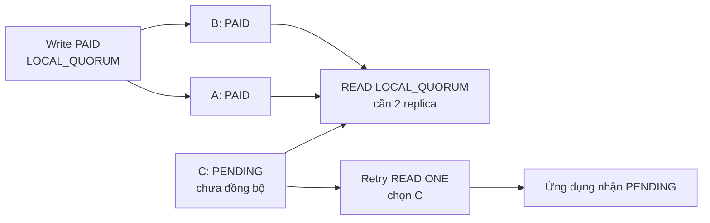
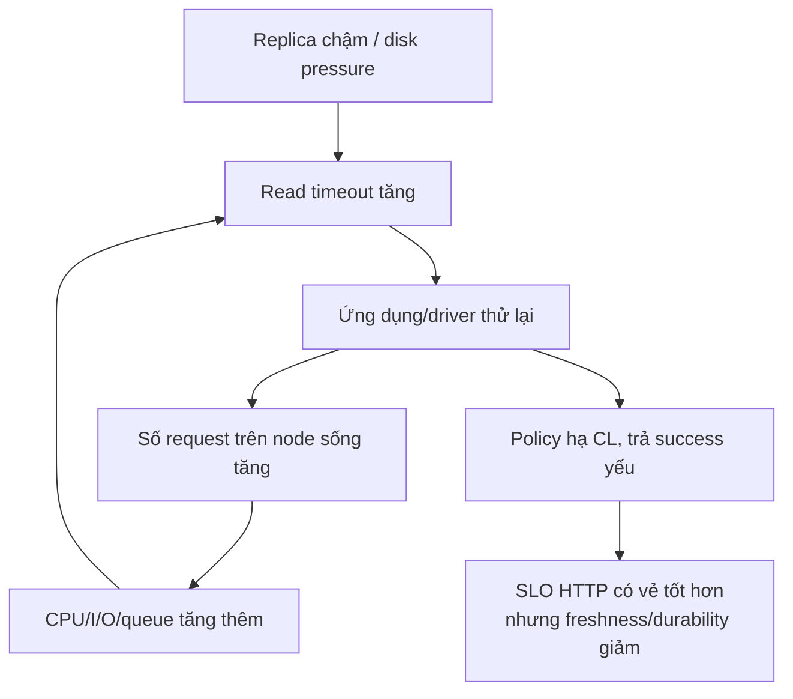

# Chính sách hạ consistency level và nguy cơ vi phạm yêu cầu nghiệp vụ

**Chương:** Retry và lỗi Java  
**Module:** `DATABASE_ENGINE_WIDE_COLUMN_CASSANDRA` — Apache Cassandra

Một ứng dụng Java đọc số dư tại `LOCAL_QUORUM`, nhưng khi một replica chậm hoặc mất kết nối, retry policy tự động thử lại với `ONE`. Màn hình vẫn hiện kết quả và tỷ lệ HTTP 200 có thể tăng; tuy nhiên, giá trị trả về có thể **cũ hơn lần ghi vừa được xác nhận ở quorum**. Nếu endpoint dùng dữ liệu đó để quyết định chi tiền, giữ chỗ hàng tồn kho hoặc kiểm tra quyền truy cập, một lần fallback tưởng như “cải thiện availability” có thể vi phạm yêu cầu nghiệp vụ.

Điều nguy hiểm hơn xảy ra ở đường ghi: một chính sách retry kiểu **consistency downgrading** có thể coi một số write timeout là thành công khi chỉ một replica xác nhận, dù ứng dụng ban đầu yêu cầu quorum. Những khác biệt này phải được biểu đạt thành **hợp đồng nhất quán của API**, không chỉ cấu hình của Cassandra Driver.

Bài này đặt trong module `DATABASE_ENGINE_WIDE_COLUMN_CASSANDRA`: hiểu kiến trúc phân tán và wide-column, partition key, thiết kế bảng theo truy vấn, consistency level, CQL, replication, compaction, repair, xử lý lỗi và kết nối từ Java. Trọng tâm là chính sách **hạ consistency level trong retry**, cách đánh giá rủi ro và thiết kế fallback an toàn theo từng loại nghiệp vụ.

> **Phạm vi phiên bản:** Cassandra 4.1/5.x; Java Driver cho Apache Cassandra 4.x, đặc biệt tài liệu **4.18.1**. `ConsistencyDowngradingRetryPolicy` có sẵn từ **Java Driver 4.10**; trong các bản 4.0–4.9 không có bản dựng sẵn tương đương. Tài liệu 3.x dùng tên/hành vi và API khác. Không suy rằng mọi phiên bản Driver mặc định tự hạ CL. Các lệnh gây mất replica hoặc thay retry policy chỉ thực hiện trên cluster **disposable/lab**, không áp dụng trực tiếp production.

## 1. Kết quả học tập

Sau bài này, bạn có thể:

1. Giải thích `ONE`, `LOCAL_ONE`, `QUORUM`, `LOCAL_QUORUM`, `EACH_QUORUM`, `ALL` và các số replica cần phản hồi.
2. Chứng minh bằng ví dụ RF=3 rằng hạ read/write CL có thể phá **quorum intersection** và kỳ vọng read-after-write.
3. Phân biệt retry **giữ nguyên CL** với retry **hạ CL**, và phân biệt **retry** với **ignore error**.
4. Hiểu chính xác các tình huống cơ bản của `DefaultRetryPolicy` và `ConsistencyDowngradingRetryPolicy` trong Driver 4.10+.
5. Giải thích khác biệt giữa `UnavailableException`, `ReadTimeoutException`, `WriteTimeoutException` và `DriverTimeoutException`.
6. Biết vì sao `setIdempotent(true)` không phải giấy phép hạ CL hoặc tạo exactly-once cho mutation.
7. Xây hợp đồng riêng cho tài khoản/số dư, inventory, bảo mật, dashboard và các dữ liệu chấp nhận trễ.
8. Viết Java Driver code **fail closed** cho đường quan trọng và **fallback minh bạch, có giới hạn** cho dashboard chỉ đọc.
9. Thiết kế lab RF=3, mô phỏng thiếu replica và kiểm thử CL mà không nhầm việc giảm lỗi HTTP với dữ liệu đúng.
10. Tạo monitoring, alert, runbook và điều kiện dừng khi fallback vi phạm giới hạn đã phê duyệt.

## 2. Consistency level ràng buộc điều gì?

Cassandra phân tán mỗi partition (theo **partition key/token**) đến nhiều replica theo replication strategy. **Consistency level (CL)** chỉ định số/loại replica phải phản hồi để một thao tác đọc hoặc ghi đạt yêu cầu. CL không tự biến một câu CQL thành giao dịch ACID đa partition, và không chứng minh tất cả replica luôn đồng bộ.

### 2.1. Bảng các mức phổ biến

| CL | Yêu cầu khái niệm | Ghi chú |
| --- | --- | --- |
| `ONE` | Một replica phản hồi | Có thể đến replica ở DC khác theo query/coordinator/topology |
| `LOCAL_ONE` | Một replica trong DC local đáp ứng | Giữ ranh giới DC local tốt hơn `ONE` |
| `TWO` / `THREE` | Hai/ba replica | Cần RF và số replica sống tương ứng |
| `QUORUM` | Đa số tổng số replica theo RF của keyspace | Với total RF=3, cần 2; multi-DC có thể dùng replica nhiều DC |
| `LOCAL_QUORUM` | Đa số replica trong **DC của coordinator** | Với RF local=3, cần 2 tại DC ấy |
| `EACH_QUORUM` | Quorum trong **mỗi DC** của keyspace | Chủ yếu dùng cho ghi; không coi là CL đọc thay thế tổng quát |
| `ALL` | Tất cả replica yêu cầu phải đáp ứng | Dễ mất availability nếu chỉ một replica Down |
| `ANY` | Với **ghi**, có thể được ACK bởi replica hoặc hint ở coordinator | Không hỗ trợ đọc; ACK qua hint không chứng minh dữ liệu đã tới replica |

Việc Cassandra gửi mutation tới các replica và việc **coordinator đợi bao nhiêu ACK** là hai khía cạnh khác nhau. Ví dụ `LOCAL_QUORUM` ở RF3 không có nghĩa coordinator chỉ gửi mutation tới đúng hai node; nó có nghĩa phải đạt số ACK tương ứng trước khi trả success.

### 2.2. Công thức giao tập quorum

Một cách lập luận cơ bản cho **cùng replica set**:

\[
R + W > RF
\]

với `R` là số replica cần phản hồi khi đọc, `W` khi ghi và `RF` là tổng replica trong phạm vi xét. Nếu tổng lớn hơn RF, tập replica trả lời của read/write buộc có giao nhau.

Ví dụ 1 DC có RF=3:

| Write CL | Read CL | W + R | So với RF=3 | Có giao tập bắt buộc? |
| --- | --- | ---: | ---: | --- |
| `LOCAL_QUORUM` (2) | `LOCAL_QUORUM` (2) | 4 | 4 > 3 | Có |
| `LOCAL_QUORUM` (2) | `LOCAL_ONE` (1) | 3 | 3 = 3 | **Không** |
| `ONE` (1) | `LOCAL_QUORUM` (2) | 3 | 3 = 3 | **Không** |
| `ONE` (1) | `ONE` (1) | 2 | 2 < 3 | **Không** |
| `ALL` (3) | `ONE` (1) | 4 | 4 > 3 | Có nếu thao tác ALL thật sự hoàn tất |

Đây là lập luận về giao tập với giả thiết replica placement, timestamps, thứ tự ghi và phạm vi DC phù hợp. **Không** từ đó kết luận hệ thống tuyến tính hóa (*linearizable*) trong mọi trường hợp đồng thời, lỗi mạng hoặc ghi xung đột. Cassandra có hòa giải theo timestamp/last-write-wins; nếu business invariant đòi điều kiện chuyển trạng thái nguyên tử, cần mô hình CAS/LWT hoặc nguồn giao dịch phù hợp.

### 2.3. Một sơ đồ dữ liệu đọc cũ

Giả sử write `LOCAL_QUORUM` được A và B ACK, C vẫn chưa nhận mutation:

```text
Partition P, RF=3 trong dc1
  A: status = PAID  (đã nhận write)
  B: status = PAID  (đã nhận write)
  C: status = PENDING (chưa theo kịp)

Read LOCAL_QUORUM cần 2:
  B + C hoặc A + C -> có ít nhất 1 bản mới

Read LOCAL_ONE chỉ cần 1:
  Nếu chọn C -> có thể thấy PENDING (stale)
```

Nếu timeout làm driver hạ `LOCAL_QUORUM → ONE`, response có thể chứa `PENDING` mặc dù trước đó ứng dụng ghi `PAID` và nhận ACK quorum. **Failing a read** và **trả dữ liệu cũ như dữ liệu hiện tại** có hậu quả nghiệp vụ rất khác nhau.



Sơ đồ mô tả một cửa sổ chênh lệch khả dĩ, **không** phải cam kết mọi read ở `ONE` đều stale.

## 3. Hạ CL chính xác là thay đổi hợp đồng nào?

Một request ban đầu yêu cầu `LOCAL_QUORUM` nhưng được xử lý bằng `ONE` có thể làm thay đổi:

- **Số replica được kiểm tra/ACK:** giảm ngưỡng xác nhận.
- **Giá trị có thể quan sát:** read có thể từ một replica chưa có write mới.
- **Độ bền được công bố:** write từng được hứa ACK từ nhiều replica nhưng chỉ một replica phản hồi.
- **Ranh giới DC:** `ONE` không ràng buộc replica cùng DC như `LOCAL_ONE`.
- **Khả năng đối soát:** request “thành công” ở CL yếu hơn nhưng log/metrics chỉ ghi HTTP 200 có thể che vi phạm.
- **Rủi ro nghiệp vụ:** authorization/tiền/tồn kho/counter có điều kiện đúng khác dashboard.

Câu “giảm CL làm hệ thống sẵn sàng hơn” mới nói **một phần**. Đúng hơn: giảm CL **cho phép trả lời với ít ACK hơn trong một số tình huống**, đổi lại giảm tính mạnh của bảo đảm đọc/ghi. Khi một replica duy nhất Down, write `LOCAL_QUORUM` RF3 vẫn có thể thành công; không cần hạ CL theo phản xạ.

### 3.1. Một ví dụ hạ write rồi read lại

```text
RF3: A, B, C

Client ghi X=10 với yêu cầu QUORUM (W=2).
A nhận X=10; B/C chưa trả lời.
Coordinator báo WRITE_TIMEOUT, received=1.

Policy coi 1 ACK là thành công ở mức ONE và "ignore" lỗi.
Client báo "ghi thành công" cho nghiệp vụ.

Client khác đọc QUORUM ở B+C:
B/C có thể vẫn thấy X=9.

Từ góc nhìn hợp đồng W=2/R=2:
  Kỳ vọng giao tập quorum ban đầu không được bảo đảm.
```

Ở đây **W thực tế = 1**, không phải 2. Việc client được kết quả success do retry policy **không thay đổi thực tế vật lý** của số ACK.

### 3.2. Consistency không đơn giản là “số bản sao đang có”

Một replica có thể sống nhưng chậm, mất kết nối từng phần hoặc chưa có dữ liệu mới. `UnavailableException` nói về số replica coordinator **biết là live** so với required; `ReadTimeoutException` liên quan replica không phản hồi kịp. Hai lỗi khác nhau và policy có thể quyết định khác nhau. Hạ CL sau timeout có thể tăng tải ở node còn sống thay vì chữa bottleneck.

## 4. Driver 4.x: default policy không tự downgrade

Trong Java Driver 4.18.1, hai retry policy dựng sẵn có hành vi khác nhau:

- **`DefaultRetryPolicy`:** mặc định, có những lần thử lại có giới hạn khi khả năng thành công cao; **không tự hạ CL**.
- **`ConsistencyDowngradingRetryPolicy`:** lựa chọn riêng từ **4.10+** cho ứng dụng **chủ động chấp nhận giảm bảo đảm nhất quán**; có thể retry read ở CL yếu hơn hoặc **ignore write timeout** theo điều kiện.

Lịch sử phiên bản quan trọng:

| Phiên bản Driver | Tình trạng downgrading policy |
| --- | --- |
| Driver 3.x | Có `DowngradingConsistencyRetryPolicy` nhưng bị deprecated trong các phiên bản sau |
| Driver 4.0–4.9 | Không có built-in policy tương đương 3.x |
| Driver 4.10 trở lên, ví dụ 4.18.1 | Có `ConsistencyDowngradingRetryPolicy`; **không phải mặc định** |
| Custom retry policy | Có thể được ứng dụng tự cài | Phải review code và contract, không suy từ tên class |

Để kiểm tra ứng dụng có đang sử dụng downgrading, xem **effective driver configuration** theo environment/execution profile, custom `RetryPolicy` và code có tự retry bằng CL khác không. Chỉ đọc một file HOCON mặc định chưa đủ nếu runtime có override.

### 4.1. Cấu hình được đề xuất làm baseline

```hocon
# application.conf (minh họa Driver 4.x)
datastax-java-driver {
  advanced.retry-policy.class = DefaultRetryPolicy
  basic.request.default-idempotence = false
}
```

`DefaultRetryPolicy` vốn là mặc định; cấu hình tường minh giúp người review nhận ra chính sách. `default-idempotence=false` là baseline thận trọng, tránh tự đánh dấu mọi mutation có thể retry/speculate.

**Ví dụ cấu hình KHÔNG khuyến nghị dùng mặc định trên production:**

```hocon
# CHỈ để nhận diện cấu hình rủi ro trong audit hoặc lab có kiểm soát.
# KHÔNG copy vào ứng dụng tiền/tồn kho/quyền truy cập.
datastax-java-driver {
  advanced.retry-policy.class = ConsistencyDowngradingRetryPolicy
}
```

Cấu hình trên có thể khiến xử lý của request khác với CL ban đầu. Chỉ bật khi tổ chức đã phân tích và phê duyệt **mọi loại query đi qua execution profile đó**, hiểu rõ cơ chế write-ACK/ignore và cơ chế giảm CL.

### 4.2. Cảnh báo về tên `DowngradingConsistencyRetryPolicy`

Không nhầm tên cũ `DowngradingConsistencyRetryPolicy` (Driver 3.x) với `ConsistencyDowngradingRetryPolicy` (Driver 4.10+). Chuyển project Java 3.x → 4.x phải kiểm tra lại tên, hành vi và effective configuration; không copy class name/config từ bài viết cũ rồi suy chắc có tác dụng.

## 5. Bốn quyết định của RetryPolicy

Tài liệu Java Driver mô tả các verdict khái niệm:

1. **Retry same node:** thử lại cùng coordinator, có thể giữ nguyên hoặc thay CL theo quyết định.
2. **Retry next node:** thử coordinator tiếp theo trong query plan.
3. **Rethrow:** trả lỗi về ứng dụng; giữ nguyên ý nghĩa “chưa đáp ứng yêu cầu”.
4. **Ignore:** coi request thành công và trả **kết quả rỗng** dù coordinator đã báo lỗi.

**`Ignore` không phải retry** và là loại dễ gây sai lệch nhất cho nghiệp vụ: ứng dụng có thể ghi log “success” khi thao tác **không đạt CL đã yêu cầu**.

### 5.1. Bảng quyết định theo loại lỗi (Driver 4.18.1)

| Tình huống | `DefaultRetryPolicy` | `ConsistencyDowngradingRetryPolicy` | Nguy cơ |
| --- | --- | --- | --- |
| `UNAVAILABLE`, thiếu replica để đạt CL | Thử tối đa một lần ở **node kế tiếp**, giữ CL | Có thể thử **cùng coordinator** với CL thấp hơn | Từ chối theo contract bị thay bằng kết quả yếu |
| `READ_TIMEOUT`, đủ số response nhưng thiếu dữ liệu thực | Có thể thử **cùng node** một lần, giữ CL | Tương tự default | Thêm latency; vẫn phải xét stale/overload |
| `READ_TIMEOUT`, thiếu số response | Rethrow (không downgrade) | Có thể hạ CL và thử lại | Đọc từ tập replica yếu hơn |
| `WRITE_TIMEOUT`, write type `SIMPLE`/`BATCH`, ≥1 ACK | Thường rethrow; ngoại lệ có giới hạn cho `BATCH_LOG` | Với statement idempotent, có thể **ignore error** | Client báo success dù chưa đạt CL |
| `WRITE_TIMEOUT`, `UNLOGGED_BATCH` | Không tự coi thành công | Có thể hạ CL và retry cùng node | Partial batch + duplicate/replay effects |
| `WRITE_TIMEOUT`, `BATCH_LOG` | Có thể retry cùng node một lần | Cơ chế retry tương ứng | Phải hiểu batch semantics |
| `ReadFailure`/`WriteFailure` | Rethrow | Rethrow | Không mặc định downgrade để che lỗi thật |
| Connection closed/aborted (statement idempotent) | Có thể retry node khác | Tương tự | Retry có thể tăng tải |
| `DriverTimeoutException` | Client-side timeout; không phải server `READ_TIMEOUT` | Không suy được số ACK để hạ CL | Outcome có thể không rõ |

Bảng là **tóm tắt hành vi chính trong tài liệu Driver 4.18.1**, không phải bảo đảm tất cả policy callbacks được gọi trong mọi hoàn cảnh: query plan, retry count, idempotence, error type và các quy tắc nội bộ còn ảnh hưởng.

### 5.2. Trường hợp ngoại lệ: idempotence

Đặc biệt:

- `onWriteTimeoutVerdict` chỉ được Driver gọi cho **statement được đánh dấu idempotent**; nếu không, Driver rethrow trực tiếp.
- `onRequestAbortedVerdict` và `onErrorResponseVerdict` cũng có điều kiện idempotence.
- `onUnavailableVerdict` và `onReadTimeoutVerdict` có xử lý riêng theo nguyên nhân, không nên diễn giải bằng khẩu hiệu “mọi callback chỉ chạy nếu true”.
- Driver có các retry **hard-coded** khi chắc chắn request chưa gửi qua mạng, hoặc cần re-prepare statement, không được nhầm đó là downgrading CL.
- Policy custom có thể tạo thêm đường hành vi, nên cần review implementation và test thực tế.

**`setIdempotent(true)` không đồng nghĩa consistency requirement có thể hạ.** Một phép gán giá trị cố định có thể idempotent nhưng nghiệp vụ vẫn yêu cầu ít nhất hai replica ghi xong trước khi trả HTTP 200.

## 6. Tách rõ từng loại exception của Java Driver

### 6.1. `UnavailableException`

Coordinator biết tại thời điểm quyết định rằng số replica live không đủ để thực hiện request ở CL yêu cầu. Ví dụ RF3 local, `LOCAL_QUORUM` cần 2 nhưng coordinator chỉ thấy 1 live.

Có thể truy cập `getRequired()` và `getAlive()` trong API Java Driver khi nhận trực tiếp exception này. Tuy nhiên, sau khi default policy thử nhiều coordinators, lỗi có thể được bọc trong `AllNodesFailedException`; logic ứng dụng không nên assume mọi failure đều là một `UnavailableException` cấp ngoài cùng.

**Không biến “chỉ 1 live” thành lý do tự hạ CL** nếu thao tác cần quorum. Phản hồi 503/unavailable ở tầng API có thể chính xác về mặt hợp đồng.

### 6.2. `ReadTimeoutException`

Coordinator ban đầu tin đủ replica nhưng không nhận đủ response đúng hạn. Trong một số tình huống, số replica phản hồi đạt yêu cầu nhưng **chưa có data response**, chỉ có digest; Driver mặc định có thể thử lại cùng node một lần giữ nguyên CL.

Nếu đang thiếu response cần thiết, downgrading policy có thể thử CL thấp hơn. Điều này **không chứng minh dữ liệu đọc từ replica còn lại là mới** và có thể làm thêm request trên một cụm đã quá tải.

### 6.3. `WriteTimeoutException`

Một write timeout có thể xảy ra sau khi một hoặc nhiều replica đã áp dụng mutation. Kết quả thường thuộc nhóm **unknown outcome ở CL ban đầu**. Với policy downgrading, loại `SIMPLE`/`BATCH` và ≥1 ACK có thể bị **ignore** rồi trả một kết quả thành công/rỗng cho Java.

Điều này đặc biệt nguy hiểm nếu code:

```java
// Phản ví dụ: không bảo đảm thành công ở LOCAL_QUORUM
session.execute(writeStatement);
audit.markPaymentCommitted();  // Suy luận sai nếu retry policy đã ignore lỗi
```

Khi success bị policy chuyển nghĩa, người gọi `session.execute` không nhận được lý do để biết write **không đạt số ACK đã yêu cầu**. Vì vậy cách bảo vệ vững chắc cho đường ghi quan trọng là **không dùng policy có khả năng ignore/downgrade** trên session/execution profile ấy.

### 6.4. `DriverTimeoutException` và lỗi mạng

Đây là timeout ở phía Driver khi không có response phù hợp trong giới hạn client. Nó khác lỗi server trả `READ_TIMEOUT`/`WRITE_TIMEOUT`. App có thể không biết request đã tới coordinator/replica tới mức nào, nhất là với write.

**Không** catch `DriverTimeoutException` rồi chạy lại `counter + 1` hoặc `list append` theo phản xạ. Chúng là mutation không lũy đẳng, có thể bị nhân đôi.

### 6.5. `ReadFailureException`, `WriteFailureException`, `OverloadedException`

Đây không đơn giản là “thiếu một ACK”. Có thể có I/O error, data corruption, replica exception hoặc quá tải. Default và downgrading policies theo tài liệu không chuyển read/write failure thành tự hạ CL tùy tiện. Khi gặp các lỗi này, điều tra node/replica logs và health; hạ consistency vô tội vạ có thể che mất vấn đề phần cứng/dữ liệu.

### 6.6. Error taxonomy đề xuất cho API

| Nhóm | Ý nghĩa vận hành | Hành vi ứng dụng gợi ý |
| --- | --- | --- |
| **ACK đạt CL** | Giao dịch CQL được chấp nhận theo điều kiện đã chọn | Cho phép tiếp tục workflow trong phạm vi bảo đảm đó |
| **Unavailable** | Không đủ replica live theo coordinator | Critical: fail closed; optional read: xem policy degrade đã được phê duyệt |
| **Read timeout** | Không nhận đủ data/response đúng hạn | Critical: không dùng dữ liệu thay thế thiếu tin cậy; optional read: fallback có nhãn |
| **Write timeout** | Chưa có ACK đúng mức, có thể đã áp dụng một phần | Trả unknown/failed-contract; không tự công bố committed |
| **Driver timeout/connection loss** | Client không biết kết quả chắc chắn | Unknown outcome; reconciliation nếu write |
| **Read/write failure** | Lỗi xử lý/replica | Incident/triage, không che bằng CL thấp |
| **Unauthorized/invalid CQL** | Sai policy/schema/query | Sửa quyền/query, không retry/hạ CL |
| **LWT `[applied]=false`** | Điều kiện CAS không thỏa | Business outcome riêng, không phải retry vì CL thấp |

## 7. Điều gì vi phạm yêu cầu nghiệp vụ?

### 7.1. Tồn kho: oversell do stale read

API `reserveInventory(sku, quantity)` đọc số tồn kho tại quorum, sau đó xác định có thể bán không. Khi fallback `LOCAL_ONE` lấy từ replica chưa nhận các reservation gần đây, hệ thống có thể **đánh giá quá cao tồn kho**.

**Ngay cả quorum read rồi write cũng không tự tạo transaction chống oversell giữa các writers.** Nếu nghiệp vụ đòi invariant `available >= 0`, phải có giải pháp cấp phát/đặt chỗ có điều kiện và xử lý đồng thời phù hợp. Việc hạ CL khiến một mô hình đã yếu càng yếu hơn; không phải nguyên nhân duy nhất của oversell.

### 7.2. Thanh toán/số dư: công bố thành công sai

Một write được yêu cầu `LOCAL_QUORUM` vì hệ thống chỉ được phát hóa đơn khi mutation đã đủ ACK. Nếu retry policy ignore `WRITE_TIMEOUT` sau 1 ACK, mã ứng dụng có thể báo “thanh toán hoàn tất”, trong khi replica khác chưa có dữ liệu và node nhận write có thể lỗi trước khi hội tụ.

Không dùng downgrading global cho:
- Số dư và hạch toán.
- Thanh toán đã capture/refund.
- Hạn mức tín dụng/quota cứng.
- Khóa giao dịch/đơn hàng đang đổi trạng thái.
- Nghĩa vụ pháp lý/audit phải có bằng chứng xác nhận.

Cần lưu một nguồn sự thật giao dịch hoặc một quy trình idempotency/conditional write phù hợp. Quorum không tự thay thế ledger transaction.

### 7.3. Phân quyền: dữ liệu đã thu hồi vẫn xuất hiện

Một user bị thu hồi quyền ở quorum, nhưng ACL cache/row ở một replica khác chưa cập nhật. Read fallback `ONE` có thể trả **quyền cũ**, tạo lỗ hổng nếu ứng dụng tin dữ liệu ấy để cho phép truy cập.

Với authorization, **stale-allow là nguy hiểm**. Hành vi nên là deny/fail closed khi không thể chứng minh trạng thái quyền đạt freshness cần thiết. Không dùng dashboard-style downgrade cho authorization checks.

### 7.4. Dashboard: có thể chấp nhận trễ, nhưng phải nói thật

Một biểu đồ tổng hợp lượt xem theo giờ có thể cho phép tối đa **5 phút trễ**. Nếu `LOCAL_QUORUM` thất bại và `LOCAL_ONE` trả bản snapshot được ghi kèm `computed_at` còn trong giới hạn, API có thể trả:

```json
{
  "value": 18420,
  "quality": "DEGRADED_STALE_ALLOWED",
  "requestedConsistency": "LOCAL_QUORUM",
  "effectiveConsistency": "LOCAL_ONE",
  "computedAt": "2026-11-21T09:04:00Z",
  "maximumStalenessSeconds": 300
}
```

Đây là **response contract minh họa**, không phải trường có sẵn từ Cassandra Driver. Nếu không có `computed_at` tin cậy, không thể tự chứng minh data freshness chỉ vì CL=ONE. Nếu quá hạn hoặc null/missing, trả “unavailable” chứ không trình bày số 0 như dữ liệu hiện tại.

### 7.5. Bảng phân loại hợp đồng ứng dụng

| Workload | Mức trễ được chấp nhận | Hạ read CL? | Hạ write CL? | Chính sách khuyến nghị |
| --- | --- | --- | --- | --- |
| Số dư/tài khoản | Thường rất nghiêm ngặt | **Không** | **Không** | Fail closed, transaction/source-of-truth phù hợp |
| Đặt chỗ tồn kho | Phải bảo vệ invariant | **Không** cho quyết định đặt chỗ | **Không** | CAS/serialization/reservation protocol |
| Quyền truy cập/đã thu hồi | Không chấp nhận stale-allow | **Không** | **Không** | Deny/unavailable, audit |
| Chuyển trạng thái đơn hàng | Đòi đúng thứ tự | Thường không | Thường không | Version/conditional transition |
| Dashboard metrics | Có thể ≤5 phút | **Có điều kiện** | Không nếu ingest cần ACK nghiêm ngặt | Fallback riêng có nhãn và timestamp |
| Gợi ý nội dung | Có thể hơi cũ | Có điều kiện | Phụ thuộc event semantics | Cache/read model với stale marker |
| Logs/analytics có thể tái dựng | Tùy RPO/độ chính xác | Có thể | Chỉ nếu chính sách data loss được duyệt | Event facts và reconciliation |
| Cấu hình hiển thị không nhạy cảm | Tùy feature | Có điều kiện | Tùy owner | Giới hạn độ trễ và điều kiện rollback |

**Không tồn tại “cấu hình best practice duy nhất”** cho mọi bảng Cassandra. Phải định nghĩa freshness, durability và hành vi khi không đủ replica ở **cấp use case**, không chỉ theo keyspace hoặc tên team.

## 8. LOCAL_ONE không giống ONE trong hệ đa DC

Giả sử keyspace sử dụng `NetworkTopologyStrategy`:

```sql
WITH replication = {
  'class': 'NetworkTopologyStrategy',
  'dc1': 3,
  'dc2': 3
}
```

Ứng dụng chạy tại `dc1`, write ở `LOCAL_QUORUM` (`2/3` replicas trong dc1). Nếu fallback read `ONE`, request **có thể** được đáp ứng bởi replica ở `dc2` trong một số đường routing/coordinator, tùy trạng thái local và query plan. Đây có thể là bản copy chưa nhận mutation mới hoặc không phù hợp mục tiêu data locality.

`LOCAL_ONE` yêu cầu replica local và tránh fallback sang DC khác, **nhưng nó vẫn không đạt bảo đảm đọc tại local quorum**. Do đó:

- `LOCAL_QUORUM → LOCAL_ONE` giảm consistency nhưng giữ phạm vi DC local.
- `LOCAL_QUORUM → ONE` vừa giảm consistency vừa có thể phá ranh giới địa lý.
- `LOCAL_QUORUM → QUORUM` không phải “downgrade an toàn”: nó có thể yêu cầu replicas ở DC khác, thay latency/failure mode.
- `EACH_QUORUM` cho write đa DC không được tự giảm vì muốn tránh lỗi khi một DC down; đó là thay đổi thỏa thuận replication visibility.
- Nếu hệ có yêu cầu data residency, ngay cả read-only degrade có thể **không được phép** đưa request ra DC khác.

**Quan trọng:** việc driver có `withLocalDatacenter("dc1")` chỉ định local DC cho load balancing, không cho phép suy rằng một chính sách tự downgrade sang `ONE` có cùng semantics với `LOCAL_ONE`. Kiểm tra behavior của policy theo phiên bản và đường xử lý thực tế.

## 9. Không nên “thử QUORUM trước, ONE khi lỗi” một cách mặc định

Một anti-pattern thường gặp:

```text
read:
    try CL=QUORUM
    if exception:
        retry CL=ONE
    return result as normal success
```

Nếu client chấp nhận dữ liệu stale trong mọi tình huống, chọn `ONE` ngay từ đầu có thể có latency thấp hơn và hợp đồng rõ hơn. Nếu client **chỉ** chấp nhận stale trong sự cố, fallback phải được thiết kế thành một **chế độ degraded có điều kiện** với log, metrics, giới hạn và tiêu chí phục hồi; không nên là behavior ngầm của mọi request.

### 9.1. Phải chọn một trong ba mô hình

1. **Strict:** luôn yêu cầu CL đã duyệt; không đạt thì báo lỗi. Dành cho business-critical/authorization.
2. **Eventual by design:** dùng CL thấp từ đầu cho use case chấp nhận eventual consistency; không hứa “đọc mới ngay”.
3. **Explicit degraded-read:** thử CL mạnh, khi lỗi **thuộc nhóm được chấp nhận** thì thử CL yếu hơn, trả nhãn stale/quality, chỉ nếu freshness được chứng minh và chưa vượt error budget.

Model 3 cần owner phê duyệt. Không sử dụng “retry 3 lần” cho mọi lỗi với CL giảm dần và không hiển thị chất lượng dữ liệu.

### 9.2. Giao diện có thể cải thiện availability mà không hạ CL

- Trả cached snapshot có `computedAt` tin cậy và nhãn “dữ liệu cách đây X phút” cho dashboard.
- Thiết kế bảng projection/read model theo query để giảm latency/tombstone scan.
- Giảm partition quá lớn, điều chỉnh paging và tránh `ALLOW FILTERING`.
- Sửa node chậm, compaction backlog, network/GC hoặc hotspot.
- Tăng health/redundancy trong giới hạn RF/CL, quản lý rolling maintenance phù hợp.
- Dùng circuit breaker, backpressure và bounded request budgets để tránh retry storm.
- Hiển thị “tạm thời không thể xác nhận” thay vì dùng bản cũ cho quyết định quan trọng.

## 10. CQL lab: so sánh CL mà không lẫn dữ liệu khác

### 10.1. Cluster lab và giả định

Để dễ lý luận, dùng **ba node Cassandra** cùng DC `dc1`, NTS RF=3, tất cả healthy `UN`. Mỗi partition trong keyspace lab sẽ có ba replica ở A/B/C. Muốn làm thí nghiệm mất replica, phải dùng **cluster disposable**; không stop node thật.

```bash
nodetool status
nodetool describecluster
cqlsh
```

Trong `cqlsh`:

```sql
SELECT data_center, release_version
FROM system.local;
```

Nếu DC thực tế tên khác `dc1`, thay tên trong DDL. Chỉ dùng RF=3 nếu DC đủ node và đủ resource; RF=1 không cho thấy ví dụ quorum hai replica.

### 10.2. Tạo bảng dữ liệu quan trọng và bảng dashboard

```sql
CREATE KEYSPACE IF NOT EXISTS lab_cl_retry
WITH replication = {
  'class': 'NetworkTopologyStrategy',
  'dc1': 3
}
AND durable_writes = true;

CREATE TABLE IF NOT EXISTS lab_cl_retry.account_state_by_id (
    account_id uuid PRIMARY KEY,
    state text,
    version bigint,
    changed_at timestamp
);

CREATE TABLE IF NOT EXISTS lab_cl_retry.dashboard_by_id (
    dashboard_id uuid PRIMARY KEY,
    display_name text,
    active_users int,
    computed_at timestamp
);
```

`account_id` và `dashboard_id` là partition keys; truy vấn theo đầy đủ khóa sẽ định vị replica set rõ hơn scan toàn keyspace. Bảng dashboard chỉ chứa dữ liệu tổng hợp được phép stale; không dùng làm nguồn quyết định thanh toán.

### 10.3. Ghi baseline tại ALL khi cả ba replica Up

```sql
CONSISTENCY ALL

INSERT INTO lab_cl_retry.account_state_by_id
    (account_id, state, version, changed_at)
VALUES (
    10000000-0000-4000-8000-000000000010,
    'ACTIVE',
    1,
    '2026-11-21T09:00:00Z'
);

INSERT INTO lab_cl_retry.dashboard_by_id
    (dashboard_id, display_name, active_users, computed_at)
VALUES (
    20000000-0000-4000-8000-000000000010,
    'homepage-traffic',
    42,
    '2026-11-21T09:00:00Z'
);

SELECT account_id, state, version
FROM lab_cl_retry.account_state_by_id
WHERE account_id = 10000000-0000-4000-8000-000000000010;
```

Khi `ALL` success, đã có đủ ACK cho ví dụ ban đầu. Nếu lệnh thất bại, **không tiếp tục như thể baseline nhất quán**; sửa lab hoặc dùng khóa mới.

### 10.4. Một replica Down: local quorum còn khả dụng

Trong cluster Docker disposable, **chỉ khi container thực sự tên `cassandra3` và được phép dừng**:

```bash
# MINH HỌA LAB DISPOSABLE. Không chạy trên production.
docker stop cassandra3

# Trên node còn sống:
nodetool status
```

Trong `cqlsh` kết nối tới node A/B còn sống:

```sql
CONSISTENCY LOCAL_QUORUM

UPDATE lab_cl_retry.account_state_by_id
SET state = 'SUSPENDED',
    version = 2,
    changed_at = '2026-11-21T09:10:00Z'
WHERE account_id = 10000000-0000-4000-8000-000000000010;

SELECT state, version
FROM lab_cl_retry.account_state_by_id
WHERE account_id = 10000000-0000-4000-8000-000000000010;
```

RF3 local quorum=2; nếu A/B khỏe, các thao tác có thể thành công. **Không có lý do kỹ thuật để tự hạ xuống ONE chỉ vì C Down**. Nếu thử `CONSISTENCY ALL` khi C Down, unavailable là kết quả đúng theo CL, không chứng minh lỗi dữ liệu.

### 10.5. Hai replicas Down: mất quorum

Trong **lab disposable**, nếu muốn mô phỏng chỉ còn A:

```bash
# Chỉ khi cả hai container đúng tên và test được phê duyệt:
docker stop cassandra2

# Sau phép thử, phục hồi cả hai:
docker start cassandra2
docker start cassandra3
```

Thời điểm chỉ còn A:

```sql
CONSISTENCY LOCAL_QUORUM

SELECT state, version
FROM lab_cl_retry.account_state_by_id
WHERE account_id = 10000000-0000-4000-8000-000000000010;

-- Có thể UNAVAILABLE vì chỉ một replica Up.
CONSISTENCY ONE

SELECT state, version
FROM lab_cl_retry.account_state_by_id
WHERE account_id = 10000000-0000-4000-8000-000000000010;
```

`ONE` **có thể** trả dữ liệu; điều đó không làm request `LOCAL_QUORUM` trước trở thành đã đạt quorum. `cqlsh` không tự sử dụng Java Driver 4.x retry policy; việc đổi `CONSISTENCY` ở trên là phép **mô phỏng có chủ đích** sự khác biệt CL, không phải kiểm thử implementation của `ConsistencyDowngradingRetryPolicy`.

**Lưu ý vận hành:** Sau khi hai nodes khởi động lại, xác minh `nodetool status`, logs, hints/repair needs; không thử kết quả stale như một điều chắc chắn. Hinted handoff và trạng thái replica có thể nhanh chóng hội tụ, nên một SELECT `ONE` ở lab không phải phép kiểm định xác định stale ở mọi lần chạy.

### 10.6. Trường hợp dữ liệu stale mô tả bằng snapshots

Để chứng minh về mặt logic, có thể ghi bảng trạng thái giả định tại một thời điểm:

| Replica | `account.state` | `account.version` |
| --- | --- | ---: |
| A | `SUSPENDED` | 2 |
| B | `SUSPENDED` | 2 |
| C | `ACTIVE` | 1 |

Khi C quay lại nhưng chưa nhận update, read `LOCAL_ONE` nhắm C có thể trả `ACTIVE`. **Không cần cố tình phá repair hoặc bỏ hints** để tái hiện stale trên production. Bảng minh họa đã đủ để phân tích quorum intersection.

## 11. Java Driver: fail closed cho dữ liệu quan trọng

Ví dụ Java Driver 4.x nhận một `CqlSession` đã được cấu hình TLS/auth và local DC phù hợp. Query đọc trạng thái tài khoản **không fallback** nếu không đạt CL.

```java
import com.datastax.oss.driver.api.core.CqlSession;
import com.datastax.oss.driver.api.core.DefaultConsistencyLevel;
import com.datastax.oss.driver.api.core.cql.PreparedStatement;
import com.datastax.oss.driver.api.core.cql.Row;

import java.util.UUID;

public final class StrictAccountReader {
    private final CqlSession session;
    private final PreparedStatement read;

    public StrictAccountReader(CqlSession session) {
        this.session = session;
        this.read = session.prepare(
            "SELECT state, version " +
            "FROM lab_cl_retry.account_state_by_id " +
            "WHERE account_id = ?"
        );
    }

    public AccountState readStrict(UUID accountId) {
        // Idempotent vì chỉ đọc, nhưng policy vẫn giữ CL yêu cầu.
        Row row = session.execute(
            read.bind(accountId)
                .setConsistencyLevel(DefaultConsistencyLevel.LOCAL_QUORUM)
                .setIdempotent(true)
        ).one();

        if (row == null) {
            // Chỉ diễn giải ABSENT khi read thật sự hoàn tất ở CL yêu cầu.
            return null;
        }

        return new AccountState(
            row.getString("state"),
            row.getLong("version")
        );
    }

    public static final class AccountState {
        public final String state;
        public final long version;

        public AccountState(String state, long version) {
            this.state = state;
            this.version = version;
        }
    }
}
```

**Cách dùng:** cấu hình driver cho đường ứng dụng này là `DefaultRetryPolicy`, không dùng downgrading execution profile; nếu không đạt CL, lỗi đi lên service boundary và trả response dạng “không thể xác minh trạng thái” theo API contract.

**Không** dùng:

```java
// PHẢN VÍ DỤ — không dùng cho tiền/quyền/tồn kho:
try {
    return readAtLocalQuorum(accountId);
} catch (RuntimeException ex) {
    return readAtOne(accountId); // Có thể stale, che cả lỗi CQL/auth.
}
```

Đặc biệt không catch `UnauthorizedException`/`InvalidQueryException` rồi hạ CL; những lỗi đó không liên quan thiếu replica.

### 11.1. Không tự mở policy downgrading trong thư viện chung

Một thư viện Java nội bộ tạo `CqlSession` và bật policy downgrading toàn cục có thể ảnh hưởng mọi use case: dashboard, order, payment, authentication. **Service owner có thể không biết chính sách đã đổi** vì lớp DAO vẫn gọi `setConsistencyLevel(LOCAL_QUORUM)`.

Vì thế, review effective config/execution profile và contract quan trọng hơn chỉ nhìn code của một query.

## 12. Java Driver: fallback có kiểm soát cho dashboard

Chỉ dashboard/analytics được phép stale mới có đường fallback. Ta **không bật `ConsistencyDowngradingRetryPolicy` toàn cục**; thay vào đó, ứng dụng chủ động quyết định khi nào retry, gắn nhãn quality và kiểm tra `computed_at`.

### 12.1. Hợp đồng degraded read

Một response degraded được cho phép khi **tất cả** điều kiện sau đúng:

- Query là **read-only**, không chứa side effects nghiệp vụ.
- Data owner đã duyệt freshness bound, ví dụ tối đa 300 giây.
- Lỗi là **nhóm thiếu replica/read timeout được phân loại**, không phải unauthorized/invalid query/corruption.
- Fallback chỉ được thử **tối đa một lần** với CL được quy định (ưu tiên `LOCAL_ONE` khi cần local DC).
- Dữ liệu trả về có **timestamp đáng tin cậy**, nằm trong giới hạn trễ.
- Response chứa nhãn **DEGRADED** và effective consistency, không giả làm strong read.
- Có rate limit/circuit breaker, metrics và kill switch để tắt fallback.
- Nếu dữ liệu vắng mặt hoặc quá cũ, **không** trả giá trị mặc định như dữ liệu hiện tại.

### 12.2. Ví dụ Java đầy đủ

```java
import com.datastax.oss.driver.api.core.CqlSession;
import com.datastax.oss.driver.api.core.DefaultConsistencyLevel;
import com.datastax.oss.driver.api.core.cql.BoundStatement;
import com.datastax.oss.driver.api.core.cql.PreparedStatement;
import com.datastax.oss.driver.api.core.cql.Row;
import com.datastax.oss.driver.api.core.servererrors.ReadTimeoutException;
import com.datastax.oss.driver.api.core.servererrors.UnavailableException;

import java.time.Duration;
import java.time.Instant;
import java.util.UUID;

public final class BoundedDashboardReader {
    private final CqlSession session;
    private final PreparedStatement query;
    private final Duration maximumAge = Duration.ofMinutes(5);

    // Flag phải do configuration/feature-management được phê duyệt quản lý.
    private final boolean allowDegradedRead;

    public BoundedDashboardReader(
            CqlSession session,
            boolean allowDegradedRead) {
        this.session = session;
        this.allowDegradedRead = allowDegradedRead;
        this.query = session.prepare(
            "SELECT display_name, active_users, computed_at " +
            "FROM lab_cl_retry.dashboard_by_id " +
            "WHERE dashboard_id = ?"
        );
    }

    public DashboardValue read(UUID dashboardId) {
        try {
            Row row = execute(dashboardId,
                DefaultConsistencyLevel.LOCAL_QUORUM);

            // Một kết quả quorum thành công không cần downgrade.
            return parse(row, "NORMAL",
                "LOCAL_QUORUM", false);
        } catch (UnavailableException | ReadTimeoutException ex) {
            // Chỉ một số lỗi server-side được phép xét fallback.
            if (!allowDegradedRead) {
                throw ex;
            }

            // Không bắt RuntimeException chung để tránh che lỗi bảo mật,
            // schema, I/O hoặc DriverTimeoutException không rõ kết quả.
            Row row = execute(dashboardId,
                DefaultConsistencyLevel.LOCAL_ONE);

            return parse(row, "DEGRADED",
                "LOCAL_ONE", true);
        }
    }

    private Row execute(UUID id, DefaultConsistencyLevel cl) {
        BoundStatement request = query.bind(id)
            .setConsistencyLevel(cl)
            .setIdempotent(true);
        return session.execute(request).one();
    }

    private DashboardValue parse(
            Row row,
            String quality,
            String effectiveCl,
            boolean enforceAge) {
        if (row == null || row.isNull("computed_at")) {
            // Không chuyển null thành 0 users hay dữ liệu chắc chắn vắng.
            throw new IllegalStateException(
                "Dashboard snapshot unavailable"
            );
        }

        Instant computedAt = row.getInstant("computed_at");
        Instant now = Instant.now();

        if (computedAt.isAfter(now.plusSeconds(5))) {
            throw new IllegalStateException(
                "Untrusted future timestamp / clock skew"
            );
        }

        Duration age = Duration.between(computedAt, now);
        if (enforceAge && age.compareTo(maximumAge) > 0) {
            throw new IllegalStateException(
                "Fallback snapshot older than allowed bound"
            );
        }

        return new DashboardValue(
            row.getString("display_name"),
            row.getInt("active_users"),
            computedAt,
            quality,
            effectiveCl
        );
    }

    public static final class DashboardValue {
        public final String name;
        public final int activeUsers;
        public final Instant computedAt;
        public final String quality;
        public final String effectiveConsistency;

        DashboardValue(
                String name,
                int activeUsers,
                Instant computedAt,
                String quality,
                String effectiveConsistency) {
            this.name = name;
            this.activeUsers = activeUsers;
            this.computedAt = computedAt;
            this.quality = quality;
            this.effectiveConsistency = effectiveConsistency;
        }
    }
}
```

### 12.3. Giới hạn quan trọng của ví dụ

- Code minh họa **một fallback tối đa**, không dùng vòng lặp đến khi thành công. Driver vẫn có thể thực hiện retry theo `DefaultRetryPolicy` trước khi exception tới ứng dụng; muốn ràng buộc số attempts toàn đường cần theo dõi cả driver và application layers.
- `UnavailableException` và `ReadTimeoutException` đôi khi có thể nằm trong `AllNodesFailedException` do Driver thử coordinators; ví dụ **không tự bóc mọi exception lồng nhau** để khỏi fallback sai. Production có thể có bộ phân loại lỗi đã review, chỉ mở rộng khi chắc chắn.
- `computed_at` phải được cập nhật **theo thời điểm kết quả tổng hợp thực sự được tính** từ nguồn tin cậy, không tự gán thời điểm đọc. Timestamp có thể còn mới dù dữ liệu nguồn chưa hội tụ, nên nó là một **giới hạn freshness ứng dụng**, không phải bằng chứng linearizability.
- Cần kiểm tra chính sách clock/NTP; độ lệch giờ làm kết luận stale sai.
- `LOCAL_ONE` giữ ranh giới DC local hơn `ONE` nhưng **vẫn** không có quorum intersection với một write local quorum của RF3.
- Dashboard response bình thường cũng nên kèm metadata chất lượng hoặc khung thời gian để người đọc hiểu số liệu.
- Trong sản phẩm thật, fallback còn cần timeout tổng, circuit breaker, rate limit và người chịu trách nhiệm duyệt tính năng; chúng không được triển khai trọn trong ví dụ Java.
- Không dùng mẫu này cho số dư, phân quyền hoặc quyết định đặt chỗ.

### 12.4. Vì sao không hạ write CL theo cách tương tự?

Một read-only snapshot cũ có thể được UI **đánh dấu**. Nhưng đối với write có side effect, một lần gửi lại ở CL yếu có thể:

- Đã ghi ở một vài replica từ lần đầu → lặp mutation.
- Ghi counter/list append thêm lần nữa.
- Phá điều kiện chuyển trạng thái của writer khác.
- Tạo success giả định cho business transaction.
- Thay thứ tự ghi/TTL/timestamp.
- Không đạt RPO/durability contract dù HTTP 200.

Vì vậy **ví dụ fallback chỉ dành cho SELECT được phép stale**. Không viết hàm Java `writeAtQuorumOrOne()` dùng chung cho API nghiệp vụ.

## 13. Idempotence và consistency downgrade là hai trục khác nhau

### 13.1. Mutation có thể idempotent nhưng không được hạ CL

```sql
UPDATE lab_cl_retry.account_state_by_id
SET state = 'SUSPENDED'
WHERE account_id = 10000000-0000-4000-8000-000000000010;
```

Về trạng thái giá trị đơn giản, chạy cùng phép gán nhiều lần có thể cho cùng kết quả. Nhưng nếu hệ thống yêu cầu **ACK ở LOCAL_QUORUM trước khi gửi email xác nhận thu hồi quyền**, một ACK đơn lẻ không đủ. `setIdempotent(true)` không hạ yêu cầu duy trì chính sách quorum.

### 13.2. Counter và list append càng nguy hiểm

Ví dụ bảng counter bổ sung trong keyspace lab:

```sql
CREATE TABLE IF NOT EXISTS lab_cl_retry.metrics_by_id (
    metric_id uuid PRIMARY KEY,
    views counter
);
```

```sql
-- KHÔNG lũy đẳng:
UPDATE lab_cl_retry.metrics_by_id
SET views = views + 1
WHERE metric_id = 10000000-0000-4000-8000-000000000020;
```

Câu lệnh tăng counter trên bảng vừa tạo bị gửi lại có thể cộng hai lần; không được đánh dấu `setIdempotent(true)` chỉ để kích hoạt downgrading policy. Cũng không dùng `BEGIN COUNTER BATCH` như biện pháp exactly-once.

### 13.3. Bảng kết hợp hai trục

| Mutation | Idempotent? | Hạ CL được không? |
| --- | --- | --- |
| SELECT dashboard có stale bound | Read-only | Có thể, **chỉ với fallback được công bố** |
| SELECT số dư/quyền truy cập | Read-only | **Không** theo business contract |
| SET status fixed value | Có điều kiện | **Không** nếu cần quorum ACK/durability |
| INSERT event fact với UUID cố định | Có điều kiện | Tùy hợp đồng ghi; không mặc định |
| Counter `+1` | **Không** | Không |
| List append/prepend | **Không** | Không |
| LWT `IF version=...` | Conditional; outcome cần phân biệt | Không biến điều kiện thành read/write ONE |
| LOGGED BATCH/UNLOGGED BATCH | Phụ thuộc mutations, batch semantics | Không hạ để che partial/unknown |
| Read từ cache có nhãn timestamp | Không phát sinh mutation | Có thể theo SLA stale đã duyệt |

Phải xét **cả hai câu hỏi** trong review: (1) an toàn khi gửi lại không? (2) bảo đảm CL ban đầu có được phép giảm không?

## 14. LWT, SERIAL và các yêu cầu điều kiện

Cassandra có **lightweight transactions** với `IF` để thực hiện conditional updates trong phạm vi hỗ trợ, dùng Paxos và các consistency levels riêng như `SERIAL`/`LOCAL_SERIAL` cho phần điều kiện. Những cơ chế này **khác** một write thường `LOCAL_QUORUM`.

```sql
UPDATE lab_cl_retry.account_state_by_id
SET state = 'SUSPENDED',
    version = 2
WHERE account_id = 10000000-0000-4000-8000-000000000010
IF version = 1;
```

Phải đọc kết quả `[applied]` và trạng thái thực nếu timeout. Không thể thay phần điều kiện bằng `ONE` để “giải quyết” lỗi quorum; đó là **thay đổi semantics CAS**. Trường `setSerialConsistencyLevel(...)` trong Java Driver cũng phải được chọn theo hợp đồng LWT và phiên bản, không đồng nghĩa với retry downgrade thông thường.

Khi cần exactly-once cho payment/order transition, xem xét event ID, dedup/CAS/transactional source-of-truth. **LWT không tạo giao dịch ACID tổng quát qua mọi partition**, và retry sau timeout vẫn cần biết lần đầu có thể đã áp dụng.

## 15. Không nhầm `ANY` với lựa chọn fallback an toàn

`ANY` chỉ áp dụng cho **write**. Trong một số trường hợp, coordinator có thể ACK sau khi giữ một **hint**, trước khi mutation đến replica đích. Vì thế:

- `ANY` không phải cách đọc “mạnh hơn ONE”.
- Write ACK ở ANY có semantics độ bền/khả dụng khác LOCAL_QUORUM.
- Nếu node chứa hint mất dữ liệu trước khi replay, khả năng khôi phục khác so với một write đã nằm trên nhiều replica.
- Không dùng ANY để “ghi chắc chắn thanh toán” khi nghiệp vụ cần quorum ACK.
- Không hạ tùy tiện sang ANY khi write ở QUORUM timeout.

Các phiên bản/cấu hình hiện đại còn có giới hạn hinted handoff/hints và thao tác đặc biệt; đọc tài liệu version cụ thể trước khi suy bảo đảm từ ACK.

## 16. Retry storm và ảnh hưởng đến cluster health

Khi replica chậm vì disk I/O/compaction/tombstone, một retry có thể làm tải nặng hơn:



Nếu cả retry policy và HTTP gateway đều thử lại ba lần, số attempt có thể tăng theo bội số. Nếu có speculative execution, cùng request idempotent có thể được gửi tới nhiều coordinators. Đây là lý do phân tích hiệu năng cần:

- Attempt count **toàn bộ đường đi**: driver + service + message queue + gateway.
- End-to-end timeout budget, không chỉ một `request.timeout`.
- Backoff có jitter và giới hạn đồng thời.
- Circuit breaker/overload policy.
- SLO riêng cho **normal success** và **degraded success**.
- Error rate của coordinator/replicas và pressure trên DC.
- Không kích hoạt downgrade để che hạ tầng thiếu capacity.

## 17. Observability: phải đo cả “độ đúng” của response

### 17.1. Dashboard giám sát

| Panel/metric | Điều cần theo dõi |
| --- | --- |
| `requested_consistency` vs `effective_consistency` | Biết request nào thực sự được giảm CL |
| Retry policy class / execution profile | Phát hiện policy downgrading ngoài ý muốn |
| Retry decisions | retry same/next, rethrow, **ignore**, downgrade |
| Read/write p50/p95/p99 | SLO latency và tác động tới business |
| Unavailable/read/write/driver timeouts | Phân biệt các failure modes |
| Degraded result rate | Tỷ lệ response chấp nhận stale |
| Stale age histogram | Dữ liệu fallback trễ bao lâu |
| Quorum failure rate | Availability theo CL chuẩn |
| App-level unknown writes | Các write chưa xác minh thành công |
| Node health/replica availability | `nodetool status`, DC/rack/token |
| Compaction/GC/disk I/O | Nguyên nhân gốc gây timeouts |
| Hints/repair/streaming | Trạng thái bù dữ liệu sau node down |
| Cross-DC traffic | Có route bất ngờ qua region khác khi fallback không? |
| Business discrepancies | Inventory mismatch, stale authorization, reconciliation |

**Không** dùng mỗi HTTP 200 rate để báo “dịch vụ hồi phục”. Khi response degraded tăng từ 0 lên 30%, khả năng client nhận một giá trị có tính tươi yếu hơn đã thay đổi đáng kể.

### 17.2. Log có phân loại

```text
request_id=... endpoint=/dashboard/traffic
requested_cl=LOCAL_QUORUM
effective_cl=LOCAL_ONE
quality=DEGRADED
fallback_reason=read_timeout
data_age_seconds=85
retry_attempts_total=2
result=SUCCESS_DEGRADED

request_id=... endpoint=/payments/capture
requested_cl=LOCAL_QUORUM
effective_cl=LOCAL_QUORUM
quality=STRICT
result=UNVERIFIED_WRITE
error_class=WriteTimeoutException
business_action=NO_COMMIT_ACK
```

Đây là **mẫu log ứng dụng tự xây**, không phải fields mặc định của Driver. `effective_cl` phải được ghi đúng theo logic thực tế; nếu policy bên dưới tự downgrade/ignore mà app không biết, không được tự điền `LOCAL_QUORUM` chỉ dựa vào câu `setConsistencyLevel`.

Đừng log số tài khoản, thông tin thanh toán hoặc partition key thô vào metrics labels; dùng correlation IDs được quản lý để tránh lộ dữ liệu/cardinality cao.

### 17.3. Các lệnh Cassandra liên quan

```bash
nodetool status
nodetool describecluster
nodetool tpstats
nodetool compactionstats
nodetool netstats
nodetool tablestats lab_cl_retry.account_state_by_id
nodetool tablestats lab_cl_retry.dashboard_by_id
```

Đọc logs server và Driver, query tracing có chọn lọc để tìm coordinator/replica chậm. Những lệnh này chỉ cho biết **trạng thái từng node**, không trực tiếp chứng minh business transaction đã thành công ở CL yêu cầu.

### 17.4. Điều kiện alert

Ví dụ các điều kiện cần **định ngưỡng theo workload**:

- Bất kỳ degraded response nào trên endpoint thanh toán hoặc authorization → incident.
- `ConsistencyDowngradingRetryPolicy` xuất hiện trong effective config của service critical → block deployment.
- Tỷ lệ degraded dashboard vượt ngân sách/duy trì quá thời gian được phép → cảnh báo.
- `stale_age_seconds` vượt TTL hợp đồng → fallback phải fail closed.
- Retry attempt rate tăng đồng thời timeouts/CPU/disk → xét retry storm.
- Write error bị **ignore** mà audit log nghiệp vụ ghi “committed” → vi phạm nghiêm trọng.

## 18. Quy trình xử lý sự cố có kiểm soát

### 18.1. Khi timeout tăng

1. Xác định endpoint, query, keyspace/table, partition key, DC, RF, CL ban đầu.
2. Đọc **effective retry policy**, idempotence, speculative execution và application/gateway retry.
3. Phân loại exception, có `received/required` hoặc dataPresent không.
4. Xem node health, disk, GC, compaction, hotspot và repair/streaming.
5. Đối chiếu p99 và availability với dữ liệu stale/unknown outcomes.
6. Với endpoint strict: **giữ nguyên CL**, trả lỗi đúng hợp đồng, cảnh báo owner.
7. Với endpoint đã duyệt degraded: kiểm tra flag, stale bound, locality và request budget.
8. Khôi phục node/replica/capacity; không coi fallback là giải pháp sửa nguyên nhân.
9. Đối soát writes đã bị timeout hoặc bị ignore nếu phát hiện policy rủi ro.
10. Khi CL chuẩn hồi phục, tắt fallback và xác minh dữ liệu/business invariants.

### 18.2. Nếu phát hiện chính sách downgrading đang bật toàn cục

- Ghi version Driver, config source, execution profile, các endpoints bị ảnh hưởng và khoảng thời gian.
- **Không giả định mọi HTTP 200 trong khoảng đó đều đạt CL ban đầu.**
- Tách reads được phép stale và writes/critical reads.
- Thu logs/audit/business events để tìm những writes `WRITE_TIMEOUT` được trả thành công qua policy.
- Đối chiếu nguồn sự thật/replica state, không blind replay counter/payment operations.
- Thay bằng `DefaultRetryPolicy` theo rollout/canary đã duyệt, theo dõi thay đổi error rate.
- Đánh giá incident về độ đúng dữ liệu chứ không chỉ sự ổn định hạ tầng.
- Mở ticket sửa chính sách, unit/integration tests để ngăn tái phát.

## 19. Kiểm thử và fault injection

### 19.1. Test matrix tối thiểu

| Thử nghiệm | RF/CL | Mô phỏng | Kết quả đúng theo contract |
| --- | --- | --- | --- |
| RF3, 3/3 Up | Write `LOCAL_QUORUM` | Không lỗi | ACK normal, đọc lại tại quorum |
| RF3, 2/3 Up | Read `LOCAL_QUORUM` | 1 node Down | Có thể thành công nếu 2 replicas còn khỏe |
| RF3, 1/3 Up | Read `LOCAL_QUORUM` | 2 nodes Down | Unavailable/timeout; critical API không downgrade |
| RF3, 1/3 Up | Read `LOCAL_ONE` | 2 nodes Down | Có thể trả dữ liệu, nhưng **không đạt quorum** |
| RF3, 1/3 Up | Dashboard explicit fallback | Từ LQ lỗi sang LOCAL_ONE | Có nhãn DEGRADED, timestamp trong bound |
| RF3, 1/3 Up | Account strict read | LQ lỗi | API trả không thể xác minh, **không trả stale như hiện tại** |
| RF3, 1/3 Up | Critical write LQ | Thiếu quorum | Không ghi business committed; xử lý unknown |
| Multi-DC | Read `ONE` | DC local mất replicas | Có thể dùng remote DC, phải kiểm tra residency |
| Error from invalid CQL | Any | Sai schema | Không fallback |
| Auth failure | Any | Role thiếu quyền | Không fallback |
| LWT | CL + serial CL | Replica thiếu | Không tự giảm điều kiện CAS |
| Counter update | Any | Timeout/connection loss | Không blind retry/double increment |

### 19.2. Không đủ nếu chỉ test “có trả row”

Với strict API, assert:

- Response không chứa giá trị khi không thể đáp ứng CL.
- Không có đoạn code đổi `LOCAL_QUORUM` sang `ONE` sau exception.
- Driver policy **không có ignore** write timeout.
- Write-only nghiệp vụ không báo committed nếu không có ACK hợp lệ.
- Metrics phân biệt success normal với unavailable/unknown.
- Sau khi node hồi phục, xác minh data reconciliation và repair policy.

Với dashboard degraded, assert:

- Fallback chỉ cho phép đúng lỗi/endpoint.
- Fallback attempt tối đa một lần ở tầng application.
- Chỉ dùng `LOCAL_ONE` khi yêu cầu local data.
- Trả `quality=DEGRADED`, `computedAt`, `effectiveConsistency`.
- Dữ liệu quá hạn → reject, không biến null thành 0.
- Fallback tắt được bằng flag/circuit breaker.
- Khi quorum hồi phục, response trở lại normal.
- Log không chứa dữ liệu nhạy cảm.

### 19.3. Không tạo lỗi trên production để chứng minh policy

Dừng hai node trong RF3 là **phép thử phá availability** cho quorum. Chỉ làm trong cluster disposable, có người quản lý môi trường và kế hoạch start lại. Đừng giảm RF, xóa SSTable, tắt encryption, vô hiệu repair hay tạo network partitions trên production để “kiểm tra fallback”. Một proof lý thuyết + test có kiểm soát thường đủ để ra quyết định policy.

## 20. Những hiểu lầm phổ biến

### A. “CL=ONE là dữ liệu sai”

Không nhất thiết: ONE **có thể** trả bản mới nhất. Vấn đề là nó **không bảo đảm** giao tập với write quorum RF3. Business critical không nên dựa vào khả năng “thường đúng”.

### B. “LOCAL_ONE là quorum vì vẫn trong DC”

Không. Với RF local=3, LOCAL_ONE cần một replica, LOCAL_QUORUM cần hai. Cùng DC không thay được quorum.

### C. “DefaultRetryPolicy tự giảm consistency khi cần”

Sai với Java Driver 4.18.1: policy mặc định có retry hạn chế giữ CL. Downgrading là policy riêng.

### D. “Driver 4.x không có ConsistencyDowngradingRetryPolicy”

Phát biểu đó thiếu phiên bản: 4.0–4.9 không có built-in tương đương; từ 4.10+ có lại. Cần biết version đang dùng.

### E. “setIdempotent(true) bảo đảm ghi đạt quorum”

Sai. Nó cung cấp metadata cho retry/speculation, không biến một ACK thành hai ACK.

### F. “Nếu policy ignore lỗi thì write đã thành công ở LOCAL_QUORUM”

Sai. Lệnh có thể được **coi là thành công ở lớp Driver** dù chỉ đạt một ACK. Không ghi “committed at quorum” nếu không có bằng chứng.

### G. “Timeout nghĩa server chưa thực thi”

Sai. Write timeout/driver timeout có thể xảy ra sau khi một số replica đã áp dụng mutation; outcome chưa rõ.

### H. “Hạ CL chỉ làm latency xấu/tốt hơn”

Không đủ. Nó có thể thay **freshness, locality, durability và business correctness**; chỉ số p99 không phản ánh tất cả.

### I. “SELECT idempotent thì fallback luôn an toàn”

Sai. Một read-only request có thể quyết định cấp tiền, giao hàng hoặc phân quyền. **Không có side effect ở CQL** không có nghĩa hậu quả nghiệp vụ cho phép stale.

### J. “Write QUORUM, read QUORUM luôn linearizable”

Không phải cam kết tổng quát cho mọi concurrent operations/CAS; giao tập quorum hỗ trợ visibility trong những giả định thích hợp, nhưng timestamps/ghi cạnh tranh và application invariants vẫn quan trọng.

### K. “Retry hạ CL cũng không gửi dữ liệu qua DC khác”

Với `ONE`, locality có thể khác `LOCAL_ONE`; tài liệu policy cảnh báo có trường hợp LOCAL_QUORUM downgrade tới ONE. Với yêu cầu residency, cần chặn.

### L. “Không có warning trong Driver thì không có degraded”

Nếu policy tự ignore hoặc mã app không gắn quality, success có thể không hiển thị CL thực tế. Cần audit config/policy và thêm quan sát ở lớp quyết định.

### M. “Hạ write CL khi repair sẽ tự đồng bộ ngay”

Repair/hints/replication hội tụ theo điều kiện riêng; một ACK thấp hơn không chứng minh ngay lập tức mọi replica có dữ liệu. Không sử dụng repair như lý do chấp nhận durability contract yếu.

### N. “Bật policy downgrading chỉ trong một thư viện chung là không sao”

Một session dùng chung có thể phục vụ payments và dashboards. Policy global phá hợp đồng của tất cả DAO dù source query vẫn chỉ rõ `LOCAL_QUORUM`.

## 21. Runbook xét duyệt thay đổi retry/consistency

Trước khi merge hoặc deploy một retry policy:

1. Liệt kê endpoints và phân loại **STRICT**, **EVENTUAL** hoặc **DEGRADED-READ-ALLOWED**.
2. Ghi RF theo DC, replication strategy, local DC, read CL và write CL.
3. Ghi **business invariant**: freshness, read-after-write, durability, residency, audit, data loss tolerance.
4. Xác định Java Driver version, effective policy class, execution profiles, idempotence.
5. Vẽ đường exception: unavailable/read timeout/write timeout/driver timeout/read failure.
6. Kiểm kê policy có **ignore** lỗi write hay không; nếu có, cấm trên critical endpoints.
7. Chứng minh mọi fallback được phép chỉ đọc và có bound/nhãn.
8. Xem queue/gateway retry và speculative execution, giới hạn attempts toàn đường.
9. Thử lab RF3 với node missing và bắt đầu/khôi phục đúng cách.
10. So kết quả CQL, application status và logs/metrics, không chỉ p99.
11. Thiết lập kill switch cho degraded paths, có owner quyết định khi incident.
12. Canaries theo nhóm, quan sát degraded rate, freshness và business discrepancies.
13. Nếu quyền/dữ liệu critical bị ảnh hưởng, **rollback policy**, điều tra và đối soát.
14. Ghi thay đổi vào tài liệu SLO và đào tạo on-call.

### 21.1. Biên bản thay đổi có thể dùng lại

```text
CHANGE_ID:
OWNER:
DRIVER_VERSION:
CASSANDRA_VERSION:
DATACENTERS_AND_RF:
KEYSPACES_AND_TABLES:
QUERY_SHAPES:
PARTITION_KEY / CLUSTERING_RANGE:
REQUESTED_READ_CL:
REQUESTED_WRITE_CL:
BUSINESS_CONTRACT:
R_PLUS_W_ASSUMPTIONS:
CURRENT_RETRY_POLICY:
PROPOSED_RETRY_POLICY:
EXECUTION_PROFILE:
IDEMPOTENCE_REVIEW:
CAN_IGNORE_WRITE_TIMEOUT:
ALLOW_READ_FALLBACK:
FALLBACK_CL / LOCALITY:
MAX_STALENESS_SECONDS:
TIMESTAMP_TRUST_SOURCE:
MAX_ATTEMPTS:
REQUEST_DEADLINE:
CIRCUIT_BREAKER:
ERROR_CLASSIFICATION:
ALERTS_AND_AUDIT:
LAB_FAULT_TESTS:
CANARY_RESULTS:
STOP_CONDITIONS:
ROLLBACK_OWNER:
APPROVAL:
```

Không điền các trường chưa kiểm chứng là “PASS”. Đặc biệt `CAN_IGNORE_WRITE_TIMEOUT=true` cần review ở mức bảo đảm nghiệp vụ, không chỉ có engineer thao tác Cassandra đồng ý.

## 22. Bài tập theo tình huống

### Tình huống 1 — RF3 và “read your writes”

Đường ghi `LOCAL_QUORUM` được ACK bởi A/B, C chưa cập nhật. Khi read `LOCAL_QUORUM` gặp timeout, policy thử `ONE` trên C. Hãy giải thích vì sao trạng thái cũ có thể xuất hiện, biểu diễn bằng `R+W > RF`, và nêu API nào bị ảnh hưởng.

### Tình huống 2 — Write timeout được “ignore”

Ứng dụng ghi trạng thái `PAID` với `LOCAL_QUORUM`. Coordinator nhận một ACK rồi báo `WRITE_TIMEOUT`. Policy downgrading chọn ignore. Hãy chỉ ra điều kiện nào đã **không được chứng minh** khi Java nhận một result rỗng, và thiết kế phản ứng cho hệ thống thanh toán.

### Tình huống 3 — Dashboard chấp nhận 5 phút stale

Một biểu đồ lỗi quorum. Fallback `LOCAL_ONE` trả `computed_at` cách đây 3 phút. Có được trả HTTP 200 không? Cần metadata/quality gì? Nếu snapshot cách đây 8 phút thì làm gì?

### Tình huống 4 — Một replica Down nhưng quorum vẫn còn

RF3 có A/B/C; C Down, A/B khỏe. Ứng dụng yêu cầu `LOCAL_QUORUM`. Có cần hạ CL không? Nếu p99 vẫn cao, hãy liệt kê ba nguyên nhân hạ tầng cần điều tra.

### Tình huống 5 — Multi-DC và data residency

Ứng dụng tại dc1 yêu cầu read local quorum nhưng policy chuyển sang `ONE`. Hãy giải thích rủi ro replica dc2 có thể tham gia, và vì sao chỉ thay thành `LOCAL_ONE` vẫn chưa đáp ứng quorum.

### Tình huống 6 — Retry storm

Replica chậm vì compaction. Driver thử một lần, HTTP gateway thử hai lần, message queue redeliver một lần. Hãy chỉ ra vì sao attempt count có thể tăng vượt một request ban đầu và những giới hạn/circuit breakers phải đặt.

### Tình huống 7 — Driver version thay đổi

Một service dùng Driver 4.8 nói “không có policy downgrade”; sau đó nâng tới 4.18 và thêm `ConsistencyDowngradingRetryPolicy`. Có gì đổi trong risk assessment? Hãy giải thích tại sao tên class từ Driver 3.x không dùng nguyên văn.

### Tình huống 8 — Auth revocation stale

ACL được thu hồi, một replica chưa thấy tombstone/update. Read fallback `ONE` xác nhận người dùng vẫn có quyền. Endpoint nên trả gì? Vì sao “fail closed” khác trả một permission cũ?

### Tình huống 9 — Counter increment

Ứng dụng `views = views + 1`, request bị `DriverTimeoutException`. Có nên retry với `ONE` không? Nếu đã có một ACK ở lần đầu, chuyện gì xảy ra khi gửi lại?

### Tình huống 10 — LWT khi thiếu replica

Một conditional update `IF version=1` timeout. Developer muốn hạ read/write CL còn ONE. Những semantics nào của LWT và serial consistency phải xem xét? Vì sao cần đối chiếu trạng thái/event ID thay vì gửi lại mù?

## 23. Câu hỏi tự kiểm tra

1. Nêu ý nghĩa của `LOCAL_QUORUM` với RF local=3.
2. Tại sao `W=2, R=1, RF=3` không có giao tập bắt buộc?
3. Một read `ONE` luôn trả giá trị cũ không? Giải thích sự khác biệt giữa “có thể” và “bảo đảm”.
4. Khi nào `LOCAL_ONE` được ưu tiên hơn `ONE`, và nó có giải được strong read không?
5. `DefaultRetryPolicy` của Driver 4.18.1 có tự hạ CL không?
6. Driver 4.0–4.9 có built-in downgrade policy không? Từ version nào xuất hiện lại?
7. `ConsistencyDowngradingRetryPolicy` có thể làm gì khi `UNAVAILABLE` ở QUORUM nhưng còn một replica live?
8. Khi `READ_TIMEOUT` đủ số response nhưng thiếu data, default policy có thể xử lý thế nào?
9. Tại sao `WriteTimeoutException` là unknown outcome ở CL ban đầu?
10. Retry verdict `ignore` có nghĩa gì đối với result và log business?
11. Vì sao hạ write CL từ quorum xuống một ACK làm thay đổi read-after-write?
12. `setIdempotent(true)` có tự quyết định hạ CL không?
13. Vì sao counter increment/list append không an toàn khi retry sau timeout?
14. `DriverTimeoutException` khác `ReadTimeoutException` thế nào?
15. Khi nào `AllNodesFailedException` có thể che một `UnavailableException` bên trong?
16. `ReadFailureException` nên được xử lý giống unavailable không? Vì sao?
17. Vì sao báo HTTP 200 không đủ để kết luận write đạt CL ban đầu khi có downgrade policy?
18. Điều kiện nào cho phép degraded dashboard read theo thời điểm `computed_at`?
19. Một snapshot có timestamp mới luôn bảo đảm business freshness không? Vì sao?
20. Vì sao không nên downgrade read phục vụ authorization?
21. Với NTS `dc1:3, dc2:3`, `QUORUM` toàn cluster cần bao nhiêu replica, `LOCAL_QUORUM` tại dc1 cần bao nhiêu?
22. `EACH_QUORUM` trên write đa DC khác `ONE` như thế nào về hợp đồng?
23. Giải thích vì sao hạ CL không chữa được tombstone scan/compaction bottleneck.
24. Khi policy tự downgrade read, phải đo những metrics và logs nào để phân biệt normal/degraded success?
25. Hãy viết một decision table cho ba endpoints: payment, inventory reserve và analytics dashboard.

### Checklist trước khi cho phép hạ consistency level

- [ ] Có business contract tường minh: freshness, read-after-write, durability, locality, error response.
- [ ] Biết RF/NTS và số quorum theo từng DC, không suy từ tổng số node.
- [ ] Biết Driver version và policy chính xác; không nhầm 3.x/4.0–4.9/4.10+.
- [ ] `DefaultRetryPolicy` là baseline trừ khi có lý do đã phê duyệt để khác đi.
- [ ] Không có downgrading policy trên session/profile dành cho payment, quota, authorization.
- [ ] Không có khả năng **ignore write timeout** cho write quan trọng.
- [ ] Đã đánh giá riêng idempotence và consistency; không coi true là cho phép downgrade.
- [ ] Chỉ fallback trên read-only workload được phép stale và lỗi được phân loại.
- [ ] Fallback có `effectiveConsistency` và `quality=DEGRADED` trong contract.
- [ ] Có timestamp/watermark nguồn đáng tin và giới hạn stale được duyệt.
- [ ] Khi stale vượt ngưỡng hoặc thiếu row, fallback trả unavailable chứ không giả data.
- [ ] Có hạn chế attempts, timeouts, rate limit/circuit breaker và kill switch.
- [ ] Không tùy tiện chuyển `LOCAL_QUORUM` sang `ONE` nếu locality/residency quan trọng.
- [ ] Đã kiểm tra logic Driver/HTTP gateway/queue retry và speculative execution.
- [ ] Có test RF3 mất replica trên cluster disposable, cùng bài test hồi phục.
- [ ] Có dashboard phân biệt normal success, degraded success, rejected/unknown write.
- [ ] Khi lỗi hardware/replica, có kế hoạch repair/restore root cause, không xem fallback là fix.
- [ ] Có người duyệt, rollback và audit log về thay đổi retry policy.
- [ ] Các trường hợp chưa kiểm chứng không được giả định là an toàn.

**Ghi nhớ:** **Retry giữ nguyên consistency level** và **retry hạ consistency level** không phải cùng một hành vi. `DefaultRetryPolicy` của Java Driver 4.x không tự giảm CL; `ConsistencyDowngradingRetryPolicy` từ 4.10+ có thể đổi CL cho read hoặc **coi một write timeout là thành công** khi chỉ có ACK yếu hơn. Mọi fallback phải được xem là **thay đổi hợp đồng nghiệp vụ**. Đối với dữ liệu cần quorum, **thà trả lỗi có thể kiểm chứng còn hơn trả kết quả yếu nhưng giả làm mạnh**. Đối với analytics được phép stale, hãy làm degraded read minh bạch, có giới hạn độ trễ và cơ chế tắt.

## Tài liệu kỹ thuật tham khảo

- [Apache Cassandra Java Driver 4.18.1 — Retry policies và behavior](https://apache.github.io/cassandra-java-driver/4.18.1/core/retries/).
- [Apache Cassandra Java Driver 4.18.1 — Idempotence](https://apache.github.io/cassandra-java-driver/4.18.1/core/idempotence/).
- [Apache Cassandra Java Driver 4.18.1 — FAQ về downgrading policy trong 4.10+](https://apache.github.io/cassandra-java-driver/4.18.1/faq-README/).
- [Apache Cassandra Java Driver 4.18.1 — RetryPolicy API](https://apache.github.io/cassandra-java-driver/4.18.1/api/com/datastax/oss/driver/api/core/retry/RetryPolicy.html).
- [Apache Cassandra 5.0 — Dynamo, tunable consistency và quorum intersection](https://cassandra.apache.org/doc/stable/cassandra/architecture/dynamo.html).
- [Apache Cassandra Java Driver 4.18.1 — UnavailableException](https://apache.github.io/cassandra-java-driver/4.18.1/api/com/datastax/oss/driver/api/core/servererrors/UnavailableException.html).
- [Apache Cassandra Java Driver 4.18.1 — DriverTimeoutException](https://apache.github.io/cassandra-java-driver/4.18.1/api/com/datastax/oss/driver/api/core/DriverTimeoutException.html).

Các liên kết phục vụ đối chiếu; **cấu hình thực tế, execution profiles, query types, RF/CL, Java Driver và server Cassandra phải được xác minh trên môi trường đích**. Ví dụ không thay thế thử nghiệm trong cluster disposable, quan sát business invariants và phê duyệt của data owner.

