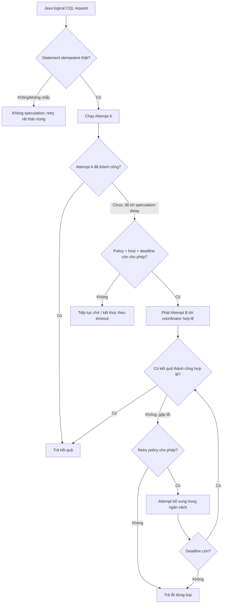

# Speculative execution và phân biệt với retry

> **Chương:** Retry và lỗi Java  
> **Phạm vi:** Apache Cassandra và **Java Driver 4.x**, nơi một truy vấn CQL đi từ ứng dụng Java tới coordinator rồi đến các replica theo partition key, replication factor (RF) và consistency level (CL). Bài phân biệt **driver-side speculative execution**, **driver retry**, và **server-side speculative retry** khi gặp độ trễ hoặc lỗi.
>
> **Mục tiêu:** Nhận ra vì sao cùng một logical request có thể có nhiều execution attempt; xác định khi nào được gửi thêm request trước khi lần đầu thất bại, khi nào retry dựa trên lỗi; đánh giá **idempotency**, timeout, tính nhất quán, bão hòa CPU/I/O và rủi ro duplicate writes; cấu hình policy theo **execution profile**; đo p95/p99, số attempts và hiệu quả thực tế trước khi bật trên production.

## 1. Tình huống: p99 cao dù phần lớn truy vấn rất nhanh

Một ứng dụng Java truy vấn bảng `orders_by_customer_day` của Cassandra. Hầu hết request đọc xong trong 20–40 ms, nhưng có những request mất 300 ms do một coordinator chậm, GC pause, network jitter hoặc replica đang compaction.

Đội phát triển đề xuất:

> “Nếu request chưa trả lời sau 100 ms, cứ gửi thêm một bản giống hệt tới coordinator khác. Bản nào về trước thì dùng.”

Đó là ý tưởng **speculative execution** (còn gọi *hedged request*) ở tầng **Java Driver**. Nó khác với retry thông thường:

- **Speculative execution:** gửi **bản bổ sung khi execution trước vẫn đang chờ**, dựa trên ngưỡng trễ và policy, chưa cần có lỗi.
- **Retry:** sau khi một execution gặp **lỗi hoặc một điều kiện thất bại** mà retry policy cho phép, quyết định thực hiện lại theo chiến lược của driver.

Cả hai đều tạo thêm công việc và chỉ phù hợp khi **thực thi lặp lại không phá tính đúng đắn**.

Nếu request là `SELECT` đọc dữ liệu công khai, hedging có thể giúp giảm tail latency trong điều kiện cụ thể. Nhưng nếu request là “tăng bộ đếm số lượt xem thêm 1”, hai attempt chạy song song có thể làm tăng **hai lần**.

**Một tính năng giảm latency phải được đánh giá cả về độ đúng dữ liệu và mức tăng tải cho toàn cluster.**

## 2. Thuật ngữ: logical request, execution attempt, coordinator

Cần phân biệt ba đối tượng:

1. **Logical request:** thao tác ứng dụng muốn làm một lần, ví dụ “đọc 20 đơn gần nhất của customer C trong ngày D”.
2. **Execution attempt:** một lần driver gửi statement qua một coordinator.
3. **Replica request:** công việc coordinator thực hiện với các replica để đáp ứng CL. Một execution attempt có thể gây nhiều thông điệp nội bộ.

```text
Ứng dụng
   |
   | Một logical SELECT
   v
Java Driver 4.x
   |
   +---- Attempt A ---> Coordinator N1 ---> Replica R1/R2...
   |
   +---- Attempt B ---> Coordinator N2 ---> Replica R2/R3...
                        (chỉ nếu policy phát thêm)
```

Hai attempt có thể chọn các coordinator khác nhau nhưng vẫn **đụng tới cùng replica**. Thêm coordinator không có nghĩa công việc vật lý được cô lập hoàn toàn.

Đối với bảng wide-column, partition key định tuyến dữ liệu theo token; coordinator dùng topology và RF để liên hệ replica. **Speculative execution không làm đổi partition key, replication strategy hoặc consistency level.**

### “Speculative execution” không phải speculative transaction

Tên gọi có thể làm người học nghĩ tới “chạy trước để commit sau”. Ở đây không có một cơ chế commit/rollback đa replica mới. Driver chỉ **gửi thêm bản thực thi cùng một statement** theo policy.

Nếu hai attempt đều được server xử lý, hành vi đọc/ghi vẫn tuân theo quy tắc Cassandra thông thường, bao gồm timestamp, tombstone, Paxos/LWT và CL của statement.

## 3. Bảng so sánh cốt lõi

| Tiêu chí | Driver speculative execution | Driver retry |
| --- | --- | --- |
| **Thời điểm kích hoạt** | Khi attempt đang chậm nhưng **chưa nhất thiết báo lỗi** | Khi có lỗi/điều kiện mà retry policy xử lý |
| **Số attempt đang chạy** | Có thể **đồng thời** | Thường phát sinh sau kết quả lỗi của attempt trước; cũng có thể tương tác với speculation |
| **Đích** | Thường thử coordinator khác nếu có node phù hợp | Tùy retry decision: cùng hoặc coordinator khác, hoặc rethrow |
| **Quyết định bởi** | `SpeculativeExecutionPolicy` và lịch delay | `RetryPolicy` và loại lỗi/attempt/CL |
| **Bắt buộc cân nhắc idempotency** | Có, đặc biệt quan trọng vì server có thể xử lý cả hai | Có, vì request đầu có thể đã được áp dụng |
| **Dữ liệu đọc** | Cùng CQL/bind values, khác đường thực thi | Thường cùng logical statement |
| **Chi phí** | Tăng coordinator request/replica work ngay cả khi request đầu rồi thành công | Tăng việc khi xảy ra lỗi có thể retry |
| **Mục tiêu** | Giảm **tail latency** từ các outlier chậm | Xử lý một số lỗi tạm thời theo chính sách |
| **Không bảo đảm** | Không bảo đảm p99 cải thiện hay dữ liệu là snapshot | Không bảo đảm ghi đúng một lần hoặc lỗi sẽ biến mất |

Trong thực tế, driver có thể dùng **cả retry lẫn speculation trong một logical request**. Vì vậy đừng cộng các chỉ số retry/speculation một cách máy móc rồi nghĩ mỗi logical request chỉ thuộc một loại.

## 4. Timeline: cùng request, hai cơ chế

### A. Speculative execution

```text
t =   0 ms: Attempt A gửi tới coordinator N1
t =  80 ms: Attempt A chưa hoàn tất
t = 100 ms: Speculative policy phát Attempt B tới N2
t = 135 ms: Attempt B trả lời thành công
t = 135 ms: Ứng dụng nhận kết quả từ B
t = 180 ms: A có thể vẫn đang hoàn tất một phần công việc
```

Đây là timeline **giả định** để minh họa. Không có một hành động rollback bắt buộc cho toàn bộ công việc đã gửi đến server. Hủy request phía client cũng **không bảo đảm** coordinator/replica ngừng tính toán ngay.

### B. Retry sau lỗi

```text
t =   0 ms: Attempt A gửi tới coordinator N1
t =  55 ms: Attempt A nhận lỗi được policy xem xét
t =  56 ms: Retry policy quyết định có retry không
t =  57 ms: Attempt B được gửi nếu policy cho phép
t = 100 ms: Attempt B thành công
```

Nếu policy quyết định **RETHROW**, logical request kết thúc bằng lỗi; không có attempt B. Không phải lỗi nào cũng đáng retry.

### C. Phối hợp hai cơ chế

```text
Logical request
    |
    +--> Attempt A (chậm)
    |       |
    |       +--> có thể gặp lỗi và retry policy xử lý
    |
    +--> Attempt B (speculation sau delay)
            |
            +--> có thể thành công hoặc cũng gặp lỗi
    |
    v
Driver tổng hợp kết quả/attempt theo implementation,
giới hạn thời gian và policy của đúng release
```

Đừng thiết kế giả định “mỗi request tối đa hai lần” nếu bạn vừa bật retry policy vừa cho phép một speculative execution. **Ngân sách tổng attempt và request deadline** mới là ranh giới cần kiểm soát.

## 5. Vì sao tail latency có thể giảm?

Trong hệ phân tán, thời gian phục vụ query có nhiều thành phần:

```text
Client
  |
  +--> TLS/network tới coordinator
  +--> Coordinator scheduling/GC/CPU
  +--> Internode messaging tới replica
  +--> Memtable/SSTable/cache/index read
  +--> Replica queue, disk I/O, compaction contention
  +--> Response aggregation theo CL
  +--> Driver decode và application mapping
```

Một outlier ở **một coordinator hoặc một đường truyền** có thể làm chậm một logical request. Nếu driver gửi bản khác qua một coordinator ít bị nghẽn, request thứ hai có thể về trước.

Tuy nhiên:

- Nếu **mọi replica đều chậm vì cùng disk/compaction bottleneck**, attempt B chỉ làm tăng việc.
- Nếu nhiều client cùng phát speculative attempts khi p99 tăng, chúng có thể tạo **feedback loop** khiến cluster quá tải hơn.
- Nếu statement cần `LOCAL_QUORUM`, hai coordinator có thể hỏi **những replica chồng lấn**, không tạo hai đường độc lập.
- Nếu bottleneck ở application CPU hoặc response mapping, thêm Cassandra attempts không giải quyết gốc vấn đề.

**Speculation là kỹ thuật xử lý straggler, không phải phương pháp thay capacity planning, schema/query tuning hay repair.**

## 6. Driver-side speculation khác server-side speculative retry

Cassandra còn có khái niệm **speculative retry phía server** dành cho đường đọc ở những release/tables có hỗ trợ option tương ứng.

Hai tầng:

```text
Java Driver
   |
   | Driver-side speculation:
   | có thể gửi thêm CQL request qua coordinator N2
   v
Coordinator N1 / N2
   |
   | Server-side speculative retry:
   | coordinator có thể liên hệ thêm một replica
   | khi phản hồi replica của read bị chậm
   v
Replica R1 / R2 / R3
```

| Điểm | Driver-side speculative execution | Server-side speculative retry |
| --- | --- | --- |
| Khởi tạo bởi | Java Driver/client | Cassandra coordinator |
| Tầng | **CQL request** tới coordinator | **Replica read** nội bộ |
| Cấu hình | Driver execution profile và policy | Tùy server release/table-level read setting |
| Đích bổ sung | Coordinator khác | Replica khác (theo logic đọc) |
| Tính năng áp dụng | Theo statement/idempotency/policy driver | Chủ yếu là **read path** theo tính năng server |
| Tác động | Tăng CQL attempts | Tăng replica read requests |
| Quan sát | Driver metrics/tracing | Server read metrics/tracing và internode activity |

Tên option ở server thường liên quan `speculative_retry`, nhưng **giá trị/cú pháp và hành vi thay đổi theo Cassandra release**. Không sao chép một lệnh `ALTER TABLE` từ bài viết khác lên production mà chưa xác minh version.

**Hai tầng có thể cùng hoạt động.** Một driver speculative attempt mới có thể dẫn tới coordinator mới, nơi server cũng phát replica speculative read. Trong trường hợp xấu, đây là hiệu ứng nhân tải, không phải một tối ưu miễn phí.

## 7. Các điều kiện để driver thực sự phát speculative attempt

Để speculative execution xảy ra, ít nhất cần xét:

1. **Policy được bật** trên effective execution profile của statement.
2. Statement được đánh dấu **idempotent** theo cơ chế driver đang dùng.
3. Attempt trước **chưa trả về kết quả đủ để hoàn tất** trước mốc policy delay.
4. Còn coordinator/host có thể chọn theo load balancing policy và trạng thái kết nối.
5. Request chưa bị kết thúc vì **global/request timeout**, cancellation hoặc lỗi kết thúc.
6. Chưa vượt giới hạn số executions của policy.
7. Phiên bản driver/protocol có hỗ trợ hành vi đó như đã cấu hình.

**Bật policy không có nghĩa mọi request sẽ luôn phát thêm bản.** Nếu request xong trong 20 ms và delay là 150 ms, không cần speculation.

### Idempotence được đánh dấu ở đâu?

Với Java Driver 4.x, ví dụ:

```java
BoundStatement read = prepared.bind(customerId, day)
    .setIdempotent(true);
```

Đây là **cam kết từ lập trình viên** về ngữ nghĩa của request, không phải một bằng chứng mà driver tự chứng minh bằng cách phân tích business logic.

Nếu đánh dấu một mutation nguy hiểm thành idempotent, retry và speculation có thể thực thi nhiều bản gây lỗi dữ liệu. **Đừng bật default idempotence toàn ứng dụng chỉ để làm p99 tốt hơn.**

## 8. Idempotency là ranh giới an toàn quan trọng nhất

Một thao tác **idempotent** là thao tác mà thực hiện nhiều lần trong điều kiện liên quan vẫn có hiệu ứng logic mong muốn tương đương thực hiện một lần.

### Thường là ứng viên phù hợp

- Một `SELECT` chỉ đọc dữ liệu theo partition key, không dựa vào side effect bất thường.
- Một phép ghi với primary key/giá trị rõ ràng và **timestamp cố định**, nếu đã kiểm tra không có tác động phụ và concurrency semantics phù hợp.
- Một request chỉ đọc metadata không gây thay đổi nghiệp vụ.

### Cần đánh giá rất thận trọng hoặc không nên speculation

- `UPDATE counter = counter + 1`: cùng mutation nhiều lần có thể tăng nhiều lần.
- Collection/list append/prepend kiểu `list = list + [...]`: có thể tạo phần tử lặp.
- Một lệnh ghi với server-generated timestamp khiến mỗi lần thực thi thành một mutation khác thời điểm.
- `INSERT`/`UPDATE` với TTL nếu retry/speculation tái sinh timestamp/expiry, có thể làm thay đổi vòng đời dữ liệu.
- LWT `IF NOT EXISTS`, `IF status = ...` khi ứng dụng diễn giải kết quả CAS như một nghiệp vụ chỉ được làm một lần.
- Các câu query gọi UDF hoặc side effect tùy chỉnh, nếu không chứng minh được tính thuần túy.
- Batch chứa thao tác không idempotent.
- Các thao tác ghi đồng thời cạnh tranh trên cùng primary key mà client không có quy tắc version/timestamp rõ.

**“Cùng CQL text và bind values” không tự chứng minh idempotent.**

### Bảng đánh giá theo nghiệp vụ

| Operation | Có nên đánh dấu idempotent? | Lý do |
| --- | --- | --- |
| `SELECT ... WHERE full_partition_key = ?` | Thường có | Không chủ đích thay đổi dữ liệu |
| `UPDATE views = views + 1` trên counter | **Không** | Lặp lại có thể tăng nhiều lần |
| `UPDATE tags = tags + {'java'}` trên set | Cần đánh giá | Kết quả set có thể giống, nhưng timestamp/side effects còn liên quan |
| `UPDATE status='PAID' USING TIMESTAMP fixed` | Có thể, **sau khi xác minh** | Mutation tương đương hơn nếu timestamp cố định; nghiệp vụ phải bảo đảm |
| `INSERT event_id = UUID.randomUUID()` mỗi attempt ở application | Không nên mặc định | Mỗi lần có thể sinh bản ghi khác nhau |
| `INSERT ... IF NOT EXISTS` | Không mặc định | CAS result và business workflow có ngữ nghĩa riêng |
| `DELETE col` | Cần đánh giá | Timestamp, ghi đồng thời, tombstone và audit có thể làm lặp nguy hiểm |
| `BATCH` chứa counter/list append | Không | Thành phần không idempotent |

Nếu không chắc, **để non-idempotent** và thiết kế idempotency key, cố định timestamp hoặc cơ chế nghiệp vụ thích hợp trước.

## 9. Idempotency và “exactly once” không giống nhau

Giả sử API có thao tác “thu tiền một lần cho order O”. Ngay cả khi Cassandra statement có dạng:

```cql
UPDATE lab.orders_by_id
SET payment_status = 'PAID'
WHERE order_id = ?;
```

thì nghiệp vụ thu tiền **không nằm trọn trong một CQL cell**. Một service có thể đã gọi cổng thanh toán bên ngoài trước khi ghi Cassandra. Nếu retry toàn bộ workflow, tiền có thể bị thu hai lần dù giá trị `payment_status` cuối cùng vẫn là `PAID`.

Vì vậy phải phân biệt:

1. **Idempotency của một CQL statement.**
2. **Idempotency của API request và workflow nghiệp vụ.**
3. **Exactly-once effect** trên các hệ thống khác, thường cần event ID/deduplication hoặc transaction/ledger riêng.

Driver speculative execution chỉ biết **statement đã được đánh dấu idempotent**, không biết cổng thanh toán có bị gọi lại hay không. Không dùng thuộc tính của driver để khẳng định end-to-end exactly once.

## 10. Bối cảnh CL: speculation không tăng consistency

Giả sử keyspace dùng `NetworkTopologyStrategy` với RF=3 ở `dc1` và RF=3 ở `dc2`.

| CL | Điều kiện phản hồi khái niệm | Speculation làm gì? |
| --- | --- | --- |
| `LOCAL_ONE` | Một replica local trả lời | Có thể thay coordinator/đường đọc; **không tăng** thành quorum |
| `LOCAL_QUORUM` | Hai replica trong DC của coordinator khi RF local=3 | Thêm CQL attempt, vẫn cần local quorum cho từng attempt |
| `QUORUM` | Quorum theo tổng RF được tính cho request | Không thay số ACK/response yêu cầu |
| `ALL` | Mức yêu cầu rất cao theo số replica | Không giảm yêu cầu của CL |
| `LOCAL_SERIAL`/`SERIAL` | Liên quan pha serial/LWT | Không phải lựa chọn để “hedge” CAS tùy ý |

**Speculation không phải read repair**, không tăng RF và không sửa partition key/query.

### Hai coordinator có thể dùng cùng replica

Với RF=3 local, N1 và N2 đều có thể gửi read tới R1/R2/R3 theo chiến lược server. Nếu R2 đang disk bottleneck, hai attempt vẫn có thể bị ảnh hưởng.

Do đó, p99 tốt hơn hay tệ hơn phụ thuộc topology và **mức độc lập thực tế** của các đường thực thi.

### Khi dùng LOCAL_ONE

Một lần đọc `LOCAL_ONE` có thể gặp một replica chưa thấy mutation mới; attempt khác có thể đọc một replica khác với kết quả khác. **Bản nào phản hồi trước không phải bằng chứng nó “mới nhất”.** Nếu nghiệp vụ cần độ nhất quán cao hơn, phải chọn CL và mô hình ghi phù hợp thay vì dựa vào speculation để tìm một bản sao nhanh.

## 11. Retry, speculation và request timeout

Có ít nhất ba loại thời gian cần phân biệt:

- **Thời gian xử lý một execution attempt** trên coordinator/replica.
- **Speculation delay:** khi chưa xong sau một ngưỡng, policy có thể khởi động attempt bổ sung.
- **Request timeout / deadline:** ngân sách thời gian tổng mà driver/ứng dụng cho logical request, tùy API và phiên bản.

Ví dụ giả định:

```text
Request budget: 500 ms
Speculation delay: 150 ms
Extra speculative executions: tối đa 1

t=0    Attempt A
t=150  Nếu A còn pending -> Attempt B
t=210  Nếu B thành công -> trả kết quả
t=500  Nếu chưa có kết quả hợp lệ -> request timeout
```

**Thêm attempt không tự kéo dài thời hạn ứng dụng cho phép.** Ngược lại, có thể tăng lượng công việc node đang chạy dù client đã timeout/cancel.

### Phân biệt hai timeout phổ biến

- **Server read/write timeout:** coordinator trả lỗi vì không đủ phản hồi replica trong điều kiện CL/thời gian xử lý của server.
- **Client-side driver timeout:** client hết ngân sách chờ response; server vẫn có thể đã xử lý hoặc đang xử lý.

Với **write**, một timeout không chứng minh rằng **không có replica nào ghi thành công**. Retry/speculate write không idempotent có thể dẫn đến tác dụng lặp, dữ liệu cuối sai hoặc side effect.

Không nên chỉnh cả server timeout và driver timeout lớn hơn chỉ để “che” p99 của hot partition.

## 12. Retry policy xử lý những trường hợp nào?

Trong Java Driver 4.x, `RetryPolicy` nhận thông tin lỗi và bối cảnh request để ra quyết định cho một số tình huống.

Các nhóm lỗi hay gặp:

| Nhóm | Ý nghĩa thường gặp | Có tự retry không? |
| --- | --- | --- |
| `ReadTimeoutException` | Coordinator không nhận đủ phản hồi đọc theo CL | **Tùy policy và bối cảnh**, không tự động |
| `WriteTimeoutException` | Không đủ ACK ghi, trạng thái commit có thể chưa rõ | Rất cẩn trọng; nhiều kiểu write không an toàn |
| `UnavailableException` | Không đủ replica khả dụng để đáp ứng CL | Retry ngay thường không giúp nếu topology không đổi |
| `ReadFailureException` / `WriteFailureException` | Replica báo lỗi xử lý request | Xét nguyên nhân và policy |
| `DriverTimeoutException` | Client-side request deadline hết | Không suy ra server chưa thực thi |
| `AllNodesFailedException` | Driver thất bại khi cố kết nối/thực thi trên các node | Xem nguyên nhân con theo host |
| `UnauthorizedException` | Thiếu quyền resource | Không retry mù; sửa quyền |
| `InvalidQueryException` | CQL/schema/bind không hợp lệ | Không retry mù; sửa query |
| TLS/authentication failure | Lỗi kết nối/bảo mật | Không bỏ TLS/auth để retry cho qua |
| Overload/bootstrapping | Node đang từ chối hoặc chưa sẵn sàng | Cần giảm tải, kiểm tra topology và policy |

**Retry policy cụ thể và cách driver phân loại errors phụ thuộc phiên bản**. Không giả định mọi exception trong bảng có phương thức retry giống nhau. Một số lỗi xảy ra trước khi request được gửi, nên có thể là vấn đề chọn host/connectivity hơn là một *server request retry*.

### Điều không nên làm trong Java

```java
// Anti-pattern: retry mọi lỗi không giới hạn.
while (true) {
    try {
        session.execute(statement);
        break;
    } catch (Exception ignored) {
        // Không backoff, không deadline, không phân biệt lỗi.
    }
}
```

Vòng này có thể tạo **retry storm**, lặp mutation nguy hiểm và che lỗi authorization/schema. Nếu cần application-level retries, phải có deadline/backoff/jitter, giới hạn attempt, phân loại exception và idempotency.

## 13. Speculation policy trong Java Driver 4.x

Java Driver 4.x có các policy cho speculative execution. Thông thường cấu hình được khai báo trong **driver configuration** và có thể áp dụng theo **execution profile**.

Các lựa chọn khái niệm:

| Policy | Ý tưởng | Lưu ý |
| --- | --- | --- |
| **NoSpeculativeExecutionPolicy** | Không phát bản speculative | Điểm xuất phát an toàn |
| **ConstantSpeculativeExecutionPolicy** | Phát thêm attempt sau delay cố định, với giới hạn | Dễ dự đoán, nhưng delay cố định phải phù hợp workload |
| **Percentile-based policy** nếu bản driver hỗ trợ | Đặt delay theo phân bố latency quan sát | Cần sample đủ tốt và hiểu metric/window theo release |
| **Custom policy** | Theo logic do ứng dụng cung cấp | Rủi ro config/logic/observability; chỉ dùng khi đã review |

Đừng mặc định mọi phiên bản Java Driver 4.x có cùng danh sách class/constructor/config options. Với môi trường thực, kiểm tra tài liệu chính xác của **artifact và patch version đang chạy**.

**Không bật speculation cho toàn bộ application ngay từ đầu.** Nên thử trên một **execution profile chuyên cho những truy vấn đọc đã kiểm chứng idempotent**.

## 14. Cấu hình HOCON: mặc định không speculation, chỉ bật cho read profile

Ví dụ cấu hình **minh họa cho Java Driver 4.x**. Tên path và class phải được xác minh với release đã chọn trước khi deploy:

```hocon
datastax-java-driver {
  basic {
    request {
      timeout = 2 seconds
      default-idempotence = false
    }
    load-balancing-policy {
      local-datacenter = "dc1"
    }
  }

  advanced {
    speculative-execution-policy {
      class = NoSpeculativeExecutionPolicy
    }
  }

  profiles {
    "hedged-read" {
      basic.request.timeout = 2 seconds

      advanced.speculative-execution-policy {
        class = ConstantSpeculativeExecutionPolicy
        delay = 150 milliseconds
        max-executions = 1
      }
    }
  }
}
```

Mục tiêu chính:

- **Default** không có speculative execution.
- **Profile `hedged-read`** có thể phát **tối đa một bản bổ sung** theo cấu hình ví dụ.
- `delay = 150 milliseconds` là con số thử nghiệm, **không phải giá trị được khuyến nghị mặc định**.
- `default-idempotence = false` bảo vệ các statement chưa được đánh dấu rõ.
- Request `setIdempotent(true)` phải được **đánh giá thật về ngữ nghĩa** trước khi đi qua profile này.
- Driver chọn local DC phù hợp với topology; `dc1` trong ví dụ phải đổi theo cluster thực.

**Cấu hình chưa chứa contact points, TLS, credentials, keyspace hoặc timeout server.** Những thông số đó cần thiết lập riêng trong deployment.

### Hiểu `max-executions`

Tên `max-executions` ở policy liên quan số **speculative executions được phép** theo version/config, không phải một cơ chế giới hạn tất cả retries của application. Cần đọc semantics của driver đang chạy, đặc biệt nếu có custom retry policy hoặc nhiều execution profiles.

Không sử dụng số này như bằng chứng “tổng số CQL attempts chắc chắn bằng 2 trong mọi tình huống”.

## 15. Java Driver 4.x: đánh dấu SELECT idempotent và chọn profile

Dùng bảng được thiết kế theo truy vấn:

```cql
CREATE TABLE IF NOT EXISTS lab.orders_by_customer_day (
    tenant_id text,
    customer_id uuid,
    day_bucket date,
    created_at timestamp,
    order_id uuid,
    status text,
    total decimal,
    PRIMARY KEY ((tenant_id, customer_id, day_bucket),
                 created_at, order_id)
) WITH CLUSTERING ORDER BY (created_at DESC, order_id ASC);
```

Giả sử keyspace `lab` tồn tại với RF phù hợp. Đây là một bảng wide-column, partition theo `tenant_id + customer_id + day_bucket`; truy vấn sử dụng đầy đủ partition key.

Ví dụ Java 4.x:

```java
import java.time.LocalDate;
import java.time.Instant;
import java.util.UUID;
import java.util.ArrayList;
import java.util.List;

import com.datastax.oss.driver.api.core.CqlSession;
import com.datastax.oss.driver.api.core.DefaultConsistencyLevel;
import com.datastax.oss.driver.api.core.cql.BoundStatement;
import com.datastax.oss.driver.api.core.cql.ExecutionInfo;
import com.datastax.oss.driver.api.core.cql.PreparedStatement;
import com.datastax.oss.driver.api.core.cql.ResultSet;
import com.datastax.oss.driver.api.core.cql.Row;

public final class HedgedOrdersReader {
    private final CqlSession session;
    private final PreparedStatement byDay;

    public record OrderSummary(UUID id, Instant createdAt, String status) {}

    public HedgedOrdersReader(CqlSession session) {
        this.session = session;
        this.byDay = session.prepare(
            "SELECT order_id, created_at, status " +
            "FROM lab.orders_by_customer_day " +
            "WHERE tenant_id = ? AND customer_id = ? " +
            "AND day_bucket = ? LIMIT 20"
        );
    }

    public List<OrderSummary> loadLatest(
            String tenantId, UUID customerId, LocalDate day) {

        if (tenantId == null || tenantId.isBlank() ||
            customerId == null || day == null) {
            throw new IllegalArgumentException("Missing partition key");
        }

        BoundStatement statement = byDay
            .bind(tenantId, customerId, day)
            .setExecutionProfileName("hedged-read")
            .setConsistencyLevel(
                DefaultConsistencyLevel.LOCAL_QUORUM)
            .setIdempotent(true)
            .setPageSize(20);

        long startNanos = System.nanoTime();
        ResultSet result = session.execute(statement);
        ExecutionInfo info = result.getExecutionInfo();

        long elapsedMicros =
            (System.nanoTime() - startNanos) / 1_000L;

        List<OrderSummary> orders = new ArrayList<>();
        for (Row row : result) {
            orders.add(new OrderSummary(
                row.getUuid("order_id"),
                row.getInstant("created_at"),
                row.getString("status")
            ));
        }

        System.out.printf(
            "elapsed_us=%d speculativeExecutions=%d coordinator=%s%n",
            elapsedMicros,
            info.getSpeculativeExecutionCount(),
            info.getCoordinator() == null
                ? "unknown"
                : info.getCoordinator().getEndPoint()
        );

        return orders;
    }
}
```

Ví dụ dùng **Java 17** cho `record` và Java Driver 4.x phù hợp; `CqlSession` được tạo/cấu hình từ bên ngoài với authentication/TLS và local DC đúng. Không log giá trị đơn hàng nhạy cảm trong production.

### Cần hiểu giới hạn đo của code

- `getSpeculativeExecutionCount()` (nếu API có ở driver release đang dùng) mô tả speculation được ghi nhận trong execution info của request, **không bằng tổng replica read RPC**.
- Thời gian đo từ trước `execute` tới khi nhận result metadata; vòng lặp đọc/map rows cũng tốn thời gian. Nếu muốn đo **end-to-end API latency**, phải đo bao gồm việc tiêu thụ result và serialization.
- Vì CQL có `LIMIT 20` nên vòng lặp tối đa số row logic đã giới hạn; với query không LIMIT và `ResultSet` đồng bộ, duyệt iterator có thể **tự fetch các trang tiếp**, tăng tải.
- Speculation có thể chưa xảy ra nếu request đầu hoàn tất trước delay.
- Lệnh `setIdempotent(true)` ở đây phù hợp với một SELECT chỉ đọc thông thường; **không copy cờ này sang write/aggregate bất kỳ**.
- Dữ liệu live có thể thay đổi giữa hai lần đọc/attempt; driver speculation không tạo một snapshot chung cho request dài hạn.
- Nếu query sử dụng UDF có side effect hoặc chính sách đặc biệt, cần đánh giá lại tính an toàn.

## 16. Java async: đọc một request nhưng không chặn thread ứng dụng

Khi backend Java dùng mô hình bất đồng bộ, speculative execution vẫn là chính sách bên dưới driver. Ứng dụng không cần tự tạo hai `CompletableFuture` để “hedge” ở ngoài nếu đã dùng driver policy.

```java
import java.time.LocalDate;
import java.util.UUID;
import java.util.concurrent.CompletionStage;

import com.datastax.oss.driver.api.core.CqlSession;
import com.datastax.oss.driver.api.core.DefaultConsistencyLevel;
import com.datastax.oss.driver.api.core.cql.AsyncResultSet;
import com.datastax.oss.driver.api.core.cql.BoundStatement;
import com.datastax.oss.driver.api.core.cql.PreparedStatement;

public final class AsyncOrderRead {
    private final CqlSession session;
    private final PreparedStatement select;

    public AsyncOrderRead(CqlSession session) {
        this.session = session;
        this.select = session.prepare(
            "SELECT order_id, created_at, status " +
            "FROM lab.orders_by_customer_day " +
            "WHERE tenant_id = ? AND customer_id = ? " +
            "AND day_bucket = ? LIMIT 20"
        );
    }

    public CompletionStage<AsyncResultSet> fetch(
            String tenant, UUID customerId, LocalDate day) {

        BoundStatement statement = select
            .bind(tenant, customerId, day)
            .setExecutionProfileName("hedged-read")
            .setIdempotent(true)
            .setConsistencyLevel(
                DefaultConsistencyLevel.LOCAL_QUORUM)
            .setPageSize(20);

        return session.executeAsync(statement);
    }
}
```

`AsyncResultSet.currentPage()` chỉ duyệt trang hiện tại, còn `fetchNextPage()` chủ động yêu cầu tiếp. **Speculative execution không phải pagination**; một logical page request có thể phát thêm execution attempt, và các page tiếp theo là những logical requests riêng.

### Vì sao không tự viết hai truy vấn song song?

Ví dụ ứng dụng tự gọi `executeAsync` hai lần và dùng `anyOf`:

- Có thể vượt cơ chế idempotency/scheduling/host selection của driver.
- Không tự quản trị đúng cancellation/deadline/metrics như một policy driver.
- Có thể dùng cùng coordinator do load balancing, không cải thiện tail latency.
- Dễ bỏ quên retry budget/authorization/tracing và tạo thêm gấp đôi công việc.

**Ưu tiên policy được driver hỗ trợ**, chỉ viết hedging cấp ứng dụng khi có nhu cầu rõ và đã kiểm chứng ngữ nghĩa toàn hệ thống.

## 17. Write: ví dụ không được speculative execution

### Counter increment

```cql
CREATE TABLE IF NOT EXISTS lab.page_views_by_id (
    page_id uuid PRIMARY KEY,
    views counter
);
```

Một thao tác cộng:

```cql
UPDATE lab.page_views_by_id
SET views = views + 1
WHERE page_id = 11111111-1111-4111-8111-111111111111;
```

Nếu gửi hai bản và cả hai được xử lý, counter có thể tăng **2 thay vì 1**. Đây không phải một request thích hợp để đánh dấu idempotent.

Java:

```java
BoundStatement statement = incrementPrepared
    .bind(pageId)
    .setIdempotent(false);
session.execute(statement);
```

**Không bảo đảm exactly once chỉ bằng `setIdempotent(false)`**: nó giúp driver tránh một số hành vi retry/speculation cho statement nhưng ứng dụng, gateway hoặc client vẫn có thể gửi lại cùng nghiệp vụ. Cần thiết kế dedup/event ID nếu mục tiêu đòi chính xác một tác động.

### Append vào list

Một câu `UPDATE ... SET events = events + [?]` có thể khiến dữ liệu lặp khi thực hiện nhiều lần. Không xem cùng một câu UPDATE là an toàn chỉ vì bind values giống nhau.

### LWT

Một `INSERT ... IF NOT EXISTS` có kết quả CAS phụ thuộc trạng thái mà các execution gặp. Ngay cả khi trạng thái cuối có thể không nhân đôi row, **diễn giải kết quả applied/not applied của workflow** cần đặc biệt cẩn trọng. Không mặc định bật hedging cho LWT; dùng thiết kế kiểm soát giao dịch và đọc xác minh phù hợp.

## 18. “SET cùng giá trị” chưa luôn an toàn tuyệt đối

Ví dụ:

```cql
UPDATE lab.orders_by_id
SET status = 'PAID'
WHERE order_id = 11111111-1111-4111-8111-111111111111;
```

Thoạt nhìn, gửi hai lần cùng `status='PAID'` sẽ cho cùng giá trị cuối. Nhưng cần xét:

1. **Timestamp:** hai execution có thể dùng timestamp khác nhau nếu không cố định, gây khác thứ tự với write đồng thời.
2. **TTL:** nếu có TTL, thời điểm expiry/retention có thể đổi.
3. **Ghi cạnh tranh:** một request khác đặt `status='CANCELLED'`; attempt chậm có thể đến sau và ghi đè tùy timestamp.
4. **Side effects:** trigger, CDC hoặc pipeline nghiệp vụ có thể quan sát nhiều mutation.
5. **Client retry:** timeout không chứng minh attempt trước chưa thực thi.

Một phép ghi với **cùng cell value, cùng explicit timestamp, không TTL/side effect** thường dễ lập luận về tính idempotent hơn, nhưng vẫn cần xác minh yêu cầu nghiệp vụ và tương thích với schema.

### Có thể cố định timestamp khi cần

Cassandra CQL hỗ trợ gắn explicit timestamp cho một số mutation phù hợp, ví dụ **minh họa cú pháp**:

```cql
UPDATE lab.orders_by_id
USING TIMESTAMP 1800000000000000
SET status = 'PAID'
WHERE order_id = 11111111-1111-4111-8111-111111111111;
```

Timestamp CQL là đơn vị **microsecond**, con số ở đây chỉ để minh họa. Không lấy giờ hệ thống máy client tùy tiện để cấp timestamp cao bất thường trong production. Và **cố định timestamp không tự tạo exactly-once workflow**.

## 19. Timeout khi ghi: vì sao không biết rõ đã commit hay chưa?

Hình dung một write `LOCAL_QUORUM` khi RF=3 local:

```text
Client -> Coordinator
          |
          +--> Replica R1: mutation applied
          +--> Replica R2: mutation applied nhưng ACK chậm
          +--> Replica R3: node chậm/offline

Client hết timeout trước khi nhận được đủ ACK
          |
          v
Ứng dụng thấy "timeout"
```

Không thể từ timeout phía client khẳng định mutation **chưa được áp dụng ở đâu cả**. Với retry/speculate:

- Một số replica có thể nhận lại cùng mutation.
- Nếu mutation non-idempotent, có thể tăng counter/list hai lần.
- Nếu dữ liệu có TTL/timestamp mới, các phiên bản có thể cạnh tranh.
- Sửa lỗi bằng cách retry liên tục có thể làm cluster chậm hơn.

**Bản chất của retry write sau timeout là xử lý trạng thái kết quả chưa chắc chắn**, không phải “gửi lại vì trước đó chắc chắn thất bại”.

## 20. Điều kiện nào giúp speculation hiệu quả?

Một ứng viên tốt thường có:

- Query đọc **theo partition key đầy đủ**, số row giới hạn, không scan toàn bảng.
- P95 nhanh, chỉ một tỷ lệ nhỏ request bị **outlier coordinator/network**.
- Cluster có **headroom thật** về CPU, disk, network và số concurrent requests.
- Có nhiều host/coordinator phù hợp với routing và local DC.
- Request được chứng minh idempotent.
- Có SLO p99 đủ nghiêm để chi phí bổ sung đáng cân nhắc.
- Có metrics per-attempt, error rate, amplification và canary/rollback.

### Khi nào speculation ít có ích hoặc gây hại?

- CPU/disk/GC của **toàn bộ cluster** đang bão hòa.
- Tombstone-heavy query hoặc partition rất lớn khiến mọi replica đều tốn công.
- Nhiều request đã ở sát client timeout; delay kích hoạt quá muộn.
- Load balancing không có node khác khả dụng.
- Băng thông giữa DC bị giới hạn; chọn coordinator xa làm tăng latency.
- Retry policy của ứng dụng đã quá hung hăng.
- Các tác vụ compaction/repair/streaming đang cạnh tranh mạnh với read path.
- Workload chủ yếu là write/counter/LWT nhạy tác động lặp.

Không dùng speculation làm phương án thay việc giảm hot partitions, sửa CQL/query-first model hoặc bổ sung capacity.

## 21. Chọn delay và max executions như thế nào?

Không có một giá trị 50 ms, 100 ms hay 200 ms đúng cho mọi Cassandra cluster. Cách quyết định:

1. Đo phân bố latency **theo query shape/CL/DC**, không gộp mọi query.
2. Tách vấn đề ở **coordinator** khỏi ở **replica/disk** khi có bằng chứng.
3. Chọn một số query đọc có cơ hội được một coordinator khác xử lý nhanh hơn.
4. Đặt delay **cao hơn phần lớn request khỏe mạnh**, tránh speculation cho request bình thường.
5. Bắt đầu với **một bản bổ sung** trong lab/canary nếu policy cho phép.
6. Theo dõi extra attempts, throughput, p99, timeouts, CPU, GC và disk await.
7. Nếu số extra attempts cao nhưng p99 không cải thiện, giảm/tắt.
8. Rà soát lại khi traffic, RF/DC, driver version hoặc phần cứng đổi.

### Delay dựa trên percentile

Một số driver/policy có thể ước lượng delay từ percentile của latency quá khứ. Cách này chỉ hợp lý nếu:

- Sample đủ đại diện, không bị cold start/low QPS chi phối.
- Phân bố latency phân nhóm theo workload quan trọng.
- Không để latency bị speculation/tracing làm sai lệch cách diễn giải metric.
- Có floor/cap và giới hạn attempt phù hợp.
- Có hành vi fallback rõ khi sample thiếu.

**Không gọi một policy “percentile” là tự động tối ưu.** Nếu latency tăng vì cluster quá tải, percentile động có thể thay delay mà không giải quyết nguyên nhân.

## 22. Ví dụ định lượng chi phí amplification

Giả sử workload minh họa:

```text
Logical reads:           1.000 request/giây
Speculative rate:        10% request phát 1 bản bổ sung
Average extra CQL tries: 100 attempt/giây
Total coordinator tries: ~1.100 attempt/giây

Tăng coordinator-level request work xấp xỉ 10%
(chưa tính replica requests, retry, server-side speculation).
```

Nếu mỗi coordinator attempt đòi local quorum, tổng replica read work có thể tăng thêm đáng kể, tùy cache, speculative server-side reads, cancellation và phản hồi sớm.

Một cách đo đơn giản:

\[
\text{Execution amplification}
=\frac{\text{total coordinator attempts}}{\text{logical application requests}}
\]

Nếu quan sát 110.000 coordinator attempts trên 100.000 logical requests:

\[
\text{Amplification}=1.10
\]

Đây là con số **chỉ của tầng đang đo**, không phải “replica CPU tăng đúng 10%”. Cần dùng server CPU/I/O/network thực tế để đánh giá chi phí toàn cụm.

### Mục tiêu ra quyết định

Một thử nghiệm hợp lý muốn:

- API p99 giảm đáng kể trong tải đại diện.
- Error/timeouts không tăng.
- Tỷ lệ speculation nằm trong ngân sách.
- Replica/CPU/disk/network/GC còn headroom.
- Tính đúng dữ liệu không bị ảnh hưởng.
- Hiệu ứng vẫn ổn khi có compaction/repair và sự cố node.

Nếu p99 giảm từ 240 ms xuống 180 ms nhưng CPU tăng tới 95% và timeout ghi tăng, **đó không phải một tối ưu thành công**.

## 23. Dashboard và metrics cần đo

| Metric | Tầng | Ý nghĩa |
| --- | --- | --- |
| Logical request rate | API | Số yêu cầu nghiệp vụ |
| Driver CQL attempts | Driver | Tổng execution attempts, gồm retry/speculation khi instrument được |
| Speculative execution count/rate | Driver | Bao nhiêu bản được gửi do policy |
| Retry count/rate và lý do | Driver | Có retry storm hoặc lỗi tạm thời? |
| Successful speculative wins | Driver/app nếu có instrumentation | Bản bổ sung có thật sự giải quyết straggler? |
| API read p50/p95/p99 | Application | Trải nghiệm end-to-end |
| Driver CQL latency p95/p99 | Driver | Thời gian chờ DB |
| Client-side vs server-side timeout | Driver/server | Phân biệt chờ deadline và lỗi coordinator |
| Coordinator selection theo DC | Driver | Có routing sai/local DC lệch? |
| Read request rate theo node | Server | Phân bố tải và hotspot |
| Read p95/p99, pending/dropped | Server | Stage queue có nghẽn không? |
| CPU, JVM heap/GC pause | Node | Code và request overhead |
| Disk await, SSTable/tombstone scans | Node | Query có bị I/O/read amplification? |
| Compaction/repair/streaming backlog | Node | Tác vụ nền có tranh tài nguyên? |
| Error rate theo exception family | API/driver | Kết quả có an toàn/ổn định hơn không? |

**Tên metric cụ thể trong Java Driver 4.x, exporter và Cassandra release có thể khác.** Bảng mô tả **ý nghĩa chỉ số**, không khẳng định mọi driver đều xuất sẵn từng counter. Có thể cần bổ sung tracing/instrumentation an toàn, không làm lộ PII.

Không gắn token, order ID, customer ID hoặc raw CQL bind values làm metric label; chúng có cardinality cao và có thể chứa dữ liệu nhạy cảm.

## 24. Vì sao chỉ nhìn p99 chưa đủ?

Giả sử canary cho thấy:

| Chỉ số | Không speculation | Có speculation |
| --- | ---: | ---: |
| p50 read latency | 28 ms | 29 ms |
| p95 read latency | 84 ms | 81 ms |
| p99 read latency | 250 ms | 170 ms |
| Extra CQL attempt rate | 0% | 12% |
| CPU replica p95 | 61% | 79% |
| Write timeout/10.000 requests | 1 | 5 |

Đây là **số liệu giả định để luyện phân tích**, không phải benchmark Cassandra thực tế.

Kết luận không nên chỉ là “p99 read tốt hơn 80 ms”. Cần hỏi:

- CPU tăng có còn an toàn vào giờ cao điểm?
- Write timeout tăng do speculation hay một thay đổi đồng thời?
- Có phân bố tải không đều giữa node/DC?
- Dữ liệu đọc có đúng CL và partition mẫu không?
- Retry rate có tăng vì overload?
- Thời gian thử có đại diện cho repair/compaction window không?

Một tối ưu p99 đọc nhưng phá write SLO có thể cần rollback ngay.

## 25. Phân biệt speculative count và retry count trong quan sát

Đừng đo dựa vào một tổng số request mà suy ra mọi bản thêm đều là speculation.

Ví dụ một logical request có:

```text
Attempt 0: gửi lúc t=0
Attempt 1: speculation lúc t=120ms
Attempt 2: retry sau lỗi của một attempt
```

Các events có thể được driver ghi ở những nơi khác nhau. Trong dashboard nên phân biệt:

- **Logical application operations** (thường do service tự instrument).
- **Speculative attempts** được policy phát do chậm.
- **Retries** do RetryPolicy quyết định sau lỗi.
- **Server-side speculative replica reads** nếu được server báo.
- **Cancelled/abandoned client attempts** khi request đã hoàn tất.
- **Request timeout** cuối cùng tới API.

Khi không có per-attempt trace đủ tin cậy, chỉ báo cáo phần metrics có thể đo, **không bịa “winning attempt reason”** từ tổng count.

### Tracing nên bật thế nào?

Cassandra query tracing có thể giúp nhìn coordinator/replica read path, nhưng có overhead và lưu dữ liệu trace. Chỉ dùng sampling/lab để chẩn đoán, tránh bật trace 100% trên traffic production.

```cql
TRACING ON;

SELECT order_id, status
FROM lab.orders_by_customer_day
WHERE tenant_id = 'tenant-a'
  AND customer_id = 11111111-1111-4111-8111-111111111111
  AND day_bucket = '2026-11-21'
LIMIT 20;

TRACING OFF;
```

Lệnh trên minh họa **một phiên cqlsh**, không tái hiện tự động hai speculative attempts của Java Driver. Muốn xem speculation thật cần **trace/log từ đúng Java application** kết hợp server observations.

## 26. Nguy cơ retry storm và đòn bẩy bảo vệ

Hình dung cluster đọc chậm vì disk ở vài replica bão hòa. Mỗi API instance bật speculation sau 100 ms; đồng thời tầng HTTP gateway retry request khi timeout.

```text
1 request user
   |
   +--> API request #1
   |      +--> Driver attempt A
   |      +--> Driver speculative B
   |      +--> Driver retry C (nếu có lỗi)
   |
   +--> API gateway retry request #2
          +--> Driver attempt D
          +--> Driver speculative E
          +--> ...
```

Hệ quả: **một thao tác người dùng tạo nhiều request xuống cluster**. Nếu mọi bản cùng đụng disk bão hòa, hiệu năng càng giảm.

### Biện pháp bảo vệ

1. Đặt **end-to-end deadline** xuyên HTTP → application → driver.
2. Giới hạn retry ở từng tầng và **điều phối budget toàn chuỗi**.
3. Rate limit, concurrency limit và backpressure ở API.
4. Circuit breaker/fail fast khi cluster thật sự quá tải.
5. Chỉ speculative những SELECT đã kiểm chứng, không bật toàn bộ operations.
6. Dùng jitter/backoff cho application-level retry thích hợp; tránh đồng loạt retry.
7. Kiểm soát cỡ partition, page size và tombstone scans để giảm gốc p99.
8. Có feature flag/rollback nhanh khi extra attempts vượt ngân sách.

Một request timeout dài hơn có thể giảm error thấy ở client nhưng **làm giữ tài nguyên lâu hơn**. Cần tối ưu nguyên nhân, không chỉ tăng thời gian chờ.

## 27. Cách chọn truy vấn để thử speculative execution

### Ứng viên tốt: query-first, khóa phân vùng đầy đủ

```cql
SELECT order_id, created_at, status
FROM lab.orders_by_customer_day
WHERE tenant_id = 'tenant-a'
  AND customer_id = 11111111-1111-4111-8111-111111111111
  AND day_bucket = '2026-11-21'
LIMIT 20;
```

Lý do:

- Một partition được xác định rõ.
- Số row logic giới hạn.
- Không có side effect được yêu cầu.
- Có thể đo latency theo query shape cụ thể.

### Không phù hợp: scan rộng và filtering

```cql
-- Ví dụ anti-pattern: không dùng trên production lớn.
SELECT *
FROM lab.orders_by_customer_day
WHERE status = 'PENDING'
ALLOW FILTERING;
```

Bảng không có partition key trong predicate; filter rộng có thể đòi quét nhiều dữ liệu. Speculation làm gửi thêm bản query **nặng**, dễ tăng tải thay vì sửa mô hình truy vấn.

### Không phù hợp: truy vấn hotspot kéo dài

Nếu một customer/day có partition cực lớn, dù dùng khóa đầy đủ vẫn có thể khiến reads lâu, nhất là với tombstone/large collections. Cần chia bucket hoặc thiết kế bảng phù hợp trước khi dùng speculative execution.

**Chất lượng mô hình wide-column là biện pháp giảm latency gốc.**

## 28. Multi-DC: đừng để speculation trở thành WAN amplification

Giả sử application ở `dc1`, keyspace RF=3 trong `dc1` và `dc2`. Java Driver cần đặt **local datacenter** đúng.

Nếu configuration load balancing ưu tiên dc1, một speculative attempt nên tuân theo policy lựa chọn host phù hợp. Nhưng nếu deployment/app đã cấu hình sai hoặc policy tùy chỉnh cho phép điều phối xa, tail latency và network cost có thể tăng.

Cần xác minh:

- Coordinator của attempt thường và speculative nằm ở DC nào.
- RF/DC đúng và local DC hiện hành của ứng dụng.
- CL có đúng với yêu cầu nghiệp vụ không.
- Replica nào được read RPC liên hệ; có trùng bottleneck không.
- Có ảnh hưởng đến traffic giữa DC vốn đang phục vụ replication/repair không.

**`LOCAL_QUORUM` không đồng nghĩa mọi request đều có coordinator cùng DC với ứng dụng** nếu driver routing bị cấu hình sai. Theo dõi coordinator DC là một metric quan trọng khi tuning speculation.

## 29. Khi một node gặp GC pause hoặc disk chậm

### Trường hợp A — Một coordinator đơn lẻ chậm

**Triệu chứng:** request qua N1 có p99 cao, các node khác khỏe; CPU/GC hoặc event loop của N1 có outlier.

**Speculation có thể hữu ích:** một execution qua N2 có thể trả nhanh hơn, nếu còn headroom.

**Vẫn phải sửa nguyên nhân:** GC configuration, heap, thread pools, network và thời điểm compaction; speculation chỉ giảm tác động nhìn từ client.

### Trường hợp B — Replica chung bị disk bottleneck

**Triệu chứng:** nhiều coordinator cùng chờ một nhóm replica có disk await cao.

**Speculation có thể ít hiệu quả:** N1 và N2 đều phải lấy dữ liệu từ tập replica liên quan. Thêm coordinator requests có thể làm tăng queue.

**Hành động:** tối ưu partition, tombstones, SSTables/compaction, capacity và repair scheduling. Không mở thêm speculative attempts khi disk đã quá tải.

### Trường hợp C — Cluster thiếu replica cho CL

**Triệu chứng:** `UnavailableException` hoặc không đủ replica theo `LOCAL_QUORUM`.

**Speculation không tạo replica mới**. Retry qua coordinator khác thường không sửa được topology nếu CL đòi hai replica local nhưng chỉ một replica usable.

**Hành động:** khôi phục node, network/topology, kiểm tra RF/DC và failure budget; không tùy ý hạ consistency level để làm dashboard xanh.

## 30. Retry policy và exception handling trong Java application

Một service Java nên phân loại lỗi trước khi quyết định trả response hoặc ứng dụng tự retry. Ví dụ code **minh họa khung xử lý**:

```java
import java.util.UUID;

import com.datastax.oss.driver.api.core.CqlSession;
import com.datastax.oss.driver.api.core.DriverTimeoutException;
import com.datastax.oss.driver.api.core.AllNodesFailedException;
import com.datastax.oss.driver.api.core.cql.BoundStatement;
import com.datastax.oss.driver.api.core.cql.PreparedStatement;
import com.datastax.oss.driver.api.core.servererrors.ReadTimeoutException;
import com.datastax.oss.driver.api.core.servererrors.UnavailableException;
import com.datastax.oss.driver.api.core.servererrors.InvalidQueryException;

public final class SafeReadErrors {
    private final CqlSession session;
    private final PreparedStatement select;

    public SafeReadErrors(CqlSession session) {
        this.session = session;
        select = session.prepare(
            "SELECT status FROM lab.orders_by_id WHERE order_id = ?"
        );
    }

    public String getStatus(UUID orderId) {
        BoundStatement statement = select.bind(orderId)
            .setIdempotent(true);

        try {
            var row = session.execute(statement).one();
            return row == null ? null : row.getString("status");

        } catch (InvalidQueryException e) {
            // Sai schema/CQL: không retry mù.
            throw new IllegalStateException("Invalid CQL configuration", e);

        } catch (UnavailableException e) {
            // Không đủ replica; alert health/CL.
            throw new IllegalStateException("Required replicas unavailable", e);

        } catch (ReadTimeoutException e) {
            // Server không lấy đủ kết quả trong thời gian cho phép.
            throw new IllegalStateException("Cassandra read timed out", e);

        } catch (DriverTimeoutException e) {
            // Client deadline; server có thể còn xử lý.
            throw new IllegalStateException("Client request timed out", e);

        } catch (AllNodesFailedException e) {
            // Xem per-host causes, connection/auth/TLS/network.
            throw new IllegalStateException("No usable Cassandra node", e);
        }
    }
}
```

Đoạn mã dùng Java 10+ vì có `var`, có thể thay bằng kiểu `Row`. Các exception/constructor/package ở driver release cụ thể cần được xác minh qua dependency thực và compilation ở STEP kiểm thử dự án tương ứng; đoạn code chỉ minh họa **cách phân loại thay vì retry vô hạn**.

**Không trả nguyên exception chứa endpoint, schema hay thông tin nhạy cảm ra public API.** Log nội bộ theo error category/correlation ID; không log raw bind values, token hoặc credentials.

### Không retry cả một transaction business khi DB timeout

Một API có thể làm nhiều việc: gọi payment gateway, viết DB, phát event. Bắt mọi exception rồi retry **cả method** có thể lặp tác dụng ngoài Cassandra. Hãy giới hạn vùng retry, xác định idempotency key và cơ chế đối soát nghiệp vụ.

## 31. Bật speculation có cần đổi retry policy không?

Không nhất thiết. Hai policy độc lập về mục tiêu, dù cùng ảnh hưởng tổng số attempts. Một chiến lược là:

1. Đo baseline với policy retry hiện tại và **không speculative execution**.
2. Phân loại lỗi đang có: timeout server, unavailable, auth, invalid CQL.
3. Chỉ bật speculation cho **truy vấn đọc ứng viên** qua execution profile.
4. Giữ retry policy ổn định trong đợt canary để dễ quy nguyên nhân.
5. Đo combined attempt budget và cancellation behavior.
6. Nếu cần tinh chỉnh retry, làm thành **thay đổi riêng**, có benchmark/rollback riêng.

Đừng đồng thời nâng số retry, giảm speculation delay và tăng request timeout rồi chỉ quan sát p99; sẽ rất khó biết thay đổi nào gây tăng tải hoặc thay đổi behavior.

### Retry policy “ignore error” cũng nguy hiểm

Một số retry policy có thể hỗ trợ quyết định bỏ qua lỗi và coi request như không trả row/giá trị mong đợi. **Không dùng IGNORE để giả lập thành công của mutation chưa rõ kết quả**. Nó có thể làm mất tín hiệu lỗi quan trọng của ứng dụng.

Không sửa lỗi dữ liệu bằng policy vì policy ở tầng client không biết bất biến nghiệp vụ.

## 32. Paging và speculative execution

Một `SELECT` lớn có thể trải qua nhiều Cassandra protocol pages:

```text
API request / page #1
   |
   +--> CQL execution (có thể speculative)
   |
   v
PagingState
   |
API request / page #2
   |
   +--> CQL execution để đọc trang kế
   |
   v
PagingState tiếp theo
```

**Mỗi page fetch có request/context riêng ở tầng driver**, không phải một transaction snapshot cho toàn bộ danh sách.

Lưu ý:

- `setPageSize(100)` khác `LIMIT 100`.
- Java Driver đồng bộ có thể tự động fetch trang kế khi iterator cần; nếu gọi `ResultSet.all()` trên kết quả không giới hạn, có thể tạo nhiều request.
- `AsyncResultSet.currentPage()` giúp đọc đúng trang hiện tại.
- Speculation trên một query phân trang không làm paging state thành token public an toàn.
- Không đưa raw paging state ra UI mà không có lớp bảo vệ riêng.
- Dữ liệu thay đổi giữa các page làm kết quả không giống snapshot, ngay cả khi đọc `LOCAL_QUORUM`.

Nếu user-facing API cần snapshot ổn định, phải thiết kế watermark/snapshot hoặc bảng kết quả bất biến; speculation không giải quyết.

## 33. LWT và contention: vì sao không dùng speculation như tối ưu CAS

Trong Cassandra, LWT sử dụng giao thức đồng thuận để thực hiện điều kiện như:

```cql
UPDATE lab.orders_by_id
SET status = 'PAID'
WHERE order_id = 11111111-1111-4111-8111-111111111111
IF status = 'PENDING';
```

Hai attempts đồng thời cho cùng một CAS có thể:

- Tạo thêm contention và công việc Paxos.
- Một attempt thấy `applied=true`, attempt khác thấy `applied=false`.
- Driver/app nhận một kết quả không mô tả đầy đủ mọi attempt đã thực thi.
- Kết quả workflow không được suy ra đơn giản từ “lệnh có chạy xong không”.

**Không mặc định đánh dấu LWT là idempotent và bật speculation** chỉ vì nó “đặt status về một giá trị”. Cần chính sách xử lý unknown outcome, read-back, idempotency key và điều phối concurrency theo nghiệp vụ.

Nếu CAS p99 cao, phân tích contention trên partition, số lần CAS, cross-DC Paxos/serial CL và thiết kế transaction, không chỉ thêm speculative coordinator.

## 34. Bảo vệ query permissions và dữ liệu nhạy cảm

Speculative execution không thay đổi ranh giới authorization:

- Một role phải có quyền SELECT/MODIFY phù hợp với CQL.
- TLS bảo vệ native connection nếu được cấu hình.
- Driver sẽ không tự nâng quyền khi chọn coordinator khác.
- Ứng dụng phải kiểm tra tenant/customer access trước khi query.
- Thêm execution attempts có thể tăng số trace/log; tránh log PII/secret/bind values không cần thiết.

Một câu SELECT trong service account có thể đọc nhiều tenant nếu CQL không bind tenant ID đầy đủ. **Speculation không sửa lỗi thiếu tenant filter**.

Cấu hình cho các execution profiles nên nằm trong change control; một thay đổi bật speculation quá rộng có thể làm tốn ngân sách cluster dù không thay schema.

## 35. Ma trận kiểm thử trước khi bật trên production

| Case | Tình huống | Tiêu chí đạt |
| --- | --- | --- |
| T1 | SELECT hoàn tất nhanh hơn delay | Không phát extra attempt |
| T2 | Một coordinator cố ý chậm trong lab | Có thể phát attempt khác và đo được kết quả |
| T3 | Không còn coordinator eligible | Không gửi vô hạn; xử lý timeout/lỗi rõ |
| T4 | Statement `setIdempotent(false)` | Không bị speculate theo policy thông thường |
| T5 | READ idempotent | Speculation khi đạt điều kiện và có host |
| T6 | Counter increment | Không được đánh dấu idempotent/bật speculative |
| T7 | List append | Không bị duplicate từ policy của driver |
| T8 | LWT/CAS | Không bật speculation tùy tiện; kiểm tra kết quả nghiệp vụ |
| T9 | Server read timeout | Retry policy quyết định đúng theo lỗi |
| T10 | Client request deadline hết | Kết thúc trong ngân sách ứng dụng |
| T11 | Unavailable CL do thiếu replica | Không spam thêm CQL requests |
| T12 | TLS/auth failure | Không bypass bảo mật bằng retry |
| T13 | Host load uneven | Extra attempts không dồn vào hotspot |
| T14 | RF=3 và LOCAL_QUORUM | CL vẫn giữ, kết quả đọc đúng |
| T15 | Hai DC | Coordinator local DC đúng; không tăng WAN traffic bất ngờ |
| T16 | Query có tombstones/hot partition | Speculation không làm p99/tải tệ hơn |
| T17 | Compaction/repair song song | SLO đọc/ghi vẫn đạt |
| T18 | Driver retry + speculation đồng thời | Attempt budget và metrics rõ |
| T19 | API gateway cũng retry | Không tạo retry storm |
| T20 | Phiên bản driver/profile khác | Effective config và class policy đúng |
| T21 | Một node restart | Reconnect, host selection và p99 đúng |
| T22 | Result paging nhiều trang | Không auto-fetch quá mức, limit requests |
| T23 | Read có UDF không thuần | Không đánh dấu idempotent nếu side effect |
| T24 | Write timeout không rõ outcome | Không làm lặp tác động không idempotent |
| T25 | Disable feature flag | Quay về baseline không speculation |

### Đo thế nào cho công bằng?

- Cùng data, schema, RF, CL, local DC và query shape.
- Cùng tải logical QPS, read/write mix và thời điểm quan sát.
- Có giai đoạn warm-up hợp lý; không so cold cache với warm cache.
- Dùng ít nhất nhiều chu kỳ đo thay vì một p99 chụp tại một phút.
- Đo cả **request logic** và **server resource amplification**.
- Nếu test cố ý tạo outlier, ghi rõ phương pháp để không diễn giải kết quả thành benchmark tự nhiên.

**Không phá node production để “chứng minh hedging hoạt động”.** Thực hiện fault injection trên lab/staging hoặc canary được phê duyệt.

## 36. Incident runbook: bật speculation xong p99 còn tệ hơn

### Triệu chứng

- p99 đọc không giảm, thậm chí tăng.
- Rate speculative executions tăng mạnh.
- CPU/GC, disk await và `tpstats` pending tăng.
- Write timeout xảy ra dù chỉ bật speculation cho reads.

### Quy trình

1. Kiểm tra thay đổi gần nhất: profile nào, delay và max executions bao nhiêu.
2. Xem driver speculative rate, retry count và overall attempts amplification.
3. Tách query shapes, DC, coordinator/node và workload time window.
4. Xem server read latency, disk/compaction/repair, CPU/GC và node health.
5. Xác định extra attempts có thắng request hay chỉ đến sau khi cả hai cùng chậm.
6. Nếu vượt ngân sách tài nguyên hoặc SLO ghi, **disable hedged profile** theo feature flag/config rollout.
7. Theo dõi p99 và CPU sau rollback; tránh kết luận sớm khi còn work in-flight.
8. Khắc phục gốc: partition hotspot, tombstone scans, disk, GC, topology hoặc retry storm.
9. Tái kiểm thử delay/candidate set trong lab trước khi bật lại.
10. Lưu bằng chứng và cập nhật runbook.

**Không chữa bằng cách tăng max-executions từ 1 lên 5** khi hệ đã quá tải. Một hành vi bị khuếch đại càng mạnh có thể làm cluster mất khả năng phục vụ.

## 37. Sơ đồ quyết định dùng speculation hay retry



Đây là sơ đồ **ra quyết định khái niệm**, không phải bản sao chính xác của state machine nội bộ driver. Thực tế retry và speculative attempts có thể xen kẽ; số executions được giới hạn bởi policy, host availability và request deadline.

## 38. Những ngộ nhận phổ biến

**“Speculative execution là retry.”** Sai. Speculation có thể phát thêm request **khi lần đầu vẫn chưa lỗi**; retry thường phản ứng theo failure.

**“Driver 4.x tự bật speculation cho mọi SELECT.”** Không nên giả định. Cần kiểm tra effective policy/version và idempotency; mặc định an toàn thường là không speculation.

**“Chỉ có một attempt chạy trên server vì driver lấy kết quả đầu tiên.”** Sai. Bản còn lại có thể đang/đã chạy tại coordinator/replica.

**“Cancellation có nghĩa mutation ở server được rollback.”** Sai. Không có bảo đảm hoàn tác công việc đã gửi.

**“Cùng câu CQL thì chắc chắn idempotent.”** Sai. Counter, list append, TTL/timestamp và workflow đều có thể làm lặp nguy hiểm.

**“INSERT với cùng primary key là exactly once.”** Sai. Cassandra upsert theo PK/timestamp không đảm bảo exactly-once side effects của cả nghiệp vụ.

**“Retry write timeout an toàn vì server chắc chắn chưa ghi.”** Sai. Timeout có thể che một phần hoặc toàn bộ mutation đã được áp dụng.

**“Speculation nâng LOCAL_ONE thành QUORUM.”** Sai. CL vẫn giữ nguyên.

**“Hai coordinator chắc chắn nói chuyện với hai nhóm replica khác nhau.”** Sai. Replica requests có thể trùng nhau.

**“Server-side speculative retry và driver speculation là một cờ duy nhất.”** Sai. Chúng ở hai tầng, có thể cộng tải với nhau.

**“Tăng số speculation luôn giảm p99.”** Sai. Khi cluster bão hòa, thêm request có thể làm p99 tệ hơn.

**“Lỗi Unauthorized sẽ hết nếu retry qua node khác.”** Không phải hành vi mong đợi; sửa quyền/auth/schema.

**“Driver timeout nghĩa là kết quả ghi chắc chắn thất bại.”** Sai. Trạng thái server có thể chưa chắc chắn.

**“Local quorum ở hai DC tạo snapshot nhất quán cho toàn cluster.”** Sai. Hai local quorum khác DC có thể không giao replica.

**“Đặt `setIdempotent(true)` làm request an toàn.”** Sai. Cờ chỉ thông báo quyết định của lập trình viên tới driver.

**“Một số đo p99 cải thiện là đủ để rollout.”** Sai. Phải xem extra attempts, CPU/GC, disk, write SLO, error rate và correctness.

**“Dùng speculation sẽ sửa truy vấn không có partition key.”** Sai. Query-first data modeling vẫn là việc quan trọng nhất.

## 39. Bài tập và câu hỏi phỏng vấn

1. Phân biệt **logical request**, **execution attempt** và **replica request** trong Cassandra.
2. Vì sao speculation có thể chạy trước khi retry policy nhận lỗi?
3. Vẽ timeline request A chậm 300 ms, delay=100 ms, request B thành công sau 40 ms.
4. Nếu request A cũng hoàn tất sau khi B trả kết quả, server có bắt buộc hủy A không?
5. Giải thích vì sao hai coordinator không đồng nghĩa hai tập replica hoàn toàn độc lập.
6. Server-side speculative retry khác driver-side speculative execution ở tầng nào?
7. Vì sao bật cả hai cơ chế có thể nhân read amplification?
8. Idempotency là gì? Vì sao cùng CQL text chưa đủ?
9. Tại sao counter increment không phù hợp với speculative executions?
10. Vì sao list append có thể tạo kết quả lặp?
11. Khi nào `UPDATE status='PAID'` có thể khó coi là idempotent?
12. Vì sao explicit timestamp giúp lập luận tính lặp, nhưng không bảo đảm workflow exactly once?
13. Một write timeout có chứng minh không replica nào ghi không?
14. Vì sao không nên mặc định bật speculation cho LWT?
15. Một role Java Driver đã set idempotent=true cho SELECT. Điều đó có tự bật speculation không?
16. Một policy delay=150 ms, request trả sau 20 ms. Có phát speculative attempt không?
17. Nếu không có coordinator đủ điều kiện khác, policy nên xử lý ra sao?
18. Giải thích khác nhau giữa `DriverTimeoutException` và `ReadTimeoutException`.
19. Vì sao `UnavailableException` thường không được sửa bằng retry mù?
20. Với RF=3 trong dc1, `LOCAL_QUORUM` đợi mấy replica local? Speculation có đổi con số đó không?
21. Vì sao query `LOCAL_ONE` có thể trả giá trị khác khi coordinator/replica thay đổi?
22. Kể tên những metrics cần có để chứng minh speculation thực sự giảm tail latency.
23. Tính request amplification nếu 2.000 logical reads/s, 8% được speculative thêm một lần.
24. Nếu p99 giảm 40 ms nhưng CPU tăng từ 65% lên 95%, nên làm gì?
25. Vì sao cần tách metrics speculation khỏi retries?
26. Làm sao chọn delay phù hợp với query shape có p95 nhanh nhưng p99 nhiều outlier?
27. Khi nào percentile-based policy có thể đưa ra quyết định sai?
28. Vì sao request timeout/deadline cần được quản lý cả ở API và driver?
29. Nếu API gateway và Java Driver đều retry, rủi ro nhân tải là gì?
30. Tại sao nên bật speculative execution theo execution profile riêng cho đọc?
31. Viết CQL SELECT theo partition key cho bảng `orders_by_customer_day` và tạo BoundStatement idempotent.
32. Làm sao dùng `getSpeculativeExecutionCount()` và coordinator metadata trong kết quả Java để hỗ trợ chẩn đoán?
33. Một query có nhiều trang; speculation có tạo snapshot cho toàn bộ trang không?
34. Có nên speculative một SELECT dùng UDF không thuần tính toán? Vì sao?
35. Khi compaction/repair làm disk bão hòa, speculation có thể giúp hay hại?
36. Đề xuất phương án canary có tiêu chí dừng khi read/write p99 hoặc CPU vượt ngân sách.
37. Vì sao không nên đổi retry policy, speculation delay và request timeout cùng lúc?
38. Thiết kế một ma trận negative tests gồm non-idempotent writes, unavailable, TLS failure và deadline.
39. Đưa ra ba tình huống cần **tắt speculation ngay** và nêu bằng chứng.
40. Một request ghi trong thanh toán đã gọi dịch vụ ngoài Cassandra. Vì sao driver retry không thể tự bảo đảm không thu tiền hai lần?

## 40. Runbook triển khai có kiểm soát

### Trước khi bật

1. Kiểm kê Cassandra server version, Java Driver 4.x artifact, local DC, RF/CL và retry policy hiện có.
2. Phân loại query shapes theo read/write, idempotent/non-idempotent, p95/p99, QPS.
3. Xác minh query-first partition key, clustering order, cỡ partition, tombstone và SSTable read path.
4. Tách đọc ứng viên vào execution profile; giữ default không speculation.
5. Đo baseline API latency, retries, errors, CQL attempts, CPU/GC/disk/network.
6. Chọn delay/max executions thận trọng và đặt deadline/attempt budget.
7. Test các cases idempotent, non-idempotent, CL, multi-DC, node failure trong lab.
8. Lưu cấu hình hiện hành và chuẩn bị rollback/feature flag.

### Khi canary

9. Bật cho một tỷ lệ nhỏ traffic SELECT đã được duyệt.
10. Quan sát speculative attempts và “winning” behavior khi driver có telemetry đáng tin.
11. Theo dõi cả read **và write** p99, error/timeouts, CPU, disk await, GC.
12. Kiểm tra coordinator DC và tỷ lệ extra attempts; cảnh báo khi vượt ngân sách.
13. Tránh rollout cùng lúc thay đổi RF, repair schedule, retry policy hoặc schema.
14. Dừng/rollback nếu amplification tăng mà p99 không cải thiện đáng kể hoặc làm SLO khác xấu đi.

### Sau rollout

15. Xác minh effective config/execution profile trên mọi instance/region.
16. So kết quả với baseline đủ chu kỳ, bao gồm cao điểm và công việc nền.
17. Kiểm tra không có non-idempotent writes được đánh dấu nhầm.
18. Điều chỉnh delay hoặc đối tượng truy vấn theo bằng chứng, không theo cảm giác.
19. Lưu metrics, cấu hình, quyết định, nguồn lỗi và cách rollback.
20. Rà soát lại khi đổi Cassandra release, Java Driver, RF/DC, phần cứng hoặc workload.

## 41. Kết luận

**Speculative execution** và **retry** đều có thể làm **một logical CQL request sinh nhiều execution attempts**, nhưng cơ chế kích hoạt khác nhau:

- **Speculative execution:** gửi thêm request **vì bản đầu đang chậm**, trước khi nhất thiết có lỗi, nhằm giảm tail latency.
- **Retry:** thử lại **sau khi một execution gặp lỗi** mà policy cho phép và việc lặp lại an toàn.
- **Server-side speculative retry:** coordinator có thể phát **thêm replica read**; không phải driver gửi thêm CQL attempt.

Cả ba cơ chế đều có chi phí và **không bảo đảm exactly once, snapshot hay quorum cao hơn**. Với Java Driver 4.x, hãy giữ **idempotency như một hợp đồng nghiệp vụ**, cấu hình speculation **chỉ cho những SELECT có lợi ích được đo**, hạn chế delay/số bản bổ sung, quản lý request deadline và chống retry storm xuyên tầng. **Thước đo thành công là p95/p99, error rate và dữ liệu đúng trong khi CPU/I/O/replica vẫn còn ngân sách an toàn**, không phải chỉ số speculative executions càng nhiều càng tốt.
