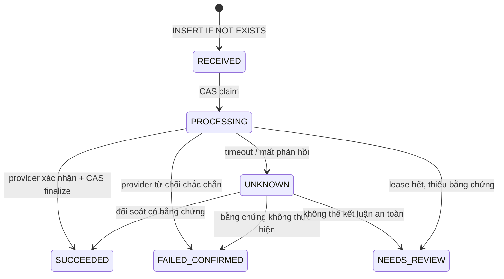
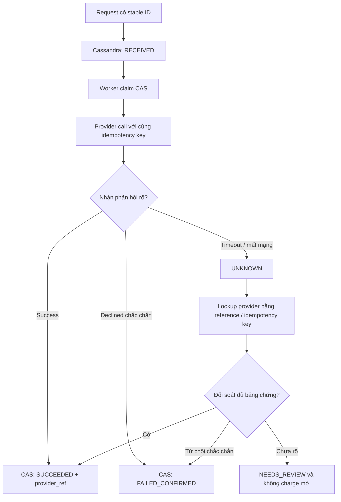

# Đối soát kết quả chưa biết và chống ghi trùng bằng thiết kế nghiệp vụ trong Apache Cassandra

## 1. Vấn đề: một lần timeout không chứng minh thao tác chưa được thực hiện

Apache Cassandra là hệ quản trị **wide-column phân tán**: partition key xác định nơi lưu dữ liệu, replication factor (RF) quy định số replica, và consistency level (CL) quy định số phản hồi cần nhận trước khi một câu CQL được coi là thành công. Ứng dụng Java thường kết nối qua **Cassandra Java Driver**, sử dụng prepared statements, timeout và retry policies để truy vấn.

Giả sử một dịch vụ thanh toán gửi yêu cầu cập nhật trạng thái đơn hàng:

```sql
UPDATE commerce.orders_by_id
SET payment_status = 'PAID'
WHERE order_id = ?;
```

Driver nhận `WriteTimeoutException` sau hai giây. Ở thời điểm đó, có ít nhất ba khả năng:

1. Một số replica đã ghi, nhưng coordinator chưa nhận đủ ACK tại CL yêu cầu.
2. Đủ replica có thể đã ghi, nhưng ACK/response bị chậm hoặc mất.
3. Mutation vẫn đang được xử lý sau khi client ngừng chờ.

Nếu Java gọi lại CQL hoặc gọi lại cổng thanh toán ngay vì “timeout nghĩa là thất bại”, một **yêu cầu nghiệp vụ** có thể tạo **nhiều lần tác động**.

Bài này nằm trong chương **Retry và lỗi Java** của module `DATABASE_ENGINE_WIDE_COLUMN_CASSANDRA`. Trọng tâm không phải “nên tăng timeout lên bao nhiêu”, mà là cách **thiết kế trạng thái, định danh, chống trùng và đối soát** để kết quả chưa biết không biến thành mất yêu cầu hoặc xử lý hai lần.

Sau bài học, bạn có thể:

- Phân biệt **attempt kỹ thuật** với **operation nghiệp vụ**.
- Xác định đúng phạm vi kết quả chưa rõ sau `WriteTimeout`, `DriverTimeout`, lỗi mạng hoặc LWT timeout.
- Thiết kế `request_id`/`idempotency_key` bền vững và phát hiện xung đột payload.
- Dùng **LWT (`IF NOT EXISTS`/`IF version = ...`)** để ngăn ghi trùng tại **một partition**.
- Xây dựng **state machine** có trạng thái `UNKNOWN` và worker reconciliation.
- Tích hợp hệ thống ngoài (payment gateway, broker, email) theo cách không hứa hẹn “exactly-once” khi không có bảo đảm tương ứng.
- Viết mã Java Driver 4.x và vận hành quy trình retry an toàn dưới tải, lỗi replica và sự cố restore.

## 2. Cơ sở: xác nhận ở mức Cassandra khác kết quả nghiệp vụ

Một coordinator xử lý request ghi với CL đã chọn. Ví dụ `RF(dc1)=3`, `LOCAL_QUORUM` cần **2 replica trong dc1** phản hồi đúng hạn. Đạt quorum giúp request được xác nhận ở CL đó; nó **không** tự bảo đảm mọi hệ thống ngoài đã hoàn thành cùng lúc.

| Câu hỏi | Ai trả lời? | Có thể suy ra từ một response CQL không? |
| --- | --- | --- |
| CQL được coordinator chấp nhận và đạt CL? | Cassandra/Driver | Có khi nhận thành công; không chắc khi timeout |
| Bao nhiêu replica đã thực sự lưu mutation sau timeout? | Trạng thái cluster và quá trình hội tụ | **Không** chỉ từ tên exception |
| Yêu cầu thanh toán đã được gateway thực hiện? | Payment provider | **Không** từ CQL write ACK |
| Khách đã được tính tiền đúng một lần? | Nguồn sự thật/ledger thanh toán, provider và nghiệp vụ | Cần idempotency/reconciliation |
| Có an toàn để gọi lại API không? | Thiết kế nghiệp vụ + contract provider | Chỉ khi định danh và semantics được kiểm chứng |

### 2.1. Phân biệt bốn kết quả kỹ thuật

| Kết quả ở client | Điều được biết | Điều **không** được phép khẳng định |
| --- | --- | --- |
| `Unavailable` | Theo coordinator, không đủ replica khả dụng cho CL ở attempt này | Không khẳng định toàn bộ operation chưa có side effect từ attempt trước |
| `ReadTimeout` | Read chưa có đủ phản hồi/dữ liệu trong hạn | Không phải “không tìm thấy bản ghi” |
| `WriteTimeout` | Write chưa nhận đủ ACK tại CL trong hạn | Không phải “chưa có replica nào ghi” |
| `DriverTimeout`/lỗi kết nối | Java chưa nhận kết quả trước deadline hoặc mất đường liên lạc | Không biết request đã tới coordinator, replica hoặc gateway chưa |

**Nguyên tắc:** lỗi kỹ thuật có thể dẫn tới trạng thái nghiệp vụ **`UNKNOWN`**. Không ánh xạ mọi timeout thành `FAILED`, và không trả `SUCCESS` chỉ vì “chắc Cassandra sẽ hội tụ”.

### 2.2. Timeline gây ra hai lần xử lý

```text
Client           Java API             Cassandra              Payment Gateway
  |                 |                      |                         |
  | POST request X  |                      |                         |
  |---------------->| ghi RECEIVED         |                         |
  |                 |--------------------->|                         |
  |                 |             (đã ghi, ACK thất lạc)             |
  |                 |<--- TIMEOUT ---------|                         |
  |<---- 5xx -------|                      |                         |
  |                 |                      |                         |
  | POST request Y  |                      |                         |
  | (ID mới vì retry)                      |                         |
  |---------------->| ghi RECEIVED lần 2  |                         |
  |                 |--------------------->|                         |
  |                 |-------- gọi charge --------------------------->|
  |                 |-------- gọi charge lần nữa ------------------->|
```

Lỗi gốc không nằm ở việc client retry hay không, mà nằm ở chỗ **request X và Y không có định danh nghiệp vụ ổn định** và bên nhận không phát hiện chúng là cùng một ý định.

## 3. Attempt, logical operation và idempotency key

Phải phân biệt ba định danh:

| Định danh | Ý nghĩa | Có thay đổi khi retry? |
| --- | --- | --- |
| **Transport/request attempt ID** | Một lần gửi HTTP, CQL hoặc gọi gateway | **Có thể thay đổi** từng attempt |
| **Logical operation ID / request_id** | Một ý định nghiệp vụ duy nhất, ví dụ “thu tiền đơn O với số tiền M” | **Không** thay đổi trong mọi retry của cùng ý định |
| **Idempotency key tại provider** | Khóa bên ngoài dùng để nhận diện operation khi gọi API provider | **Phải ổn định** qua mọi lần gọi cùng operation, trong contract hỗ trợ của provider |

Ví dụ: người dùng bấm “Thanh toán” một lần, app tạo `request_id=R`. HTTP timeout thì app gửi lại với **cùng R**, không tạo R mới. API phải kiểm tenant, payload và trạng thái R trước khi tạo tác động.

### 3.1. Khóa phải duy nhất trong đúng miền nghiệp vụ

Giả sử hệ thống nhiều tenant. Chọn khóa:

```text
logical_key = (tenant_id, request_id)
provider_idempotency_key = "payment/" + tenant_id + "/" + request_id
```

Đừng dùng chỉ `order_id` làm khóa nếu một đơn có thể có nhiều yêu cầu độc lập (thử thanh toán mới sau khi bị từ chối, refund, capture từng phần). Ngược lại, đừng dùng `UUID.randomUUID()` **mỗi khi retry** cùng một payment.

Cần định nghĩa rõ **khi nào sinh request ID**:

- Sinh **trước attempt đầu tiên** và lưu đủ bền vững để caller giữ khi retry.
- Mọi tầng API/worker/message consumer truyền cùng logical ID.
- Một lần thực hiện nghiệp vụ **mới thật sự** phải có ID mới; không tái sử dụng ID cũ với nội dung khác.
- Khóa gắn tenant/principal và được xác thực quyền, tránh người khác đoán ID rồi truy vấn trạng thái của tenant khác.

### 3.2. Payload fingerprint để chống “trùng ID, khác ý định”

Nếu client gửi lại cùng `request_id` nhưng đổi số tiền từ 120.000 sang 210.000 VND, không được xem đó là retry hợp lệ. Hãy lưu các trường nghiệp vụ bất biến hoặc một **payload hash chuẩn hóa**.

Ví dụ dữ liệu đem so sánh:

```text
tenant_id, operation_type=PAYMENT_CAPTURE, order_id,
amount_minor, currency, business_version
```

Tạo canonical representation với thứ tự trường, chuẩn hóa kiểu số/tiền tệ và encode nhất quán. Không hash trực tiếp JSON tùy ý rồi giả định đổi thứ tự thuộc tính không ảnh hưởng. Nếu cần che thông tin nhạy cảm, dùng HMAC/cơ chế bảo vệ theo chính sách.

**Quy tắc bắt buộc:**

- `request_id` chưa tồn tại: có thể tiếp nhận ý định mới.
- Cùng `request_id`, cùng payload: trả trạng thái **đang lưu**; không tự chạy lại effect.
- Cùng `request_id`, **khác** payload: trả lỗi xung đột (ví dụ HTTP `409`), không ghi đè.

Idempotency key chỉ có ích nếu được duy trì đủ lâu. TTL quá ngắn khiến request cũ quay lại sau khi record bị xóa và được coi nhầm là operation mới.

## 4. Thiết kế bảng theo request ID trong Cassandra

Cassandra được thiết kế theo truy vấn; nhu cầu trung tâm ở đây là:

```sql
SELECT ...
FROM commerce.payment_requests_by_id
WHERE tenant_id = ? AND request_id = ?;
```

Ta tạo **một partition cho mỗi logical operation**:

```sql
-- Ví dụ cho môi trường lab có DC thực tế tên dc1.
CREATE KEYSPACE IF NOT EXISTS commerce
WITH replication = {
    'class': 'NetworkTopologyStrategy',
    'dc1': 3
};

CREATE TABLE IF NOT EXISTS commerce.payment_requests_by_id (
    tenant_id uuid,
    request_id uuid,
    order_id uuid,
    amount_minor bigint,
    currency text,
    payload_hash text,
    state text,
    version int,
    attempt_id uuid,
    provider_idempotency_key text,
    provider_reference text,
    created_at timestamp,
    updated_at timestamp,
    lease_until timestamp,
    last_error_code text,
    PRIMARY KEY ((tenant_id, request_id))
);
```

**Ý nghĩa từng nhóm cột:**

| Cột | Mục đích | Lưu ý |
| --- | --- | --- |
| `tenant_id`, `request_id` | Khóa partition định danh operation | Mọi query quan trọng phải có đủ hai trường |
| `order_id`, `amount_minor`, `currency` | Hợp đồng tiền/đơn hàng bất biến | Không dùng `double` để biểu diễn tiền; số đơn vị nhỏ nhất/`decimal` tùy contract |
| `payload_hash` | Phát hiện key reuse với payload khác | Chuẩn hóa dữ liệu trước khi tính hash |
| `state` | Trạng thái state machine | Không suy từ `null` là FAILED |
| `version` | Fencing/so sánh điều kiện cập nhật | Dùng CAS để tránh stale worker ghi đè |
| `attempt_id`, `lease_until` | Chủ sở hữu attempt hiện tại và thời hạn lease | Lease **không** tạo transaction với gateway |
| `provider_idempotency_key` | Khóa gửi đến provider | Duy trì ổn định qua retry/recovery |
| `provider_reference` | ID transaction thực phía provider | Là bằng chứng giúp đối soát |
| `created_at`, `updated_at` | Audit/tìm tiến trình treo | Chú ý clock skew và timestamp semantics |
| `last_error_code` | Hỗ trợ chẩn đoán | Không lưu token/card data/bí mật nhạy cảm |

**Không đặt TTL mặc định ngắn cho bảng chống trùng** chỉ để giảm dung lượng. Cần chính sách retention theo thời hạn retry của client, provider idempotency window, yêu cầu kiểm toán, khả năng restore và luật dữ liệu. Nếu record idempotency đã hết hạn nhưng provider còn một charge cũ, thao tác mới có thể tính tiền lần thứ hai.

Vì bảng được truy vấn bằng `request_id`, **không dùng `SELECT *` toàn bảng với `ALLOW FILTERING`** để tìm các operation pending. Worker cần nguồn work queue bền vững hoặc bảng chỉ mục theo bucket/trạng thái được thiết kế và đối soát riêng; các bảng denormalized không tự nhất quán xuyên nhiều partition.

## 5. State machine: UNKNOWN là trạng thái có ý nghĩa

Không nên chỉ có `SUCCESS` và `FAILED`. Một state machine cho workflow thanh toán có thể dùng:

| State | Nghĩa | Khi nào được chuyển |
| --- | --- | --- |
| `RECEIVED` | Đã lưu ý định với request ID và payload | Sau khi xác nhận mutation đăng ký |
| `PROCESSING` | Worker đã claim operation và có thể đang gọi provider | CAS theo state/version |
| `UNKNOWN` | Đã có attempt với kết quả chưa xác định | Sau timeout/đứt mạng hoặc reaper không biết effect |
| `SUCCEEDED` | Có bằng chứng nghiệp vụ đủ tin cậy đã hoàn tất | Provider xác nhận thành công, kiểm được reference/payload |
| `FAILED_CONFIRMED` | Có bằng chứng rõ effect không xảy ra hoặc bị từ chối cuối cùng | Provider có kết luận từ chối/không thành công theo contract |
| `NEEDS_REVIEW` | Không thể tự đối soát an toàn | Hết idempotency window, kết quả xung đột, bằng chứng không đầy đủ |



Sơ đồ mô tả **ý định nghiệp vụ**. Nếu write chuyển trạng thái cũng timeout thì **transition có thể đã áp dụng**, nên worker phải kiểm lại state và version thay vì tự áp dụng một lần khác. Không tự động chuyển `UNKNOWN → FAILED_CONFIRMED` chỉ vì đợi lâu.

### 5.1. Tách “không thấy record” khỏi “chắc chắn chưa thực hiện”

Một read-back không trả row có thể do:

- Lệnh đăng ký lần đầu chưa từng commit.
- Mutation mới được ghi ở ít replica/chưa đủ visibility theo CL đọc.
- Lệnh đang in-flight và sẽ hoàn tất sau read.
- Schema/topology/CL chưa phù hợp, hoặc dữ liệu đã hết TTL do thiết kế retention sai.

Vì vậy **một lần SELECT không thấy row không luôn là bằng chứng âm tính tuyệt đối** trong kịch bản đang có request tranh chấp hoặc sự cố mạng. Dùng cùng `request_id` cho phép thử lại thao tác đăng ký **có điều kiện**, thay vì tạo operation mới.

### 5.2. Terminal state phải được bảo vệ

Sau khi `SUCCEEDED` hoặc `FAILED_CONFIRMED`, không để worker có claim cũ ghi trả về `PROCESSING` hay trạng thái khác. Dùng CAS theo `state` và `version`, bảo đảm các transition cho phép có quy tắc rõ ràng. Nếu nghiệp vụ cần refund, hãy tạo **operation mới** liên kết charge gốc thay vì sửa trạng thái charge cũ thành một ý định khác.

## 6. LWT `IF NOT EXISTS`: chống hai yêu cầu cùng ID trên một partition

CQL đăng ký request:

```sql
INSERT INTO commerce.payment_requests_by_id (
    tenant_id, request_id, order_id, amount_minor,
    currency, payload_hash, state, version,
    provider_idempotency_key, created_at, updated_at
)
VALUES (?, ?, ?, ?, ?, ?, 'RECEIVED', 0, ?, ?, ?)
IF NOT EXISTS;
```

Nếu nhiều client đồng thời đăng ký cùng `(tenant_id, request_id)`, **LWT** cho phép chọn một request tạo record theo ngữ nghĩa conditional write của Cassandra. Ứng dụng phải kiểm kết quả `[applied]`.

| Kết quả | Diễn giải | Hành động |
| --- | --- | --- |
| `[applied]=true` | Lần gửi này tạo record theo điều kiện | Được phép xếp work theo quy trình bền vững |
| `[applied]=false` | Record đã tồn tại | Đọc/kiểm `order_id`, số tiền, currency, hash và state; không coi là FAILED |
| `WriteTimeout`/`DriverTimeout`/lỗi kết nối | Không biết conditional write đã commit chưa | Chuyển sang kiểm tra/reconcile; **không sinh request ID mới** |
| `Unavailable` | Không đủ replica/điều kiện cho CL | Không hạ CL hoặc tự bypass LWT |

**LWT bảo vệ điều kiện của một partition Cassandra.** Nó không bảo đảm một lần gọi HTTP duy nhất, một lần gửi Kafka duy nhất hoặc một lần trừ tiền ở provider. Hai operation khác request ID vẫn có thể cùng tính tiền nếu hệ thống **không có invariant cấp đơn hàng**.

### 6.1. Đừng hiểu `[applied]=false` là “thao tác nghiệp vụ thất bại”

Nếu attempt đầu áp dụng insert nhưng response mất, attempt thứ hai gửi **cùng ID** có thể nhận `[applied]=false`. Đây là hành vi **mong đợi** trong hệ thống chống trùng.

- Nếu payload **trùng**, trả **trạng thái record**: RECEIVED, PROCESSING, UNKNOWN hoặc SUCCEEDED.
- Nếu payload **khác**, báo conflict; không overwrite payload của operation đã tồn tại.
- Nếu trạng thái chưa cuối cùng, người gọi có thể poll bằng request ID hoặc nhận response chờ xử lý theo contract.

**Không trả `SUCCEEDED` chỉ vì record tồn tại.** Record ban đầu chỉ có nghĩa đã tiếp nhận yêu cầu, chưa chắc provider xử lý thành công.

### 6.2. Vì sao không dùng `INSERT` thường?

`INSERT` không điều kiện theo cùng primary key có thể là idempotent ở mức giá trị đơn giản, nhưng Cassandra dùng cơ chế timestamp và last-write-wins cho cập nhật. Hai request khác payload cùng key có thể ghi đè trường bất biến. Với yêu cầu phân xử quyền sở hữu một operation, `IF NOT EXISTS`/CAS là biên an toàn hơn, dù chi phí/latency cao hơn write thường.

## 7. Java Driver 4.x: đăng ký request và phân loại kết quả

Ví dụ dùng API `com.datastax.oss.driver.api.*` của Java Driver 4.x. Mã dưới đây là **khối xử lý đăng ký**, giả định `CqlSession` đã được tạo và cấu hình với đúng DC, TLS, authentication và role `MODIFY/SELECT` cần thiết.

```java
import java.time.Duration;
import java.time.Instant;
import java.util.Objects;
import java.util.UUID;

import com.datastax.oss.driver.api.core.CqlSession;
import com.datastax.oss.driver.api.core.DefaultConsistencyLevel;
import com.datastax.oss.driver.api.core.DriverTimeoutException;
import com.datastax.oss.driver.api.core.cql.BoundStatement;
import com.datastax.oss.driver.api.core.cql.PreparedStatement;
import com.datastax.oss.driver.api.core.cql.ResultSet;
import com.datastax.oss.driver.api.core.cql.Row;
import com.datastax.oss.driver.api.core.servererrors.ReadTimeoutException;
import com.datastax.oss.driver.api.core.servererrors.UnavailableException;
import com.datastax.oss.driver.api.core.servererrors.WriteTimeoutException;

public final class PaymentRequestRegistry {
    public enum Decision {
        CREATED, ALREADY_EXISTS_SAME_PAYLOAD, CONFLICT, UNKNOWN
    }

    private final CqlSession session;
    private final PreparedStatement insert;
    private final PreparedStatement read;

    public PaymentRequestRegistry(CqlSession session) {
        this.session = session;
        this.insert = session.prepare(
            "INSERT INTO commerce.payment_requests_by_id " +
            "(tenant_id, request_id, order_id, amount_minor, currency, " +
            " payload_hash, state, version, provider_idempotency_key, " +
            " created_at, updated_at) " +
            "VALUES (?, ?, ?, ?, ?, ?, 'RECEIVED', 0, ?, ?, ?) " +
            "IF NOT EXISTS");

        this.read = session.prepare(
            "SELECT order_id, amount_minor, currency, payload_hash, state " +
            "FROM commerce.payment_requests_by_id " +
            "WHERE tenant_id = ? AND request_id = ?");
    }

    public Decision register(UUID tenantId, UUID requestId, UUID orderId,
            long amountMinor, String currency, String payloadHash,
            String providerKey) {

        Instant now = Instant.now();

        BoundStatement attempt = insert.bind(
                tenantId, requestId, orderId, amountMinor,
                currency, payloadHash, providerKey, now, now)
            .setConsistencyLevel(DefaultConsistencyLevel.LOCAL_QUORUM)
            .setSerialConsistencyLevel(DefaultConsistencyLevel.LOCAL_SERIAL)
            .setTimeout(Duration.ofSeconds(2))
            .setIdempotent(false); // Không tự động retry CAS mù quáng.

        try {
            ResultSet result = session.execute(attempt);
            if (result.wasApplied()) {
                return Decision.CREATED;
            }
            return classifyExisting(
                tenantId, requestId, orderId,
                amountMinor, currency, payloadHash);

        } catch (WriteTimeoutException
                | DriverTimeoutException
                | UnavailableException e) {
            // Đăng ký có thể đã commit; không tạo requestId mới,
            // không gọi cổng thanh toán chỉ vì client nhận timeout.
            return Decision.UNKNOWN;
        }
    }

    private Decision classifyExisting(UUID tenantId, UUID requestId,
            UUID orderId, long amountMinor,
            String currency, String payloadHash) {

        BoundStatement query = read.bind(tenantId, requestId)
            .setConsistencyLevel(DefaultConsistencyLevel.LOCAL_QUORUM)
            .setTimeout(Duration.ofSeconds(2))
            .setIdempotent(true);

        try {
            Row row = session.execute(query).one();
            if (row == null) {
                // Một lần đọc không thấy không chứng minh write đầu không xảy ra.
                return Decision.UNKNOWN;
            }

            boolean same = Objects.equals(row.getUuid("order_id"), orderId)
                && row.getLong("amount_minor") == amountMinor
                && Objects.equals(row.getString("currency"), currency)
                && Objects.equals(row.getString("payload_hash"), payloadHash);

            return same
                ? Decision.ALREADY_EXISTS_SAME_PAYLOAD
                : Decision.CONFLICT;
        } catch (ReadTimeoutException
                | DriverTimeoutException
                | UnavailableException e) {
            return Decision.UNKNOWN;
        }
    }
}
```

**Điểm quan trọng của ví dụ:**

- `Decision.CREATED` nghĩa là **đã tạo record tiếp nhận**, **không phải thanh toán thành công**.
- `ALREADY_EXISTS_SAME_PAYLOAD` nghĩa là trùng logical operation hợp lệ; lớp dịch vụ phải **đọc state hiện tại** để phản hồi phù hợp, không tự gửi charge lần hai.
- `UNKNOWN` không được biến thành `FAILED_CONFIRMED`. Nếu hàm trả UNKNOWN khi mạng hỏng, caller phải retry **cùng requestId** hoặc tham gia quy trình reconciliation.
- Code chưa bắt mọi lỗi transport hoặc CAS-specific exception của mọi bản driver. Trong production, phân loại thêm những exception được bản driver thực dùng, nhưng **không nuốt lỗi auth/schema/programming thành UNKNOWN** rồi retry vô hạn.
- `LOCAL_SERIAL` và `LOCAL_QUORUM` chỉ là lựa chọn minh họa cho DC/RF phù hợp; phải xác định hợp đồng nhất quán và topology.
- `now` được sinh cho **attempt lần này**; khi retry đăng ký sau UNKNOWN cần giữ các trường payload bất biến và không dùng timestamp mới để quyết định đây là operation khác.
- Việc nhận record `CREATED` xong **không đảm bảo công việc đã được đưa vào một hàng đợi bền vững**. Cần kết nối quy trình đăng ký với nguồn work có recovery, trình bày ở phần sau.

### 7.1. Tại sao mark `setIdempotent(false)` cho LWT?

Có thể lặp lại `INSERT IF NOT EXISTS` với **cùng key và payload** một cách có kiểm soát để phát hiện bản ghi đã tồn tại. Tuy nhiên, **kết quả phản hồi có thể đổi** từ `[applied]=true` sang `[applied]=false`; việc trả API đúng còn phụ thuộc read-back và state machine. Đánh dấu non-idempotent là lựa chọn bảo thủ tránh speculative retry không được thiết kế trước.

Sau đó, tầng nghiệp vụ **có thể chủ động** quyết định kiểm tra/retry cùng logical ID khi còn deadline và biết cách diễn giải kết quả; không đánh dấu true chỉ vì có `IF NOT EXISTS`.

## 8. Claim công việc và chống worker cũ ghi đè: CAS + version

Đăng ký yêu cầu chống trùng chỉ là bước đầu. Nếu hai worker cùng nhìn thấy `RECEIVED` và cùng gửi charge, vẫn có thể gọi provider hai lần. Cần **claim** operation theo điều kiện.

Ví dụ sau khi đọc `state='RECEIVED'` và `version=0`:

```sql
UPDATE commerce.payment_requests_by_id
SET state = 'PROCESSING',
    version = 1,
    attempt_id = 44444444-4444-4444-4444-444444444444,
    lease_until = '2026-11-21 10:00:00+0000',
    updated_at = '2026-11-21 09:55:00+0000'
WHERE tenant_id = 11111111-1111-1111-1111-111111111111
  AND request_id = 22222222-2222-2222-2222-222222222222
IF state = 'RECEIVED' AND version = 0;
```

Trong hệ thống thật, sinh `attempt_id` duy nhất, thời gian lease có giới hạn và giá trị `version` mới từ state trước; mẫu trên minh họa CQL, **không khuyến nghị dùng timestamp cố định**.

Nếu `[applied]=true`, worker đã giành quyền claim theo điều kiện. Nếu `[applied]=false`, worker phải đọc lại state/version/attempt hiện tại thay vì gọi provider.

### 8.1. Vì sao cần `version` và `attempt_id`?

Một worker có thể chậm hoặc bị pause sau khi lease hết. Một worker khác được reaper cấp claim mới. Nếu worker cũ trở lại và ghi `SUCCEEDED` vô điều kiện, nó có thể ghi đè kết quả của worker mới.

Dùng finalization có điều kiện:

```sql
UPDATE commerce.payment_requests_by_id
SET state = 'SUCCEEDED',
    provider_reference = ?,
    updated_at = ?,
    version = ?
WHERE tenant_id = ? AND request_id = ?
IF state = 'PROCESSING'
   AND attempt_id = ?
   AND version = ?;
```

**Bằng chứng finalization:** nếu CAS trả `[applied]=true`, mutation này đã vượt điều kiện; nếu timeout hoặc `[applied]=false`, phải kiểm trạng thái trước khi quyết định tiếp.

- `version` là số nguyên ứng dụng tự tăng từ phiên bản đọc trước, **không phải Cassandra counter**.
- `attempt_id` giúp nhận ra worker cũ.
- `lease_until` chỉ giúp ứng dụng *quyết định có nên claim lại không*. **Lease không phải lock xuyên Cassandra và provider**.
- Reaper không nên dựa vào so sánh clock đơn lẻ để “chứng minh chắc worker chết”; phải CAS/fencing và chấp nhận có attempt đã gửi ra ngoài.
- Nếu process gửi charge rồi crash trước finalization, **CAS không đảo ngược charge**; chỉ provider idempotency/reconciliation mới xử lý được.

### 8.2. Lỗi timeout khi claim cũng có kết quả mơ hồ

Nếu worker gọi CAS claim và nhận timeout, nó chưa biết claim đã áp dụng hay chưa. Không tạo attempt ID mới rồi claim lại ngay. Hãy truy vấn `state`, `version`, `attempt_id` của cùng request ID; nếu vẫn chưa chắc, đánh dấu cần đối soát. Việc record có `PROCESSING` với attempt ID hiện tại là một dấu hiệu; nhưng với concurrency và lease expiry, cần tiếp tục theo state machine và CAS.

## 9. Hệ thống ngoài: tại sao “exactly once” khó hơn một câu CQL

Cassandra và payment gateway là **hai hệ thống độc lập**. Không có transaction ACID phân tán mặc định bảo đảm “ghi Cassandra và charge provider cùng commit hoặc cùng rollback”.



### 9.1. Contract với provider phải được kiểm tra

Một số provider hỗ trợ **idempotency key** trên API tạo charge, nhưng phạm vi, thời hạn lưu key, quy tắc payload và cách tra cứu **khác nhau theo provider và API**.

Cần ghi rõ:

- Khóa được xét trong phạm vi merchant/tenant nào?
- Cùng key + cùng payload có trả lại **cùng kết quả/reference** không?
- Cùng key + payload khác trả conflict hay tạo operation mới?
- Key được lưu bao lâu? Khi hết hạn, provider có thể xử lý lại như yêu cầu mới không?
- Nếu network timeout, có endpoint tra cứu theo `merchant_reference`/`request_id` không?
- Provider có trạng thái `PENDING`, `AUTHORIZED`, `CAPTURED`, `DECLINED` như thế nào? Trạng thái nào là terminal?
- Webhook có thể đến trễ/lặp/không theo thứ tự không? Có chữ ký xác minh và event ID không?

Nếu **không có idempotency hoặc lookup đáng tin cậy**, không nên tự động gửi lại yêu cầu có khả năng tạo charge. Dùng `UNKNOWN`, điều tra ngoài băng và reconciliation theo quy trình được kiểm soát.

### 9.2. Trình tự “ghi trước hay gọi trước” đều có khe hở

| Trình tự | Khoảng lỗi | Cách giảm rủi ro |
| --- | --- | --- |
| Gọi provider trước, rồi lưu Cassandra | Provider đã charge nhưng process crash trước khi ghi | Stable provider key, reconciliation và durable intent trước call |
| Lưu Cassandra trước, rồi gọi provider | Record đã lưu nhưng chưa gọi provider khi process crash | Worker/queue có recovery, polling có kiểm soát |
| Ghi Cassandra, gọi provider, ghi trạng thái cuối | Provider thành công nhưng finalization timeout | Record `UNKNOWN`, lookup provider, CAS finalize |
| Đẩy message rồi cập nhật Cassandra | Queue đã giao nhưng state chưa lưu, hoặc ngược lại | At-least-once consumer, stable ID và reconciliation giữa hai hệ |

**Không gọi `LOGGED BATCH` xuyên bảng để tuyên bố transaction với provider.** Cassandra batch không giao dịch được với HTTP API, và ghi nhiều partition không có tính cách ly giao dịch ứng dụng như một RDBMS ACID transaction.

## 10. At-least-once delivery và recovery: đừng đặt niềm tin vào một hàng đợi đơn độc

Giả sử Kafka, SQS hoặc một queue khác có thể gửi lại message khi consumer crash trước khi ACK. Đây là hành vi **at least once**, không phải bug.

Mẫu thiết kế:

1. Message chứa `tenant_id`, `request_id`, payload hash và metadata cần thiết.
2. Consumer kiểm trạng thái operation trong Cassandra theo partition key.
3. Consumer **CAS claim** và xác định có quyền gọi provider hay không.
4. Gọi provider với **khóa idempotency không đổi**; nếu timeout, không tự suy ra FAILED.
5. CAS ghi trạng thái cuối; nếu timeout, lập reconciliation.
6. ACK message khi **durable state** đã phản ánh tiến trình phù hợp với contract; nếu message gửi lại, consumer thấy trạng thái đã có và không tạo effect mới.

### 10.1. Khe hở giữa table và queue

Ghi `payment_requests_by_id` rồi publish queue là hai thao tác độc lập. Process có thể crash sau ghi table trước khi publish, làm record mắc kẹt ở `RECEIVED`.

Một số chiến lược:

- **Outbox/intent bền vững trong cùng partition** khi thiết kế mutation/CAS thích hợp; dispatcher đọc rồi phát idempotent, giữ trạng thái giao hàng.
- CDC theo khả năng phiên bản/triển khai, với contract thứ tự và at-least-once rõ ràng.
- Queue là nguồn chấp nhận operation, nhưng cần đảm bảo message bền vững trước khi cam kết đã tiếp nhận.
- **Reconciler định kỳ** phát hiện record còn `RECEIVED/PROCESSING/UNKNOWN` quá lâu và phục hồi bằng khóa operation.

Cassandra không hỗ trợ hiệu quả truy vấn tất cả partition bằng `WHERE state='UNKNOWN'` nếu bảng chỉ có partition key request ID. Hãy tạo **index công việc theo bucket/thời gian/trạng thái** hoặc sử dụng durable queue/CDC; chấp nhận rằng hai bảng denormalized có thể lệch và cần đối soát. Không quét toàn bảng `ALLOW FILTERING` liên tục trong production.

### 10.2. Vì sao cần một tầng reconciliation độc lập?

Không phải mọi attempt sinh timeout đều còn chạy khi service restart. Một worker reconcile độc lập giúp:

- Tìm operation `PROCESSING` đã quá lease hoặc `UNKNOWN` chưa có quyết định.
- Tra cứu provider bằng key/reference ổn định.
- So sánh kết quả ngoài với payload/order và trạng thái trong Cassandra.
- Ghi finalization bằng CAS, không overwrite terminal state.
- Đưa case không thể kết luận vào `NEEDS_REVIEW` và alert theo SLA.
- Chạy lại an toàn sau crash và kiểm checkpoint/lock để tránh hai reconciler làm cùng effect.

**Reconciliation không nhất thiết tự gọi charge lại.** Với kết quả chưa rõ, ưu tiên **tra cứu trạng thái** thay vì thực hiện tác động mới.

## 11. Read-back sau `WriteTimeout`: bằng chứng nào là đủ?

Giả sử ứng dụng vừa gửi mutation đăng ký `request_id=R` và gặp `WriteTimeout`. Nó thực hiện `SELECT` tại `LOCAL_QUORUM`.

| Kết quả đọc | Điều có thể nói | Điều chưa thể nói |
| --- | --- | --- |
| Thấy record R và payload khớp | R hiện được nhìn thấy, có thể tiếp tục dựa trên state | Provider đã thực hiện charge |
| Thấy R nhưng payload khác | Idempotency key bị dùng với ý định khác; phải chặn | Không thể overwrite để “sửa cho giống” |
| Không thấy R | Chưa thấy record qua lần đọc này | Không chắc write trước không đang in-flight hoặc chưa thành công |
| Đọc timeout/unavailable | Không có dữ liệu đủ tin cậy để quyết định | Không thể tự kết luận R không tồn tại |
| Thấy `PROCESSING`/`UNKNOWN` | Work đã tiến tới trạng thái đó | Không chắc provider charge hay chưa |
| Thấy `SUCCEEDED` + reference hợp lệ | Có record kết quả thành công trong Cassandra | Cần đối chiếu invariant/provider nếu đang điều tra sự cố lớn hoặc restore |

Read-back có thể làm rõ trạng thái, nhưng **không biến một hệ thống phân tán thành transaction đa hệ thống**. Với hoạt động ảnh hưởng tiền, kiểm cả trạng thái nguồn sự thật của provider và bảo đảm idempotency.

### 11.1. Tại sao một lần `LOCAL_QUORUM` không luôn trả lời hết?

Với RF=3 và `LOCAL_QUORUM`, đọc/ghi quorum có giao nhau theo phép đếm replica. Nhưng còn các yếu tố:

- Write có thể **chưa đạt quorum** khi timeout.
- Mutation có thể **tiếp tục đến sau** lần read.
- Các writer khác có thể cập nhật cùng partition, khiến read-back phản ánh trạng thái mới.
- Cassandra dùng timestamp/last-write-wins cho các cột không có điều kiện; không suy ra trình tự nghiệp vụ chỉ từ thời gian hệ thống.
- LWT có ngữ nghĩa CAS riêng và cần xử lý concurrency; một SELECT thường không phải chứng nhận “không ai đang xử lý”.

Với yêu cầu ngăn trùng, dùng **LWT có cùng khóa operation** và đối soát state/version, không dựa hoàn toàn vào một lần SELECT rồi cho phép retry mutation tùy ý.

## 12. Xử lý timeout và retry trong Java Driver: tầng nào quyết định?

Một Java request có thể được retry ở nhiều lớp:

- Driver retry policy cho một số lỗi/attempt.
- Speculative execution của driver khi được bật.
- Service layer retry bằng Java loop/future.
- HTTP client, API gateway hoặc mobile app retry.
- Message broker redelivery.
- Provider SDK tự retry.

Nếu tất cả cùng tự retry, một intent có thể tạo nhiều attempts hơn dự kiến.

### 12.1. Bật/tắt idempotence cần bằng chứng nghiệp vụ

```java
BoundStatement query = selectById.bind(orderId)
    .setIdempotent(true); // SELECT không có side effect nghiệp vụ.

BoundStatement conditionalInsert = insertPaymentRequest.bind(/* giá trị */)
    .setIdempotent(false); // Bảo thủ; service tự diễn giải CAS/reconciliation.
```

`setIdempotent(true)` **không** tạo khóa chống trùng. Nó chỉ cung cấp thông tin cho các policy của driver. Không dùng nó để biến counter increment hoặc gọi provider thành thao tác an toàn.

### 12.2. Bounded retries: khác “retry cho đến khi thành công”

Một retry được xét chỉ khi:

1. **Cùng logical operation ID** và payload.
2. Biết rõ bước định retry là **read**, **register CAS**, **lookup provider** hay **effectful charge**.
3. Bước đó được chứng minh an toàn khi gửi lại theo contract.
4. Còn deadline, số attempts tối đa và khả năng phục vụ của cluster.
5. Có backoff/jitter và giới hạn in-flight để tránh retry storm.

Ví dụ pseudo-code:

```text
function handleRetry(op):
    if op.state is terminal:
        return storedOutcome(op)

    if op.payloadConflictsWithStored:
        return CONFLICT

    if op.providerOutcomeUnknown:
        return reconcileByStableProviderKey(op)

    if op.needsRegistrationCheck:
        return conditionalInsertWithSameRequestId(op)

    if op.effectfulStepCouldHaveHappened:
        return UNKNOWN_NEEDS_RECONCILIATION

    if not enoughDeadline or overload:
        return PENDING

    performOnlyProvenSafeStepWithBoundedRetry(op)
```

**Không hạ `LOCAL_QUORUM` xuống `LOCAL_ONE` chỉ để nhận response nhanh** nếu hợp đồng dữ liệu yêu cầu quorum. CL, RF, repair và tình trạng replica là biến của chiến lược nhất quán, không phải “nút bỏ qua lỗi”.

### 12.3. Bảo đảm HTTP response không nói quá bằng chứng

Tùy hợp đồng API:

| Tình huống | Phản hồi hợp lý theo thiết kế | Lưu ý |
| --- | --- | --- |
| Record đã được tạo bền vững, công việc đang chờ | `202 Accepted` hoặc trạng thái `PENDING` | Chỉ nếu **thực sự có cách tiếp tục xử lý** sau crash |
| Operation đã thành công được xác nhận | `200 OK`/kết quả nghiệp vụ | Đính request ID và reference; không suy từ insert |
| Cùng key khác payload | `409 Conflict` | Không gọi provider |
| Operation có kết quả chưa rõ | Trạng thái `UNKNOWN/PENDING` hoặc lỗi tạm thời theo contract | Client phải giữ key; không yêu cầu gửi operation ID mới |
| Hạ tầng không bảo đảm lưu intent | `503`/lỗi retryable theo contract | Không hứa “đã tiếp nhận” khi chưa có durable evidence |

Với một operation có trạng thái chưa rõ, API có thể cho phép **`GET /operations/{request_id}`** để client tra cứu kết quả. Endpoint tra cứu cần kiểm tenant/auth và phản ánh **state thực**, kể cả `UNKNOWN`.

## 13. Tương tác với timestamp, TTL, batch, counter và nhiều bảng

### 13.1. Timestamp và ghi cạnh tranh

Cassandra xử lý các cập nhật không điều kiện bằng quy tắc timestamp. Nếu một attempt cũ retry sau attempt mới với timestamp lớn hơn, nó có thể ghi đè trạng thái mới hợp lệ.

Ví dụ một worker đã chuyển đơn sang `REFUNDED`, rồi client retry `UPDATE ... SET status='PAID'` với timestamp ghi mới hơn. Dù câu lệnh nhìn có vẻ idempotent vì luôn SET PAID, **nó không an toàn theo state machine**.

Giải pháp: CAS theo `version/state` khi cập nhật trạng thái có ràng buộc nghiệp vụ; dùng ID ổn định và tránh retry mutation vô điều kiện.

### 13.2. TTL làm mất bộ nhớ chống trùng

- Record idempotency hết TTL trong khi client hoặc provider còn khả năng replay → hệ thống có thể coi request cũ là mới.
- Dữ liệu với TTL được ghi lại có thể đổi thời điểm hết hạn.
- Tombstone và `gc_grace_seconds`/repair ảnh hưởng khả năng khôi phục/nhìn thấy dữ liệu đã xóa.

Thiết kế retention phải xét **cả cửa sổ retry của client, message broker, provider, backup/restore và audit**. Một TTL cụ thể không phải giải pháp chung; dữ liệu nhạy cảm cần chính sách bảo vệ/xóa phù hợp.

### 13.3. Counter không phải nền tảng chống trùng

`UPDATE counter = counter + 1` có thể thực hiện nhiều lần nếu retry sau `WriteTimeout`. Đừng tăng counter trực tiếp khi xử lý event at-least-once mà không có chiến lược de-duplication. Có thể lưu **event ID duy nhất** và tính lại aggregate idempotent theo pipeline có kiểm soát; nếu vẫn dùng counter, cần hiểu các giới hạn consistency giữa event log và counter table.

### 13.4. Logged batch không tạo transaction đa bảng có cách ly

`BEGIN LOGGED BATCH ... APPLY BATCH` có cơ chế hỗ trợ đảm bảo các mutation theo mô hình batch, nhưng không tạo **ACID transaction với isolation và rollback** giống RDBMS giữa mọi partition, càng không điều phối được cổng thanh toán. Hai bảng denormalized theo truy vấn có thể hiển thị trạng thái khác nhau trong thời gian ngắn và cần reconciliation.

Nếu có hai bảng `orders_by_id` và `orders_by_customer`, đừng dùng việc ghi thành công một bảng làm bằng chứng bảng kia đã hội tụ. Cần nguồn sự thật và projection update có event ID, version hoặc quy trình backfill.

## 14. Khôi phục sau sự cố: backup/restore cũng phải tính đến chống trùng

Giả sử:

- 10:00: request R được ghi, provider đã charge thành công.
- 10:10: cluster Cassandra bị lỗi nghiêm trọng.
- 10:20: operator restore một snapshot chụp lúc 09:50.

Snapshot trước 10:00 **không chứa R**, nhưng provider vẫn có charge. Nếu ứng dụng nhận lại R và chỉ kiểm Cassandra sau restore, nó có thể tạo operation mới và **charge lần hai**.

Vì vậy, kế hoạch disaster recovery cần:

1. Định nghĩa **RPO/RTO** và phân biệt mất state Cassandra với trạng thái provider.
2. Giữ changelog/event ledger có khả năng replay **theo ID**, hoặc nguồn sự thật độc lập được đối soát.
3. Trước khi mở lại traffic effectful, đối chiếu request IDs/trạng thái từ provider với dữ liệu đã restore trong khoảng RPO.
4. Với operation chưa chứng minh kết quả, giữ `UNKNOWN/NEEDS_REVIEW` và không gửi effect mới.
5. Kiểm retention của provider idempotency key: có thể đã hết hạn khi restore trễ.
6. Kiểm test restore không chỉ đọc được SSTable, mà còn **không tạo duplicate charge** khi replay pending work.
7. Ghi lại checkpoint/cutover time và chứng cứ đã giải quyết những operation trong khoảng thiếu dữ liệu.

**Snapshot, repair và replication không thay thế idempotency nghiệp vụ.** Repair giúp đồng bộ dữ liệu giữa replica; nó không thể tái tạo transaction đã xảy ra tại nhà cung cấp thanh toán nếu bản backup Cassandra không ghi nhận.

## 15. Observability: theo dõi operation chứ không chỉ exception

Metric `WriteTimeout/s` quan trọng nhưng không nói có bao nhiêu khách bị tính tiền hai lần. Cần quan sát **logical operation lifecycle**.

| Tín hiệu | Vì sao quan trọng |
| --- | --- |
| Số operation được tạo theo request ID | Baseline traffic nghiệp vụ |
| `duplicate_same_payload` / `conflict` | Phân biệt retry hợp lệ với reuse sai key |
| Số `UNKNOWN` mới và backlog quá SLA | Đo nợ đối soát, không chỉ lỗi trả về |
| Tuổi của `PROCESSING`/lease hết hạn | Tìm worker crash/hàng đợi mắc |
| Provider lookups và kết quả reconciliation | Phát hiện mismatch giữa hai hệ thống |
| Số effect calls cho mỗi logical ID | Phát hiện duplicate call (dù provider có de-dup) |
| Số terminal records `SUCCEEDED/FAILED_CONFIRMED` | Tỷ lệ xử lý và hiệu quả recovery |
| LWT contention, CAS failures, latency | Quan sát chi phí claim/dedupe |
| Driver timeout, server read/write timeout, `Unavailable` | Phân loại nguyên nhân hạ tầng |
| RF/CL, replica health, compaction, dropped messages | Liên hệ sự cố ứng dụng với cluster |
| Số operation mất record sau restore nhưng provider có reference | Tìm rủi ro double effect sau DR |

**Không log** thông tin thẻ, token thanh toán, password, PII không cần thiết hoặc toàn bộ CQL bind values. Dùng request ID/trace ID và provider reference được bảo vệ để nối sự kiện qua hệ thống.

### 15.1. Mẫu audit event

```json
{
  "logical_request_id": "<uuid>",
  "tenant_scope": "<tenant-internal-ref>",
  "operation": "PAYMENT_CAPTURE",
  "attempt_id": "<uuid>",
  "step": "PROVIDER_STATUS_LOOKUP",
  "state_before": "UNKNOWN",
  "state_after": "SUCCEEDED",
  "provider_reference": "<redacted-reference>",
  "source": "reconciliation-worker",
  "outcome_evidence": "provider-confirmed"
}
```

Đây là **mẫu schema audit**, không phải tài liệu cấu hình hay dữ liệu thật. Trường `outcome_evidence` cần chỉ ra bằng chứng, không tự đặt “success” chỉ từ một time-based heuristic.

## 16. Runbook xử lý đợt request kết quả chưa biết

### Pha A — Khoanh vùng và bảo vệ dữ liệu

1. Phân loại lỗi đến từ Java Driver, Cassandra coordinator, provider hay message broker.
2. Xác định logical operation ID, payload hash, order ID, tenant, trạng thái Cassandra và lần gọi provider tương ứng.
3. Bật giới hạn in-flight, giảm retry tự động hoặc chuyển service sang degraded mode có kiểm soát nếu lỗi hàng loạt.
4. Với effectful operations chưa rõ, **không tạo ID mới**, không gọi charge/refund lại nếu không có idempotency contract.
5. Đánh dấu `UNKNOWN` trong hệ thống bền vững (nếu ghi cũng lỗi thì sử dụng durable incident queue/runbook tương ứng) và lưu bằng chứng an toàn.

### Pha B — Kiểm tra cluster và dữ liệu

```bash
# Các lệnh chỉ đọc, chạy với quyền và target node phù hợp:
nodetool status
nodetool describecluster
nodetool tpstats
nodetool compactionstats
nodetool netstats
```

- Kiểm RF/DC/CL, số replica khả dụng cho partition, kết nối và driver timeouts.
- Kiểm compaction, disk, GC, repair và streaming bất thường.
- Đọc operation record bằng `(tenant_id, request_id)`, kiểm `state`, `version`, `attempt_id` và payload.
- Kiểm tiến trình claim/reaper có worker cũ hoặc duplicate messages không.
- Không hạ `LOCAL_QUORUM` xuống `LOCAL_ONE` một cách tự động nếu dữ liệu cần quorum.

### Pha C — Đối soát provider

1. Tra cứu theo `provider_idempotency_key` hoặc `provider_reference` đã lưu.
2. Xác minh merchant/tenant, amount, currency, order ID và state provider.
3. Khi provider xác nhận effect đã thành công: dùng CAS chuyển `UNKNOWN/PROCESSING → SUCCEEDED`, ghi provider reference.
4. Khi có **bằng chứng chắc chắn bị từ chối/không thực hiện**: chuyển `FAILED_CONFIRMED`.
5. Khi provider không thể xác định: giữ `NEEDS_REVIEW`, alert và không tạo effect mới.
6. Với concurrent worker, chỉ một finalization CAS phù hợp; không overwrite terminal state.

### Pha D — Khôi phục traffic và đóng sự cố

- Smoke test với **ID/payload giả** và sandbox provider, không gửi charge thật để “thử”.
- Theo dõi backlog UNKNOWN, reconciliation latency, duplicate-call ratio và Cassandra p95/p99.
- Chỉ mở tăng traffic khi **cả hệ thống Cassandra và provider** ổn định; retry queue không tạo storm.
- Đóng từng operation sau khi có bằng chứng terminal hoặc quyết định manual có audit.
- Viết postmortem: nguyên nhân timeout, khe hở durability, idempotency window, rule retry và cải tiến test/alert.

## 17. Sai lầm phổ biến và cách sửa

| Sai lầm | Hậu quả | Cách đúng |
| --- | --- | --- |
| Sinh UUID mới mỗi lần HTTP retry | Một ý định thành nhiều operations | Giữ `request_id` ổn định qua mọi attempt |
| `WriteTimeout` → mặc định FAILED | Có thể đã ghi/charge | Trạng thái `UNKNOWN` và reconciliation |
| `[applied]=false` → báo thanh toán thất bại | Có thể lần trước đã tạo record | Đọc record và trả state hiện có |
| Chỉ so request ID, không so payload | Cùng key có thể bị dùng cho số tiền khác | Payload fingerprint + conflict |
| Dùng `INSERT` thường cho idempotency record | Ghi cạnh tranh có thể đổi payload bất biến | `IF NOT EXISTS` + verify |
| Dùng LWT rồi tuyên bố “exactly once toàn hệ thống” | Gateway/broker vẫn độc lập | Provider idempotency + durable workflow |
| TTL idempotency 24h nhưng client replay 7 ngày | Record biến mất, effect có thể lặp | Retention phù hợp mọi cửa sổ retry |
| Worker lease hết → gọi provider lại với key mới | Hai worker có thể cùng charge | Fencing CAS + key provider không đổi |
| Retry counter update sau timeout | Có thể cộng hai lần | Event ID/dedupe + aggregation an toàn |
| Gọi gateway trước khi lưu durable intent | Crash sau charge làm mất dấu | Persist intent, lookup/reconcile |
| Ghi table trước khi publish queue và không recovery | Request mắc ở RECEIVED vô hạn | Durable outbox/CDC/reconciler |
| Coi read-back trống là proof never happened | Mutation có thể đang in-flight | Conditional retry same key hoặc pending |
| Restore snapshot cũ rồi replay tự do | Charge trùng với provider | Cross-system DR reconciliation trước mở effect |
| Hạ CL để “khỏi timeout” | Đổi mức nhất quán dữ liệu | Điều tra replica/latency và phê duyệt CL riêng |

## 18. Bài tập thực hành và gợi ý

**Bối cảnh:** một ứng dụng Java nhận `POST /payments`. Cassandra có `RF(dc1)=3`, API dùng `LOCAL_QUORUM`. Provider hỗ trợ idempotency key trong một khoảng thời gian nhất định và endpoint tra cứu status, nhưng webhook có thể gửi lặp.

### Bài 1 — Timeout khi tạo request

Client gửi `request_id=R1`, payload “thu 100.000 VND cho O1”. `INSERT IF NOT EXISTS` vào Cassandra bị `WriteTimeout`.

1. Có thể xác định record chưa được ghi không?
2. Client nên sinh R2 để retry hay giữ R1?
3. Nếu retry R1 trả `[applied]=false`, phải làm gì?
4. Nếu retry R1 nhưng amount thành 120.000 VND, đáp ứng thế nào?

**Gợi ý:** giữ R1; đọc state/payload và đối soát. `[applied]=false` có thể là dấu vết của lần thành công trước. Payload khác là conflict, không chạy charge.

### Bài 2 — Crash sau provider call

Worker claim R1 rồi gọi provider với key `payment/T1/R1`. Provider thực hiện thành công nhưng kết nối đứt trước khi client nhận response. Worker crash, Cassandra còn `PROCESSING`.

1. Reaper có nên gọi charge lần nữa bằng ID mới không?
2. Nếu lease hết hạn, có nghĩa effect chưa xảy ra không?
3. Trình tự reconciliation nào an toàn?
4. Cần kiểm thời hạn provider idempotency window để làm gì?

**Gợi ý:** lease hết không chứng minh provider chưa xử lý. Tra cứu provider bằng key cũ, so payload/reference; không phát effect khác khi còn UNKNOWN.

### Bài 3 — Hai worker tranh chấp

Worker A claim `version=4`, worker B sau một sự cố lease claim thành `version=5`. Worker A trở lại và cố lưu `SUCCEEDED`.

1. Nếu UPDATE vô điều kiện sẽ có nguy cơ gì?
2. Viết điều kiện CAS để A chỉ finalize nếu state/version/attempt còn đúng.
3. Nếu CAS trả `[applied]=false`, có kết luận provider call của A chắc chắn thất bại không?

**Gợi ý:**

```sql
UPDATE commerce.payment_requests_by_id
SET state = 'SUCCEEDED',
    provider_reference = ?,
    version = ?,
    updated_at = ?
WHERE tenant_id = ? AND request_id = ?
IF state = 'PROCESSING'
   AND version = ?
   AND attempt_id = ?;
```

A phải dùng version/attempt của claim mình; nếu B đã thay, A không được ghi đè. CAS không nói gì về effect đã xảy ra tại provider.

### Bài 4 — Duplicate webhook

Provider gửi hai webhook `PAYMENT_SUCCEEDED` có cùng `event_id` nhưng hai lần HTTP khác nhau.

1. Dùng event ID thế nào để không gửi email/ghi ledger hai lần?
2. Nếu ghi Cassandra thành công rồi ACK webhook mất, lần redelivery nên xử lý ra sao?
3. Vì sao `LOGGED BATCH` không cung cấp transaction giữa Cassandra và email?

**Gợi ý:** dùng event dedup record và terminal CAS/state; email/outbox riêng có stable message ID và at-least-once consumer idempotent. Webhook redelivery phải an toàn khi record đã tồn tại. Không có ACID xuyên Cassandra và mail provider.

### Bài 5 — Restore và idempotency

Snapshot Cassandra lúc 09:00 được restore vào 10:00; provider đã charge R9 lúc 09:30.

1. Nếu sau restore không có record R9, có được charge lại không?
2. Những nguồn dữ liệu nào cần đối soát để phục hồi?
3. Làm sao xác minh một bài diễn tập DR không gây duplicate effect?

**Gợi ý:** không charge chỉ vì Cassandra không thấy R9. Đối chiếu provider, durable event log, request IDs và window RPO trước khi cho phép replay; thử sandbox với lỗi giả lập.

## 19. Checklist thiết kế an toàn trong production

- [ ] Mỗi ý định nghiệp vụ có **logical request ID ổn định**, khác transport attempt ID.
- [ ] Idempotency key có scope tenant/principal đúng và được bảo vệ khỏi reuse khác payload.
- [ ] Có canonical payload/fingerprint, xác định rõ amount/currency/order/action và conflict handling.
- [ ] Bảng Cassandra theo `(tenant_id, request_id)`, dùng `IF NOT EXISTS`/CAS khi tranh chấp.
- [ ] `[applied]=false` được diễn giải là record tồn tại; không mặc định xem operation FAILED.
- [ ] Có state machine với `RECEIVED, PROCESSING, UNKNOWN, SUCCEEDED, FAILED_CONFIRMED, NEEDS_REVIEW`.
- [ ] Chỉ chuyển terminal khi có bằng chứng; `UNKNOWN` không tự biến thành FAILED do quá giờ.
- [ ] Có `version/attempt_id` và CAS/fencing cho claim/finalization; lease không được coi là transaction ngoài.
- [ ] Provider idempotency key **không đổi** qua retries, crashes và reconciliation.
- [ ] Đã kiểm provider contract: scope, thời hạn, duplicate behavior, lookup/status và webhook semantics.
- [ ] Có worker reconciliation bền vững; không chỉ phụ thuộc vào request/HTTP process còn sống.
- [ ] Có chiến lược queue/outbox/CDC với at-least-once semantics và khôi phục khe hở dual-write.
- [ ] Không scan toàn bảng Cassandra bằng `ALLOW FILTERING` để tìm pending jobs ở production.
- [ ] Retry theo loại operation, CL và idempotence; có deadline, capped attempts, jitter/backpressure.
- [ ] Không dùng `setIdempotent(true)` để thay thế việc chứng minh nghiệp vụ an toàn.
- [ ] Không retry counter/LWT/provider effect mù quáng khi timeout hoặc mất ACK.
- [ ] Retention/idempotency window đủ cho client retries, queue replay, provider và backup/restore.
- [ ] DR runbook kiểm trường hợp provider đã thành công nhưng Cassandra restore về snapshot cũ.
- [ ] Audit/metrics theo logical ID, UNKNOWN age, duplicate call ratio và reconciliation outcome.
- [ ] Đã thử concurrent workers, write timeout, mất mạng, provider response lost, crash/restore và duplicate webhook.

**Kết luận:** Cassandra có thể báo lỗi hoặc timeout dù mutation đã xảy ra một phần hoặc đã hoàn tất mà client chưa nhận xác nhận. Để **đối soát kết quả chưa biết và chống ghi trùng**, phải thiết kế từ **logical operation ID bất biến**, **payload fingerprint**, **LWT trên partition theo request ID**, **state machine có UNKNOWN**, **CAS/fencing cho worker** và **provider idempotency/reconciliation**. Không có một câu CQL, một HTTP retry hay một cờ `setIdempotent(true)` nào tự tạo exactly-once qua nhiều hệ thống. Khả năng xử lý chính xác đến từ **hợp đồng nghiệp vụ, bằng chứng outcome và quy trình phục hồi có thể chạy lại an toàn**.
