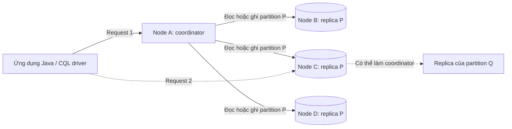
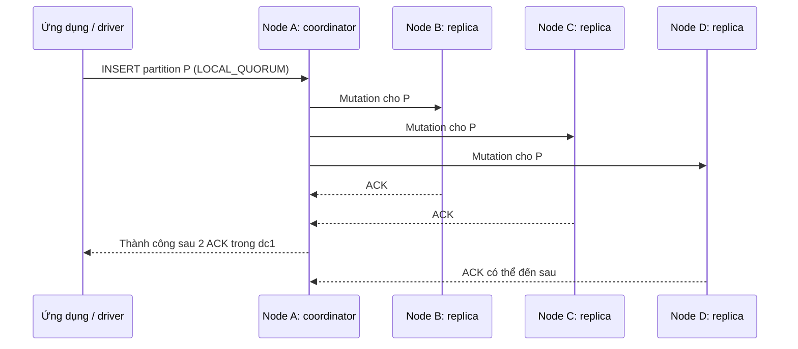

# Kiến trúc ngang hàng và vai trò nút điều phối theo từng yêu cầu

Apache Cassandra là cơ sở dữ liệu phân tán theo mô hình **wide-column**, được thiết kế để mở rộng ngang và duy trì khả năng phục vụ khi một số nút gặp sự cố. Để sử dụng Cassandra đúng cách, cần phân biệt hai ý tưởng tưởng như trái ngược: **các nút bình đẳng về vai trò trong cụm**, nhưng **mỗi yêu cầu đọc hoặc ghi vẫn cần một nút đứng ra điều phối**. Nút điều phối đó gọi là *coordinator* và chỉ giữ vai trò này đối với yêu cầu cụ thể.

Sau bài này, bạn có thể:

- Giải thích vì sao Cassandra là kiến trúc **peer-to-peer**, không có một nút master cố định xử lý mọi truy vấn.
- Phân biệt **coordinator**, **replica**, **seed node**, **client driver** và các khái niệm **data center/rack**.
- Theo dấu một yêu cầu CQL từ ứng dụng Java đến các replica rồi quay về client.
- Giải thích ảnh hưởng của **partition key**, **replication factor** và **consistency level** đến đường đi, độ sẵn sàng và kết quả truy vấn.
- Phân tích hành vi khi coordinator hoặc replica lỗi và kiểm tra một cụm đang chạy bằng công cụ vận hành cơ bản.

## 1. Ngang hàng không có nghĩa là không có điều phối

Trong mô hình primary–replica truyền thống, một nút thường giữ vai trò primary/master đặc biệt cho thao tác ghi. Trong Cassandra, **không có master toàn cục**: mỗi nút có thể nhận kết nối CQL từ client, lưu dữ liệu của các partition mà mình phụ trách và điều phối yêu cầu nếu client gửi yêu cầu đến nó.

Tuy nhiên, không phải mọi nút đều giữ cùng một bản sao dữ liệu. Cassandra sử dụng **partition key** để xác định vị trí logic của partition và bố trí nhiều **replica** cho partition đó theo cấu hình replication. Vì vậy, hai yêu cầu đi vào cùng một nút có thể cần liên hệ với hai tập replica khác nhau.

Một cách hình dung đúng:

1. **Peer-to-peer** mô tả quan hệ giữa các nút: không có nút chủ được bầu cố định cho toàn cụm.
2. **Coordinator** mô tả vai trò trong **một request**: nút nhận yêu cầu CQL và chịu trách nhiệm chuyển tiếp, thu kết quả theo mức nhất quán, rồi phản hồi client.
3. **Replica** mô tả trách nhiệm lưu trữ **một partition**: nút có dữ liệu của partition đó theo chiến lược replication.

Một nút có thể vừa là coordinator vừa là replica cho cùng yêu cầu; hoặc là coordinator nhưng **không** lưu partition được truy vấn. Nút đang là replica trong request này có thể trở thành coordinator ở request tiếp theo.



Trong sơ đồ, A điều phối request 1 nhưng không nhất thiết là replica của P. Với request 2, client có thể kết nối tới C; C lúc đó đóng vai trò coordinator cho request mới. Các đường từ A đến B/C/D là giao tiếp nội bộ giữa các nút, không phải ba truy vấn độc lập do client gửi.

## 2. Các thành phần trong cụm

| Thành phần | Vai trò | Điều dễ nhầm |
|---|---|---|
| **Node / peer** | Một tiến trình Cassandra tham gia cụm; có thể nhận CQL và lưu các partition được phân công. | “Peer” không có nghĩa mọi nút lưu mọi bản ghi. |
| **Coordinator** | Nút tiếp nhận **một request**, xác định replica, gửi yêu cầu, đợi đủ phản hồi và trả kết quả. | Đây không phải vai trò cố định hay một master toàn cục. |
| **Replica** | Nút sở hữu một bản sao của partition cụ thể. | Một node là replica của partition P nhưng có thể không là replica của Q. |
| **Seed node** | Điểm liên hệ ban đầu giúp nút mới hoặc nút khởi động lại khám phá các peer bằng gossip. | Seed không phải master, không mặc định điều phối mọi request và không phải thành phần bỏ phiếu lãnh đạo. |
| **Data center (DC), rack** | Nhóm topology logic/phần cứng để bố trí replica và định tuyến ưu tiên theo vị trí. | DC/rack là cấu hình topology; không phải consistency level. |
| **CQL driver** | Thành phần ở ứng dụng quản lý kết nối, metadata, định tuyến, retry và chính sách tải. | Driver chọn nút gửi request; nút nhận mới là coordinator của request đó. |

### Gossip và thông tin topology

Các nút trao đổi thông tin thành viên và trạng thái qua **gossip**. Cassandra kết hợp thông tin này với cơ chế phát hiện lỗi để biết peer nào có vẻ không còn phản hồi. **Snitch** cung cấp thông tin DC/rack, phục vụ bố trí replica và ưu tiên liên lạc phù hợp topology.

Gossip **không** đồng nghĩa với việc mọi truy vấn phải gửi đến tất cả các nút; các yêu cầu dữ liệu chủ yếu được gửi đến **những replica liên quan**. Seed node chủ yếu giúp khám phá cụm ở giai đoạn khởi tạo liên lạc. Việc mất một seed sau khi cụm đã hoạt động **không** làm toàn cụm mất “master”, nhưng vẫn có thể gây khó khăn cho các nút cần bootstrap/kết nối lại nếu cấu hình seed không phù hợp.

### Token ring, partition key và virtual node

Cassandra băm **toàn bộ partition key** để tính token. Các token được phân bố trên một vòng logic (*token ring*). Cấu hình token/vnode cho biết những nút nào phụ trách các khoảng token; chiến lược replication và topology xác định tập replica thực tế của một partition.

Ví dụ, nếu bảng có khóa chính `PRIMARY KEY ((tenant_id, device_id, event_day), event_time, event_id)` thì **ba cột trong cặp ngoặc tròn bên trong** `(tenant_id, device_id, event_day)` hợp thành partition key. `event_time` và `event_id` là **clustering columns**, quyết định thứ tự dữ liệu **bên trong** partition. Thay đổi `event_day` có thể làm thay đổi token, từ đó thay đổi tập replica cần liên hệ.

> **Lưu ý:** Vòng token là mô hình phân bố dữ liệu logic, không phải sơ đồ kết nối vật lý. Các nút giao tiếp qua mạng theo topology thực tế; không phải một yêu cầu luôn đi tuần tự “quanh vòng”.

## 3. Một request tìm đến các replica như thế nào?

Giả sử keyspace dùng `NetworkTopologyStrategy` với replication factor **RF = 3** trong DC `dc1`, có đủ nút để lưu ba bản sao. Một partition P được gán cho ba replica B, C và D. Ứng dụng gửi một lệnh CQL qua kết nối tới A.

1. **Nhận request:** A trở thành **coordinator** của request này. Nếu client gửi request tương tự tới B, B sẽ là coordinator.
2. **Xác định partition:** Với thao tác có partition key rõ ràng, coordinator suy ra token và tập replica có trách nhiệm lưu partition. Với truy vấn khác, kế hoạch thực thi có thể phức tạp hơn, thậm chí phải đọc nhiều partition/nút.
3. **Xác định mức nhất quán:** Consistency level (CL) cho biết cần bao nhiêu phản hồi thỏa điều kiện trước khi trả lời thành công. CL **không** quyết định số bản sao lưu trữ; điều đó do RF và replication strategy xác định.
4. **Liên hệ replica:** Coordinator gửi thao tác đến replica thích hợp, có thể dùng các ưu tiên về địa phương và tình trạng nút. Khi ghi, Cassandra cố gắng chuyển mutation tới các replica có trách nhiệm, kể cả khi CL chỉ cần một phần phản hồi.
5. **Tổng hợp và trả kết quả:** Coordinator trả thành công sau khi có đủ xác nhận, hoặc trả lỗi/timeout khi không đáp ứng điều kiện trong thời hạn.

Vì vị trí coordinator phụ thuộc request, nói “node A là coordinator của cluster” là sai; câu chính xác là **“A đang là coordinator của request X”**.

### Token-aware routing từ ứng dụng

Driver Cassandra có thể tận dụng metadata của bảng và **partition key** để ưu tiên gửi request trực tiếp đến một replica phù hợp, thường trong DC gần ứng dụng. Khi đó replica nhận request đồng thời đóng vai trò coordinator, giảm một chặng liên lạc không cần thiết. Cơ chế này hoạt động tốt nhất khi driver xác định được routing key, chẳng hạn từ câu lệnh **prepared statement** có đầy đủ thành phần partition key.

Token-aware routing là **tối ưu định tuyến**, không thay đổi quy tắc RF hoặc CL. Nếu replica ưu tiên không khả dụng, driver có thể chọn nút khác theo chính sách cân bằng tải và retry. Với truy vấn không xác định được partition key, đừng giả định driver luôn gửi được đến đúng replica ngay từ đầu.

## 4. Luồng ghi: coordinator chờ gì trước khi trả thành công?

Xét lệnh `INSERT` hoặc `UPDATE` vào partition P, RF = 3, CL = `LOCAL_QUORUM` trong DC `dc1`:



Đây là một **trình tự minh họa**: các thông điệp gửi và nhận thực tế có thể diễn ra đồng thời, replica nhanh nhất không cố định. Tại replica, Cassandra xử lý ghi thông qua **commit log** và **memtable**; dữ liệu được flush thành **SSTable** sau đó. ACK từ replica **không** có nghĩa dữ liệu đã được compaction hoặc đã nằm trong một SSTable mới. Độ bền tới đĩa còn liên quan đến cấu hình commit log.

Với RF = 3 trong một DC, `LOCAL_QUORUM` cần `floor(3 / 2) + 1 = 2` replica của DC đó xác nhận. Vì vậy:

- Nếu B và C trả ACK đúng hạn, client có thể nhận thành công ngay cả khi D chưa phản hồi.
- Nếu chỉ một replica khả dụng, yêu cầu `LOCAL_QUORUM` **không** thể được xác nhận thành công tại thời điểm đó.
- Nếu coordinator hết thời gian chờ, **không thể kết luận chắc chắn** dữ liệu chưa được ghi: một số replica có thể đã áp dụng mutation. Khi retry, cần xét tính idempotent, timestamp và tác dụng phụ của thao tác.

Cassandra còn có **hinted handoff** trong một số trường hợp replica tạm thời vắng mặt: một nút khác có thể giữ “hint” để phát lại mutation khi replica trở lại. Hint có giới hạn lưu giữ và không thay thế cho **anti-entropy repair**, vốn dùng để đối chiếu, đồng bộ dữ liệu giữa các replica. Không nên hiểu rằng “ghi ở CL ONE” thì các bản sao khác chắc chắn đã đồng nhất ngay khi client nhận ACK.

### Cùng một ghi trong cụm nhiều DC

Giả sử mỗi DC có RF = 3. Khi dùng `LOCAL_QUORUM` tại `dc1`, coordinator cần **hai ACK từ replica ở `dc1`**; các phản hồi từ `dc2` không dùng để bù cho việc thiếu quorum ở `dc1`. Dữ liệu vẫn được nhân bản sang DC còn lại theo bố trí replica, nhưng lời đáp thành công của một yêu cầu `LOCAL_QUORUM` **không bảo đảm** các replica ở DC kia đã theo kịp.

Trái lại, `QUORUM` dựa trên tổng RF của keyspace qua các DC: với RF tổng là 6, quorum toàn cục là `floor(6 / 2) + 1 = 4`. Điều này ảnh hưởng đến độ trễ và hành vi khi mất kết nối liên DC. Chọn CL phải căn cứ yêu cầu đọc/ghi thực tế thay vì mặc định rằng “quorum” luôn có nghĩa là hai node.

## 5. Luồng đọc: coordinator chọn và đối chiếu kết quả

Với một lệnh `SELECT` xác định được partition P, coordinator tìm replica và yêu cầu dữ liệu theo CL của request.

- Ở CL `ONE` hoặc `LOCAL_ONE`, một phản hồi đáp ứng điều kiện là đủ để trả kết quả. Đọc có thể nhanh hơn nhưng dễ thấy dữ liệu cũ khi các replica chưa đồng bộ.
- Ở CL `QUORUM` hoặc `LOCAL_QUORUM`, coordinator cần đủ phản hồi của các replica thích hợp. Trong đường đọc điển hình, Cassandra có thể yêu cầu **dữ liệu đầy đủ** từ một replica và **digest** (bản tóm lược kiểm tra nội dung) từ những replica khác để so sánh; cách tối ưu chi tiết phụ thuộc phiên bản và tình huống.
- Nếu phát hiện các replica bất đồng, Cassandra có thể đọc thêm dữ liệu và hòa giải các phiên bản trước khi trả kết quả. **Read repair** có thể xử lý một phần bất đồng phát hiện trong quá trình đọc; hành vi phụ thuộc cấu hình bảng và phiên bản. Nó không thay thế quy trình repair định kỳ.
- Nếu không đạt số phản hồi CL yêu cầu, coordinator trả lỗi hoặc timeout. Một node còn sống không có nghĩa là toàn bộ replica cần cho truy vấn đang khả dụng.

Kết quả đọc chịu ảnh hưởng của timestamp và quy tắc hòa giải mutation, xóa dữ liệu bằng tombstone, TTL, và mức đồng bộ thực tế. **Quorum không phải khóa giao dịch toàn cục**; các cập nhật đồng thời vẫn có thể cạnh tranh theo timestamp.

### Bảng so sánh các consistency level thường gặp

Giả sử không có transient replication và các replica thông thường được cấu hình đầy đủ:

| CL | Điều kiện phản hồi tối thiểu | Ý nghĩa điển hình |
|---|---|---|
| `ONE` | 1 replica thuộc tập replica của partition | Tăng khả năng đáp ứng và có thể giảm độ trễ; có nguy cơ đọc dữ liệu chưa mới nhất. |
| `LOCAL_ONE` | 1 replica trong DC địa phương | Hạn chế phụ thuộc đường liên DC cho điều kiện xác nhận. |
| `QUORUM` | `floor(RF_tổng / 2) + 1` replica trên tổng RF | Phải đạt đa số trên toàn bộ replica được cấu hình của keyspace. |
| `LOCAL_QUORUM` | `floor(RF_DC_địa_phương / 2) + 1` replica của DC địa phương | Thường dùng để cân bằng tính nhất quán và độ trễ trong ứng dụng nhiều DC. |
| `ALL` | Mọi replica của partition | Giảm khả năng thành công khi một replica không sẵn sàng. |

Với một DC, RF = 3, phép ghép **ghi `QUORUM` (W = 2) + đọc `QUORUM` (R = 2)** cho `R + W > RF`, nên tập replica đọc và ghi có ít nhất một nút giao nhau trong điều kiện thông thường. Đây là quy tắc hữu ích để hiểu xác suất nhìn thấy dữ liệu mới, **không phải lời hứa linearizability** trong mọi tình huống: còn các ghi cạnh tranh, timestamp, lỗi mạng và tiến trình hòa giải.

Nếu nghiệp vụ cần kiểm tra–rồi–ghi nguyên tử, chẳng hạn “chỉ tạo bản ghi khi khóa này chưa tồn tại”, xem **lightweight transaction (LWT)** và cú pháp như `INSERT ... IF NOT EXISTS`. LWT sử dụng giao thức đồng thuận riêng, có chi phí cao hơn thao tác ghi thông thường; coordinator của một request không tự biến mọi lệnh CQL thành giao dịch có khóa.

## 6. Ví dụ CQL: thiết kế partition giúp định tuyến chính xác

Giả sử hệ thống lưu dữ liệu cảm biến theo tenant, thiết bị và ngày. Ứng dụng thường hỏi: **“Lấy 20 điểm đo mới nhất của thiết bị X trong ngày Y.”** Đây là kiểu thiết kế bảng theo truy vấn rất quan trọng trong Cassandra.

```sql
-- Ví dụ cho một DC có tên thực tế là dc1 và ít nhất 3 node phù hợp.
CREATE KEYSPACE telemetry
WITH replication = {
  'class': 'NetworkTopologyStrategy',
  'dc1': 3
};

CREATE TABLE telemetry.events_by_device_day (
  tenant_id uuid,
  device_id uuid,
  event_day date,
  event_time timestamp,
  event_id timeuuid,
  reading double,
  PRIMARY KEY ((tenant_id, device_id, event_day), event_time, event_id)
) WITH CLUSTERING ORDER BY (event_time DESC, event_id DESC);
```

Ở bảng này:

- `tenant_id`, `device_id`, `event_day` là **partition key tổng hợp**. Cả ba cùng quyết định token và tập replica.
- `event_time`, `event_id` là clustering columns, giúp sắp xếp các bản ghi trong cùng partition theo thời điểm mới trước.
- `event_day` giúp **chia bucket theo ngày**, tránh để toàn bộ lịch sử của một thiết bị tích lũy vào một partition vô hạn. Kích thước bucket thực tế phải được chọn theo lưu lượng và kích thước dữ liệu.

Trong `cqlsh`, có thể đổi CL cho phiên làm việc rồi thực hiện truy vấn khớp partition key:

```sql
-- CONSISTENCY là lệnh của cqlsh, không thuộc câu lệnh CQL SELECT.
CONSISTENCY LOCAL_QUORUM;

SELECT event_time, event_id, reading
FROM telemetry.events_by_device_day
WHERE tenant_id = 11111111-1111-1111-1111-111111111111
  AND device_id = 22222222-2222-2222-2222-222222222222
  AND event_day = '2026-11-21'
LIMIT 20;
```

Với truy vấn này, coordinator định vị **một partition** rồi liên hệ các replica tương ứng theo CL. Nếu bỏ `event_day` khỏi điều kiện lọc, truy vấn không còn xác định đầy đủ partition key và thường sẽ bị Cassandra từ chối nếu không có cơ chế truy vấn thích hợp. `ALLOW FILTERING` không phải cách chữa mặc định: nó có thể dẫn tới quét dữ liệu tốn kém, làm độ trễ và tải cluster tăng mạnh.

Đây là lý do mô hình wide-column của Cassandra thường cần **một bảng cho mỗi mẫu truy vấn chính** thay vì cố dùng JOIN hoặc lọc tùy ý như trong cơ sở dữ liệu quan hệ.

## 7. Ứng dụng Java nên kết nối và định tuyến ra sao?

Với Apache Cassandra Java Driver 4.x (API `com.datastax.oss.driver`), khai báo contact point để khởi tạo kết nối, chỉ rõ **local data center**, sau đó dùng prepared statement có đủ partition key:

```java
import com.datastax.oss.driver.api.core.CqlSession;
import com.datastax.oss.driver.api.core.cql.BoundStatement;
import com.datastax.oss.driver.api.core.cql.PreparedStatement;
import com.datastax.oss.driver.api.core.cql.Row;
import com.datastax.oss.driver.api.core.DefaultConsistencyLevel;

import java.net.InetSocketAddress;
import java.time.LocalDate;
import java.util.UUID;

public class ReadDeviceEvents {
    public static void main(String[] args) {
        UUID tenantId = UUID.fromString("11111111-1111-1111-1111-111111111111");
        UUID deviceId = UUID.fromString("22222222-2222-2222-2222-222222222222");

        try (CqlSession session = CqlSession.builder()
                .addContactPoint(new InetSocketAddress("127.0.0.1", 9042))
                .withLocalDatacenter("dc1")
                .build()) {

            PreparedStatement prepared = session.prepare(
                "SELECT event_time, reading " +
                "FROM telemetry.events_by_device_day " +
                "WHERE tenant_id = ? AND device_id = ? AND event_day = ? " +
                "LIMIT 20"
            );

            BoundStatement statement = prepared
                .bind(tenantId, deviceId, LocalDate.parse("2026-11-21"))
                .setConsistencyLevel(DefaultConsistencyLevel.LOCAL_QUORUM);

            for (Row row : session.execute(statement)) {
                System.out.println(row.getInstant("event_time")
                    + ": " + row.getDouble("reading"));
            }
        }
    }
}
```

Địa chỉ `127.0.0.1` và DC `dc1` chỉ là giá trị minh họa: khi triển khai thực tế phải dùng contact point truy cập được và tên DC thật. Nên cấu hình **nhiều contact point** để khởi tạo kết nối đáng tin cậy hơn. Contact point **không** có nghĩa mọi truy vấn đều đi qua nút đó; sau khi lấy metadata, driver có thể chọn coordinator khác dựa vào token, tình trạng nút và chính sách cân bằng tải. Prepared statement giúp driver biết partition key để thực hiện token-aware routing khi có đủ metadata.

Nên quản lý mức nhất quán theo yêu cầu nghiệp vụ hoặc execution profile. Ví dụ, đọc bản tin thiết bị có thể chấp nhận `LOCAL_ONE` trong một số màn hình, trong khi một thao tác cần đọc ngay sau ghi trong cùng DC thường cân nhắc `LOCAL_QUORUM` cho cả đọc và ghi cùng các giới hạn đã nêu. Retry cần gắn với **tính idempotent** và ngữ nghĩa timeout; không được mặc định gửi lại mọi mutation vô điều kiện.

## 8. Các kịch bản lỗi thường gây hiểu nhầm

| Kịch bản | Điều xảy ra | Ý nghĩa đối với thiết kế |
|---|---|---|
| **Coordinator A chết trước khi trả lời** | Client thấy kết nối lỗi/timeout; các replica có thể đã ghi một phần hoặc đủ CL. Request tiếp theo có thể được điều phối bởi nút khác. | Timeout không đồng nghĩa rollback; cần đánh giá retry, idempotency và timestamp. |
| **Một replica của partition P bị down, RF = 3** | Với hai replica còn khả dụng trong DC, ghi/đọc `LOCAL_QUORUM` vẫn có thể đáp ứng. | Khả năng chịu lỗi phụ thuộc RF, CL, DC và tình trạng replica, không phụ thuộc nhãn coordinator. |
| **Hai replica của P bị down, RF = 3** | Chỉ còn một replica đáp ứng; `LOCAL_QUORUM` không đủ, nhưng `LOCAL_ONE` có thể vẫn thành công nếu replica đó khả dụng. | CL tạo ra đánh đổi giữa yêu cầu xác nhận và độ sẵn sàng. |
| **Seed node bị down sau khi cụm đã hình thành** | Các peer đang chạy có thể tiếp tục trao đổi và phục vụ request. | Seed không phải master; vẫn cần cấu hình nhiều seed phù hợp cho khởi động/join. |
| **Mạng chia cụm thành hai phía 2–1 với RF = 3** | Phía có hai replica có thể đạt quorum; phía chỉ có một replica không đạt quorum, dù `ONE` có thể tiếp nhận yêu cầu trong điều kiện thích hợp. | Cassandra không đảm bảo mọi phía mạng đều nhận ghi quorum khi xảy ra phân vùng mạng. |
| **Một partition nhận quá nhiều ghi/đọc** | Replica của partition đó bị quá tải dù cluster có nhiều node nhàn rỗi. | Coordinator không tự chia nhỏ một partition “nóng”; phải xem lại partition key và bucketing. |

Khi các replica chứa giá trị khác nhau, Cassandra dùng timestamp và quy tắc hòa giải dữ liệu để quyết định bản ghi có hiệu lực. Đồng hồ lệch hoặc các ghi đồng thời có thể tạo kết quả ngoài mong đợi; đồng bộ thời gian và thiết kế cập nhật đúng cách là yêu cầu vận hành quan trọng. Các bản ghi xóa dùng **tombstone**; bỏ qua repair trong thời gian dài có thể ảnh hưởng đến tính đúng đắn sau khi tombstone hết thời gian lưu.

## 9. Quan sát thực tế: coordinator, topology và CL

Trong môi trường thực hành, bắt đầu với ba nút cùng DC, RF = 3 và bảng ở mục 6. Kiểm tra trạng thái cụm:

```bash
nodetool status
nodetool describecluster
```

`nodetool status` giúp xem DC, rack và trạng thái nút (ví dụ `UN` thường là *Up/Normal*). `nodetool describecluster` giúp kiểm tra thông tin cụm và tình trạng schema. Khi cần xem dữ liệu gossip phục vụ chẩn đoán, có thể dùng `nodetool gossipinfo`; đầu ra chi tiết và không thay thế cho đo đạc lỗi/độ trễ của ứng dụng.

Để nhìn đường đi của một truy vấn, có thể bật trace trong phiên `cqlsh`:

```sql
TRACING ON;
CONSISTENCY LOCAL_QUORUM;

SELECT event_time, event_id, reading
FROM telemetry.events_by_device_day
WHERE tenant_id = 11111111-1111-1111-1111-111111111111
  AND device_id = 22222222-2222-2222-2222-222222222222
  AND event_day = '2026-11-21'
LIMIT 20;

TRACING OFF;
```

Trace có thể cho biết nút nào điều phối, các bước gửi thông điệp đến replica và thời gian tương ứng. Kết quả thay đổi theo data placement, phiên bản Cassandra và tối ưu thực thi. Chỉ nên bật tracing có chọn lọc, vì bản thân tracing tạo thêm chi phí xử lý và lưu dấu vết.

Khi phân tích một request lỗi, hãy trả lời theo thứ tự:

1. **Partition key là gì?** Truy vấn nhắm một partition hay nhiều partition?
2. **Các replica nằm ở đâu?** RF, chiến lược replication, DC/rack và trạng thái của chúng ra sao?
3. **Client gửi đến coordinator nào?** Driver có metadata/routing key để ưu tiên replica địa phương không?
4. **CL yêu cầu bao nhiêu phản hồi và ở DC nào?** Đây là nguyên nhân thường gặp của `Unavailable`, `ReadTimeout` hoặc `WriteTimeout`.
5. **Replica có bất đồng hoặc chưa được repair?** Xem các đợt ngắt mạng, hint, repair, tombstone và tải trên nút.

Tránh coi thao tác `nodetool repair` là nút “sửa mọi lỗi” khi chưa xác định nguyên nhân; repair tiêu thụ tài nguyên và cần lịch vận hành phù hợp kích thước dữ liệu, topology và phiên bản Cassandra.

## 10. Tổng hợp mô hình tư duy

Đặt câu hỏi **“ai là master?”** sẽ làm hiểu sai Cassandra. Hãy hỏi **“request này đi vào nút nào, partition key trỏ tới replica nào, và CL cần bao nhiêu phản hồi?”**. Với mô hình đó:

- **Peer-to-peer** giải thích vì sao không có một đầu mối điều phối cố định và vì sao cụm có thể mở rộng bằng cách thêm nút.
- **Partition key + token + replication strategy** giải thích dữ liệu nằm ở những replica nào; **clustering columns** quyết định tổ chức dữ liệu trong partition.
- **Coordinator theo request** giải thích đường đi của truy vấn CQL và điểm thu thập phản hồi; vị trí của coordinator có thể thay đổi giữa các request.
- **Consistency level** giải thích điều kiện thành công của từng thao tác; không tự quyết định số bản sao, không thay thế cơ chế repair, và không biến mọi cập nhật thành giao dịch tuyến tính.
- **Driver Java** có thể chọn nút nhận request hợp lý hơn nếu biết đầy đủ routing key, DC và topology; còn thiết kế bảng theo truy vấn quyết định nền tảng hiệu năng lâu dài.

Khi đã phân biệt được các vai trò này, các chủ đề tiếp theo như replication đa DC, compaction, repair, xử lý lỗi hay tối ưu truy vấn sẽ có một khung giải thích thống nhất: **dữ liệu được phân bố theo partition, các bản sao cùng phục vụ request, và một coordinator tạm thời chịu trách nhiệm đạt mức nhất quán đã yêu cầu**.
