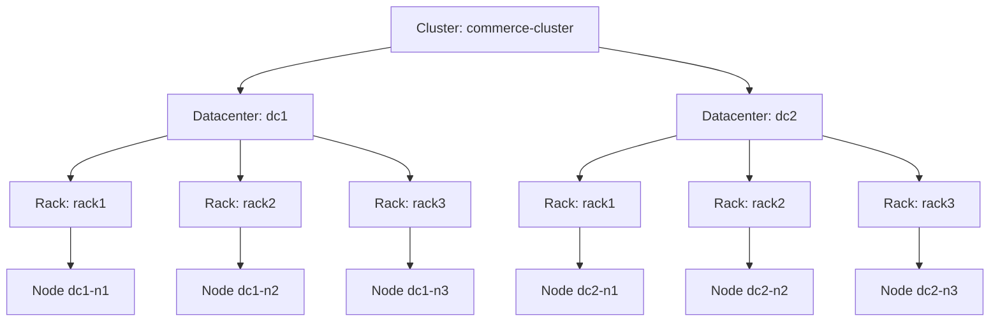
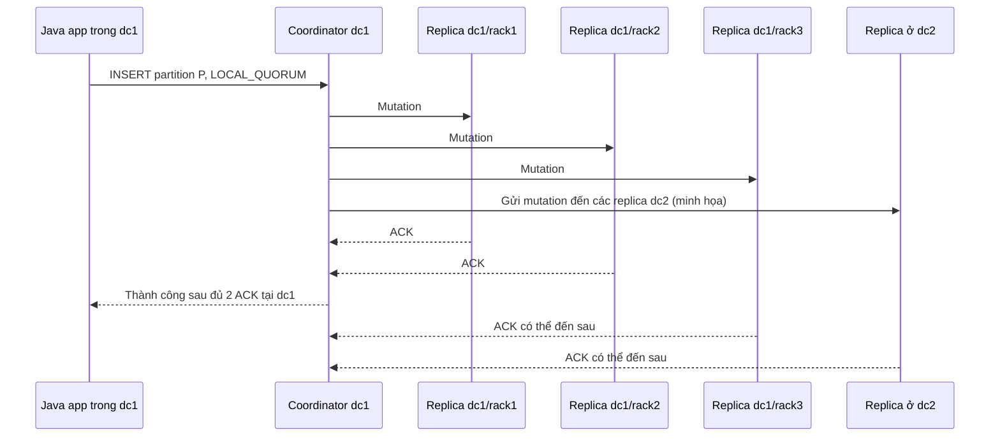

# Quan hệ giữa node, rack, datacenter và cluster

Apache Cassandra là cơ sở dữ liệu **wide-column phân tán**, trong đó dữ liệu được chia theo partition và nhân bản trên nhiều máy. Khi nói về kiến trúc cụm Cassandra, bốn khái niệm **node**, **rack**, **datacenter** và **cluster** tạo thành hệ phân cấp topology quan trọng nhất. Hiểu đúng quan hệ của chúng giúp trả lời những câu hỏi rất thực tế: Một partition được đặt ở đâu? Vì sao mất một máy vẫn đọc/ghi được, nhưng mất một rack lại có thể gây lỗi? Ứng dụng Java nên kết nối vào datacenter nào? Và replication factor liên quan gì đến consistency level?

Mục tiêu của bài học:

- Phân biệt chính xác node, rack, datacenter (DC) và cluster, cùng phạm vi trách nhiệm của từng cấp.
- Hiểu topology logic được khai báo như thế nào và liên hệ với vùng lỗi vật lý.
- Giải thích cách **partition key**, token, `NetworkTopologyStrategy` và **replication factor** quyết định vị trí replica theo DC/rack.
- Dự đoán tác động khi một node, một rack hoặc cả một DC mất kết nối đối với mức nhất quán đọc/ghi.
- Tạo keyspace đa DC bằng CQL, quan sát topology bằng `nodetool`, và cấu hình ứng dụng Java ưu tiên DC địa phương.

## 1. Bốn cấp trong cùng một kiến trúc

Ở mức khái niệm, một cụm Cassandra gồm một hoặc nhiều datacenter; mỗi datacenter có một hoặc nhiều rack; mỗi rack chứa các node. Cassandra không yêu cầu chúng phải tương ứng một-một với địa điểm hay tủ rack vật lý, nhưng cách cấu hình cần phản ánh **những thành phần có thể hỏng cùng lúc**.



Sơ đồ trên minh họa **một** cách tổ chức với hai DC, mỗi DC ba rack, mỗi rack một node. Cụm thực tế thường có nhiều node trong mỗi rack; mỗi DC cũng có thể chứa nhiều nhóm phần cứng hoặc nhiều availability zone. Tên `rack1` được phép lặp ở các DC khác nhau vì rack được hiểu trong **phạm vi DC** tương ứng.

| Cấp | Phạm vi | Chức năng chính | Ví dụ |
|---|---|---|---|
| **Node** | Một instance Cassandra tham gia cụm, thường chạy trên một máy hoặc VM/container có tài nguyên và địa chỉ mạng riêng. | Nhận/gửi yêu cầu, lưu các partition được phân công, tham gia giao tiếp giữa các peer. | `dc1-n1` |
| **Rack** | Nhóm node trong một DC, dùng để mô tả một **failure domain**. | Giúp chiến lược replication tránh đặt quá nhiều bản sao của cùng partition vào cùng một nhóm có thể hỏng đồng thời. | `dc1/rack2` |
| **Datacenter (DC)** | Nhóm rack/node trong cùng một miền topology logic. | Xác định vị trí đặt replica, chính sách đọc/ghi địa phương và lưu lượng liên vùng. | `dc1`, `dc2` |
| **Cluster** | Toàn bộ các node hợp thành một triển khai Cassandra có chung metadata và cơ chế thành viên. | Cung cấp không gian dữ liệu phân tán; một keyspace có thể nhân bản dữ liệu qua nhiều DC trong cùng cluster. | `commerce-cluster` |

Quan hệ cần nhớ: **mỗi node thuộc đúng một rack trong đúng một DC tại một thời điểm; nhiều DC có thể thuộc cùng một cluster**. Rack và DC là nhãn topology do hệ thống biết thông qua cấu hình snitch và trao đổi trạng thái; chúng không phải đối tượng lưu trữ bản ghi độc lập với node.

## 2. Node: đơn vị xử lý, lưu trữ và mở rộng

Một node Cassandra là một thành viên của cụm. Nó có thể:

- Lưu dữ liệu của các partition mà chiến lược phân bố gán cho node đó; thực hiện ghi qua **commit log**, **memtable** và sau đó là **SSTable**.
- Phục vụ đọc dữ liệu, áp dụng mutation, tham gia replication, compaction và các thao tác repair.
- Tiếp nhận kết nối CQL từ driver và trở thành **coordinator của một request**; coordinator gửi yêu cầu đến các replica phù hợp rồi tổng hợp phản hồi theo consistency level.
- Trao đổi thông tin thành viên và trạng thái với các peer bằng **gossip**.

Cassandra có kiến trúc **peer-to-peer**, không có master cố định điều phối mọi truy vấn. “Node nào là coordinator?” là câu hỏi theo **từng request**, không phải cách phân loại node vĩnh viễn. Một node làm coordinator của lệnh đọc vẫn có thể không giữ bản sao của partition đang đọc.

Điểm cốt lõi: **số node không bằng số replica của từng partition**. Ví dụ, một DC có 12 node và RF = 3 thì một partition thông thường chỉ có ba bản sao trong DC đó; các partition khác có thể được đặt trên những nhóm ba node khác nhau. Nhờ vậy, thêm node giúp phân bố tải và dung lượng, dù quá trình cân bằng dữ liệu cần streaming và thời gian ổn định sau khi thay đổi topology.

### Token và virtual node (vnode)

Cassandra băm **partition key** thành token trong không gian token. Mỗi node sở hữu các khoảng token; với vnode, một node có thể sở hữu nhiều khoảng token không liền nhau. Cơ chế này là nền tảng để phân phối partition trong cluster.

Token không đồng nghĩa với “rack” hay “DC”. Token giúp xác định vị trí partition trong vòng logic, còn **chiến lược replication** cùng **thông tin DC/rack** xác định các node giữ bản sao. Các node có thể giao tiếp trực tiếp qua mạng; dữ liệu không bắt buộc chạy từng bước quanh một vòng máy vật lý.

## 3. Rack: nhóm các node cùng nguy cơ sự cố

Trong Cassandra, *rack* là nhãn mô tả nhóm node bên trong một DC. Nhãn này thường được thiết kế để trùng với **failure domain**: một tủ máy chung nguồn điện/network switch, một nhóm máy chia sẻ hạ tầng, hoặc một **availability zone** trong môi trường cloud. Không bắt buộc có tủ rack vật lý mang đúng tên cấu hình.

Tại sao Cassandra cần biết rack? Giả sử partition P có RF = 3 trong DC `dc1`:

- Nếu ba replica đều nằm trên ba node nhưng cùng rack và switch của rack hỏng, cả ba replica có thể mất kết nối cùng lúc.
- Nếu ba replica được rải ở ba rack độc lập, mất một rack có thể chỉ làm mất một trong ba replica. Hai replica còn lại vẫn có khả năng phục vụ `LOCAL_QUORUM`.

Với `NetworkTopologyStrategy`, Cassandra cố gắng phân bố replica của một partition trên **những rack khác nhau trong từng DC**, nếu topology có đủ rack và node phù hợp. Nếu RF lớn hơn số rack khả dụng trong DC, việc đặt nhiều replica trên cùng rack là không tránh khỏi; **không nên kết luận RF = 3 tự động có khả năng chịu lỗi một rack nếu DC chỉ có một rack**.

Rack là khái niệm của **bố trí dữ liệu và cô lập lỗi**, không phải một node đặc biệt. Nó không thực thi CQL, không lưu dữ liệu dưới dạng một tiến trình riêng và không thay thế replication factor. Cấu hình rack sai (ví dụ mọi node cùng `rack1` dù thực tế nằm ở ba zone khác nhau) làm Cassandra mất thông tin quan trọng để phân tán replica theo đúng nguy cơ lỗi.

## 4. Datacenter: biên giới bố trí bản sao và truy vấn địa phương

Một Cassandra cluster có thể trải trên nhiều DC. Trong triển khai cloud phổ biến, người ta thường ánh xạ:

- **Một Cassandra DC ↔ một cloud region** (hoặc miền mạng có độ trễ và độ sẵn sàng tương đương).
- **Một Cassandra rack ↔ một availability zone** bên trong region đó.
- **Một Cassandra node ↔ một instance** được đặt trong zone đã khai báo.

Đây là **mô hình triển khai thường dùng**, không phải quy luật bắt buộc: tên DC/rack là topology logic. Hai nhóm máy ở cùng địa điểm vẫn có thể tách thành hai Cassandra DC nếu thiết kế vận hành yêu cầu, và một DC Cassandra có thể chạy trên hạ tầng tổ chức riêng.

DC ảnh hưởng trực tiếp đến ba quyết định:

1. **Replica sẽ nằm ở DC nào:** `NetworkTopologyStrategy` cho phép cấu hình RF riêng cho từng DC.
2. **Ứng dụng ưu tiên truy vấn tại đâu:** driver Cassandra thường được cấu hình `localDatacenter` để ưu tiên node tại DC gần ứng dụng.
3. **Cần bao nhiêu phản hồi để coi truy vấn thành công:** `LOCAL_ONE` và `LOCAL_QUORUM` tính replica thuộc **DC của coordinator**, trong khi các mức nhất quán khác có phạm vi rộng hơn.

Việc có bản sao ở DC khác mang lại khả năng phục hồi theo vùng, nhưng **không tự động thực hiện chuyển ứng dụng, DNS, kết nối, traffic hay kiểm tra tính sẵn sàng** khi DC đang dùng mất hoàn toàn. Đó là bài toán failover của hệ thống ứng dụng và vận hành.

## 5. Cluster: tập hợp các peer, không phải một máy điều khiển

Một cluster Cassandra gồm các node tham gia cùng một hệ thống phân tán, chia sẻ thông tin thành viên, schema và phân bố token. Cấu hình `cluster_name` là một dấu hiệu nhận diện cluster; ngoài tên cụm, các node còn cần cấu hình giao tiếp, seed, snitch/partitioner và quy trình join phù hợp để thực sự trở thành peer của cùng cụm.

Trong cluster:

- **Keyspace** định nghĩa replication strategy và replication factor theo DC.
- **Table** định nghĩa partition key, clustering columns và cách lưu/truy vấn dữ liệu.
- **Token/ring** định vị các partition; chiến lược replication và topology quyết định node chứa replica.
- **Seed node** là điểm liên hệ giúp khám phá peer khi khởi động hoặc tham gia cluster; **seed không phải master**, không điều phối mọi lệnh CQL và cũng không nhất thiết nằm trên một rack/DC chuyên dụng.

Phân biệt hai tình huống rất khác nhau:

| Topology | Tác động |
|---|---|
| Hai DC **thuộc cùng cluster**, keyspace có RF ở cả hai DC. | Cassandra có thể nhân bản các partition giữa hai DC theo cấu hình, dùng chung schema của cluster và hỗ trợ các CL địa phương/toàn cụm. |
| Hai **cluster độc lập**, mỗi cluster có DC riêng. | Không tự động có replication CQL giữa hai cluster; phải thiết kế cơ chế đồng bộ/di chuyển dữ liệu khác nếu cần. |

Vì vậy, câu “có hai datacenter” chưa đủ để kết luận đã có disaster recovery. Cần biết **chúng thuộc cùng cluster hay không, keyspace có replica ở đâu, dữ liệu đã được đồng bộ đến mức nào và ứng dụng failover ra sao**.

## 6. CQL: đặt replica theo DC bằng `NetworkTopologyStrategy`

Xét một hệ thống quản lý đơn hàng với hai DC `dc1` và `dc2`. Mỗi DC có ít nhất ba node phù hợp, trải trên ít nhất ba rack độc lập. Ta muốn mỗi partition có **ba replica tại mỗi DC**:

```sql
CREATE KEYSPACE commerce
WITH replication = {
  'class': 'NetworkTopologyStrategy',
  'dc1': 3,
  'dc2': 3
};

CREATE TABLE commerce.orders_by_shop_day (
    shop_id uuid,
    order_day date,
    created_at timestamp,
    order_id uuid,
    state text,
    PRIMARY KEY ((shop_id, order_day), created_at, order_id)
) WITH CLUSTERING ORDER BY (created_at DESC, order_id ASC);
```

Ở ví dụ này:

- Cụm có **hai DC**, nhưng chỉ **một keyspace `commerce`** với hai giá trị RF độc lập.
- `RF_dc1 = 3`, `RF_dc2 = 3`: tổng cộng **sáu replica đầy đủ cho mỗi partition** trong topology giả định, không phải sáu replica cho toàn bảng hoặc sáu coordinator.
- Một partition được nhận diện bằng **cặp** `(shop_id, order_day)`. Cùng cặp giá trị thì đi đến cùng tập replica; ngày khác có thể dẫn tới vị trí khác.
- `created_at` và `order_id` là **clustering columns** sắp xếp hàng trong partition; chúng không làm tăng số bản sao hay quyết định DC.
- Tên DC trong định nghĩa replication **phải khớp tên DC mà các node công bố qua snitch**. Gõ nhầm `dc-1` trong khi node khai báo `dc1` sẽ không tạo ra topology mong muốn.

`NetworkTopologyStrategy` là lựa chọn phù hợp cho môi trường có topology DC/rack. `SimpleStrategy` phân bố theo vòng token mà không áp dụng mục tiêu rack/DC tương ứng; không nên chọn nó cho triển khai production đa DC.

### Minh họa một partition nằm ở các rack khác nhau

Giả sử mỗi DC có sáu node chia đều vào ba rack, hai node mỗi rack. Với RF = 3 mỗi DC, tập replica của partition P **có thể** là:

| DC | Rack | Replica của partition P |
|---|---|---|
| `dc1` | `rack1` | `dc1-n1` |
| `dc1` | `rack2` | `dc1-n4` |
| `dc1` | `rack3` | `dc1-n6` |
| `dc2` | `rack1` | `dc2-n2` |
| `dc2` | `rack2` | `dc2-n3` |
| `dc2` | `rack3` | `dc2-n5` |

Đây là **ví dụ minh họa**, không phải thuật toán chọn những node có tên trên. Replica thực tế phụ thuộc token, cấu hình vnode, snitch và trạng thái topology. Partition Q có thể nằm trên nhóm node khác. Cassandra tìm cách chọn các rack riêng biệt cho các bản sao khi có thể, nhưng không đảm bảo mọi DC thực tế luôn có đủ rack/node khỏe mạnh để đáp ứng mọi CL.

### RF không phải CL, và thay đổi RF không tự di chuyển lịch sử dữ liệu tức thì

**Replication factor (RF)** là số bản sao mong muốn của mỗi partition trong phạm vi định nghĩa; **consistency level (CL)** là điều kiện xác nhận của một request đọc/ghi. Ví dụ, trong `dc1` với RF = 3, truy vấn ở `LOCAL_QUORUM` cần hai phản hồi phù hợp từ các replica `dc1`. Việc điều kiện xác nhận là hai **không** làm Cassandra chỉ giữ hai bản sao.

Khi thay đổi RF bằng `ALTER KEYSPACE`, hoặc thêm DC/node mới, cluster cần phân phối dữ liệu về những replica mới qua cơ chế streaming/rebuild/repair thích hợp theo phiên bản và quy trình vận hành. **Cập nhật schema không có nghĩa dữ liệu lịch sử đã hiện diện đầy đủ tại mọi replica mới ngay lập tức**. Không nên thử nghiệm thay đổi RF hoặc nhãn DC/rack trên cụm đang phục vụ nghiệp vụ mà không có kế hoạch di chuyển dữ liệu và xác nhận trạng thái.

## 7. Liên hệ topology với mức nhất quán đọc và ghi

Giữ giả định `RF_dc1 = 3` và `RF_dc2 = 3`. Ứng dụng kết nối vào coordinator ở `dc1`:

| Consistency level | Số phản hồi cần thiết | Phạm vi và hệ quả |
|---|---|---|
| `LOCAL_ONE` | 1 replica ở `dc1`. | Ít phụ thuộc liên DC, đổi lại có thể đọc bản cũ nếu replica chưa đồng bộ. |
| `LOCAL_QUORUM` | `floor(3/2) + 1 = 2` replica ở `dc1`. | Thường cân bằng khả năng chịu lỗi một replica và độ trễ trong DC địa phương. |
| `QUORUM` | `floor(6/2) + 1 = 4` replica trên tổng hai DC. | Có thể cần phản hồi xuyên DC; phạm vi phụ thuộc tổng RF. |
| `EACH_QUORUM` | **Khi ghi:** ít nhất 2 replica ở **mỗi** DC. | Đảm bảo quorum theo từng DC, nhưng ghi có thể thất bại nếu một DC không đáp ứng. Không dùng cho đọc thông thường. |
| `ALL` | 6 replica. | Đòi mọi replica liên quan phản hồi; giảm khả năng thành công khi một node hoặc đường mạng gặp lỗi. |

`LOCAL_QUORUM` được hiểu theo **DC của coordinator**, không phải địa chỉ IP của máy tính chạy ứng dụng. Driver Java ưu tiên node `dc1` nhờ cấu hình local DC; nếu hệ thống chuyển sang coordinator ở `dc2`, mức `LOCAL_QUORUM` của request mới áp dụng cho replica `dc2`.

### Ví dụ đường đi một lần ghi



Trong hệ thống thực tế, coordinator có thể sử dụng các tối ưu chuyển tiếp hoặc gửi song song khác nhau theo phiên bản; biểu đồ chỉ nhấn mạnh **ranh giới yêu cầu ACK**. Các replica của `dc2` cũng được nhắm tới theo replication, nhưng **ACK từ `dc2` không thay thế việc thiếu hai ACK trong `dc1` khi request dùng `LOCAL_QUORUM` ở `dc1`**. Thành công tại `dc1` cũng không chứng minh mọi replica `dc2` đã cập nhật xong.

Với đọc, Cassandra có thể lấy dữ liệu/digest từ các replica và hòa giải bất đồng khi cần. Chọn `LOCAL_ONE` hay `LOCAL_QUORUM` ảnh hưởng trực tiếp đến điều kiện đủ phản hồi; kết quả cũng phụ thuộc đồng bộ giữa replica, timestamp, tombstone và các thao tác repair. Quorum giữa đọc/ghi mang lại tính chất giao nhau của tập replica trong những giả định nhất định, **không tự biến Cassandra thành cơ sở dữ liệu có giao dịch tuyến tính cho mọi lệnh CQL**.

## 8. Khi node, rack hoặc datacenter gặp sự cố

Với RF = 3 tại `dc1`, ba replica của partition P nằm trên ba rack khác nhau và coordinator gửi request ở `LOCAL_QUORUM`:

| Sự cố | Replica P còn truy cập được trong `dc1` | Kết quả có thể kỳ vọng |
|---|---:|---|
| Một node replica ngừng hoạt động | 2 | `LOCAL_QUORUM` vẫn có khả năng thành công nếu hai replica còn lại phản hồi đúng hạn. |
| Mất một rack chứa một replica P | 2 | Giữ quorum nếu ba replica thực sự trải trên ba rack độc lập. |
| Mất hai rack chứa hai replica P | 1 | Không đạt `LOCAL_QUORUM`; `LOCAL_ONE` có thể phục vụ với rủi ro nhất quán tương ứng. |
| Toàn bộ `dc1` mất kết nối | 0 | Không đạt CL địa phương ở `dc1`; cần failover ứng dụng sang `dc2` và xác minh dữ liệu/trạng thái trước khi phục vụ. |
| Mất kết nối giữa `dc1` và `dc2`, cả hai DC còn chạy | 3 ở mỗi DC | Request `LOCAL_QUORUM` ở từng DC có thể tiếp tục thành công nội bộ; `EACH_QUORUM` ghi sẽ không đạt nếu không liên hệ được DC còn lại. |

Những nhận định trong bảng phụ thuộc cả coordinator, đường mạng, số node/rack thực tế và tình trạng replica; chúng **không phải cam kết vô điều kiện**. Nếu một node vẫn “Up” nhưng truy vấn quá chậm, thiếu ACK đúng hạn vẫn có thể gây timeout.

### Thử suy luận về phân vùng mạng

Ở `dc1`, RF = 3 và `LOCAL_QUORUM` cần hai phản hồi. Nếu mạng phân chia sao cho hai replica ở một phía, replica còn lại ở phía kia:

- Coordinator phía **hai replica** có thể đạt `LOCAL_QUORUM` nếu cả hai phục vụ được.
- Coordinator phía **một replica** không thể đạt `LOCAL_QUORUM` tại thời điểm đó, dù node vẫn sống.
- Ở CL `LOCAL_ONE`, phía có một replica có thể còn phục vụ một số thao tác, nhưng rủi ro đọc dữ liệu cũ hoặc ghi không được mọi replica xác nhận tăng lên.

Đó là lý do kiến trúc Cassandra phải được xem xét đồng thời theo **vị trí bản sao và yêu cầu xác nhận**, thay vì chỉ đếm số node đang hiển thị trạng thái `UN`.

### Sau sự cố: trở lại online chưa chắc đã đồng nhất

Khi một replica vắng mặt, các mutation mới có thể chưa tới nó. **Hinted handoff** hỗ trợ chuyển tiếp một số ghi bị bỏ lỡ trong giới hạn cấu hình; **anti-entropy repair** đối chiếu và đồng bộ dữ liệu giữa các replica. **Compaction** tổ chức/thu gọn SSTable trên từng node, không đảm nhận việc nhân bản dữ liệu giữa các DC. Cần phân biệt ba cơ chế này để không hiểu nhầm việc node/rack khôi phục là dữ liệu đã nhất quán hoàn toàn.

Khi cả `dc1` mất, một số ghi từng trả thành công tại `LOCAL_QUORUM` ở `dc1` có thể **chưa kịp được xác nhận tại `dc2`**. Chuyển lưu lượng ngay sang `dc2` có thể gặp khoảng trống dữ liệu tạm thời tùy tình trạng replication và sự cố. Kế hoạch DR cần xác định rõ mục tiêu mất dữ liệu chấp nhận được (RPO), thời gian phục hồi (RTO), kiểm tra bản sao và xử lý hội tụ sau khi hai DC kết nối lại.

## 9. Node biết mình thuộc DC/rack nào?

Thông tin DC/rack được cung cấp bởi **snitch**. Trong triển khai sử dụng `GossipingPropertyFileSnitch`, mỗi node có cấu hình DC/rack riêng trong tệp `cassandra-rackdc.properties` (minh họa):

```properties
# Trên node dc1-n1
dc=dc1
rack=rack1
```

Và trong cấu hình Cassandra cần chọn snitch tương ứng (minh họa khóa cấu hình):

```yaml
endpoint_snitch: GossipingPropertyFileSnitch
```

Node ở `dc1/rack2` phải khai báo `dc=dc1`, `rack=rack2`; node ở `dc2/rack1` khai báo `dc=dc2`, `rack=rack1`. Cấu hình có thể do hệ thống triển khai cung cấp theo hình thức khác (ví dụ cloud snitch); điều quan trọng là các node nhận diện topology **đúng và nhất quán với hạ tầng thực**.

Việc thay đổi nhãn DC/rack của node đang có dữ liệu **không phải chỉ là sửa một chuỗi**: các nhãn ảnh hưởng cách Cassandra phân bố replica. Cần quy trình di chuyển topology/streaming/repair phù hợp và kiểm tra trạng thái sau thay đổi. Không nên dùng thao tác đổi nhãn tùy tiện như cách chữa nhanh lỗi `Unavailable`.

### Kiểm tra bằng `nodetool`

Chạy từ máy có quyền truy cập một node Cassandra:

```bash
nodetool status
nodetool describecluster
```

`nodetool status` thường nhóm node theo DC, hiển thị trạng thái như `UN` (*Up/Normal*) và cột `Rack`. `nodetool describecluster` hỗ trợ kiểm tra thông tin cụm và schema. Kiểm tra từng DC có đủ node, rack được gắn đúng, và các node quan trọng đều sẵn sàng trước khi thử failover.

Trong `cqlsh`, có thể xem DC/rack của **node mà phiên kết nối đang truy vấn** bằng bảng hệ thống:

```sql
SELECT cluster_name, data_center, rack
FROM system.local;

-- Kiểm tra RF thực của keyspace:
SELECT keyspace_name, replication
FROM system_schema.keyspaces
WHERE keyspace_name = 'commerce';
```

Các bảng và cột metadata có thể khác đôi chút theo phiên bản Cassandra. `system.local` chỉ phản ánh **node hiện tại**, không dùng nó làm danh sách toàn cluster. Để xác minh các peer, ưu tiên đối chiếu `nodetool status` và metadata peer phù hợp phiên bản đang chạy.

### Vì sao không nên mặc định seed là “nút chính”?

Seed chỉ hỗ trợ **khám phá thành viên** khi peer khởi động hoặc tham gia; nó không mang trách nhiệm bắt buộc chứa mọi partition, cũng không giữ quyền master để phân phối truy vấn. Cần đặt seed đủ đa dạng trong hạ tầng và cấu hình phù hợp để các node mới có đường khám phá cluster, nhưng các request CQL bình thường không phải đi qua seed.

## 10. Ứng dụng Java kết nối theo datacenter

Với Apache Cassandra Java Driver 4.x, `localDatacenter` giúp driver xác định nơi ưu tiên gửi request. Đây là lựa chọn **định tuyến client**; nó không sửa replication của keyspace.

```java
import com.datastax.oss.driver.api.core.CqlSession;
import com.datastax.oss.driver.api.core.DefaultConsistencyLevel;
import com.datastax.oss.driver.api.core.cql.PreparedStatement;
import com.datastax.oss.driver.api.core.cql.BoundStatement;
import com.datastax.oss.driver.api.core.cql.Row;

import java.net.InetSocketAddress;
import java.time.LocalDate;
import java.util.UUID;

public class ShopOrders {
    public static void main(String[] args) {
        UUID shopId = UUID.fromString("aaaaaaaa-aaaa-aaaa-aaaa-aaaaaaaaaaaa");

        try (CqlSession session = CqlSession.builder()
                .addContactPoint(new InetSocketAddress("10.0.1.11", 9042))
                .addContactPoint(new InetSocketAddress("10.0.2.12", 9042))
                .withLocalDatacenter("dc1")
                .build()) {

            PreparedStatement prepared = session.prepare(
                "SELECT order_id, created_at, state " +
                "FROM commerce.orders_by_shop_day " +
                "WHERE shop_id = ? AND order_day = ? LIMIT 20"
            );

            BoundStatement statement = prepared
                .bind(shopId, LocalDate.parse("2026-11-21"))
                .setConsistencyLevel(DefaultConsistencyLevel.LOCAL_QUORUM);

            for (Row row : session.execute(statement)) {
                System.out.println(row.getUuid("order_id") + " "
                    + row.getString("state"));
            }
        }
    }
}
```

Các địa chỉ `10.0.1.11`, `10.0.2.12` chỉ là ví dụ; cấu hình thực tế phải dùng **contact point truy cập được**, nằm trong cùng cluster và phù hợp local DC. Nên có nhiều contact point để việc khởi tạo phiên ít phụ thuộc một node. Contact point chỉ là **điểm bắt đầu khám phá cluster**; sau khi có metadata, driver có thể ưu tiên coordinator khác, đặc biệt khi prepared statement có đủ partition key để hỗ trợ **token-aware routing**.

Nếu triển khai ứng dụng ở cả `dc1` và `dc2`, mỗi nhóm ứng dụng thường dùng `localDatacenter` tương ứng. Khi failover từ `dc1` sang `dc2`, hệ thống cần thay đổi endpoint/định tuyến hoặc dùng cấu hình kết nối dự phòng đã được thiết kế; đổi `LOCAL_QUORUM` không tự động chuyển máy chủ nhận request sang DC khỏe mạnh.

## 11. Thiết kế topology phục vụ hiệu năng và độ tin cậy

Các quyết định về cluster, DC, rack và node không độc lập với mô hình dữ liệu wide-column:

| Quyết định | Lý do | Rủi ro khi làm sai |
|---|---|---|
| **Chọn partition key theo truy vấn** | Phân tán dữ liệu và cho phép driver/coordinator xác định replica của partition. | Hot partition làm quá tải một nhóm replica dù cụm có nhiều node nhàn rỗi. |
| **Chia bucket cho partition lớn** | Giới hạn kích thước partition và phân bổ truy cập theo thời gian/nhóm. | Partition quá rộng làm tăng đọc, compaction, repair và độ trễ. |
| **Chọn RF theo từng DC** | Xác định số bản sao và khả năng chịu lỗi tại mỗi miền. | RF quá thấp làm mất khả năng đáp ứng CL sau lỗi; RF quá cao tăng chi phí lưu trữ/ghi/repair. |
| **Ánh xạ rack đúng failure domain** | Giảm nguy cơ cùng mất nhiều replica khi hỏng một nguồn điện, switch hoặc zone. | Các replica có thể cùng nằm trong một vùng lỗi mà người vận hành tưởng là độc lập. |
| **Chọn CL đọc/ghi theo nghiệp vụ** | Cân bằng độ trễ, tính sẵn sàng và mức nhìn thấy dữ liệu mới. | `ALL` có thể quá nhạy với lỗi; `ONE` có thể không thỏa yêu cầu độ mới. |
| **Đặt ứng dụng gần DC phục vụ** | Giảm thời gian truy vấn CQL và hạn chế phụ thuộc đường WAN cho `LOCAL_*`. | Mỗi request đi xuyên vùng làm tăng độ trễ và xác suất timeout. |
| **Lập lịch repair/kiểm soát tombstone** | Giúp các replica hội tụ sau giai đoạn ngắt kết nối hoặc bỏ lỡ mutation. | Replica khác biệt kéo dài, dễ phát sinh rủi ro khi xóa dữ liệu và tombstone hết thời gian lưu. |

Đừng kỳ vọng việc **thêm node** tự động xử lý một partition nóng: trong Cassandra, mọi thao tác lên cùng partition vẫn nhắm về tập replica của partition đó. Cần thiết kế lại khóa phân vùng hoặc mô hình bucketing theo mẫu truy vấn, song song với việc phân bổ tài nguyên node/rack/DC.

Tương tự, **compaction** chỉ tối ưu cách SSTable được lưu trên node và có thể ảnh hưởng tải I/O; nó không thay thế cơ chế **replication** đặt dữ liệu theo topology hay **repair** đồng bộ các replica.

## 12. Bài thực hành tự kiểm tra

Giả sử cluster `commerce-cluster` có hai DC. Mỗi DC có ba rack, mỗi rack hai node. Keyspace `commerce` dùng RF = 3 ở mỗi DC, partition P hiện có một replica trên mỗi rack ở cả hai DC. Ứng dụng Java chạy tại `dc1` sử dụng `LOCAL_QUORUM`.

**Tình huống A — Mất một node chứa replica P ở `dc1`:** Có bao nhiêu ACK cần thiết để ghi thành công? Hai replica còn lại tại `dc1` có thể cung cấp đủ **2 ACK**. Nếu một trong hai không phản hồi đúng hạn, vẫn có thể timeout; RF và số rack chỉ cho biết khả năng đáp ứng về mặt bố trí.

**Tình huống B — Mất hẳn rack chứa replica P:** Vì replica P nằm trên ba rack khác nhau, `dc1` vẫn còn hai replica P. Giải thích vì sao thiết kế ba rack giúp hơn ba node cùng rack trong trường hợp hỏng switch chung.

**Tình huống C — Hai DC ngắt kết nối nhau:** Ghi `LOCAL_QUORUM` do coordinator `dc1` nhận có thể được xác nhận bằng các replica `dc1`, còn ghi `EACH_QUORUM` không thể đạt nếu không liên hệ được `dc2`. Liệt kê tác động đến DR và yêu cầu repair sau khi liên kết hoạt động lại.

**Tình huống D — Chuyển ứng dụng sang `dc2`:** Cần xác minh `RF_dc2`, trạng thái replica, tính mới của dữ liệu, đường kết nối của ứng dụng và `localDatacenter`. Chỉ thay tên DC trong lệnh CQL hoặc giảm CL không phải kế hoạch failover đầy đủ.

Để thực hành trên cụm thử nghiệm, hãy đọc `nodetool status`, ghi lại số node/rack theo từng DC, kiểm tra `system_schema.keyspaces`, rồi đối chiếu xem topology thực tế có hỗ trợ RF/CL đang chọn hay không. Không chủ động tắt node hoặc đổi cấu hình trên cụm production chỉ để thực hiện bài tập này.

## 13. Ghi nhớ

Trong Cassandra, **cluster** là toàn bộ hệ thống các peer; **datacenter** chia cụm thành những miền topology có thể áp dụng RF và định tuyến địa phương riêng; **rack** mô tả nhóm có thể hỏng cùng lúc bên trong DC; còn **node** mới là thành phần trực tiếp lưu dữ liệu và phục vụ CQL.

Hãy suy luận một request theo chuỗi:

```text
Partition key → token → replica theo RF + DC/rack
                        ↓
Client/Java driver → coordinator của request
                        ↓
                  ACK/kết quả theo CL
```

Nếu xác định đúng **partition nào**, **replica nằm ở rack/DC nào**, **đang mất failure domain nào** và **consistency level cần bao nhiêu phản hồi**, bạn sẽ giải thích được hầu hết quyết định kiến trúc, cân bằng tải, khả năng sẵn sàng và lỗi đọc/ghi thường gặp của Cassandra. Đây cũng là nền tảng để đi sâu vào replication, repair, compaction và xử lý sự cố phân tán trong các bài tiếp theo.
