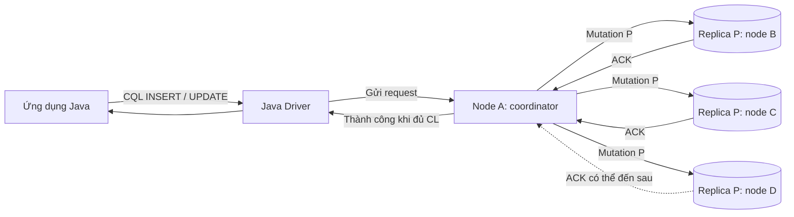
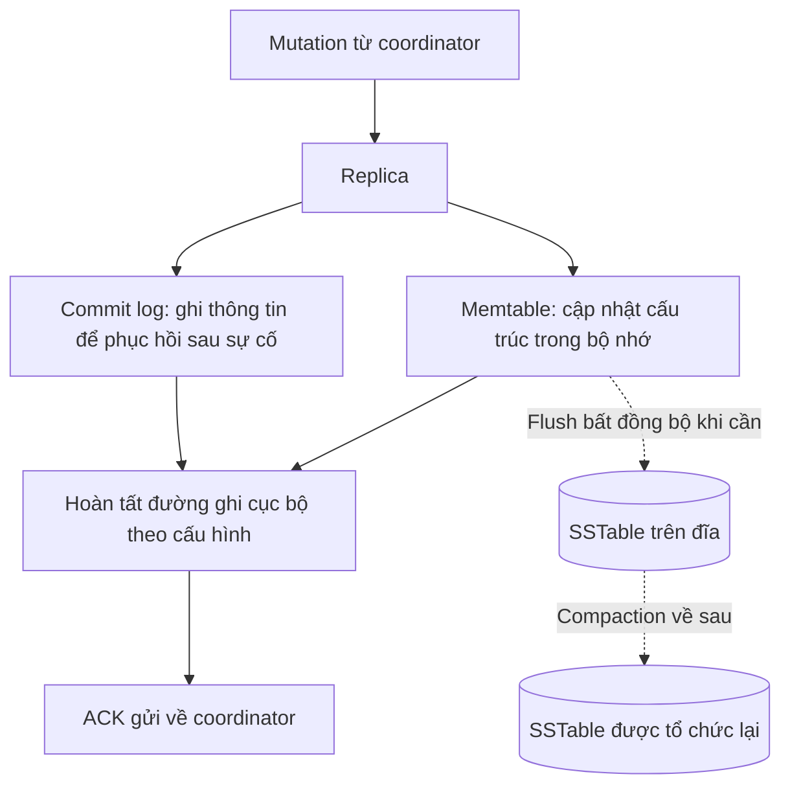
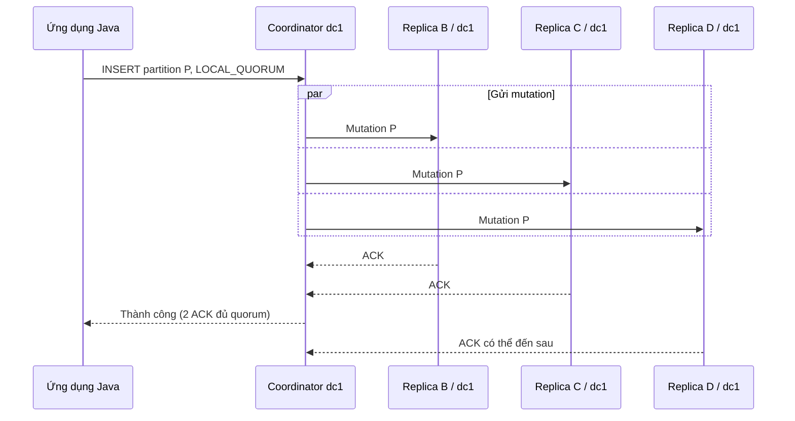

# Luồng ghi từ ứng dụng đến coordinator và replica

Khi ứng dụng Java gọi một câu lệnh `INSERT` hoặc `UPDATE` vào Apache Cassandra, dữ liệu không đi qua một máy chủ master cố định. **Driver** chọn một node Cassandra để tiếp nhận yêu cầu; node đó trở thành **coordinator của request**; coordinator xác định những **replica** cần lưu partition rồi gửi mutation và đợi số phản hồi tương ứng với **consistency level** (CL). Ở mỗi replica, dữ liệu đi qua **commit log** và **memtable** trước khi được ghi thành **SSTable** trong các đợt flush về sau.

Hiểu đường đi này giúp phân biệt ba câu hỏi dễ bị nhầm: *Câu lệnh ghi đã được client báo thành công chưa? Bao nhiêu replica đã xác nhận? Và dữ liệu đã hội tụ giữa tất cả replica hay chưa?* Ba câu hỏi có thể có ba đáp án khác nhau tại cùng thời điểm.

Mục tiêu của bài học:

- Theo dấu một mutation từ ứng dụng Java, CQL driver, coordinator đến replica và phản hồi ngược về client.
- Hiểu cách partition key, token, replication strategy, datacenter/rack quyết định tập replica; CL quyết định điều kiện thành công của **từng request**.
- Phân biệt commit log, memtable, SSTable, flush, compaction, hinted handoff và repair trong đường ghi.
- Phân tích các tình huống ACK, timeout, replica chết, coordinator chết và retry an toàn.
- Thực hành CQL, cấu hình Java Driver, tracing và các lệnh kiểm tra cụm.

## 1. Bức tranh toàn cảnh: một request, nhiều replica

Apache Cassandra là cơ sở dữ liệu **wide-column phân tán** với kiến trúc **peer-to-peer**. Một node bất kỳ được driver chọn có thể nhận yêu cầu và trở thành coordinator cho yêu cầu đó. Coordinator không phải master của cụm; nó chỉ chịu trách nhiệm xử lý **request đang xét**.

Đường ghi điển hình gồm sáu chặng:

1. **Ứng dụng tạo câu lệnh CQL** và lựa chọn keyspace/table, các giá trị khóa, CL; driver quản lý kết nối và chọn node nhận request.
2. **Node nhận request trở thành coordinator**; nó xác định partition key, token và tập replica theo replication strategy cùng topology.
3. **Coordinator gửi mutation** đến các replica chịu trách nhiệm cho partition. Về mặt logic, các replica đều là đích lưu bản sao, dù việc chuyển thông điệp có thể được tối ưu theo DC và phiên bản Cassandra.
4. **Mỗi replica xử lý ghi cục bộ**, gồm cập nhật commit log và memtable; sau khi đạt điều kiện xử lý ghi của replica, replica gửi xác nhận (ACK) về coordinator.
5. **Coordinator thu đủ ACK theo CL** rồi trả thành công cho driver, hoặc trả lỗi/timeout khi không đạt điều kiện trong thời gian yêu cầu.
6. **Các công việc về sau** như flush, compaction, đối chiếu replica bằng repair vẫn tiếp diễn độc lập với thời điểm ứng dụng nhận ACK.



Trong sơ đồ, node A **không nhất thiết** chứa partition P. Nếu A cũng là replica của P, nó đồng thời thực hiện phần ghi cục bộ và tính ACK của mình theo quy tắc tương ứng. Ở request tiếp theo, driver có thể chọn B làm coordinator. Cassandra không cần “chuyển quyền master” giữa A và B.

## 2. Trước khi ghi: partition key quyết định dữ liệu đi đâu

Trong mô hình wide-column, cần thiết kế bảng dựa trên truy vấn. Hãy xét hệ thống đo nhiệt độ theo tenant, thiết bị và ngày. Ứng dụng thường ghi một điểm đo, rồi đọc các điểm đo của **một thiết bị trong một ngày**.

Ví dụ môi trường thử nghiệm: hai datacenter `dc1` và `dc2`, mỗi DC có ít nhất ba node phù hợp, được phân bố trên các rack độc lập; mỗi partition có ba bản sao trong từng DC.

```sql
CREATE KEYSPACE telemetry
WITH replication = {
  'class': 'NetworkTopologyStrategy',
  'dc1': 3,
  'dc2': 3
};

CREATE TABLE telemetry.measurements_by_device_day (
    tenant_id uuid,
    device_id uuid,
    event_day date,
    event_time timestamp,
    event_id uuid,
    temperature_c double,
    PRIMARY KEY ((tenant_id, device_id, event_day), event_time, event_id)
) WITH CLUSTERING ORDER BY (event_time DESC, event_id ASC);
```

Trong bảng này:

- **Partition key tổng hợp** là `(tenant_id, device_id, event_day)`. Cassandra băm đủ ba giá trị để xác định **token** của partition.
- `event_time` và `event_id` là **clustering columns**, dùng để sắp xếp các hàng trong cùng partition và phân biệt các sự kiện. Chúng không quyết định node chứa partition.
- `temperature_c` là cột dữ liệu thông thường.
- Chia theo `event_day` giúp hạn chế việc lịch sử đo của một thiết bị trở thành partition tăng vô hạn. Chọn kích thước bucket phải dựa vào khối lượng ghi và giới hạn vận hành thực tế.

Giả sử ghi một điểm đo:

```sql
INSERT INTO telemetry.measurements_by_device_day (
    tenant_id, device_id, event_day, event_time, event_id, temperature_c
) VALUES (
    11111111-1111-1111-1111-111111111111,
    22222222-2222-2222-2222-222222222222,
    '2026-11-21',
    '2026-11-21T08:30:00+07:00',
    33333333-3333-3333-3333-333333333333,
    36.7
);
```

Ở lần ghi này, coordinator phải tìm tập replica của partition được nhận diện bởi ba giá trị `tenant_id`, `device_id`, `event_day`. Các partition khác có thể có tập replica khác. **Replication factor (RF)** là số bản sao mong muốn của *mỗi partition* trong DC; RF = 3 không có nghĩa mỗi bảng chỉ lưu trên đúng ba node của toàn cụm.

### Token, replica và topology

Mô hình khái quát:

```text
Giá trị partition key
       |
       v
    Hàm băm -> token
       |
       v
Khoảng token / virtual nodes
       |
       v
NetworkTopologyStrategy + RF từng DC + snitch (DC/rack)
       |
       +----> tập replica trong dc1
       |
       +----> tập replica trong dc2
```

`NetworkTopologyStrategy` biết topology từ thông tin DC/rack của node và cố gắng phân tán các bản sao trên những rack khác nhau khi có thể. Replica placement là chức năng của partition key, token, replication strategy và cấu hình cụm; **coordinator không tùy ý chọn ba máy nhanh nhất để lưu dữ liệu**.

## 3. Ứng dụng và driver chọn node nhận request

Trong ứng dụng Java, **contact points** được dùng để kết nối ban đầu và lấy thông tin topology. Sau khi đã có metadata, driver có thể mở kết nối tới nhiều node khác và chọn coordinator theo chính sách cân bằng tải.

Driver Cassandra có thể dùng **token-aware routing** để ưu tiên một replica của partition làm coordinator. Điều này giảm một chặng giao tiếp nội bộ: nếu request được gửi tới replica P, node đó vừa điều phối vừa tham gia lưu P. Token-aware routing hoạt động tốt khi driver biết đầy đủ routing key, chẳng hạn từ **prepared statement** có đủ thành phần partition key.

Hai khái niệm cần tách bạch:

| Thành phần | Quyết định | Không quyết định |
|---|---|---|
| **Java Driver** | Node nào nhận request, kết nối và metadata sử dụng, chính sách retry, routing ưu tiên DC địa phương. | Không quyết định RF và không tự chuyển partition sang node khác. |
| **Coordinator** | Replica nào liên quan tới partition, thông điệp mutation và điều kiện ACK theo CL. | Không trở thành master của mọi partition hoặc bảo đảm mọi replica đã hội tụ chỉ vì đã trả ACK. |
| **Replica** | Cập nhật dữ liệu cục bộ, ghi commit log/memtable và gửi ACK theo trạng thái ghi. | Không quyết định CL thay mặt client. |

Nếu driver chọn node không phải replica, node đó vẫn điều phối được ghi; sự khác biệt thường là thêm giao tiếp qua mạng. Vì vậy, **contact point không phải địa chỉ cố định của “write master”**, còn `localDatacenter` là cấu hình định tuyến ưu tiên của driver, không phải nơi duy nhất có replica.

## 4. Coordinator xử lý yêu cầu ghi ra sao?

Đối với ghi CQL thông thường có khóa phân vùng xác định, coordinator nhận nội dung mutation cùng consistency level từ driver và thực hiện các việc chính:

1. **Kiểm tra yêu cầu** như schema, định dạng dữ liệu, quyền và các giới hạn thích hợp; chuẩn bị mutation với timestamp và các thuộc tính liên quan như TTL nếu có.
2. **Xác định replica có trách nhiệm** theo token và metadata cluster, tính toán số phản hồi cần thiết từ CL và RF.
3. **Kiểm tra tính khả dụng dự kiến**. Nếu ngay từ đầu không có đủ replica được xem là sẵn sàng cho CL, coordinator có thể trả lỗi dạng `Unavailable`; kết quả thực tế còn tùy trạng thái mạng và replica.
4. **Phân phối mutation**. Cassandra hướng đến việc cập nhật tất cả bản sao tự nhiên của partition, đồng thời sử dụng tối ưu mạng/định tuyến nội bộ phù hợp phiên bản và topology.
5. **Thu ACK** theo điều kiện CL. Khi đủ xác nhận, coordinator có thể trả thành công mà không cần chờ mọi replica còn lại.
6. **Theo dõi các replica chưa phản hồi** theo khả năng của hệ thống. Các cơ chế như hinted handoff có thể giúp truyền lại mutation trong một số tình huống; đó không phải bảo đảm tuyệt đối thay cho repair.

Về mặt khái niệm, coordinator giữ trạng thái tạm thời của request: những replica nào đã phản hồi, đã đạt CL hay chưa và request có vượt thời hạn không. **Nó không bắt buộc phải lưu một bản sao dữ liệu của partition được ghi.** Dữ liệu lâu dài do các replica chịu trách nhiệm.

### Coordinator của request này có thể là replica của request khác

Giả sử partition P có replica B, C, D. Driver gửi request tới A, A điều phối. Với partition Q, tập replica có thể gồm A, C, E; nếu driver gửi request Q tới A, A vừa là coordinator vừa là replica. Địa chỉ coordinator vì thế **không phải thuộc tính của một bảng, keyspace hay cluster**.

## 5. Điều gì xảy ra bên trong một replica khi nhận mutation?

Replica là nơi thực sự lưu bản sao của partition. Trong đường ghi thông thường của Cassandra, hai cấu trúc đặc biệt quan trọng là **commit log** và **memtable**.



| Thành phần | Vai trò | Quan hệ với ACK |
|---|---|---|
| **Commit log** | Nhật ký ghi phục vụ khôi phục mutation nếu tiến trình gặp sự cố trước khi memtable được flush đầy đủ. | Nằm trong đường ghi cục bộ, nhưng thời điểm `fsync` vật lý phụ thuộc cấu hình commit log. |
| **Memtable** | Cấu trúc trong bộ nhớ lưu các mutation chưa được flush thành SSTable. | Được cập nhật trong đường ghi; không cần đợi memtable được flush mới ACK. |
| **SSTable** | Tệp dữ liệu bất biến trên đĩa được tạo qua flush/compaction. | Flush thành SSTable thường diễn ra **sau ACK**, không phải điều kiện hoàn thành một lệnh ghi thông thường. |
| **Compaction** | Hợp nhất/tổ chức lại SSTable, xử lý dữ liệu cũ và tombstone theo quy tắc Cassandra. | Là công việc bảo trì lưu trữ, không phải điều kiện để coordinator trả thành công. |

### Commit log và độ bền

Commit log có nhiệm vụ hỗ trợ phục hồi những mutation đã nhận nhưng chưa được flush từ memtable. **Không được đồng nhất “ACK đã gửi” với “một SSTable mới đã được tạo”**. Cũng không nên mặc định ACK nghĩa là từng byte đã được `fsync` trên mọi đĩa: độ bền liên quan đến cấu hình đồng bộ commit log, loại thiết bị lưu trữ và mức nhất quán.

Trong cấu hình đồng bộ commit log dạng `periodic`, có thể có khoảng thời gian giữa việc ghi và đồng bộ ra đĩa; chế độ `batch` có hành vi chờ đồng bộ khác. Khi đánh giá khả năng chịu mất điện đột ngột, cần xem **đúng cấu hình Cassandra đang chạy**, RF và tình trạng replica. RF giúp phân tán rủi ro nhưng không thay thế kiểm tra độ bền.

### Tại sao Cassandra có thể ghi nhanh?

Cassandra tối ưu đường ghi theo cấu trúc kiểu **LSM tree**: ghi tuần tự vào commit log và cập nhật memtable, sau đó flush dữ liệu thành SSTable bất biến. Điều này tránh việc mỗi mutation phải sửa ngẫu nhiên tại chỗ trên các tệp dữ liệu. Bù lại, hệ thống cần compaction và các cơ chế đọc/hòa giải dữ liệu khi nhiều SSTable hoặc replica có thông tin khác nhau.

**Compaction không phải replication**: compaction hoạt động trên dữ liệu lưu trữ của node, còn replication phân phối bản sao giữa node/DC. **Repair** lại là quá trình đối chiếu dữ liệu giữa replica để khắc phục sai lệch; không thể thay hai quá trình ấy cho nhau.

## 6. Coordinator đợi bao nhiêu ACK? RF và consistency level

**RF** trả lời *partition có bao nhiêu bản sao được cấu hình?* **CL** trả lời *yêu cầu ghi này phải thu bao nhiêu xác nhận, và từ DC nào, mới được trả thành công?*

Giả sử keyspace `telemetry` có `RF_dc1 = 3` và `RF_dc2 = 3`; coordinator tiếp nhận request nằm ở `dc1`:

| CL của ghi | Điều kiện xác nhận | Hệ quả |
|---|---|---|
| `ONE` | Một ACK từ replica của partition. | Có thể trả sớm; các bản sao khác có thể chưa hoàn tất. |
| `LOCAL_ONE` | Một ACK từ replica trong `dc1`. | Điều kiện xác nhận không cần ACK từ DC khác. |
| `LOCAL_QUORUM` | `floor(3 / 2) + 1 = 2` ACK tại `dc1`. | Phù hợp nhiều luồng ghi cần quorum địa phương và hạn chế phụ thuộc liên DC. |
| `QUORUM` | `floor(6 / 2) + 1 = 4` ACK trên tổng replica ở hai DC. | Có thể cần phản hồi xuyên DC, ảnh hưởng độ trễ và lỗi mạng. |
| `EACH_QUORUM` | Ít nhất 2 ACK **trong mỗi DC**. | Mạnh hơn khi yêu cầu xác nhận tại từng DC; có thể thất bại nếu một DC không sẵn sàng. Dùng cho ghi. |
| `ALL` | Cả 6 ACK. | Rất nhạy với sự cố ở một replica hoặc một đường kết nối. |

Trường hợp **một DC RF = 3** thì `QUORUM` và `LOCAL_QUORUM` đều cần hai ACK trong điều kiện cùng một DC. Trường hợp **hai DC RF = 3 + 3** thì `QUORUM` cần bốn ACK toàn cục, còn `LOCAL_QUORUM` ở `dc1` chỉ cần hai ACK thuộc `dc1`.

Trong Cassandra còn có `ANY` dành cho **ghi**: nó có thể trả thành công khi mutation được chấp nhận dưới dạng **hint** ngay cả khi chưa có replica tự nhiên xác nhận. Vì vậy, `ANY` không phù hợp nếu nghiệp vụ cần đọc được dữ liệu ngay tại replica sau khi ghi; không dùng `ANY` cho đọc. Đây là tình huống đặc biệt cần phân biệt với `ONE`.

### Vì sao “đã ACK” không đồng nghĩa “mọi replica đều cập nhật”?

Ở `LOCAL_QUORUM` với ba replica tại `dc1`, coordinator có thể nhận ACK từ B và C rồi trả thành công dù D chưa phản hồi. D có thể đang xử lý chậm, tạm không liên lạc được hoặc đã xử lý nhưng ACK về trễ. Sau đó, D có thể nhận mutation hoặc cần cơ chế hội tụ dữ liệu.



Biểu đồ cố ý chỉ vẽ replica `dc1` để tập trung vào điều kiện `LOCAL_QUORUM`. Với keyspace có replica tại `dc2`, mutation vẫn cần được nhân bản tới các replica của DC đó; các thông điệp xuyên DC có thể qua tối ưu chuyển tiếp nội bộ tùy phiên bản. **Thành công tại `dc1` không bảo đảm dữ liệu đã sẵn sàng trên mọi replica của `dc2`.**

## 7. Phân biệt năm mốc thời gian của một lần ghi

Để điều tra hiệu năng và tính đúng đắn, không nên gộp mọi sự kiện thành “ghi xong”. Xét các mốc sau:

| Mốc | Điều đã biết | Chưa thể kết luận |
|---|---|---|
| **T1 — Driver gửi** | Request đã đi qua kết nối từ ứng dụng đến một node. | Chưa biết coordinator hoặc replica có thực sự xử lý thành công không. |
| **T2 — Coordinator phân phối** | Replica đã được xác định và mutation được gửi theo đường ghi. | Chưa biết replica nào đã áp dụng mutation. |
| **T3 — Một replica ACK** | Một replica đã hoàn thành bước ghi cục bộ đủ điều kiện ACK. | Nếu CL đòi quorum, một ACK chưa đủ thành công. |
| **T4 — Đủ ACK theo CL** | Coordinator có thể trả thành công cho client. | Không suy ra toàn bộ replica/DC đã bắt kịp hay compaction đã chạy. |
| **T5 — Dữ liệu hội tụ về sau** | Các replica được đồng bộ qua truyền mutation, hint hoặc repair khi cần. | Không thể suy ra chỉ từ phản hồi `INSERT`; cần quan sát/đối chiếu thực tế. |

Độ trễ đo tại ứng dụng thường gồm **xử lý và hàng đợi trong driver + mạng client/coordinator + xử lý tại coordinator + mạng nội bộ + thời gian ACK của các replica cần thiết**. Một replica chậm không phải lúc nào cũng kéo dài request nếu CL đã đủ nhờ các replica khác; nhưng sự cố làm mất số ACK cần thiết sẽ dẫn tới timeout hoặc lỗi khả dụng.

## 8. Timestamp, TTL, UPDATE và xóa trong luồng mutation

Cassandra xử lý mutation dựa trên **khóa phân vùng và các cell**, kết hợp timestamp để hòa giải giá trị khi nhiều ghi cạnh tranh hoặc replica khác nhau có trạng thái khác nhau.

### `INSERT` và `UPDATE` thường là upsert

Đối với lệnh CQL thông thường, `INSERT` vào khóa đã tồn tại có thể cập nhật giá trị; `UPDATE` không bắt buộc đọc trước rồi ghi như một phép read-modify-write có khóa. Cassandra không mặc định kiểm tra điều kiện “chưa tồn tại” cho `INSERT`. Nếu hệ thống cần tạo duy nhất khi bản ghi chưa có, có thể dùng **lightweight transaction (LWT)**:

```sql
INSERT INTO telemetry.measurements_by_device_day (
    tenant_id, device_id, event_day, event_time, event_id, temperature_c
) VALUES (
    11111111-1111-1111-1111-111111111111,
    22222222-2222-2222-2222-222222222222,
    '2026-11-21',
    '2026-11-21T08:30:00+07:00',
    33333333-3333-3333-3333-333333333333,
    36.7
) IF NOT EXISTS;
```

Đây là **conditional write** dùng giao thức đồng thuận riêng, có chi phí và ngữ nghĩa khác ghi thông thường; không nên xem LWT là mặc định của mọi `INSERT`. Đối với hệ thống ghi sự kiện liên tục, một định danh sự kiện ổn định giúp ứng dụng tránh tạo hàng mới ngoài ý muốn khi lặp lại yêu cầu.

### Timestamp và thứ tự ghi

Các mutation/cell được gắn timestamp. Khi replica hòa giải các phiên bản cạnh tranh, timestamp là yếu tố quan trọng để quyết định giá trị có hiệu lực; **request đến sau về thời gian mạng không nhất thiết thắng** nếu timestamp nhỏ hơn. Đồng hồ lệch hoặc ứng dụng tự cấp timestamp thiếu kiểm soát có thể tạo hiện tượng ghi mới nhưng giá trị cũ vẫn được nhìn thấy.

Không nên dùng retry mù quáng với timestamp mới nếu mutation có thể đã thành công một phần và một thao tác khác đã cập nhật cùng cell. Hệ thống nên chọn chiến lược idempotency phù hợp nghiệp vụ: tái sử dụng cùng khóa sự kiện, cùng payload và quản lý timestamp khi cần.

### TTL và tombstone

Nếu ghi với `USING TTL`, giá trị có thời hạn tồn tại; khi hết hạn, Cassandra dùng ngữ nghĩa hết hạn/tombstone để xử lý dữ liệu cũ. Lệnh `DELETE` cũng tạo **tombstone** thay vì bảo đảm xóa sạch mọi byte trên tất cả replica ngay lập tức. Compaction và repair ảnh hưởng đến vòng đời tombstone; hoạt động ghi với TTL/xóa cần được thiết kế trong giới hạn thời gian repair và đặc tính tải.

Thay đổi partition key không phải một `UPDATE` di chuyển hàng tự động. Nếu cần đổi khóa phân vùng, ứng dụng phải thiết kế quy trình ghi bản ghi ở khóa mới và xử lý bản ghi cũ phù hợp.

### Batch không có nghĩa là một transaction toàn cụm

CQL `BEGIN BATCH ... APPLY BATCH` có mục đích và chi phí riêng; **logged batch** hỗ trợ tính nguyên tử cuối cùng của nhóm mutation theo cơ chế batchlog, nhưng **không** cung cấp cô lập giao dịch quan hệ cho các partition bất kỳ. Batch quá lớn hoặc trải quá nhiều partition có thể gây tải đáng kể. Với một luồng ghi dữ liệu cảm biến, thường nên ưu tiên từng mutation đã chọn đúng partition và tối ưu batching dựa trên mẫu truy cập thực tế.

## 9. Lỗi tại coordinator và replica: client nên hiểu gì?

Kết quả trả về cho driver phụ thuộc CL và trạng thái gửi/nhận. Những trường hợp sau rất quan trọng:

| Tình huống | Có thể xảy ra | Cách hiểu đúng |
|---|---|---|
| **Một replica down trước khi gửi** | Coordinator vẫn ghi được với CL yêu cầu ít ACK hơn số replica còn khỏe. | RF và CL cùng quyết định khả năng tiếp tục ghi. |
| **Không đủ replica được coi là khả dụng ngay từ đầu** | Có thể nhận `Unavailable`. | Request chưa đạt điều kiện khả dụng; không suy ra cluster hoàn toàn ngừng hoạt động. |
| **Replica nhận mutation nhưng ACK về chậm/mất** | Có thể nhận `WriteTimeout` dù một số replica đã ghi. | Timeout **không chứng minh mutation chưa được áp dụng**. |
| **Coordinator chết sau khi phát mutation** | Client mất kết nối/timeout; replica có thể đã ghi đủ, một phần hoặc chưa ghi. | Kết quả là **không chắc chắn** nếu không có kiểm tra thích hợp. |
| **Một DC mất mạng trong ghi `LOCAL_QUORUM`** | Coordinator ở DC còn khỏe có thể vẫn ghi thành công nhờ replica địa phương. | Không suy ra replica ở DC mất mạng đã nhận dữ liệu. |
| **Ghi `ALL` và một replica không đáp ứng** | Request thất bại/timeout dù phần lớn replica có thể đã ghi. | CL cao tăng điều kiện xác nhận nhưng giảm khả năng thành công trong sự cố. |

### Tại sao retry có thể nguy hiểm?

Giả sử ứng dụng gửi ghi cho sự kiện E, coordinator đã chuyển tới hai replica nhưng phản hồi về client thất lạc. Client thấy timeout và gửi lại:

1. Nếu dùng **khóa bản ghi mới mỗi lần retry**, ứng dụng có thể tạo hai hàng khác nhau cho cùng sự kiện.
2. Nếu dùng **cùng partition/clustering key và payload**, rủi ro sinh hàng trùng giảm, nhưng hai lần ghi vẫn có thể có timestamp khác nhau và cạnh tranh với mutation khác.
3. Nếu ghi chứa **counter**, hành động tăng/giảm có ngữ nghĩa khác với đặt giá trị tuyệt đối; retry có thể làm thay đổi kết quả nhiều lần.
4. Nếu dùng **LWT** hoặc các điều kiện `IF`, cần xử lý kết quả áp dụng điều kiện thay vì xem mọi retry là tương đương.

Driver có cơ chế retry policy, nhưng ứng dụng phải gắn retry với **ngữ nghĩa idempotent thực sự**. Không nên cấu hình tự động retry mọi `INSERT`/`UPDATE` chỉ vì thấy `WriteTimeout`. Đối với trạng thái nghiệp vụ quan trọng, hãy thiết kế event ID ổn định, kiểm tra kết quả theo khóa, hoặc dùng cơ chế điều kiện phù hợp.

## 10. Replica bỏ lỡ ghi: hint, repair và compaction khác nhau thế nào?

Ghi thành công ở CL thấp không yêu cầu mọi replica cùng ACK. Khi một replica vắng mặt, các bản sao có thể lệch nhau tạm thời; Cassandra có những cơ chế khác nhau để giảm khoảng cách đó.

| Cơ chế | Mục đích | Giới hạn cần nhớ |
|---|---|---|
| **Hinted handoff** | Lưu thông tin mutation bị bỏ lỡ cho replica tạm thời không khả dụng, để phát lại khi nó hồi phục. | Có giới hạn thời gian/cấu hình/tài nguyên; không bảo đảm mọi sai lệch đều có hint. |
| **Anti-entropy repair** | Đối chiếu dữ liệu giữa các replica và đồng bộ khác biệt. | Tiêu thụ I/O, CPU, mạng; cần vận hành theo lịch và hướng dẫn phiên bản. |
| **Read repair** | Có thể sửa một phần bất đồng được phát hiện khi đọc, tùy phiên bản và thiết lập bảng. | Không bảo đảm mọi partition được quét; không thay thế repair định kỳ. |
| **Flush** | Chuyển memtable sang SSTable trên node. | Không chuyển dữ liệu sang replica khác. |
| **Compaction** | Tổ chức lại SSTable và quản lý dữ liệu cũ/tombstone theo chiến lược. | Không phải quá trình nhân bản/đối chiếu toàn cụm. |

Ví dụ B và C đã ACK một mutation `LOCAL_QUORUM`, còn D down. Coordinator có thể trả thành công. Khi D trở lại, dữ liệu có thể được phát lại bằng hint nếu điều kiện cho phép; nếu hint hết hạn hoặc bị bỏ qua, repair vẫn là công cụ quan trọng để đối chiếu. **Không chạy repair ngay sau mỗi lần ghi**: đây là công việc vận hành có kế hoạch.

Trong cụm nhiều DC, mất kết nối xuyên DC có thể kéo dài thời gian hội tụ. Nếu cần failover sang DC khác, phải kiểm tra mức dữ liệu mới nhất mà DC đó thực sự có; `LOCAL_QUORUM` thành công ở DC nguồn **không** tương đương ghi đã được xác nhận tại DC đích.

## 11. Ví dụ Java Driver 4.x: ghi dữ liệu với CL rõ ràng

Ví dụ sau dùng API `com.datastax.oss.driver` của Apache Cassandra Java Driver 4.x. Prepared statement có đủ ba thành phần partition key, giúp driver có thể tính routing key và ưu tiên replica địa phương khi metadata đầy đủ.

```java
import com.datastax.oss.driver.api.core.CqlSession;
import com.datastax.oss.driver.api.core.DefaultConsistencyLevel;
import com.datastax.oss.driver.api.core.cql.BoundStatement;
import com.datastax.oss.driver.api.core.cql.PreparedStatement;

import java.net.InetSocketAddress;
import java.time.Instant;
import java.time.LocalDate;
import java.util.UUID;

public class SaveMeasurement {
    public static void main(String[] args) {
        UUID tenantId = UUID.fromString(
            "11111111-1111-1111-1111-111111111111");
        UUID deviceId = UUID.fromString(
            "22222222-2222-2222-2222-222222222222");
        UUID eventId = UUID.fromString(
            "33333333-3333-3333-3333-333333333333");
        LocalDate eventDay = LocalDate.parse("2026-11-21");
        Instant eventTime = Instant.parse("2026-11-21T01:30:00Z");

        // Địa chỉ minh họa trong mạng tài liệu: thay bằng node thật.
        try (CqlSession session = CqlSession.builder()
                .addContactPoint(new InetSocketAddress("192.0.2.10", 9042))
                .addContactPoint(new InetSocketAddress("192.0.2.11", 9042))
                .withLocalDatacenter("dc1")
                .build()) {

            PreparedStatement prepared = session.prepare(
                "INSERT INTO telemetry.measurements_by_device_day " +
                "(tenant_id, device_id, event_day, " +
                " event_time, event_id, temperature_c) " +
                "VALUES (?, ?, ?, ?, ?, ?)"
            );

            BoundStatement write = prepared
                .bind(tenantId, deviceId, eventDay, eventTime, eventId, 36.7)
                .setConsistencyLevel(DefaultConsistencyLevel.LOCAL_QUORUM);

            session.execute(write);
            System.out.println("Đã nhận xác nhận ghi LOCAL_QUORUM");
        }
    }
}
```

Trong ví dụ:

- `192.0.2.10` và `192.0.2.11` là địa chỉ **dành cho tài liệu**, không phải endpoint Cassandra thật; thay bằng contact point truy cập được trong cluster.
- `dc1` là tên DC minh họa; phải khớp thông tin DC của node trong triển khai thực tế.
- `eventId` được tạo/ghi nhớ trước khi gửi request. Nếu nghiệp vụ cần lặp lại cùng sự kiện, nên tái sử dụng cùng định danh thay vì tạo UUID mới cho mỗi lần gửi.
- `LOCAL_QUORUM` yêu cầu đa số replica của partition **trong DC coordinator** xác nhận; ở ví dụ `RF_dc1 = 3` thì cần hai ACK địa phương.
- Lệnh `session.execute(write)` ném ngoại lệ nếu request không được xác nhận thành công theo API/CL; ứng dụng thực tế cần xử lý timeout, trạng thái không chắc chắn, logging và chính sách retry có kiểm soát.

Trong hệ thống production, nên quản lý cấu hình driver qua deployment/execution profile, tái sử dụng `CqlSession` lâu dài thay vì tạo phiên cho mỗi request, và dùng nhiều contact point phù hợp DC. Có thể cân nhắc các dạng xử lý bất đồng bộ theo nhu cầu tải; đường đi coordinator–replica và các giới hạn CL vẫn không đổi về bản chất.

### Khi nào có thể cho phép driver retry?

Không có một lựa chọn đúng cho mọi bảng. Với ghi dựa trên khóa sự kiện bất biến, payload ổn định và quy tắc timestamp phù hợp, có thể thiết kế xử lý lại an toàn hơn. Với counter, mutation phụ thuộc trạng thái trước đó hoặc cập nhật cạnh tranh, cần xét kỹ hiệu ứng lặp. Chỉ đánh dấu statement là idempotent khi **thực sự bảo đảm** gọi lại có cùng tác dụng mong muốn; không tự bật retry vô điều kiện cho mọi truy vấn.

## 12. Quan sát đường ghi bằng CQL và công cụ vận hành

Trên môi trường thử nghiệm, tạo keyspace/bảng như mục 2 và chạy một lệnh `INSERT` với trace:

```sql
-- CONSISTENCY và TRACING là lệnh của cqlsh.
CONSISTENCY LOCAL_QUORUM;
TRACING ON;

INSERT INTO telemetry.measurements_by_device_day (
    tenant_id, device_id, event_day,
    event_time, event_id, temperature_c
) VALUES (
    11111111-1111-1111-1111-111111111111,
    22222222-2222-2222-2222-222222222222,
    '2026-11-21',
    '2026-11-21T08:31:00+07:00',
    44444444-4444-4444-4444-444444444444,
    36.9
);

TRACING OFF;
```

Trace có thể cho thấy các bước chuẩn bị mutation, chuyển thông điệp và phản hồi của replica. Nội dung chính xác thay đổi theo phiên bản và tối ưu thực thi; trace có chi phí xử lý, do đó chỉ nên bật có chọn lọc khi chẩn đoán, không duy trì cho mọi request trong production.

Quan sát trạng thái cụm bằng `nodetool`:

```bash
nodetool status
nodetool describecluster
nodetool tpstats
```

- `nodetool status`: xác định node nào `UN` (*Up/Normal*), DC/rack và phân bố node; từ đó suy luận tính khả dụng của replica.
- `nodetool describecluster`: kiểm tra thông tin cluster, schema và topology khái quát.
- `nodetool tpstats`: xem hoạt động/hàng đợi của các nhóm thực thi nội bộ, hữu ích khi nghi node quá tải; chi tiết chỉ số tùy phiên bản.

Khi so sánh các lần ghi, hãy ghi lại **CL, RF theo DC, node coordinator, partition key, số replica đáp ứng, thời gian và thông tin lỗi**. Không thể kết luận nguyên nhân chậm chỉ từ một dòng trace: tốc độ commit log, áp lực memtable/flush, compaction, mạng liên DC, hotspot partition và tải của coordinator đều có thể tác động.

### Những dấu hiệu cần phân tích thêm

| Dấu hiệu | Hướng kiểm tra |
|---|---|
| `WriteTimeout` tăng khi một rack gặp vấn đề | Replica của partition có đang tập trung tại rack đó? CL cần bao nhiêu ACK? |
| Độ trễ ghi tăng dù replica vẫn `UN` | Xem I/O, commit log, memtable flush, compaction backlog, network và hàng đợi xử lý. |
| Ghi tại `dc1` thành công nhưng đọc ở `dc2` thấy bản cũ | Xem replication xuyên DC, CL, kết nối mạng, hint và repair; xác minh timestamp. |
| Tăng thêm nhiều node mà một luồng ghi vẫn chậm | Kiểm tra hot partition và clustering/bucketing; một partition vẫn ghi vào tập replica hữu hạn. |
| Retry làm số bản ghi tăng bất thường | Kiểm tra event ID/clustering key có được tái sử dụng qua lần gửi lại hay không. |

## 13. Các hiểu nhầm thường gặp

**“Ghi ở Cassandra luôn đi đến một master.”** Sai. Node nhận request là coordinator *của request đó*; mỗi node có thể làm coordinator, còn replica lưu partition theo token và topology.

**“CL ONE thì dữ liệu chỉ được gửi cho một node.”** Sai. CL quy định **bao nhiêu ACK cần thiết** để trả thành công; mục tiêu replication vẫn là cập nhật các replica chịu trách nhiệm.

**“Có hai ACK nghĩa là hai node đã tạo SSTable mới.”** Sai. ACK của ghi thông thường liên quan đường ghi cục bộ qua commit log/memtable; flush và compaction diễn ra riêng.

**“Viết thành công ở LOCAL_QUORUM thì DC dự phòng đã có dữ liệu mới nhất.”** Không được suy ra như vậy. `LOCAL_QUORUM` chỉ đòi quorum ở DC của coordinator. Độ mới của DC khác còn phụ thuộc trạng thái replication.

**“WriteTimeout có nghĩa dữ liệu chưa được ghi.”** Sai. Một số replica có thể đã áp dụng mutation, chỉ có phản hồi hoặc đủ ACK không đến được client đúng hạn.

**“Repair và compaction đều sửa replica thiếu dữ liệu.”** Sai. Repair đối chiếu và đồng bộ replica; compaction tổ chức lại SSTable tại node.

**“Bật retry cho mọi INSERT sẽ luôn an toàn.”** Sai. Khả năng lặp lại phụ thuộc khóa, timestamp, TTL, counter, thao tác đồng thời và quy tắc nghiệp vụ.

## 14. Bài tập suy luận và kiểm tra hiểu biết

Giữ giả định keyspace `telemetry` có `RF_dc1 = 3` và `RF_dc2 = 3`, với coordinator thuộc `dc1`.

**Tình huống A:** Một replica trong `dc1` mất kết nối, hai replica còn lại phản hồi. Ghi `LOCAL_QUORUM` có thể thành công không? **Có**, vì cần hai ACK địa phương, nếu cả hai đến đúng hạn. Nếu dùng `ALL`, không thể xác nhận thành công với replica mất kết nối.

**Tình huống B:** Hai replica `dc1` gửi ACK, ba replica `dc2` chưa trả ACK. Client dùng `LOCAL_QUORUM` có thể được báo thành công chưa? **Có**. Có thể kết luận dữ liệu đã cập nhật ở mọi node `dc2` không? **Không**.

**Tình huống C:** Driver báo `WriteTimeout` sau khi coordinator đã gửi mutation. Ứng dụng lập tức tạo `event_id` mới rồi gọi lại `INSERT`. Điều gì có thể xảy ra? **Hai hàng cho cùng một sự kiện nghiệp vụ** nếu mutation ban đầu đã được áp dụng. Cần giữ định danh ổn định và chiến lược xử lý trạng thái không chắc chắn.

**Tình huống D:** Một node đã ACK nhưng chưa flush memtable. Có nghĩa là chưa ghi gì ra ổ lưu trữ không? **Không**. Commit log tham gia đường ghi; mức độ đồng bộ vật lý tùy cấu hình. Chưa có SSTable mới không đồng nghĩa không có nhật ký ghi.

**Tình huống E:** DC `dc2` mất mạng trong khi ghi `LOCAL_QUORUM` tại `dc1` vẫn thành công. Khi khôi phục kết nối, cơ chế nào cần quan tâm? **Hinted handoff và repair**, đồng thời xem mức dữ liệu đã bắt kịp trước khi chuyển lưu lượng nghiệp vụ sang DC dự phòng.

Có thể tự thử nghiệm trên cluster dùng để học bằng cách theo dõi `nodetool status`, bật `TRACING` cho một `INSERT` và so sánh `LOCAL_ONE` với `LOCAL_QUORUM` trong điều kiện các replica đáp ứng bình thường. Không cần chủ động làm hỏng node production để kiểm tra các tình huống trên.

## 15. Tổng kết đường ghi

Muốn hiểu một kết quả ghi trong Cassandra, hãy lần lượt xác định:

1. **Partition key là gì?** Nó quyết định token và giúp xác định tập replica.
2. **Client gửi request tới node nào?** Node đó làm coordinator cho request.
3. **Replica nằm ở những DC/rack nào?** RF và `NetworkTopologyStrategy` xác định vị trí các bản sao mong muốn.
4. **Replica làm gì trước ACK?** Mutation được ghi vào commit log và áp dụng cho memtable theo đường ghi cục bộ; SSTable được tạo qua flush về sau.
5. **CL cần bao nhiêu ACK?** Đó là điều kiện để coordinator trả thành công, không phải cam kết mọi replica đã hội tụ.
6. **Nếu lỗi hoặc timeout thì sao?** Kết quả có thể không chắc chắn; retry, hinted handoff và repair cần được hiểu theo ngữ nghĩa riêng.

```text
Java / CQL Driver
        |
        v
Coordinator của request
        |
        +-- Partition key -> token -> replica theo RF + topology
        |
        +-- Mutation --> Replica 1: commit log + memtable --> ACK
        +-- Mutation --> Replica 2: commit log + memtable --> ACK
        +-- Mutation --> Replica 3: commit log + memtable --> ACK (có thể trễ)
        |
        +-- Đủ ACK theo consistency level
        v
Phản hồi cho ứng dụng

Sau đó: flush SSTable, compaction, hint/repair khi cần.
```

Đường ghi Cassandra kết hợp **phân bố partition**, **nhân bản theo topology**, **ghi cục bộ tối ưu cho LSM tree** và **xác nhận theo consistency level**. Đây là nền tảng để phân tích thiết kế bảng theo truy vấn, replication, hiệu năng, độ bền, khôi phục lỗi và kết nối từ ứng dụng Java trong các chủ đề tiếp theo.
