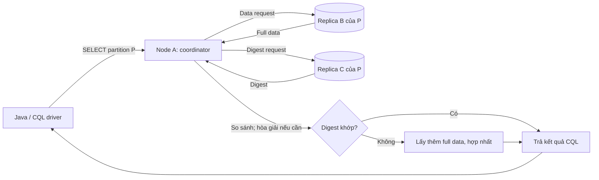
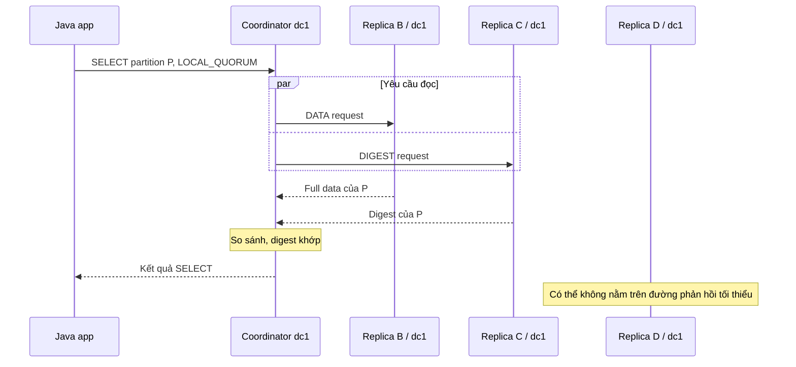
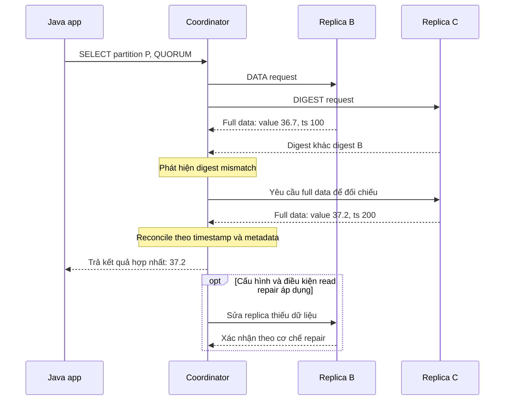
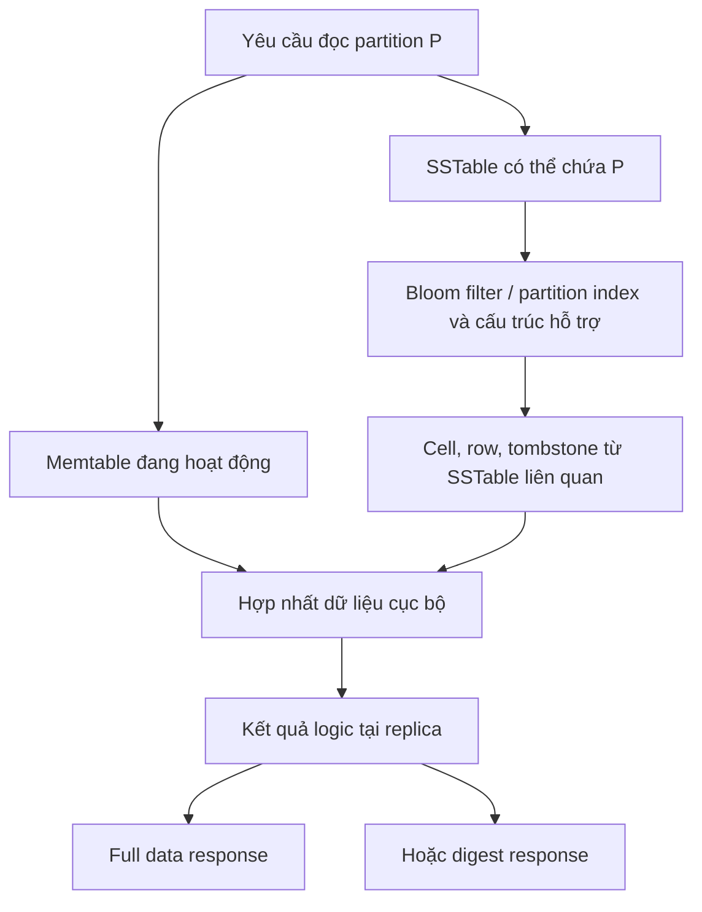

# Luồng đọc, phản hồi digest và hợp nhất phiên bản

Trong Apache Cassandra, một yêu cầu `SELECT` không nhất thiết được xử lý bởi một node đang giữ toàn bộ dữ liệu cần đọc. Ứng dụng Java gửi CQL tới một node, node đó đóng vai trò **coordinator của request**, tìm các **replica** lưu partition, thu phản hồi theo **consistency level (CL)** rồi trả dữ liệu cho client. Để giảm lượng dữ liệu truyền qua mạng, các replica có thể phản hồi bằng **dữ liệu đầy đủ (full data)** hoặc **digest**. Nếu nội dung được so sánh khác nhau, coordinator phải tìm hiểu các phiên bản và thực hiện **hợp nhất dữ liệu (reconciliation)** để xác định kết quả đọc.

Đây là một khía cạnh quan trọng của kiến trúc wide-column phân tán: nhiều bản sao của một partition có thể **chưa hội tụ tại cùng thời điểm**, nhưng Cassandra vẫn phải trả lời truy vấn theo những cam kết cụ thể của CL. Nắm vững luồng đọc giúp thiết kế partition key, chọn CL, kiểm tra sự cố replica, tổ chức repair và viết ứng dụng Java có độ trễ phù hợp.

Sau bài này, bạn có thể:

- Vẽ đường đi của một `SELECT` từ Java Driver đến coordinator, replica, digest và phản hồi cuối cùng.
- Phân biệt full-data response với digest response; giải thích tại sao digest khớp hoặc khác nhau.
- Mô tả cách Cassandra hòa giải các phiên bản ở mức cell dựa trên timestamp, tombstone, TTL và ngữ nghĩa dữ liệu.
- Phân biệt **reconciliation**, **read repair** và **anti-entropy repair**.
- Dự đoán ảnh hưởng của RF, `ONE`, `LOCAL_QUORUM` và `QUORUM` đến tính nhất quán và khả năng phục vụ.
- Thực hành CQL tracing, truy vấn theo partition key và sử dụng Java Driver 4.x để quan sát đọc dữ liệu.

## 1. Một truy vấn đọc được điều phối như thế nào?

Cassandra tổ chức cluster theo mô hình **peer-to-peer**. Node nhận yêu cầu từ client là **coordinator của request đó**; không có master đọc cố định. Một node đang làm coordinator có thể chính là replica lưu partition cần đọc, hoặc chỉ làm trung gian giao tiếp với các replica khác.

Với truy vấn chỉ rõ partition key, đường đi khái quát:

1. Ứng dụng tạo `SELECT`, truyền các tham số và chọn CL.
2. CQL driver chọn một node nhận request theo topology, chính sách cân bằng tải và khả năng định tuyến theo token.
3. Coordinator lấy partition key, tính token, tra metadata cluster và xác định tập replica tương ứng với replication strategy.
4. Coordinator gửi yêu cầu đọc đến các replica thích hợp, với **mức dữ liệu trả về** và **số phản hồi bắt buộc** phù hợp CL, phiên bản và tối ưu thực thi.
5. Coordinator kiểm tra kết quả/digest; nếu cần, lấy thêm dữ liệu và hòa giải phiên bản.
6. Coordinator trả tập hàng CQL tới driver sau khi đạt điều kiện yêu cầu; driver giải mã thành các `Row` cho ứng dụng.



Sơ đồ minh họa một trường hợp có nhiều phản hồi cần so sánh. Với CL chỉ cần một replica, **không mặc định** tồn tại bước so sánh digest từ replica khác. Tập replica được liên hệ và cách gửi thông điệp có thể thay đổi theo CL, số bản sao, tốc độ đáp ứng và phiên bản Cassandra.

### Coordinator và replica có thể là cùng một node

Nếu driver biết đầy đủ partition key và metadata, **token-aware routing** có thể ưu tiên replica của partition làm coordinator, giảm một chặng mạng. Nếu request đến một node khác, node đó vẫn có thể điều phối. Vai trò coordinator **thay đổi theo request**, còn việc node có phải replica của một partition hay không phụ thuộc token và replication strategy.

## 2. Partition key, token, DC/rack và tập replica

Trong Cassandra, **partition key** không chỉ là điều kiện `WHERE` để lọc; nó quyết định partition nằm trên những node nào.

Giả sử keyspace `telemetry` có:

- Chiến lược `NetworkTopologyStrategy`.
- Replication factor `RF_dc1 = 3` và `RF_dc2 = 3`.
- Đủ node/rack để phân bố ba replica riêng trong mỗi DC.
- Ứng dụng ở `dc1` thường gửi yêu cầu tới coordinator thuộc `dc1`.

Khi đọc partition P, coordinator dùng token của partition để xác định **ba replica trong `dc1` và ba replica trong `dc2`**. Các replica không được chọn ngẫu nhiên theo mỗi lần đọc. Partition Q có thể có tập replica khác, do hash của partition key khác.

```text
Partition key từ SELECT
          |
          v
      Hash -> token
          |
          v
  Token ownership + NetworkTopologyStrategy
          |
          +--> dc1: replica P1, P2, P3
          |
          +--> dc2: replica P4, P5, P6
          |
          v
   Coordinator liên hệ replica theo CL
```

**Rack** giúp Cassandra phân tán bản sao vào những failure domain độc lập khi có thể; **DC** xác định phạm vi replication và ý nghĩa của các CL địa phương. Nếu một rack chứa replica P bị lỗi, số replica P còn đáp ứng trong DC mới là yếu tố quyết định yêu cầu đọc có đạt CL hay không.

Không nên hiểu token ring là một vòng mạng vật lý mà mọi request phải đi qua từng node theo thứ tự. Đây là mô hình phân bố dữ liệu **logic**; coordinator và replica trao đổi thông điệp trực tiếp theo topology thực tế.

## 3. Full data response là gì?

Một **full-data response** chứa kết quả dữ liệu thực tế cho phần partition/slice được truy vấn. Tùy nội dung `SELECT`, dữ liệu được đọc có thể gồm các cell, metadata cần cho reconciliation, thông tin tombstone và các thành phần khác mà giao thức nội bộ cần; ứng dụng cuối cùng chỉ nhận các hàng/cột mà CQL yêu cầu.

Ví dụ, ứng dụng cần 20 điểm đo gần nhất của thiết bị D trong ngày N:

```sql
SELECT event_time, event_id, temperature_c
FROM telemetry.measurements_by_device_day
WHERE tenant_id = 11111111-1111-1111-1111-111111111111
  AND device_id = 22222222-2222-2222-2222-222222222222
  AND event_day = '2026-11-21'
LIMIT 20;
```

Replica xử lý truy vấn theo dữ liệu hiện có của mình và trả **nội dung thực** cần cho coordinator. Full data có kích thước đáng kể khi partition lớn hoặc kết quả chứa nhiều cell; vì vậy việc yêu cầu mọi replica trả toàn bộ dữ liệu chỉ để kiểm tra chúng có đồng ý hay không sẽ làm tăng lưu lượng mạng.

**Full data không có nghĩa đọc toàn bộ partition trong mọi tình huống.** Bộ lọc, slice, clustering order, paging và giới hạn kết quả ảnh hưởng đến lượng dữ liệu phải đọc/truyền; các tối ưu nội bộ còn phụ thuộc phiên bản và đặc tính dữ liệu.

## 4. Digest response là gì và vì sao nó hữu ích?

**Digest** là một giá trị tóm lược nội dung đọc, thường được xây dựng bằng cơ chế hash trên biểu diễn logic của dữ liệu liên quan tới truy vấn. Một replica có thể trả digest thay vì gửi tất cả các cell về coordinator. Coordinator so sánh digest đó với digest tương ứng của dữ liệu đã nhận.

| Loại phản hồi | Chứa gì? | Dùng để làm gì? |
|---|---|---|
| **Full data** | Dữ liệu chi tiết để dựng kết quả đọc, kèm metadata nội bộ cần thiết. | Cho coordinator có kết quả cụ thể để trả hoặc hòa giải. |
| **Digest** | Bản tóm lược/giá trị kiểm tra tính tương đồng của dữ liệu được đọc. | Giúp phát hiện replica đang có kết quả khác nhau với lưu lượng nhỏ hơn full data. |

Ví dụ đơn giản: Replica B và C đều cho kết quả logic `temperature_c = 36.7` với cùng thông tin phiên bản cần so sánh; digest dự kiến khớp. Nếu B có phiên bản `36.7` còn C có phiên bản `37.2`, digest có thể khác, báo hiệu cần đối chiếu dữ liệu chi tiết.

**Digest không phải bản sao dữ liệu và không phải phương pháp giải mã lại hàng.** Từ digest của C, coordinator không thể suy ra rằng C giữ `37.2`; nó phải yêu cầu **full data** nếu cần hòa giải.

Digest cũng không phải phép so sánh byte của **tệp SSTable**. Hai replica có thể lưu cùng dữ liệu logic nhưng được flush/compaction thành các SSTable có bố cục vật lý khác nhau. Điều đó tự nó không có nghĩa digest kết quả đọc phải khác nhau.

### Digest khớp nói lên điều gì?

Khi dữ liệu và digest tương ứng khớp, coordinator có thể dùng full-data response đã nhận để trả kết quả, miễn là **đã đáp ứng CL**. Digest khớp chỉ xác nhận sự tương đồng trong **phạm vi các phản hồi được so sánh của request**; nó **không** chứng minh mọi replica khác, mọi partition hay mọi DC trong cluster đã đồng bộ hoàn toàn.

### Digest không khớp nói lên điều gì?

Digest mismatch biểu thị có khác biệt trong nội dung cần so sánh, hoặc khác biệt metadata/phiên bản ảnh hưởng đến phép kiểm tra. Khi đó coordinator cần nhiều thông tin hơn để dựng kết quả hợp lệ. Không nên tự suy ra nguyên nhân là “replica bị hỏng dữ liệu”: replica chưa nhận mutation gần nhất, độ trễ replication, tombstone, TTL hoặc các ghi cạnh tranh đều có thể làm bản sao khác nhau tại thời điểm đọc.

## 5. Đường đọc bình thường khi digest khớp

Giả sử `dc1` có RF = 3, coordinator thuộc `dc1` và truy vấn sử dụng `LOCAL_QUORUM`. Khi không gặp lỗi và không cần đọc thêm, một đường đi thường gặp là:

1. Coordinator yêu cầu **full data** từ một replica phù hợp.
2. Coordinator yêu cầu **digest** từ replica khác để đạt mức xác nhận tối thiểu theo CL.
3. Replica thứ nhất trả dữ liệu; replica thứ hai trả digest.
4. Coordinator so sánh nội dung tương ứng và thấy chúng phù hợp.
5. Vì đã có hai phản hồi phù hợp từ `dc1`, coordinator trả kết quả cho client.



Đây là **mô hình giải thích**, không phải cam kết rằng Cassandra luôn chọn B trả full data, C trả digest hay chỉ liên hệ đúng hai replica. Tùy phiên bản, coordinator có thể dùng các tối ưu về độ trễ, gửi yêu cầu dự phòng (speculative/retry) hoặc liên hệ thêm replica. Mục đích của minh họa là tách bạch **điều kiện đủ phản hồi** với **số bản sao tồn tại**.

Với `ONE` hoặc `LOCAL_ONE`, chỉ một phản hồi hợp lệ có thể đủ để trả client; nếu không cần đối chiếu thêm, truy vấn có thể trả dữ liệu cũ mà replica đó đang giữ. Với `ALL`, điều kiện phản hồi cao hơn nhiều và dễ thất bại khi một replica không đáp ứng.

## 6. Khi digest mismatch: lấy thêm dữ liệu và hòa giải

Giả sử B có nhiệt độ `36.7` và C đã nhận cập nhật mới `37.2`. Nếu coordinator lấy full data từ B và digest từ C, digest sẽ không khớp. Coordinator **không thể chọn giá trị chỉ từ digest**; nó phải có dữ liệu chi tiết cần thiết để hòa giải.



Trong triển khai thật, số replica được yêu cầu full data và thời điểm trả client có thể khác sơ đồ; một số chế độ **read repair** cần đợi công việc sửa trước khi trả. Nếu phiên bản/cấu hình không yêu cầu repair chặn phản hồi, reconciliation vẫn có thể tạo ra kết quả đọc thích hợp mà không đồng bộ mọi replica ngay.

Ba hoạt động cần phân biệt:

1. **Phát hiện khác biệt:** digest mismatch cho biết các phản hồi không tương đồng.
2. **Hợp nhất phiên bản (reconciliation):** coordinator có đủ dữ liệu để xác định các cell có hiệu lực trong kết quả.
3. **Sửa replica (read repair):** hệ thống có thể ghi lại dữ liệu hợp nhất sang replica đang thiếu, với phạm vi và cách đợi tùy cấu hình.

Hợp nhất dữ liệu phục vụ **kết quả của request hiện tại**; read repair phục vụ **trạng thái các bản sao**. Hai mục đích liên quan nhưng không phải một hành động duy nhất.

## 7. Cassandra hợp nhất các phiên bản theo quy tắc nào?

Ở mức cơ bản, Cassandra sử dụng mô hình **last-write-wins theo timestamp của cell** để hòa giải mutation. Mỗi cell có thể có timestamp; quy tắc so sánh timestamp và ngữ nghĩa tombstone/TTL giúp xác định giá trị còn hiệu lực. Đây là **thời gian logic gắn với mutation**, không nhất thiết là thứ tự request đến một coordinator.

### Ví dụ hai replica giữ hai giá trị

| Replica | Giá trị `temperature_c` | Timestamp minh họa | Khi reconcile |
|---|---:|---:|---|
| B | 36.7 | 100 | Phiên bản cũ hơn. |
| C | 37.2 | 200 | Phiên bản mới hơn; được chọn cho cell này. |
| D | 36.7 | 100 | Có thể cần cập nhật nếu tham gia quá trình sửa. |

Với cùng khóa và cùng cell, phiên bản ở timestamp `200` thắng phiên bản `100` trong trường hợp thông thường. Nếu **các cột khác nhau** được cập nhật bởi các mutation khác nhau, kết quả của một hàng có thể là sự kết hợp cell hợp lệ đến từ **nhiều replica**, không đơn giản là “chọn nguyên hàng từ node mới nhất”.

Lưu ý:

- **Timestamp lớn nhất** không đồng nghĩa với **request tới node sau cùng** nếu các tiến trình cấp timestamp không đồng bộ hoặc ứng dụng dùng `USING TIMESTAMP`.
- Trường hợp timestamp bằng nhau có thêm quy tắc hòa giải xác định, trong đó kiểu mutation và nội dung cell liên quan. Không nên xây dựng nghiệp vụ dựa vào việc hai ghi cạnh tranh cùng timestamp được chọn theo “thứ tự mạng”.
- Cassandra không biến mọi `UPDATE` thành giao dịch có khóa. Với cập nhật có điều kiện cần ngữ nghĩa riêng, sử dụng **lightweight transaction (LWT)** như `IF`/`IF NOT EXISTS` và hiểu chi phí đồng thuận.

### Tombstone: xóa cũng là một phiên bản cần hòa giải

`DELETE` không nhất thiết làm biến mất dữ liệu vật lý ở mọi replica ngay lúc client nhận thành công. Cassandra tạo **tombstone** có timestamp để thông báo rằng dữ liệu cũ phải bị coi là đã xóa.

Ví dụ:

- Replica B giữ cell `state = "ACTIVE"` tại timestamp `100`.
- Replica C giữ tombstone xóa cell đó tại timestamp `200`.
- Khi reconcile đúng phạm vi, **tombstone mới hơn** phải ngăn giá trị cũ ở B xuất hiện trở lại.

Đọc hoặc repair có thể cần xử lý tombstone để đảm bảo kết quả. Việc bỏ qua repair quá lâu trong khi tombstone bị loại bỏ theo quy tắc lưu giữ có thể dẫn đến rủi ro **deleted data resurrection** trong một số điều kiện. Chính vì thế vận hành repair và chọn `gc_grace_seconds` phải gắn với lịch mất kết nối replica và vòng đời dữ liệu; không tự giảm giá trị này cho “đỡ tombstone” khi chưa hiểu hậu quả.

### TTL và dữ liệu hết hạn

Giá trị có `TTL` sẽ hết hiệu lực sau khoảng thời gian cấu hình. Khi đọc, replica/coordinator phải tôn trọng trạng thái hết hạn và metadata tương ứng. Hai replica có thể chưa hội tụ đầy đủ nhưng kết quả hợp nhất không được tùy tiện hồi sinh một giá trị đã hết hạn.

### Vì sao kết quả đọc có thể chậm hơn khi có xung đột?

Đọc bình thường có thể chỉ cần một data response và digest. Khi digest mismatch, coordinator có thể yêu cầu thêm **full data** và thực hiện reconciliation, có thể kèm read repair. Những bước thêm này làm tăng mạng, CPU, I/O và độ trễ tail của request. Nếu xung đột/tombstone liên tục, cần xem nguyên nhân replication hoặc thiết kế dữ liệu thay vì chỉ điều chỉnh timeout.

## 8. Read repair và anti-entropy repair khác nhau như thế nào?

**Read repair** xảy ra trong hoặc gắn với đường đọc khi Cassandra phát hiện các bản sao không đồng nhất và cấu hình cho phép sửa. **Anti-entropy repair** là quy trình đối chiếu rộng hơn để đồng bộ các partition giữa replica, thường được vận hành chủ động bằng công cụ như `nodetool repair`.

| Tiêu chí | Read repair | Anti-entropy repair |
|---|---|---|
| Kích hoạt | Một số truy vấn đọc phát hiện khác biệt khi cần đối chiếu replica. | Tác vụ repair do vận hành/scheduler thực hiện, không phụ thuộc một SELECT cụ thể. |
| Phạm vi | Tập dữ liệu liên quan đến request đã đọc, tùy phiên bản và cấu hình. | Phạm vi token/partition của các replica được repair. |
| Mục tiêu | Giúp xử lý khác biệt quan sát được trong lúc đọc. | Đồng bộ dữ liệu giữa replica, kể cả dữ liệu không được người dùng truy vấn. |
| Độ trễ client | Có thể tăng nếu repair chặn phản hồi. | Chủ yếu tăng tải cụm; không phải một phần bắt buộc trong mỗi SELECT. |
| Giới hạn | Không đảm bảo phát hiện sai lệch ở các partition chưa được đọc. | Cần tài nguyên, giám sát và lịch chạy hợp lý. |

### Lựa chọn `read_repair` ở Cassandra 4.x

Ở một số phiên bản Cassandra 4.x, table option `read_repair` hỗ trợ các chế độ như:

- `BLOCKING`: read repair có thể **đợi xác nhận sửa** theo điều kiện thích hợp trước khi hoàn thành đường đọc; giúp duy trì tính chất **monotonic quorum reads** trong những điều kiện được mô tả của Cassandra.
- `NONE`: không thực hiện read repair theo cơ chế blocking đó; vẫn có thể cần **reconciliation để trả kết quả đúng cho request**. Chế độ này có những đánh đổi về ngữ nghĩa với các tình huống batch ghi nhiều hàng/partition.

Việc chọn chế độ phải dựa vào **phiên bản Cassandra đang dùng**, bảng và yêu cầu ứng dụng. Không nên giả định có một cấu hình read repair giống nhau ở mọi phiên bản hoặc bật `BLOCKING` thì cụm không bao giờ sai lệch. Read repair không thay thế repair định kỳ, replication hay quan sát lỗi.

## 9. Dữ liệu được tìm trong replica bằng cách nào?

Khi một replica nhận yêu cầu full data, nó cần tìm dữ liệu partition trong **memtable** và các **SSTable** đã có. Bên trong node, Cassandra dùng các chỉ mục và cấu trúc hỗ trợ như partition index, bloom filter, caching tùy bảng và phiên bản để tránh I/O không cần thiết.



**SSTable là bất biến**: một lần `UPDATE` không nhất thiết ghi đè byte cũ trên SSTable. Replica có thể cần hợp nhất dữ liệu từ memtable và nhiều SSTable để nhận ra cell/tombstone có hiệu lực. Sau đó mới có dữ liệu logic để gửi về coordinator hoặc tính digest.

Điều này giải thích vì sao ba hiện tượng dễ bị nhầm:

- **Compaction backlog** có thể khiến nhiều SSTable liên quan đến một partition và làm chi phí đọc tăng.
- **Nhiều tombstone** có thể khiến replica phải quét thông tin xóa dù ít hàng sống được trả về.
- **Hot partition** có thể khiến một số replica bị quá tải, ngay cả khi cluster có nhiều node nhàn rỗi.

Thiết kế partition key và kích thước partition ảnh hưởng trực tiếp đến đọc, không chỉ đến việc dữ liệu đặt ở node nào. Truy vấn biết đầy đủ partition key thường hiệu quả hơn truy vấn buộc quét nhiều partition với `ALLOW FILTERING`.

## 10. Consistency level khi đọc: yêu cầu bao nhiêu phản hồi?

Giả sử `RF_dc1 = 3`, `RF_dc2 = 3` và coordinator ở `dc1`, không dùng transient replication:

| CL đọc | Điều kiện tối thiểu | Nhận xét |
|---|---|---|
| `ONE` | Một replica của partition. | Độ trễ có thể thấp, nhưng có nguy cơ lấy bản chưa mới nhất. |
| `LOCAL_ONE` | Một replica trong `dc1`. | Không cần replica `dc2` để đạt điều kiện xác nhận. |
| `LOCAL_QUORUM` | `floor(3 / 2) + 1 = 2` replica của `dc1`. | Có cơ hội so sánh và hòa giải từ quorum địa phương. |
| `QUORUM` | `floor(6 / 2) + 1 = 4` replica trên tổng RF. | Có thể cần liên hệ replica xuyên DC; tăng phụ thuộc mạng liên vùng. |
| `ALL` | Cả sáu replica. | Nhạy với sự cố/chậm ở một replica; thường khó đáp ứng trong môi trường có lỗi. |

CL **không chọn số bản sao được lưu**; RF làm việc đó. CL quyết định bao nhiêu phản hồi hợp lệ đủ để coordinator trả kết quả. Một replica có dữ liệu mới hơn nhưng **không nằm trong tập phản hồi được đọc** có thể khiến truy vấn CL thấp trả dữ liệu cũ.

### Quy tắc `R + W > RF` cần hiểu đúng

Với **một DC RF = 3**, nếu ghi yêu cầu `W = 2` ACK (quorum) và đọc yêu cầu `R = 2` phản hồi (quorum), thì:

```text
R + W = 2 + 2 = 4 > RF = 3
```

Hai tập replica với kích thước như vậy **phải giao nhau ít nhất tại một replica**. Tính chất này giúp giải thích tại sao cặp ghi/đọc quorum là lựa chọn phổ biến khi muốn nhìn thấy ghi đã được xác nhận. Tuy nhiên:

- Các ghi cạnh tranh, timestamp lệch, TTL, tombstone, timeout và trạng thái replica vẫn ảnh hưởng kết quả.
- `R + W > RF` phải xét **cùng một tập replica/phạm vi DC**. Ghi `LOCAL_QUORUM` ở `dc1` rồi đọc `LOCAL_QUORUM` ở `dc2` không tự bảo đảm giao nhau: hai tập đều địa phương nhưng thuộc **hai DC khác nhau**.
- Giao nhau của quorum không tạo ra **linearizable transaction** cho mọi CQL. Các lệnh điều kiện dùng LWT có cơ chế và cam kết riêng.

Để phục vụ luồng đọc sau ghi trong cùng DC, cặp `LOCAL_QUORUM` cho ghi và đọc là một thiết kế thường gặp, nhưng vẫn phải phân tích ngữ nghĩa ứng dụng, giới hạn lỗi, độ trễ và thời điểm truy cập.

## 11. Khi replica hoặc coordinator gặp sự cố

Sự cố của đường đọc không đồng nhất với sự cố toàn cluster. Một partition có thể mất quorum trong khi các partition khác vẫn truy vấn được. Các trường hợp thường gặp:

| Tình huống | Hành vi có thể gặp | Cách phân tích |
|---|---|---|
| Replica nhận `DATA` bị down trước khi phản hồi | Coordinator có thể thử replica phù hợp khác nếu còn thời gian và chính sách cho phép. | Kiểm tra replica khả dụng trong phạm vi CL. |
| Replica trả dữ liệu, nhưng digest replica khác không tới kịp | `ReadTimeout` có thể xuất hiện nếu không đủ phản hồi yêu cầu trước deadline. | Timeout không nhất thiết nghĩa tất cả replica đều không có dữ liệu. |
| Digest khác nhau | Coordinator cần thêm full data để hòa giải và có thể kích hoạt read repair. | Độ trễ tăng do thêm thông điệp và xử lý. |
| Không đủ replica được xem là sống để đạt CL | Có thể trả `Unavailable` ngay từ đầu. | Kiểm tra DC, RF, node và đường mạng. |
| Replica phát lỗi trong khi đọc | Có thể nhận lỗi dạng `ReadFailure` hoặc lỗi tương đương theo phiên bản/driver. | Phân biệt lỗi xử lý nội bộ với thiếu ACK. |
| Coordinator chết khi đang xử lý | Driver thấy mất kết nối/timeout và có thể chọn coordinator khác theo chính sách. | Không có một read master cố định; request có thể được gửi lại. |
| Mất kết nối giữa `dc1` và `dc2` | `LOCAL_QUORUM` trong mỗi DC có thể tiếp tục nếu đủ replica địa phương; `QUORUM` toàn cụm có thể không đạt. | Phạm vi CL quyết định cần mạng xuyên DC hay không. |

### Retry và speculative execution trong đường đọc

Đọc `SELECT` thông thường có thể được gửi lại khi gặp timeout trong những điều kiện thích hợp, nhưng retry vô hạn sẽ làm quá tải node đang lỗi. Driver cần giới hạn retry, tôn trọng timeout và chính sách cân bằng tải. **Speculative execution** có thể gửi thêm một request đọc tới coordinator khác khi request đầu tiên chậm; đổi lại tăng tải mạng/cluster và có thể tạo các quan sát khác nhau nếu dữ liệu đang thay đổi.

Nếu đọc qua paging, đừng xem các trang `SELECT` như một ảnh chụp giao dịch cố định của dữ liệu đang được ghi liên tục. Các thay đổi đồng thời và thời điểm đọc khác nhau có thể ảnh hưởng kết quả quan sát qua nhiều trang.

### Có bao giờ digest khớp nhưng dữ liệu vẫn không đúng mong đợi?

Có thể. Digest khớp **giữa các replica được đối chiếu** không nói rằng:

- Một replica khác chưa được hỏi không chứa phiên bản mới hơn.
- Đồng hồ ứng dụng và timestamp không có sai lệch.
- Truy vấn `WHERE` hoặc thiết kế bảng đã chọn đúng partition và mọi hàng nghiệp vụ.
- Không có ghi cạnh tranh diễn ra ngay sau khi trả kết quả.

Digest là công cụ phát hiện bất đồng **trong một phép đọc cụ thể**, không phải cam kết toàn cục về tính mới nhất hay tính đúng của mô hình nghiệp vụ.

## 12. Ví dụ CQL hoàn chỉnh: truy vấn theo partition

Trên cluster thử nghiệm có DC `dc1` và `dc2` đã cấu hình đúng, tạo keyspace/bảng:

```sql
CREATE KEYSPACE telemetry
WITH replication = {
  'class': 'NetworkTopologyStrategy',
  'dc1': 3,
  'dc2': 3
};

CREATE TABLE telemetry.measurements_by_device_day (
    tenant_id uuid,
    device_id uuid,
    event_day date,
    event_time timestamp,
    event_id uuid,
    temperature_c double,
    PRIMARY KEY ((tenant_id, device_id, event_day), event_time, event_id)
) WITH CLUSTERING ORDER BY (event_time DESC, event_id ASC);
```

Thêm một hàng mẫu:

```sql
INSERT INTO telemetry.measurements_by_device_day
  (tenant_id, device_id, event_day, event_time, event_id, temperature_c)
VALUES (
  11111111-1111-1111-1111-111111111111,
  22222222-2222-2222-2222-222222222222,
  '2026-11-21',
  '2026-11-21T08:30:00+07:00',
  33333333-3333-3333-3333-333333333333,
  36.7
);
```

Đọc cùng partition với `LOCAL_QUORUM` bằng `cqlsh`:

```sql
-- Hai dòng sau là lệnh của cqlsh, không phải cú pháp SELECT CQL.
CONSISTENCY LOCAL_QUORUM;
TRACING ON;

SELECT event_time, event_id, temperature_c
FROM telemetry.measurements_by_device_day
WHERE tenant_id = 11111111-1111-1111-1111-111111111111
  AND device_id = 22222222-2222-2222-2222-222222222222
  AND event_day = '2026-11-21'
LIMIT 20;

TRACING OFF;
```

Với bộ khóa đã cho, coordinator xác định được một partition; clustering order giúp lấy các thời điểm gần nhất trước. Nếu bỏ `event_day` khỏi điều kiện, truy vấn không còn có đầy đủ partition key. Cassandra thường từ chối hoặc đòi cơ chế truy vấn khác; thêm `ALLOW FILTERING` tùy tiện có thể khiến cluster quét dữ liệu nhiều và gây độ trễ rất cao.

### Cách đọc tracing

Trace có thể thể hiện các bước gửi request đến replica, nhận data/digest, kết thúc hoặc gửi thêm thông điệp. **Không mặc định trace nào cũng hiển thị sự kiện “digest mismatch”**: nếu các replica đồng nhất, có thể không có mismatch; nội dung event cũng phụ thuộc phiên bản, tối ưu và mức tracing. Bật tracing có chọn lọc vì tracing tạo thêm công việc xử lý và lưu metadata.

Việc cố ý làm replica lệch nhau để thử read repair chỉ nên thực hiện trong môi trường Cassandra chuyên dùng để học và có quy trình kiểm soát; không điều chỉnh trạng thái hoặc tắt node của cluster production cho thí nghiệm.

## 13. Java Driver 4.x: đọc dữ liệu với CL rõ ràng

Ví dụ dùng API `com.datastax.oss.driver` của Apache Cassandra Java Driver 4.x. Prepared statement chứa đủ **ba thành phần partition key**, giúp driver có thể suy ra routing key và ưu tiên node địa phương phù hợp:

```java
import com.datastax.oss.driver.api.core.CqlSession;
import com.datastax.oss.driver.api.core.DefaultConsistencyLevel;
import com.datastax.oss.driver.api.core.cql.BoundStatement;
import com.datastax.oss.driver.api.core.cql.PreparedStatement;
import com.datastax.oss.driver.api.core.cql.Row;

import java.net.InetSocketAddress;
import java.time.LocalDate;
import java.util.UUID;

public class ReadMeasurements {
    public static void main(String[] args) {
        UUID tenantId = UUID.fromString(
            "11111111-1111-1111-1111-111111111111");
        UUID deviceId = UUID.fromString(
            "22222222-2222-2222-2222-222222222222");
        LocalDate day = LocalDate.parse("2026-11-21");

        // 192.0.2.0/24 là mạng ví dụ dành cho tài liệu.
        try (CqlSession session = CqlSession.builder()
                .addContactPoint(new InetSocketAddress("192.0.2.10", 9042))
                .addContactPoint(new InetSocketAddress("192.0.2.11", 9042))
                .withLocalDatacenter("dc1")
                .build()) {

            PreparedStatement prepared = session.prepare(
                "SELECT event_time, event_id, temperature_c " +
                "FROM telemetry.measurements_by_device_day " +
                "WHERE tenant_id = ? AND device_id = ? AND event_day = ? " +
                "LIMIT 20"
            );

            BoundStatement read = prepared
                .bind(tenantId, deviceId, day)
                .setConsistencyLevel(DefaultConsistencyLevel.LOCAL_QUORUM);

            for (Row row : session.execute(read)) {
                System.out.printf(
                    "%s | %s | %.2f C%n",
                    row.getInstant("event_time"),
                    row.getUuid("event_id"),
                    row.getDouble("temperature_c")
                );
            }
        }
    }
}
```

Các contact point trong ví dụ phải được thay bằng địa chỉ node thật, còn tên `dc1` phải trùng tên DC trong cluster. Driver ưu tiên node địa phương nhờ `withLocalDatacenter("dc1")`; điểm kết nối ban đầu **không phải node duy nhất** nhận mọi yêu cầu. Với dữ liệu lớn, kết quả `SELECT` có thể được chia thành nhiều trang và driver có thể đọc tiếp khi ứng dụng duyệt kết quả.

CL được đặt **trên request**, không phải trên schema bảng; một ứng dụng có thể dùng profile khác cho màn hình giám sát và cho nghiệp vụ cần độ mới cao hơn. Một `SELECT` thường phù hợp hơn với retry có kiểm soát so với mutation không idempotent, nhưng vẫn cần giới hạn tổng thời gian và tải trên cluster.

## 14. Công cụ và dấu hiệu chẩn đoán khi đọc chậm hoặc sai lệch

Một số lệnh hữu ích trong môi trường vận hành:

```bash
nodetool status
nodetool describecluster
nodetool tablestats telemetry.measurements_by_device_day
nodetool tpstats
```

- `nodetool status` giúp xem DC, rack, node đang `UN` (*Up/Normal*) và các node khác có dấu hiệu bất thường.
- `nodetool describecluster` cung cấp thông tin tổng quan cụm/schema để kiểm tra topology.
- `nodetool tablestats` cho biết chỉ số bảng, có thể gồm tombstone, latencies và thông tin SSTable tùy phiên bản.
- `nodetool tpstats` giúp xem hàng đợi và tác vụ nội bộ khi nghi node chậm/quá tải.

| Dấu hiệu | Các hướng cần kiểm tra |
|---|---|
| Đọc `LOCAL_ONE` nhanh nhưng đôi khi trả bản cũ | Replica được chọn có thể chưa hội tụ; xem ghi, hint, repair và đồng bộ giữa replica. |
| Đọc `LOCAL_QUORUM` tăng độ trễ tail | Xem số replica chậm, read repair, digest mismatch, mạng và áp lực SSTable/tombstone. |
| `ReadTimeout` khi một rack mất kết nối | Replica của partition có trải trên các rack không? CL cần mấy ACK trong DC đó? |
| Đọc qua DC khác thấy dữ liệu cũ | So sánh CL và phạm vi DC của cả ghi lẫn đọc; xác minh trạng thái replication xuyên DC. |
| Truy vấn một thiết bị kéo dài khi lịch sử lớn | Kiểm tra kích thước partition, bucketing ngày/giờ, clustering order, paging và tombstone. |
| Sau `DELETE` vẫn có dữ liệu bất thường | Kiểm tra timestamp, repair, tombstone, thời gian offline và cấu hình `gc_grace_seconds`. |

Đừng quy mọi tình trạng kết quả đọc khác nhau cho digest: digest giúp **phát hiện bất đồng** giữa các replica được hỏi. Nguyên nhân có thể ở replication chưa kịp, client đọc sai DC/partition, ghi đồng thời, timestamp, tombstone, hoặc logic truy vấn.

### Mẫu câu hỏi khi điều tra một request

1. Partition key của request là gì, và có chỉ định đầy đủ các thành phần không?
2. Coordinator thuộc DC nào? Driver có đủ metadata để định tuyến theo token không?
3. RF của keyspace tại từng DC là bao nhiêu, các replica thực tế nằm trên node/rack nào?
4. CL yêu cầu bao nhiêu phản hồi và từ phạm vi nào?
5. Đã thu được full data, digest nào? Có mismatch, timeout hoặc read repair chặn phản hồi không?
6. Replica có thể đang giữ phiên bản, tombstone hoặc TTL khác nhau vì sự kiện gì?
7. Có kế hoạch repair và giám sát phù hợp sau sự cố mạng/node không?

## 15. Tình huống tự luyện

**Tình huống A — Digest khác nhau:** B trả full data `36.7@100`, C trả digest không khớp. Coordinator có thể tự suy ra giá trị của C từ digest không? **Không.** Cần yêu cầu full data thích hợp, rồi reconcile theo timestamp và metadata.

**Tình huống B — Quorum địa phương:** `RF_dc1 = 3`, `LOCAL_QUORUM` cần mấy phản hồi? **Hai replica trong `dc1`.** Nó có chứng minh `dc2` đã đồng bộ không? **Không.**

**Tình huống C — Ghi một DC, đọc DC khác:** Ghi thành công ở `LOCAL_QUORUM` tại `dc1`, ngay sau đó đọc `LOCAL_QUORUM` tại `dc2`. Vì sao vẫn có thể thấy dữ liệu cũ? **Hai tập quorum địa phương không giao nhau**, và replication xuyên DC có thể chưa hoàn tất.

**Tình huống D — Timestamp cạnh tranh:** B giữ `state = "NEW"@300`, C giữ `state = "PAID"@250`. Khi reconciliation thông thường, cell nào có hiệu lực? **`NEW@300`** dù ý nghĩa nghiệp vụ có thể mong trạng thái `PAID`. Đây là lý do cần quản lý timestamp và quy tắc cập nhật; không coi thứ tự mạng là thứ tự nghiệp vụ.

**Tình huống E — Xóa dữ liệu:** B giữ `status = "ACTIVE"@100`, C có tombstone `@200`. Kết quả hòa giải hợp lệ có hiển thị lại `ACTIVE` không? **Không**, nếu tombstone mới hơn vẫn được giữ và áp dụng đúng. Khi replica offline quá lâu, cần đặc biệt chú ý lịch repair và vòng đời tombstone.

**Tình huống F — Mọi digest đều khớp:** Hai replica được hỏi trả dữ liệu/digest phù hợp. Có thể kết luận các replica khác trong mọi DC đều nhất quán không? **Không**. Điều đã quan sát chỉ nằm trong phạm vi các phản hồi của request.

## 16. Tổng kết mô hình đọc

Một câu lệnh `SELECT` trong Cassandra trải qua chuỗi quyết định:

```text
Java Driver: chọn coordinator
            |
            v
Coordinator: partition key -> token -> tập replica theo RF/topology
            |
            +--> Replica B: full data
            |
            +--> Replica C: digest (nếu cần đối chiếu)
            |
            v
      So sánh các phản hồi
        /             \
   Khớp              Không khớp
     |                    |
     |           Lấy thêm full data
     |                    |
     |           Reconcile timestamp,
     |           tombstone, TTL, cell
     |                    |
     +----------+---------+
                |
      Đủ điều kiện CL?
                |
                v
       Trả kết quả cho client
                |
       Read repair nếu áp dụng;
       repair định kỳ thực hiện riêng
```

**Full data** giúp trả kết quả cụ thể; **digest** giúp kiểm tra sự tương đồng với lưu lượng nhỏ; **reconciliation** quyết định phiên bản có hiệu lực khi replica khác nhau; **read repair** có thể sửa một số sai lệch được phát hiện khi đọc; còn **anti-entropy repair** phục vụ sự đồng bộ rộng hơn của cụm. Kết hợp hiểu biết này với **partition key, replication factor, consistency level, topology DC/rack, SSTable/compaction** và cấu hình Java Driver sẽ giúp bạn thiết kế truy vấn, đánh giá độ mới dữ liệu và chẩn đoán lỗi phân tán một cách có cơ sở.
