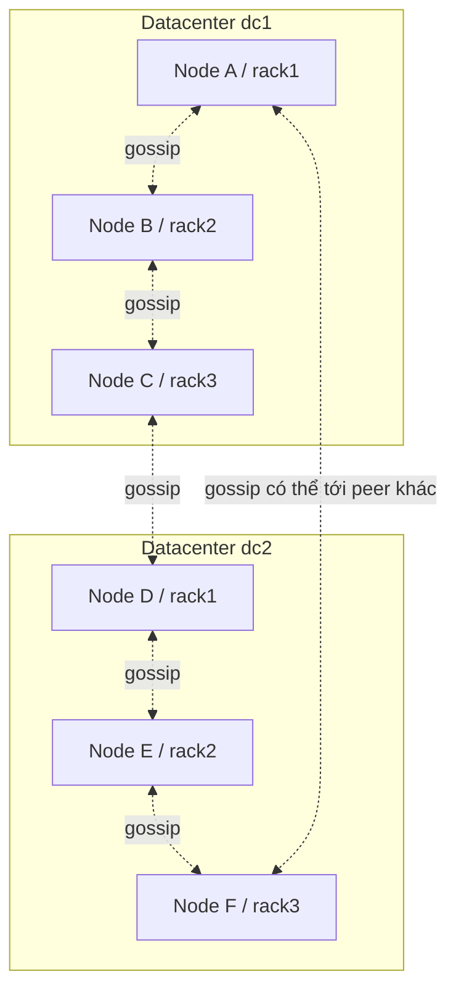
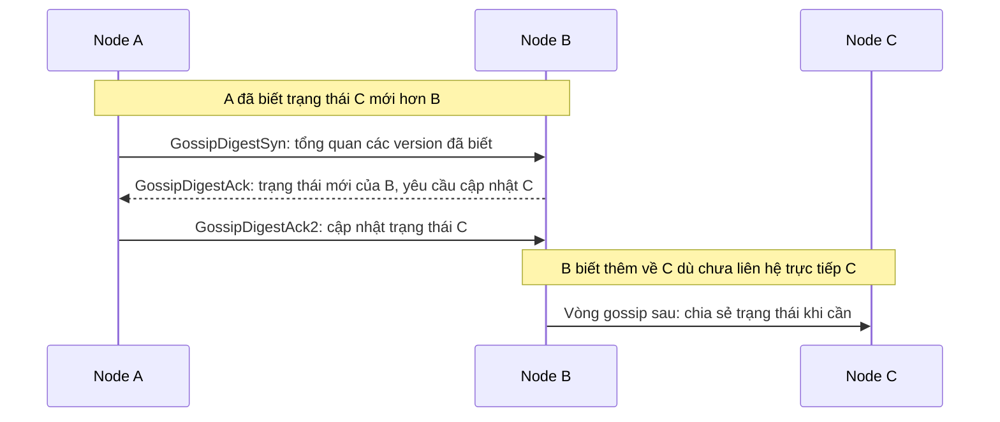
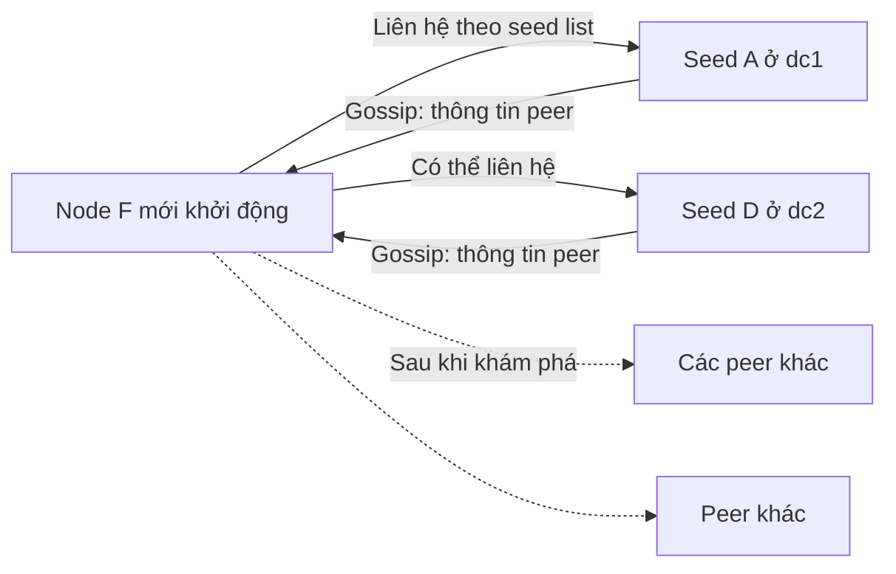
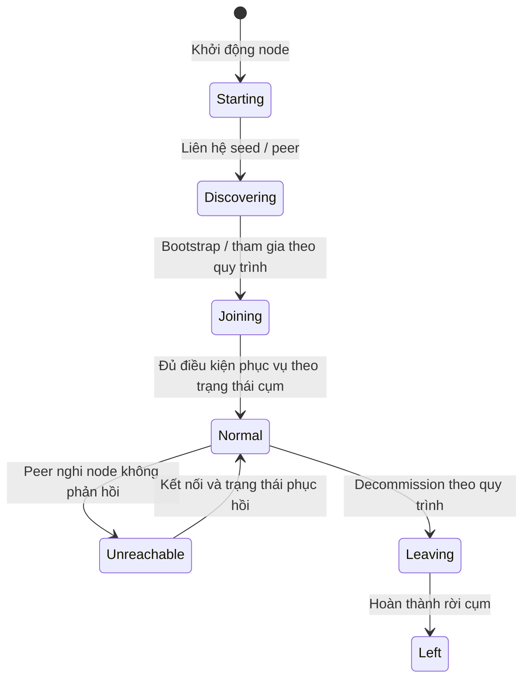
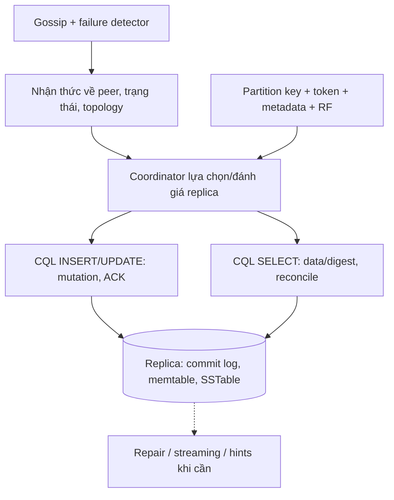

# Gossip và truyền thông tin trạng thái thành viên

Apache Cassandra là cơ sở dữ liệu **wide-column phân tán** sử dụng kiến trúc **peer-to-peer**. Không có một master cố định nắm danh sách thành viên hoặc thông báo cho mọi node khi cụm thay đổi. Thay vào đó, các node trao đổi trạng thái bằng **gossip**: mỗi node định kỳ liên lạc với một số peer để chia sẻ những gì nó biết về các thành viên khác. Thông tin được lan truyền dần qua cụm, giúp các node xây dựng nhận thức chung về topology và trạng thái sống/chết của peer.

Gossip trả lời câu hỏi **“Trong cụm có những node nào và chúng đang được nhìn nhận ra sao?”**. Nó không tự thay thế việc nhân bản dữ liệu, chọn consistency level, sửa bản ghi lệch nhau hay điều hành một transaction. Muốn vận hành Cassandra đúng cách, cần phân biệt giao thức lan truyền trạng thái, **failure detector**, **seed node**, metadata cluster và luồng CQL giữa coordinator với replica.

Sau bài học, bạn có thể:

- Giải thích gossip hoạt động thế nào mà không cần máy chủ điều khiển trung tâm.
- Phân biệt *membership*, *liveness*, *application state*; hiểu heartbeat, generation và version trong thông tin gossip.
- Mô tả vai trò của seed node, snitch, rack/datacenter và failure detector.
- Phân tích trường hợp node khởi động, join, ngừng phản hồi, quay lại hoặc bị cô lập mạng.
- Đọc kết quả `nodetool status`, `nodetool gossipinfo` và biết những giới hạn của mỗi góc nhìn.
- Hiểu tác động của thay đổi membership đến replication, consistency level và client Java Driver.

## 1. Vì sao một cluster cần gossip?

Giả sử cluster có sáu node trải trên hai datacenter:



Đường nối nét đứt minh họa **các cuộc trao đổi có thể xảy ra**, không phải sáu kết nối gossip cố định. Ở mỗi khoảng thời gian, node lựa chọn peer để trao đổi; qua nhiều lượt, trạng thái lan rộng trong cụm.

Tình huống: B khởi động lại, D mất kết nối mạng trong vài phút, F đang được thêm vào cụm. Để định tuyến request đến replica phù hợp, các node cần biết peer nào tồn tại và peer nào có vẻ đang sẵn sàng. Nếu chỉ một node trung tâm giữ danh sách này, node đó dễ trở thành nút thắt hoặc điểm lỗi tập trung. Gossip giúp các peer **tự truyền đạt thông tin** và tiếp tục hoạt động khi một số thành viên ngừng phản hồi.

Gossip có ba đặc tính quan trọng:

1. **Phi tập trung:** không có một “gossip master” hoặc node lãnh đạo chịu trách nhiệm phát lệnh cho toàn cluster.
2. **Lan truyền dần:** mỗi vòng trao đổi chỉ liên hệ một số peer; thông tin có thể đến các node tại các thời điểm khác nhau.
3. **Hội tụ theo thời gian:** khi kết nối ổn định và các node tiếp tục gossip, các bản nhìn về trạng thái có xu hướng hội tụ; tại một thời điểm ngắn, chúng có thể chưa giống nhau.

Điều thứ ba đặc biệt quan trọng: **gossip không phải một transaction đồng bộ ghi toàn cụm**, cũng không có cam kết rằng mọi node đồng thời biết một sự cố hoặc cùng thời điểm tuyên bố một peer là down.

## 2. Membership, liveness và application state là ba lớp thông tin khác nhau

Khi xem đầu ra của `nodetool gossipinfo`, rất dễ gộp tất cả thành “trạng thái node”. Nên tách ba khái niệm:

| Khái niệm | Câu hỏi nó trả lời | Ví dụ |
|---|---|---|
| **Membership** | Những endpoint/node nào được cụm biết đến? | Node A, B, C đã tham gia hoặc đang được biết đến trong cluster. |
| **Liveness** | Peer có đang phản hồi như mong đợi từ góc nhìn node này không? | A nhìn B là UP; A nghi D không còn phản hồi. |
| **Application state** | Peer công bố trạng thái hoặc thuộc tính liên quan đến Cassandra nào? | `DC`, `RACK`, `TOKENS`, `HOST_ID`, trạng thái vòng đời node. |

**Endpoint** thường được hiểu là địa chỉ nhận diện node dùng cho giao tiếp nội bộ Cassandra, trong các phiên bản/cấu hình hiện đại có thể gồm địa chỉ và cổng. Endpoint không đồng nghĩa với địa chỉ CQL `9042` mà ứng dụng Java dùng để truy vấn.

Một node có thể:

- Được biết đến trong membership nhưng tạm thời **không phản hồi**.
- Được đánh giá là sống nhưng đang ở trạng thái **joining** hoặc **leaving**, chưa sẵn sàng phục vụ toàn bộ phần dữ liệu như một node bình thường.
- Vẫn chạy tiến trình Cassandra nhưng không truy cập được qua mạng từ một số peer.
- Trả lời yêu cầu CQL nhưng có một đường liên lạc nội bộ trục trặc, khiến trạng thái giữa các node bất đồng.

Vì vậy, “có tên trong danh sách”, “đang Up” và “sẵn sàng giữ replica theo token” là những điều **khác nhau**.

## 3. Gossip trao đổi trạng thái ra sao?

Trong mô hình gossip thường được trình bày cho Cassandra 3.x/4.x, các cuộc trao đổi gồm ba loại thông điệp logic:

- **GossipDigestSyn:** node gửi bản tóm lược những trạng thái mình đang biết.
- **GossipDigestAck:** peer phản hồi những thông tin mới hơn mà nó có, đồng thời yêu cầu các phần trạng thái còn thiếu/cũ ở phía đối tác.
- **GossipDigestAck2:** node khởi tạo gửi nốt những cập nhật mà peer yêu cầu.

Tên thông điệp là chi tiết giao thức nội bộ, có thể thay đổi hoặc được tối ưu theo phiên bản Cassandra; mục đích cần ghi nhớ là **so sánh phiên bản trạng thái và chỉ trao đổi phần cần thiết**.



Ví dụ, A nhận tin rằng C chuyển từ trạng thái sẵn sàng sang không phản hồi. Khi A gossip với B, B có thể biết thông tin mới đó; B tiếp tục lan đến những peer khác. Không cần A gửi một thông báo trực tiếp tới **từng** node trong cluster ở cùng một thời điểm.

### Điều gì được gửi trong một vòng?

Gossip không có nghĩa là sao chép toàn bộ danh sách trạng thái ở mọi lượt. Phía khởi tạo trao đổi các **digest** nhận diện trạng thái và phiên bản mà mình biết; peer đối chiếu và trao đổi những phần thiếu hoặc đã cũ. Vì vậy, lưu lượng truyền trạng thái được giảm so với cách gửi toàn bộ metadata liên tục cho tất cả node.

Cassandra thường có nhịp gossip ngắn, trong nhiều phiên bản khoảng **một giây mỗi vòng**. Đây là **nhịp xử lý điển hình**, không phải cam kết rằng một thay đổi sẽ được tất cả node biết trong đúng một giây. Độ trễ hội tụ phụ thuộc số node, tải, mạng, lịch gossip và khả năng đáp ứng của peer.

## 4. Heartbeat, generation và version: làm sao biết thông tin nào mới?

Gossip cần phân biệt một trạng thái mới với bản trạng thái cũ được truyền lại qua một peer. Trong cách biểu diễn thông tin trạng thái của Cassandra, ba khái niệm thường gặp là:

| Thành phần | Ý nghĩa | Tại sao cần? |
|---|---|---|
| **Heartbeat** | Thông tin tiến triển định kỳ của trạng thái sống tại endpoint. | Cho biết endpoint có dấu hiệu tiếp tục hoạt động và lan truyền trạng thái. |
| **Generation** | Phân biệt các thế hệ trạng thái của một endpoint, thường gắn với lần khởi động mới. | Tránh để thông tin cũ từ trước lần khởi động lại lấn át trạng thái mới. |
| **Version** | Đánh dấu lần cập nhật của từng phần trạng thái trong một generation. | Giúp peer biết một thuộc tính/ứng dụng nào đã có bản mới hơn và cần truyền lại. |

Hình dung A từng giữ trạng thái của B ở **generation 15, version 30**, sau đó B khởi động lại và phát trạng thái thuộc **generation 16**. Thông tin của B ở generation mới nên được xem là trạng thái phiên hiện tại, dù một peer khác còn giữ version cũ. Những con số này chỉ dùng minh họa; chúng **không** phải địa chỉ node hay số bản ghi của partition.

### Heartbeat không phải một phép ping duy nhất

Tăng heartbeat/cập nhật gossip và thành công của một kết nối mạng không hoàn toàn đồng nghĩa. Node có thể tạm dừng vì GC hoặc quá tải, gói tin mạng có thể chậm/mất, và các peer có thể diễn giải việc thiếu phản hồi khác nhau. **Failure detector** sử dụng lịch sử phản hồi/đến của heartbeat để đưa ra đánh giá trạng thái, chứ không chỉ kiểm tra một lần ping rồi kết luận node đã chết.

### Trạng thái ứng dụng đi kèm

Trong đầu ra gossip tùy phiên bản, bạn có thể gặp các thuộc tính như:

| Thuộc tính thường gặp | Ý nghĩa khái quát |
|---|---|
| `DC`, `RACK` | Thông tin topology mà node công bố. |
| `HOST_ID` | Danh tính logic của node, khác với địa chỉ IP đơn thuần. |
| `TOKENS` | Thông tin liên quan token mà node sở hữu/công bố trong cơ chế metadata tương ứng. |
| `STATUS` hoặc `STATUS_WITH_PORT` | Trạng thái vòng đời của node từ góc nhìn giao thức/phiên bản. |
| `RELEASE_VERSION` | Phiên bản Cassandra mà endpoint công bố. |
| `SCHEMA` | Dấu vết schema metadata ở một số phiên bản/kiến trúc. |

Danh sách khóa và biểu diễn đầu ra **không cố định giữa các phiên bản**. Đặc biệt, Cassandra **5.0** đưa vào **Cluster Metadata Service/TCM** để quản lý các thay đổi metadata cluster có điều phối hơn. Không nên lấy toàn bộ chi tiết truyền schema/topology bằng gossip của một phiên bản cũ áp nguyên xi cho 5.x. Gossip vẫn liên quan đến thông tin sống/chết và trạng thái peer, nhưng cần xem tài liệu phiên bản khi phân tích **ai là nguồn xác thực của thay đổi metadata**.

## 5. Seed node giúp khám phá peer, không phải master

Một node mới hoặc node vừa khởi động cần một số địa chỉ liên hệ ban đầu để khám phá các thành viên khác. Những địa chỉ đó được khai báo qua **seed provider**, và node cung cấp liên hệ ban đầu được gọi là **seed node**.

Ví dụ mô hình bootstrap:



**Seed không phải một vai trò bậc trên**. Seed vẫn là node Cassandra bình thường, có thể là replica, coordinator cho request hoặc gặp sự cố giống các node khác. Nó không bắt buộc giữ mọi partition, không phê duyệt mọi truy vấn và không duy trì một “sổ thành viên trung tâm” theo nghĩa master.

Cần lưu ý:

- Có **nhiều seed phù hợp** để tránh việc node mới phụ thuộc vào một địa chỉ ban đầu; bố trí theo failure domain và DC thực tế.
- Không cần biến **mọi node thành seed**. Một danh sách seed được quản lý có chủ đích dễ vận hành hơn.
- Node đã tham gia cụm và đang liên lạc với peer có thể tiếp tục phục vụ khi một seed down; tuy nhiên **bootstrap, restart và khám phá lại** có thể khó khăn hơn nếu mọi seed có thể liên hệ đều không sẵn sàng.
- Seed list cần chứa endpoint thật, truy cập được qua **mạng internode**. Nhầm địa chỉ NAT, firewall hoặc cổng giữa CQL và internode sẽ gây khó phát hiện.

### Ví dụ cấu hình seed (minh họa)

Trên Cassandra dùng cấu hình `cassandra.yaml` kiểu phổ biến, cấu hình có thể trông như sau:

```yaml
cluster_name: 'telemetry-cluster'

seed_provider:
  - class_name: org.apache.cassandra.locator.SimpleSeedProvider
    parameters:
      - seeds: "192.0.2.11,192.0.2.21"

endpoint_snitch: GossipingPropertyFileSnitch
```

Các địa chỉ thuộc dải `192.0.2.0/24` chỉ dành cho tài liệu; không thể dùng nguyên xi để triển khai. Cú pháp và các tham số cần đối chiếu phiên bản Cassandra đang chạy. Ví dụ **không** thay thế cấu hình `listen_address`, `broadcast_address`, xác thực, mã hóa hoặc các bước bootstrap an toàn.

Đổi seed list cũng **không tự giải quyết việc dữ liệu bị thiếu ở replica**; seed chỉ góp phần khám phá cụm. Khi một node thật sự join để trở thành replica, các bước cập nhật metadata và **streaming dữ liệu** được thực hiện theo quy trình riêng.

## 6. Gossip cung cấp thông tin topology, snitch diễn giải DC/rack

Trong Cassandra, mỗi node có vị trí topology: thuộc một **datacenter** và một **rack**. Với `GossipingPropertyFileSnitch`, thông tin địa phương có thể được cấu hình trong `cassandra-rackdc.properties`:

```properties
# Ví dụ trên node thuộc dc1, rack2
dc=dc1
rack=rack2
```

Snitch cho Cassandra biết vị trí DC/rack; gossip giúp các peer lan truyền thông tin trạng thái có liên quan. Trong một số môi trường khác, topology được xác định bằng snitch hoặc cơ chế cấu hình tương ứng của cloud. Vì vậy, **rack không phải một service gossip độc lập** và một node không tự động biết đúng DC/rack chỉ vì địa chỉ IP có mẫu tương tự.

**NetworkTopologyStrategy** dùng thông tin DC/rack để bố trí replica theo RF của keyspace. Ví dụ:

```sql
CREATE KEYSPACE telemetry
WITH replication = {
  'class': 'NetworkTopologyStrategy',
  'dc1': 3,
  'dc2': 3
};
```

Với topology có đủ rack/node, Cassandra cố gắng phân tán ba bản sao của mỗi partition trên các rack khác nhau **trong từng DC**. Gossip giúp các node có thông tin về peer, nhưng **không tự chọn RF**: RF thuộc định nghĩa keyspace.

Nếu tên DC một node công bố là `dc_1` còn keyspace khai báo `dc1`, đừng kỳ vọng Cassandra tự hiểu chúng giống nhau. Thông tin sai về rack/DC có thể dẫn đến chọn replica không như thiết kế, lỗi về khả năng đạt CL và rủi ro nhiều replica cùng chịu một điểm lỗi vật lý.

**Không đổi nhãn DC/rack của node đang chứa dữ liệu một cách tùy tiện.** Đây là thay đổi có tác động đến cách bố trí replica/metadata và phải tuân thủ quy trình di chuyển topology phù hợp phiên bản.

## 7. Gossip và failure detector: nghi ngờ node lỗi khác với xác nhận node chết

Gossip hỗ trợ lan truyền thông tin, còn **failure detector** đánh giá khả năng một peer đang không đáp ứng. Cassandra sử dụng cơ chế **phi accrual failure detector** ở các phiên bản phổ biến: thay vì đếm số lần ping thất bại cố định, nó nhìn vào lịch sử thời gian giữa các thông tin nhận được để tính mức **nghi ngờ** (phi).

Giải thích trực giác:

- A thường nhận được dấu hiệu tiến triển từ B đều đặn.
- Trong một khoảng thời gian, A không nhận được thông tin mới đúng nhịp.
- Mức nghi ngờ tăng theo thời gian và phân bố lịch sử phản hồi.
- Khi vượt ngưỡng cấu hình, A có thể **convict/đánh dấu B down từ góc nhìn của A** và tránh chọn B cho các thao tác yêu cầu replica sống.

Kết luận “B down” ở đây là **nhận định của node A**, không phải bằng chứng phần cứng B đã tắt. B có thể còn chạy nhưng bị:

- Mất đường mạng tới A.
- Tạm dừng quá lâu do garbage collection, CPU hoặc I/O quá tải.
- Quá tải internode messaging, hàng đợi hoặc luồng xử lý.
- Bị phân vùng mạng, trong khi vẫn liên lạc được với một tập peer khác.

**Không có quy trình bỏ phiếu đa số toàn cụm chỉ để một node bị coi là down trong gossip.** Các peer có thể nhận định khác nhau trước khi thông tin và liên lạc ổn định trở lại.

### Ngưỡng và phản ứng khi mạng chập chờn

Các tham số như `phi_convict_threshold` có thể tác động đến độ nhạy của failure detector ở một số phiên bản. Hạ ngưỡng quá mức có thể khiến node bị đánh dấu down vì độ trễ ngắn; nâng ngưỡng quá cao có thể kéo dài thời gian coordinator tiếp tục liên hệ node không đáp ứng.

Không nên thay đổi ngưỡng như phản xạ đầu tiên khi thấy `DN` trong `nodetool status`. Trước hết cần kiểm tra **mạng, tài nguyên node, GC, cổng internode, đồng hồ, nhật ký và tình trạng thực tế của Cassandra**, sau đó mới đánh giá cấu hình theo khuyến nghị phiên bản.

## 8. Chu kỳ join, restart, leave và các trạng thái vòng đời

Gossip gắn với vòng đời thành viên, nhưng quá trình thay đổi topology còn cần quản lý metadata và dữ liệu. Có thể mô hình hóa ở mức khái quát như sau:



Sơ đồ là **mô hình sư phạm**: tên và chuyển tiếp trạng thái thật có thể thay đổi theo phiên bản, đặc biệt khi sử dụng hệ thống quản lý cluster metadata mới. Trạng thái `Joining` hoặc `Leaving` không có nghĩa node đã được chọn làm replica hoàn chỉnh cho mọi partition trong một bước tức thì.

### Node mới join cần nhiều hơn gossip

Khi thêm node F, nó phải:

1. Khởi động với danh tính, networking, DC/rack và seed phù hợp.
2. Khám phá các peer và xác thực thông tin cluster.
3. Tham gia quy trình thay đổi topology/metadata.
4. Nhận các vùng dữ liệu cần chịu trách nhiệm thông qua **streaming** hoặc cơ chế bootstrap tương ứng.
5. Chuyển sang trạng thái bình thường khi điều kiện thích hợp được đáp ứng.

Gossip có thể giúp node khác biết F đang tham gia, nhưng **không có nghĩa mọi partition đã được chuyển tới F ngay khi peer thấy tên F**. Tương tự, việc decommission node phải di chuyển/điều chỉnh trách nhiệm replica theo quy trình, không đơn giản là tắt tiến trình rồi chờ gossip thông báo.

### Node khởi động lại có được coi là một node hoàn toàn mới?

Một node restart bình thường giữ danh tính, dữ liệu và metadata phù hợp. Generation mới giúp phân biệt trạng thái mới khỏi những thông tin cũ còn lưu trong các peer. Nếu thay IP, thay host ID, mất dữ liệu hoặc phải replace một node hỏng, cần dùng **quy trình thay thế/khôi phục** thích hợp; không tùy tiện sao chép dữ liệu/cấu hình node sang một instance khác rồi khởi động song song.

## 9. Gossip ảnh hưởng đến đọc/ghi, nhưng không chuyển dữ liệu nghiệp vụ

Đặt gossip vào toàn bộ kiến trúc:



Gossip cung cấp một phần **thông tin phục vụ quyết định**, không mang các hàng dữ liệu ứng dụng như một giao thức replication. Khi ứng dụng viết mutation cho partition P, coordinator phân phối yêu cầu đến **replica có trách nhiệm** theo token, replication strategy và trạng thái cụm. Khi đọc, coordinator thu dữ liệu/digest theo CL; việc hợp nhất phiên bản hoặc read repair là công việc riêng.

| Cơ chế | Nội dung điển hình | Mục đích |
|---|---|---|
| **Gossip** | Trạng thái và thông tin thành viên/endpoint. | Lan truyền nhận thức về peer và liveness. |
| **CQL request / internode messaging** | Lệnh truy vấn, mutation, ACK, dữ liệu/digest. | Phục vụ đọc/ghi theo yêu cầu ứng dụng. |
| **Streaming** | Dữ liệu để bootstrap, thay đổi topology hoặc vận hành tương ứng. | Chuyển trách nhiệm/bản sao dữ liệu giữa node. |
| **Hinted handoff** | Mutation bị replica bỏ lỡ trong điều kiện cho phép. | Hỗ trợ phát lại một số ghi sau khi replica phục hồi. |
| **Anti-entropy repair** | Thông tin đối chiếu và dữ liệu cần đồng bộ giữa replica. | Giảm chênh lệch dữ liệu giữa các replica. |
| **Compaction** | Đọc/ghi lại SSTable trên một node. | Tổ chức lưu trữ cục bộ; không phải lan truyền membership. |

**Gossip không tự bảo đảm dữ liệu của mọi replica đã nhất quán.** Node B có thể được A nhìn nhận là `UP` nhưng vẫn thiếu một mutation do ngắt mạng trước đó. Tình trạng hội tụ dữ liệu cần được đánh giá bằng CL, hint, repair, tracing và dấu hiệu liên quan.

## 10. Ví dụ: node D down có làm request thất bại không?

Giả sử keyspace `telemetry` có `RF_dc1 = 3`, với ba replica của partition P là A, B, C ở ba rack khác nhau trong `dc1`. Một ứng dụng Java gửi request với `LOCAL_QUORUM`, tức cần **hai phản hồi phù hợp** của `dc1`.

| Sự kiện | Nhận thức gossip/failure detector | Hệ quả có thể xảy ra |
|---|---|---|
| C mất kết nối nhưng A và B vẫn sống | Các peer dần nhận định C không đáp ứng. | Đọc/ghi `LOCAL_QUORUM` vẫn có thể thành công nhờ A và B. |
| C ngừng phản hồi ngay trước khi bị đánh dấu down | Membership/liveness có thể chưa cập nhật ở tất cả coordinator. | Một số request thử C rồi timeout; các request khác vẫn đủ ACK tùy đường đi. |
| B và C đều không liên lạc được | Dần có ít hơn hai replica có thể đáp ứng tại DC. | `LOCAL_QUORUM` không thể thành công nếu chỉ còn A khả dụng. |
| C trở lại sau nhiều giờ | Gossip có thể lại cho thấy C là `UP`. | C vẫn có thể cần nhận hint/repair để bắt kịp dữ liệu đã bỏ lỡ. |
| Một seed S down nhưng A, B, C liên lạc được | Seed không làm master, các peer vẫn có trạng thái đã biết. | Cụm có thể tiếp tục phục vụ; node mới cần seed/đường khám phá khác. |

Nếu DC có nhiều rack và RF = 3 nhưng **ba replica của P vô tình cùng một failure domain** do topology được khai báo sai, hỏng một switch có thể làm mất cả ba cùng lúc. Cấu hình rack đúng rất quan trọng; gossip chỉ lan truyền thông tin đã được các node khai báo, không thể tự sửa mọi sai sót hạ tầng.

### Network partition gây bất đồng nhận thức

Giả sử ba replica trong `dc1` bị chia thành hai phía mạng: {A, B} và {C}. Khi không liên lạc được, mỗi phía có thể đánh giá peer phía kia là down. Điều kiện `LOCAL_QUORUM` (2/3) chỉ có thể đạt ở phía có hai replica **nếu coordinator ở đó có đường liên lạc đến cả A và B**.

Node C vẫn chạy không làm một yêu cầu quorum từ phía C tự thành công. Mặt khác, request dùng `LOCAL_ONE` có thể được phục vụ ở một số vị trí tùy replica và đường mạng, với đánh đổi về tính nhất quán. Đây là tác động của **RF và CL**, không phải vì gossip “bỏ phiếu quyết định dữ liệu nào đúng”.

## 11. Gossip liên quan thế nào đến Java Driver?

Ứng dụng Java nói chuyện với Cassandra bằng **giao thức native CQL**, thường qua cổng `9042`. Nó **không tham gia gossip giữa các node**. Driver khám phá node và topology thông qua metadata/protocol của cluster, rồi duy trì nhận thức client của riêng mình để chọn coordinator.

Trong Apache Cassandra Java Driver 4.x, có thể xem metadata mà driver đã khám phá:

```java
import com.datastax.oss.driver.api.core.CqlSession;
import com.datastax.oss.driver.api.core.metadata.Node;

import java.net.InetSocketAddress;

public class InspectCassandraTopology {
    public static void main(String[] args) {
        // Thay các IP tài liệu và tên DC bằng giá trị thực tế.
        try (CqlSession session = CqlSession.builder()
                .addContactPoint(new InetSocketAddress("192.0.2.11", 9042))
                .addContactPoint(new InetSocketAddress("192.0.2.12", 9042))
                .withLocalDatacenter("dc1")
                .build()) {

            for (Node node : session.getMetadata().getNodes().values()) {
                System.out.printf(
                    "endpoint=%s dc=%s rack=%s%n",
                    node.getEndPoint(),
                    node.getDatacenter(),
                    node.getRack()
                );
            }
        }
    }
}
```

`192.0.2.11` và `192.0.2.12` là địa chỉ trong dải dành cho tài liệu; ví dụ chỉ chạy được khi thay bằng endpoint thật. Cần cấu hình `localDatacenter` đúng với tên DC mà cluster công bố.

Metadata mà driver nhìn thấy **có thể cập nhật bất đồng bộ**, nên đừng coi một lần gọi `getMetadata()` là ảnh chụp tuyệt đối đồng bộ với trạng thái tại mọi replica. Driver có cơ chế theo dõi metadata và trạng thái kết nối để điều chỉnh định tuyến. Một node có thể đang bị loại khỏi kế hoạch cân bằng tải của client vì sự cố CQL trong khi vài peer Cassandra vẫn cho rằng node đó sống qua internode gossip.

### Contact point, seed và coordinator không phải cùng một khái niệm

| Đối tượng | Ai sử dụng? | Vai trò |
|---|---|---|
| **Contact point** | Java Driver và các CQL client. | Điểm kết nối ban đầu để khởi tạo phiên và khám phá cluster. |
| **Seed** | Cassandra node khi khởi động/join. | Điểm liên hệ ban đầu để khám phá peer qua cơ chế cluster/gossip. |
| **Coordinator** | Một node Cassandra đang nhận **một CQL request**. | Định tuyến đến replica, thu phản hồi theo CL và trả kết quả client. |
| **Replica** | Các node Cassandra lưu partition theo metadata/RF. | Thực sự phục vụ đọc hoặc lưu mutation. |

Không cần dùng seed làm contact point duy nhất. Chọn contact point dựa trên khả năng truy cập native CQL và tính sẵn sàng; chọn seed dựa trên hạ tầng giao tiếp **giữa các node**.

## 12. Quan sát gossip và membership bằng lệnh vận hành

Trên **cluster thử nghiệm** đã có các node Cassandra, các lệnh sau giúp quan sát topology và trạng thái:

```bash
nodetool status
nodetool gossipinfo
nodetool describecluster
```

### `nodetool status`

Lệnh này nhóm node theo DC/rack và thường hiển thị:

- `UN`: **Up / Normal** — node được xem là sống và đang ở trạng thái normal từ góc nhìn kết quả.
- `DN`: **Down / Normal** — node không được xem là sống, dù trạng thái vòng đời còn là normal.
- Các trạng thái khác như joining, leaving, moving có thể hiển thị tùy thời điểm/phiên bản.

Hai chữ cái mô tả **liveness + trạng thái vòng đời**, không phải bản kiểm tra toàn bộ sức khỏe dữ liệu. Một node `UN` vẫn có thể chậm, đầy ổ, tồn đọng compaction hoặc chứa replica chưa repair.

### `nodetool gossipinfo`

`nodetool gossipinfo` cho thấy **trạng thái gossip mà node được truy vấn đang biết** về các endpoint. Dạng đầu ra khác nhau giữa phiên bản, nhưng có thể chứa heartbeat generation/version, DC/rack, host ID, release version hoặc status.

Khi phân tích, hãy quan sát:

1. **Endpoint** nào đang được biết tới?
2. Có **generation/version** mới sau khi một node khởi động lại không?
3. **DC/RACK** có khớp topology mong đợi không?
4. Một số endpoint có bị đánh giá unreachable/down không?
5. Hai node khác nhau có **góc nhìn khác nhau** trong giai đoạn sự cố không?

**Đọc kết quả từ một node không có nghĩa đó là sự thật chung tại mọi node.** Khi nghi cluster bị phân vùng mạng, chạy lệnh từ các node ở hai phía kết nối (qua quy trình truy cập vận hành được cấp phép) để so sánh góc nhìn.

### `nodetool describecluster` và bảng hệ thống

Lệnh này hiển thị thông tin tổng quan cluster và schema/metadata tùy phiên bản. Có thể đối chiếu thông tin tại node hiện tại bằng `cqlsh`:

```sql
SELECT cluster_name, data_center, rack, host_id
FROM system.local;
```

`system.local` phản ánh **node đang nhận truy vấn CQL**; không phải bảng liệt kê mọi thành viên. Đối với các phiên bản hỗ trợ `system.peers_v2`, có thể xem thêm metadata peer:

```sql
-- Khả dụng tùy phiên bản; dùng để quan sát, không chỉnh sửa.
SELECT * FROM system.peers_v2;
```

Không tự sửa các bảng hệ thống để “ép” gossip hoặc membership theo mong muốn. Khi thông tin không phù hợp, hãy tìm nguyên nhân và dùng quy trình vận hành topology/metadata chính thức.

## 13. Mạng và cấu hình: vì sao gossip không đến được peer?

Một cụm Cassandra có **ít nhất hai loại kết nối dễ bị nhầm**:

- **Native CQL** từ ứng dụng/driver đến node, cổng thường gặp `9042`.
- **Internode messaging/gossip** giữa các node Cassandra. Cổng thường gặp là `7000` (không mã hóa) hoặc cổng mã hóa tương ứng như `7001` trong một số cấu hình/phiên bản.

Đây là các giá trị **điển hình**, có thể được tùy chỉnh. Một máy có thể mở CQL `9042` nhưng đường internode bị chặn; client kết nối được chưa chứng minh node tham gia gossip khỏe mạnh.

Cần kiểm tra các vấn đề cụ thể:

| Dấu hiệu | Nguyên nhân có thể | Hướng xác minh |
|---|---|---|
| Node mới không khám phá được peer | Seed list sai/không truy cập được, địa chỉ internode sai. | Kiểm tra `seed_provider`, `listen_address`, `broadcast_address`, DNS và đường mạng thực. |
| Node lúc `UN` lúc `DN` | GC pause dài, CPU/I/O quá tải, packet loss hoặc firewall chập chờn. | Đối chiếu thời điểm chuyển trạng thái với log, metrics và mạng. |
| Các node báo DC/rack khác nhau ngoài dự kiến | Snitch hoặc cấu hình topology không nhất quán. | Kiểm tra `GossipingPropertyFileSnitch`, `cassandra-rackdc.properties` và output gossip. |
| Java Driver thấy node, nhưng truy vấn thường timeout | Node sống ở mức membership nhưng lưu trữ/mạng/replica/CL quá chậm. | Kiểm tra trace CQL, metrics, RF, CL và tài nguyên replica. |
| Node restart nhưng peer chưa đồng ý trạng thái | Gossip chưa hội tụ, networking lỗi hoặc trạng thái bootstrap/metadata đang tiến hành. | So sánh `gossipinfo` ở nhiều node và nhật ký bootstrap. |
| Mất một DC, DC còn lại vẫn hoạt động nhưng failover khó | Không phải mọi keyspace đều có RF ở DC còn lại, routing ứng dụng chưa chuyển hoặc bản sao chưa hội tụ. | Kiểm tra RF theo DC, CL, thời điểm ghi và kế hoạch DR. |

### “Chờ gossip hội tụ” có đủ để sửa lỗi không?

Chỉ khi nguyên nhân là **độ trễ lan truyền trạng thái ngắn hạn** và mạng vẫn khỏe. Nếu node mất kết nối, địa chỉ internode sai, hàng đợi nghẽn hoặc metadata thay đổi lỗi, chờ thêm không giải quyết gốc rễ. Cũng không thể suy ra khi gossip hội tụ thì **dữ liệu nghiệp vụ đã repair**.

### Các thao tác nguy hiểm không nên dùng làm bước đầu

Lệnh quản trị tác động membership/topology như **force remove, assassinate, replace, decommission** có hậu quả vượt xa việc xem trạng thái. Khi node down, đừng dùng chúng chỉ để làm `nodetool status` trông đẹp hơn. Cần xác định node còn dữ liệu gì, replication factor, trạng thái bootstrap/streaming, khả năng khôi phục và tài liệu chính xác của phiên bản.

## 14. Tình huống tự luyện: đọc đúng một sự cố gossip

**Bối cảnh:** Cluster gồm `dc1` (A, B, C) và `dc2` (D, E, F); mỗi DC ba rack. Keyspace `telemetry` có RF = 3 trong mỗi DC. Ứng dụng Java nằm ở `dc1`, sử dụng `LOCAL_QUORUM`.

### Tình huống A — Seed A down, còn B và C đang hoạt động

Một người nhận định “A là master nên cluster dừng ghi”. Điều này đúng không?

**Không.** Seed không phải master. Nếu hai replica cần thiết của partition trong `dc1` còn có thể phục vụ, request `LOCAL_QUORUM` vẫn có thể thành công. Tuy nhiên, các node mới khởi động/join có thể cần seed khác để khám phá cụm.

### Tình huống B — C ngừng phản hồi gossip trong 20 giây

Một số peer đánh dấu C down, nhưng C vẫn có tiến trình Cassandra. Có mâu thuẫn không?

**Không.** Failure detector đưa ra nhận định về khả năng liên lạc; node còn chạy không đồng nghĩa node có thể trao đổi thông điệp đúng hạn. Kiểm tra mạng, GC, tài nguyên và góc nhìn của các peer trước khi quyết định xử lý.

### Tình huống C — `nodetool gossipinfo` ở B và E khác nhau

Điều này có luôn cho thấy dữ liệu Cassandra bị hỏng không?

**Không.** Trạng thái gossip lan truyền dần, và sự khác nhau ngắn hạn có thể xảy ra. Nếu khác biệt kéo dài, cần điều tra mất kết nối hoặc điều kiện lỗi. **Dữ liệu replica lệch nhau** là vấn đề khác, cần đánh giá bằng CL/repair và thông tin nghiệp vụ.

### Tình huống D — B restart, generation mới xuất hiện

Generation mới có nghĩa dữ liệu của B chắc chắn đã bị xóa?

**Không.** Generation thường giúp phân biệt trạng thái heartbeat giữa các lần khởi động. Dữ liệu có thể vẫn ở các SSTable/commit log và được khôi phục theo cơ chế lưu trữ. Tình trạng dữ liệu phải được xác minh riêng.

### Tình huống E — Liên kết `dc1`–`dc2` bị cắt

Một client `dc1` vẫn ghi `LOCAL_QUORUM` thành công. Có thể kết luận tất cả replica `dc2` đã cập nhật không?

**Không.** `LOCAL_QUORUM` chỉ cần quorum trong DC coordinator; cập nhật cross-DC có thể còn thiếu. Khi mạng trở lại, cần quan sát replication/hint và thực hiện repair theo quy trình để đánh giá độ hội tụ.

### Tình huống F — Thêm F mới, đã thấy tên trong gossip

F có thể lập tức thay thế replica của mọi partition sau khi được phát hiện không?

**Không.** Membership discovery chỉ là một phần. Bootstrap, metadata/topology và **streaming dữ liệu** phải hoàn tất theo cơ chế của phiên bản trước khi có thể kết luận F đã sẵn sàng với trách nhiệm replica mới.

## 15. Quy trình kiểm tra nhanh khi một node bị báo down

Khi gặp cảnh báo membership trên cluster đang phục vụ nghiệp vụ, có thể sử dụng chuỗi câu hỏi sau:

1. **Có đúng node/địa chỉ không?** So khớp endpoint, host ID, DC/rack và danh tính instance.
2. **Ai nhìn thấy down?** So sánh `nodetool status` và `nodetool gossipinfo` tại các peer đại diện; một góc nhìn không tương đương đồng thuận toàn cụm.
3. **Đường internode có thông không?** Kiểm tra kết nối địa chỉ/cổng, firewall, DNS/NAT, mạng giữa DC và sự kiện gián đoạn.
4. **Node bị treo hay quá tải?** Xem tiến trình, log Cassandra, GC, CPU, I/O, hàng đợi messaging và dung lượng đĩa.
5. **Node có đang join/leave/restart?** Đối chiếu metadata và các tác vụ streaming/topology theo phiên bản.
6. **Replica nào bị ảnh hưởng?** Dựa vào partition key, token, RF/DC, rack và CL để xác định khả năng đọc/ghi còn lại.
7. **Dữ liệu có thể thiếu không?** Kiểm tra giai đoạn mất kết nối, các mutation được ACK ở CL nào, hint/repair và kế hoạch khôi phục.

Tránh suy diễn từ một chỉ số duy nhất: node `UN` không bảo đảm dữ liệu đúng, node `DN` không chứng minh máy đã tắt, và seed down không chứng minh cluster mất master.

## 16. Tổng kết mô hình tư duy

Gossip là cách Cassandra **lan truyền nhận thức về thành viên**, chứ không phải giao thức di chuyển dữ liệu nghiệp vụ. Một node biết đến peer qua seed và các vòng gossip; trao đổi digest/state cùng heartbeat, generation, version để so sánh thông tin mới/cũ; failure detector dùng dấu hiệu thiếu phản hồi để đánh giá liveness; snitch cung cấp thông tin DC/rack phục vụ metadata/topology và bố trí replica. Trên nền đó, coordinator mới xử lý từng request CQL theo partition key, RF và CL.

```text
Seed / peer discovery
         |
         v
Gossip: SYNC trạng thái thành viên (heartbeat, generation, version)
         |
         +--> DC, rack và application state theo phiên bản
         |
         +--> Failure detector: đánh giá UP/DOWN từ góc nhìn peer
         |
         v
Nhận thức membership/topology của node
         |
         v
Coordinator + metadata/token/RF + consistency level
         |
         +--> Đọc/ghi với các replica phù hợp
         |
         +--> Streaming / hints / repair khi cần đồng bộ dữ liệu
```

Hiểu đúng sự phân vai này giúp phân tích **thời điểm phát hiện lỗi, chênh lệch góc nhìn thành viên, bootstrap/restart, đọc ghi khi mạng phân vùng và trạng thái replica sau khi hồi phục**. Trong Cassandra, một hệ thống phân tán có thể tiếp tục phục vụ dù một số peer chưa đồng ý ngay lập tức về trạng thái; điều cần kiểm chứng đối với mỗi request vẫn là **tập replica thực sự truy cập được, mức nhất quán được yêu cầu và dữ liệu đã hội tụ tới đâu**.
