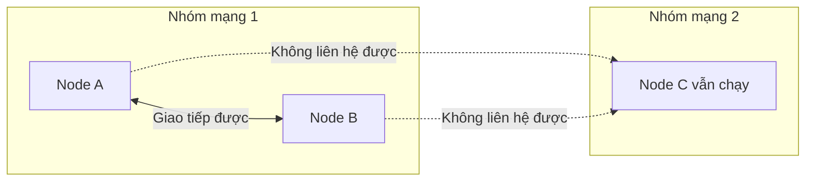
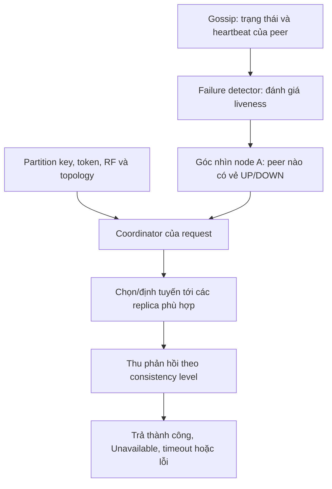
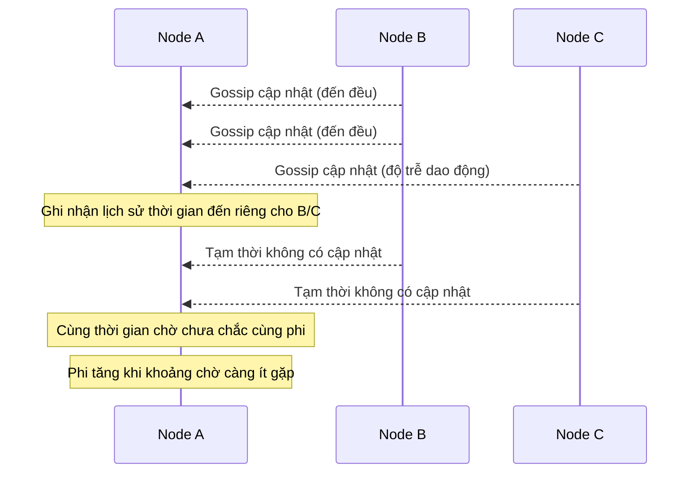
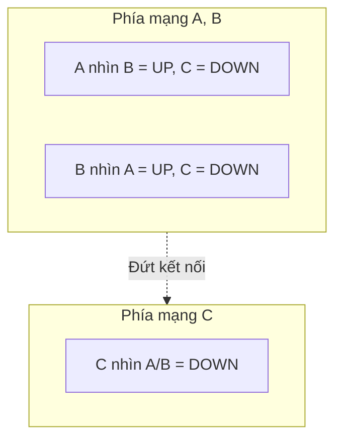
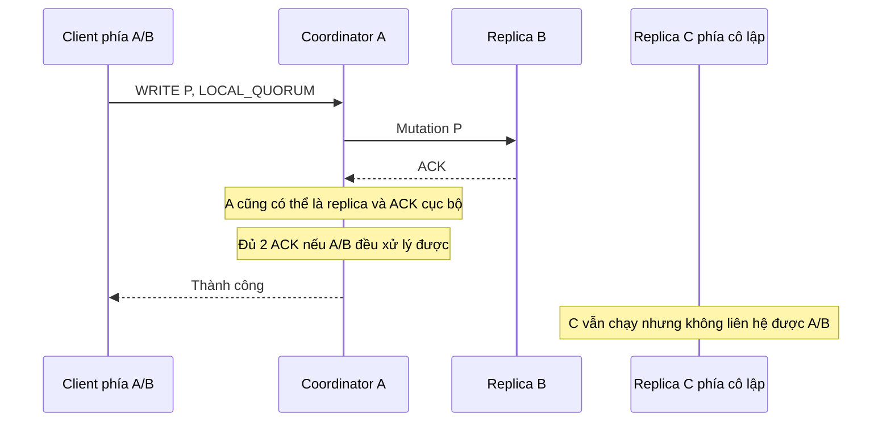
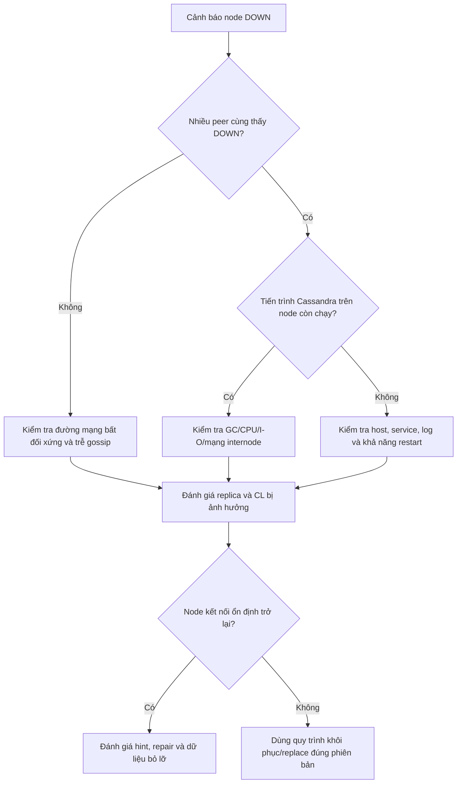

# Failure detector và giới hạn suy luận một nút đã ngừng hoạt động

Trong Apache Cassandra, một node không phản hồi đúng lúc **không nhất thiết đã chết**. Nó có thể đang bị tạm dừng do garbage collection, quá tải I/O, mất đường mạng tới một vài peer hoặc đang khởi động lại. Tuy nhiên, các node khác không thể chờ vô hạn để biết chắc điều gì đã xảy ra: chúng phải quyết định có tiếp tục gửi yêu cầu đọc/ghi tới node đó hay không. **Failure detector** (bộ phát hiện lỗi) là cơ chế giúp Cassandra đưa ra quyết định vận hành dựa trên dấu hiệu liên lạc giữa các node.

Failure detector của Cassandra thường được gọi là **phi accrual failure detector**. Thay vì chứng minh rằng một máy đã ngừng hoạt động, nó đánh giá **mức độ đáng nghi** khi các thông tin sống từ peer không đến đúng nhịp đã quan sát. Kết quả có thể được sử dụng để coi một node là `UP` hoặc `DOWN` từ góc nhìn của node đang đánh giá.

Bài này thuộc phần **Kiến trúc cụm** của module Cassandra, kết nối kiến thức peer-to-peer, gossip, partition key, replica, replication factor (RF), consistency level (CL) và xử lý lỗi trong ứng dụng Java.

Sau bài học, bạn có thể:

- Giải thích vì sao không thể suy ra chắc chắn một node “đã chết” chỉ từ timeout.
- Trình bày vai trò của gossip, heartbeat, lịch sử khoảng cách giữa các lần nhận thông tin và ngưỡng phi.
- Phân biệt **liveness**, **membership**, trạng thái vòng đời của node và khả năng phục vụ **một request cụ thể**.
- Dự đoán ảnh hưởng của một node bị đánh dấu `DOWN` đến `ONE`, `LOCAL_QUORUM`, `QUORUM` và khả năng đọc/ghi.
- Phân tích false positive, false negative, network partition, GC pause và sự khác biệt góc nhìn giữa các node.
- Dùng `nodetool`, CQL và Java Driver để quan sát, phân loại sự cố trước khi thực hiện thay đổi topology.

## 1. “Node down” là một nhận định, không phải chứng cứ vật lý

Giả sử cluster có ba replica A, B, C của partition P. Trong một thời gian, A không nhận được gossip hoặc phản hồi nội bộ đúng nhịp từ C. Có ít nhất bốn khả năng:

1. **C thực sự tắt máy hoặc tiến trình Cassandra đã dừng.**
2. **C vẫn chạy** nhưng bị tạm dừng dài do JVM garbage collection hoặc CPU bị chiếm dụng.
3. **Mạng A–C bị ngắt**, trong khi B vẫn liên hệ được C.
4. **Đường liên lạc nghẽn**, khiến các thông điệp đến trễ vượt kỳ vọng.

Từ riêng quan sát “A không nhận phản hồi từ C”, A **không thể phân biệt chắc chắn** bốn trường hợp. Nếu cứ đợi bằng chứng tuyệt đối, hệ thống có thể ngừng trả lời các request. Vì vậy Cassandra sử dụng bộ phát hiện lỗi để đánh giá rủi ro và nhanh chóng chọn cách định tuyến khả thi.

Điều cần nhớ: trạng thái `DOWN` là **kết luận vận hành theo thông tin quan sát tại một thời điểm và một vị trí**, không phải kết luận giám định phần cứng.

### Một ví dụ mạng phân vùng



A và B có thể nghi C `DOWN`, trong khi C vẫn xử lý công việc cục bộ và có thể nghi A/B `DOWN`. Hai phía không thể cùng lúc nhìn thấy đầy đủ thực tế mạng. Failure detector phải đưa ra đánh giá từ **góc nhìn cục bộ**, chứ không thể đóng vai trò một “người quan sát toàn năng” của cluster.

## 2. Failure detector nằm ở đâu trong kiến trúc Cassandra?

Cassandra có kiến trúc **peer-to-peer**: không có master toàn cụm phụ trách kiểm tra sự sống của mọi máy. Mỗi node giữ thông tin về các peer, nhận cập nhật trạng thái qua gossip và đưa ra nhận định về khả năng phản hồi.

Để không trộn lẫn chức năng, hãy phân biệt:

| Thành phần | Chức năng | Không đồng nghĩa với |
|---|---|---|
| **Gossip** | Lan truyền thông tin thành viên và các trạng thái peer qua những cuộc trao đổi định kỳ. | Cơ chế nhân bản toàn bộ dữ liệu bảng. |
| **Failure detector** | Đánh giá mức độ nghi ngờ một peer không còn phản hồi dựa trên lịch sử liên lạc. | Bằng chứng máy đã hỏng hoặc bộ lưu trữ đã mất dữ liệu. |
| **Membership / topology metadata** | Cho biết các node được biết đến, danh tính và trách nhiệm liên quan đến token/DC/rack. | Trạng thái `UP` không có nghĩa mọi partition đã được đồng bộ. |
| **Coordinator** | Điều phối từng request CQL, định vị replica và đợi phản hồi theo CL. | Master cố định của cluster hoặc của một bảng. |
| **Replica** | Node lưu bản sao của một partition theo RF và chiến lược replication. | Bất kỳ node nào đang `UP` đều là replica của mọi partition. |
| **Java Driver** | Quản lý kết nối CQL, topology nhìn từ client và chọn node để gửi request. | Thành viên trực tiếp của giao thức internode gossip. |

Khi gossip/failure detector đánh dấu C không phản hồi, coordinator có thể tránh gửi request tới C hoặc kết luận chưa đủ replica khả dụng cho CL. Nhưng **tập replica tự nhiên của partition** vẫn do partition key, token và replication strategy quyết định; đánh dấu `DOWN` không làm một node bất kỳ khác lập tức sở hữu bản sao mới.



## 3. Gossip cung cấp những dấu hiệu gì cho failure detector?

Trong các phiên bản Cassandra phổ biến, gossip trao đổi thông tin trạng thái giữa peer theo các vòng ngắn. Các trạng thái có **heartbeat** và thông tin về **generation/version**, giúp phát hiện tiến triển mới và phân biệt trạng thái cũ với trạng thái mới sau restart.

- **Heartbeat:** thay đổi theo tiến trình hoạt động của node, tạo ra dấu hiệu rằng endpoint vẫn đang cập nhật trạng thái.
- **Generation:** phân biệt thế hệ trạng thái của cùng endpoint, thường liên quan tới lần khởi động mới.
- **Version:** giúp so sánh bản cập nhật mới/cũ của phần thông tin trạng thái trong một generation.
- **Gossip state:** có thể gồm thông tin DC, rack, host ID, trạng thái vòng đời và các thuộc tính khác tùy phiên bản.

Khi A nhận được cập nhật liên quan đến C, A có thể biết C vẫn đang tiến triển. Thông tin có thể đến **trực tiếp từ C hoặc qua một peer khác**; việc trao đổi gossip không đòi A phải kết nối tới mọi node trong mỗi lượt.

### Nhịp gossip không phải hạn chót liveness

Nhiều phiên bản Cassandra có vòng gossip điển hình khoảng một giây, nhưng **không có quy tắc rằng “im lặng hơn một giây thì down”**. Phản hồi qua mạng, thời gian thực thi và tần suất truyền trạng thái có dao động. Failure detector sử dụng **lịch sử thời gian đến** để ước lượng mức độ bất thường khi một cập nhật bị trễ.

Đừng trộn **heartbeat gossip** với ACK của một lệnh `INSERT` hoặc `SELECT`: hai loại thông điệp có mục đích khác nhau. Node có thể còn được nhìn nhận là `UP` qua gossip nhưng truy vấn dữ liệu quá chậm và vượt timeout; cũng có thể client CQL kết nối được tới một node nhưng đường internode của nó đang gặp lỗi.

## 4. Phi accrual failure detector là gì?

Các cơ chế timeout cố định thường hoạt động như sau: “Không thấy phản hồi trong X giây thì coi node down”. Cách này khó thích nghi với độ trễ khác nhau giữa các mạng hoặc giai đoạn hệ thống quá tải.

**Phi accrual failure detector** hướng tới một thước đo liên tục: thời gian im lặng hiện tại **bất thường đến đâu so với lịch sử nhận cập nhật từ peer đó?** Giá trị phi thường được trình bày dưới dạng:

\[
\phi(t) = -\log_{10}\left(P(T > t)\right)
\]

Trong đó:

- \(T\) là khoảng thời gian giữa các dấu hiệu nhận được theo mô hình thống kê đang sử dụng.
- \(t\) là khoảng thời gian đã trôi qua từ dấu hiệu mới nhất.
- \(P(T > t)\) là xác suất mô hình dự đoán khoảng chờ có thể còn dài hơn \(t\).
- \(\phi(t)\) càng cao thì thời gian không nhận cập nhật **càng bất thường** trong mô hình.

Đây là **cách diễn giải khái niệm**; công thức, ước lượng phân bố và cách xử lý mẫu/giới hạn nội bộ phụ thuộc triển khai và phiên bản Cassandra. Không dùng công thức này để tự thay thế giá trị/thuật toán trong Cassandra mà chưa đối chiếu bản đang vận hành.

### Cách hiểu giá trị phi

Trong mô hình lý tưởng ở trên:

| Giá trị phi | Xác suất phần đuôi mô hình \(P(T > t)\) | Cách diễn giải |
|---:|---:|---|
| 1 | \(10^{-1}\) | Khoảng chờ đã quan sát tương đối bất thường. |
| 2 | \(10^{-2}\) | Khoảng chờ ít gặp hơn dưới mô hình. |
| 4 | \(10^{-4}\) | Mức nghi ngờ cao hơn đáng kể. |
| 8 | \(10^{-8}\) | Mức nghi ngờ rất cao trong mô hình đang ước lượng. |

**Không** được suy ra “phi = 8 tức 99,999999% node đã chết” theo nghĩa xác suất sự kiện máy chết ngoài đời thực. Đây là xác suất của **khoảng chờ dưới mô hình**, không phải xác suất hậu nghiệm rằng máy đã tắt. Nếu mạng, tải hoặc mẫu thống kê thay đổi đột ngột, kết quả có thể đánh giá sai.

### Ngưỡng `phi_convict_threshold`

Trong những phiên bản dùng tham số `phi_convict_threshold`, Cassandra so sánh mức nghi ngờ với ngưỡng để quyết định có **convict** (đánh dấu một peer không phản hồi) hay không. Phi **không phải phép đếm số lần ping thất bại** và ngưỡng phi **không quy đổi cố định thành N giây**.

- Ngưỡng **quá thấp** có thể tăng false positive khi mạng/GC không ổn định.
- Ngưỡng **quá cao** có thể trì hoãn phát hiện peer thực sự không đáp ứng, khiến request tiếp tục thử node hỏng lâu hơn.
- Giá trị và ý nghĩa chính xác cần được kiểm chứng theo phiên bản, cấu hình và telemetry thực tế.

Không nên thay đổi ngưỡng chỉ vì một lần thấy `DN` trên `nodetool status`. Cần xác định nguyên nhân mạng, JVM, I/O và các sự kiện liên quan trước.

## 5. Minh họa về khoảng chờ và hai kiểu mạng

Hãy hình dung hai cặp peer có lịch sử nhận cập nhật khác nhau:

- **Mạng ổn định:** các khoảng chờ thường tập trung gần một mức thấp, độ dao động nhỏ.
- **Mạng nhiễu:** các khoảng chờ biến động nhiều do tải, jitter hoặc đường liên vùng.

Nếu cả hai đang im lặng cùng một khoảng thời gian, mức phi có thể **khác nhau**, vì “bất thường” được đánh giá so với lịch sử từng peer.



Không cần tính phi bằng tay khi vận hành. Mục đích của ví dụ là tránh suy luận kiểu “node im lặng X giây thì chắc chắn down” hoặc “mọi node phải có cùng thời gian phát hiện lỗi”.

## 6. Giới hạn của failure detector trong một hệ thống bất đồng bộ

Một hệ thống phân tán không thể phân biệt tuyệt đối một node chậm vô hạn với một node đã chết chỉ nhờ quan sát thông điệp trong thời gian hữu hạn. Hệ thống thực tế có deadline và chọn **nghi ngờ theo xác suất/thống kê**, rồi tiếp tục phục vụ trong giới hạn yêu cầu.

### False positive: đánh dấu down dù node vẫn chạy

C có thể bị A coi là down dù C vẫn vận hành vì:

- Stop-the-world GC pause kéo dài.
- CPU hoặc disk I/O bị quá tải; thread xử lý thông điệp bị nghẽn.
- Mạng mất gói, route thay đổi hoặc firewall chập chờn.
- Liên kết internode bị đứt trong khi cổng native CQL vẫn truy cập được.
- Máy ảo bị tạm dừng; đồng hồ/hệ thống scheduling có bất thường.

Đây là **false positive của đánh giá liveness**, không nhất thiết là lỗi dữ liệu. Hậu quả có thể là coordinator tạm tránh node còn khỏe, request bị giảm số replica có thể sử dụng hoặc cảnh báo `DN` dao động.

### False negative hoặc phát hiện chậm

Ngược lại, một node đã ngừng hoạt động nhưng peer chưa nhận ra ngay có thể vẫn bị coi là `UP` trong một khoảng. Coordinator gửi request, đợi đến deadline rồi timeout; sau đó thông tin liveness có thể mới thay đổi.

Điều này cho thấy **thời gian phát hiện lỗi** và **thời gian timeout một request** là hai đại lượng khác nhau. Cả hai bị ảnh hưởng bởi kết nối, tải, CL và cấu hình; không thể dùng một tham số để đảm bảo mọi request đều kết thúc trước một mốc thời gian cố định.

### Mỗi node có một góc nhìn riêng



Gossip lan truyền dần. Ngay cả khi mạng không bị cắt hẳn, A có thể đánh dấu C `DOWN` trước B. Trạng thái `UP`/`DOWN` theo failure detector **không hình thành một kết quả đồng thuận tức thì** trên toàn cluster và không phải một giao dịch nguyên tử thay đổi membership.

## 7. Đừng nhầm `DOWN` với vòng đời của node

Trong kết quả `nodetool status`, thường có hai khía cạnh:

- **Liveness:** `U` (*Up*) hoặc `D` (*Down*) là cách node đang quan sát đánh giá khả năng liên lạc.
- **Trạng thái vòng đời/token:** `N` (*Normal*), `J` (*Joining*), `L` (*Leaving*), `M` (*Moving*) hoặc biểu diễn khác tùy phiên bản.

Ví dụ:

| Biểu diễn thường gặp | Hiểu theo hai trục | Không thể kết luận |
|---|---|---|
| `UN` | Node được nhìn là **Up, Normal**. | “Mọi truy vấn qua node đều nhanh và replica chắc chắn đã repair.” |
| `DN` | Node được nhìn là **Down, Normal**. | “Máy đã mất hoàn toàn dữ liệu” hoặc “phải remove node ngay”. |
| `UJ` | Node được nhìn là **Up, Joining**. | “Node đã sở hữu và phục vụ hoàn chỉnh mọi partition mới.” |
| `UL` | Node được nhìn là **Up, Leaving**. | “Có thể tắt máy ngay mà không ảnh hưởng replication.” |

Một node vừa khởi động/join có thể được thấy trong membership trước khi streaming dữ liệu hoàn tất. Node vẫn còn danh tính trong cluster sau sự cố không có nghĩa nó đã được loại khỏi trách nhiệm replica. Các thay đổi topology như replace, decommission, remove cần quy trình quản lý metadata và streaming riêng.

Đối với Cassandra 5.x, hệ thống **Cluster Metadata Service/TCM** thay đổi cách điều phối metadata; không nên lấy các quy tắc chi tiết của bản cũ áp nguyên vào mọi phiên bản. Nhưng giới hạn cơ bản vẫn còn: **góc nhìn liveness không chứng minh trạng thái dữ liệu hoặc phần cứng**.

## 8. Replica nào cần sống để đọc/ghi thành công?

Failure detector đánh giá node có vẻ sẵn sàng, còn **replication factor** và **consistency level** quyết định một request có thể hoàn thành với tập replica còn liên lạc được hay không.

Ví dụ keyspace cho hệ thống đọc ghi sự kiện:

```sql
-- Ví dụ dc1 và dc2 đều có ít nhất 3 node phù hợp.
CREATE KEYSPACE telemetry
WITH replication = {
    'class': 'NetworkTopologyStrategy',
    'dc1': 3,
    'dc2': 3
};

CREATE TABLE telemetry.events_by_device_day (
    tenant_id uuid,
    device_id uuid,
    event_day date,
    event_time timestamp,
    event_id uuid,
    measurement double,
    PRIMARY KEY ((tenant_id, device_id, event_day), event_time, event_id)
) WITH CLUSTERING ORDER BY (event_time DESC, event_id ASC);
```

Với một partition P, giả sử có ba replica A/B/C trong `dc1` và ba replica D/E/F trong `dc2`. Coordinator thuộc `dc1`. Bảng sau giả định các replica thông thường, không dùng transient replication:

| CL | Điều kiện cần đạt | Khi C ở `dc1` bị nhìn là down |
|---|---|---|
| `ONE` | Một replica có phản hồi hợp lệ. | Có thể thành công nhờ A hoặc B. |
| `LOCAL_ONE` | Một replica `dc1` có phản hồi hợp lệ. | Có thể thành công nhờ A hoặc B. |
| `LOCAL_QUORUM` | `floor(3/2)+1 = 2` replica `dc1`. | Có thể thành công nếu cả A và B phản hồi đúng hạn. |
| `QUORUM` | `floor(6/2)+1 = 4` replica trên tổng RF. | Có thể thành công nếu có đủ bốn phản hồi hợp lệ, có thể cần qua `dc2`. |
| `ALL` | Cả sáu replica. | Không đạt nếu C thực sự không thể phản hồi. |

Nếu **hai** replica của P ở `dc1` đều không sẵn sàng, `LOCAL_QUORUM` không thể đạt bằng một replica địa phương còn lại. ACK hoặc dữ liệu từ `dc2` **không bù được** cho quorum địa phương của một request `LOCAL_QUORUM` do coordinator ở `dc1` xử lý.

Những nhận định trên chỉ liên quan **replica của partition P**. Nếu một node không sở hữu P bị đánh dấu down, điều đó không trực tiếp làm giảm số replica P; nó vẫn có thể ảnh hưởng metadata, tải, định tuyến hoặc một partition khác. Phải luôn xác định **partition key → token → tập replica** trước khi kết luận.

### Vì sao một node Up vẫn có thể làm request timeout?

Một replica được đánh giá `UP` nghĩa là các dấu hiệu liveness chưa vượt ngưỡng lỗi; nó có thể đang bận compaction, repair, flush, xử lý tombstone hoặc chịu I/O chậm. Coordinator gửi đọc/ghi nhưng ACK hoặc dữ liệu không đến trước deadline. Vì vậy:

**“Replica có vẻ sống” là điều kiện hỗ trợ định tuyến, không phải cam kết replica sẽ đáp ứng đúng hạn cho mọi thao tác.**

## 9. `Unavailable`, `ReadTimeout`, `WriteTimeout` và lỗi xử lý

Khi một request gặp sự cố, loại lỗi và thời điểm thường gợi ý nguyên nhân:

| Hiện tượng | Diễn giải thường gặp | Điều chưa thể suy ra |
|---|---|---|
| `Unavailable` | Coordinator nhìn thấy không đủ replica được coi là khả dụng để đáp ứng CL khi đánh giá request. | Không chứng minh toàn cluster đã ngừng hoạt động. |
| `ReadTimeout` | Không nhận đủ phản hồi đọc cần thiết trong thời hạn. | Không chứng minh partition không tồn tại hoặc mọi replica đều hỏng. |
| `WriteTimeout` | Không nhận đủ xác nhận ghi trong thời hạn. | **Không** chứng minh mutation đã rollback hoặc chưa được ghi ở replica nào. |
| `ReadFailure` / `WriteFailure` | Replica hoặc đường xử lý báo lỗi khi thao tác, theo cơ chế/phiên bản. | Không đồng nhất với lỗi gossip hay node đã bị loại khỏi cluster. |
| Lỗi kết nối client/coordinator | Driver không liên lạc được với node được chọn hoặc connection bị mất. | Không có nghĩa mọi replica không nhận được request; kết quả ghi có thể không chắc chắn. |

**Số ACK/response hợp lệ và CL mới quyết định kết quả**. Một node từ góc nhìn failure detector có vẻ `DOWN` có thể khiến coordinator trả `Unavailable` trước khi gửi; còn một node đang `UP` nhưng cực chậm có thể gây timeout sau khi coordinator đã gửi request.

Đối với ghi, điều cần nhớ nhất là **timeout không tương đương rollback**. Nếu một mutation đã tới một số replica, client có thể không nhận ACK dù dữ liệu đã thay đổi. Ứng dụng Java phải thiết kế retry theo ngữ nghĩa idempotency, khóa sự kiện và timestamp thay vì gửi lại vô điều kiện.

## 10. Network partition: node chạy vẫn có thể mất quorum

Xét một DC có RF = 3, các replica của P là A, B, C. Mạng phân đôi: A/B liên lạc với nhau nhưng không liên lạc được với C.



Nếu A và B đều là replica P và ghi thành công, phía A/B có thể đạt quorum 2/3. Một client chỉ liên lạc được với C **không** thể đạt `LOCAL_QUORUM` cho P dù C vẫn chạy; nó có thể đọc/ghi ở mức `LOCAL_ONE` trong những điều kiện thích hợp, với đánh đổi về tính nhất quán.

Ở đây:

- **Failure detector** phản ánh đường liên lạc bị mất từ góc nhìn mỗi phía.
- **CL** quyết định cần mấy phản hồi; phía C không thể tự tạo đa số.
- **Replication** chưa hoàn tất ở C có thể được xử lý sau khi kết nối phục hồi bằng cơ chế truyền mutation/hint và repair phù hợp.
- **Gossip hội tụ trở lại** không tự chứng minh dữ liệu đã hội tụ.

Không nên cho rằng phía có nhiều node hơn **luôn** có quorum của mọi partition. Replica placement mới là yếu tố quyết định; một partition có thể có replica phân bố theo tập node khác.

## 11. Các nguồn gây đánh dấu nhầm: GC, CPU, I/O, mạng

Khi thấy node liên tục chuyển `UN` ↔ `DN`, cần kiểm tra nguyên nhân trước khi tăng ngưỡng phi.

### JVM và garbage collection

Một stop-the-world pause dài có thể chặn xử lý của tiến trình Cassandra, khiến peer không nhận cập nhật đúng hạn. Nếu pause kết thúc và node tiếp tục hoạt động, peer có thể lại nhìn thấy trạng thái `UP`. Kiểm tra GC logs, heap pressure, phân bổ bộ nhớ và các pause tương ứng với thời điểm cảnh báo.

### CPU, disk I/O và áp lực lưu trữ

Compaction backlog, commit log/flush chậm, repair nặng, nhiều tombstone hoặc partition nóng có thể làm node xử lý chậm. Một node có thể vẫn còn nhận gossip nhưng xử lý truy vấn rất tệ; hoặc quá tải nghiêm trọng khiến cả gossip bị trễ. Cần đối chiếu metrics về hàng đợi, I/O và latency, không chỉ nhìn trạng thái `UN`.

### Mạng internode

Cassandra phân biệt **kết nối native CQL** từ ứng dụng (thường cổng `9042`) với **internode messaging** giữa các node (các cổng và thiết lập TLS tùy phiên bản/cấu hình; ví dụ thường gặp `7000`/`7001`). Một node có thể trả lời cổng CQL nhưng bị chặn trên đường internode, khiến peer nghi nó không còn sống hoặc không thể nhận mutation.

Kiểm tra routing, DNS/NAT, firewall, packet loss, latency liên DC, cấu hình địa chỉ broadcast/listen và chứng chỉ mạng nếu có mã hóa. Không được kết luận lỗi nằm ở failure detector chỉ vì đổi ngưỡng làm cảnh báo tạm biến mất.

### Host và tài nguyên hạ tầng

Máy ảo bị pause, host quá tải, thiếu bộ nhớ, container bị giới hạn CPU hoặc ổ đĩa đầy đều có thể làm node gián đoạn. Cần so sánh cảnh báo Cassandra với telemetry máy chủ tại **cùng thời điểm**.

## 12. Quan sát bằng `nodetool` và CQL

Trên một cluster thử nghiệm hoặc qua quy trình truy cập vận hành được cấp phép, sử dụng:

```bash
nodetool status
nodetool gossipinfo
nodetool describecluster
nodetool tpstats
```

**`nodetool status`** cho biết góc nhìn về trạng thái node, DC/rack và vòng đời. `UN` thường là *Up/Normal*, `DN` là *Down/Normal*. **`nodetool gossipinfo`** cho thấy thông tin gossip mà node đang quan sát biết đến: endpoint, heartbeat generation/version và application states tùy phiên bản.

**`nodetool describecluster`** hữu ích để xem metadata/schema khái quát của cụm; **`nodetool tpstats`** giúp quan sát các hàng đợi/thực thi nội bộ khi nghi quá tải. Đầu ra chính xác thay đổi theo phiên bản.

Ở `cqlsh`, thông tin topology của **node đang nhận câu CQL** có thể được đọc:

```sql
SELECT cluster_name, data_center, rack, host_id
FROM system.local;

-- Kiểm tra replication của keyspace:
SELECT keyspace_name, replication
FROM system_schema.keyspaces
WHERE keyspace_name = 'telemetry';
```

`system.local` không phải danh sách cluster đầy đủ; các bảng peer (ví dụ `system.peers_v2` ở phiên bản hỗ trợ) hoặc metadata từ công cụ phù hợp có thể hỗ trợ kiểm tra các node khác.

### So sánh góc nhìn từ nhiều peer

Nếu A báo C `DN` nhưng B báo C `UN`, hãy lưu **thời điểm quan sát, node chạy lệnh, địa chỉ/host ID, phiên bản** và đối chiếu liên lạc từng hướng. Một lần chạy `nodetool status` chỉ phản ánh **góc nhìn tại điểm đo**, không đủ để khẳng định cụm đã đạt trạng thái chung.

Ví dụ bảng nhật ký tự ghi khi chẩn đoán:

| Thời điểm | Node quan sát | Quan sát về C | Bằng chứng bổ sung |
|---|---|---|---|
| 08:30:01 | A | `DN` | Mất gói A ↔ C, GC log C chưa rõ. |
| 08:30:03 | B | `UN` | B vẫn trao đổi nội bộ với C. |
| 08:30:09 | A | `UN` | Đường A ↔ C phục hồi. |

Đây là **dữ liệu minh họa**, không phải log thực tế. Mục đích là nhấn mạnh **trạng thái có thể bất đồng theo vị trí và thời gian**.

### Phân biệt đọc/ghi theo CL

Có thể sử dụng `TRACING` trên `cqlsh` để hiểu đường đi một request thử nghiệm:

```sql
CONSISTENCY LOCAL_QUORUM;
TRACING ON;

SELECT event_time, measurement
FROM telemetry.events_by_device_day
WHERE tenant_id = 11111111-1111-1111-1111-111111111111
  AND device_id = 22222222-2222-2222-2222-222222222222
  AND event_day = '2026-11-21'
LIMIT 20;

TRACING OFF;
```

`TRACING` và `CONSISTENCY` là lệnh của `cqlsh`. Muốn chạy truy vấn cần tạo bảng ở mục 8 và có dữ liệu phù hợp; không cần tắt node để thử. Tracing tạo thêm chi phí xử lý và lưu thông tin, nên dùng có chọn lọc trên môi trường thích hợp.

## 13. Java Driver có bộ đánh giá kết nối riêng

Java Driver 4.x truy vấn Cassandra qua **native CQL**, chứ không trở thành thành viên gossip. Driver có metadata về node/DC/rack, trạng thái kết nối và chính sách cân bằng tải của client. Vì thế **driver nhìn một node không sẵn sàng cho CQL** không nhất thiết đồng nghĩa **failure detector internode của mọi node đã coi nó down**.

Ví dụ dưới đây đọc metadata mà driver thấy và thực hiện `SELECT` với `LOCAL_QUORUM`:

```java
import com.datastax.oss.driver.api.core.CqlSession;
import com.datastax.oss.driver.api.core.DefaultConsistencyLevel;
import com.datastax.oss.driver.api.core.cql.BoundStatement;
import com.datastax.oss.driver.api.core.cql.PreparedStatement;
import com.datastax.oss.driver.api.core.cql.Row;
import com.datastax.oss.driver.api.core.metadata.Node;

import java.net.InetSocketAddress;
import java.time.LocalDate;
import java.util.UUID;

public class CassandraLivenessExample {
    public static void main(String[] args) {
        // IP tài liệu: phải thay bằng contact point truy cập được.
        try (CqlSession session = CqlSession.builder()
                .addContactPoint(new InetSocketAddress("192.0.2.10", 9042))
                .addContactPoint(new InetSocketAddress("192.0.2.11", 9042))
                .withLocalDatacenter("dc1")
                .build()) {

            for (Node node : session.getMetadata().getNodes().values()) {
                System.out.printf("node=%s dc=%s rack=%s state=%s%n",
                    node.getEndPoint(),
                    node.getDatacenter(),
                    node.getRack(),
                    node.getState());
            }

            PreparedStatement prepared = session.prepare(
                "SELECT event_time, measurement " +
                "FROM telemetry.events_by_device_day " +
                "WHERE tenant_id = ? AND device_id = ? AND event_day = ? " +
                "LIMIT 20");

            BoundStatement read = prepared.bind(
                    UUID.fromString("11111111-1111-1111-1111-111111111111"),
                    UUID.fromString("22222222-2222-2222-2222-222222222222"),
                    LocalDate.parse("2026-11-21"))
                .setConsistencyLevel(DefaultConsistencyLevel.LOCAL_QUORUM);

            for (Row row : session.execute(read)) {
                System.out.printf("%s: %.2f%n",
                    row.getInstant("event_time"),
                    row.getDouble("measurement"));
            }
        }
    }
}
```

`192.0.2.0/24` là dải ví dụ dành cho tài liệu. Trong triển khai thật, cần dùng địa chỉ node thực, tên local DC thực và thiết lập xác thực/TLS nếu có. Driver nhận metadata bất đồng bộ; việc in `Node.getState()` chỉ phản ánh **trạng thái trong driver tại thời điểm gọi**, không phải phép chẩn đoán phần cứng hoặc đồng thuận liveness của mọi peer.

Nếu một request thất bại do kết nối, driver có thể chọn coordinator khác theo chính sách định tuyến và retry. **Không được mặc định mọi thao tác ghi đều idempotent**: `WriteTimeout` có thể xảy ra sau khi một số replica đã ghi. Với mutation nhạy cảm, dùng event ID ổn định, timestamp có kiểm soát, hoặc thao tác có điều kiện khi đúng với yêu cầu nghiệp vụ.

## 14. Sau khi một node phục hồi, còn việc gì cần làm?

Giả sử C bị cô lập mạng trong thời gian dài rồi được A/B nhìn thấy `UP` trở lại. Điều này nói rằng liên lạc đang phục hồi; **không chứng minh C đã có toàn bộ mutation xảy ra trong lúc vắng mặt**.

Cassandra có những cơ chế liên quan nhưng khác nhau:

| Cơ chế | Công dụng | Giới hạn |
|---|---|---|
| **Gossip / failure detector** | Phát hiện và lan truyền nhận thức về khả năng liên lạc. | Không truyền toàn bộ dữ liệu bị bỏ lỡ. |
| **Hinted handoff** | Có thể giữ và phát lại một số mutation khi replica tạm vắng. | Bị giới hạn bởi thời gian/cấu hình và điều kiện ghi hint. |
| **Anti-entropy repair** | Đối chiếu dữ liệu giữa replica, sửa khác biệt. | Cần lịch vận hành và tài nguyên; không tự xảy ra chỉ vì node `UP`. |
| **Streaming / bootstrap / replace** | Chuyển dữ liệu theo thay đổi trách nhiệm replica/topology. | Phụ thuộc quy trình join/replace/decommission và phiên bản. |
| **Compaction** | Hợp nhất/tổ chức lại SSTable trên node. | Không tự đồng bộ dữ liệu giữa các replica. |

Nếu C chỉ restart bình thường mà dữ liệu vẫn nguyên vẹn, cách xử lý khác với **thay thế node bị mất toàn bộ ổ đĩa**. Đừng chọn lệnh remove, assassinate, replace hay decommission chỉ vì `DN` còn hiển thị trong chốc lát; các thao tác này ảnh hưởng membership, token và dữ liệu.

### Vì sao tombstone khiến repair trở nên quan trọng?

Một node bỏ lỡ `DELETE` có thể còn giữ giá trị cũ. Cassandra dùng **tombstone** để ngăn dữ liệu bị xóa xuất hiện lại trong reconciliation. Nếu replica vắng quá lâu và tombstone được loại bỏ theo vòng đời cấu hình trước khi dữ liệu cũ được đối chiếu, có nguy cơ **deleted data resurrection** trong một số điều kiện.

Vì vậy, việc một node đổi từ `DN` sang `UN` không kết thúc câu chuyện; cần đánh giá **mức dữ liệu bị bỏ lỡ, thời gian mất kết nối, lịch repair, TTL/tombstone và yêu cầu phục hồi**.

## 15. Quy trình chẩn đoán: từ cảnh báo DOWN đến nguyên nhân

Khi phát hiện node bị đánh dấu `DOWN` trong một cluster Cassandra đang phục vụ ứng dụng, nên làm theo thứ tự:

1. **Xác nhận danh tính:** endpoint, host ID, DC/rack và node nào đang báo xuống. Phân biệt một node bị lỗi với một nhóm node cùng mạng/rack.
2. **So sánh nhiều góc nhìn:** `nodetool status` và `nodetool gossipinfo` từ các node ở failure domain khác nhau nếu truy cập hợp lệ.
3. **Kiểm tra kết nối mạng:** địa chỉ broadcast/listen, cổng internode, firewall, packet loss, route, DNS và kết nối liên DC.
4. **Xem tài nguyên node:** Cassandra process, logs, GC pause, CPU, RAM, disk space, I/O, thread/queue backlog.
5. **Xác định trạng thái vòng đời:** node đang normal, restart, bootstrap, streaming, leave hay replace? Đối chiếu phiên bản và metadata.
6. **Xác định partition/replica bị ảnh hưởng:** từ partition key và RF theo DC, không đếm tùy ý mọi node trong cluster.
7. **Đánh giá tác động ứng dụng:** lỗi `Unavailable`/timeout nào, CL nào, coordinator nào, tần suất và độ trễ ra sao?
8. **Lên kế hoạch đồng bộ sau sự cố:** hint, repair hoặc quy trình thay node khi cần; kiểm tra đặc biệt các ghi `LOCAL_QUORUM` liên DC.

Tránh hai phản ứng vội: tăng `phi_convict_threshold` mà không xử lý nguyên nhân chậm, hoặc xóa node khỏi membership khi nó chỉ bị cô lập mạng tạm thời.

### Một cây quyết định đơn giản



Sơ đồ là hướng suy luận, không phải quy trình thay thế bảo đảm cho mọi sự cố. Có tình huống node **vẫn chạy nhưng quá tải nặng**, nên một vài phép kiểm tra ngắn không phản ánh hết trạng thái; cần kết hợp quan sát theo thời gian.

## 16. Bài tập tự luyện

**Tình huống A — Node vẫn online nhưng A báo down.** A không nhận cập nhật từ C trong một khoảng dài; B vẫn giao tiếp được C. Có nên kết luận C đã chết? **Không.** Kiểm tra mạng A–C, tải, GC và trạng thái từ nhiều peer; cảnh báo là góc nhìn cục bộ.

**Tình huống B — Giá trị phi tăng.** Phi tăng có chứng minh dữ liệu đã mất không? **Không.** Phi mô tả mức bất thường của thời gian im lặng trong mô hình, không kiểm tra ổ đĩa hay sự hiện diện của partition.

**Tình huống C — Một replica down, RF = 3.** Partition P có A/B/C trong `dc1`, C bị coi down, cả A/B trả phản hồi. Ghi `LOCAL_QUORUM` có thành công không? **Có thể có**, vì hai ACK địa phương đáp ứng quorum, miễn chúng đến trong thời hạn.

**Tình huống D — Một replica còn sống, RF = 3.** A và B không liên lạc được, C còn phục vụ. Ghi `LOCAL_QUORUM` cho P có đạt không? **Không**, nếu chỉ C có thể phản hồi. Một thao tác `LOCAL_ONE` có thể vẫn đáp ứng trong điều kiện phù hợp, với đánh đổi nhất quán.

**Tình huống E — Coordinator gửi ghi rồi timeout.** Client có được mặc định ghi chưa xảy ra và sinh khóa sự kiện mới khi retry không? **Không.** Một số replica có thể đã lưu mutation; cần kế hoạch retry idempotent và xác minh theo khóa.

**Tình huống F — Node đổi từ DN thành UN.** Có thể kết luận replica đã khớp tất cả dữ liệu? **Không.** Liveness phục hồi khác với dữ liệu đã hội tụ; cần đánh giá hint/repair theo thời gian node vắng mặt.

**Tình huống G — Hai DC tách mạng.** Ghi `LOCAL_QUORUM` tại `dc1` có thể thành công dù `dc2` mất kết nối không? **Có thể**, nếu đủ replica địa phương; không suy ra dữ liệu đã đến `dc2`. Đây là điểm phải xem trong thiết kế DR.

## 17. Những sai lầm thường gặp cần tránh

| Nhận định sai | Cách hiểu đúng |
|---|---|
| “`DN` nghĩa là máy đã chết và cần remove ngay.” | `DN` là đánh giá liveness; hãy xác minh host, mạng và trạng thái vòng đời trước khi xử lý topology. |
| “Mọi node sẽ đồng thời biết một peer bị down.” | Gossip lan truyền dần, failure detector đánh giá theo từng node. |
| “Phi là xác suất máy đã chết.” | Phi là thước đo khoảng chờ bất thường dưới mô hình thống kê. |
| “Tăng ngưỡng phi chữa được lỗi mạng.” | Có thể che triệu chứng hoặc làm chậm phát hiện lỗi; phải xử lý nguyên nhân. |
| “Node Up thì mọi request đọc/ghi đều sẽ thành công.” | RF, CL, replica placement, tải và timeout quyết định từng request. |
| “Gossip tự nhân bản lại dữ liệu bị bỏ lỡ.” | Nhân bản mutation, hinted handoff, streaming và repair là các cơ chế khác. |
| “Driver Java tham gia gossip và có cùng kết luận liveness với peer.” | Driver quan sát qua giao thức CQL/metadata riêng và có thể có góc nhìn khác. |
| “Mất một node làm toàn cluster không thể ghi.” | Chỉ những partition/CL bị mất đủ replica phản hồi mới không đáp ứng yêu cầu. |

## 18. Kết luận

**Failure detector giúp Cassandra hành động khi thiếu thông tin**, chứ không cung cấp bằng chứng tuyệt đối về tình trạng vật lý của node. Nó biến lịch sử nhận heartbeat/gossip thành một **mức nghi ngờ**; từ đó peer đánh giá liveness và coordinator quyết định có thể liên hệ replica nào cho từng request.

Chuỗi suy luận đúng khi một node bị báo down là:

```text
Thiếu thông tin liên lạc từ peer
                |
                v
Phi accrual failure detector đánh giá mức nghi ngờ
                |
                v
Một node nhìn peer là UP/DOWN (góc nhìn cục bộ)
                |
                +--> Kiểm tra host, GC, CPU, I/O và đường mạng
                |
                +--> Đối chiếu góc nhìn của các peer khác
                |
                v
Partition key + token + RF/DC/rack -> replica của request
                |
                v
Consistency level + phản hồi thực tế -> kết quả đọc/ghi
                |
                v
Sau phục hồi: đánh giá hint, streaming và repair nếu cần
```

Giữ riêng các khái niệm **“node bị nghi down”**, **“node thật sự không truy cập được từ vị trí cụ thể”**, **“replica không đủ điều kiện CL”** và **“dữ liệu đã đồng bộ”** sẽ giúp chẩn đoán lỗi Cassandra chính xác hơn, tránh quyết định thay node vội vàng và thiết kế ứng dụng Java xử lý timeout/retry một cách có kiểm soát.
