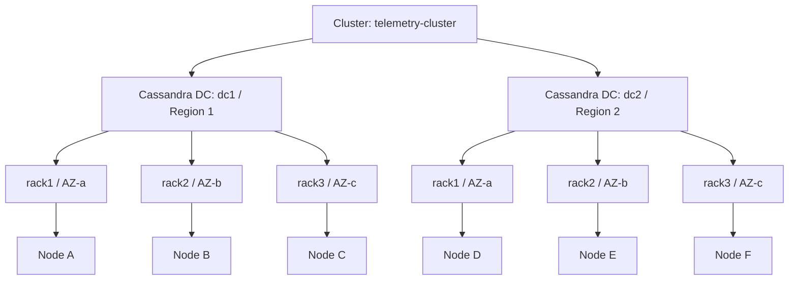
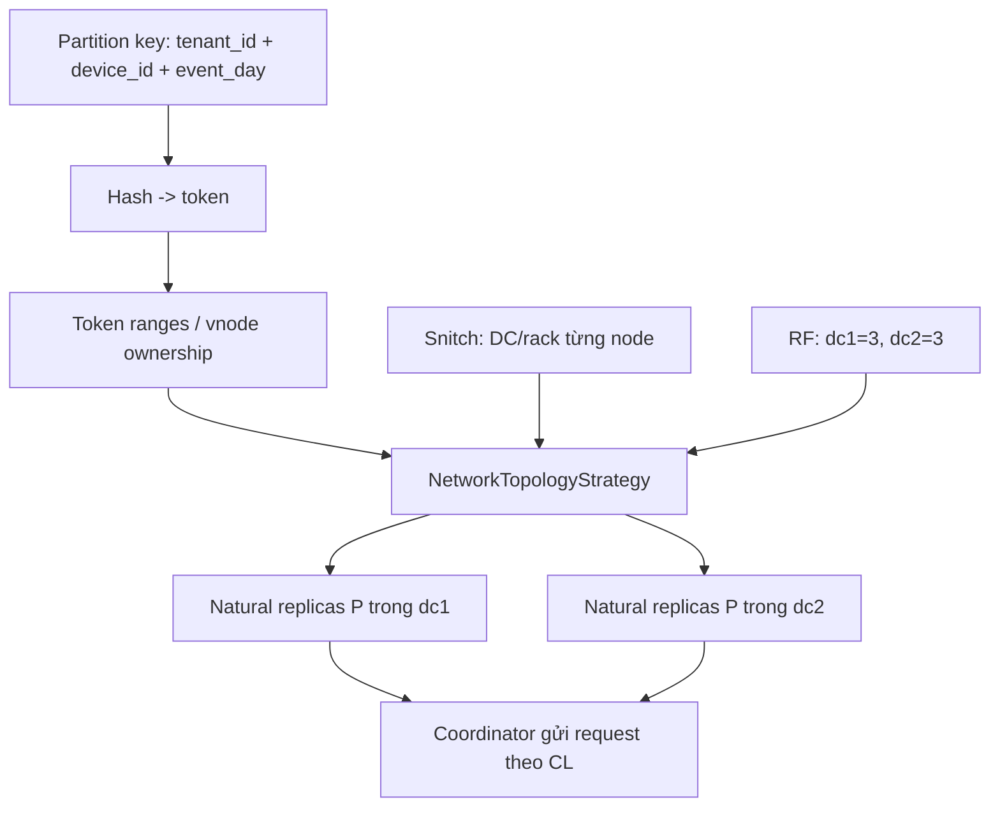
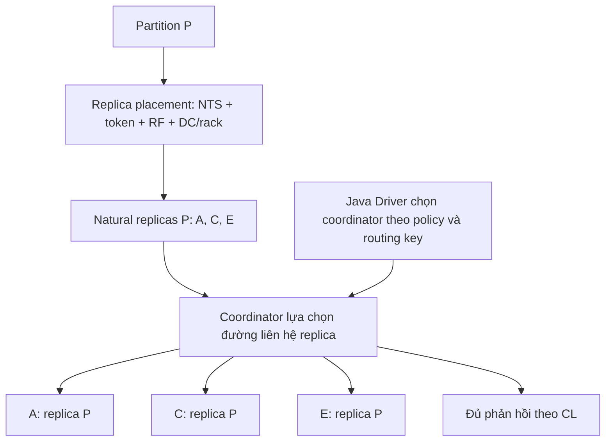

# Snitch, thông tin topology và lựa chọn bản sao theo miền lỗi

Một cluster Apache Cassandra có thể trải trên nhiều máy chủ, rack, availability zone và datacenter. Khi lưu một partition thành nhiều bản sao, chỉ đếm số replica là **chưa đủ**: nếu các replica nằm trên những máy cùng mất điện hoặc cùng mất kết nối mạng, sự cố của một miền hạ tầng có thể khiến chúng đồng thời không truy cập được. Cassandra giải quyết phần lớn bài toán bố trí này bằng **topology** của cluster, **snitch** và **replication strategy**.

**Snitch** cung cấp thông tin một node thuộc **datacenter (DC)** và **rack** nào. **NetworkTopologyStrategy** sử dụng thông tin đó cùng với **token** và **replication factor (RF)** để lựa chọn các node giữ replica của từng partition, cố gắng trải replica qua các rack khác nhau khi có thể. Sau đó, **consistency level (CL)** của request quyết định cần bao nhiêu replica phản hồi trước khi coordinator trả lời thành công.

Bài thuộc chương **Kiến trúc cụm** của module Apache Cassandra, kết nối kiến thức wide-column, thiết kế bảng theo truy vấn, replication, đọc/ghi, xử lý lỗi và Java Driver. Sau bài này, bạn có thể:

- Phân biệt **node**, **rack**, **datacenter**, **cluster** và **failure domain**.
- Giải thích snitch làm gì, cung cấp dữ liệu gì và vì sao snitch **không tự quyết định RF**.
- Trình bày cách partition key → token → replication strategy → tập replica, và vì sao hai partition có thể nằm trên các node khác nhau.
- Dự đoán khả năng chịu lỗi khi mất node, rack/availability zone hoặc cả DC.
- Hiểu khác biệt giữa **bố trí replica**, **chọn replica để đọc** và **driver chọn coordinator**.
- Viết CQL để cấu hình replication, kiểm tra topology bằng `nodetool` và đọc metadata từ ứng dụng Java.

## 1. Tại sao phải quan tâm đến miền lỗi?

Giả sử một partition P có RF = 3, tức muốn giữ ba bản sao. Xét hai cách đặt:

| Cách bố trí | Các replica của P | Khi rack chứa chúng mất điện |
|---|---|---|
| **Cùng một rack** | Node A, B, C đều ở `rack1` | Cả ba có thể mất kết nối cùng lúc. |
| **Trải trên ba rack** | A ở `rack1`, B ở `rack2`, C ở `rack3` | Mất `rack1` có thể chỉ làm mất một replica; B và C còn phục vụ được quorum 2/3. |

Với cùng RF, **khả năng chịu lỗi thực tế khác nhau** vì phạm vi lỗi có thể tác động đến nhiều node cùng lúc. Một miền lỗi (*failure domain*) là nhóm tài nguyên có nguy cơ hỏng đồng thời do chung nguồn điện, switch, hạ tầng lưu trữ, availability zone hoặc một thành phần khác.

Trong hệ thống on-premises, rack Cassandra thường được gắn với tủ máy hay nhóm máy có hạ tầng chung. Trong hệ thống cloud, một lựa chọn phổ biến là **một Cassandra DC tương ứng một region**, còn **một Cassandra rack tương ứng một availability zone (AZ)** bên trong region. Đây là *cách ánh xạ vận hành*, không phải ràng buộc kỹ thuật bắt buộc.



Sơ đồ giả định mỗi rack một node để dễ hình dung; triển khai thật có thể có nhiều node trong cùng rack. Tên `rack1` có thể lặp ở `dc1` và `dc2` vì rack được xét **bên trong từng DC**. Mục tiêu không phải đặt càng nhiều nhãn rack càng tốt, mà là để những nhãn đó **phản ánh đúng những miền có thể hỏng cùng nhau**.

## 2. Phân cấp node, rack, DC và cluster

| Thành phần | Ý nghĩa trong Cassandra | Câu hỏi quan trọng |
|---|---|---|
| **Node** | Một thành viên Cassandra có khả năng nhận CQL và lưu các partition được gán. | Node nào đang giữ bản sao của partition P? |
| **Rack** | Nhóm node trong một DC, đại diện một miền lỗi ở cấp thấp hơn DC. | Các replica P có nằm trong các rack độc lập không? |
| **Datacenter** | Nhóm rack/node dùng để quản lý replication và định tuyến địa phương. | Có bao nhiêu replica P trong `dc1`, `dc2`? |
| **Cluster** | Toàn bộ các node peer hợp thành một triển khai Cassandra. | Các DC này thuộc cùng cluster và cùng replication topology không? |

Một node nằm trong một rack thuộc một DC ở một thời điểm; nhiều DC có thể thuộc cùng cluster. Cassandra là hệ thống **peer-to-peer**, không có master cố định điều phối mọi truy vấn. Một node có thể thành **coordinator** khi nhận request và thành **replica** nếu được gán lưu partition đó. Hai vai trò này không quyết định vị trí rack/DC.

DC và rack là **thông tin logic mà Cassandra biết**, chứ không phải hai loại tiến trình chạy độc lập. Một AZ thực có thể chứa nhiều node; tên rack cần được khai báo chính xác để các cơ chế đặt bản sao hiểu ranh giới lỗi.

### Phân biệt “độc lập về tên” với “độc lập về hạ tầng”

Nếu cấu hình ba máy thành `rack1`, `rack2`, `rack3` nhưng cả ba cùng chạy trên một hypervisor hoặc cùng phụ thuộc một nguồn điện, Cassandra có thể phân tán replica theo **nhãn** mà vẫn không tránh được lỗi chung. Snitch không đo được độ độc lập thực tế của hạ tầng; nó **tin vào topology được cung cấp**.

Ngược lại, nếu ba AZ thực sự độc lập nhưng cả ba node đều khai báo `rack1`, Cassandra không có thông tin đúng để tối ưu đặt replica qua các AZ. Vì vậy, xác thực topology là một phần của kiểm tra tính sẵn sàng, bên cạnh RF và CL.

## 3. Snitch là gì?

**Snitch** là thành phần giúp Cassandra biết **vị trí topology tương đối** của một endpoint/node, thường là tên DC và rack. Một số cơ chế snitch hoặc phần tối ưu có thể hỗ trợ đánh giá vị trí/gần xa của endpoint để ưu tiên truy cập khi phù hợp.

Nói gọn, snitch trả lời: **“Node này ở DC nào, rack nào?”** Thông tin được dùng trong các quyết định liên quan đến replica và đường liên lạc. Snitch không thay thế toàn bộ thuật toán phân phối dữ liệu và không phải một máy chủ phân công.

| Thành phần | Cung cấp/quyết định điều gì? | Không làm gì? |
|---|---|---|
| **Snitch** | Topology DC/rack của node, hỗ trợ đánh giá locality. | Không tự đặt RF = 3 và không lưu bản sao dữ liệu. |
| **Partitioner + token ownership** | Ánh xạ partition key thành token và quan hệ với các khoảng token thuộc node. | Không tự hiểu các miền lỗi vật lý nếu thiếu topology. |
| **Replication strategy** | Kết hợp token, RF, topology để chọn **natural replicas** của từng partition. | Không biến CL của request thành số bản sao lưu trữ. |
| **Consistency level** | Quy định phản hồi tối thiểu để một request đọc/ghi thành công. | Không tạo ra replica mới khi node bị down. |
| **Driver load balancing** | Chọn node nhận CQL request (coordinator), ưu tiên DC và token khi khả thi. | Không định nghĩa vị trí lưu partition. |

Trong nhiều phiên bản, cấu hình snitch được khai báo tại `cassandra.yaml` bằng trường `endpoint_snitch`. Tên lựa chọn và cách tích hợp cloud có thể khác giữa các phiên bản; cần dùng loại được bản Cassandra triển khai hỗ trợ.

### Từ thông tin cục bộ đến nhận thức của cả cluster

Với `GossipingPropertyFileSnitch`, mỗi node có thể đọc DC/rack được cấu hình cục bộ rồi công bố thông tin liên quan qua cơ chế trạng thái/gossip. Peer dần biết những thông tin topology cần thiết. Không nên suy ra rằng mọi nút đều nhận biết thay đổi ngay tức thì; việc thay DC/rack của một node đang chứa dữ liệu là **thay đổi topology có ảnh hưởng lớn**, cần quy trình vận hành riêng.

Ở Cassandra 5.x, **Cluster Metadata Service/TCM** quản lý những thay đổi metadata cluster có điều phối hơn so với một số bản cũ. Vì vậy, cách quản lý topology/metadata ở mức nội bộ cần đối chiếu phiên bản. **Nguyên tắc snitch cung cấp DC/rack cho quyết định placement vẫn quan trọng**.

## 4. Một số loại snitch và khi nào sử dụng

Cassandra có nhiều cơ chế snitch qua các phiên bản và môi trường triển khai. Không nên chọn bằng cách nhớ một tên rồi sử dụng cho mọi cluster.

| Loại/nhóm | Ý nghĩa điển hình | Khi cân nhắc |
|---|---|---|
| **GossipingPropertyFileSnitch** | Dùng thông tin `dc`/`rack` khai báo cục bộ trong `cassandra-rackdc.properties`, công bố cho peer. | Triển khai tự quản, on-premises, VM hoặc khi muốn khai báo rõ topology. |
| **Snitch theo môi trường cloud** | Có thể suy ra region/zone từ metadata của hạ tầng, tùy snitch và phiên bản. | Cụm chạy trên nền tảng được loại snitch đó hỗ trợ; kiểm tra ánh xạ DC/AZ. |
| **SimpleSnitch** trong tài liệu cũ | Không cung cấp phân biệt rack/DC thực tế theo cách phù hợp môi trường nhiều miền lỗi. | Chủ yếu gặp trong ví dụ hoặc môi trường đơn giản; không nên mặc định sử dụng cho production đa DC. |
| **Dynamic snitch/endpoint scoring** | Cơ chế tối ưu lựa chọn endpoint dựa trên độ trễ quan sát, bên cạnh hiểu biết topology nền. | Liên quan hiệu năng đường đọc; không phải phương pháp thay đổi RF hay natural replica. |

Ví dụ cấu hình trên một node của `dc1/rack2` khi dùng `GossipingPropertyFileSnitch`:

```yaml
# cassandra.yaml (minh họa)
cluster_name: 'telemetry-cluster'
endpoint_snitch: GossipingPropertyFileSnitch
```

```properties
# cassandra-rackdc.properties trên node này
dc=dc1
rack=rack2
```

Node khác phải có giá trị DC/rack phù hợp vị trí **của chính node đó**. Các tệp và cú pháp ở đây là mẫu; triển khai thực tế cần xác minh đường dẫn cấu hình, quyền ghi, tên DC, mạng internode, cơ chế snitch được hỗ trợ và hướng dẫn của phiên bản.

**Không được chỉ sửa snitch rồi restart hàng loạt node để “đổi vùng” cho cluster đang chứa dữ liệu.** Thay đổi DC/rack có thể thay cách Cassandra xác định replica, liên quan bootstrap, streaming, repair và quy trình quản lý topology.

## 5. Partition key, token và natural replica

Cassandra là hệ thống wide-column, tối ưu thiết kế bảng theo mẫu truy vấn. **Partition key** quyết định token của partition; **clustering columns** xác định thứ tự hàng trong cùng partition.

Ví dụ:

```sql
CREATE KEYSPACE telemetry
WITH replication = {
    'class': 'NetworkTopologyStrategy',
    'dc1': 3,
    'dc2': 3
};

CREATE TABLE telemetry.readings_by_device_day (
    tenant_id uuid,
    device_id uuid,
    event_day date,
    event_time timestamp,
    event_id uuid,
    reading double,
    PRIMARY KEY ((tenant_id, device_id, event_day), event_time, event_id)
) WITH CLUSTERING ORDER BY (event_time DESC, event_id ASC);
```

Trong bảng này, `(tenant_id, device_id, event_day)` là **partition key tổng hợp**. Cassandra băm **cả ba giá trị** thành token. `event_time` và `event_id` là clustering columns; chúng hỗ trợ sắp xếp/định vị hàng bên trong partition nhưng **không** tự chọn DC/rack.

Trong ví dụ có đủ sáu node trải trên hai DC, `RF_dc1 = 3` và `RF_dc2 = 3`, một partition có **ba replica ở mỗi DC**, tổng sáu bản sao. Điều đó không có nghĩa mọi hàng của bảng được chuyển đến cùng một nhóm sáu node trên một cluster lớn hơn: partition khác có token khác và có thể có tập natural replica khác.

### Natural replica là gì?

**Natural replicas** là các node được replication strategy xác định có trách nhiệm giữ một bản sao của partition. Ví dụ tập replica của P có thể là A, B, C trong `dc1` và D, E, F trong `dc2`. Nếu coordinator nhận request từ một node G không nằm trong tập đó, G **vẫn có thể điều phối**, còn dữ liệu cần đọc/ghi nằm trên các natural replica.

Nếu một natural replica đang down, Cassandra không tự coi một node bất kỳ khác là bản sao đầy đủ mới của P chỉ vì nó đang `UP`. Các cơ chế như hints và quản lý bootstrap/streaming giải quyết những tình huống khác nhau; **replica placement** vẫn do metadata và chiến lược replication xác định.



Sơ đồ là mô hình logic. Token ring **không phải vòng dây nối các máy**; giao tiếp giữa coordinator và replica diễn ra theo mạng internode thực tế. Virtual node (*vnode*) cho phép một node sở hữu nhiều khoảng token, nhưng không làm node tự nhiên có thêm rack hoặc DC.

## 6. NetworkTopologyStrategy chọn replica qua rack như thế nào?

`NetworkTopologyStrategy` là chiến lược replication thường dùng khi một cluster có thông tin DC/rack. Mỗi DC được cấu hình RF riêng. Trong một DC, chiến lược **cố gắng chọn replica ở các rack khác nhau** khi có đủ rack và node phù hợp, để tránh đặt mọi bản sao trong một miền lỗi.

Ví dụ cluster có 12 node: `dc1` gồm sáu node chia đều vào ba rack; `dc2` tương tự. RF mỗi DC là 3. Tập replica **minh họa** cho partition P:

| DC | Rack | Node giữ P |
|---|---|---|
| `dc1` | `rack1` | A |
| `dc1` | `rack2` | C |
| `dc1` | `rack3` | E |
| `dc2` | `rack1` | H |
| `dc2` | `rack2` | J |
| `dc2` | `rack3` | L |

Đây **không phải thuật toán chọn tên node cụ thể**. Vị trí thực tế phụ thuộc token, vnode, số node, topology và replication strategy. Partition Q có thể được đặt ở các node khác.

### Điều kiện để rải một replica trên mỗi rack

Nếu mỗi DC có **ít nhất ba rack độc lập** và RF = 3, chiến lược có thể phân bố ba bản sao trên ba rack khác nhau. Nhưng:

- Nếu DC chỉ có **hai rack** mà RF = 3, ít nhất hai replica sẽ phải chia sẻ một rack, dù có rất nhiều node.
- Nếu DC chỉ có **một rack**, RF = 3 không bảo vệ khỏi việc toàn rack đó mất điện.
- Nếu một rack có tên đúng nhưng **các node cùng phụ thuộc một switch ở rack khác**, nhãn topology không khắc phục được điểm lỗi chung.
- Nếu cluster có nhiều AZ nhưng thông tin rack bị khai báo sai, chiến lược không có cơ sở chính xác để tối ưu vị trí bản sao.

RF nên được chọn dựa trên **số node, rack/DC thực sự khả dụng, mức chịu lỗi cần thiết, dung lượng và chi phí**, thay vì luôn đặt 3 trong mọi môi trường.

### Khi RF lớn hơn số rack

Ví dụ RF = 4 trong DC có ba rack. Không thể có bốn replica thuộc bốn rack khác nhau nếu chỉ tồn tại ba rack. Cassandra phải có nhiều replica ở ít nhất một rack, hoặc thay đổi thiết kế topology/RF. Vì vậy, mệnh đề “NetworkTopologyStrategy luôn đặt mỗi replica vào một rack riêng” **chỉ có ý nghĩa khi topology đủ rack và node**.

### Khi thêm node mới

Thêm node có thể làm thay đổi khoảng token và trách nhiệm lưu các partition; quá trình **bootstrap/streaming** cần phân phối dữ liệu đến vị trí mới. Thấy tên node mới trong gossip hoặc `nodetool status` không chứng minh dữ liệu đã được chuyển hoàn tất. Tương tự, đổi RF hoặc mở rộng DC cần quy trình dữ liệu/repair theo phiên bản; việc sửa schema đơn thuần không tự hoàn thành các bước đồng bộ lịch sử.

## 7. Một bài toán placement theo miền lỗi

Giả sử một DC gồm sáu node trong ba rack:

```text
dc1
├── rack1 (AZ-a): A, B
├── rack2 (AZ-b): C, D
└── rack3 (AZ-c): E, F

Keyspace telemetry: RF_dc1 = 3
Partition P (minh họa): A, D, E
Partition Q (minh họa): B, C, F
```

Nếu `rack2` mất kết nối, P mất D nhưng còn A và E; Q mất C nhưng còn B và F. Với CL `LOCAL_QUORUM` và RF = 3, mỗi partition vẫn **có thể** đạt hai phản hồi từ các replica còn lại nếu chúng hoạt động đúng hạn.

Tuy nhiên, nếu mọi node trong `dc1` được cấu hình cùng `rack1`, việc Cassandra cố gắng phân tán replica **theo rack** không mang lại bảo vệ trước sự cố AZ theo cách thiết kế mong muốn, ngay cả khi các node thực tế thuộc ba AZ.

Ngược lại, chỉ riêng việc rải replica qua ba rack **không bảo đảm** sống sót trước lỗi cả datacenter. Muốn chịu lỗi DC, phải thiết kế **replication sang DC khác**, dữ liệu hội tụ, ứng dụng có khả năng failover và lựa chọn CL phù hợp.

## 8. Topology và consistency level quyết định khả năng phục vụ

Nhắc lại: **RF là số bản sao mong muốn**, còn **CL là điều kiện đủ phản hồi của từng request**. Với keyspace `telemetry` ở mục 5, `RF_dc1 = 3` và `RF_dc2 = 3`; coordinator nằm tại `dc1`:

| CL | Điều kiện phản hồi | Nhận xét topology |
|---|---|---|
| `ONE` | Một replica có phản hồi hợp lệ. | Có thể nhanh; không bảo đảm đọc phiên bản mới nhất khi replica chưa hội tụ. |
| `LOCAL_ONE` | Một replica trong `dc1`. | Điều kiện xác nhận địa phương, không cần ACK/data từ `dc2`. |
| `LOCAL_QUORUM` | `floor(3/2) + 1 = 2` replica `dc1`. | Có thể chịu mất một replica `dc1` nếu hai replica còn lại phản hồi. |
| `QUORUM` | `floor(6/2) + 1 = 4` replica trên tổng RF hai DC. | Có thể đòi liên lạc xuyên DC, tùy tập phản hồi. |
| `EACH_QUORUM` | **Đối với ghi:** quorum trong **mỗi** DC: 2 ở `dc1` và 2 ở `dc2`. | Không thành công khi một DC không thể đạt quorum của chính nó. |
| `ALL` | Mọi replica của partition (sáu trong ví dụ). | Nhạy với lỗi/chậm của một replica hoặc đường mạng. |

Ở ví dụ một DC RF = 3, nếu partition P rải trên ba rack thì khi một rack bị mất, **hai replica còn lại có thể đủ `LOCAL_QUORUM`**. Nếu hai rack chứa replica P cùng mất, chỉ một replica còn đáp ứng thì `LOCAL_QUORUM` không đạt. Đây là giao điểm giữa **khả năng chịu lỗi của topology** và **điều kiện của CL**.

### Một replica `UP` không có nghĩa request sẽ đáp ứng

`nodetool status` có thể báo node `UN` (*Up/Normal*), nhưng node vẫn chậm vì GC, mạng, I/O, compaction, tombstone hoặc repair. Coordinator cần **ACK/dữ liệu đúng hạn**. `Unavailable` có thể xuất hiện nếu không đủ replica được xem là khả dụng; `ReadTimeout`/`WriteTimeout` có thể xuất hiện khi đã gửi nhưng không nhận đủ phản hồi trước deadline.

Khi ghi timeout, mutation **có thể đã tới một số replica**. Vì vậy, ứng dụng Java phải có chiến lược retry idempotent, khóa sự kiện ổn định và kiểm soát timestamp khi cần. Topology đúng giúp giảm rủi ro mất đồng thời, nhưng không loại bỏ hoàn toàn các trạng thái kết quả không chắc chắn.

### Multi-DC và giới hạn của LOCAL_QUORUM

Giả sử ứng dụng ghi tại `dc1` với `LOCAL_QUORUM` rồi lập tức chuyển sang đọc tại `dc2` cũng với `LOCAL_QUORUM`. Hai tập quorum đều địa phương nhưng **không nhất thiết giao nhau**: ghi đã được xác nhận ở `dc1` có thể chưa có đủ bản sao tại `dc2` ở thời điểm đọc. Khi thiết kế DR/failover, phải xét replication xuyên DC, kết nối WAN, thời gian hội tụ và mục tiêu mất dữ liệu chấp nhận được.

## 9. Placement và lựa chọn replica để đọc là hai việc khác nhau

Một câu hỏi thường gặp: “Snitch chọn node để đọc, vậy nó có chọn node giữ dữ liệu không?” Có hai lớp quyết định riêng:

1. **Replica placement:** partition key → token → `NetworkTopologyStrategy` + RF + thông tin DC/rack, tạo tập **natural replica**. Tập này xác định **ai có trách nhiệm lưu**.
2. **Read replica selection:** coordinator chọn cách gửi yêu cầu đọc đến các replica trong tập thích hợp, xét CL, locality, trạng thái và các tối ưu hiệu năng. Cơ chế đánh giá độ trễ endpoint (ví dụ dynamic snitch ở những phiên bản hỗ trợ) có thể ảnh hưởng **thứ tự ưu tiên đọc**, nhưng **không biến một node ngoài tập natural replica thành bản sao**.



Sơ đồ gộp các quyết định để dễ nhìn; Java Driver thực ra gửi request **đến một coordinator**, còn coordinator mới liên hệ natural replica. Tối ưu lựa chọn replica để đọc không có nghĩa có một “master đọc” vĩnh viễn.

### Dynamic snitch: thay đổi ưu tiên hiệu năng, không đổi RF

Ở các phiên bản có cơ chế **dynamic snitch**, Cassandra có thể dùng thống kê thời gian phản hồi để đánh giá endpoint phù hợp cho một số đường đọc. Node phản hồi nhanh hơn có thể được ưu tiên trong các tình huống thích hợp. Tuy nhiên:

- Nếu node nhanh nhất **không phải replica của P**, tốc độ không biến nó thành nguồn dữ liệu của P.
- CL vẫn quy định **số phản hồi cần thiết**; chọn replica nhanh không giảm quorum từ hai thành một.
- Dynamic snitch không thay thế topology, rack-awareness hay repair dữ liệu.
- Tùy phiên bản, cơ chế đánh giá endpoint và cấu hình đã thay đổi; cần kiểm tra tài liệu bản chạy khi tối ưu read latency.

Đối với ghi, coordinator vẫn nhắm tới các replica có trách nhiệm; **CL xác định điều kiện ACK**, không phải cơ chế chọn “một bản sao tốt nhất” rồi bỏ các bản còn lại.

## 10. Java Driver chọn coordinator thế nào?

Ứng dụng Java kết nối tới Cassandra qua giao thức native CQL, thường cổng `9042`. Driver có **contact points** để khởi tạo kết nối và lấy metadata. Sau đó driver có thể chọn các node khác làm coordinator dựa trên local datacenter, tình trạng kết nối, token và chính sách cân bằng tải.

Nếu prepared statement chứa đầy đủ partition key và driver có metadata phù hợp, **token-aware routing** có thể ưu tiên gửi request trực tiếp tới một natural replica trong DC địa phương, giúp giảm một chặng mạng. Nhưng **đặt driver tại DC nào không thay đổi bảng replica của keyspace**.

Ví dụ với Apache Cassandra Java Driver 4.x:

```java
import com.datastax.oss.driver.api.core.CqlSession;
import com.datastax.oss.driver.api.core.DefaultConsistencyLevel;
import com.datastax.oss.driver.api.core.cql.BoundStatement;
import com.datastax.oss.driver.api.core.cql.PreparedStatement;
import com.datastax.oss.driver.api.core.cql.Row;
import com.datastax.oss.driver.api.core.metadata.Node;

import java.net.InetSocketAddress;
import java.time.LocalDate;
import java.util.UUID;

public class CassandraTopologyRead {
    public static void main(String[] args) {
        // IP thuộc dải dành cho ví dụ: thay bằng contact point thực.
        try (CqlSession session = CqlSession.builder()
                .addContactPoint(new InetSocketAddress("192.0.2.10", 9042))
                .addContactPoint(new InetSocketAddress("192.0.2.11", 9042))
                .withLocalDatacenter("dc1")
                .build()) {

            // Góc nhìn topology mà driver đã khám phá.
            for (Node node : session.getMetadata().getNodes().values()) {
                System.out.printf("node=%s dc=%s rack=%s%n",
                    node.getEndPoint(),
                    node.getDatacenter(),
                    node.getRack());
            }

            PreparedStatement prepared = session.prepare(
                "SELECT event_time, event_id, reading " +
                "FROM telemetry.readings_by_device_day " +
                "WHERE tenant_id = ? AND device_id = ? AND event_day = ? " +
                "LIMIT 20");

            BoundStatement query = prepared.bind(
                    UUID.fromString("11111111-1111-1111-1111-111111111111"),
                    UUID.fromString("22222222-2222-2222-2222-222222222222"),
                    LocalDate.parse("2026-11-21"))
                .setConsistencyLevel(DefaultConsistencyLevel.LOCAL_QUORUM);

            for (Row row : session.execute(query)) {
                System.out.printf("%s %s %.2f%n",
                    row.getInstant("event_time"),
                    row.getUuid("event_id"),
                    row.getDouble("reading"));
            }
        }
    }
}
```

Lưu ý:

- Dải `192.0.2.0/24` chỉ dùng trong tài liệu; phải thay bằng endpoint truy cập được. `dc1` phải là **tên DC thực**.
- Metadata driver được cập nhật theo cơ chế của client; nó có thể **trễ** so với trạng thái internode trong một thời điểm chuyển topology.
- `withLocalDatacenter("dc1")` ưu tiên gửi CQL tới DC địa phương; nó không tự đặt RF hay tự chuyển ứng dụng qua DC dự phòng khi sự cố.
- CL nên được chọn theo nhu cầu dữ liệu. Hai phản hồi `LOCAL_QUORUM` không tự bảo đảm mọi replica ở DC khác đã có bản mới nhất.
- Nên tái sử dụng `CqlSession` lâu dài trong ứng dụng thay vì tạo phiên mới cho từng request.

## 11. Đọc topology thực tế bằng nodetool và bảng hệ thống

Để biết Cassandra **đang nhìn nhận** cluster ra sao, bắt đầu bằng các lệnh quan sát:

```bash
nodetool status
nodetool describecluster
nodetool gossipinfo
```

`nodetool status` thường nhóm node theo DC, hiển thị cột rack và tình trạng như `UN` (*Up/Normal*). Đây là cách nhanh để phát hiện tất cả node trong một AZ bị đánh dấu cùng rack hay các nhãn rack đáng ngờ. `nodetool describecluster` hỗ trợ kiểm tra metadata/schema tổng quan; `nodetool gossipinfo` cho biết các trạng thái peer mà node đang quan sát biết được, có thể gồm `DC`/`RACK` tùy phiên bản.

Một ví dụ đầu ra **minh họa** rút gọn của `nodetool status`:

```text
Datacenter: dc1
Status=Up/Down
|/ State=Normal/Leaving/Joining/Moving
-- Address       Load     Tokens  Owns   Host ID  Rack
UN 192.0.2.10    ...      ...     ...    ...      rack1
UN 192.0.2.11    ...      ...     ...    ...      rack2
UN 192.0.2.12    ...      ...     ...    ...      rack3

Datacenter: dc2
-- Address       Load     Tokens  Owns   Host ID  Rack
UN 192.0.2.20    ...      ...     ...    ...      rack1
UN 192.0.2.21    ...      ...     ...    ...      rack2
UN 192.0.2.22    ...      ...     ...    ...      rack3
```

Địa chỉ và dấu `...` chỉ là ví dụ, không phải kết quả chạy thật. **Cột Owns có cách hiểu và độ chính xác phụ thuộc replication strategy và tham số lệnh**, vì vậy không dùng một giá trị phần trăm trong bảng trạng thái để suy luận ngay vị trí chính xác của một partition.

### Truy vấn metadata CQL

Trong `cqlsh`, có thể xem thông tin node đang nhận CQL:

```sql
SELECT cluster_name, data_center, rack, host_id
FROM system.local;

SELECT keyspace_name, replication
FROM system_schema.keyspaces
WHERE keyspace_name = 'telemetry';
```

`system.local` mô tả **node hiện tại**, không phải danh sách toàn cluster. Ở các phiên bản hỗ trợ `system.peers_v2`, có thể xem metadata về peer:

```sql
-- Có thể khác hoặc không hiện diện ở một số phiên bản.
SELECT peer, data_center, rack
FROM system.peers_v2;
```

Đối chiếu output ở **nhiều node**, nhất là khi nghi topology không đồng nhất. Không chỉnh sửa thủ công các bảng hệ thống để “sửa” DC/rack. Thông tin chưa hội tụ hoặc thay đổi metadata sai phải được xử lý theo quy trình của Cassandra phiên bản đang chạy.

## 12. CQL tracing: quan sát đường đi của một truy vấn

Sau khi tạo bảng ở mục 5 và thêm dữ liệu thử nghiệm, có thể quan sát một truy vấn đọc:

```sql
-- CONSISTENCY và TRACING là lệnh của cqlsh.
CONSISTENCY LOCAL_QUORUM;
TRACING ON;

SELECT event_time, event_id, reading
FROM telemetry.readings_by_device_day
WHERE tenant_id = 11111111-1111-1111-1111-111111111111
  AND device_id = 22222222-2222-2222-2222-222222222222
  AND event_day = '2026-11-21'
LIMIT 20;

TRACING OFF;
```

Trace có thể giúp xác định coordinator, trao đổi với replica và chi phí xử lý request. **Không mặc định tracing luôn liệt kê rõ tất cả natural replicas hoặc “lý do chọn rack”**; dữ liệu trace thay đổi theo phiên bản, đường thực thi, CL và các tối ưu nội bộ. Tracing có chi phí xử lý nên chỉ bật có chọn lọc.

Thiết kế bảng theo truy vấn giúp giảm phạm vi: vì `WHERE` cung cấp đầy đủ `tenant_id`, `device_id` và `event_day`, coordinator có thể nhắm một partition. Bỏ một thành phần partition key thường làm truy vấn không còn được hỗ trợ theo đường đọc hiệu quả mặc định; thêm `ALLOW FILTERING` để “cho chạy” có thể khiến quét nhiều partition và tăng tải cluster.

## 13. Những lỗi cấu hình topology dễ gặp

| Hiện tượng | Nguyên nhân có thể | Hệ quả |
|---|---|---|
| Tất cả node trong DC hiển thị cùng `rack1` dù hạ tầng có ba AZ | Copy cùng `cassandra-rackdc.properties` cho mọi node. | NTS thiếu thông tin để rải replica theo AZ như mong muốn. |
| Keyspace khai báo `dc1` nhưng node tự nhận `DC1` hoặc `dc-1` | Không thống nhất tên DC; tên là chuỗi có phân biệt ký tự. | RF/placement không diễn ra theo DC dự kiến, có thể gây `Unavailable` hoặc hành vi vận hành bất thường. |
| Ba replica trên ba node nhưng vẫn mất cùng lúc khi switch hỏng | Các node cùng một failure domain vật lý hoặc nhãn rack sai. | RF không đáp ứng khả năng chịu lỗi rack mong đợi. |
| Driver Java gửi truy vấn xuyên vùng | `localDatacenter`, contact point, metadata hoặc cấu hình cân bằng tải không phù hợp. | Tăng độ trễ, timeout và tải mạng WAN. |
| Thêm DC mới nhưng đọc được rất ít dữ liệu lịch sử | RF/schema đã đổi nhưng streaming/rebuild/repair chưa hoàn chỉnh. | DC mới chưa có đầy đủ replica để phục vụ hoặc failover. |
| Một node báo rack khác với các peer | Snitch/config không đồng bộ hoặc trạng thái metadata chưa được cập nhật đúng. | Các quyết định replica có thể không khớp mong đợi; cần điều tra trước khi đổi topology. |
| Mất rack nhưng `LOCAL_QUORUM` thất bại | Replica không thực sự trải trên đủ rack, hoặc node còn lại cũng lỗi/chậm. | Cần kiểm tra **replica của từng partition** và số ACK thực tế, không chỉ nhìn tổng node còn `UN`. |

### Một node bị DOWN có phải lý do để đổi snitch?

Thông thường **không**. Node có thể down do mạng, GC, I/O, ổ đĩa hoặc lỗi tiến trình. Snitch mô tả topology; đổi nó trong khi xử lý lỗi liveness có thể thay đổi cách đặt bản sao, làm tình trạng phức tạp hơn. Trước hết nên xác định nguyên nhân qua `nodetool`, log, metrics, đường internode và trạng thái replica.

### Seed node có quyết định vị trí replica?

**Không.** Seed hỗ trợ **khám phá peer** khi node khởi động/join. Seed có thể nằm trong một rack/DC thông thường và không là master. Replica placement vẫn dựa vào token, strategy, RF và topology. Không cấu hình seed duy nhất trên một failure domain dễ mất nếu việc khám phá/restart cụm cần chịu lỗi; nhưng số seed cũng không phải số replica.

## 14. Thay đổi topology có rủi ro gì?

Một thay đổi nhỏ trên giấy như `dc=dc1` thành `dc=dc2` có thể mang ý nghĩa lớn: từ góc nhìn Cassandra, node đang chuyển miền replication. Điều đó có thể thay tập natural replica của các partition, ảnh hưởng CL địa phương, đường mạng, streaming, repair và an toàn dữ liệu.

Những trường hợp cần quy trình chính thức:

1. **Thêm node hoặc rack:** bảo đảm node có địa chỉ, snitch, DC/rack đúng từ đầu; bootstrap/streaming hoàn tất trước khi coi nó đang phục vụ đầy đủ.
2. **Thêm DC mới:** đặt RF thích hợp, di chuyển hoặc xây dựng bản sao dữ liệu theo cách được phiên bản hỗ trợ; xác minh dữ liệu và đường đi ứng dụng trước khi failover.
3. **Chuyển một node sang DC/rack khác:** không làm bằng thao tác sửa file rồi restart tùy ý trên cluster có dữ liệu; xem hướng dẫn di chuyển topology và những giới hạn được hỗ trợ.
4. **Thay RF:** cập nhật schema và hoàn thành quy trình phân phối/repair dữ liệu; không xem `ALTER KEYSPACE` là bằng chứng mọi replica mới đã có đủ dữ liệu.
5. **Replace/decommission/remove node:** xác minh trách nhiệm replica, dữ liệu, trạng thái streaming, token và độ sẵn sàng của cụm trước khi hành động.

Trong những phiên bản Cassandra sử dụng TCM, thay đổi metadata phải theo quy trình và điều kiện của hệ thống metadata mới. Mục tiêu là **thay đổi topology mà vẫn bảo toàn dữ liệu và khả năng phục vụ**, không chỉ thay nhãn hiển thị trên `nodetool status`.

### Repair và compaction không giải quyết cùng một việc

- **Streaming** chuyển dữ liệu khi bootstrap hoặc thay đổi trách nhiệm node.
- **Hinted handoff** có thể phát lại một số mutation mà replica tạm thời bỏ lỡ, trong giới hạn cấu hình.
- **Anti-entropy repair** đối chiếu và đồng bộ khác biệt giữa replica.
- **Compaction** tổ chức lại SSTable trên từng node, phục vụ hiệu năng và quản lý dữ liệu cũ/tombstone; nó **không tự đặt bản sao vào rack/DC mới**.

Khi một rack mất kết nối rồi quay lại, snitch có thể vẫn cho thấy nhãn rack đúng. Điều đó **không chứng minh** replica trong rack đã bắt kịp mọi mutation. Khả năng phục hồi còn cần quan sát hint, repair, tombstone và độ mới dữ liệu sau sự cố.

## 15. Thiết kế topology cho một ứng dụng Java thực tế

Giả sử hệ thống giám sát thiết bị IoT có yêu cầu:

- Ghi liên tục theo `tenant_id`, `device_id`, ngày.
- Đọc 20 điểm đo gần nhất trong một ngày của một thiết bị.
- Phục vụ tại hai region; ở mỗi region chịu được lỗi một AZ mà vẫn cho phép các request `LOCAL_QUORUM` tiếp tục nếu replica còn lại phản hồi.
- Có kế hoạch failover sang region khác khi sự cố nghiêm trọng.

Một thiết kế ban đầu hợp lý **trong điều kiện đủ nguồn lực** là:

| Yếu tố | Lựa chọn minh họa | Lý do |
|---|---|---|
| Cluster | Một Cassandra cluster, hai DC. | Cho phép cấu hình replication cùng keyspace giữa hai DC. |
| DC | `dc1` ở Region 1, `dc2` ở Region 2. | Ranh giới mạng và failure domain cấp vùng. |
| Rack | Ba rack/AZ độc lập trong mỗi DC. | Có cơ hội rải RF = 3 trên ba AZ. |
| Node | Ít nhất một node mỗi rack; thường cần nhiều hơn theo dung lượng/tải. | Cung cấp tập replica và khả năng mở rộng. |
| RF | `NetworkTopologyStrategy` với 3 ở mỗi DC. | Ba bản sao mỗi partition trong từng DC. |
| Partition key | `(tenant_id, device_id, event_day)`. | Khoanh vùng truy vấn theo thiết bị/ngày, giảm partition không giới hạn. |
| Driver | Ứng dụng từng region ưu tiên `localDatacenter` tương ứng. | Giảm lưu lượng/độ trễ liên DC cho request địa phương. |
| CL thường dùng | `LOCAL_QUORUM` cho luồng cần xác nhận quorum tại DC. | Có thể chịu mất một replica/rack khi topology phù hợp. |
| Vận hành | Giám sát replica, repair, tombstone, throughput, failover. | Phục hồi dữ liệu và xác định rõ RPO/RTO. |

Thiết kế này **chưa phải cam kết RPO bằng 0**. Một ghi `LOCAL_QUORUM` thành công tại `dc1` có thể chưa được xác nhận ở `dc2`. Nếu nghiệp vụ yêu cầu DC dự phòng nhìn thấy ghi mới nhất trước khi báo thành công, phải phân tích CL ghi và yêu cầu độ trễ, ví dụ cân nhắc `EACH_QUORUM` trong điều kiện phù hợp; điều đó cũng làm ghi phụ thuộc vào khả năng phục vụ của cả hai DC.

Khi một partition trở nên quá nóng, thêm node/rack không tự chia nhỏ partition đó: cùng partition vẫn đi đến tập natural replica hữu hạn. Cần xem lại bucketing/partition key và thiết kế bảng theo truy vấn, bên cạnh năng lực hạ tầng.

## 16. Bài tập suy luận

**Bài tập A — Ba node, một rack:** `dc1` có ba node A/B/C, tất cả được gắn `rack1`, RF = 3. Mất cả rack sẽ còn bao nhiêu replica của P trong `dc1`? **Không còn replica có thể truy cập trong DC đó** nếu sự cố tác động toàn rack. RF = 3 chỉ chống lỗi node riêng lẻ tốt hơn, không chống lỗi miền chung.

**Bài tập B — Ba rack độc lập:** `dc1` có A ở `rack1`, B ở `rack2`, C ở `rack3`; RF = 3. Mất `rack2`, `LOCAL_QUORUM` cần mấy phản hồi? **Hai**; A và C có thể đủ nếu cả hai đáp ứng đúng hạn.

**Bài tập C — RF lớn hơn số rack:** DC có hai rack nhưng RF = 3. Có thể bảo đảm ba replica đều nằm ở rack khác nhau không? **Không**, vì chỉ có hai rack; ít nhất một rack phải giữ nhiều replica nếu đủ node.

**Bài tập D — Snitch sai:** Node vật lý ở AZ-b nhưng công bố `rack1`, cùng rack label với AZ-a. Cassandra có thể tự biết chúng thuộc hai AZ khác nhau không? **Không thể mặc định.** Snitch cung cấp topology theo cấu hình/metadata, nên phải sửa quy trình khai báo và xác minh tác động dữ liệu trước khi thay.

**Bài tập E — Driver gửi tới node ngoài tập replica:** Driver gửi `SELECT` partition P đến node G, nhưng natural replicas là A/B/C. G có thể điều phối không? **Có.** G trở thành coordinator và liên hệ các replica thích hợp, nếu mạng và trạng thái cho phép.

**Bài tập F — Cross-DC read-after-write:** `LOCAL_QUORUM` ghi tại `dc1` đã thành công; ngay sau đó ứng dụng đọc `LOCAL_QUORUM` ở `dc2`. Có được bảo đảm đọc được ghi mới không? **Không**, vì quorum của hai DC không giao nhau và bản sao ở DC kia có thể chưa hội tụ.

**Bài tập G — Thêm một rack:** Đổi tên rack của node có dữ liệu rồi khởi động lại có đủ để “phân bố lại” replica không? **Không.** Thay đổi topology cần quy trình metadata, streaming/repair và xác minh theo phiên bản.

**Bài tập H — Một node báo `UN` nhưng đọc timeout:** Có phải snitch hỏng? **Chưa chắc.** Node có thể đủ liveness nhưng chậm do I/O, compaction, GC hoặc mạng; kiểm tra CL và phản hồi thực tế trước khi kết luận.

## 17. Các hiểu nhầm cần loại bỏ

| Hiểu nhầm | Diễn giải đúng |
|---|---|
| “Snitch tự tạo ba bản sao.” | RF và replication strategy quyết định số lượng/vị trí; snitch cung cấp thông tin DC/rack. |
| “Mọi node đều có mọi partition vì Cassandra peer-to-peer.” | Mỗi partition có tập natural replica được gán theo token/strategy. |
| “RF = 3 nghĩa là chống lỗi bất kỳ một rack.” | Chỉ khi replica thực sự phân bố trên failure domain phù hợp và các node còn lại phục vụ được CL. |
| “Rack bắt buộc là một tủ máy vật lý.” | Rack là nhãn topology; có thể đại diện AZ hoặc miền lỗi thích hợp khác. |
| “Ba tên rack khác nhau bảo đảm ba failure domain thật độc lập.” | Tên cần phản ánh hạ tầng thực; snitch không phát hiện mọi phụ thuộc chung. |
| “Dynamic snitch thay đổi node lưu partition.” | Nó liên quan lựa chọn endpoint/độ trễ; không thay replication strategy. |
| “Driver local DC là DC duy nhất chứa dữ liệu.” | Local DC phục vụ định tuyến client; replication có thể trải nhiều DC. |
| “Node down thì Cassandra tự biến node khác thành replica của partition đó ngay.” | Replica ownership không đổi chỉ vì liveness; cần các quy trình topology và dữ liệu thích hợp. |
| “Đổi RF trong CQL nghĩa là dữ liệu lịch sử đã tự hoàn toàn đồng bộ.” | Cần hoàn tất quy trình phân phối và repair dữ liệu phù hợp. |
| “Node lên lại sau sự cố thì dữ liệu đã đồng nhất.” | `UP` không chứng minh các replica đã hội tụ; còn cần đánh giá hint/repair. |

## 18. Tổng kết

Mô hình tư duy chính xác cho replica placement trong Cassandra là:

```text
Ứng dụng thiết kế partition key
                  |
                  v
      Hash partition key -> token
                  |
                  v
      Token/vnode ownership của các node
                  |
                  v
     Replication strategy + RF theo DC
                  ^
                  |
      Snitch: DC/rack của từng node
                  |
                  v
       Tập natural replica của partition
                  |
                  v
Coordinator nhận CQL -> liên hệ replica thích hợp
                  |
                  v
        Số ACK/data đáp ứng theo CL
                  |
                  v
       Trả kết quả / timeout / lỗi
```

**Snitch mô tả topology**, **NetworkTopologyStrategy dùng topology để phân bố natural replica**, **RF quy định số bản sao**, còn **CL quy định điều kiện thành công của request**. Khi rack đúng với failure domain thật, Cassandra có cơ hội tránh mất đồng thời nhiều bản sao. Khi cấu hình sai, số node và RF cao vẫn có thể tạo ảo giác an toàn.

Đối với ứng dụng Java và vận hành thực tế, hãy kiểm tra từ **partition key, token, vị trí replica, DC/rack thực, CL và phản hồi của các node** rồi mới kết luận một sự cố làm mất tính sẵn sàng hay dữ liệu. Kiến thức này là nền tảng để đi sâu vào replication đa DC, repair, compaction, timeout và quy trình thay đổi topology an toàn.
