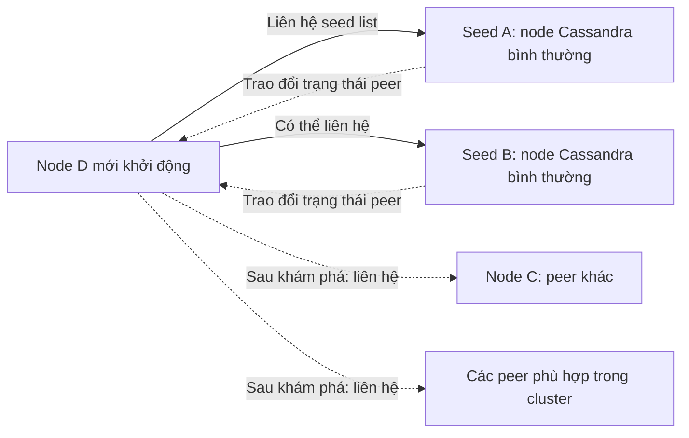
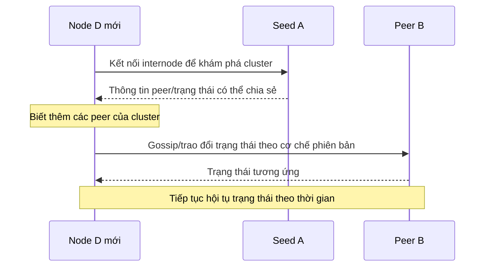
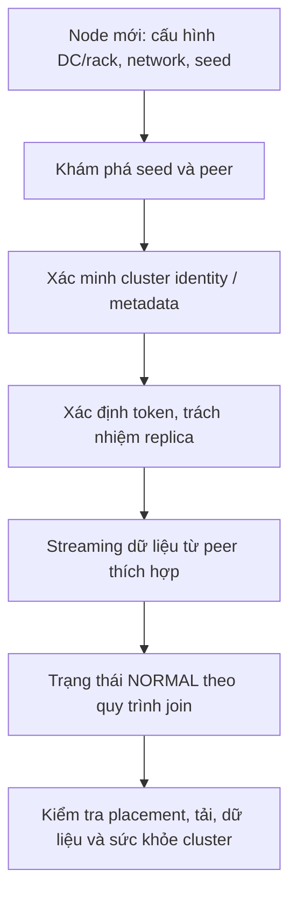
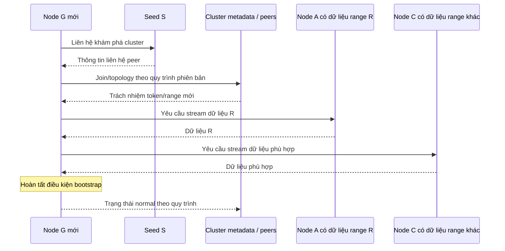

# Seed node, bootstrap và phân biệt với vai trò leader

Trong Apache Cassandra, một node mới không thể tự biết tất cả thành viên của cluster nếu chưa có ai giới thiệu. Nó cần một số địa chỉ ban đầu để **khám phá peer**. Các địa chỉ này thường được khai báo trong **seed list**, và những node được dùng làm điểm liên hệ được gọi là **seed node**. Nhưng seed **không phải master**: Cassandra vẫn sử dụng kiến trúc **peer-to-peer**, mọi node đủ điều kiện đều có thể nhận yêu cầu CQL, trở thành coordinator của request và lưu dữ liệu của những partition được phân công.

Hai khái niệm dễ bị đánh đồng là **seed discovery** và **bootstrap**. Discovery giúp node mới nhận biết cluster, còn bootstrap là quá trình tham gia topology và **nhận dữ liệu** cần thiết cho các khoảng token/partition mà node sẽ sở hữu. Kết nối được seed **chưa** chứng minh quá trình bootstrap hoàn tất. Ngược lại, một cluster đã hoạt động có thể tiếp tục phục vụ khi một seed mất kết nối, miễn là các replica, đường mạng và metadata thiết yếu vẫn đáp ứng yêu cầu của các request.

Bài này thuộc chương **Kiến trúc cụm** của module cơ sở dữ liệu **wide-column Apache Cassandra**, đặt các khái niệm seed/bootstrap vào quan hệ với partition key, replication, consistency level, lỗi mạng và kết nối từ ứng dụng Java.

Sau bài học, bạn có thể:

- Giải thích vai trò của seed node, seed provider và gossip trong quá trình khám phá cluster.
- Phân biệt seed, coordinator, replica, node đang bootstrap và các khái niệm leader/đồng thuận xuất hiện trong một số chức năng đặc biệt.
- Mô tả các bước một node mới tham gia cluster, hình thành trách nhiệm token và **streaming** dữ liệu.
- Nhận biết khác biệt giữa **bootstrap node mới**, **restart node cũ**, **replace node mất dữ liệu** và **decommission**.
- Phân tích điều gì xảy ra khi seed, một node thường hoặc cả nhóm replica mất kết nối.
- Kiểm tra trạng thái join/streaming bằng `nodetool`, cấu hình seed hợp lý và hiểu tại sao Java Driver contact point là khái niệm khác.

## 1. Seed node được dùng để giải quyết vấn đề gì?

Giả sử có cluster `telemetry-cluster` gồm A, B, C ở `dc1`. Bạn muốn đưa node D ở cùng DC vào cluster. Khi D mới bật lên, nó phải biết ít nhất một peer có thể liên hệ để tìm hiểu trạng thái cụm. D được cấu hình một danh sách địa chỉ seed như A và B, sau đó liên hệ với các peer đó theo cơ chế giao tiếp internode của Cassandra.



Các đường trên mô tả **cơ chế khám phá**, không phải toàn bộ các luồng chuyển dữ liệu. A/B không phải trung tâm cố định điều phối mọi truy vấn hoặc sao chép mọi partition sang D. Seed chỉ cung cấp một **điểm bắt đầu** để node lấy thông tin và giao tiếp với cluster.

Gossip thường lan truyền thông tin trạng thái thành viên qua các peer. Một node không cần hỏi seed cho **mọi** thay đổi liveness sau khi đã khám phá và liên hệ được với các thành viên khác. Tùy phiên bản, việc thay đổi topology hoặc metadata cluster có thể cần quy trình điều phối bổ sung, nhưng **được liệt kê là seed** không tự cấp cho một node quyền leader.

### Seed là vai trò cấu hình, không phải loại máy chủ

Một seed node:

- Vẫn là một **Cassandra node** có DC, rack, địa chỉ và trách nhiệm lưu dữ liệu theo partition placement như những node khác.
- Có thể làm **coordinator** nếu ứng dụng gửi một CQL request vào nó.
- Có thể là **replica** của partition P nhưng không phải replica của partition Q.
- Có thể bị lỗi, restart, chịu compaction, repair và tải truy vấn như các node khác.
- Được sử dụng làm **điểm khám phá cluster ban đầu** cho các node khác.

Không có “seed master” hoặc “seed database” chứa toàn bộ dữ liệu cần thiết để cluster phục vụ đọc/ghi.

## 2. Phân biệt seed, peer, coordinator, replica và leader

| Vai trò/khái niệm | Phạm vi | Trách nhiệm | Điều dễ nhầm |
|---|---|---|---|
| **Seed node** | Cấu hình khám phá peer | Cung cấp endpoint ban đầu để các node liên hệ khi tìm thành viên. | Không phải master của cluster. |
| **Peer/node** | Thành viên Cassandra | Giao tiếp với các peer, có thể nhận CQL và lưu những partition được gán. | Peer không đồng nghĩa mọi node giữ mọi bản ghi. |
| **Coordinator** | **Từng request CQL** | Nhận lệnh từ client, tìm replica, chờ phản hồi theo consistency level rồi trả kết quả. | Không phải một nút chủ cố định cho mọi request. |
| **Natural replica** | **Từng partition** | Giữ một bản sao dữ liệu mà replication strategy phân công. | Seed không tự động là replica của mọi partition. |
| **Node đang bootstrap** | Giai đoạn tham gia topology | Nhận trách nhiệm dữ liệu và streaming theo quy trình join của phiên bản. | Biết seed chưa có nghĩa bootstrap xong. |
| **Leader/điều phối đồng thuận** | Một giao thức hoặc thao tác chuyên biệt, nếu có | Có thể xuất hiện trong thao tác metadata hoặc lightweight transaction theo phiên bản. | Không tạo ra primary/master toàn cục cho các đọc/ghi CQL thông thường. |

Trong kiến trúc peer-to-peer, mỗi request có thể có coordinator khác nhau. Driver Java chọn nút nhận request theo metadata, topology và chính sách cân bằng tải. Ví dụ request thứ nhất gửi vào A và request thứ hai gửi vào C: A/C là coordinator **của từng request**, bất kể chúng có nằm trong seed list hay không.

### “Không có master” có nghĩa Cassandra không bao giờ có cơ chế đồng thuận?

**Không.** Cần phân biệt hai cấp:

1. **Đường đọc/ghi CQL thông thường:** Cassandra không phụ thuộc vào một leader lưu trữ dữ liệu cố định; coordinator được xác định theo request và replica theo partition key/token.
2. **Chức năng cần đồng thuận hoặc metadata có điều phối:** Lightweight transaction (LWT) dùng Paxos, và Cassandra 5.x có **Cluster Metadata Service (CMS)** để xử lý thay đổi metadata cụm theo cơ chế có điều phối. Các vai trò/điểm điều phối trong những cơ chế đó **không biến seed node thành leader dữ liệu toàn cluster**.

Do đó, câu “Cassandra không có leader” chỉ chính xác khi nói **không có master cố định cho mọi thao tác đọc/ghi dữ liệu**. Không nên suy rộng thành “không có bất kỳ quy trình đồng thuận, quorum hay điều phối nào trong hệ thống”.

## 3. Seed provider và seed list

Trong các triển khai Cassandra sử dụng `SimpleSeedProvider`, danh sách seed thường được khai báo ở `cassandra.yaml`:

```yaml
# Minh họa cấu hình, cần đối chiếu với phiên bản đang chạy.
cluster_name: 'telemetry-cluster'

seed_provider:
  - class_name: org.apache.cassandra.locator.SimpleSeedProvider
    parameters:
      - seeds: "192.0.2.11,192.0.2.12"

endpoint_snitch: GossipingPropertyFileSnitch
```

Các địa chỉ `192.0.2.11` và `192.0.2.12` thuộc dải **dành riêng cho tài liệu**; phải thay bằng địa chỉ peer thật, truy cập được qua mạng internode. Không sao chép nguyên ví dụ vào production. Cấu hình thực tế còn cần địa chỉ listen/broadcast, DC/rack, xác thực/mã hóa và tham số phù hợp bản Cassandra.

**Seed list không phải danh sách mọi node**. Thông thường nên chọn một số seed ổn định, trải qua các failure domain thích hợp và có đường mạng tốt từ các node cần tham gia. Các khuyến nghị về số lượng và cách đặt seed phụ thuộc quy mô, DC và phiên bản Cassandra.

Những nguyên tắc vận hành:

- Chọn **nhiều endpoint seed có thể tiếp cận**, tránh tất cả cùng phụ thuộc một máy, một rack hoặc một đường mạng duy nhất.
- Cân nhắc **seed trong từng DC** để giảm phụ thuộc vào kết nối xuyên DC khi node của DC đó khởi động hoặc cần khám phá peer.
- Giữ seed list **nhất quán và có quản lý** giữa các node tương ứng với thiết kế cluster.
- Không mặc định “càng nhiều seed càng tốt”; chọn tất cả node làm seed làm danh sách khó kiểm soát mà không tạo thêm bản sao dữ liệu.
- Seed là địa chỉ **internode**; đừng nhầm với contact point CQL cổng `9042` của ứng dụng Java.

### Seed list của node tự chứa địa chỉ chính nó?

Một seed node có thể xuất hiện trong các seed list được phân phối ở cluster. Cách xử lý seed trong lần khởi tạo cluster, các bước bootstrap và hành vi của node được đánh dấu seed có những chi tiết phụ thuộc phiên bản; **không dùng mẹo thay seed list để cố bỏ qua streaming**. Hãy phân biệt cấu hình seed provider với các thiết lập như `auto_bootstrap` và dùng quy trình khởi tạo/thêm node theo tài liệu đúng phiên bản.

## 4. Gossip khám phá peer như thế nào?

Ở những phiên bản dùng mô hình gossip truyền thống, node liên hệ peer đã biết và trao đổi các digest/trạng thái. Tên thông điệp nội bộ thường được mô tả là `GossipDigestSyn`, `GossipDigestAck` và `GossipDigestAck2`; cơ chế tổng quát là so sánh trạng thái đã biết để gửi những thông tin còn thiếu hoặc mới hơn.



Gossip có các thuộc tính quan trọng:

- **Phi tập trung:** nhiều peer có thể truyền tin về thành viên khác, không đòi một seed đứng giữa mọi vòng.
- **Lan truyền dần:** các node có thể nhận biết việc join/down/restart tại các thời điểm khác nhau.
- **Phát hiện lỗi có tính suy luận:** failure detector đánh giá peer có phản hồi hay không; không có bằng chứng tuyệt đối máy đã tắt.

Gossip **không** gửi toàn bộ SSTable như một bước bình thường khi phát tán trạng thái, cũng không tự đồng bộ mọi partition bị bỏ lỡ. Việc đưa dữ liệu sang node mới là câu chuyện của **bootstrap/streaming**, còn sai lệch dữ liệu giữa replica có thể cần **hinted handoff** hoặc **repair**.

### Cluster metadata trong Cassandra 5.x

Cassandra 5.x giới thiệu cơ chế **Cluster Metadata Service (CMS)** trong thiết kế quản lý metadata cụm. Những thay đổi topology/schema có cơ chế ghi nhận và điều phối cụ thể, khác chi tiết vận hành truyền thống ở các phiên bản trước. Khi điều tra một lỗi join hoặc cấu hình topology, phải dùng tài liệu đúng **phiên bản thực chạy** để xác định tình trạng metadata.

Điều không đổi về ý nghĩa: **seed giúp tìm đường liên hệ ban đầu; seed không đương nhiên giữ quyền điều phối hoặc lãnh đạo CMS**. Các tiến trình lưu trữ dữ liệu vẫn vận hành theo partition/replica, và CQL coordinator vẫn là vai trò của một request.

## 5. Bootstrap không chỉ là kết nối tới seed

**Bootstrap** là quá trình đưa một node mới vào cluster để node đó nhận trách nhiệm về một phần không gian token và dữ liệu tương ứng. Việc có kết nối mạng tới seed mới chỉ là **bước chuẩn bị**.

Một trình tự khái quát khi thêm node mới:

1. **Chuẩn bị node:** cài Cassandra tương thích, cấu hình tên cluster, địa chỉ internode/CQL, snitch, DC/rack và seed provider. Xác nhận node là **instance mới thực sự**, không trùng danh tính/host ID hoặc dữ liệu của node đang chạy.
2. **Khởi động và khám phá:** node liên hệ các seed/peer, xác định cluster mục tiêu và trạng thái metadata phù hợp phiên bản.
3. **Xác định trách nhiệm token:** cluster tổ chức việc phân phối token/vnode và cập nhật trách nhiệm replica theo chiến lược replication, RF và topology.
4. **Streaming dữ liệu:** node mới nhận những partition/range cần giữ từ các nguồn hiện có theo quy trình bootstrap. Dữ liệu thường được truyền từ các peer có trách nhiệm thích hợp, **không nhất thiết từ seed**.
5. **Hoàn tất tham gia:** node chuyển sang trạng thái normal khi các điều kiện metadata và dữ liệu cần thiết của quy trình được đáp ứng.
6. **Theo dõi sau join:** kiểm tra dữ liệu, tải, streaming, cân bằng dung lượng và kế hoạch repair/cleanup nếu quy trình và phiên bản yêu cầu.



Sơ đồ là **mô hình học thuật**, không phải tập lệnh vận hành áp dụng nguyên xi cho mọi phiên bản. Chi tiết thứ tự và cách quản lý metadata có thể thay đổi đáng kể, đặc biệt giữa các phiên bản trước và sau sự xuất hiện của CMS.

### Ví dụ thay đổi tập replica

Giả sử keyspace có RF = 3 ở `dc1`, node A/B/C/D/E/F đang phục vụ những phân đoạn token khác nhau. Khi thêm G, một số khoảng token hoặc trách nhiệm replica có thể được phân bố lại. Ví dụ partition P trước đó có natural replica A/C/E, sau thay đổi topology ổn định có thể được phân công cho A/E/G. Đây **chỉ là minh họa**: việc chọn natural replica thực tế do token, vnode, replication strategy và rack/DC quyết định.

Điểm quan trọng là **G phải nhận dữ liệu liên quan** trước khi có thể thực hiện đầy đủ trách nhiệm replica mới; chỉ xuất hiện trong gossip hoặc trong metadata join không bảo đảm G đã có đủ hàng của P.

## 6. Token, vnode và replication liên quan gì đến bootstrap?

Cassandra băm **partition key** thành token. Các node có những khoảng token mà chúng chịu trách nhiệm; với **virtual nodes (vnodes)**, một node có thể sở hữu nhiều khoảng token không liên tiếp.

Ví dụ bảng wide-column theo thiết bị/ngày:

```sql
CREATE KEYSPACE telemetry
WITH replication = {
  'class': 'NetworkTopologyStrategy',
  'dc1': 3,
  'dc2': 3
};

CREATE TABLE telemetry.events_by_device_day (
    tenant_id uuid,
    device_id uuid,
    event_day date,
    event_time timestamp,
    event_id uuid,
    reading double,
    PRIMARY KEY ((tenant_id, device_id, event_day), event_time, event_id)
) WITH CLUSTERING ORDER BY (event_time DESC, event_id ASC);
```

Ở đây, `(tenant_id, device_id, event_day)` là **partition key tổng hợp** quyết định token của partition; `event_time` và `event_id` sắp xếp hàng trong partition. `NetworkTopologyStrategy` dùng token, RF và thông tin DC/rack để tìm **natural replicas** cho mỗi partition.

Khi bootstrap G, cluster có thể cần đưa những partition/range thuộc trách nhiệm mới của G sang node đó. Đây là **dữ liệu thực**: G không thể tạo ra các giá trị `reading` chỉ bằng cách nhận tên peer qua gossip.

### Thêm node có thay đổi RF không?

Không tự động. Với `RF_dc1 = 3`, mỗi partition vẫn có **ba bản sao mong muốn ở `dc1`**, nhưng tập node giữ từng bản sao có thể thay đổi khi token/ring được điều chỉnh. Thêm node thường giúp **phân bổ dung lượng và tải** trên nhiều máy; nó không có nghĩa partition P lập tức có bốn hoặc năm replica.

Một **hot partition** vẫn chủ yếu được phục vụ bởi tập replica hữu hạn của chính partition đó. Nếu tất cả ghi liên tục nhắm cùng partition P, thêm nhiều node không tự chia nhỏ P; cần xem lại partition key, bucketing theo ngày/giờ và thiết kế bảng theo truy vấn.

## 7. Streaming dữ liệu: điều gì xảy ra sau discovery?

**Streaming** là quá trình chuyển dữ liệu giữa các node để đáp ứng trách nhiệm partition/range trong những trường hợp như bootstrap hoặc thay đổi topology. Nó khác hoàn toàn với việc trao đổi **gossip heartbeat/state**.



Sơ đồ tách seed S khỏi nguồn dữ liệu A/C để nhấn mạnh: **seed không mặc định là nguồn streaming**, không giữ toàn bộ partition và không được chọn làm “server sao chép chính” cho mọi node join. Các nguồn streaming được chọn theo dữ liệu cần chuyển, topology và cơ chế phiên bản.

Streaming có thể tiêu thụ **băng thông, disk I/O, CPU**, ảnh hưởng latency CQL của các node đang phục vụ. Đặt lịch thêm node phù hợp, theo dõi tiến độ và bảo đảm dung lượng dư. Một node nhận dữ liệu không hoàn chỉnh do lỗi bootstrap cần được xử lý đúng quy trình; không coi “tắt rồi bật lại nhiều lần” là cách sửa chung.

## 8. Node đang Joining khác node Up/Normal như thế nào?

`nodetool status` thường hiển thị đồng thời hai khía cạnh:

- Ký tự đầu: `U` (*Up*) hoặc `D` (*Down*) thể hiện liveness từ góc nhìn node đang chạy lệnh.
- Ký tự sau: `N` (*Normal*), `J` (*Joining*), `L` (*Leaving*), `M` (*Moving*) hoặc trạng thái khác tùy phiên bản.

| Ví dụ | Cách hiểu | Không được suy ra |
|---|---|---|
| `UJ` | Node đang được coi là sống và đang tham gia topology. | Node đã hoàn tất nhận dữ liệu như một replica bình thường. |
| `UN` | Node được nhìn là Up/Normal. | Mọi partition đã repair hoàn toàn hoặc mọi request chắc chắn thành công. |
| `DN` | Node được nhìn là Down/Normal. | Node đã mất ổ đĩa, phải remove/replace ngay. |
| `UL` | Node được nhìn là Up/Leaving. | Có thể tắt tùy tiện, không cần hoàn tất decommission. |

Độ sẵn sàng của một request còn phụ thuộc **partition key, tập natural replica, RF, CL, trạng thái mạng và phản hồi đúng hạn**. Một node `UN` vẫn có thể rất chậm do compaction, repair, flush hoặc tombstone.

Trong lúc bootstrap, liveness và dữ liệu là hai lớp riêng: **node xuất hiện trong danh sách thành viên không chứng minh quá trình nhận dữ liệu đã kết thúc**.

## 9. Bootstrap, restart, replace và decommission không giống nhau

Đây là bốn thao tác thường bị hiểu nhầm:

| Tình huống | Node có dữ liệu/danh tính cũ không? | Hướng xử lý |
|---|---|---|
| **Thêm node mới (bootstrap)** | Node mới, chưa mang bản sao dữ liệu đúng trách nhiệm. | Join topology và stream dữ liệu cho các range được phân công. |
| **Restart một node hiện hữu** | Thường vẫn giữ host ID, token, commit log/SSTable và trạng thái phù hợp. | Khởi động lại theo quy trình node hiện hữu, đánh giá các mutation bỏ lỡ và recovery. |
| **Replace node đã hỏng/mất dữ liệu** | Instance thay thế khác với node cũ; cần xử lý danh tính/token và dữ liệu thiếu. | Quy trình replace theo phiên bản, đảm bảo node cũ không cùng tồn tại xung đột và phục hồi replica. |
| **Decommission node đang sống** | Node cũ rời cluster có kiểm soát. | Chuyển trách nhiệm/dữ liệu, cập nhật topology trước khi tắt hoặc loại bỏ hẳn. |

Một lỗi nghiêm trọng là **lấy lại thư mục dữ liệu/host ID của node cũ rồi khởi chạy đồng thời trên node mới**. Điều đó có thể tạo xung đột danh tính và metadata. Tương tự, không dùng `auto_bootstrap: false` hay xóa thư mục dữ liệu như “mẹo thêm node nhanh” khi chưa có quy trình chính xác của phiên bản và trạng thái cluster.

### Bootstrap có tự xảy ra với seed node mới không?

Một số phiên bản và cấu hình có khác biệt trong cách seed, token và `auto_bootstrap` tương tác. Do đó không thể phát biểu đơn giản rằng **“chỉ cần thêm địa chỉ node mới vào seed list thì node sẽ nhận đầy đủ dữ liệu”** hoặc **“seed node không bao giờ cần streaming”**. Phải kiểm tra **cơ chế bootstrap đúng phiên bản**, trạng thái dữ liệu thực và các giới hạn của quy trình add/replace trước khi đưa node vào production.

### Một node restart có cần seed?

Node restart có thể dùng các endpoint đã biết và seed được cấu hình để khám phá peer/làm mới trạng thái, nhưng đó **không biến nó thành một node mới cần bootstrap toàn bộ dữ liệu**. Nếu nó giữ nguyên danh tính, token và dữ liệu, recovery theo kịch bản restart khác bản chất với node mới trống. Nếu có mất dữ liệu, sự cố metadata hoặc vắng mặt quá lâu, cần thêm bước đồng bộ/khôi phục phù hợp.

## 10. Điều gì xảy ra nếu seed node không hoạt động?

Xét hai giai đoạn riêng:

| Bối cảnh | Seed bị lỗi có thể gây gì? | Điều còn phụ thuộc |
|---|---|---|
| **Cluster đã ổn định, các node vẫn giao tiếp với nhau** | Có thể giảm nguồn discovery khi có node mới/restart. Các request CQL bình thường không bắt buộc đi qua seed. | Replica, network, RF/CL, coordinator và tình trạng các dịch vụ metadata cần thiết. |
| **Node mới cần bootstrap nhưng không liên hệ được seed/peer** | Node mới có thể không khám phá hoặc không tham gia được cluster. | Có seed khác truy cập được không, địa chỉ/cổng đúng không, phiên bản và quy trình metadata? |
| **Một seed đồng thời là natural replica P** | Nếu seed bị down, replica P đó có thể không đáp ứng, như bất kỳ node replica nào khác. | Số replica P còn sống có đủ CL không? |
| **Tất cả seed trong một rack/AZ cùng mất** | Rủi ro khám phá từ các node mới tăng; cũng có thể mất một phần replica/tài nguyên của cluster. | Các peer hiện hữu có còn liên lạc, và topology có dự phòng qua failure domain khác không? |

Từ bảng trên, **“seed down” không tương đương “cluster down”**, nhưng cũng không nên coi seed là vô nghĩa. Nó là phụ thuộc quan trọng đối với các quy trình **khám phá/khởi tạo kết nối nội bộ**, đặc biệt khi mở rộng hoặc khôi phục.

### Một ví dụ tính quorum độc lập với nhãn seed

Giả sử partition P có ba replica A, B, C tại `dc1` (RF = 3), ứng dụng ghi với `LOCAL_QUORUM`, cần **hai ACK địa phương**. Nếu A là seed và A down, request vẫn **có thể thành công** khi B và C đều phản hồi đúng hạn. Nếu B và C down còn A sống, request `LOCAL_QUORUM` không đạt mặc dù seed A vẫn hoạt động tốt.

Vậy số seed sống **không quyết định quorum**. Để đánh giá request, hãy xác định natural replica của partition và CL thật sự.

## 11. Khởi tạo cluster đầu tiên và mở rộng cluster có sẵn

Hai thao tác này cần cách chuẩn bị khác nhau:

**Khởi tạo cluster mới:** các node chưa có trạng thái chung và dữ liệu nghiệp vụ. Cần thiết kế tên cluster, seed/contact topology, partitioner, snitch, DC/rack, security và quy trình khởi tạo phiên bản. Một số node ban đầu sẽ hình thành cluster; trong trường hợp bootstrap đầu tiên, không thể stream dữ liệu từ một cluster hoàn toàn chưa tồn tại. Hướng dẫn riêng cho **lần đầu khởi tạo** của đúng phiên bản là nguồn quyết định.

**Mở rộng cluster đang hoạt động:** node mới phải tương thích cluster hiện hữu, dùng topology/DC/rack đúng, xác định trách nhiệm token và nhận dữ liệu cần thiết. Không được dùng quy trình “tạo cluster đầu tiên” để ép một node mới độc lập nhập vào cluster đã có dữ liệu.

Nên chuẩn bị trước khi thêm node:

1. RF và số node/rack thực tại DC có hỗ trợ những mục tiêu chịu lỗi mong muốn không?
2. Node mới có **khả năng liên hệ seed/peer qua internode networking** không?
3. Bản Cassandra, cấu hình snitch, cluster name, network security và schema có phù hợp không?
4. Disk, CPU, I/O, băng thông và thời gian dành cho streaming có đủ không?
5. Có cách quan sát trạng thái join, streaming và metrics trước khi thay đổi lưu lượng ứng dụng không?

Các câu hỏi này có tác dụng hơn việc chỉ xác nhận “ping được seed”.

## 12. Kiểm tra thực tế bằng nodetool và CQL

Những lệnh đọc trạng thái thường dùng khi đang quan sát bootstrap:

```bash
# Nhận biết DC, rack, trạng thái Up/Down và Joining/Normal
nodetool status

# Xem hoạt động streaming đang diễn ra từ góc nhìn node
nodetool netstats

# Quan sát thông tin thành viên/gossip node đang biết
nodetool gossipinfo

# Kiểm tra tổng quan cluster, schema/metadata theo phiên bản
nodetool describecluster
```

Không có một lệnh đơn lẻ nào chứng minh mọi replica đã đúng:

- `nodetool status` hiển thị node có đang `UJ` hay `UN`, nhưng `UN` chưa là bằng chứng repair/hội tụ toàn bộ.
- `nodetool netstats` có thể hiển thị streaming đang hoạt động; không thấy tiến độ stream **không đủ** để khẳng định node mới đã nhận mọi dữ liệu mong muốn.
- `nodetool gossipinfo` hiển thị trạng thái peer từ **góc nhìn node đang chạy lệnh**, không phải một cam kết mọi peer đều có metadata giống hệt nhau ngay lập tức.
- `nodetool describecluster` giúp đối chiếu cluster/schema và trạng thái phù hợp phiên bản.

Trong `cqlsh`, kiểm tra cấu hình replication hiện tại:

```sql
SELECT cluster_name, data_center, rack, host_id
FROM system.local;

SELECT keyspace_name, replication
FROM system_schema.keyspaces
WHERE keyspace_name = 'telemetry';
```

`system.local` mô tả **node đang nhận CQL**. Để quan sát peer, dùng `nodetool status` hoặc các bảng hệ thống hỗ trợ theo phiên bản; không chỉnh trực tiếp bảng hệ thống để làm thay đổi membership.

### Các dấu hiệu cần lưu lại trong một đợt bootstrap

| Dấu hiệu | Vì sao cần |
|---|---|
| Node mới có đúng **cluster name, DC, rack, host ID**? | Tránh tham gia sai cluster hoặc khai báo sai topology. |
| Có đường liên lạc tới **seed/peer** không? | Xác minh khâu discovery. |
| Trạng thái có chuyển từ joining sang normal không? | Theo dõi vòng đời tham gia. |
| Streaming có tiến triển và hoàn tất theo kế hoạch không? | Xác minh node nhận dữ liệu cho trách nhiệm mới. |
| Latency/timeout của node nguồn và client có tăng? | Đánh giá tác động tài nguyên do bootstrap. |
| RF/CL và số rack còn khỏe sau thay đổi ra sao? | Đánh giá tính sẵn sàng trong khi topology chuyển trạng thái. |

## 13. Phân biệt seed với contact point của Java Driver

**Seed** do các **Cassandra node** dùng để khám phá peer ở lớp internode. **Contact point** do **CQL client/Java Driver** dùng để mở kết nối ban đầu vào cluster và lấy metadata. Chúng có thể trùng địa chỉ máy nhưng **khác cơ chế, vai trò và cổng mạng**.

| Thuộc tính | Seed node | Contact point của Java Driver |
|---|---|---|
| Bên sử dụng | Cassandra node khi discovery/bootstrap/restart. | Ứng dụng CQL/Java Driver khi khởi tạo `CqlSession`. |
| Loại kết nối | **Internode** networking và cơ chế peer. | **Native CQL** networking. |
| Cổng thường gặp | Internode, ví dụ `7000` hoặc cổng TLS phù hợp cấu hình/phiên bản. | Thường `9042`. |
| Chứa mọi partition? | Không. | Không; đây chỉ là node được client liên hệ ban đầu. |
| Có phải coordinator mọi request? | Không. | Không; driver có thể chọn coordinator khác sau khi khám phá cluster. |
| Có cần cùng danh sách? | Không. | Không; chọn theo khả năng truy cập và chiến lược của từng bên. |

Một contact point bị lỗi có thể khiến **khởi tạo kết nối CQL** gặp khó khăn nếu ứng dụng không có điểm khác; đó là vấn đề phía client, không chứng minh gossip/seed của Cassandra đã lỗi. Tương tự, seed internode có thể hoạt động nhưng cổng CQL của nó không được phép truy cập từ ứng dụng.

### Java Driver 4.x: sử dụng nhiều contact point

```java
import com.datastax.oss.driver.api.core.CqlSession;
import com.datastax.oss.driver.api.core.DefaultConsistencyLevel;
import com.datastax.oss.driver.api.core.cql.BoundStatement;
import com.datastax.oss.driver.api.core.cql.PreparedStatement;
import com.datastax.oss.driver.api.core.cql.Row;

import java.net.InetSocketAddress;
import java.time.LocalDate;
import java.util.UUID;

public class ReadTelemetry {
    public static void main(String[] args) {
        UUID tenant = UUID.fromString(
            "11111111-1111-1111-1111-111111111111");
        UUID device = UUID.fromString(
            "22222222-2222-2222-2222-222222222222");

        // 192.0.2.0/24 dùng cho tài liệu: thay bằng endpoint thật.
        try (CqlSession session = CqlSession.builder()
                .addContactPoint(new InetSocketAddress("192.0.2.21", 9042))
                .addContactPoint(new InetSocketAddress("192.0.2.22", 9042))
                .withLocalDatacenter("dc1")
                .build()) {

            PreparedStatement prepared = session.prepare(
                "SELECT event_time, event_id, reading " +
                "FROM telemetry.events_by_device_day " +
                "WHERE tenant_id = ? AND device_id = ? AND event_day = ? " +
                "LIMIT 20"
            );

            BoundStatement statement = prepared
                .bind(tenant, device, LocalDate.parse("2026-11-21"))
                .setConsistencyLevel(DefaultConsistencyLevel.LOCAL_QUORUM);

            for (Row row : session.execute(statement)) {
                System.out.printf("%s %s %.2f%n",
                    row.getInstant("event_time"),
                    row.getUuid("event_id"),
                    row.getDouble("reading"));
            }
        }
    }
}
```

Với prepared statement chứa đủ partition key, driver có thể dùng **token-aware routing** để ưu tiên một natural replica thích hợp làm coordinator, nếu metadata đầy đủ. Các contact point trong đoạn mã **không cần là seed node**. Trong ứng dụng thật, nên tái sử dụng `CqlSession`, quản lý cấu hình kết nối/xác thực/TLS qua hệ thống triển khai và dùng local DC đúng với topology thực tế.

Một node vừa bootstrap xong cũng **không tự động trở thành contact point** trong cấu hình tĩnh của ứng dụng; driver có thể khám phá nó qua metadata và chính sách định tuyến sau khi cluster/client đã cập nhật.

## 14. Sai lầm thường gặp khi seed hoặc bootstrap gặp lỗi

| Triệu chứng | Hiểu nhầm phổ biến | Hướng tìm nguyên nhân |
|---|---|---|
| Node mới không join được | “Seed phải cấp quyền master nhưng đang từ chối.” | Kiểm tra seed/peer reachability, tên cluster, internode network, config và metadata phiên bản. |
| Node hiển thị `UJ` lâu | “Gossip chưa truyền hết.” | Xem `nodetool netstats`, log bootstrap, stream source, disk/băng thông và tình trạng metadata. |
| Seed A down nhưng client vẫn đọc/ghi | “Hệ thống chắc đã bỏ qua lỗi.” | Đây có thể là hành vi bình thường nếu quorum và kết nối giữa các peer còn đủ. |
| Sau thêm G, một số truy vấn chậm | “Seed đang gửi dữ liệu quá chậm.” | Kiểm tra streaming ở node nguồn/đích, tải compaction, mạng và replica placement; nguồn không nhất thiết là seed. |
| Thêm node nhưng hot partition vẫn chậm | “Cassandra không cân bằng tải.” | Kiểm tra phân phối partition key; một partition vẫn được phục vụ bởi tập replica hữu hạn. |
| G xuất hiện trong `nodetool status` nhưng dữ liệu thiếu | “Membership đã có nên mọi bản ghi phải được copy.” | Xác minh bootstrap/streaming/repair và replication của keyspace. |
| Node restart với dữ liệu cũ nhưng bị xem như node mới | “Chỉ cần thêm IP vào seed list.” | Kiểm tra host ID, token, dữ liệu, thay IP và quy trình restart/replace. |
| Thất bại `LOCAL_QUORUM` khi seed đang `UN` | “Quorum phải tính trên seed.” | Xác định natural replica của partition và số phản hồi thực; nhãn seed không quyết định CL. |

### Đường mạng: seed liên hệ được bằng CQL chưa chắc internode thông

Giao tiếp native CQL và internode có thể dùng cổng, TLS, địa chỉ listen/broadcast khác nhau. Đừng chỉ thử cổng `9042` rồi kết luận seed discovery thông suốt. Hãy kiểm tra địa chỉ nội bộ, DNS/NAT, firewall, cổng internode và cấu hình mã hóa thực tế.

### Tránh thay đổi nguy hiểm để “sửa seed”

Không tùy tiện xóa thư mục dữ liệu, thay host ID, tắt auto-bootstrap, sửa bảng hệ thống, force-remove hay dùng các thao tác thay node chỉ để `nodetool status` hết báo lỗi. Những hành động đó có thể gây mất dữ liệu hoặc xung đột trách nhiệm replica. Hãy xác định **đây là node mới, restart hay replace** trước khi chọn quy trình.

## 15. Điều gì liên quan đến consistency level khi thêm node?

Bootstrap thay đổi trách nhiệm lưu trữ của các node, nhưng **không tự thay đổi CL của client**. Với keyspace RF = 3 ở `dc1`:

- `LOCAL_ONE` cần một replica tại `dc1` trả lời.
- `LOCAL_QUORUM` cần `floor(3/2) + 1 = 2` phản hồi tại `dc1`.
- `ALL` cần tất cả replica thuộc phạm vi yêu cầu; dễ bị ảnh hưởng khi một replica chậm hoặc mất mạng.

Trạng thái trong thời gian topology chuyển đổi phải được xử lý theo quy trình nội bộ của phiên bản, vì tập natural replica/trách nhiệm token có thể đang thay đổi. Không tự suy ra rằng `UJ` là một replica đầy đủ để thay thế một trong các ACK, hoặc rằng seed luôn được cộng vào quorum.

Ở cụm đa DC, với `RF_dc1 = 3` và `RF_dc2 = 3`, `LOCAL_QUORUM` tại `dc1` cần **hai** ACK/dữ liệu từ replica địa phương; sự sẵn sàng của seed ở `dc2` không thay thế được quorum đó. Ghi thành công ở `dc1` không bảo đảm replica `dc2` đã hội tụ; khi failover sang DC khác cần đánh giá dữ liệu, repair và mục tiêu DR.

### Sau bootstrap cần nhìn gì ngoài trạng thái `UN`?

Kiểm tra phân bố dữ liệu, khả năng đọc/ghi của partition, latency, tải streaming/compaction và trạng thái replica. Nếu trước đó node vắng mặt hoặc thay đổi topology làm dữ liệu không đồng nhất, các công cụ như **anti-entropy repair** hỗ trợ đồng bộ. **Compaction** chỉ tổ chức lại SSTable trên node; nó không thay thế streaming bootstrap hoặc repair replica.

## 16. Bài tập suy luận

**Tình huống A — Seed down sau khi cluster ổn định.** Cluster có A/B/C, A là seed, B/C vẫn liên lạc với nhau và là hai replica đang sẵn sàng cho partition P (RF = 3). Ghi `LOCAL_QUORUM` còn có thể thành công không? **Có**, nếu B/C phản hồi đúng hạn. Seed không phải master giữ quyền ghi.

**Tình huống B — Node mới liên hệ seed thành công.** D đã nhận thông tin peer của cluster. Có thể kết luận D đã giữ đúng mọi partition mới không? **Không.** Còn quy trình thay đổi metadata/token và **streaming** dữ liệu.

**Tình huống C — Seed không giữ partition cần chuyển.** Node G bootstrap và nhận một range từ node C, trong khi seed A không giữ range đó. Điều này có bất thường không? **Không.** Seed giúp discovery, còn streaming phụ thuộc trách nhiệm dữ liệu.

**Tình huống D — Tất cả seed thuộc một AZ.** AZ đó mất kết nối trong lúc cụm còn vài peer khác hoạt động. Truy vấn hiện hữu có nhất thiết dừng không? **Không**, nhưng node mới hoặc node cần khám phá cluster có thể bị ảnh hưởng nghiêm trọng. Nên bố trí seed qua các failure domain phù hợp.

**Tình huống E — Java Driver có contact point là B, seed list chỉ có A.** Ứng dụng có thể gửi request tới B không? **Có**, nếu B phục vụ native CQL và driver được cấu hình đúng. Không cần B là seed.

**Tình huống F — Bootstrap node mới nhưng dùng lại host ID của node cũ vẫn đang chạy.** Rủi ro là gì? **Xung đột danh tính/metadata**, không phải cách tăng tốc join. Cần giữ riêng quy trình add node và replace.

**Tình huống G — Cassandra 5.x có CMS.** CMS có khiến seed trở thành master của mọi câu lệnh `SELECT` và `INSERT` không? **Không.** Quản lý metadata có điều phối là phạm vi khác với xử lý dữ liệu bằng coordinator theo request.

**Tình huống H — Thêm node có làm partition nóng tự chia nhỏ?** **Không.** Partition key và token vẫn quyết định các bản sao; cần thiết kế lại bucketing hoặc mẫu truy vấn nếu một partition quá nóng.

## 17. Các câu hỏi cần trả lời trước khi xử lý sự cố seed/bootstrap

1. **Đây là cluster mới hay cluster đã có dữ liệu?** Quy trình first-node và expansion khác nhau.
2. **Đây là node mới, node restart hay node replace?** Danh tính, dữ liệu và token có đúng với trường hợp không?
3. **Node có liên hệ được peer qua internode không?** Seed list, cổng, TLS, DNS/NAT, listen/broadcast đã phù hợp?
4. **Tên cluster, phiên bản, snitch, DC/rack có khớp không?** Nếu mismatch, cần sửa thiết kế trước khi cho node join.
5. **Token/vnode và trách nhiệm replica được quản lý thế nào?** Cluster đã ghi nhận thay đổi metadata theo cơ chế phiên bản chưa?
6. **Streaming đang diễn ra hay thất bại ở đâu?** Xem `nodetool netstats`, logs và tài nguyên node nguồn/đích.
7. **Các request nghiệp vụ chịu ảnh hưởng gì?** Xác định partition key, natural replica, RF và CL; đừng dùng tình trạng seed làm đại diện toàn cluster.
8. **Dữ liệu đã hội tụ chưa?** Xác nhận bằng quan sát dữ liệu và quy trình repair khi cần; `UN` chưa đủ làm bằng chứng.

Trong điều tra, lưu kèm **timestamp, node quan sát, phiên bản Cassandra, host ID, DC/rack, trạng thái join và lỗi kết nối cụ thể**. Những dữ liệu này hữu ích hơn một kết luận chung chung “seed không hoạt động”.

## 18. Tổng kết

Hãy nhìn seed và bootstrap như hai giai đoạn tách biệt:

```text
Node mới
   |
   +--> Seed list: tìm endpoint ban đầu
   |       |
   |       +--> Gossip/peer discovery và metadata theo phiên bản
   |
   v
Tham gia topology: danh tính, token/vnode, DC/rack, trách nhiệm replica
   |
   v
Bootstrap/streaming: nhận dữ liệu cần sở hữu từ peer thích hợp
   |
   v
Đạt điều kiện hoàn tất join và chuyển trạng thái normal
   |
   v
Phục vụ CQL theo vai trò:
   - Coordinator: của từng request
   - Replica: của từng partition
   - Seed: điểm khám phá (nếu được cấu hình)
```

**Seed node là một peer cung cấp điểm khám phá, không phải leader dữ liệu toàn cụm.** **Bootstrap** là tiến trình tham gia cluster và nhận trách nhiệm dữ liệu, không chỉ là một kết nối thành công tới seed. Cassandra vẫn chọn natural replica dựa trên **partition key, token, replication strategy, RF và topology**, rồi chọn điều kiện thành công của request dựa trên **CL**. Những giao thức điều phối metadata hoặc giao dịch có điều kiện ở một số phiên bản là vấn đề riêng, không làm seed trở thành master CQL.

Nắm đúng ranh giới này giúp bạn thêm node, khôi phục cluster, chọn seed phân bố theo failure domain, thiết kế Java Driver và chẩn đoán timeout mà không nhầm **“khám phá được peer”** với **“đã tham gia hoàn chỉnh và có dữ liệu”**.
