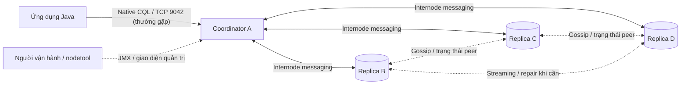
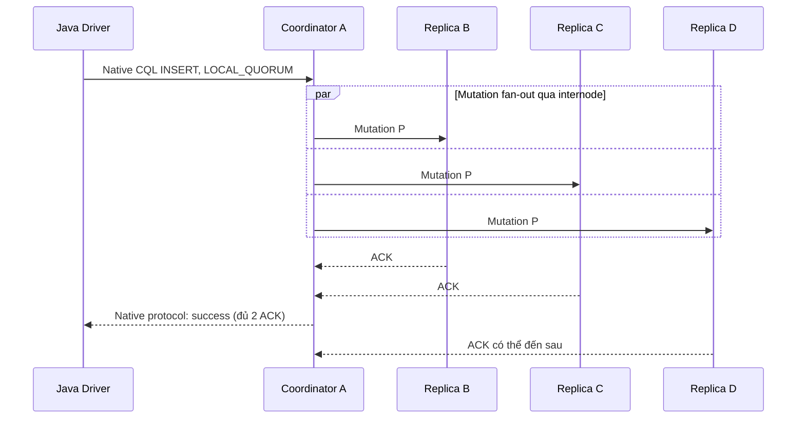
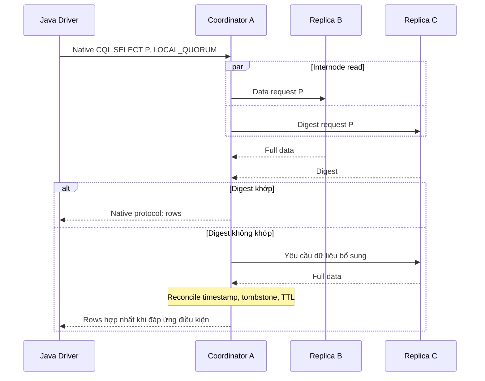
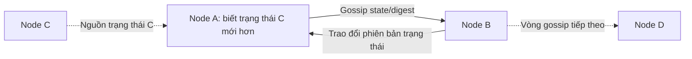
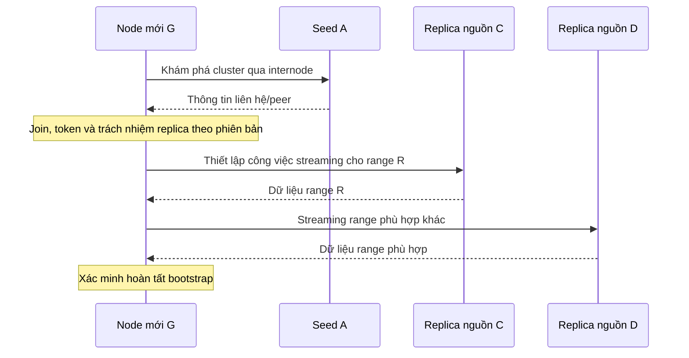
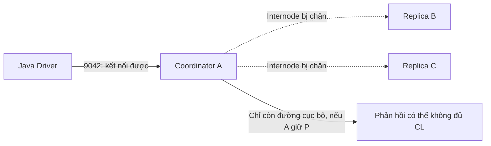

# Internode messaging, native transport và các loại lưu lượng

Apache Cassandra là cơ sở dữ liệu **wide-column phân tán**. Một câu lệnh `INSERT` từ ứng dụng Java chỉ là điểm bắt đầu: sau khi một node nhận CQL, node ấy có thể phải liên lạc với nhiều **replica** để ghi dữ liệu, nhận xác nhận và trả kết quả theo **consistency level (CL)**. Song song với các request nghiệp vụ, các node còn trao đổi **gossip**, trạng thái topology, thông tin repair và đôi khi truyền khối lượng dữ liệu lớn khi **bootstrap** hoặc **streaming**.

Không phải mọi kết nối trong Cassandra đều là CQL. Hai lớp cần phân biệt nhất là:

- **Native transport / native protocol:** đường giao tiếp giữa **CQL client** (Java Driver, `cqlsh`, ứng dụng) và một node Cassandra, thường qua TCP cổng **9042**.
- **Internode messaging:** đường giao tiếp **giữa các node Cassandra** để phối hợp đọc, ghi, gossip và nhiều công việc phân tán khác. Cổng thường gặp cho internode messaging là **7000**; cấu hình mã hóa hoặc phiên bản có thể sử dụng thêm cổng như **7001**.

Bên cạnh đó còn có **streaming dữ liệu**, **repair**, **quản trị/JMX**, **monitoring** và lưu lượng qua các datacenter. Một số cơ chế có thể chia sẻ hạ tầng giao tiếp hoặc dùng đường/chế độ truyền khác nhau tùy phiên bản; không được suy ra “một loại lưu lượng = luôn đúng một cổng” trong mọi Cassandra release.

Mục tiêu bài học:

1. Phân biệt các hướng giao tiếp và các loại lưu lượng có trong một cluster.
2. Theo dấu một request đọc/ghi từ Java Driver tới coordinator, replica và trở lại ứng dụng.
3. Giải thích vai trò của internode messaging đối với gossip, replication, consistency level và vận hành topology.
4. Nhận ra lưu lượng **control/state** khác với lưu lượng **dữ liệu CQL**, **streaming/repair**, và **quản trị**.
5. Xác định ranh giới mạng, cổng, địa chỉ listen/broadcast, mã hóa và khả năng kết nối trong môi trường nhiều DC.
6. Sử dụng CQL, `nodetool` và Java Driver để chẩn đoán timeout/kết nối mà không đồng nhất các loại sự cố.

## 1. Bản đồ các đường giao tiếp trong một cluster

Giả sử ứng dụng Java hoạt động ở `dc1` và cluster có ba replica của partition P tại đó. Java Driver thường bắt đầu bằng kết nối CQL tới một **contact point**. Sau khi khám phá metadata, nó có thể gửi request tới node khác làm **coordinator**. Coordinator xác định natural replica và trao đổi thông điệp nội bộ; không phải ứng dụng trực tiếp ghi lên từng replica qua ba kết nối CQL độc lập.



Sơ đồ tách các **mục đích lưu lượng**, không khẳng định mỗi mũi tên là một TCP socket riêng hoặc cùng loại thông điệp có thể tùy ý chuyển qua mọi cổng. Chi tiết transport, TLS và multiplexing phụ thuộc cấu hình/phiên bản.

| Đường giao tiếp | Bên khởi tạo và bên nhận | Nội dung điển hình | Mục đích |
|---|---|---|---|
| **Client → node** | Java Driver, `cqlsh` → Cassandra coordinator | CQL request, prepared statement, tham số, kết quả row, lỗi | Thực thi nghiệp vụ qua native protocol. |
| **Node ↔ node: đọc/ghi** | Coordinator ↔ natural replica | Mutation, ACK, data/digest response, timeout/error | Đáp ứng replica placement và CL. |
| **Node ↔ node: gossip** | Các peer Cassandra | Trạng thái thành viên, heartbeat, thông tin liên quan topology | Lan truyền nhận thức về peer và hỗ trợ liveness. |
| **Node ↔ node: streaming** | Node nguồn ↔ node nhận | Dữ liệu cần chuyển trong bootstrap/replace/rebuild hoặc hoạt động khác | Di chuyển bản sao hoặc trách nhiệm dữ liệu. |
| **Node ↔ node: repair** | Những node/replica liên quan | Phối hợp đối chiếu, thông tin đồng bộ và dữ liệu cần sửa | Khắc phục lệch dữ liệu giữa replica. |
| **Quản trị/monitoring** | Công cụ vận hành ↔ node, agent/metrics exporter | JMX, trạng thái, metrics, lệnh vận hành | Giám sát và điều khiển có kiểm soát. |

Gossip không mang mọi bản ghi của bảng. Streaming không phải một dạng `SELECT` do Java Driver gửi. Và JMX không phải cổng phục vụ ứng dụng CQL bình thường.

## 2. Native transport: client giao tiếp với coordinator

**Native transport** là lớp nhận kết nối và thực thi giao thức Cassandra Native Protocol từ ứng dụng. CQL là ngôn ngữ truy vấn; trên mạng, driver sử dụng **native protocol** để truyền request, tham số, metadata, kết quả và thông báo lỗi. Giao thức có phiên bản và cách đóng khung/multiplexing riêng; client không gửi “tệp SQL” hay truy cập thẳng SSTable.

Một phiên Java Driver điển hình:

1. Driver mở kết nối đến một hoặc vài **contact point** mà ứng dụng cấu hình.
2. Driver thực hiện các bước bắt tay/phát hiện khả năng, xác thực và mã hóa nếu được cấu hình.
3. Driver nhận metadata cần thiết về node, DC/rack, keyspace, schema và token để quản lý định tuyến.
4. Ứng dụng chuẩn bị câu lệnh, bind tham số, chọn CL và gửi request qua kết nối đến một node.
5. Node nhận request trở thành **coordinator của request đó**; nó thực hiện xử lý CQL và trao đổi nội bộ với replica khi cần.
6. Coordinator trả kết quả hoặc lỗi qua **native transport**; driver chuyển thành `ResultSet`, `Row` hoặc ngoại lệ Java.

Ví dụ CQL:

```sql
SELECT event_time, event_id, reading
FROM telemetry.readings_by_device_day
WHERE tenant_id = 11111111-1111-1111-1111-111111111111
  AND device_id = 22222222-2222-2222-2222-222222222222
  AND event_day = '2026-11-21'
LIMIT 20;
```

Nếu client có đủ thành phần partition key, token-aware routing có thể giúp driver ưu tiên replica địa phương làm coordinator. Tuy nhiên, **coordinator không phải master cố định**; node làm coordinator có thể không giữ partition này.

### Contact point không phải seed

**Contact point** là địa chỉ mà **CQL client** dùng khi khởi tạo kết nối. **Seed node** là điểm liên hệ ban đầu cho **Cassandra peer** khi khám phá cluster. Một máy có thể vừa là seed vừa được cấu hình làm contact point, nhưng hai vai trò không giống nhau.

- Contact point thường dùng **native CQL port** như `9042`.
- Seed phục vụ **internode discovery/messaging**, thường không dùng cổng `9042` cho mục đích ấy.
- Sau khi bootstrap kết nối, driver có thể gửi CQL tới các node khác mà không đi qua contact point ban đầu.
- Seed không phải node đứng giữa mọi CQL request.

Một lỗi thường thấy là client kết nối được `9042` của A nên kết luận mọi node A/B/C cũng trao đổi được internode messaging. Hai đường giao tiếp này dùng **cấu hình, bảo mật và kết nối mạng khác nhau**.

## 3. Internode messaging: phối hợp giữa các peer

**Internode messaging** là cơ chế node Cassandra trao đổi thông điệp để hoàn thành những công việc phân tán. Đường này nằm **sau lớp giao tiếp CQL của client** trong một request điển hình, nhưng nhiều thông điệp không do client tạo ra: gossip và một phần tác vụ vận hành hoạt động kể cả khi không có ứng dụng nào đang `SELECT`.

Các nhóm thông điệp nội bộ thường gặp:

| Nhóm | Ví dụ nội dung logic | Tại sao cần? |
|---|---|---|
| **Mutation/write** | Mutation gửi đến replica, xác nhận đã xử lý, thông tin lỗi | Nhân bản bản ghi và đợi ACK theo CL. |
| **Read** | Yêu cầu dữ liệu, digest, full-data response | Đọc và so sánh các replica của partition. |
| **Gossip/liveness** | Trạng thái thành viên, heartbeat/generation/version theo phiên bản | Đánh giá peer nào có vẻ đang phản hồi. |
| **Topology/schema/metadata** | Trao đổi trạng thái, thông báo hoặc phối hợp thay đổi cần thiết | Giữ thông tin cụm đủ nhất quán cho điều phối; cơ chế cụ thể theo phiên bản. |
| **Hint/repair coordination** | Thông tin về mutation bỏ lỡ, đối chiếu và sửa replica | Hỗ trợ hội tụ dữ liệu sau lỗi. |
| **Streaming control/data** | Thỏa thuận phiên truyền, trạng thái và dữ liệu lớn | Bootstrap/rebuild/repair/đổi trách nhiệm dữ liệu. |

Không nên áp một sơ đồ giao thức/port cứng từ Cassandra 3.x cho Cassandra 4.x/5.x. Bên trong Cassandra, những loại thông điệp có thể được phân lớp ưu tiên, giới hạn hàng đợi, giới hạn kết nối hoặc chuyển qua các đường streaming được triển khai khác nhau.

### Internode protocol không phải giao thức CQL client

Một Java Driver thông thường không kết nối trực tiếp tới internode port để gửi `SELECT`. Ngược lại, một node Cassandra không dùng giao thức native CQL của client làm cơ chế duy nhất gửi mutation đến các replica. Cùng một cluster có thể mở cả hai loại listener nhưng mỗi loại có **giao thức, đường thực thi và mô hình bảo mật riêng**.

## 4. Luồng ghi: từ native CQL sang internode mutation

Ví dụ hệ thống lưu điểm đo theo thiết bị và ngày. Giả sử partition P có natural replica B, C, D trong `dc1`, RF = 3, coordinator A nhận request ở `dc1`.



Các bước cần hiểu:

1. **Native CQL:** ứng dụng gửi `INSERT` và CL đến coordinator A.
2. **Replica placement:** A dùng partition key → token → replication strategy để tìm natural replicas của P. Nếu A cũng là replica, phần ghi cục bộ của A có thể thay cho một đường mạng.
3. **Internode mutation:** A phân phối mutation tới các replica thích hợp; lưu lượng có thể đi qua nhiều DC tùy RF của keyspace.
4. **Ghi cục bộ tại replica:** mỗi replica xử lý commit log và memtable trong đường ghi, rồi gửi ACK theo điều kiện của nó. Flush SSTable và compaction diễn ra ở giai đoạn khác.
5. **CL:** tại `LOCAL_QUORUM` và RF = 3 trong DC coordinator, **hai ACK địa phương** đủ để coordinator trả thành công. ACK từ DC khác không bù cho việc thiếu quorum địa phương.

Điểm quan trọng: **CL quyết định số ACK bắt buộc, không quyết định chỉ gửi mutation đến đúng từng ấy replica**. RF quyết định số bản sao mong muốn. Khi có RF ở DC khác, coordinator vẫn hướng mutation tới các replica theo cơ chế replication, nhưng việc xác nhận `LOCAL_QUORUM` không nhất thiết đợi ACK của DC xa.

### Hệ quả về băng thông

Một lệnh ghi nhỏ từ client có thể dẫn tới nhiều thông điệp **internode**: mutation tới từng replica, ACK trả lại, dữ liệu xuyên DC nếu keyspace nhân bản đa DC, và có thể hint hoặc repair về sau. Dung lượng mạng ở phía client **không bằng** tổng dữ liệu truyền trong cluster. Với RF cao hoặc ghi liên tục, phải tính công suất internode và liên DC, không chỉ cổng `9042`.

## 5. Luồng đọc: full data, digest và reconciliation

Với đọc `LOCAL_QUORUM` ở một DC RF = 3, coordinator có thể liên hệ replica để nhận **full data** và **digest**; khi kết quả khác nhau, nó cần thêm dữ liệu để hòa giải phiên bản.



Sơ đồ chỉ là **mô hình khái niệm** của một đường đọc có đối chiếu replica. Với `ONE`, một full-data response có thể đủ và không cần digest từ replica khác. Các tối ưu speculative retry, read repair hoặc số replica liên hệ thực tế phụ thuộc phiên bản và cấu hình.

Điều cần phân biệt:

- **Data response:** có nội dung mà coordinator cần để dựng kết quả.
- **Digest response:** giá trị tóm lược dùng phát hiện dữ liệu đọc không đồng nhất; **không chứa đủ dữ liệu để giải mã lại hàng**.
- **Reconciliation:** so sánh phiên bản/cell/timestamp, TTL và tombstone để chọn kết quả có hiệu lực.
- **Read repair:** có thể dùng internode messaging để cập nhật một số replica thiếu dữ liệu, tùy phiên bản/cấu hình.

Vì vậy một `SELECT` trả ra ít hàng vẫn có thể cần nhiều mạng và I/O khi replica bất đồng hoặc gặp nhiều tombstone. Không được cho rằng “dữ liệu client trả về 5 KB thì internode traffic chỉ 5 KB”.

## 6. Gossip và failure detector: lưu lượng trạng thái, không phải bản ghi

**Gossip** giúp node lan truyền nhận thức về peer, DC/rack và trạng thái theo cơ chế phiên bản. Trong các bản Cassandra dùng mô hình gossip truyền thống, trạng thái có heartbeat, generation, version và các application states; những vòng trao đổi thường sử dụng bản tóm lược để giảm dữ liệu gửi.



Thông tin gossip được trao đổi ở lớp **node-node**, không phải một bản cập nhật bảng CQL và không phải yêu cầu từ Java Driver. **Failure detector** dùng các dấu hiệu đến/không đến để suy luận khả năng phản hồi của peer. Nếu A nhìn C là `DOWN`, đó không phải bằng chứng máy C tắt; có thể do mạng bị phân vùng hoặc GC pause.

Hai kết luận không được đánh đồng:

1. **Gossip hội tụ:** các peer có nhận thức trạng thái gần nhau hơn.
2. **Dữ liệu replica hội tụ:** các bản sao partition thực sự có cùng giá trị logic sau mutation, hint hoặc repair.

Gossip không tự làm việc thứ hai. Một replica vừa chuyển từ `DN` về `UN` vẫn có thể thiếu mutation của thời gian vắng mặt.

### Metadata theo phiên bản

Cassandra 5.x đưa vào cơ chế **Cluster Metadata Service (CMS)** để điều phối thay đổi metadata cluster. Các chi tiết message và nguồn xác thực của thay đổi topology/schema khác so với mô hình cũ. Khi phân tích lưu lượng metadata, cần đối chiếu **phiên bản Cassandra cụ thể**, thay vì mặc định mọi metadata đều chỉ “lan qua gossip” theo cách các bản trước.

## 7. Streaming: dữ liệu khối lượng lớn giữa các node

Một node mới bootstrap cần nhận dữ liệu cho những khoảng token/partition mà nó sẽ chịu trách nhiệm. **Streaming** truyền dữ liệu đó từ những peer thích hợp. Tương tự, replace, rebuild, thay đổi replication và một số hoạt động sửa chữa có thể phát sinh streaming hoặc dữ liệu trao đổi lớn.



**Seed không nhất thiết là nguồn streaming.** Nó chỉ hỗ trợ khám phá. Các node có dữ liệu phù hợp và có thể phục vụ nguồn stream sẽ tham gia theo quy trình tương ứng.

Streaming khác với mutation CQL thông thường ở **khối lượng, thời gian và mục đích**. Một request `INSERT` nhỏ thường gửi mutation và đợi ACK; bootstrap có thể cần truyền hàng gigabyte hay terabyte dữ liệu (tùy cụm), chiếm băng thông/I/O trong thời gian dài. Đừng giả định stream luôn chạy trên đúng cổng CQL hoặc cùng một luồng gửi gossip: giao thức, cổng và tối ưu vận chuyển chi tiết **thay đổi theo Cassandra release và cấu hình**.

### Repair cũng tạo lưu lượng, nhưng không giống compaction

**Anti-entropy repair** cần đối chiếu dữ liệu giữa replica rồi đồng bộ khác biệt. Nó có thể tạo các phiên làm việc, cấu trúc đối chiếu và luồng dữ liệu giữa node. **Compaction** chủ yếu đọc và ghi lại SSTable trên **cùng node**, không phải một giao thức nhân bản dữ liệu qua mạng; tuy nhiên compaction dùng I/O/CPU và có thể làm các hoạt động mạng khác chậm đi do cạnh tranh tài nguyên.

**Hinted handoff** cũng khác: khi replica tạm vắng, Cassandra có thể lưu hint và phát lại một số mutation khi replica trở lại trong giới hạn cấu hình. Không dựa hoàn toàn vào hint để bỏ qua lịch repair.

## 8. Mạng đa DC: local traffic và cross-DC traffic

Giả sử cluster có `dc1` và `dc2`, mỗi DC RF = 3. Ứng dụng đặt tại `dc1`, Java Driver cấu hình `localDatacenter = dc1`. Một request ghi `LOCAL_QUORUM` ở `dc1` có thể được xác nhận khi **hai replica `dc1`** phản hồi, nhưng dữ liệu vẫn cần được nhân bản tới `dc2` theo topology.

| Loại lưu lượng | Đi trong một DC | Có thể vượt DC | Điểm cần cân nhắc |
|---|---|---|---|
| Native CQL từ ứng dụng địa phương | Có, nếu driver ưu tiên node địa phương. | Có, nếu routing/failover chủ động thay đổi. | Độ trễ client/coordinator, bảo mật và connection. |
| Internode mutation/read | Có. | Có, tùy RF, CL và placement. | Fan-out replica, độ trễ WAN, packet loss. |
| Gossip/trạng thái | Có. | Có, để các peer nắm trạng thái cluster đa DC. | Khả năng liên lạc và tính hội tụ của peer. |
| Streaming/bootstrap/rebuild | Có. | Có khi mở rộng/khôi phục DC hoặc đổi topology. | Băng thông WAN và thời gian phục hồi. |
| Repair | Có. | Có khi đối chiếu replica giữa DC; lựa chọn phạm vi repair ảnh hưởng. | Cần kiểm soát lịch, loại repair và nguồn lực. |
| JMX/monitoring | Theo thiết kế vận hành. | Chỉ nếu thiết kế và chính sách bảo mật cho phép. | Không công khai cổng quản trị ra Internet. |

Điều quan trọng là **độ trễ nhìn từ client** và **băng thông nội bộ** không tỷ lệ một-một. CL có thể làm client không đợi DC xa, nhưng cross-DC replication vẫn tạo tải mạng. `QUORUM` trên tổng sáu replica cần bốn phản hồi; `LOCAL_QUORUM` chỉ cần hai từ `dc1`. Chọn CL liên quan trực tiếp đến độ nhạy với WAN và khả năng chịu lỗi, không chỉ “mạnh hay yếu”.

### Cẩn thận khi liên kết hai DC bị cắt

Nếu `dc1` và `dc2` tách mạng, các request `LOCAL_QUORUM` trong mỗi DC **có thể** vẫn phục vụ nếu đủ replica địa phương. Nhưng một ghi đã được xác nhận ở `dc1` có thể chưa được nhận tại `dc2`. Khi mạng phục hồi, cần đánh giá dữ liệu bỏ lỡ, hint, repair và kế hoạch failover. Việc trạng thái gossip trở lại bình thường **không** chứng minh cross-DC replication đã hoàn tất.

## 9. Những cổng mạng và địa chỉ thường gặp

Không phải tất cả cổng của Cassandra đều mở tới cùng nhóm người dùng. Một cấu hình mẫu có các lớp sau:

| Cổng/thiết lập thường gặp | Kết nối | Phạm vi/phân tích |
|---|---|---|
| **9042/TCP** (`native_transport_port`) | Java Driver, `cqlsh`, native CQL client → node | Mở cho **ứng dụng được phép**, không tự động mở cho Internet. |
| **7000/TCP** (`storage_port`) | Node Cassandra ↔ node Cassandra | Cổng internode thường gặp. Phải thông giữa những peer cần liên hệ. |
| **7001/TCP** (`ssl_storage_port`) | Internode theo một số chế độ TLS/phiên bản | Không mặc định mọi cluster TLS đều có socket 7001; kiểm tra cấu hình bản chạy. |
| **7199/TCP** (JMX phổ biến) | `nodetool`/JMX tooling → JVM Cassandra | Cổng quản trị; giới hạn mạng và xác thực/SSL phù hợp, không cho phép truy cập công khai. |
| **Monitoring/agent ports** | Exporter, Prometheus, công cụ quan sát | Không có một cổng chuẩn duy nhất cho mọi hệ thống; tùy integration. |

**Cổng chỉ là mặc định thường gặp**, không thay thế việc xem cấu hình thật. Cách sử dụng cổng mã hóa internode, ranh giới connection và một số listener được thay đổi qua các release; khi thiết kế firewall, cần xuất phát từ tài liệu và cấu hình Cassandra đang vận hành.

### Phân biệt listen, broadcast và địa chỉ client

Các trường cấu hình có mục đích khác nhau:

- `listen_address`: địa chỉ node dùng để **lắng nghe giao tiếp internode** ở thiết lập tương ứng.
- `broadcast_address`: địa chỉ node **quảng bá** để peer dùng liên hệ internode trong những cấu hình cần thiết.
- `rpc_address`: địa chỉ **lắng nghe native transport** trong các phiên bản dùng trường này; tên có thể gây nhầm với hệ Thrift cũ, nhưng cần đọc theo phiên bản Cassandra.
- `broadcast_rpc_address`: địa chỉ **công bố cho client/driver** để liên hệ native CQL, đặc biệt quan trọng khi bind ở mọi interface.
- `native_transport_port`: cổng native CQL, thường là 9042.
- `storage_port` và `ssl_storage_port`: thông số cổng cho internode messaging tương ứng với cấu hình/phiên bản.

Ví dụ **minh họa** một node `dc1`; IP thuộc dải dùng cho tài liệu:

```yaml
# Cấu hình minh họa; kiểm tra tính tương thích với bản Cassandra thực tế.
cluster_name: 'telemetry-cluster'

# Đường giữa các Cassandra node:
listen_address: 192.0.2.11
broadcast_address: 192.0.2.11
storage_port: 7000
ssl_storage_port: 7001

# Đường native CQL từ driver:
start_native_transport: true
rpc_address: 192.0.2.11
native_transport_port: 9042
broadcast_rpc_address: 192.0.2.11

endpoint_snitch: GossipingPropertyFileSnitch
```

Thực tế, IP nội bộ có thể khác IP mà client bên ngoài cluster truy cập được. Địa chỉ **broadcast** phải là địa chỉ bên còn lại thực sự có thể kết nối, không nhất thiết bằng địa chỉ listen. Khi đặt `rpc_address: 0.0.0.0` ở cấu hình hỗ trợ, phải thiết lập `broadcast_rpc_address` hợp lệ; không quảng bá `0.0.0.0` như một endpoint mà driver cần kết nối.

**Không sửa các trường mạng trên cluster production theo ví dụ này.** Thay đổi broadcast/listen address có thể ảnh hưởng danh tính/khả năng liên hệ, membership và quá trình thay node; cần quy trình phù hợp phiên bản.

## 10. TLS, xác thực và quyền mạng

Cassandra có ít nhất hai phạm vi bảo mật cần tính riêng:

1. **Client-to-node:** ứng dụng Java ↔ native CQL listener. Cấu hình TLS và xác thực quyết định ai được gửi CQL và dữ liệu trao đổi có được mã hóa hay không.
2. **Node-to-node:** các peer ↔ internode messaging/streaming. TLS giữa node giúp bảo vệ lưu lượng dữ liệu và trạng thái nội bộ, nhưng cần chứng chỉ, trust, cấu hình endpoint và chính sách phiên bản phù hợp.

Các cấu hình truyền thống có nhóm tùy chọn như `client_encryption_options` và `server_encryption_options`. **Tên khóa con, loại keystore và hành vi bắt buộc TLS khác nhau theo phiên bản**, nên bài này không đưa mật khẩu, đường dẫn chứng chỉ giả hoặc tuyên bố một YAML mẫu có thể bật TLS an toàn cho mọi bản Cassandra.

Checklist bảo mật:

- Phân đoạn **mạng client**, **mạng internode** và **mạng quản trị** phù hợp chính sách hạ tầng.
- Chỉ cho ứng dụng được phép truy cập native CQL; không mở rộng quyền internode chỉ để chữa lỗi client.
- Bảo vệ cả **internode liên DC**, vì mutation, thông tin trạng thái và dữ liệu streaming có thể đi qua WAN.
- Không công khai JMX; áp dụng xác thực, TLS, network policy và tài khoản quản trị phù hợp.
- Kiểm tra certificate chain, hostname/SAN, truststore và thời hạn chứng chỉ khi TLS handshake lỗi.
- Test đường kết nối theo **hai chiều** giữa node; một NAT/rule bất đối xứng có thể làm gossip hoặc streaming hỏng dù client CQL vẫn khỏe.

Không nên vô hiệu hóa TLS để “xác nhận nhanh” trên production mà không có môi trường kiểm thử và kiểm soát an toàn.

## 11. Thiết lập keyspace và bảng để quan sát lưu lượng

Trong cluster thử nghiệm có hai DC với những tên như trên, tạo keyspace và bảng wide-column:

```sql
CREATE KEYSPACE telemetry
WITH replication = {
  'class': 'NetworkTopologyStrategy',
  'dc1': 3,
  'dc2': 3
};

CREATE TABLE telemetry.readings_by_device_day (
    tenant_id uuid,
    device_id uuid,
    event_day date,
    event_time timestamp,
    event_id uuid,
    reading double,
    PRIMARY KEY ((tenant_id, device_id, event_day), event_time, event_id)
) WITH CLUSTERING ORDER BY (event_time DESC, event_id ASC);
```

Ở đây, partition key là **`(tenant_id, device_id, event_day)`**; Cassandra băm đủ ba giá trị thành token, rồi dùng `NetworkTopologyStrategy` cùng RF của các DC để tìm natural replica. `event_time` và `event_id` là **clustering columns**: chúng sắp xếp/phân biệt hàng trong partition, không quyết định DC hoặc rack.

Ghi và đọc cùng partition:

```sql
INSERT INTO telemetry.readings_by_device_day
  (tenant_id, device_id, event_day, event_time, event_id, reading)
VALUES (
  11111111-1111-1111-1111-111111111111,
  22222222-2222-2222-2222-222222222222,
  '2026-11-21',
  '2026-11-21T08:30:00+07:00',
  33333333-3333-3333-3333-333333333333,
  36.7
);

SELECT event_time, event_id, reading
FROM telemetry.readings_by_device_day
WHERE tenant_id = 11111111-1111-1111-1111-111111111111
  AND device_id = 22222222-2222-2222-2222-222222222222
  AND event_day = '2026-11-21'
LIMIT 20;
```

Truy vấn chọn đầy đủ partition key, vì vậy coordinator có thể nhắm tập replica cụ thể. Việc thiếu thành phần khóa phân vùng hoặc thêm `ALLOW FILTERING` tùy tiện có thể dẫn đến quét dữ liệu lớn hơn và tăng tải internode/I/O đáng kể.

## 12. Quan sát CQL và nội bộ bằng các công cụ phù hợp

Đối với một môi trường test, dùng `cqlsh` để bật tracing cho **một request có chủ đích**:

```sql
-- Lệnh cqlsh, không phải cú pháp SELECT thuần.
CONSISTENCY LOCAL_QUORUM;
TRACING ON;

SELECT event_time, event_id, reading
FROM telemetry.readings_by_device_day
WHERE tenant_id = 11111111-1111-1111-1111-111111111111
  AND device_id = 22222222-2222-2222-2222-222222222222
  AND event_day = '2026-11-21'
LIMIT 20;

TRACING OFF;
```

Trace có thể thể hiện bước xử lý ở coordinator, gửi yêu cầu đến replica và nhận phản hồi. Tracing **không phải packet capture** cho mọi kết nối TCP, cũng không nhất thiết cho thấy chính xác mọi stream hoặc bước gossip. Bật tracing tạo thêm tải và metadata, nên dùng có chọn lọc.

Quan sát cluster:

```bash
nodetool status
nodetool gossipinfo
nodetool netstats
nodetool tpstats
nodetool describecluster
```

| Lệnh | Hữu ích cho việc gì? | Giới hạn |
|---|---|---|
| `nodetool status` | Nhìn node theo DC/rack, `UN`/`DN` và vòng đời. | Một node `UN` vẫn có thể không xử lý đọc/ghi đúng hạn. |
| `nodetool gossipinfo` | Xem thông tin trạng thái peer mà node đang biết. | Là **góc nhìn cục bộ**, không chứng minh mọi node đồng ý ngay. |
| `nodetool netstats` | Xem trạng thái một số phiên streaming và thông tin mạng liên quan tùy phiên bản. | Không phải số liệu toàn bộ byte của mọi CQL request trong cluster. |
| `nodetool tpstats` | Xem hàng đợi/tác vụ nội bộ, gợi ý quá tải. | Cần kết hợp metrics và log để hiểu nguyên nhân. |
| `nodetool describecluster` | Kiểm tra tên cụm, thông tin schema/metadata khái quát. | Không phải công cụ xem packet payload. |

Trong CQL, kiểm tra node và keyspace:

```sql
SELECT cluster_name, data_center, rack, host_id
FROM system.local;

SELECT keyspace_name, replication
FROM system_schema.keyspaces
WHERE keyspace_name = 'telemetry';
```

`system.local` chỉ phản ánh **node đang trả lời request**, không phải danh sách toàn bộ cluster. Các bảng peer hoặc metadata driver tùy phiên bản hỗ trợ đối chiếu topology ở phạm vi rộng hơn.

## 13. Java Driver 4.x: đường client và định tuyến địa phương

Ví dụ Java sử dụng Apache Cassandra Java Driver 4.x với API `com.datastax.oss.driver`. Nó mở **native CQL connection** tới contact points, không trực tiếp mở internode messaging tới replica.

```java
import com.datastax.oss.driver.api.core.CqlSession;
import com.datastax.oss.driver.api.core.DefaultConsistencyLevel;
import com.datastax.oss.driver.api.core.cql.BoundStatement;
import com.datastax.oss.driver.api.core.cql.PreparedStatement;
import com.datastax.oss.driver.api.core.cql.Row;
import com.datastax.oss.driver.api.core.metadata.Node;

import java.net.InetSocketAddress;
import java.time.Instant;
import java.time.LocalDate;
import java.util.UUID;

public class CassandraTrafficExample {
    public static void main(String[] args) {
        UUID tenantId = UUID.fromString(
            "11111111-1111-1111-1111-111111111111");
        UUID deviceId = UUID.fromString(
            "22222222-2222-2222-2222-222222222222");
        UUID eventId = UUID.fromString(
            "33333333-3333-3333-3333-333333333333");
        LocalDate day = LocalDate.parse("2026-11-21");
        Instant time = Instant.parse("2026-11-21T01:30:00Z");

        // IP dành cho tài liệu; thay bằng contact point thật.
        try (CqlSession session = CqlSession.builder()
                .addContactPoint(new InetSocketAddress("192.0.2.11", 9042))
                .addContactPoint(new InetSocketAddress("192.0.2.12", 9042))
                .withLocalDatacenter("dc1")
                .build()) {

            // Đây là metadata driver, không phải giao thức gossip.
            for (Node node : session.getMetadata().getNodes().values()) {
                System.out.printf("node=%s dc=%s rack=%s%n",
                    node.getEndPoint(),
                    node.getDatacenter(),
                    node.getRack());
            }

            PreparedStatement insert = session.prepare(
                "INSERT INTO telemetry.readings_by_device_day " +
                "(tenant_id, device_id, event_day, event_time, event_id, reading) " +
                "VALUES (?, ?, ?, ?, ?, ?)");
            BoundStatement write = insert
                .bind(tenantId, deviceId, day, time, eventId, 36.7)
                .setConsistencyLevel(DefaultConsistencyLevel.LOCAL_QUORUM);
            session.execute(write);

            PreparedStatement select = session.prepare(
                "SELECT event_time, event_id, reading " +
                "FROM telemetry.readings_by_device_day " +
                "WHERE tenant_id = ? AND device_id = ? AND event_day = ? " +
                "LIMIT 20");
            BoundStatement read = select
                .bind(tenantId, deviceId, day)
                .setConsistencyLevel(DefaultConsistencyLevel.LOCAL_QUORUM);

            for (Row row : session.execute(read)) {
                System.out.printf("%s %s %.2f%n",
                    row.getInstant("event_time"),
                    row.getUuid("event_id"),
                    row.getDouble("reading"));
            }
        }
    }
}
```

Trong ví dụ:

- `192.0.2.11` và `192.0.2.12` là IP **minh họa**, không phải địa chỉ node thực. `dc1` phải khớp local DC của cluster.
- Hai prepared statements cung cấp đủ **partition key**; khi driver có metadata, nó có thể dùng token-aware routing để ưu tiên replica phù hợp làm coordinator.
- `LOCAL_QUORUM` áp dụng cho **ACK/data ở DC coordinator**, không làm client phải kết nối trực tiếp với từng replica ở DC đó.
- Metadata driver được cập nhật bất đồng bộ. Nó có thể không khớp hoàn toàn với góc nhìn gossip tại mọi node ở cùng thời điểm.
- Ứng dụng production cần cấu hình xác thực, TLS, timeout, retry policy và tái sử dụng `CqlSession` lâu dài, thay vì tạo session cho từng request.

Đọc lại `Row` là kết quả của request CQL. Từ Java API này không thể suy ra có bao nhiêu internode TCP connection đã được tạo hoặc stream đang chạy. Muốn phân tích sâu cần trace, log, metrics và công cụ mạng theo quyền truy cập được cấp.

## 14. Chẩn đoán: CQL kết nối được nhưng internode bị chặn

Đây là một trong những tình huống quan trọng nhất để phân biệt các loại lưu lượng.

Giả sử A, B, C là các natural replica của partition P, nhưng firewall vô tình chặn đường **internode** từ A tới B/C. Ứng dụng vẫn kết nối được tới **native CQL port** của A:



Khi đó:

- TCP handshake hoặc authentication CQL có thể thành công; **request `INSERT`/`SELECT` vẫn có thể timeout hoặc `Unavailable`** do không liên hệ được đủ replica.
- Nếu A **không** là natural replica của P, ngay cả CL thấp có thể thất bại vì các replica cần thiết nằm ở node không liên lạc được.
- Nếu A là replica, `LOCAL_ONE` có thể phục vụ một số request, trong khi `LOCAL_QUORUM` của RF = 3 cần thêm một replica địa phương; kết quả phụ thuộc mạng/thời hạn thực tế.
- Gossip/failure detector có thể dần coi các peer là `DOWN`; trạng thái này là nhận định theo đường liên lạc, không chứng minh B/C đã tắt.

Ngược lại, khi internode giao tiếp tốt nhưng cổng `9042` của A bị chặn đối với một nhóm ứng dụng, **node Cassandra có thể vẫn phục vụ nội bộ bình thường**, nhưng client đó không thể khởi tạo kết nối CQL tới A. Đây là hai loại sự cố khác nhau và có thể cần sửa rule mạng khác nhau.

## 15. Phân loại lỗi theo lớp lưu lượng

| Dấu hiệu | Đường có khả năng liên quan | Cần kiểm tra |
|---|---|---|
| Java Driver không mở được session; lỗi connection/refused/handshake | **Client → native transport** | Contact point, `9042`, TLS, authentication, địa chỉ broadcast client. |
| `cqlsh` kết nối được nhưng `LOCAL_QUORUM` liên tục timeout | **Coordinator ↔ replica** | RF, natural replica, internode network, liveness, queue, disk/GC. |
| Node lúc `UN` lúc `DN`, góc nhìn giữa peer khác nhau | **Gossip/failure detector**, internode | Packet loss, GC pause, CPU, địa chỉ listen/broadcast, mạng bất đối xứng. |
| Thêm node rất chậm, `nodetool netstats` có phiên stream dài | **Streaming/bootstrap** | Băng thông, disk I/O, nguồn streaming, cross-DC, logs. |
| Repair khiến latency CQL tăng | **Repair + tải node/mạng** | Lịch repair, phạm vi, compaction/I/O, mạng giữa replica. |
| Đọc `LOCAL_ONE` ở DC dự phòng cho dữ liệu cũ sau failover | **Replication cross-DC/hội tụ** | CL ghi/đọc, đường WAN, hint, repair, timestamp. |
| Truy vấn thất bại chỉ từ một mạng ứng dụng, node vẫn `UN` | **Client networking** | Route/NAT, `broadcast_rpc_address`, security group, TLS. |
| `nodetool` không kết nối được nhưng CQL hoạt động | **JMX/quản trị** | Cổng JMX, xác thực, SSL, mạng quản trị và quyền. |

### Phân biệt `Unavailable` và timeout

`Unavailable` thường được trả khi coordinator **không nhìn thấy đủ replica được coi là sẵn sàng** để đạt CL ngay từ đầu. `ReadTimeout`/`WriteTimeout` thường biểu thị request đã đi vào đường thực thi nhưng **không thu đủ phản hồi đúng hạn**. Ngoài ra còn có các dạng `ReadFailure`/`WriteFailure` khi replica báo lỗi.

Với ghi, **timeout không chứng minh mutation chưa được áp dụng**: một số replica có thể đã nhận dữ liệu. Không tự retry không giới hạn bằng cách tạo khóa sự kiện mới; cần thiết kế idempotency và xử lý trạng thái không chắc chắn ở ứng dụng.

Với đọc, digest mismatch/reconciliation có thể phát sinh thêm thông điệp và làm tăng độ trễ, ngay cả khi node vẫn `UN`. Không nên vội quy mọi timeout cho “mạng 9042 chậm”.

## 16. Năng lực mạng và vận hành: ưu tiên điều gì?

Để đánh giá hiệu năng, cần nhìn ở **ba cấp tải**:

1. **Client traffic:** số kết nối CQL, request/s, kích thước query/result, p95/p99 latency và timeout.
2. **Internode request traffic:** mutation fan-out theo RF, ACK/data/digest, thông điệp gossip và metadata, tải giữa các rack/DC.
3. **Bulk/maintenance traffic:** streaming, repair, hints và tác động gián tiếp từ compaction/I/O trên node.

Các tối ưu như **client-side connection pooling**, native protocol multiplexing, internode compression và điều tiết tài nguyên có thể giúp hiệu năng, nhưng cấu hình cụ thể phụ thuộc phiên bản. Không mặc định bật một chế độ nén internode sẽ làm mọi trường hợp nhanh hơn; dữ liệu ít nén, CPU hạn chế hoặc traffic đã mã hóa có thể tạo đánh đổi khác.

Một quy trình quan sát hợp lý:

- Đo request rate và latency ở ứng dụng/driver, phân biệt connect error với CQL timeout.
- Đối chiếu request với coordinator, RF, CL và tập replica của partition.
- Quan sát internode bytes/messages/queue và CPU/disk của node trong cùng khung thời gian.
- Tách riêng giai đoạn bootstrap, repair hoặc cross-DC failover khỏi tải thường ngày.
- Cân đối băng thông giữa DC, traffic peaks và khả năng phục hồi sau khi mất một failure domain.

### Kiểm soát hotspot ở mức partition

Cassandra không tự tách một **partition cực nóng** cho toàn bộ node trong cluster. Partition key quyết định tập natural replica, nên request của partition nóng vẫn tập trung vào những replica nhất định. Thêm node hoặc tăng cổng mạng không tự giải quyết vấn đề này. Cần thiết kế lại khóa/bucket theo mẫu truy vấn, cân nhắc phân bố thiết bị/ngày/tenant, cùng với sizing node và kiểm soát retention/tombstone.

### Điều chỉnh CL không phải tối ưu mạng miễn phí

Chuyển `LOCAL_QUORUM` xuống `LOCAL_ONE` có thể giảm số ACK/data cần chờ, nhưng **thay đổi ngữ nghĩa nhất quán**; nó không giảm RF và không tự xóa lưu lượng nhân bản đến các replica khác. Ngược lại, dùng `EACH_QUORUM` cho ghi đa DC tăng điều kiện xác nhận tại từng DC và có thể khiến lỗi liên DC ảnh hưởng kết quả client. Mọi điều chỉnh CL cần xuất phát từ yêu cầu nghiệp vụ và failover, không chỉ từ một biểu đồ độ trễ.

## 17. Bài tập suy luận

**Tình huống A — Native CQL hoạt động, ghi quorum lỗi:** Driver kết nối A qua `9042` thành công nhưng `INSERT` `LOCAL_QUORUM` trả timeout. Có thể kết luận `9042` của A là nguyên nhân không? **Không.** Phải kiểm tra thêm internode messaging tới natural replica, tải node và số ACK thực tế.

**Tình huống B — Seed down:** Seed S không trả lời nhưng các peer vẫn liên lạc nội bộ được và partition P có đủ replica khỏe mạnh. Mọi request CQL có bắt buộc đi qua S không? **Không.** Seed giúp khám phá, không phải CQL master.

**Tình huống C — Mất mạng WAN:** Cluster hai DC, mỗi DC RF = 3; ghi `LOCAL_QUORUM` tại `dc1` vẫn thành công. Điều đó có xác nhận `dc2` đã chứa mutation không? **Không.** Điều kiện ACK chỉ thuộc `dc1`.

**Tình huống D — Streaming rất lớn:** Node mới G đang bootstrap và các node nguồn tăng disk/network utilization. Có phải Java Driver đang gửi hàng triệu câu `INSERT` để tạo dữ liệu trên G không? **Không nhất thiết**. Bootstrap dùng cơ chế streaming node-node, tách khỏi các query CQL thông thường.

**Tình huống E — Một replica Up nhưng timeout:** `nodetool status` hiện `UN` ở C, song đọc có thể timeout. Mâu thuẫn không? **Không.** Liveness không đảm bảo đọc SSTable/memtable và trả dữ liệu đúng hạn khi I/O, GC, mạng hoặc queue chậm.

**Tình huống F — JMX hỏng:** `nodetool status` không truy cập được một node do JMX bị chặn nhưng `cqlsh` vẫn `SELECT` được. Điều đó có chứng minh node không còn tham gia cluster? **Không**; cần xác minh cổng/cấu hình JMX riêng.

**Tình huống G — Contact point vs replica:** Driver dùng A làm contact point, nhưng partition P có natural replica B/C/D. A có thể là coordinator không? **Có** nếu A nhận request hợp lệ; A sẽ liên hệ replica phù hợp qua internode.

**Tình huống H — Bật tracing:** Có nên bật `TRACING ON` cho mọi request production để đếm packet? **Không.** Trace có chi phí và không phải packet capture; cần dùng metrics và công cụ chẩn đoán phù hợp.

**Tình huống I — Chỉ mở TCP 9042 giữa hai DC:** Có đủ để một Cassandra cluster đa DC đồng bộ replication không? **Không.** Peer cần đường internode được cấu hình phù hợp; `9042` phục vụ giao thức CQL client.

## 18. Checklist triển khai và xử lý lỗi

Khi chuẩn bị một cluster có ứng dụng Java và nhiều rack/DC, hãy trả lời:

1. **Ai kết nối tới ai?** Vẽ đường **client → native CQL** và **node ↔ node internode** riêng, kể cả cross-DC.
2. **Cổng, địa chỉ và TLS nào thực sự được dùng?** Đối chiếu `native_transport_port`, `storage_port`, `ssl_storage_port`, listen/broadcast và cấu hình mã hóa bản chạy.
3. **Seed và contact point có bị nhầm không?** Seed phục vụ discovery node, contact point phục vụ driver, cả hai không phải master.
4. **Partition nằm trên những replica nào?** Từ partition key, token, `NetworkTopologyStrategy`, RF, DC và rack.
5. **CL của request yêu cầu gì?** Phân biệt ACK local vs toàn cụm; tính khả năng chịu lỗi và liên DC.
6. **Lỗi xảy ra ở lớp nào?** TCP/connect/TLS, internode, replica response, gossip liveness, streaming hay JMX.
7. **Có bảo trì đồng thời không?** Kiểm tra bootstrap, repair, hints, compaction và ảnh hưởng tới mạng/I/O.
8. **Dữ liệu có hội tụ không?** Node `UN`, gossip bình thường hay kết nối CQL tốt không thay thế kiểm chứng replica/hint/repair.
9. **Ứng dụng retry thế nào?** Có dùng khóa sự kiện ổn định, CL thích hợp, timeout và idempotency?
10. **Có dự phòng failure domain không?** Bố trí rack/DC đúng, seed liên hệ được, đường mạng và chính sách DR được kiểm tra.

Những câu hỏi này ngăn hai kiểu chẩn đoán sai phổ biến: *“Java kết nối được nên Cassandra cluster khỏe”* và *“có lỗi CQL nên phải sửa seed/gossip”*. Chỉ khi biết **loại lưu lượng và hai đầu đường truyền**, mới chọn đúng công cụ và bước khắc phục.

## 19. Tổng kết

Nhìn tổng thể, Cassandra có nhiều lớp lưu lượng hoạt động đồng thời:

```text
Java App / cqlsh
      |
      | Native CQL transport (thường TCP 9042)
      v
Coordinator của request
      |
      | Internode messaging: mutation, ACK, read data/digest
      +--------------------> Natural replicas theo token + RF + topology
      |                                |
      |                                +--> Commit log / memtable / SSTable
      |
      | Gossip / metadata / liveness giữa các peer
      +--------------------> Các node của cluster
      |
      | Streaming / repair / hint khi cần
      +--------------------> Node nguồn / node đích phù hợp

Quản trị / monitoring
      |
      +--> JMX / agent / metrics (không phải giao thức CQL client)
```

**Native transport** phục vụ ứng dụng CQL; **internode messaging** phục vụ phối hợp phân tán giữa các node; **gossip** lan truyền trạng thái; **streaming/repair** giúp chuyển và đối chiếu dữ liệu; **JMX/monitoring** phục vụ vận hành. Các cơ chế có thể chia sẻ tài nguyên máy và đường mạng, nhưng **không thể dùng thành công ở một lớp để kết luận tất cả lớp khác đều khỏe mạnh**.

Khi phân tích lỗi Cassandra, hãy xuất phát từ **partition key → natural replica → coordinator → CL** và vẽ chính xác **client traffic, internode traffic, cross-DC traffic, maintenance traffic**. Tư duy này kết nối kiến trúc cụm với thiết kế bảng wide-column, replication, đọc/ghi, repair, compaction, xử lý timeout và kết nối Java một cách nhất quán.
