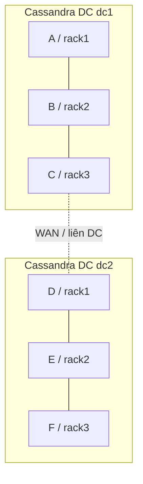
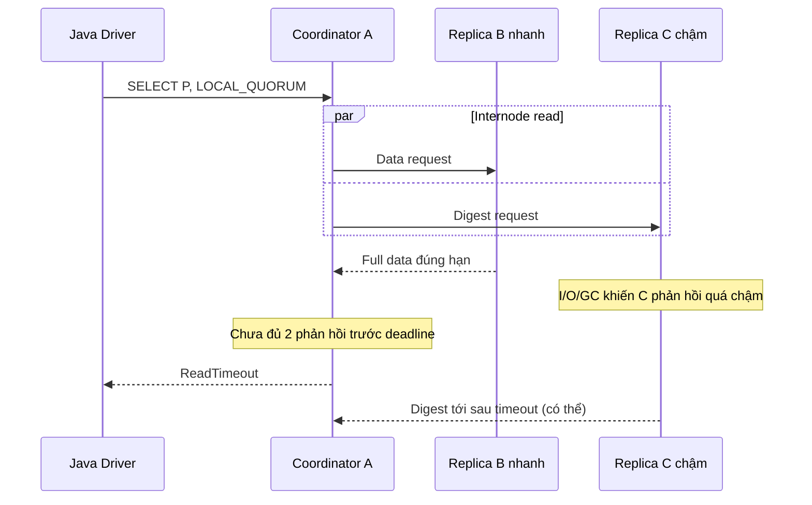
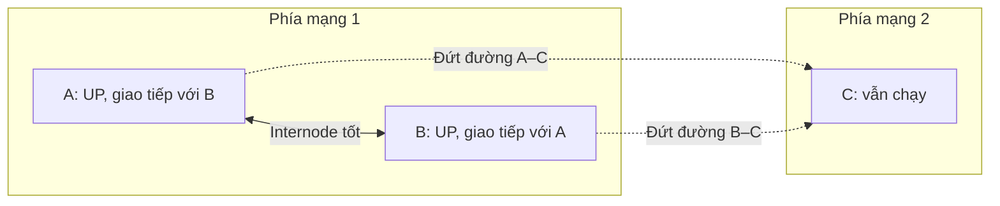
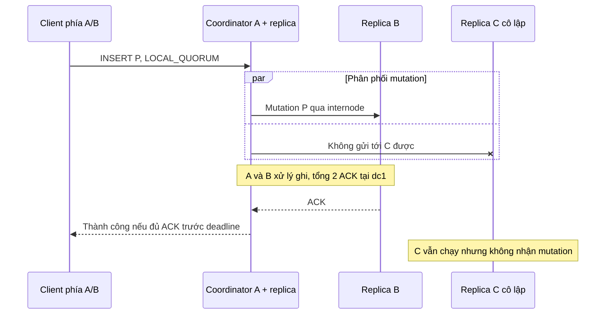
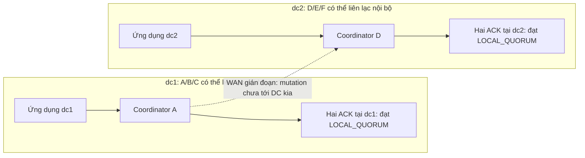
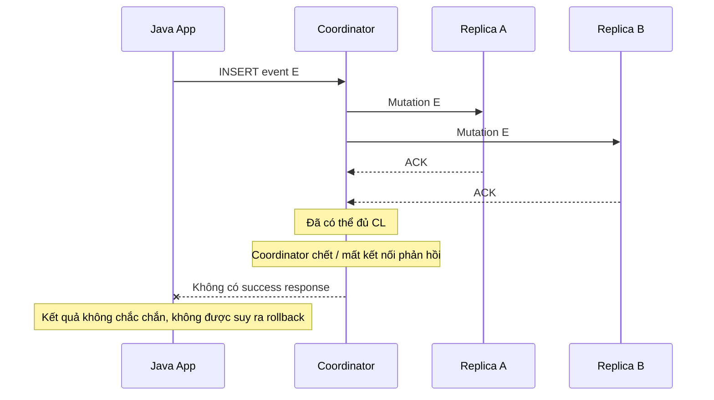
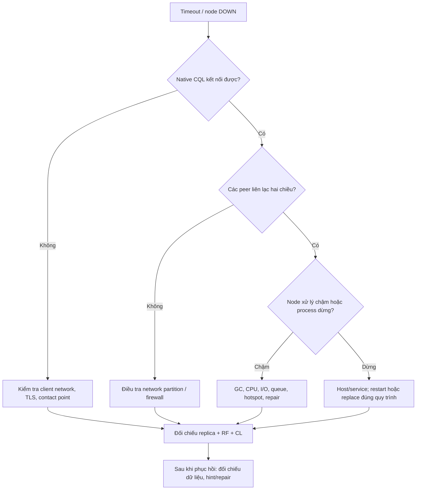

# Phân vùng mạng, nút chậm và sự khác biệt với lỗi dừng hoàn toàn

Trong một cluster Apache Cassandra, thông báo “node không phản hồi” không cho biết chắc node **đã tắt**, **đang chạy chậm**, hay **chỉ không thể liên lạc từ một phía mạng**. Ba tình huống có thể tạo ra cùng một triệu chứng ở ứng dụng Java — `ReadTimeout`, `WriteTimeout`, mất kết nối hoặc `Unavailable` — nhưng có hậu quả vận hành và cách xử lý rất khác nhau.

Đây là một vấn đề cốt lõi của **kiến trúc phân tán**. Cassandra sử dụng mô hình **peer-to-peer**, lưu từng partition trên các **natural replica** theo token, replication strategy và replication factor (RF). Một request CQL được một **coordinator** điều phối, và **consistency level (CL)** quyết định số phản hồi tối thiểu mà coordinator cần nhận. Khi mạng phân vùng hoặc một node bị chậm, không phải toàn cluster đều thất bại giống nhau: kết quả phụ thuộc **tập replica của partition**, **DC/rack**, **CL**, **góc nhìn liveness**, **đường mạng** và **thời hạn request**.

Bài học này đi sâu vào việc phân biệt lỗi để đọc đúng tín hiệu, chọn mức nhất quán phù hợp và xử lý an toàn trước khi restart, replace hoặc remove node. Nội dung gắn với mục tiêu của module Cassandra: partition key và thiết kế bảng theo truy vấn, CQL, replication, repair, compaction, phát hiện lỗi và kết nối Java Driver.

Sau bài, bạn có thể:

- Phân biệt **crash-stop**, **crash-recovery**, **slow node**, **network partition** và **đứt đường client–coordinator**.
- Giải thích vì sao failure detector không thể “chứng minh node đã chết” từ một timeout.
- Phân tích khả năng đọc/ghi khi cluster mất một node, một rack hoặc một đường liên DC.
- Tính quorum cho `LOCAL_QUORUM`, `QUORUM` và `EACH_QUORUM` trong ví dụ RF cụ thể.
- Hiểu kết quả ghi **không chắc chắn** sau `WriteTimeout`, cách tránh retry gây trùng dữ liệu và việc cần làm sau hồi phục.
- Dùng công cụ CQL, `nodetool`, tracing, log và Java Driver để định vị tầng gây lỗi.

## 1. Một triệu chứng, nhiều loại lỗi khác nhau

Trong hệ thống tập trung, một tiến trình tắt thường dễ xác định. Trong cluster phân tán, các peer chỉ quan sát được **thông điệp đến hay không đến trong một khoảng thời gian**. Đó là bằng chứng về *khả năng liên lạc*, không phải bằng chứng tuyệt đối về *trạng thái vật lý*.

| Tình huống | Bản chất | Node còn chạy? | Một peer khác có thể liên hệ? |
|---|---|---|---|
| **Crash-stop** | Máy/tiến trình dừng và không tiếp tục trong thời gian quan sát. | Không. | Không, trừ phản hồi cũ đang trên đường mạng. |
| **Crash-recovery** | Node dừng rồi khởi động trở lại, thường giữ dữ liệu và danh tính nếu không bị mất đĩa. | Không trong lúc dừng; có sau khi khôi phục. | Thay đổi theo từng giai đoạn. |
| **Slow node** | Tiến trình vẫn hoạt động nhưng xử lý hoặc giao tiếp rất chậm. | Có. | Có thể có, nhưng trễ hoặc không đúng deadline. |
| **Network partition** | Đường liên lạc giữa một số nhóm node bị gián đoạn. | Có thể tất cả vẫn chạy. | Phụ thuộc phía mạng và hướng kết nối. |
| **Client-side partition** | Ứng dụng không tới được một coordinator qua native CQL, dù các node Cassandra còn nói chuyện với nhau. | Có thể có. | Có thể vẫn bình thường ở lớp internode. |
| **Partial failure** | Chỉ một phần chức năng hoặc đường kết nối bị lỗi. | Không nhất thiết dừng. | Có thể trả lời CQL nhưng không trả lời internode, hoặc ngược lại. |

Điểm phân biệt: một node có thể **`UP` từ góc nhìn A**, nhưng **`DOWN` từ góc nhìn B**. Một node chậm có thể được cả hai đánh giá là `DOWN` trong một khoảng ngắn rồi tự xuất hiện lại. Cả hai hiện tượng không tự chứng minh có lỗi đĩa hay mất dữ liệu.

### Minh họa hai kết quả giống nhau tại client

Ứng dụng gửi `SELECT` tới coordinator A rồi nhận `ReadTimeout`:

- **Kịch bản 1:** Replica C đã tắt; coordinator cần hai phản hồi nhưng chỉ có một replica khả dụng.
- **Kịch bản 2:** Replica C vẫn chạy và đang đọc SSTable, nhưng I/O quá chậm nên phản hồi đến sau deadline.
- **Kịch bản 3:** C trả kết quả đúng hạn cho B nhưng đường C → A bị mất gói; A không nhận được.
- **Kịch bản 4:** C và A trao đổi tốt, song chính coordinator A bị quá tải hoặc đường A → Java Driver bị lỗi.

Ứng dụng có thể thấy triệu chứng gần giống nhau. Muốn khắc phục chính xác cần xác định **đường truyền, thời điểm và số phản hồi đã thực sự tới coordinator**.

## 2. “Partition” trong Cassandra có hai nghĩa phải tách rời

Trong ngữ cảnh Cassandra, từ *partition* xuất hiện ở cả **mô hình dữ liệu** và **mạng phân tán**, nhưng hai nghĩa hoàn toàn khác:

| Thuật ngữ | Ý nghĩa | Ví dụ |
|---|---|---|
| **Data partition** | Tập hàng thuộc cùng partition key trong một bảng wide-column. | Dữ liệu đo của thiết bị D trong ngày N. |
| **Network partition** | Hai hay nhiều nhóm node không thể trao đổi thông điệp theo một số đường mạng. | `dc1` không liên hệ được `dc2`. |

**Partition key** quyết định token và tập replica giữ dữ liệu. **Network partition** quyết định những replica nào có thể liên lạc/đáp ứng tại thời điểm request. Một lỗi mạng không tự đổi partition key hoặc tạo một data partition mới.

Ví dụ bảng:

```sql
CREATE KEYSPACE telemetry
WITH replication = {
  'class': 'NetworkTopologyStrategy',
  'dc1': 3,
  'dc2': 3
};

CREATE TABLE telemetry.readings_by_device_day (
    tenant_id uuid,
    device_id uuid,
    event_day date,
    event_time timestamp,
    event_id uuid,
    reading double,
    PRIMARY KEY ((tenant_id, device_id, event_day), event_time, event_id)
) WITH CLUSTERING ORDER BY (event_time DESC, event_id ASC);
```

Ở đây, `(tenant_id, device_id, event_day)` là **partition key tổng hợp**; Cassandra băm đủ ba giá trị thành token để xác định các replica. Hai clustering columns `event_time` và `event_id` dùng để sắp xếp/định danh hàng trong cùng data partition.

Nếu mạng bị chia đôi, partition lưu trữ này **không bị chia làm hai nửa hàng** theo ranh giới mạng. Các replica của *cùng data partition* có thể nằm ở hai phía, và mỗi phía có thể có phiên bản dữ liệu khác nhau cho đến khi kết nối hồi phục.

## 3. Cấu hình minh họa: hai DC, nhiều rack, RF theo từng DC

Để thống nhất tính toán trong bài, xét cluster gồm sáu node:



Giả định `telemetry` được cấu hình `NetworkTopologyStrategy` với `RF_dc1 = 3` và `RF_dc2 = 3`. Vì ví dụ mỗi DC chỉ có ba node, mỗi data partition có ba natural replica ở mỗi DC: **A, B, C** và **D, E, F**. Trong cluster thực tế có nhiều node hơn, partition khác có thể được gán cho những node khác theo token.

Các rack khác nhau nhằm minh họa **failure domain**. Khi đủ rack/node, `NetworkTopologyStrategy` cố gắng phân tán replica qua các rack, nhưng snitch chỉ biết thông tin được khai báo. Ba tên rack khác nhau không chứng minh ba nguồn điện, switch hoặc availability zone thật sự độc lập.

Giả sử ứng dụng Java bình thường kết nối tại `dc1`, request có coordinator ở `dc1`. Nếu không nêu khác, ví dụ này xét **replica thông thường, không dùng transient replication**. CL được tính cho **tập natural replica của data partition**, không cho toàn bộ số node trong cluster một cách tùy tiện.

## 4. Crash-stop: khi tiến trình hoặc máy đã dừng hoàn toàn

**Crash-stop** là mô hình lỗi trong đó một node dừng và không tiếp tục xử lý trong khoảng đang xét. Nguyên nhân có thể là mất nguồn, lỗi host hoặc tiến trình Cassandra chết. Các peer không được nhận ACK mới từ node đó sau khi ngừng, nhưng phải nhớ rằng một số thông điệp cũ có thể đã được gửi trước khi dừng.

Đường đi của một ghi khi C dừng:

1. Java Driver gửi `INSERT` đến coordinator A.
2. A xác định replica của partition P là A/B/C trong `dc1`.
3. A và B vẫn có thể xử lý mutation cục bộ và gửi ACK; C không đáp ứng.
4. Nếu CL là `LOCAL_QUORUM`, hai ACK từ A và B **có thể đủ** để trả thành công.
5. Nếu CL là `ALL` và partition còn có replica tại `dc2`, việc C không đáp ứng khiến yêu cầu không thể đạt toàn bộ ACK.

Node C ngừng không làm những partition khác **tự động mất hết dữ liệu**: chúng vẫn có replica theo RF. Tuy nhiên, nếu C sở hữu một bản sao của partition P, yêu cầu cần nhiều hơn số replica còn khả dụng có thể thất bại.

### Crash-recovery không giống replace

Nếu C khởi động lại và giữ nguyên host ID, token, SSTable, commit log cùng trạng thái phù hợp, đó thường là **restart/recovery của node hiện hữu**. C có thể phục hồi dữ liệu cục bộ rồi bắt kịp những mutation bị bỏ lỡ qua cơ chế phù hợp.

Nếu C mất hoàn toàn dữ liệu hoặc phần cứng, **replace** là quy trình khác với restart; không tự sao chép thư mục dữ liệu/host ID của một node đang hoạt động sang instance mới. Cả hai tình huống đều khác với chỉ **gỡ mạng** của một node đang chạy.

## 5. Slow node: còn chạy nhưng không đúng hạn

Node chậm là một loại **lỗi hiệu năng có thể biểu hiện như lỗi khả dụng**. Nó vẫn nhận hoặc xử lý request nhưng mất nhiều thời gian đến mức coordinator hoặc client đã hết thời hạn chờ.

Nguyên nhân điển hình:

- **JVM GC pause:** stop-the-world pause kéo dài làm trễ gossip, xử lý message và phản hồi CQL.
- **Disk I/O:** flush, commit log sync, compaction hoặc ổ đĩa có độ trễ cao gây nghẽn ghi/đọc.
- **Tombstone và nhiều SSTable:** một `SELECT` phải quét nhiều dữ liệu/tombstone hoặc hợp nhất các mảnh dữ liệu phân tán trong SSTable.
- **Hot partition:** nhiều yêu cầu dồn vào cùng partition, chỉ một tập replica hữu hạn chịu tải.
- **CPU/heap pressure:** hàng đợi xử lý quá dài, thiếu tài nguyên hoặc allocation nhiều.
- **Mạng trễ/mất gói:** node xử lý xong nhưng ACK/data về coordinator chậm.
- **Tác vụ vận hành:** bootstrap/streaming, repair, rebuild hoặc hint replay cạnh tranh băng thông và I/O với request đang phục vụ.



Trong sơ đồ, C **không bị tắt**. Nó có thể gửi digest hợp lệ về sau, nhưng kết quả đó đến quá muộn cho request đã timeout. Failure detector có thể vẫn đánh giá C `UP` nếu đường gossip chưa bị ảnh hưởng đủ lớn, nên trạng thái `UN` không mâu thuẫn với `ReadTimeout`.

### Slow node có thể bị hiểu lầm là down

Nếu GC pause hoặc nghẽn mạng kéo dài khiến peer không nhận các dấu hiệu heartbeat đúng nhịp, failure detector có thể **nghi C down**. Khi C hồi phục tốc độ, trạng thái có thể đổi thành `UP`. Vì vậy cần phân biệt:

- **Chậm ở request path**: ACK/data tới trễ.
- **Chậm ở membership path**: gossip/heartbeat tới trễ.
- **Chậm ở client path**: Java Driver không nhận phản hồi native CQL đúng hạn.

Ba đường có thể bị ảnh hưởng cùng lúc, nhưng không bắt buộc.

## 6. Network partition: node vẫn chạy nhưng cụm bị chia góc nhìn

**Network partition** xuất hiện khi các nhóm node không còn trao đổi được thông điệp cần thiết, do đứt cáp, lỗi switch/firewall, route, packet loss kéo dài hoặc cấu hình mạng không nhất quán. Mạng có thể bị phân chia theo **rack**, **AZ**, **DC** hoặc giữa một vài endpoint.

Ví dụ trong `dc1`, A/B nói chuyện được với nhau nhưng không thể liên hệ C:



A/B có thể đánh giá C là `DOWN`; C có thể đánh giá A/B không đáp ứng. Đây là **nhận định liveness cục bộ**. Không có một “master gossip” ở giữa cung cấp chân lý tuyệt đối cho cả hai phía. Khi mạng nối lại, các peer có thể hội tụ nhận thức nhưng dữ liệu có thể cần thêm hint/repair.

### Partition không nhất thiết đối xứng

Không phải lỗi nào cũng cắt một đường mạng theo cả hai chiều. Có trường hợp A gửi được cho C, nhưng ACK của C không trở lại A; hoặc A liên hệ được C còn B không. Load balancer, NAT, firewall stateful, MTU, TLS và sự cố giữa các availability zone có thể tạo lỗi bất đối xứng. Vì vậy:

- “Ping được từ A tới C” chưa chứng minh các thông điệp internode hai chiều đều chạy tốt.
- “Mở được TCP `9042`” chưa chứng minh cổng/mạng internode khỏe.
- “Một peer thấy C `UN`” chưa chứng minh những peer khác cũng thấy vậy.
- “Client có response” không chứng minh mọi replica ở DC khác đã nhận mutation.

Điều tra network partition cần **thu bằng chứng từ nhiều vị trí và hướng kết nối**.

## 7. Failure detector: đo độ nghi ngờ, không chứng minh cái chết

Cassandra dùng cơ chế **phi accrual failure detector** trong nhiều phiên bản phổ biến, dựa trên lịch sử thời gian nhận các dấu hiệu cập nhật/gossip từ peer để đánh giá mức bất thường khi peer im lặng.

Cách trình bày trực giác thường dùng:

\[
\phi(t) = -\log_{10}(P(T>t))
\]

Ở đây \(T\) biểu diễn khoảng thời gian đến giữa các cập nhật theo mô hình thống kê, còn \(t\) là thời gian chưa thấy cập nhật mới. **Phi lớn nghĩa là khoảng chờ hiện tại bất thường hơn trong mô hình**, không phải “xác suất phần cứng bị chết” tính trực tiếp.

Trong cấu hình hỗ trợ `phi_convict_threshold`, peer có thể bị đánh giá không đáp ứng khi mức nghi ngờ vượt ngưỡng:

| Quan sát | Cách diễn giải hợp lý | Điều chưa biết |
|---|---|---|
| Phi tăng do mất heartbeat | Peer không còn gửi/được nhận thông tin theo nhịp kỳ vọng. | Peer tắt, pause GC hay bị cách ly mạng? |
| A coi C down, B coi C up | Hai peer có các thông tin quan sát khác nhau. | Có lỗi mạng bất đối xứng hay trạng thái đang hội tụ? |
| C trở lại `UN` | C đã được nhìn nhận sống/normal từ một góc nhìn. | C có đủ dữ liệu mới nhất, hoặc còn chậm I/O không? |
| Node vẫn `UN` nhưng request timeout | Membership vẫn coi node sống. | Vì sao xử lý dữ liệu hoặc mạng yêu cầu quá chậm? |

**Không được tự điều chỉnh ngưỡng phi** chỉ vì thấy node `DN` thoáng qua. Hạ ngưỡng có thể làm tăng false positive; nâng ngưỡng có thể khiến phát hiện thật sự chậm hơn. Trước hết xem GC, I/O, mạng, metrics, log và phiên bản Cassandra.

### Góc nhìn liveness khác trạng thái vòng đời

`nodetool status` thường hiển thị `UN` (*Up/Normal*) hoặc `DN` (*Down/Normal*); joining/leaving có trạng thái vòng đời khác. Hai chữ cái mô tả **liveness** và **lifecycle**, không phải checksum của toàn bộ dữ liệu. Một node đang joining có thể giao tiếp được nhưng chưa stream đủ dữ liệu; một node normal có thể bị tách mạng.

Trong Cassandra 5.x, cơ chế quản lý metadata cụm có **Cluster Metadata Service (CMS)**; chi tiết điều phối thay đổi metadata khác giữa các thế hệ Cassandra. Không được dùng trạng thái gossip làm giả định duy nhất về tiến độ một thao tác replace/leave/bootstrap.

## 8. RF, CL và khả năng đáp ứng khi một node ngừng hoặc chậm

**RF** là số bản sao mong muốn của mỗi partition. **CL** là điều kiện phản hồi tối thiểu trước khi client được báo thành công. Số node đang `UP` trong cluster **không tự cho biết** yêu cầu có đạt CL, vì phải xét *node nào thực sự là replica của partition*.

Với `dc1` có ba replica A/B/C của partition P:

| CL của request ở dc1 | Phản hồi cần thiết trong dc1 | Một replica C down hoặc quá chậm | Hai replica B/C down |
|---|---:|---|---|
| `LOCAL_ONE` | 1 | Có thể thành công từ A/B. | Có thể thành công từ A nếu A đáp ứng. |
| `LOCAL_QUORUM` | 2 | Có thể thành công từ A/B đúng hạn. | Không đạt nếu chỉ A phản hồi. |
| `ALL` (keyspace chỉ có dc1 RF=3) | 3 | Không đạt nếu C không phản hồi. | Không đạt. |

Với **hai DC RF = 3 + 3** như ví dụ ban đầu, tính toán là:

| CL | Điều kiện | Phụ thuộc DC khác? |
|---|---|---|
| `ONE` | Một replica thuộc tập replica được đọc/ghi. | Không bắt buộc DC cụ thể. |
| `LOCAL_ONE` | Một replica ở DC coordinator. | Không bắt buộc. |
| `LOCAL_QUORUM` | `floor(3/2)+1 = 2` ở DC coordinator. | Không cần ACK từ DC kia để đáp ứng điều kiện. |
| `QUORUM` | `floor(6/2)+1 = 4` trên tổng replica. | Thường cần phản hồi xuyên DC nếu một DC chỉ có ba replica. |
| `EACH_QUORUM` (**ghi**) | Hai ACK ở **mỗi DC**. | Có, mỗi DC phải đủ quorum. |
| `ALL` | Tất cả sáu replica. | Có; một replica không đáp ứng cũng ngăn thành công. |

`EACH_QUORUM` là mức dành cho **ghi**; không dùng như CL đọc thông thường. `ANY` là trường hợp đặc biệt **chỉ dành cho ghi** có thể xác nhận qua hint trong điều kiện thích hợp, không đồng nghĩa một natural replica đã giữ dữ liệu sẵn sàng để đọc.

### “Đủ node sống” chưa chắc đủ CL

Giả sử C chậm, D/E/F ở `dc2` đều khỏe. Ghi `LOCAL_QUORUM` tại `dc1` vẫn cần hai ACK từ A/B/C. Nếu chỉ A đáp ứng đúng hạn, ba ACK từ `dc2` **không thay thế được** quorum của `dc1`. Ngược lại, `QUORUM` toàn cluster có thể đạt bốn phản hồi qua cả hai DC nếu mạng cho phép.

Đây là lý do phải ghi rõ **CL của request, RF theo DC, coordinator ở đâu và partition có replica nào**, thay vì nói chung “cluster còn năm node sống”.

## 9. Phân vùng một DC thành nhóm 2 + 1: quorum ở phía nào?

Xét chỉ `dc1`, RF = 3 và partition P có replica A/B/C. Mạng tách thành `{A,B}` và `{C}`. Giả sử Java client phía A/B có đường tới coordinator A.



Kết quả:

- **Phía A/B:** có thể đạt `LOCAL_QUORUM` nhờ hai replica liên lạc được và xử lý kịp thời.
- **Phía C:** nếu client ở đó chỉ tiếp cận C, không thể đạt `LOCAL_QUORUM` cho P; một request `LOCAL_ONE` có thể vẫn phục vụ theo điều kiện phù hợp.
- **Sau nối mạng:** C có thể thiếu mutation đã được xác nhận ở phía A/B và cần bắt kịp.

Không phải cứ “phía nào đông node hơn” thì luôn có quorum cho **mọi partition**: nếu cluster lớn với các partition có tập replica khác nhau, một phía đông người nhưng chứa rất ít replica của partition Q vẫn có thể không đạt CL của Q.

### Ghi `ONE` trên hai phía có thể gây xung đột

Giả sử client ở phía A/B ghi `state = "RUNNING"`, client ở phía C ghi `state = "STOPPED"` vào **cùng cell** với CL thấp đủ cho mỗi phía. Sau khi mạng nối lại, replica có thể giữ hai phiên bản cạnh tranh. Cassandra hòa giải theo **timestamp/cell và tombstone semantics**; không thể mặc định “bên nhiều node thắng” hoặc “ghi đến sau ngoài đời thắng”.

Nếu nghiệp vụ cần chuyển trạng thái theo điều kiện, phải cân nhắc **lightweight transaction (LWT)** và mô hình idempotency thích hợp; cũng cần hiểu rằng LWT có giao thức đồng thuận/serial consistency riêng và có thể bị ảnh hưởng bởi phân vùng mạng.

## 10. Phân vùng giữa hai datacenter: local quorum có thể hoạt động ở cả hai phía

Giả sử WAN giữa `dc1` và `dc2` đứt, nhưng mạng nội bộ ở mỗi DC vẫn bình thường. Mỗi DC có RF = 3. Hai ứng dụng tiếp tục gửi `LOCAL_QUORUM` tới coordinator **địa phương** của mình.



**Hai yêu cầu có thể cùng thành công tại hai DC** nếu đủ replica địa phương và các điều kiện khác cho phép. Tuy nhiên:

1. Ghi thành công ở `dc1` không chứng minh `dc2` đã có dữ liệu mới.
2. Ghi thành công ở `dc2` không chứng minh `dc1` đã nhận ghi đó.
3. Nếu hai phía sửa **cùng cell** khi cô lập, sau hội tụ Cassandra phải giải quyết xung đột theo timestamp/semantics, không theo mong muốn nghiệp vụ về thứ tự thực.
4. Nếu ứng dụng failover từ DC nguồn sang DC dự phòng trong lúc dữ liệu chưa hội tụ, một số ghi vừa ACK có thể **chưa thấy được ở DC đích**.

Với RF tổng là 6, `QUORUM` toàn cụm cần **4 phản hồi**. Khi WAN đứt hoàn toàn, mỗi DC chỉ có ba replica tự nhiên: không bên nào có bốn phản hồi, vì vậy request `QUORUM` không đạt. `EACH_QUORUM` cho ghi cũng không đạt vì không thể có quorum từ **mỗi DC**.

Đó là đánh đổi rõ rệt:

- `LOCAL_QUORUM` ưu tiên khả năng phục vụ của một DC khi WAN hỏng, nhưng không bảo đảm ghi đã hiện diện ngay bên kia.
- `QUORUM`/`EACH_QUORUM` tăng điều kiện xác nhận xuyên DC trong bối cảnh này, nhưng phụ thuộc liên kết WAN và số replica đáp ứng.

### Lưu ý về đọc sau ghi giữa DC

Ghi `LOCAL_QUORUM` tại `dc1` rồi đọc `LOCAL_QUORUM` tại `dc2` **không có giao nhau bắt buộc giữa hai tập quorum địa phương**. Vì thế không được quảng bá cặp thao tác này như cam kết *read-your-writes xuyên DC* ngay lập tức. Trong một DC RF = 3, cặp đọc quorum/ghi quorum có giao nhau nếu xét cùng tập replica và điều kiện phù hợp, nhưng không đồng nghĩa transaction tuyến tính hóa toàn cluster khi có ghi cạnh tranh.

## 11. Góc nhìn CAP: không biến “AP” hay “CP” thành nhãn tuyệt đối

Định lý CAP thường được dùng để nhắc rằng khi **network partition thực sự xảy ra**, không thể đồng thời giữ **tính nhất quán mạnh theo nghĩa linearizability** và **khả dụng cho mọi request hợp lệ** trên cả hai phía phân vùng.

Trong Cassandra, kết quả phụ thuộc **CL, RF và phạm vi lỗi**:

- Với `LOCAL_ONE` hoặc `ONE`, nhiều request có thể được phục vụ dù replica chưa hội tụ, đổi lại nguy cơ đọc dữ liệu cũ hoặc có ghi cạnh tranh.
- Với `LOCAL_QUORUM` tại một DC, request có thể tiếp tục nếu phía client còn đủ natural replica địa phương; phía chỉ có một replica của partition RF = 3 có thể không phục vụ được.
- Với `QUORUM` hoặc `ALL`, những phân vùng mạng nhất định có thể làm request không đạt điều kiện, ngay cả khi một số node vẫn chạy.
- Với LWT, các yêu cầu đồng thuận có điều kiện và các loại serial consistency cần được đánh giá riêng; không suy từ CL của ghi thường sang mọi đặc tính giao dịch.

Do vậy, gọi toàn bộ Cassandra “luôn AP” hay “luôn CP” rồi suy ra mọi hành vi là **quá đơn giản**. Khi thiết kế, hãy nói cụ thể: *request nào, CL nào, tập replica nào, miền lỗi nào và cần bảo vệ tính chất gì?*

**Eventual consistency** không phải cam kết mọi bản sao đồng bộ ngay sau khi mạng phục hồi. Dữ liệu có thể cần mutation delivery, hint replay hoặc **anti-entropy repair**; lịch repair và tombstone/TTL phải được vận hành phù hợp.

## 12. Đọc khi node chậm hoặc mạng phân vùng

Đường đọc có thêm một lớp tinh tế: coordinator có thể yêu cầu **full data** từ một replica và **digest** từ replica khác. Digest khớp giúp xác nhận sự đồng nhất trong phạm vi các phản hồi được so sánh; digest mismatch có thể dẫn tới yêu cầu thêm full data và **reconciliation** theo timestamp, cell, TTL và tombstone.

| Tình huống | Đường đọc có thể làm gì? | Kết quả cần hiểu |
|---|---|---|
| Một replica chậm nhưng còn replica khác | Coordinator có thể dùng replica phản hồi nhanh hơn, tùy CL và tối ưu. | Không cần mọi replica đều nhanh nếu CL đã đạt. |
| `LOCAL_ONE` trả nhanh từ replica cũ | Có thể nhận giá trị chưa mới nhất. | Không có đối chiếu quorum mặc định ở request đó. |
| `LOCAL_QUORUM` có digest mismatch | Cần thêm dữ liệu để reconcile, có thể read repair theo chế độ phiên bản/bảng. | Độ trễ tăng, nhưng mismatch không nhất thiết là dữ liệu vật lý hỏng. |
| Không đủ replica phản hồi trước deadline | Có thể `ReadTimeout`. | Không kết luận hàng không tồn tại hoặc mọi replica down. |
| Một request chậm nhưng driver gửi thêm speculative request | Có thể tăng cơ hội nhận kết quả sớm khi được cấu hình. | Tăng tải cluster; không loại trừ gốc rễ I/O/mạng. |

**Read repair** xảy ra trong một số tình huống đọc theo phiên bản và cấu hình; **anti-entropy repair** đối chiếu replica trên phạm vi rộng, không phụ thuộc người dùng đã đọc partition đó chưa. Không coi việc đọc một hàng và thấy kết quả đúng là bằng chứng mọi replica đã repair hoàn chỉnh.

### Truy vấn theo partition key giúp giảm nơi có thể phát sinh lỗi

Với bảng `telemetry.readings_by_device_day`, điều kiện `WHERE` chứa đủ `tenant_id, device_id, event_day` giúp coordinator xác định một data partition. Truy vấn thiếu partition key hoặc lạm dụng `ALLOW FILTERING` có thể đụng nhiều partition, tạo tải không cần thiết và khiến chẩn đoán “node chậm” khó hơn.

## 13. Ghi khi coordinator timeout: thành công, thất bại hay không biết?

Đây là điểm dễ gây mất tính đúng đắn ở ứng dụng Java. Giả sử Java gửi `INSERT` cho event E với `LOCAL_QUORUM`:

1. Coordinator phát mutation tới replica A/B/C.
2. A và B ghi thành công, nhưng coordinator chết trước khi kịp trả ACK cho client.
3. Client thấy kết nối bị cắt hoặc timeout.
4. Mutation **có thể đã thỏa mãn quorum** dù client không biết.

Tình huống khác: chỉ A đã ghi, B/C chưa kịp ghi trước khi timeout. Cùng triệu chứng client nhưng trạng thái replica khác. Không có phép suy luận “timeout = rollback”.



### Retry an toàn phải xuất phát từ idempotency

| Kiểu mutation | Rủi ro khi retry | Thiết kế nên cân nhắc |
|---|---|---|
| Ghi một event với **UUID mới mỗi lần gửi** | Có thể tạo hai hàng cho cùng sự kiện. | Tạo event ID **trước** lần gửi đầu và dùng lại khi retry. |
| Ghi cùng khóa và giá trị tuyệt đối | Thường giảm nguy cơ tạo trùng hàng; timestamp và ghi cạnh tranh vẫn phải xét. | Chọn khóa/payload ổn định và chiến lược timestamp theo nghiệp vụ. |
| `UPDATE counter = counter + 1` | Có thể tăng nhiều lần nếu gửi lại. | Không mặc định counter là thao tác idempotent. |
| Ghi có điều kiện `IF` / LWT | Retry chịu ngữ nghĩa đồng thuận/điều kiện riêng. | Đọc và xử lý kết quả `[applied]` đúng cách. |
| Ghi có TTL/timestamp thay đổi mỗi lần | Kéo dài tuổi thọ hoặc tạo phiên bản mới ngoài ý muốn. | Kiểm soát timestamp/TTL nếu retry cần tác dụng tương đương. |

Driver có **retry policy**, nhưng không được cấu hình tự động retry mọi mutation chỉ vì xuất hiện `WriteTimeout`. Một retry không đúng còn có thể tăng tải lên node đang nghẽn và gây **retry storm**. Hãy giới hạn số lần, tổng thời gian, có backoff phù hợp và đo tỷ lệ lỗi.

## 14. Sau khi nối mạng hoặc node phục hồi: dữ liệu có tự đúng ngay?

Một node chuyển từ `DN` về `UN` nghĩa là **khả năng liên lạc đang được nhìn nhận đã phục hồi**, không phải checksum dữ liệu của nó khớp mọi replica.

Các cơ chế liên quan:

| Cơ chế | Tác dụng | Điều không đảm bảo |
|---|---|---|
| **Gossip** | Peer lan truyền thông tin thành viên/liveness. | Không chuyển mọi hàng bị bỏ lỡ. |
| **Hinted handoff** | Lưu/phát lại một số mutation gửi tới replica vắng mặt trong giới hạn cấu hình. | Không thay thế repair; hint có giới hạn thời gian và điều kiện. |
| **Read repair** | Có thể sửa sai khác tìm thấy trong đường đọc theo phiên bản/chế độ. | Không quét toàn bộ partition không được đọc. |
| **Anti-entropy repair** | Đối chiếu replica và đồng bộ khác biệt trên phạm vi được repair. | Không chạy tức thì chỉ vì node vừa Up; tiêu thụ tài nguyên. |
| **Streaming** | Chuyển dữ liệu khi bootstrap, replace, rebuild và các tác vụ khác. | Không phải gossip, không phải cơ chế mặc định xử lý mọi ghi trễ. |
| **Compaction** | Hợp nhất/tổ chức lại SSTable cục bộ. | Không tự đồng bộ replica trên những node khác. |

### Tombstone làm thời gian offline trở nên quan trọng

Trong Cassandra, `DELETE` thường tạo **tombstone** có timestamp để ngăn dữ liệu cũ xuất hiện trở lại. Nếu replica vắng mặt quá lâu và các tombstone bị loại bỏ theo vòng đời lưu trữ trước khi khác biệt được sửa, có rủi ro **deleted data resurrection** trong những điều kiện nhất định. Không tự ý giảm `gc_grace_seconds` hoặc bỏ repair chỉ vì một node vừa quay lại `UN`.

Khi triển khai khôi phục sau sự cố mạng/DC, cần kiểm tra **thời lượng lỗi, các mutation được ACK ở CL nào, nguồn dữ liệu còn đầy đủ không, hint còn hiệu lực không, repair và thời điểm failover**. Việc Cassandra có RF cao không miễn trừ đánh giá dữ liệu đã hội tụ.

## 15. Công cụ quan sát: tách tín hiệu từ node, client và mạng

Khi chẩn đoán, không bắt đầu bằng thao tác remove/replace. Bắt đầu bằng **đo và so sánh góc nhìn**.

Các lệnh quan sát trên node Cassandra:

```bash
nodetool status
nodetool gossipinfo
nodetool tpstats
nodetool netstats
nodetool tablestats telemetry.readings_by_device_day
nodetool describecluster
```

| Nguồn | Đo được gì? | Giới hạn |
|---|---|---|
| `nodetool status` | Node theo DC/rack, Up/Down, lifecycle. | Góc nhìn cục bộ; `UN` không bảo đảm I/O nhanh và dữ liệu mới nhất. |
| `nodetool gossipinfo` | Trạng thái peer/generation/version mà node biết. | Không phải sự thật đồng thời toàn cluster. |
| `nodetool tpstats` | Hàng đợi/công việc nội bộ, gợi ý tình trạng quá tải. | Phải kết hợp JVM/OS/network metrics. |
| `nodetool netstats` | Thông tin hoạt động streaming và trạng thái liên quan tùy phiên bản. | Không phải packet capture mọi request CQL. |
| `nodetool tablestats` | Chỉ số bảng, SSTable, read/write và tombstone tùy phiên bản. | Không chỉ ra duy nhất nguyên nhân mạng. |
| **Cassandra logs/GC logs** | Lỗi kết nối, pause, timeout, tình trạng streaming/repair. | Cần tương quan timestamp giữa các node. |
| **Java Driver metrics/logs** | Request latency, lỗi theo node/coordinator, connection, timeout. | Góc nhìn client có thể khác internode gossip. |
| **Network/OS telemetry** | RTT, packet loss, retransmit, NIC, firewall, disk, CPU. | Không tự cho biết CL có đủ ACK hay chưa. |

### Hai cổng dễ bị nhầm

- **Native CQL** thường dùng TCP `9042` giữa ứng dụng/driver và Cassandra.
- **Internode messaging/gossip** thường dùng cổng như TCP `7000` hoặc cổng tương ứng với TLS/cấu hình/phiên bản (ví dụ `7001` trong một số môi trường).

Một node có thể **phục vụ CQL qua `9042`** nhưng không liên hệ được replica khác qua internode, khiến request quorum lỗi. Ngược lại, peer internode hoạt động bình thường nhưng client không tới được `9042` vì firewall hoặc TLS. Không thể dùng thử một cổng làm bằng chứng tất cả lưu lượng đều khỏe.

## 16. Thực hành CQL: quan sát lỗi theo consistency level

Trên **cluster thử nghiệm có đủ node/DC và keyspace ở mục 2**, thêm một điểm đo:

```sql
INSERT INTO telemetry.readings_by_device_day (
    tenant_id, device_id, event_day, event_time, event_id, reading
) VALUES (
    11111111-1111-1111-1111-111111111111,
    22222222-2222-2222-2222-222222222222,
    '2026-11-21',
    '2026-11-21T08:30:00+07:00',
    33333333-3333-3333-3333-333333333333,
    36.7
);
```

Trong `cqlsh`, so sánh đọc cùng partition:

```sql
-- CONSISTENCY và TRACING là lệnh của cqlsh.
CONSISTENCY LOCAL_ONE;
TRACING ON;

SELECT event_time, event_id, reading
FROM telemetry.readings_by_device_day
WHERE tenant_id = 11111111-1111-1111-1111-111111111111
  AND device_id = 22222222-2222-2222-2222-222222222222
  AND event_day = '2026-11-21'
LIMIT 20;

CONSISTENCY LOCAL_QUORUM;

SELECT event_time, event_id, reading
FROM telemetry.readings_by_device_day
WHERE tenant_id = 11111111-1111-1111-1111-111111111111
  AND device_id = 22222222-2222-2222-2222-222222222222
  AND event_day = '2026-11-21'
LIMIT 20;

TRACING OFF;
```

Trace có thể cho biết coordinator liên hệ những replica nào và các bước gửi/nhận dữ liệu, tùy phiên bản và đường thực thi. **Không tự tạo sự cố trên production** để kiểm tra: nếu muốn quan sát timeout thực tế, hãy dùng môi trường sandbox, chaos test được phê duyệt và có phương án khôi phục. Tracing có chi phí xử lý/lưu trạng thái, nên chỉ bật có chọn lọc.

### Vì sao hai kết quả thử có thể giống nhau?

Khi các replica khỏe và đã hội tụ, `LOCAL_ONE` và `LOCAL_QUORUM` thường trả cùng giá trị. Điều này không chứng minh chúng có **cùng điều kiện xác nhận** hoặc cùng khả năng chịu lỗi. Muốn kiểm thử hành vi dưới phân vùng mạng, cần **thiết kế lỗi có kiểm soát và đo các phản hồi** chứ không chỉ chạy hai câu `SELECT` trên một cluster đang bình thường.

## 17. Java Driver 4.x: nhận diện lớp lỗi và xử lý trạng thái không chắc chắn

Ứng dụng Java dùng **native CQL transport**, không trực tiếp tham gia gossip. Driver chọn coordinator, theo dõi metadata/connections riêng và có thể thấy node không phục vụ được CQL trong khi một peer vẫn coi node đó `UP`.

Ví dụ sau dùng Apache Cassandra Java Driver 4.x (`com.datastax.oss.driver`). Đoạn mã minh họa một phép đọc có CL rõ ràng và phân loại lỗi phổ biến; **địa chỉ và tên DC là ví dụ**:

```java
import com.datastax.oss.driver.api.core.AllNodesFailedException;
import com.datastax.oss.driver.api.core.CqlSession;
import com.datastax.oss.driver.api.core.DefaultConsistencyLevel;
import com.datastax.oss.driver.api.core.cql.BoundStatement;
import com.datastax.oss.driver.api.core.cql.PreparedStatement;
import com.datastax.oss.driver.api.core.cql.Row;
import com.datastax.oss.driver.api.core.servererrors.ReadTimeoutException;
import com.datastax.oss.driver.api.core.servererrors.UnavailableException;

import java.net.InetSocketAddress;
import java.time.LocalDate;
import java.util.UUID;

public class CassandraFailureRead {
    public static void main(String[] args) {
        UUID tenant = UUID.fromString(
            "11111111-1111-1111-1111-111111111111");
        UUID device = UUID.fromString(
            "22222222-2222-2222-2222-222222222222");

        // Các địa chỉ 192.0.2.0/24 chỉ dành cho tài liệu.
        try (CqlSession session = CqlSession.builder()
                .addContactPoint(new InetSocketAddress("192.0.2.11", 9042))
                .addContactPoint(new InetSocketAddress("192.0.2.12", 9042))
                .withLocalDatacenter("dc1")
                .build()) {

            PreparedStatement prepared = session.prepare(
                "SELECT event_time, reading " +
                "FROM telemetry.readings_by_device_day " +
                "WHERE tenant_id = ? AND device_id = ? AND event_day = ? " +
                "LIMIT 20");

            BoundStatement read = prepared
                .bind(tenant, device, LocalDate.parse("2026-11-21"))
                .setConsistencyLevel(DefaultConsistencyLevel.LOCAL_QUORUM)
                .setIdempotent(true); // Chỉ cho SELECT thuần không có side effect

            try {
                for (Row row : session.execute(read)) {
                    System.out.printf("%s -> %.2f%n",
                        row.getInstant("event_time"),
                        row.getDouble("reading"));
                }
            } catch (UnavailableException ex) {
                System.err.println("Không đủ replica được nhìn là khả dụng cho CL");
            } catch (ReadTimeoutException ex) {
                System.err.println("Không đủ phản hồi đọc trước deadline");
            } catch (AllNodesFailedException ex) {
                System.err.println("Driver không tìm được node phù hợp để thực thi");
            }
        }
    }
}
```

Trong thực tế, có thể có thêm lỗi kết nối, `ReadFailure`, request timeout phía client, authentication/TLS hoặc lỗi từ node. **Cần phân loại toàn bộ ngoại lệ theo API/phiên bản driver thực tế**; ví dụ tập trung vào ba nhánh dễ học nhất, không phải trình xử lý production hoàn chỉnh.

### Ghi và retry có kiểm soát

Nếu gửi `INSERT` để lưu một event, ứng dụng nên tạo `event_id` **trước** lần gửi đầu, giữ nguyên nó khi cần thử lại cùng sự kiện và hiểu ý nghĩa timestamp/TTL. Dùng prepared statement có đủ partition key giúp routing hiệu quả hơn, nhưng **không bảo đảm một ghi timeout đã thất bại**.

Không tự đặt `setIdempotent(true)` cho mọi `UPDATE`, counter hoặc LWT chỉ để driver retry nhiều hơn. Tính idempotent phải được đánh giá theo **tác dụng nghiệp vụ, khóa, timestamp, thao tác đồng thời và payload**.

## 18. Runbook phân biệt ba kiểu lỗi trong thực tế

Khi nhận cảnh báo “Cassandra node unavailable”, có thể đi theo quy trình sau:

1. **Ghi nhận triệu chứng ban đầu:** tên request, partition key nếu được phép log an toàn, CL, DC coordinator, exception, start/end timestamp, latency và attempt.
2. **Kiểm tra tầng client:** có kết nối được native CQL `9042` không, lỗi TLS/auth hay lỗi request sau khi đã kết nối?
3. **Xác định natural replicas:** dựa trên partition key/token, replication strategy và RF theo DC; không chỉ đếm tổng node `UN`.
4. **So sánh góc nhìn liveness:** `nodetool status` và `nodetool gossipinfo` từ nhiều node/failure domain, khi có quyền truy cập phù hợp.
5. **Kiểm tra node đích:** Cassandra process, host heartbeat, GC pause, CPU/heap, disk latency, compaction, queue/`tpstats` và log.
6. **Kiểm tra mạng hai chiều:** internode TCP/TLS, DNS/NAT, firewall, packet loss/retransmission, route liên rack/DC và thời điểm sự cố.
7. **Đối chiếu lỗi với CL:** `Unavailable`, timeout, failure; có đủ replica thực sự đáp ứng deadline không?
8. **Tìm tác vụ nền:** bootstrap/streaming, repair, compaction, hint replay có cạnh tranh tài nguyên không?
9. **Chọn phục hồi phù hợp:** nếu node chậm, xử lý tải/I/O; nếu partition mạng, khôi phục đường liên lạc; nếu crash-stop, dùng quy trình restart/replace được hỗ trợ.
10. **Xác minh dữ liệu sau phục hồi:** đánh giá các ghi không chắc chắn, hint, repair, TTL/tombstone và khả năng đọc ở từng DC trước khi kết luận sự cố đã được giải quyết.



Sơ đồ chỉ gợi ý **thứ tự kiểm tra**, không có nhánh nào chứng minh nguyên nhân tuyệt đối. Một lỗi có thể đồng thời làm đứt internode, gây timeout Java và khiến node chậm do retry storm. Cần kết hợp bằng chứng, không sửa một chỉ số rồi kết luận đã khắc phục.

## 19. Các tình huống luyện suy luận

**Tình huống A — Crash-stop thực sự.** Partition P có ba replica A/B/C trong `dc1`, C đã tắt máy. A và B còn phản hồi đúng hạn. `LOCAL_QUORUM` có thể thành công không? **Có**, vì RF = 3 cần hai phản hồi địa phương. `ALL` của keyspace chỉ có RF = 3 tại DC sẽ không thành công khi C không đáp ứng.

**Tình huống B — Slow node.** C vẫn `UN` nhưng phản hồi mất 10 giây, trong khi request timeout sớm hơn. `UN` có mâu thuẫn với `ReadTimeout` không? **Không**. Liveness và hiệu năng request là hai quan sát khác nhau.

**Tình huống C — Network partition 2 + 1.** A/B liên lạc được, C cô lập. Client ở phía C muốn ghi `LOCAL_QUORUM` cho P (RF = 3). Có đạt không? **Không**, nếu chỉ C đáp ứng. Client phía A/B có thể đạt nếu hai replica xử lý đúng hạn.

**Tình huống D — Hai DC mất WAN.** Mỗi DC RF = 3. Ghi `LOCAL_QUORUM` tại `dc1` và `dc2` có thể đồng thời thành công không? **Có thể**. Điều đó có bảo đảm hai DC đã có cùng phiên bản dữ liệu không? **Không**.

**Tình huống E — Global quorum khi WAN đứt.** RF = 3 + 3, `QUORUM` cần bao nhiêu phản hồi? **Bốn**. Mỗi DC chỉ có ba replica nên mỗi phía không tự đạt `QUORUM` khi mất WAN hoàn toàn.

**Tình huống F — Client kết nối được 9042 nhưng truy vấn lỗi.** Có thể khẳng định node Cassandra khỏe không? **Không**. Internode hoặc replica có thể không đáp ứng, dù native CQL handshake thành công.

**Tình huống G — WriteTimeout.** Client không nhận ACK sau ghi event E. Có được sinh `event_id` mới rồi retry vô điều kiện không? **Không**. Mutation cũ có thể đã được lưu; dùng khóa sự kiện ổn định và kiểm soát ngữ nghĩa retry.

**Tình huống H — Node lên lại.** `nodetool status` chuyển `DN` thành `UN`. Có chứng minh mọi bản sao đã hội tụ không? **Không**. Cần xác minh hint/repair và tình trạng dữ liệu, đặc biệt sau nhiều giờ mất mạng.

**Tình huống I — Nhiều node hơn nhưng cùng rack.** RF = 3, ba replica đều đặt trong cùng rack vật lý. Mất rack có thể khiến quorum mất không? **Có**. Phải xem failure domain thực và snitch, không chỉ RF.

**Tình huống J — Nhiều câu SELECT chậm do tombstone.** Đây có chắc là network partition không? **Không**. Một node còn giao tiếp tốt vẫn có thể chậm do quét tombstone và nhiều SSTable.

## 20. Những nhầm lẫn nên loại bỏ

| Kết luận sai | Suy luận đúng |
|---|---|
| “Timeout chứng minh node đã tắt.” | Timeout chỉ nói chưa nhận phản hồi đúng hạn; có thể chậm hoặc lỗi mạng. |
| “`DN` là bằng chứng phải xóa node khỏi cluster.” | `DN` là đánh giá liveness từ một góc nhìn; cần chẩn đoán trước quyết định topology. |
| “Mạng phân vùng là dữ liệu bị chia thành hai partition key.” | Network partition và data partition là hai khái niệm khác nhau. |
| “Cứ còn hai node `UP` trong toàn cluster thì quorum đạt.” | Phải xét hai node đó có phải natural replica trong đúng phạm vi CL không. |
| “Có thể lấy ACK `dc2` bù cho `LOCAL_QUORUM` `dc1`.” | `LOCAL_QUORUM` cần đủ replica tại DC coordinator. |
| “Đã ACK ở `dc1` nghĩa là `dc2` đã có dữ liệu.” | Ghi `LOCAL_QUORUM` địa phương không đợi quorum DC khác. |
| “Gossip khôi phục đồng nghĩa dữ liệu replica đã khớp.” | Liveness và hội tụ dữ liệu khác nhau; có thể cần hint/repair. |
| “WriteTimeout nghĩa là ghi không xảy ra.” | Mutation có thể đã được áp dụng tại một số replica. |
| “Đổi ngưỡng failure detector sẽ chữa lỗi GC/disk/mạng.” | Có thể chỉ che triệu chứng và gây phát hiện lỗi sai. |
| “Tăng RF giải quyết mọi lỗi chậm.” | RF thay số bản sao/tải và chi phí; hot partition, disk, mạng và CL vẫn quan trọng. |
| “Cassandra luôn AP nên mọi request luôn trả thành công.” | Khả năng phục vụ phụ thuộc CL và tập replica liên lạc được. |

## 21. Tổng kết mô hình tư duy

Khi một node Cassandra không đáp ứng, cách suy luận đúng là:

```text
Java Driver thấy lỗi / coordinator thiếu phản hồi
                 |
                 v
Tách tình huống:
  - Crash-stop / crash-recovery
  - Slow node (GC, I/O, CPU, queue)
  - Network partition / đường bất đối xứng
                 |
                 v
Kiểm tra từ nhiều góc nhìn: client, peer, host, network
                 |
                 v
Partition key -> token -> natural replica -> DC/rack
                 |
                 v
CL + RF + phản hồi đúng hạn -> request thành công hay lỗi
                 |
                 v
Sau phục hồi: đánh giá ghi không chắc chắn, hint, repair,
TTL/tombstone và trạng thái hội tụ giữa các DC
```

**Node dừng hẳn** không phản hồi vì không còn chạy; **node chậm** có thể phản hồi sau deadline; **network partition** khiến những node còn chạy có góc nhìn khác nhau và không trao đổi được dữ liệu. Ba tình huống không thể phân biệt chỉ bằng một timeout hoặc một dòng `nodetool status`.

Đối với Cassandra, câu hỏi quyết định không phải “cluster có bao nhiêu node Up?” mà là: **partition nào, replica nào, coordinator ở đâu, đường nào còn thông và consistency level đòi bao nhiêu phản hồi?** Trả lời được những câu hỏi đó giúp thiết kế bảng wide-column, chọn RF/CL, vận hành replication đa DC, xử lý repair/compaction và viết ứng dụng Java có khả năng đối phó sự cố phân tán một cách chính xác.
