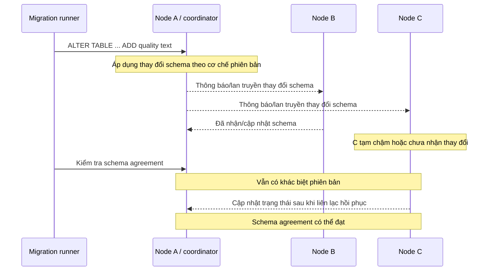
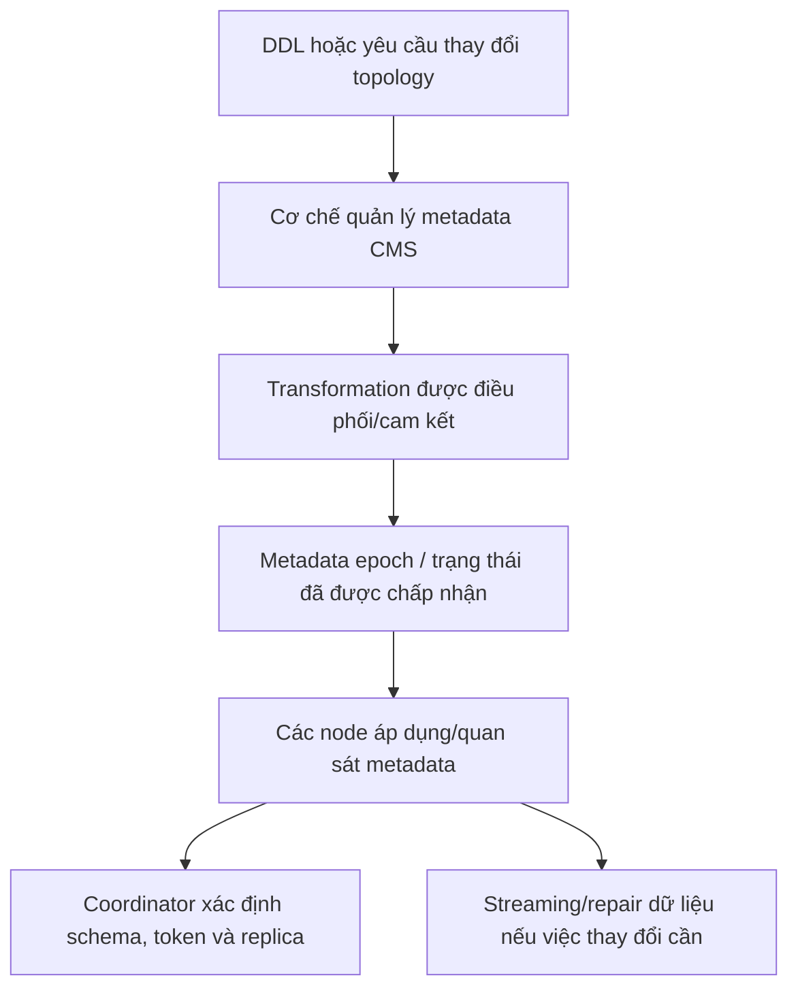
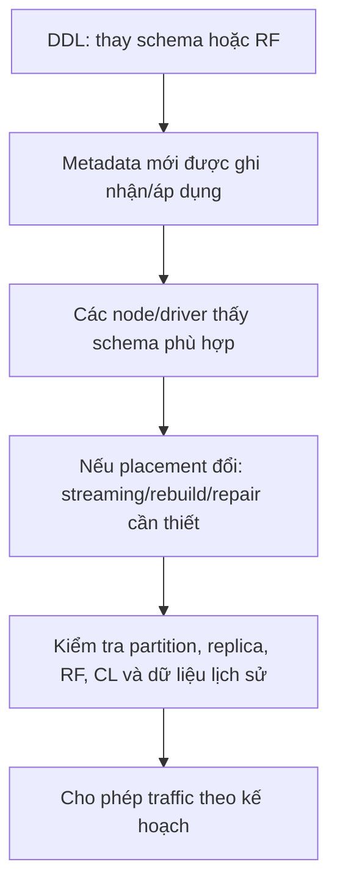
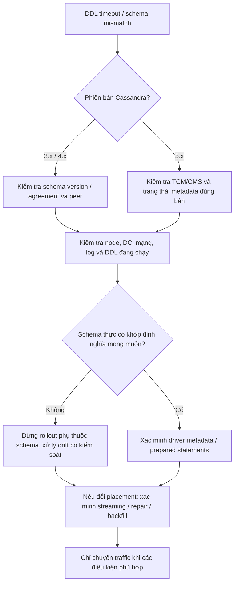

# Metadata cụm, schema agreement và thay đổi theo phiên bản

Trong Apache Cassandra, dữ liệu nghiệp vụ được phân tán thành các **partition** trên nhiều **replica**. Để một node biết partition nào cần đọc/ghi, nó còn phải biết **metadata của cluster**: các thành viên, vị trí datacenter/rack, token, replication strategy, keyspace, bảng và cột. Những thông tin này không giống các hàng CQL mà ứng dụng lưu. Một câu lệnh `CREATE TABLE` hoặc `ALTER KEYSPACE` thay đổi **cách cluster hiểu dữ liệu hoặc topology**, nên phải được quản lý đặc biệt.

Ở những bản Cassandra 3.x/4.x, thay đổi schema thường được lan truyền theo cơ chế phối hợp giữa node và các thông tin **schema version**; người vận hành/driver có thể quan sát tình trạng **schema agreement**. Cassandra 5.x đưa vào **Cluster Metadata Service (CMS)** và **Transactional Cluster Metadata (TCM)** nhằm điều phối có thứ tự các thay đổi metadata cụm. Không nên lấy toàn bộ diễn giải “gossip rồi chờ các node có cùng schema UUID” từ một bản cũ để mô tả nguyên xi mọi bản 5.x.

Bài thuộc chương **Kiến trúc cụm** của module Apache Cassandra, kết nối kiến thức wide-column, khóa phân vùng, thiết kế bảng theo truy vấn, replication, consistency level, đọc/ghi, compaction, repair, lỗi phân tán và Java Driver.

Sau bài này, bạn có thể:

- Phân loại **schema metadata**, **topology/placement metadata**, **membership/liveness** và **dữ liệu nghiệp vụ**.
- Giải thích **schema agreement** nói lên điều gì và **không** nói lên điều gì.
- Phân biệt mô hình quản lý schema trong Cassandra 3.x/4.x với cơ chế TCM/CMS của Cassandra 5.x ở mức thiết kế.
- Nhận biết rủi ro khi thay keyspace RF, bảng/cột, topology và khi node đang offline.
- Dùng CQL, `nodetool`, `cqlsh` và Java Driver 4.x để quan sát schema/metadata có kiểm soát.
- Thiết kế migration **expand–migrate–contract** và runbook xử lý schema disagreement mà không tự ý xóa dữ liệu hệ thống.

## 1. Metadata cụm là gì và tại sao nó quan trọng?

Một node Cassandra cần hai loại kiến thức để phục vụ một câu lệnh:

1. **Định nghĩa dữ liệu:** keyspace nào có bảng gì, cột nào thuộc partition key, clustering column, kiểu dữ liệu, index, option của bảng.
2. **Vị trí và trách nhiệm:** partition key được băm thành token thế nào; những node nào là natural replica; chúng ở DC/rack nào; replication factor là bao nhiêu.

Ví dụ ứng dụng Java gọi:

```sql
SELECT event_time, reading
FROM telemetry.readings_by_device_day
WHERE tenant_id = 11111111-1111-1111-1111-111111111111
  AND device_id = 22222222-2222-2222-2222-222222222222
  AND event_day = '2026-11-21'
LIMIT 20;
```

Để thực hiện câu này, coordinator phải hiểu:

- `telemetry.readings_by_device_day` có tồn tại không, `reading` là kiểu gì?
- Partition key gồm `tenant_id`, `device_id` và `event_day`, không phải chỉ `device_id`?
- Token từ partition key thuộc những khoảng token nào?
- Keyspace đặt các replica theo `NetworkTopologyStrategy` và RF từng DC nào?
- Những replica hiện có thể phục vụ được bao nhiêu phản hồi theo CL?

Nếu hai node tạm hiểu schema khác nhau, cùng một CQL request có thể được chấp nhận ở node này và bị báo thiếu bảng/cột ở node kia. Nếu topology/replication metadata khác nhau, các node có nguy cơ ra quyết định replica/placement không tương đồng. Đó là lý do **metadata phải được quản lý và hội tụ có kiểm soát**, chứ không thể coi như một bảng ứng dụng tùy ý ghi sửa.

## 2. Bốn nhóm trạng thái thường bị gọi chung là “metadata”

| Nhóm | Ví dụ | Dùng ở đâu? | Cách cần hiểu |
|---|---|---|---|
| **Schema metadata** | Keyspace, bảng, cột, primary key, index, UDT, table options. | Phân tích và thực thi CQL, driver chuẩn bị statement. | Thay đổi bằng DDL và quy trình schema tương ứng. |
| **Topology / placement metadata** | Token ranges, danh tính node, DC/rack, RF, replica placement và chuyển topology. | Coordinator chọn natural replica; bootstrap/replace/leave. | Không chỉ là “danh sách node đang sống”. |
| **Membership / liveness** | Gossip heartbeat, trạng thái peer được đánh giá `UP`/`DOWN`. | Phát hiện lỗi và đưa ra quyết định giao tiếp. | Một nhận định theo thời gian/vị trí; không chứng minh node chết. |
| **Dữ liệu nghiệp vụ** | Cell, row, tombstone, timestamp, TTL và SSTable của bảng. | Replica phục vụ `SELECT`/`INSERT`/`UPDATE`/`DELETE`. | Hội tụ bằng mutation, hint, read repair, anti-entropy repair/streaming tùy tình huống. |

**Schema agreement không tương đương data agreement.** Ba node có thể thống nhất một bảng tên `telemetry.events` và cùng định nghĩa primary key, trong khi replica B chưa nhận mutation mới nhất của partition P. Ngược lại, replica có dữ liệu cũ vẫn không nên tự suy ra bản schema đang mới nhất chỉ vì SSTable của nó còn tồn tại.

### Cluster identity và metadata khác gì seed?

`cluster_name` giúp xác định một cluster. **Seed node** là điểm liên hệ ban đầu để peer khám phá cluster; nó không phải “máy chủ metadata trung tâm” trong mô hình Cassandra cổ điển. Một seed vẫn có thể làm replica hoặc coordinator như các node khác. Ở bản có CMS, seed cũng **không tự động là leader hay thành viên quản lý metadata duy nhất**.

## 3. Schema agreement là gì?

Nói đơn giản, **schema agreement** là trạng thái mà các node cần quan tâm đã có cùng nhận thức về định nghĩa schema, theo phương thức và khả năng quan sát của phiên bản đang chạy. Khi hai node có cách hiểu khác nhau về một bảng, coordinator và client có thể gặp lỗi khó đoán do request được định tuyến tới node khác nhau.

Trong Cassandra 3.x/4.x, người vận hành thường gặp:

- Một **schema version** đại diện dấu vết nội dung schema đã biết tại node.
- Những phiên bản schema khác nhau được nhóm trong kết quả công cụ như `nodetool describecluster`.
- Driver có thể **đợi hoặc kiểm tra schema agreement** sau một DDL trước khi tiếp tục thao tác phụ thuộc schema mới.

Ví dụ:

```text
Node A: schema version V2
Node B: schema version V2
Node C: schema version V1 (chưa nhận/cập nhật DDL)

=> Chưa có schema agreement theo góc nhìn A/B/C.
```

Đây là mô hình diễn giải cho các bản dùng cơ chế version truyền thống. Schema version không phải “số lượng migration đã chạy”, cũng không phải timestamp của row và không chứng minh replica dữ liệu đã đồng bộ.

### Ba điều schema agreement KHÔNG bảo đảm

1. **Không bảo đảm dữ liệu cũ đã chuyển sang vị trí replica mới** sau `ALTER KEYSPACE` thay RF hoặc topology. Metadata có thể được cập nhật trước khi các công việc phân phối dữ liệu hoàn thành.
2. **Không bảo đảm mọi ứng dụng đã dùng schema mới**. Java Driver cache metadata/prepared statements và có thể cần cập nhật; một binary cũ vẫn có thể truy vấn tên cột đã đổi.
3. **Không bảo đảm mọi node đều khỏe và luôn trả lời đúng hạn**. Node có schema phù hợp vẫn có thể `DN`, bị network partition, I/O cao hoặc read timeout.

Vì vậy, trong một migration production, “schema agreement PASS” chỉ là **một điều kiện kiểm tra**, không phải dấu hiệu cho phép xóa ngay code cũ hay chuyển tất cả traffic.

## 4. Khác biệt giữa schema, phiên bản schema và phiên bản dữ liệu

Từ “version” xuất hiện ở nhiều lớp:

| Tên gọi | Gắn với | Khi nào thay đổi? |
|---|---|---|
| **Schema version** (truyền thống) | Định nghĩa keyspace/table/index/type mà node đã biết. | Khi thay đổi schema, sau khi trạng thái tương ứng được áp dụng. |
| **Metadata epoch** (mô hình TCM/CMS) | Thứ tự logic của các thay đổi metadata đã được ghi nhận. | Khi một thay đổi metadata được cam kết theo cơ chế phiên bản tương ứng. |
| **Cell write timestamp** | Phiên bản của một giá trị/tombstone trong dữ liệu. | Khi một mutation cập nhật cell hoặc xóa dữ liệu. |
| **Application schema version** | Revision migration do ứng dụng tự quản lý. | Khi một migration được đội triển khai đánh dấu đã chạy. |
| **Cassandra release version** | Phiên bản phần mềm node, ví dụ 4.x hay 5.x. | Khi nâng cấp binary. |

Một node có `schema_version` giống peer **không cho biết giá trị cell mới nhất**. Một metadata epoch cao hơn cũng **không tự nói gì về dữ liệu đã được repair**. Ứng dụng có thể duy trì bảng ghi nhận migration riêng, nhưng nó không thể thay thế hoàn toàn cơ chế metadata nội bộ của Cassandra.

## 5. Mô hình schema truyền thống ở Cassandra 3.x/4.x

Trong mô hình trước CMS, schema được lưu và quản lý như trạng thái cluster, có cơ chế truyền đạt thay đổi schema giữa các node. Các node có thể biết thông tin mới tại các thời điểm khác nhau và công cụ/driver có thể so sánh **schema version** của các peer.

Một trình tự khái niệm:



Sơ đồ giúp hình dung **tính bất đồng bộ và điểm cần kiểm tra**, không mô tả chính xác từng packet/ACK hoặc hứa hẹn thứ tự thông điệp giống nhau ở mọi Cassandra 3.x/4.x. Nội bộ xử lý schema và cách driver chờ có thể khác theo release.

### Vì sao cần tránh chạy DDL cạnh tranh?

Khi hai công cụ hoặc hai service đồng thời thay bảng hoặc keyspace, lịch sử schema có thể khó quản lý hơn:

- DDL thứ hai có thể dựa trên cột/table chưa được node tiếp nhận đồng nhất.
- Driver có thể dùng metadata/prepared statement chưa cập nhật.
- Log migration và dữ liệu vận hành có thể khó phân biệt “chạy thành công”, “timeout” và “đã áp dụng nhưng chưa agreement”.

Một nguyên tắc vận hành tốt là **một luồng migration có kiểm soát**, có khóa/điều phối ở hệ thống phát hành của tổ chức, thay vì để mọi instance Java tự tạo hoặc sửa schema khi khởi động. Không coi DDL Cassandra là một transaction đa bảng kiểu RDBMS.

## 6. Cassandra 5.x: TCM và Cluster Metadata Service (CMS)

Cassandra 5.0 giới thiệu **Transactional Cluster Metadata (TCM)** và **Cluster Metadata Service (CMS)** nhằm quản lý thay đổi metadata cluster có thứ tự và khả năng kiểm soát tốt hơn. Đây là một thay đổi kiến trúc quan trọng khi so với suy nghĩ “mọi cập nhật topology/schema chỉ cần gossip rồi tự hội tụ”.

Hiểu ở mức khái niệm:

- **TCM** mô hình hóa metadata cụm và các chuyển đổi trạng thái như những **transformation** được ghi nhận theo thứ tự logic.
- **CMS** là cơ chế dịch vụ quản lý/đồng thuận metadata cluster trong các phiên bản hỗ trợ, với các thành viên và quy trình phối hợp riêng.
- Thay đổi metadata có thể được gắn với **epoch** để biết một node đã theo kịp mốc metadata nào.
- Việc node cập nhật trạng thái metadata và việc dữ liệu thực được stream/repair vẫn là **hai phần việc khác nhau**.



**CMS không phải một master dữ liệu**: CQL thông thường vẫn được điều phối theo từng request, và các natural replica vẫn giữ dữ liệu theo token/RF. Thành viên CMS hay vai trò điều phối một thay đổi metadata **không đồng nghĩa seed node**, không phải “một máy phải đi qua cho mọi `SELECT`”.

### Những gì không nên suy đoán giữa các phiên bản

Không nên viết runbook kiểu:

> “Bất kỳ Cassandra 5.x nào cũng dùng nguyên cách so sánh schema UUID qua gossip và đủ là xong.”

Cũng không nên suy ngược rằng:

> “Đã có CMS thì mọi node lập tức có dữ liệu/schema và mọi lỗi metadata đều biến mất.”

TCM/CMS cải tiến cách điều phối thay đổi metadata, nhưng vẫn cần mạng, quorum/điều kiện đồng thuận metadata, theo dõi quá trình áp dụng và các bước streaming/repair khi thay đổi vị trí replica. Các lệnh quản trị CMS, cấu hình thành viên CMS và hành vi khi cluster nâng cấp phiên bản **phải dùng tài liệu chính xác của bản Cassandra đang chạy**; không áp lệnh cũ hoặc ép sửa bảng hệ thống để “đẩy epoch”.

## 7. So sánh kiến trúc theo phiên bản

| Khía cạnh | Cassandra 3.x/4.x (mô hình truyền thống) | Cassandra 5.x với TCM/CMS |
|---|---|---|
| Quản lý schema/topology | Nhiều trạng thái có thể lan truyền và được đối chiếu qua schema version/metadata giữa peer. | Các thay đổi metadata có cơ chế chuyển đổi và cam kết có thứ tự trong dịch vụ CMS. |
| Khái niệm quan sát | `schema_version` và schema agreement theo khả năng của phiên bản/công cụ. | Metadata epoch/trạng thái CMS trở nên quan trọng, ngoài metadata schema node/client đang thấy. |
| Điểm cần chờ sau DDL | Peer cần có nhận thức schema phù hợp và driver cập nhật metadata. | Cần xét kết quả cam kết thay đổi metadata, tiến độ áp dụng và cập nhật client theo cơ chế mới. |
| Thay đổi token/RF/DC | Có thể cần bootstrap/streaming/repair ngoài việc cập nhật metadata. | Vẫn cần các bước dữ liệu riêng, dù metadata được quản lý chặt hơn. |
| Gossip | Gắn với membership/liveness và một số thông tin schema/topology ở các bản cũ. | Gossip vẫn có vai trò với trạng thái peer; không phải nguồn xác thực duy nhất của mọi metadata có điều phối. |
| Coordinator của CQL | Theo request, không phải seed/master cố định. | Vẫn theo request; CMS không biến nó thành một read/write master. |

**Lưu ý nâng cấp:** Cấu hình, công cụ, lệnh và quá trình chuyển đổi cluster từ 4.x lên 5.x có ràng buộc riêng. Không dùng ví dụ bảng hệ thống hoặc giả định schema agreement của một bản để thực thi thao tác tác động metadata trên bản khác mà không xác minh.

## 8. DDL thay đổi schema khác mutation thay đổi dữ liệu

Hai lệnh CQL sau có hậu quả khác hẳn:

```sql
-- DDL: thay đổi cấu trúc schema
ALTER TABLE telemetry.readings_by_device_day
ADD quality text;

-- DML: thay đổi dữ liệu trong một partition
UPDATE telemetry.readings_by_device_day
SET quality = 'VALID'
WHERE tenant_id = 11111111-1111-1111-1111-111111111111
  AND device_id = 22222222-2222-2222-2222-222222222222
  AND event_day = '2026-11-21'
  AND event_time = '2026-11-21T08:30:00+07:00'
  AND event_id = 33333333-3333-3333-3333-333333333333;
```

Lệnh `ALTER TABLE` tạo sự kiện thay đổi **định nghĩa cột**. Các node và driver cần có schema mới để xử lý `quality` đúng. Lệnh `UPDATE` tạo **mutation dữ liệu**, được coordinator gửi đến replica theo token, RF và CL; nó không tạo một “schema version” mới.

**Thêm cột không tự điền giá trị** cho tất cả hàng hiện có. Các hàng cũ thiếu cell `quality` thường sẽ đọc ra `null` ở lớp CQL cho cột mới, trừ khi ứng dụng thực hiện backfill. Trong Cassandra, sự hiện diện của một cột trong schema không có nghĩa mỗi row phải có một cell vật lý của cột đó.

### Schema agreement không thay thế thiết kế bảng theo truy vấn

Nếu một bảng có partition key `(tenant_id, device_id, event_day)`, thay đổi schema để thêm `quality` không tự biến `quality` thành một điều kiện lọc hiệu quả trên mọi partition. Thiết kế query khác có thể yêu cầu **bảng khác được tối ưu theo truy vấn**, index phù hợp hoặc thay mô hình dữ liệu.

Tương tự, không thể tùy tiện đổi primary key tại chỗ như đổi tên cột thường. Khi cần partition key khác, thông thường phải **thiết kế bảng mới và di chuyển dữ liệu/đường truy vấn** thay vì mong `ALTER TABLE` làm lại phân bố partition một cách tức thì.

## 9. Ví dụ CQL hoàn chỉnh: tạo và tiến hóa một bảng

Giả sử cluster thử nghiệm có DC `dc1` và `dc2`, mỗi DC đủ node/rack tương ứng với RF mong muốn:

```sql
CREATE KEYSPACE IF NOT EXISTS telemetry
WITH replication = {
  'class': 'NetworkTopologyStrategy',
  'dc1': 3,
  'dc2': 3
};

CREATE TABLE IF NOT EXISTS telemetry.readings_by_device_day (
    tenant_id uuid,
    device_id uuid,
    event_day date,
    event_time timestamp,
    event_id uuid,
    reading double,
    PRIMARY KEY ((tenant_id, device_id, event_day), event_time, event_id)
) WITH CLUSTERING ORDER BY (event_time DESC, event_id ASC);
```

Chạy DDL từ **một luồng migration có kiểm soát**, chờ điều kiện metadata/schema phù hợp, rồi xác minh schema hiện hành trước khi triển khai code dùng cột mới:

```sql
-- Migration thứ hai (chạy theo lịch phát hành):
ALTER TABLE telemetry.readings_by_device_day
ADD quality text;

-- Kiểm tra metadata schema của bảng:
SELECT keyspace_name, table_name, column_name, kind, type
FROM system_schema.columns
WHERE keyspace_name = 'telemetry'
  AND table_name = 'readings_by_device_day';
```

Trong `cqlsh` có thể xem phần schema mà công cụ hiển thị bằng:

```text
DESCRIBE KEYSPACE telemetry;
DESCRIBE TABLE telemetry.readings_by_device_day;
```

`DESCRIBE` là lệnh tiện ích của `cqlsh`, không nên giả định được thực thi nguyên văn như một câu CQL qua Java Driver. `IF NOT EXISTS` giúp migration có thể chạy lại ở một số tình huống, nhưng **không kiểm tra rằng cấu trúc có sẵn giống hệt cấu trúc mong muốn**. Nếu bảng đã tồn tại với primary key khác, việc im lặng bỏ qua tạo bảng có thể che một lỗi nghiêm trọng.

### Không trộn nhiều quyết định trong một migration

Để dễ rollback/troubleshoot, nên tách các bước:

1. Tạo keyspace/bảng hoặc cột bổ sung.
2. Xác minh schema/metadata đã được áp dụng và driver thấy cấu trúc mới.
3. Triển khai code ghi dữ liệu mới, có thể vẫn giữ compatibility với code cũ.
4. Backfill hoặc xử lý dữ liệu lịch sử nếu nghiệp vụ cần.
5. Chuyển các truy vấn/consumer sang cấu trúc mới.
6. Chỉ cân nhắc xóa cột/bảng cũ khi mọi consumer và retention được kiểm tra.

Đây là quy trình **expand–migrate–contract**; schema agreement là một checkpoint trong đó, không phải toàn bộ migration.

## 10. Thay replication metadata không đồng nghĩa dữ liệu đã phân phối xong

Với `NetworkTopologyStrategy`, schema keyspace chứa RF từng DC. Ví dụ ban đầu:

```sql
CREATE KEYSPACE example_ks
WITH replication = {
  'class': 'NetworkTopologyStrategy',
  'dc1': 3
};
```

Nếu tổ chức thêm một DC, yêu cầu replication có thể đổi theo một lệnh kiểu:

```sql
-- Chỉ minh họa bước thay đổi khai báo replication.
ALTER KEYSPACE example_ks
WITH replication = {
  'class': 'NetworkTopologyStrategy',
  'dc1': 3,
  'dc2': 3
};
```

**Cảnh báo quan trọng:** Lệnh DDL trên **không tự chứng minh** dữ liệu lịch sử đã được chuyển đến ba replica mới ở `dc2`. Cluster cần quy trình **rebuild/streaming/repair và xác minh** phù hợp với phiên bản/topology, khả năng mạng, nguồn dữ liệu và trạng thái hiện tại. Không đưa DC mới vào luồng đọc/ghi quan trọng chỉ vì `system_schema.keyspaces` đã hiển thị RF mới.

Sau DDL, câu hỏi cần trả lời gồm:

- Token/rack/DC của các node mới đã đúng chưa?
- Quy trình thêm DC và di chuyển dữ liệu đã hoàn thành chưa?
- Các partition lịch sử có bản sao đúng trên DC mới chưa?
- Có đủ replica hoạt động để đạt `LOCAL_QUORUM` tại DC mới không?
- Ứng dụng Java đã cấu hình `localDatacenter`, contact points và failover phù hợp chưa?

### Vì sao thay RF có thể ảnh hưởng consistency level?

Nếu RF của `dc1` thay từ 3 thành 5, `LOCAL_QUORUM` cần tăng từ **2** lên **3** phản hồi địa phương. Điều đó có thể thay đổi độ trễ và khả năng chịu lỗi. Việc tăng RF không nên được coi là một sửa lỗi “miễn phí” cho timeout: nó tăng số bản sao, lưu lượng mutation và trách nhiệm vận hành.

## 11. Schema agreement và replica data convergence khác nhau ở ba mốc



Ba mốc cần phân biệt:

**Mốc A — Metadata được cập nhật:** Hệ thống tiếp nhận một định nghĩa mới, ví dụ cột `quality` hoặc RF mới. Phụ thuộc phiên bản, có cơ chế áp dụng/cam kết metadata tương ứng.

**Mốc B — Schema/metadata có thể được dùng đồng nhất:** Các node liên quan, công cụ quản trị và driver đã nhận biết cấu trúc phù hợp, theo điều kiện của phiên bản. Trong bản truyền thống thường gọi là *schema agreement*.

**Mốc C — Dữ liệu đúng ở các replica:** Nếu có chuyển placement hoặc backfill, dữ liệu được stream/repair/ghi lại và xác minh. Mốc C **không xảy ra tức thì chỉ vì A/B đã hoàn tất**.

Thêm một cột tùy chọn có thể không cần streaming toàn bộ bảng nhưng vẫn cần code migration và backfill nghiệp vụ. Tăng RF hoặc thêm DC thường cần các bước dữ liệu nặng hơn. Hai loại DDL có **chi phí vận hành khác nhau** dù đều là “schema change”.

## 12. Tương tác với gossip, failure detector và seed

Một node bị cô lập mạng có thể bỏ lỡ thông tin schema/topology trong các mô hình quản lý khác nhau. Nhưng đừng quy mọi vấn đề schema agreement cho gossip mà chưa xét phiên bản.

- **Gossip:** truyền nhận thức liveness/membership và các thông tin trạng thái tương ứng với cơ chế phiên bản; không dùng để stream mọi partition nghiệp vụ.
- **Failure detector:** đánh giá peer có phản hồi như kỳ vọng hay không. Một node được đánh giá `DOWN` chưa chắc đã tắt, nhưng việc nó không thể liên lạc có thể ảnh hưởng quá trình metadata/DDL.
- **Seed node:** điểm liên hệ ban đầu cho discovery, không phải master phân phối schema cho mọi request.
- **Coordinator:** node nhận CQL DDL/DML theo request, không phải leader vĩnh viễn của toàn bộ schema.
- **CMS ở Cassandra 5.x:** cơ chế điều phối thay đổi metadata có thành viên/quy tắc riêng, không đồng nghĩa tập seed hoặc tập natural replica của một partition.

### Khi network partition xảy ra trong lúc thay metadata

Giả sử `dc1` và `dc2` bị tách mạng khi người vận hành muốn sửa RF hoặc schema. Khả năng DDL tiến triển, bị trì hoãn hay thất bại phụ thuộc cơ chế metadata cụ thể và các điều kiện cần đạt theo phiên bản. Không được tuyên bố rằng “mỗi DC đều được sửa schema độc lập rồi Cassandra sẽ tự chọn định nghĩa tốt nhất”.

Với các bản dùng **CMS/TCM**, thay đổi metadata có điều phối không tương đương cho phép hai phía độc lập cam kết các lịch sử metadata đối nghịch mà không cần giải quyết. Với các bản truyền thống, tránh thực hiện schema migration đồng thời ở các phía bị tách và cố gắng “sửa” bằng cách viết trực tiếp vào bảng hệ thống.

**Quy tắc vận hành:** khi mất liên lạc lớn hoặc topology đang không ổn định, ưu tiên phục hồi khả năng liên lạc và xác định trạng thái metadata trước khi chạy thêm DDL tác động sâu đến dữ liệu.

## 13. Java Driver: metadata phía client không phải sự thật tức thời toàn cụm

Ứng dụng Java dùng **native CQL protocol**, thường cổng `9042`. Driver 4.x giữ **metadata cache** về cluster, keyspace, tables, node/DC/rack và phục vụ routing/prepared statements. Metadata phía client được cập nhật qua cơ chế driver, có thể **trễ ngắn** sau một DDL hoặc lỗi mạng.

Ba tình huống thường gặp:

1. **Node A đã có cột mới, driver chưa refresh metadata:** client có thể chưa thấy cột ở API metadata dù query mới đôi khi đã được node xử lý.
2. **Driver đã thấy schema mới, một coordinator khác còn chưa phù hợp:** request chuyển node có thể trả lỗi thiếu cột/bảng trong mô hình version truyền thống hoặc trong điều kiện lỗi/không theo kịp metadata.
3. **Prepared statement được tạo trước migration:** sau đổi schema, các truy vấn/prepared statement cần được kiểm tra tương thích, có thể cần prepare lại hoặc deploy code phù hợp.

Vì vậy, không nên cho mọi instance Java thực hiện `ALTER TABLE` khi startup rồi lập tức chạy `SELECT quality` mà không có bước chờ/xác minh schema.

### Java Driver 4.x: quan sát metadata và thực thi query

Ví dụ sử dụng API `com.datastax.oss.driver`. Cần tạo keyspace/bảng trước theo quy trình migration, thay IP tài liệu bằng địa chỉ thật và cấu hình xác thực/TLS khi cần.

```java
import com.datastax.oss.driver.api.core.CqlIdentifier;
import com.datastax.oss.driver.api.core.CqlSession;
import com.datastax.oss.driver.api.core.DefaultConsistencyLevel;
import com.datastax.oss.driver.api.core.cql.BoundStatement;
import com.datastax.oss.driver.api.core.cql.PreparedStatement;
import com.datastax.oss.driver.api.core.cql.Row;
import com.datastax.oss.driver.api.core.metadata.schema.KeyspaceMetadata;

import java.net.InetSocketAddress;
import java.time.LocalDate;
import java.util.Optional;
import java.util.UUID;

public final class SchemaMetadataExample {
    public static void main(String[] args) {
        // Các IP 192.0.2.0/24 chỉ dành cho tài liệu.
        try (CqlSession session = CqlSession.builder()
                .addContactPoint(new InetSocketAddress("192.0.2.11", 9042))
                .addContactPoint(new InetSocketAddress("192.0.2.12", 9042))
                .withLocalDatacenter("dc1")
                .build()) {

            Optional<KeyspaceMetadata> keyspace = session.getMetadata()
                .getKeyspace(CqlIdentifier.fromCql("telemetry"));

            if (keyspace.isEmpty()) {
                throw new IllegalStateException(
                    "Driver chưa thấy keyspace telemetry: kiểm tra migration/schema");
            }

            CqlIdentifier tableName =
                CqlIdentifier.fromCql("readings_by_device_day");
            if (!keyspace.get().getTables().containsKey(tableName)) {
                throw new IllegalStateException(
                    "Driver chưa thấy bảng: kiểm tra schema agreement và metadata refresh");
            }

            PreparedStatement ps = session.prepare(
                "SELECT event_time, reading, quality " +
                "FROM telemetry.readings_by_device_day " +
                "WHERE tenant_id = ? AND device_id = ? AND event_day = ? " +
                "LIMIT 20");

            BoundStatement read = ps.bind(
                    UUID.fromString("11111111-1111-1111-1111-111111111111"),
                    UUID.fromString("22222222-2222-2222-2222-222222222222"),
                    LocalDate.parse("2026-11-21"))
                .setConsistencyLevel(DefaultConsistencyLevel.LOCAL_QUORUM);

            for (Row row : session.execute(read)) {
                // quality có thể null với dữ liệu lịch sử chưa backfill.
                System.out.printf("%s %.2f quality=%s%n",
                    row.getInstant("event_time"),
                    row.getDouble("reading"),
                    row.getString("quality"));
            }
        }
    }
}
```

**Lưu ý về giới hạn:** Đoạn mã này kiểm tra **góc nhìn metadata của driver**, không chứng minh schema agreement toàn cluster. `getTables()` cho biết driver đã nhận schema bảng, nhưng chưa đủ để chứng minh cột `quality` tồn tại nếu bảng được tạo từ trước; cần xác minh column metadata hoặc thực thi truy vấn sau khi migration đã được xác nhận. Trong production, migration runner và ứng dụng đọc/ghi nên có trách nhiệm tách rời.

Nên dùng driver phù hợp phiên bản Cassandra; không tự suy ra mọi API/option của Java Driver 4.x phù hợp tương lai vô hạn. Driver cũng có cơ chế theo dõi schema agreement/refresh theo cấu hình của từng release; khi timeout phải **kiểm tra trạng thái DDL trước khi retry**.

## 14. CQL và công cụ kiểm tra metadata cụm

### Xem metadata schema từ CQL

Trên `cqlsh` hoặc CQL client phù hợp, đọc các bảng hệ thống **chỉ để quan sát**:

```sql
-- Thông tin local của node đang nhận CQL:
SELECT cluster_name, data_center, rack, host_id
FROM system.local;

-- Khai báo replication:
SELECT keyspace_name, replication
FROM system_schema.keyspaces
WHERE keyspace_name = 'telemetry';

-- Cấu trúc cột:
SELECT table_name, column_name, kind, position, type
FROM system_schema.columns
WHERE keyspace_name = 'telemetry'
  AND table_name = 'readings_by_device_day';
```

Ở các bản Cassandra truyền thống, có thể gặp `schema_version` trong metadata node và peer:

```sql
-- Chỉ sử dụng nếu phiên bản đang chạy còn hỗ trợ các cột tương ứng.
SELECT schema_version FROM system.local;

-- Một số phiên bản hỗ trợ system.peers_v2 với metadata peer.
SELECT peer, data_center, rack
FROM system.peers_v2;
```

Không mặc định các cột/tables nội bộ này **giữ nguyên cách biểu diễn trong Cassandra 5.x**; CMS/TCM đưa thêm mô hình epoch và metadata. Hãy đọc tài liệu/công cụ của đúng phiên bản. Đặc biệt **không UPDATE/DELETE trực tiếp bảng `system_schema` hay các bảng metadata hệ thống** để ép kết quả.

### Xem metadata và schema disagreement qua nodetool

```bash
nodetool status
nodetool describecluster
nodetool gossipinfo
nodetool netstats
nodetool tpstats
```

| Công cụ | Dùng để kiểm tra | Cảnh báo khi diễn giải |
|---|---|---|
| `nodetool status` | DC/rack, trạng thái Up/Down và vòng đời node. | Node `UN` chưa chắc đã áp dụng mọi DDL mà client mong. |
| `nodetool describecluster` | Metadata cluster, schema versions hoặc thông tin tương ứng tùy release. | Định dạng/thông tin schema agreement thay đổi theo phiên bản. |
| `nodetool gossipinfo` | Trạng thái peer mà node được hỏi biết; schema-related state ở những bản hỗ trợ. | Không phải công cụ đối chiếu dữ liệu replica. |
| `nodetool netstats` | Một số luồng streaming đang diễn ra. | Không chứng minh mọi lịch sử dữ liệu đã tới nơi khi stream kết thúc. |
| `nodetool tpstats` | Hàng đợi và tác vụ nội bộ, gợi ý node quá tải. | Không phải kết quả xác nhận schema agreement. |

Trong những bản cũ, kết quả `nodetool describecluster` có thể nhóm các endpoint theo **schema version**. Nếu hai phiên bản tồn tại, cần xác định **node nào, DC nào, khoảng thời gian nào** và đối chiếu logs/DDL. Ở bản mới có CMS, cần kiểm tra trạng thái metadata theo cơ chế công cụ của bản đó thay vì chỉ so sánh UUID từ một ví dụ cũ.

## 15. Một kịch bản schema disagreement thường gặp

Giả sử cluster 3.x/4.x có ba node A/B/C ở `dc1`. Đội vận hành chạy:

```sql
ALTER TABLE telemetry.readings_by_device_day
ADD quality text;
```

A và B thấy schema mới, C đang mất mạng nên chưa cập nhật. Ứng dụng Java được triển khai ngay lập tức và bắt đầu `SELECT quality`. Những khả năng có thể xuất hiện:

- Request tới A/B được xử lý bình thường, dữ liệu `quality` ở hàng cũ là null.
- Request tới C bị báo `Undefined column` hoặc lỗi schema tương ứng khi C chưa biết cột mới.
- Driver hoặc migration runner đợi agreement rồi timeout.
- Client đang giữ prepared statement cũ có thể gặp sự kiện reprepare/invalidation khi schema đổi.

**Cách xử lý hợp lý:**

1. Tạm dừng triển khai bước **phụ thuộc cột mới** nếu schema chưa ổn định.
2. Xác định trạng thái C qua mạng, `nodetool status`, `describecluster`, logs và metadata của đúng bản.
3. Phục hồi liên lạc/công việc cần thiết để C theo kịp cơ chế metadata tương ứng.
4. Kiểm tra lại schema ở các node liên quan và driver trước khi bật code mới.
5. Chỉ sau đó mới tiến hành ghi dữ liệu/backfill/đọc cột mới theo kế hoạch.

Không tự “sửa” bằng cách chép thủ công bảng `system_schema.columns` từ A sang C. Những bảng nội bộ là một phần của cơ chế quản lý metadata, không phải nơi vận hành thay schema bằng DML tùy tiện.

## 16. DDL timeout hoặc schema agreement timeout: kết quả có thể không chắc chắn

Giống với ghi phân tán, khi client không nhận xác nhận đúng hạn về **thao tác thay schema**, không nên mặc định toàn bộ thao tác “chưa hề xảy ra”. Tùy phiên bản, DDL có thể đã được tiếp nhận/áp dụng/cam kết ở một giai đoạn nhưng client không nhận phản hồi cuối cùng, hoặc driver hết thời gian chờ agreement/refresh.

Ví dụ một migration runner gửi `CREATE TABLE`, sau đó báo timeout. Nếu chạy lại nguyên lệnh ngay và không kiểm tra:

- Bảng có thể đã tồn tại với định nghĩa chính xác, và retry báo “already exists”.
- Bảng có thể đã tồn tại với định nghĩa **khác** dự kiến.
- Một số node hoặc driver chưa thấy trạng thái mới dù thao tác đã tiến triển.
- Ở hệ thống điều phối metadata mới, lỗi có thể liên quan tình trạng áp dụng/consensus và cần đánh giá theo cơ chế phiên bản.

Quy trình an toàn hơn là **reconcile trạng thái thực tế trước khi retry**:

```text
DDL gặp timeout
      |
      v
Kiểm tra migration history và metadata schema của cluster
      |
      +--> Đã có đúng định nghĩa: xác minh agreement/refresh, không tạo lại vô ích
      |
      +--> Chưa có: điều tra trạng thái mạng/CMS/peer rồi retry có kiểm soát
      |
      +--> Có định nghĩa khác: BLOCK triển khai, xử lý drift theo kế hoạch
```

`IF NOT EXISTS` và `IF EXISTS` không bảo đảm rằng hai định nghĩa schema **tương đương** hoặc việc đổi metadata được xử lý như một giao dịch nghiệp vụ nhiều bước. Một migration tốt cần cả kiểm tra **trạng thái đích mong muốn** lẫn khả năng chạy lại an toàn.

## 17. Các thay đổi schema nguy hiểm và cách giảm rủi ro

| Loại thay đổi | Rủi ro chính | Cách tiếp cận |
|---|---|---|
| **ADD cột tùy chọn** | App cũ/app mới dùng schema khác lúc rollout; null ở dữ liệu lịch sử. | Expand trước, xác minh schema, deploy code mới, backfill nếu cần. |
| **DROP cột** | Code cũ vẫn đọc/ghi cột; dữ liệu/xử lý tombstone và lịch sử SSTable. | Chỉ contract khi đã loại hết consumer; có kế hoạch rollback nghiệp vụ. |
| **Đổi kiểu cột** | Hạn chế CQL về kiểu; dữ liệu đã ghi có biểu diễn không tương thích. | Thường dùng cột/bảng mới và migration dữ liệu, không ép đổi tùy tiện. |
| **Đổi primary key** | Thay mô hình phân vùng, token và truy vấn. | Tạo bảng mới theo mẫu truy vấn rồi backfill/chuyển traffic. |
| **Tăng/giảm RF** | Thay trách nhiệm replica và số ACK của CL. | Lập kế hoạch data movement, capacity, repair và xác minh. |
| **Thêm DC** | Replica mới chưa chứa dữ liệu lịch sử, rủi ro failover. | Quy trình mở rộng DC/rebuild/repair phù hợp phiên bản; xác minh trước khi dùng. |
| **Bootstrap/replace/decommission** | Token ownership thay đổi trong khi data streaming diễn ra. | Tránh DDL cạnh tranh; dùng quy trình topology/metadata có kiểm soát. |
| **Nâng Cassandra 4.x → 5.x** | Khác biệt TCM/CMS, giao thức metadata và công cụ. | Theo đúng upgrade path/hướng dẫn release; không giả định giữ nguyên mọi script cũ. |

### Vì sao “schema rollback” thường không đơn giản?

Một migration đã tạo cột mới rồi ứng dụng ghi dữ liệu vào đó; chạy `DROP` ngay để rollback code có thể khiến dữ liệu mới bị mất khỏi đường truy vấn hoặc tạo trạng thái khó khôi phục. Với thay RF, không thể “undo” chỉ bằng DDL ngược nếu các bước streaming/repair đang diễn ra.

Do đó, nên **rollback ứng dụng trước khi rollback schema**, khi cấu trúc mới còn tương thích. Khi cần rollback schema thực sự, hãy kiểm tra dữ liệu, retention, backup/snapshot, quá trình backfill và điều kiện của release.

## 18. Schema metadata không phải catalog nhất quán tuyệt đối với mọi client

Một ứng dụng Java có thể dùng metadata cached để điều hướng request. Trong quá trình rollout:

- **Server metadata:** mỗi node giữ một góc nhìn/phiên bản theo hệ thống đang chạy.
- **Driver metadata:** client nhìn cluster qua native CQL control connections, events và cơ chế refresh.
- **Migration state:** pipeline triển khai lưu trạng thái revision riêng.
- **Business data state:** replica giữ các giá trị theo timestamp/tombstone.

Các lớp này không nhất thiết chuyển trạng thái cùng một mili-giây. Để rollout an toàn cần quy trình **tương thích ngược trong khoảng chuyển đổi**, không chỉ đặt một thời gian sleep cố định.

Ví dụ: bổ sung `quality` và cho service mới bắt đầu ghi `quality` sau khi schema sẵn sàng; trong giai đoạn đầu, service cũ vẫn đọc `reading` mà không cần cột mới. Sau khi mọi service chấp nhận thay đổi, mới cân nhắc thêm constraint ở lớp nghiệp vụ hoặc chuyển query. Đây là chiến lược giảm **schema drift giữa client và cluster**.

### Prepared statements khi schema đổi

Prepared statement lưu kết quả chuẩn bị query/metadata ở server/driver theo cơ chế cache. Thay bảng/cột có thể làm một số statement không còn hợp lệ hoặc cần chuẩn bị lại. Driver thường có cơ chế xử lý một số trường hợp reprepare, nhưng không nên dựa vào đó để giữ mọi query tương thích sau `DROP` hoặc đổi kiểu. Hãy test query của **cả phiên bản ứng dụng cũ lẫn mới** trên schema chuyển tiếp.

## 19. Vận hành đa DC và khi một nhóm node offline

Giả sử keyspace `telemetry` có `RF_dc1 = 3`, `RF_dc2 = 3`, cluster có hai DC qua WAN. Trong một đợt cập nhật schema, WAN đứt:

1. Một số node có thể không quan sát được tiến độ DDL/metadata từ DC khác.
2. Các cơ chế schema traditional hoặc CMS/TCM có cách xử lý điều phối khác nhau; không được suy từ khả năng ghi `LOCAL_QUORUM` rằng migration schema **cũng được phép tiến hành độc lập ở mỗi DC**.
3. Có thể vẫn phục vụ một số truy vấn DML bằng schema đã ổn định; nhưng đổi schema trong lúc phân vùng có thể làm lỗi khó phân loại hơn.
4. Nếu thay RF hoặc topology, dữ liệu cần streaming qua WAN sau khi mạng phục hồi có thể còn rất lớn.

**LOCAL_QUORUM của dữ liệu và quorum của CMS/metadata không phải cùng một phép tính.** Không lấy `floor(RF_dc1/2)+1` để suy ra số thành viên CMS cần cho một cập nhật metadata. Tính chất và membership của các cơ chế đồng thuận metadata phải được xác minh theo tài liệu Cassandra cụ thể.

### Khi node trở lại sau thời gian offline

Một node được đánh giá `UN` trở lại chưa chứng minh:

- Node đã có **metadata epoch/schema state** phù hợp với bản đang chạy.
- Node đã có mọi mutation mới ở các partition mà nó lưu.
- App/driver ở những DC khác đã refresh schema.
- Các bước repair/streaming sau thay đổi RF đã hoàn tất.

Theo dõi **metadata**, **replica data** và **client readiness** riêng biệt. Đó là cách tránh chuyển traffic sang một DC chưa sẵn sàng sau thảm họa.

## 20. Runbook khi nghi schema disagreement hoặc metadata drift

Một quy trình đọc-only trước khi quyết định xử lý:

1. **Xác định release Cassandra:** bản node, driver, trạng thái nâng cấp. Chọn mô hình schema agreement truyền thống hay CMS/TCM tương ứng.
2. **Ghi rõ thao tác DDL gần nhất:** ai chạy, thời điểm, coordinator và câu lệnh; đã được phát hành qua pipeline nào?
3. **Xác định lỗi thực:** thiếu keyspace/cột, `InvalidQueryException`, timeout khi migration, driver metadata stale hay lỗi metadata service?
4. **So sánh schema mong muốn:** `system_schema.keyspaces`, `system_schema.tables`, `system_schema.columns` hoặc `DESCRIBE` qua những node phù hợp.
5. **Quan sát topology/liveness:** `nodetool status`, log, mạng internode, DC/rack, node đang bootstrap/leave/replace.
6. **Kiểm tra agreement theo phiên bản:** `nodetool describecluster` và schema version ở bản hỗ trợ; trạng thái metadata/CMS bằng công cụ chính thức ở bản 5.x.
7. **Kiểm tra driver:** contact point, local DC, metadata refresh, query/prepared statement đang phụ thuộc schema nào.
8. **Tạm dừng DDL cạnh tranh:** không mở thêm migration khi chưa rõ trạng thái; không sửa bảng hệ thống trực tiếp.
9. **Khôi phục điều kiện vận hành:** mạng, tải, tiến độ metadata và các bước bổ sung theo hướng dẫn phiên bản.
10. **Xác minh đầy đủ:** schema đúng, client tương thích, data movement/backfill hoàn thành nếu thay RF/topology/bảng.



Đừng sửa `system_schema` bằng DML, xóa metadata files hoặc chạy các lệnh force-remove/replace node chỉ để làm hết cảnh báo schema disagreement. Đó là những thao tác có thể tác động nghiêm trọng đến lịch sử metadata và dữ liệu.

## 21. Bài tập tình huống

**Tình huống A — Schema giống nhau, dữ liệu khác nhau.** A/B/C cùng nhìn thấy bảng và cột `quality`, nhưng C chưa nhận ghi mới nhất. Có schema agreement không? **Có thể có** ở lớp schema; dữ liệu chưa hội tụ là chuyện riêng, cần CL/hint/repair tương ứng.

**Tình huống B — Đã ADD cột, app cũ chưa đổi.** Service cũ chỉ đọc `reading`, service mới đọc thêm `quality`. Có nên `DROP reading` ngay sau khi schema đồng nhất không? **Không.** Phải đảm bảo mọi consumer đã chuyển và dữ liệu/backfill phù hợp.

**Tình huống C — RF tăng từ 3 lên 5.** Ngay khi metadata hiện RF = 5, `LOCAL_QUORUM` cần bao nhiêu phản hồi? **Ba** nếu DC có RF 5; nhưng không được giả định dữ liệu đã tự hoàn tất đến hai replica mới.

**Tình huống D — Thêm DC mới bằng `ALTER KEYSPACE`.** Có thể lập tức chuyển đọc toàn bộ sang DC mới không? **Không.** Cần quy trình chuyển/đồng bộ dữ liệu và xác minh availability theo phiên bản.

**Tình huống E — DDL timeout.** Có nên lặp lại `CREATE TABLE` vô điều kiện cho đến khi không lỗi? **Không.** Trạng thái có thể đã được áp dụng; kiểm tra schema thực và định nghĩa đích trước.

**Tình huống F — Cassandra 5.x.** Có thể dùng nguyên bảng so sánh `schema_version` của một bài về 3.x rồi kết luận CMS đã hoàn tất mọi transformation không? **Không.** Cần hiểu metadata epoch và công cụ phù hợp với bản 5.x.

**Tình huống G — Seed down.** Seed không phục vụ được CQL nhưng các node khác khỏe. Seed có phải master schema khiến mọi migration chắc chắn thất bại? **Không.** Seed là điểm khám phá; việc thay metadata phụ thuộc cơ chế và khả năng liên lạc của hệ thống tương ứng.

**Tình huống H — Driver thấy schema mới.** Java gọi `getMetadata().getKeyspace(...)` và thấy bảng. Điều đó chứng minh mọi replica đã có dữ liệu lịch sử sau đổi RF không? **Không.** Client metadata và dữ liệu replica khác nhau.

**Tình huống I — Partition key muốn đổi.** Đổi từ khóa `(tenant_id,device_id,event_day)` thành chỉ `(device_id)` bằng sửa YAML schema mong muốn có làm Cassandra tái phân phối dữ liệu đúng không? **Không.** Cần bảng mới/migration dữ liệu, vì partition key là một phần cơ bản của mô hình lưu trữ.

**Tình huống J — Multi-DC mạng đứt.** `LOCAL_QUORUM` của DML vẫn hoạt động tại mỗi DC. Có thể coi migration metadata hoàn thành độc lập ở hai DC không? **Không.** Metadata/schema có cơ chế điều phối riêng; phải tránh DDL cạnh tranh khi phân vùng.

## 22. Những hiểu nhầm thường gặp

| Hiểu nhầm | Hiểu đúng |
|---|---|
| “Schema agreement nghĩa là mọi replica giữ cùng row.” | Schema metadata và replica data là hai lớp khác nhau. |
| “`schema_version` là timestamp ghi dữ liệu.” | Nó phản ánh phiên bản schema trong mô hình truyền thống; không phải cell timestamp. |
| “Chạy DDL một lần là tất cả Java Driver lập tức thấy cột.” | Metadata client có thể cập nhật bất đồng bộ và prepared statements có thể cần thích nghi. |
| “`ALTER KEYSPACE` đổi RF là tự xong streaming.” | Placement metadata và data movement/repair là những bước riêng. |
| “Seed là node phân phối schema chính.” | Seed chủ yếu phục vụ peer discovery, không phải master schema. |
| “CMS là master xử lý mọi SELECT/INSERT.” | CMS liên quan điều phối metadata, còn CQL coordinator/replica vẫn xử lý dữ liệu. |
| “Cassandra 5.x giống hệt 4.x trong schema propagation.” | TCM/CMS thay đổi đáng kể kiến trúc quản lý metadata. |
| “Cứ IF NOT EXISTS là migration idempotent hoàn hảo.” | Phải xác minh định nghĩa đang tồn tại đúng yêu cầu. |
| “Node UN chứng minh mọi metadata và dữ liệu đều mới nhất.” | Liveness không bảo đảm schema, driver hoặc replica đã hoàn toàn hội tụ. |
| “Có thể UPDATE system_schema để chữa schema disagreement.” | Không chỉnh bảng hệ thống thủ công; dùng DDL và quy trình phiên bản. |

## 23. Tổng kết

Mô hình tư duy cần nhớ:

```text
DDL / thay đổi topology, RF
               |
               v
Quản lý metadata theo phiên bản Cassandra
  - 3.x/4.x: schema version, propagation, agreement
  - 5.x: TCM/CMS, transformation, metadata epoch
               |
               v
Node áp dụng/quan sát schema + topology
               |
               +--> Client Java Driver refresh metadata/prepared query
               |
               +--> Nếu placement đổi: streaming/rebuild/repair cần thiết
               |
               v
Xác minh ba lớp độc lập:
  (1) Schema/metadata được áp dụng phù hợp
  (2) Dữ liệu lịch sử/replica đã sẵn sàng
  (3) Ứng dụng/driver tương thích với schema mới
               |
               v
Triển khai traffic theo kế hoạch
```

**Metadata cụm** giúp Cassandra hiểu schema, token, DC/rack và trách nhiệm replica. **Schema agreement** trong các mô hình truyền thống giúp kiểm tra những node liên quan có cùng định nghĩa schema; Cassandra 5.x sử dụng **TCM/CMS** để quản lý thay đổi metadata theo cơ chế điều phối có thứ tự. Nhưng không cơ chế nào biến kết quả DDL thành bằng chứng rằng mọi replica dữ liệu đã được stream/repair hoặc mọi Java Driver đã sẵn sàng.

Khi thay đổi hệ thống Cassandra, luôn phân biệt **schema metadata**, **topology metadata**, **liveness**, **dữ liệu thực** và **client metadata**. Điều đó giúp tránh migration lỗi, chọn đúng RF/CL, xử lý bootstrap/repair an toàn và vận hành ứng dụng Java theo một quy trình có thể kiểm chứng thay vì suy đoán từ một dòng trạng thái.
