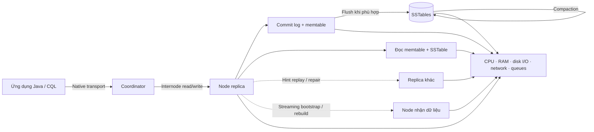
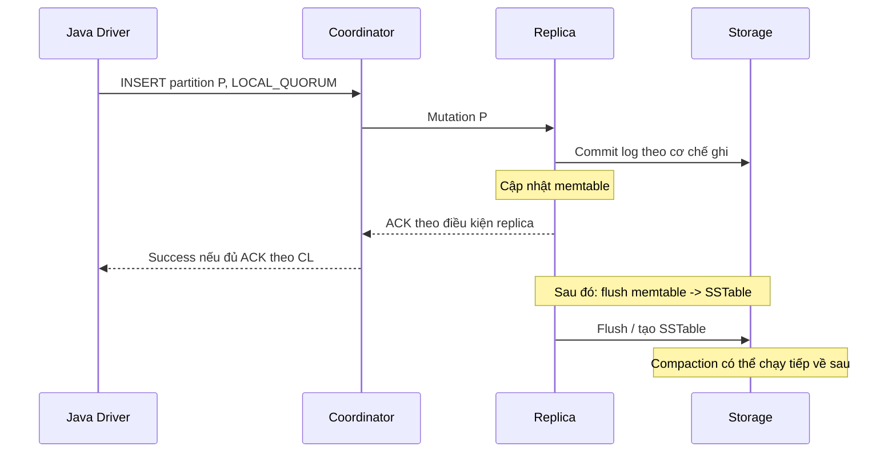
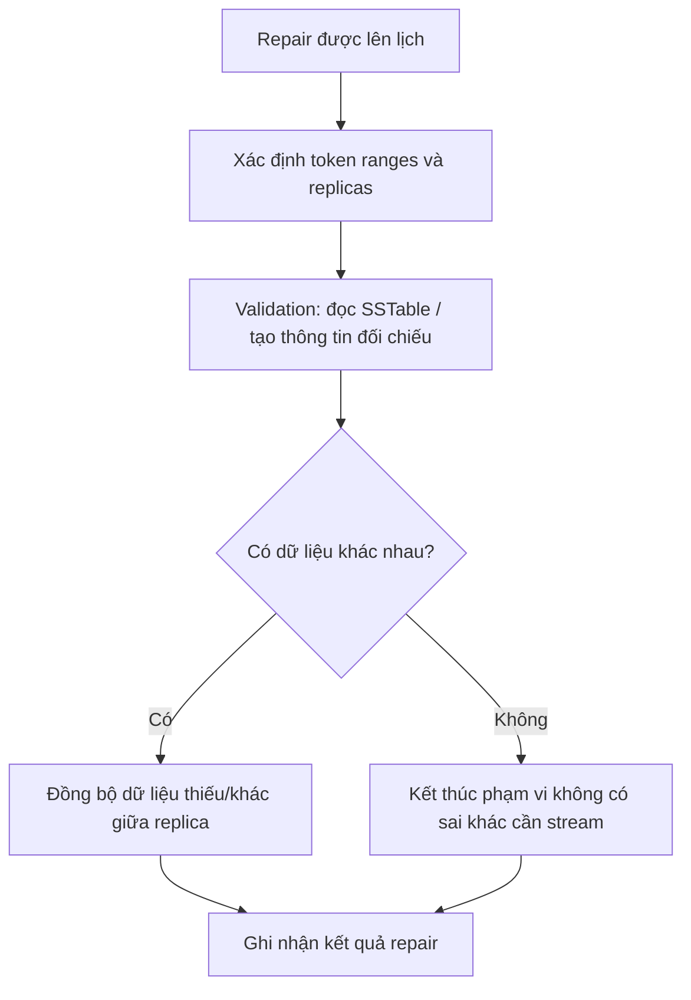
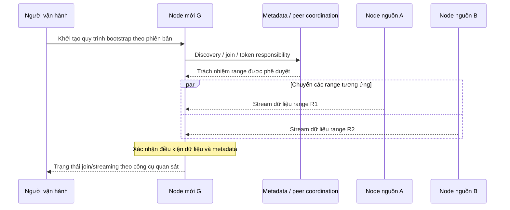
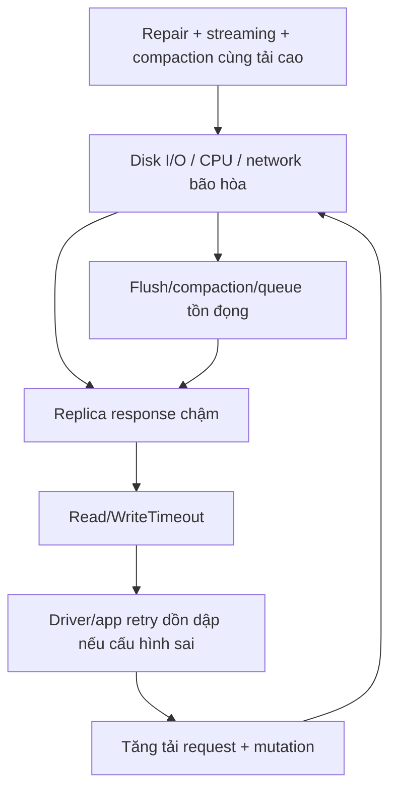
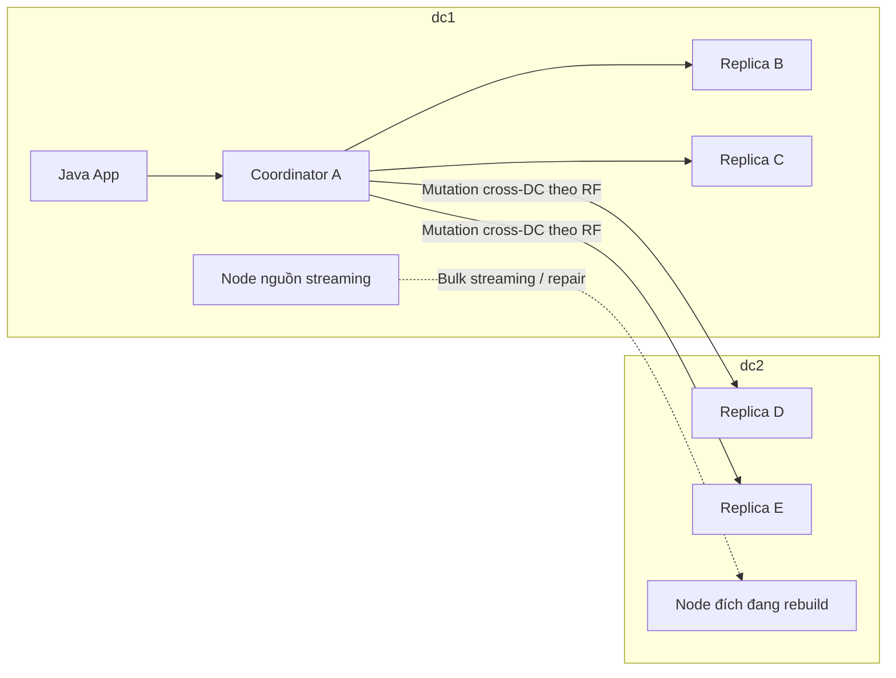
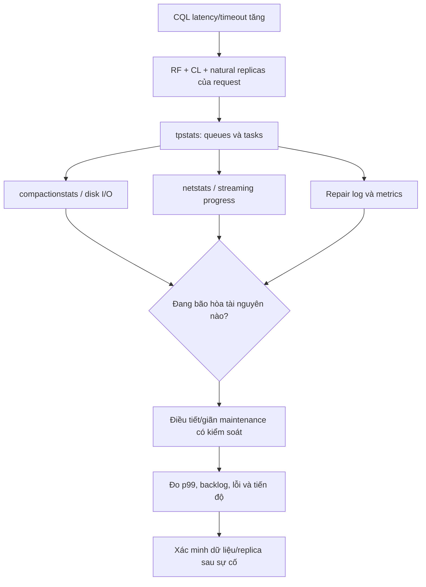

# Background task, streaming và phối hợp các tài nguyên

Apache Cassandra là cơ sở dữ liệu **wide-column phân tán**: một câu lệnh CQL của ứng dụng Java có thể cần coordinator, nhiều replica, commit log, memtable và SSTable. Tuy nhiên, những request trực tiếp từ ứng dụng chỉ là **một phần** công việc mà mỗi node phải thực hiện. Để duy trì khả năng lưu trữ và tính nhất quán lâu dài, Cassandra còn chạy những công việc như **memtable flush, compaction, hinted handoff, anti-entropy repair, streaming, cleanup** và các tác vụ bảo trì khác.

Các công việc này thường được gọi chung là **background tasks**. Chúng không nhất thiết chạy “miễn phí” vào lúc node rảnh. Một đợt streaming khi bootstrap có thể chiếm băng thông, một đợt compaction lớn tạo nhiều I/O, repair đọc dữ liệu trên nhiều replica, còn flush cần chuyển memtable xuống SSTable. Nếu các công việc trùng thời điểm ứng dụng đang tải cao, **p95/p99 latency, timeout và khả năng đạt consistency level** đều có thể bị ảnh hưởng.

Bài thuộc phần **Kiến trúc cụm** của module Apache Cassandra. Mục tiêu là nối các cơ chế lưu trữ và vận hành với **partition key, replication, đọc/ghi CQL, repair, compaction, xử lý sự cố và Java Driver**, thay vì xem mỗi tác vụ như một lệnh quản trị tách biệt.

Sau bài này, bạn có thể:

- Phân biệt **foreground request**, **background maintenance**, **data streaming** và **metadata/gossip traffic**.
- Mô tả tác dụng và điều kiện kích hoạt của flush, compaction, hint replay, repair, bootstrap streaming và cleanup.
- Giải thích tài nguyên nào bị cạnh tranh: **CPU, RAM, disk space, IOPS, disk throughput, network, thread/queue và thời gian chờ**.
- Dự đoán tại sao một node vẫn `UN` nhưng request `LOCAL_QUORUM` có thể timeout khi hoạt động nền quá nặng.
- Lập kế hoạch vận hành không để repair, bootstrap và compaction nặng gây quá tải cùng lúc.
- Dùng `nodetool`, metrics, tracing và Java Driver để phân biệt nút thắt nền với lỗi mạng/replica.

## 1. Foreground và background trong một node Cassandra

**Foreground workload** thường là công việc nằm trên đường request của client: nhận CQL, đọc memtable/SSTable, ghi commit log và memtable, gửi/nhận mutation hoặc data/digest rồi trả kết quả theo CL. **Background workload** gồm các hoạt động giữ cho lưu trữ và replica có thể hoạt động bền vững khi thời gian trôi qua.



Các mũi tên là quan hệ logic, **không phải bản đồ thread pool hoặc cổng TCP**. Flush/compaction chủ yếu dùng tài nguyên **cục bộ**, trong khi streaming/repair có thể tiêu tốn mạng **giữa các node**. Đọc/ghi của client và các tác vụ nền cạnh tranh cùng những tài nguyên vật lý.

### “Background” không đồng nghĩa “không ảnh hưởng request”

Ví dụ một replica đang flush memtable và compaction nhiều SSTable:

1. Client gửi `SELECT`; replica phải đọc các file SSTable trên ổ đĩa đang chịu tải.
2. Compaction cũng đọc/ghi SSTable trên chính ổ đĩa đó.
3. Hàng đợi I/O dài hơn, khiến data response tới coordinator muộn.
4. Coordinator không đạt quorum trước deadline và có thể trả `ReadTimeout`.

Tác vụ nền **không cần tạo ra một exception riêng** để ảnh hưởng ứng dụng. Nhiều khi nó chỉ khiến những đường request thường ngày chậm hơn.

## 2. Bản đồ các loại tác vụ và điều kiện kích hoạt

| Tác vụ | Vì sao chạy? | Dữ liệu/đường liên quan | Tài nguyên nổi bật |
|---|---|---|---|
| **Memtable flush** | Chuyển dữ liệu trong memtable thành SSTable khi đạt điều kiện flush/áp lực bộ nhớ hoặc yêu cầu vận hành. | **Một node**, memtable → SSTable. | RAM, disk write, I/O queue. |
| **Compaction** | Hợp nhất/tổ chức lại SSTable, xử lý các phiên bản/tombstone theo quy tắc an toàn. | **Một node**, đọc/ghi SSTable cục bộ. | Disk read/write, dung lượng tạm, CPU. |
| **Hint replay / handoff** | Phát lại những mutation được giữ hộ khi replica tạm vắng, trong giới hạn cấu hình. | Node giữ hint → replica đích. | Disk, internode network, write load. |
| **Anti-entropy repair** | So sánh và đồng bộ khác biệt dữ liệu giữa các replica. | Nhiều replica, validation và dữ liệu cần sửa. | Disk read, CPU, network, đôi khi streaming. |
| **Bootstrap streaming** | Node mới nhận dữ liệu cho các token/range được phân công. | Node nguồn → node mới. | Network, disk read/write, CPU. |
| **Rebuild/replace streaming** | Xây dựng lại bản sao tại DC hoặc node thay thế, tùy quy trình. | Các node nguồn và đích phù hợp. | Network và disk lớn. |
| **Cleanup** | Loại dữ liệu của token range node không còn trách nhiệm giữ sau thay đổi topology. | SSTable trên node. | Disk read/write, I/O, CPU. |
| **Snapshot / backup** | Bảo vệ điểm khôi phục hoặc xuất dữ liệu theo kế hoạch. | SSTables, storage/backup target. | Disk space, I/O, có thể network. |
| **Gossip / metadata coordination** | Duy trì nhận thức peer và các thay đổi metadata theo phiên bản. | Lưu lượng node-node/control. | Network và CPU; thường nhỏ hơn bulk streaming. |

Tần suất và cấu trúc nội bộ của từng tác vụ **phụ thuộc phiên bản Cassandra, cấu hình, chiến lược compaction, loại workload và sự kiện cluster**. Không có một “background scheduler” duy nhất bảo đảm mọi loại tác vụ sẽ tự xếp hàng hoàn hảo để không bao giờ ảnh hưởng CQL.

## 3. Đường ghi: commit log, memtable và flush

Khi replica nhận mutation:

1. Nó ghi theo cơ chế **commit log** để hỗ trợ độ bền qua sự cố và cập nhật **memtable** cho dữ liệu đang hoạt động.
2. Replica gửi ACK theo điều kiện xử lý ghi; coordinator thu ACK theo CL.
3. Khi memtable cần flush, Cassandra tạo **SSTable bất biến** trên đĩa.
4. Dữ liệu có thể tồn tại trong nhiều SSTable; **compaction** diễn ra sau để tổ chức lại theo chiến lược.



Sơ đồ minh họa **một replica**, không biểu diễn đủ toàn bộ fan-out và ACK của các replica khác. Điều cốt lõi: **client không đợi mọi SSTable được compact mới nhận success**. Flush và compaction có lịch riêng; chi tiết commit log sync, ACK và durability tùy cấu hình, kiểu mutation và phiên bản.

### Tại sao flush backlog nguy hiểm?

Flush cần ghi lượng dữ liệu đáng kể từ RAM xuống đĩa. Nếu ghi đầu vào tăng mạnh hoặc ổ đĩa quá chậm:

- Memtable/flush work tích lũy, tạo **áp lực bộ nhớ và I/O**.
- Các cơ chế giới hạn/backpressure của Cassandra có thể làm chậm request ghi để tránh tăng backlog vô hạn.
- Độ trễ của một số request ghi tăng dù mạng và RF không thay đổi.
- Flush sinh thêm SSTable; nếu compaction không bắt kịp, đọc sau đó có thể phải xem xét nhiều file hơn.

Do đó, `WriteTimeout` khi node vẫn `UN` có thể xuất phát từ bottleneck lưu trữ, không chỉ từ lỗi replication hoặc mạng.

## 4. Compaction: công việc cục bộ có hậu quả toàn cụm

**SSTable bất biến**. Ghi mới và cập nhật thường tạo các mảnh dữ liệu mới thay vì ghi đè trực tiếp lên file cũ. **Compaction** đọc SSTable liên quan và tạo SSTable mới theo chính sách của bảng; nó có thể giảm số file cần đọc, hợp nhất phiên bản cell và loại thông tin hết hiệu lực **khi các điều kiện an toàn cho phép**.

Ví dụ bảng theo thiết bị/ngày:

```sql
CREATE KEYSPACE telemetry
WITH replication = {
  'class': 'NetworkTopologyStrategy',
  'dc1': 3,
  'dc2': 3
};

CREATE TABLE telemetry.readings_by_device_day (
    tenant_id uuid,
    device_id uuid,
    event_day date,
    event_time timestamp,
    event_id uuid,
    reading double,
    PRIMARY KEY ((tenant_id, device_id, event_day), event_time, event_id)
) WITH CLUSTERING ORDER BY (event_time DESC, event_id ASC);
```

Các mutation của một partition có thể nằm trong memtable và nhiều SSTable tại **mỗi** replica. Khi đọc, replica cần hợp nhất các phiên bản/tombstone có liên quan. Compaction giảm hoặc thay đổi cấu trúc lưu trữ cục bộ, nhưng:

- **Không tự sao chép dữ liệu từ node A sang node B.**
- **Không làm replica down đột ngột trở nên up.**
- **Không bảo đảm mọi tombstone được xóa ngay.**
- **Không phải snapshot/backup** và không thay thế repair.

### Những chiến lược compaction thường gặp

| Chiến lược | Ý tưởng khái quát | Kiểu workload cần cân nhắc |
|---|---|---|
| **SizeTieredCompactionStrategy (STCS)** | Gom SSTable có kích thước tương đồng thành đợt. | Workload thiên về ghi; có thể phát sinh đợt I/O lớn. |
| **LeveledCompactionStrategy (LCS)** | Tổ chức SSTable thành các level theo quy tắc chồng lấp. | Đọc nhạy với số SSTable, đánh đổi write amplification và tài nguyên. |
| **TimeWindowCompactionStrategy (TWCS)** | Nhóm SSTable theo cửa sổ thời gian để phục vụ dữ liệu time-series/TTL phù hợp. | Dữ liệu thời gian có retention/TTL; cần tránh cách ghi muộn làm trộn dữ liệu không như mong đợi. |
| **UnifiedCompactionStrategy (UCS)** ở những bản hỗ trợ | Cho phép cấu hình chính sách hợp nhất theo cơ chế hiện đại của release. | Chỉ chọn khi đã kiểm tra version, migration và chỉ số workload thực tế. |

Không có chiến lược nào “tốt nhất cho mọi bảng”. Chọn compaction phải căn cứ **kiểu đọc/ghi, partition, TTL, tombstone, read/write amplification, dung lượng và disk throughput**. Đừng thay chiến lược trên toàn cluster production chỉ vì một đồ thị `pending compactions` cao trong vài phút.

### Dung lượng đĩa trong lúc compaction

Compaction có thể cần **ghi SSTable mới trước khi loại bỏ SSTable cũ**. Do đó phải giữ **headroom dung lượng đĩa**, không vận hành với filesystem gần đầy liên tục. Thiếu dung lượng có thể khiến compaction/flush/streaming thất bại và ảnh hưởng cả khả năng phục vụ CQL.

## 5. Repair: đối chiếu dữ liệu replica khác với compaction

Cassandra nhân bản dữ liệu theo RF, nhưng các replica có thể tạm lệch vì node down, network partition, ghi timeout hoặc replication chậm. **Anti-entropy repair** là cơ chế đối chiếu và đồng bộ dữ liệu giữa các replica trong một phạm vi token/partition được chọn.

Một quy trình repair ở mức khái niệm:

1. Xác định những replica tham gia repair cho các range và phạm vi phù hợp.
2. Các node tạo/trao đổi thông tin **validation** để xác định vùng dữ liệu có khác biệt.
3. Cơ chế so sánh có thể dùng **Merkle trees** hoặc cấu trúc tương ứng theo phiên bản.
4. Những vùng/cell cần sửa được đồng bộ bằng phương thức truyền dữ liệu phù hợp.
5. Quy trình ghi nhận kết quả repair và cập nhật trạng thái vận hành theo cơ chế phiên bản.



**Repair có thể không cần truyền khối lượng lớn dữ liệu** nếu các replica đã phù hợp trong phạm vi đối chiếu, nhưng validation vẫn có chi phí disk read và CPU. Ngược lại, sau thời gian node vắng dài, dữ liệu khác biệt có thể nhiều, tạo **lưu lượng truyền lớn** và tác động đáng kể tới latency CQL.

### Không lẫn ba khái niệm “sửa”

| Cơ chế | Kích hoạt điển hình | Phạm vi |
|---|---|---|
| **Read repair** | Một số đường đọc phát hiện bất đồng replica, tùy phiên bản/table option. | Dữ liệu được đọc và xử lý trong request tương ứng. |
| **Anti-entropy repair** | Tác vụ vận hành/scheduler chạy theo phạm vi range/replica. | Các partition trong phạm vi repair, kể cả chưa được client đọc. |
| **Compaction** | Chính sách lưu trữ cục bộ của bảng hoặc tác vụ quản trị. | SSTable trên một node; không tự đối chiếu replica khác. |

Repair là một phần của thiết kế **tính nhất quán cuối cùng và phục hồi sau lỗi**, không phải cách khắc phục tức thời mọi lỗi request. Nó cần được **lên lịch, giám sát và điều tiết**, nhất là trên cluster nhiều TB hoặc nhiều DC.

## 6. Streaming: khi dữ liệu thực chuyển giữa các node

**Streaming** truyền dữ liệu giữa các Cassandra node để một node nhận các partition/range cần giữ. Các tình huống thường gặp:

- **Bootstrap:** thêm node và phân bố lại trách nhiệm replica.
- **Replace:** thay node không thể phục hồi, theo quy trình tránh xung đột danh tính/token.
- **Rebuild:** xây dựng dữ liệu tại DC hoặc node theo hoạt động vận hành được hỗ trợ.
- **Thay replication/topology:** một số thay đổi cần dữ liệu đến replica mới.
- **Repair:** khi cần đồng bộ vùng dữ liệu khác biệt, có thể phát sinh các phiên truyền.



**Node nguồn streaming không nhất thiết là seed**. Seed giúp peer discovery; dữ liệu thường được lấy từ những node giữ các range liên quan. Streaming **không phải vòng gossip** và không tương đương Java Driver gửi lại từng câu `INSERT` để dựng dữ liệu.

### Streaming gồm cả đường điều khiển và dữ liệu

Một phiên streaming thường phải xác định **range nào, nguồn/đích nào, trạng thái phiên, tiến độ và dữ liệu cần chuyển**. Cách multiplexing, connection, format và compression phụ thuộc phiên bản/cấu hình; không nên giả định mọi byte streaming đều chạy trên cùng connection với mutation hay đi qua cổng CQL `9042`.

**Băng thông mạng chỉ là một nửa vấn đề**: node nguồn cần đọc dữ liệu và node đích cần ghi dữ liệu; cả hai cạnh tranh I/O với foreground request. Nếu nguồn là một replica đang chịu tải đọc/ghi cao, streaming có thể gây tăng latency ngay cả khi đường mạng còn nhiều băng thông.

## 7. Hinted handoff và replay khi replica phục hồi

Khi replica C tạm không đáp ứng, coordinator hoặc node phù hợp có thể ghi **hint** cho một số mutation để phát lại về sau, trong giới hạn cơ chế và cấu hình. Khi C liên lạc trở lại, **hint replay** tạo thêm lưu lượng node-node và ghi tại C.

Ví dụ partition P có RF = 3 tại `dc1`, natural replicas A/B/C. C tạm down:

1. Ứng dụng gửi ghi với `LOCAL_QUORUM`.
2. A/B có thể đủ hai ACK để client nhận thành công.
3. Một số mutation dành cho C có thể được lưu hint nếu điều kiện cho phép.
4. Sau khi C trở lại, replay chuyển các mutation được giữ hộ.
5. Nếu C vắng quá lâu hoặc hint không bao phủ mọi tình huống, **repair** có thể cần thiết để hội tụ dữ liệu.

Hint replay không phải phương pháp bảo đảm toàn bộ dữ liệu của node offline nhiều ngày sẽ tự hoàn chỉnh. Các giới hạn lưu hint, cửa sổ replay, dung lượng và tính chất cấu hình đều cần kiểm tra theo release. Replay còn **cạnh tranh băng thông và disk I/O** với request mới.

### Timeout ghi tạo ra trạng thái không chắc chắn

`WriteTimeout` không có nghĩa mutation chắc chắn chưa được ghi. A/B có thể đã lưu mutation nhưng coordinator mất kết nối trước khi trả success. Nếu Java application tự tạo **event_id mới** mỗi lần retry, cùng một sự kiện có thể thành hai hàng CQL. Vì vậy retry phải dựa trên **khóa sự kiện ổn định và ngữ nghĩa idempotent**, không chỉ dựa trên việc client vừa timeout.

## 8. Cleanup, snapshot và những công việc nền khác

Không phải tất cả công việc bảo trì đều do lỗi dữ liệu gây ra.

**Cleanup:** sau khi topology thay đổi, một node có thể còn các token range mà nó không còn chịu trách nhiệm lưu. Cleanup giúp loại dữ liệu không còn thuộc sở hữu phù hợp theo cơ chế phiên bản. Nó tiêu tốn disk I/O và cần làm theo **đúng quy trình chuyển topology**; không dùng cleanup tùy tiện để “giải phóng ổ” trên một node chưa hoàn tất bootstrap/rebalance.

**Snapshot:** tạo điểm tham chiếu để phục hồi dữ liệu, thường dựa trên các file SSTable và kỹ thuật tối ưu lưu trữ như hard link trong những môi trường hỗ trợ. Snapshot có thể dùng ít chi phí copy ban đầu nhưng vẫn **chiếm dung lượng đĩa hữu hiệu** và cần kế hoạch retention/xóa/backup off-node. Snapshot cục bộ **không** là bản sao độc lập trước lỗi cả ổ đĩa hoặc DC.

**Backup:** chuyển và duy trì dữ liệu ngoài node theo chính sách tổ chức; backup network traffic có thể cạnh tranh băng thông với replication và streaming, đặc biệt trong giờ cao điểm.

**Gossip và nhiệm vụ metadata:** thường nhỏ hơn bulk streaming về kích thước dữ liệu, nhưng nhạy với GC, scheduling hoặc mạng bị quá tải. Nếu background I/O/CPU làm node đứng hình trong thời gian dài, peer có thể nghi node `DOWN` dù phần cứng vẫn hoạt động.

## 9. Phối hợp tài nguyên: bảy điểm nghẽn cần quan sát

| Tài nguyên | Tác vụ dễ gây áp lực | Triệu chứng có thể gặp |
|---|---|---|
| **CPU** | Compression, compaction, validation repair, serialization, GC. | Queue tăng, p99 latency tăng, gossip chậm. |
| **Heap/off-heap RAM** | Memtable, buffer, cache, metadata, streaming/network buffers. | GC pause, memory pressure, OOM hoặc chậm đột biến. |
| **Disk IOPS** | Random reads, memtable flush, validation, compaction. | Nhiều request nhỏ chậm dù disk throughput chưa đạt tối đa. |
| **Disk throughput** | Sequential SSTable read/write, streaming source/destination, backup. | Băng thông đĩa bão hòa, flush/compaction backlog. |
| **Disk capacity** | SSTable mới, compaction tạm, snapshot/hints/commit log. | Thiếu headroom, flush hoặc compaction thất bại. |
| **Network bandwidth/latency** | RF fan-out, cross-DC replication, streaming, hint replay, repair. | ACK/data trễ, timeout, bootstrap kéo dài. |
| **Thread pools/queues & deadlines** | Nhiều hoạt động đồng thời tranh chấp. | Pending task tăng, request timeout dù node vẫn `UN`. |

Một tỷ lệ sử dụng CPU trung bình thấp **không loại trừ I/O bottleneck**; IOPS có thể đầy khi throughput byte chưa cao. Tương tự, disk throughput thấp nhưng latency cao có thể do đĩa bị queue nhỏ/đọc ngẫu nhiên, hoặc hệ thống lưu trữ bên dưới không ổn định.

### Hiệu ứng vòng lặp khuếch đại



Khi sự cố xảy ra, chỉ tăng timeout có thể làm nhiều request giữ tài nguyên lâu hơn. Chỉ tăng retry cũng có thể tạo **retry storm**. Cần kiểm tra tài nguyên, workload nền và **điều kiện CL** trước khi chỉnh driver.

## 10. Các tác vụ không luôn có cùng mức ưu tiên

Cassandra có nhiều **stage, executor, queue và cơ chế điều tiết** để xử lý công việc nội bộ. Tuy nhiên, tên stage, giới hạn đồng thời và pipeline thay đổi theo phiên bản. Không nên dựa trên một danh sách thread pool bất biến để tuyên bố “streaming luôn ưu tiên thấp hơn ghi nên không thể ảnh hưởng request”.

Một số nguyên tắc phối hợp:

- **Foreground latency** là một SLO cần bảo vệ; không chạy bảo trì không kiểm soát chỉ vì cluster còn trạng thái `UN`.
- **Flush** liên quan khả năng tiếp nhận ghi bền vững; làm tắc flush để ưu tiên công việc khác có thể gây hậu quả nghiêm trọng.
- **Compaction** không nên bị tắt vô thời hạn: SSTable backlog, read amplification và tombstone pressure có thể ngày càng xấu.
- **Repair** không nên bị hoãn vô hạn chỉ vì nó tốn tài nguyên: replica mất đồng bộ kéo dài, tombstone retention và khôi phục sau lỗi đều phụ thuộc lịch repair.
- **Streaming** khi add/replace/rebuild có thể cần hoàn tất trước khi node mới đủ điều kiện phục vụ, nhưng số lượng phiên đồng thời nên cân đối với năng lực nguồn và đích.
- **Hint replay** có thể tạo spike khi node trở lại; cần dự liệu tải ghi bổ sung.

Đây là vấn đề **lập ngân sách tài nguyên và thứ tự vận hành**, không đơn thuần chọn một cờ cấu hình cho tất cả tác vụ.

## 11. RF, CL và tài nguyên: ít ACK cần chờ không có nghĩa ít việc phải làm

Giả sử keyspace ở mục 4 dùng `NetworkTopologyStrategy` với `RF_dc1 = 3` và `RF_dc2 = 3`. Ứng dụng ở `dc1` gửi `INSERT` cho partition P với `LOCAL_QUORUM`:

- Coordinator cần **hai ACK hợp lệ trong `dc1`** để trả success.
- Mutation vẫn có trách nhiệm được nhân bản tới **các natural replicas** theo RF/topology, kể cả replica ở `dc2`.
- Ghi thành công ở `dc1` **không** chứng minh các replica `dc2` đã nhận mutation.
- Cross-DC network/repair có thể tiếp tục tạo tải sau khi client đã nhận ACK.

| CL tại coordinator dc1 | Điều kiện chính trong ví dụ | Đánh đổi cần nhìn |
|---|---|---|
| `LOCAL_ONE` | Một replica `dc1` phản hồi. | Latency có thể thấp, dễ thấy dữ liệu chưa hội tụ khi đọc. |
| `LOCAL_QUORUM` | Hai replica `dc1` phản hồi. | Phụ thuộc ít nhất hai replica địa phương đủ nhanh. |
| `QUORUM` | Bốn trong tổng sáu replica phản hồi. | Có thể cần liên lạc qua WAN; thêm rủi ro timeout liên DC. |
| `EACH_QUORUM` (ghi) | Quorum của **mỗi DC**: hai trong `dc1` và hai trong `dc2`. | Giảm khoảng trống xác nhận xuyên DC nhưng tăng phụ thuộc cả hai DC. |
| `ALL` | Cả sáu replica phản hồi. | Dễ thất bại/chậm khi một replica hoặc đường mạng có lỗi. |

**CL không thay RF** và không tự giảm băng thông streaming/repair. Đổi CL để giảm timeout có thể làm thay đổi cam kết nhất quán của ứng dụng; phải đánh giá cùng yêu cầu read-after-write, failover và dữ liệu quan trọng.

### Replica còn UP nhưng quá chậm

Nếu C vẫn được failure detector coi là `UP` nhưng đang compaction nặng, coordinator có thể thiếu phản hồi của C trước deadline. Với RF = 3 và `LOCAL_QUORUM`, hai replica còn lại vẫn có thể phục vụ. Nhưng nếu cả B và C cùng chịu streaming/repair nặng, chỉ A đáp ứng kịp thì `LOCAL_QUORUM` thất bại. **Liveness không đồng nghĩa đủ hiệu năng để hoàn thành request.**

## 12. Lưu lượng trong DC và xuyên DC

Với cluster nhiều DC, cần phân biệt **đường replica mutation/read** với **bulk data movement**:



Một đợt rebuild `dc2` có thể kéo băng thông WAN lớn, đồng thời ứng dụng `dc1` vẫn nhân bản ghi xuyên DC. Nếu liên kết WAN gần bão hòa, các mutation hoặc ACK liên DC có thể trễ. Với `LOCAL_QUORUM` tại `dc1`, request có thể vẫn thành công khi đủ replica địa phương; nhưng dữ liệu bên kia có thể chưa hội tụ, gây rủi ro khi failover.

Do đó, nên tính ngân sách mạng dựa trên:

1. **Lưu lượng ổn định:** foreground reads/writes nhân RF, gossip, telemetry.
2. **Lưu lượng đỉnh:** tăng đột biến từ ứng dụng và retry.
3. **Lưu lượng bảo trì:** streaming, repair, hints/backup.
4. **Tình huống lỗi:** một rack/DC mất kết nối rồi trở lại tạo khối lượng bắt kịp.

Không giả định băng thông WAN danh nghĩa là dung lượng khả dụng cho Cassandra: có thể còn overhead, packet loss, network policy và các hệ thống khác cùng sử dụng liên kết.

## 13. Thiết kế partition key giúp giảm tranh chấp tài nguyên

Không phải vấn đề hiệu năng nào cũng chữa được bằng điều tiết compaction. **Thiết kế dữ liệu wide-column theo truy vấn** quyết định số partition, kích thước partition và mức độ tập trung của yêu cầu vào các replica.

Trong bảng `telemetry.readings_by_device_day`, partition key là `(tenant_id, device_id, event_day)`, còn clustering columns là `(event_time, event_id)`. Truy vấn có đủ partition key:

```sql
SELECT event_time, event_id, reading
FROM telemetry.readings_by_device_day
WHERE tenant_id = 11111111-1111-1111-1111-111111111111
  AND device_id = 22222222-2222-2222-2222-222222222222
  AND event_day = '2026-11-21'
LIMIT 20;
```

Với cách bucketing theo ngày, một thiết bị không tạo ra một partition lịch sử vô hạn. Tuy nhiên, nếu thiết bị ghi hàng triệu điểm mỗi giây thì **partition một ngày vẫn có thể quá lớn/nóng**. Khi đó cần xem lại thời gian bucket, mức cardinality, retention và query pattern. Đừng tự chia bucket thành quá nhỏ nếu truy vấn bắt buộc đọc hàng trăm bucket mới trả được dữ liệu.

### Hot partition làm lịch bảo trì khó hơn

- Một tập replica hữu hạn chịu phần lớn reads/writes của hot partition.
- Flush và compaction tại những node đó chịu thêm I/O.
- Repair/streaming tại cùng node có thể đẩy p99 latency vượt SLO.
- Thêm node **không tự chia nhỏ một partition hiện hữu** sang mọi node; cần thay đổi data model hoặc cách phân bổ khóa.

Nếu bảng time-series sử dụng TTL, phải xét **tombstone và compaction strategy**, không chỉ số lượng bản ghi còn sống.

## 14. Tombstone, TTL và rủi ro khi hoãn repair

`DELETE` và dữ liệu hết hạn TTL thường tạo thông tin **tombstone**/trạng thái xóa logic cần được các replica tôn trọng. Cassandra không thể xóa mọi dấu vết ngay lập tức trên tất cả node, vì một replica offline có thể còn giá trị cũ.

Ví dụ:

1. Replica A/B nhận tombstone xóa cell tại timestamp mới.
2. Replica C offline không nhận xóa và vẫn giữ giá trị cũ.
3. Khi C trở lại, hệ thống cần đối chiếu đúng để tombstone thắng dữ liệu cũ.
4. Nếu tombstone bị loại bỏ theo quy tắc lưu giữ quá sớm trong khi replica chưa repair, có rủi ro **deleted data resurrection** trong những điều kiện nhất định.

`gc_grace_seconds` và lịch repair liên quan đến khoảng thời gian replica có thể vắng mặt, không phải nút vặn “giảm tombstone càng thấp càng tốt”. Không tùy ý thay giá trị này hoặc hoãn repair dài hạn để giảm I/O trước mắt.

Compaction có thể loại tombstone **khi các điều kiện an toàn cho phép**; repair đối chiếu giữa replica; hai chức năng không thay thế nhau. Với TWCS, cần hiểu cách TTL, timestamp của dữ liệu và ghi muộn ảnh hưởng cửa sổ compaction.

## 15. Phân bổ thời gian bảo trì: một lịch có thể thực hiện

Giả sử cluster `telemetry` phải chịu tải cao từ **08:00–20:00** tại DC chính, có backup ban đêm và kế hoạch thêm một node mới. Một lịch vận hành minh họa:

| Giai đoạn | Hoạt động | Điều kiện để tiếp tục |
|---|---|---|
| Trước thay đổi | Đo baseline request rate, p95/p99, compaction backlog, disk headroom, network throughput. | Không có sự cố đang mở làm chỉ số bất thường. |
| Ngoài giờ cao điểm | Thêm **một** node/bootstrap theo quy trình phiên bản. | Có đủ băng thông/đĩa; nguồn streaming không bị quá tải. |
| Trong streaming | Theo dõi `nodetool netstats`, log, queue, CQL latency. | Không vượt ngưỡng vận hành/SLO đã thống nhất. |
| Sau bootstrap | Xác minh topology/token, dữ liệu mới và các tác vụ hậu join cần thiết. | Node đạt trạng thái phù hợp, streaming hoàn tất theo checklist. |
| Cửa sổ repair | Chạy repair theo phạm vi có kiểm soát, tránh trùng bulk jobs. | Theo dõi validation/streaming, không làm p99 vượt ngưỡng kéo dài. |
| Backup/snapshot | Theo chính sách retention và dung lượng. | Disk/network còn headroom cho compaction và flush. |

Thời gian chỉ **minh họa theo tải giả định**, không phải lịch chuẩn chung cho Cassandra. Một cluster toàn cầu có peak ở nhiều múi giờ có thể không có “giờ vắng”. Khi đó cần **giới hạn đồng thời, phạm vi và băng thông**, phối hợp giữa các nhóm vận hành thay vì chỉ hẹn vào ban đêm.

### Thứ tự triển khai khi phải làm nhiều việc

1. Kiểm tra cluster và SLO trước khi bắt đầu.
2. Ưu tiên bảo đảm **đĩa không đầy** và đường ghi/flush còn khả năng tiến triển.
3. Không chạy đồng thời nhiều đợt bulk streaming/repair trên cùng nhóm node nếu chưa có năng lực và phép đo chứng minh an toàn.
4. Khi bắt đầu một job, theo dõi **node nguồn và node đích**, không chỉ node đích.
5. Có tiêu chí hoãn/giảm tải và quy trình khôi phục nếu job gây timeout tăng.
6. Sau job, đợi chỉ số ổn định và xác minh dữ liệu trước khi chuyển traffic.

## 16. Điều tiết throughput và concurrency: đừng sao chép cấu hình mù quáng

Cassandra có các tham số điều khiển throughput/concurrency cho những tác vụ như compaction, streaming và flush ở các phiên bản khác nhau. Ví dụ trong một số release có các cấu hình liên quan:

- `compaction_throughput_mb_per_sec` hoặc tên/đơn vị tương ứng theo release.
- `concurrent_compactors` để giới hạn số tác vụ compaction đồng thời.
- Các tham số điều tiết streaming theo **megabits/second** hoặc giới hạn kết nối/luồng; tên và hành vi có thể thay đổi theo phiên bản.
- Các cấu hình memtable/flush và thread/concurrency phù hợp hệ thống lưu trữ.

**Không mặc định các giá trị mẫu hoặc tên tham số này có hiệu lực giống nhau ở Cassandra 3.x, 4.x và 5.x**. Đặc biệt phải phân biệt **MB/s** với **Mb/s** (byte và bit). Cấu hình được chọn nên dựa trên:

- Năng lực **đọc và ghi đĩa** của node, không chỉ số NIC.
- Tỷ lệ **write/read** và yêu cầu latency nghiệp vụ.
- Kích thước SSTable, compaction strategy, mức tombstone.
- RF/topology và áp lực mạng **liên DC**.
- Khoảng thời gian cần hoàn tất repair/streaming, điều kiện phục hồi sau lỗi.

Tăng throughput compaction có thể giảm backlog nhanh hơn nhưng tăng I/O cạnh tranh. Giảm nó quá thấp có thể khiến SSTable tồn đọng, làm đọc ngày càng chậm. Giới hạn streaming tránh nghẽn WAN nhưng kéo dài bootstrap và khoảng thời gian topology đang thay đổi. Không có tối ưu miễn phí.

## 17. Quan sát bằng nodetool: nhìn đúng loại backlog

Những lệnh quan sát điển hình (thực hiện trên môi trường thử nghiệm hoặc qua quy trình vận hành được cấp phép):

```bash
nodetool status
nodetool tpstats
nodetool compactionstats
nodetool netstats
nodetool tablestats telemetry.readings_by_device_day
nodetool gossipinfo
nodetool describecluster
```

| Công cụ | Cần quan sát | Không thể kết luận chỉ từ lệnh này |
|---|---|---|
| `nodetool status` | DC/rack, `UN`/`DN`, joining/leaving và topology khái quát. | Node `UN` không có nghĩa không bị nghẽn I/O. |
| `nodetool tpstats` | Hàng đợi, active/pending/completed tasks theo các stage phiên bản. | Không tự cho biết nguyên nhân chính là CPU hay disk. |
| `nodetool compactionstats` | Compaction đang chạy, pending và tiến độ tùy bản. | Pending tăng ngắn hạn chưa đủ để kết luận lỗi nghiêm trọng. |
| `nodetool netstats` | Streaming sessions, gửi/nhận dữ liệu và trạng thái liên quan theo bản. | Không phải tất cả traffic native CQL/internode. |
| `nodetool tablestats` | Thống kê bảng, SSTable, latency/tombstone và dung lượng tùy bản. | Không thay hệ thống metrics theo thời gian dài. |
| `nodetool gossipinfo` | Trạng thái peer từ góc nhìn node. | Không chứng minh replica đã có cùng dữ liệu. |
| `nodetool describecluster` | Metadata/schema cluster theo công cụ phiên bản. | Không đo hiệu năng I/O hay băng thông thực tế. |

**Quan sát theo thời gian** quan trọng hơn một lần chụp. Ví dụ `pending compactions` có thể tăng sau peak rồi giảm bình thường; vấn đề đáng lo là backlog tăng liên tục, không có khả năng bắt kịp và kéo theo disk headroom/read latency xuống cấp.

### Kết hợp metrics và logs

Ngoài `nodetool`, nên theo dõi:

- **Client/driver:** p50/p95/p99 read/write latency, request rate, timeout/errors theo CL/DC.
- **JVM:** GC pause, heap/off-heap usage, CPU, thread scheduling.
- **Storage:** disk used/free, IOPS, throughput, queue depth và latency ghi/đọc.
- **Internode:** bytes/messages, network retransmissions, packet loss, RTT liên rack/DC.
- **Maintenance:** pending/running compactions, flush backlog, streaming progress, repair duration/error.
- **Logs:** lỗi disk, streaming, repair, coordinator timeout, topology/schema và các sự kiện tương ứng.

Tên metric/JMX path khác nhau theo Cassandra release và hệ thống giám sát. Khi so sánh các chỉ số, phải đồng bộ **mốc thời gian và node nguồn/đích**.

## 18. Dùng CQL tracing để phân biệt request path và tác vụ nền

Với bảng `telemetry.readings_by_device_day` đã tạo, ví dụ đọc một partition:

```sql
-- CONSISTENCY và TRACING là lệnh của cqlsh, không phải câu SELECT CQL.
CONSISTENCY LOCAL_QUORUM;
TRACING ON;

SELECT event_time, event_id, reading
FROM telemetry.readings_by_device_day
WHERE tenant_id = 11111111-1111-1111-1111-111111111111
  AND device_id = 22222222-2222-2222-2222-222222222222
  AND event_day = '2026-11-21'
LIMIT 20;

TRACING OFF;
```

Tracing có thể cho thấy một số bước xử lý coordinator/replica, nhận data/digest và thời gian nội bộ. Nhưng **trace của một SELECT không phải hồ sơ của mọi job compaction, streaming hay repair trên node**. Nếu request chậm trong lúc compaction, cần **đối chiếu timestamp trace với metrics/compactionstats/OS I/O**, thay vì mong trace tự viết rõ “do compaction”.

Tracing tạo thêm công việc lưu và xử lý thông tin, nên không bật vô hạn cho mọi request production. Không gây sự cố thực tế bằng cách dừng replica hoặc chạy repair nặng trong giờ cao điểm chỉ để minh họa.

## 19. Java Driver 4.x: kiểm soát timeout, CL và retry

Driver Java chạy trên đường **native CQL**, không trực tiếp điều khiển các thread compaction/streaming nội bộ. Ứng dụng cần **nắm CL và idempotency** để hoạt động nền không biến timeout tạm thời thành ghi trùng hoặc retry storm.

Ví dụ sử dụng Apache Cassandra Java Driver 4.x (API `com.datastax.oss.driver`). Đoạn mã lưu một event với khóa ổn định và đọc partition có CL xác định:

```java
import com.datastax.oss.driver.api.core.CqlSession;
import com.datastax.oss.driver.api.core.DefaultConsistencyLevel;
import com.datastax.oss.driver.api.core.cql.BoundStatement;
import com.datastax.oss.driver.api.core.cql.PreparedStatement;
import com.datastax.oss.driver.api.core.cql.Row;
import com.datastax.oss.driver.api.core.servererrors.WriteTimeoutException;
import com.datastax.oss.driver.api.core.servererrors.ReadTimeoutException;

import java.net.InetSocketAddress;
import java.time.Instant;
import java.time.LocalDate;
import java.util.UUID;

public class CassandraBackgroundWorkloadExample {
    public static void main(String[] args) {
        UUID tenant = UUID.fromString(
            "11111111-1111-1111-1111-111111111111");
        UUID device = UUID.fromString(
            "22222222-2222-2222-2222-222222222222");
        UUID event = UUID.fromString(
            "33333333-3333-3333-3333-333333333333");
        LocalDate day = LocalDate.parse("2026-11-21");

        // Contact points là IP ví dụ; thay bằng endpoint thật.
        try (CqlSession session = CqlSession.builder()
                .addContactPoint(new InetSocketAddress("192.0.2.11", 9042))
                .addContactPoint(new InetSocketAddress("192.0.2.12", 9042))
                .withLocalDatacenter("dc1")
                .build()) {

            PreparedStatement insert = session.prepare(
                "INSERT INTO telemetry.readings_by_device_day " +
                "(tenant_id, device_id, event_day, event_time, event_id, reading) " +
                "VALUES (?, ?, ?, ?, ?, ?)");

            // Event ID và payload ổn định khi xử lý lại cùng một sự kiện.
            BoundStatement write = insert.bind(
                    tenant, device, day,
                    Instant.parse("2026-11-21T01:30:00Z"), event, 36.7)
                .setConsistencyLevel(DefaultConsistencyLevel.LOCAL_QUORUM);

            try {
                session.execute(write);
            } catch (WriteTimeoutException ex) {
                // Không được suy ra mutation đã rollback.
                System.err.println(
                    "Ghi không chắc chắn: cần xử lý retry/idempotency ở nghiệp vụ");
            }

            PreparedStatement select = session.prepare(
                "SELECT event_time, event_id, reading " +
                "FROM telemetry.readings_by_device_day " +
                "WHERE tenant_id = ? AND device_id = ? AND event_day = ? " +
                "LIMIT 20");

            BoundStatement read = select.bind(tenant, device, day)
                .setConsistencyLevel(DefaultConsistencyLevel.LOCAL_QUORUM)
                .setIdempotent(true); // SELECT thuần không có side effect

            try {
                for (Row row : session.execute(read)) {
                    System.out.printf("%s %s %.2f%n",
                        row.getInstant("event_time"),
                        row.getUuid("event_id"),
                        row.getDouble("reading"));
                }
            } catch (ReadTimeoutException ex) {
                System.err.println("Đọc không đủ phản hồi trước deadline");
            }
        }
    }
}
```

Các IP `192.0.2.0/24` chỉ dành cho tài liệu và `dc1` phải trùng DC thật. Để chạy trong môi trường có bảo mật, cần cấu hình xác thực, TLS, timeout và connection policy phù hợp. Trong production, thường tái sử dụng `CqlSession` thay vì tạo mới cho mỗi request.

**Không tự đánh dấu mọi mutation là idempotent.** Ghi cùng khóa/cùng giá trị có thể giảm nguy cơ tạo hai hàng, nhưng timestamp, TTL, counter, LWT, giá trị tăng dần và concurrent update ảnh hưởng tính idempotent nghiệp vụ. Một `WriteTimeout` khi cluster đang compaction/repair nặng **có thể xảy ra sau khi một số replica đã ghi**.

Ứng dụng phải giới hạn retries, tránh retry liên tiếp tức thời và quan sát retry rate theo node/DC. Chỉ tăng timeout không giải quyết thiếu headroom hoặc I/O saturation.

## 20. Runbook: khi repair/streaming trùng giờ cao điểm

**Tình huống:** Trong lúc peak traffic, nhóm vận hành thêm node G vào `dc1`; đồng thời repair một keyspace lớn và compaction backlog đang cao. Java Driver tăng `ReadTimeout`/`WriteTimeout`, mặc dù `nodetool status` vẫn cho thấy nhiều node `UN`.

Thứ tự phân tích:

1. **Xác định lỗi thật:** request nào, coordinator/replica nào, DC, CL, thời điểm p95/p99 tăng.
2. **Kiểm tra quorum:** tính RF và số phản hồi cần đạt. Một replica vẫn `UP` nhưng không đáp ứng đúng hạn có thể gây timeout.
3. **Quan sát streaming:** `nodetool netstats` tại G **và các node nguồn**, không chỉ tại node mới.
4. **Quan sát compaction/flush:** `nodetool compactionstats`, `tpstats`, disk utilization, queue depth, latency.
5. **Quan sát repair:** phạm vi token, node tham gia, validation/streaming và thời điểm tác vụ bắt đầu.
6. **Đánh giá bottleneck:** disk source, disk destination, CPU/GC, network liên rack/DC hay capacity?
7. **Giảm tranh chấp theo runbook:** hoãn/điều tiết các job bảo trì có thể kiểm soát, không can thiệp tùy tiện vào flush/durability; theo hướng dẫn dừng hoặc giới hạn job đúng phiên bản.
8. **Bảo vệ client:** kiểm tra retry storm; không đổi CL hoặc tự retry mutation không idempotent chỉ để giảm cảnh báo.
9. **Theo dõi hồi phục:** pending work, disk headroom, request latency và error rate cần giảm theo xu hướng.
10. **Xác minh sau thay đổi:** streaming/repair hoàn tất theo kế hoạch, replica mới có dữ liệu, không còn vùng cần catch-up trước khi chuyển traffic.



Sơ đồ là hướng điều tra, không phải khẳng định mọi lỗi p99 đều do tác vụ nền. Network partition, lỗi đĩa, partition hotspot, schema/topology không thống nhất hoặc thiếu natural replica cũng có thể tạo triệu chứng gần giống.

## 21. Các tình huống tự luyện

**Tình huống A — Flush và commit log.** Một `INSERT` đã thành công ở CL mong muốn nhưng SSTable của replica chưa được compact. Có mâu thuẫn không? **Không.** ACK ghi và compaction thuộc các giai đoạn khác nhau; durability và commit log/flush cần hiểu theo cấu hình.

**Tình huống B — Compaction và replication.** Replica B có dữ liệu cũ vì bỏ lỡ mutation. Chạy compaction ở B có bảo đảm tự lấy dữ liệu mới từ A không? **Không.** Compaction là công việc lưu trữ cục bộ; dữ liệu thiếu cần hint/repair/streaming thích hợp.

**Tình huống C — Repair không tìm thấy khác biệt.** Có thể không phát sinh bulk streaming nhưng vẫn tiêu tốn CPU/I/O không? **Có.** Validation/đối chiếu vẫn cần đọc và tính toán.

**Tình huống D — Node vừa bootstrap.** G xuất hiện `UN` sau khi join. Có đủ để kết luận mọi lịch sử dữ liệu trong DC đã đúng và có thể failover ngay không? **Không.** Cần kiểm tra streaming, RF, repair và các điều kiện ứng dụng.

**Tình huống E — RF = 3 tại dc1, LOCAL_QUORUM.** B và C vẫn `UN` nhưng cùng đọc rất chậm vì disk I/O; chỉ A trả đúng hạn. Request có thể thành công không? **Không** nếu cần hai phản hồi đúng hạn mà chỉ có một.

**Tình huống F — WAN đang bão hòa.** Ghi `LOCAL_QUORUM` tại `dc1` vẫn thành công. Có bảo đảm `dc2` đã nhận đủ mutation không? **Không.** Ghi được xác nhận địa phương chưa chứng minh replica xa hội tụ.

**Tình huống G — Hint replay.** C quay lại sau vài giờ. Có thể chỉ đợi gossip báo `UP` rồi khẳng định C có mọi dữ liệu không? **Không.** Hint có giới hạn, cần đánh giá repair và độ dài sự cố.

**Tình huống H — Disk 95% đầy.** Có nên tăng compaction concurrency và khởi chạy thêm nhiều bootstrap để giảm backlog không? **Không mặc định.** Compaction và streaming cần dung lượng tạm, có thể làm tình trạng đầy đĩa nghiêm trọng hơn.

**Tình huống I — Hot partition.** Một thiết bị tạo rất nhiều dữ liệu trong cùng partition ngày. Thêm mười node có chia đều mọi request của partition đó không? **Không.** Partition vẫn có tập natural replica theo token/RF; cần xem lại bucketing/partition key và workload.

**Tình huống J — Java WriteTimeout.** Khi compaction nặng, client timeout sau `INSERT`. Có nên lập tức phát lại với `event_id` mới không? **Không.** Có thể mutation đã được lưu; khóa event ổn định và retry có kiểm soát là điều cần thiết.

## 22. Những nhầm lẫn nên loại bỏ

| Nhận định sai | Diễn giải đúng |
|---|---|
| “Background task chỉ chạy khi node rảnh.” | Nhiều công việc nền chạy đồng thời với CQL và cạnh tranh tài nguyên thực. |
| “Một node `UN` chắc chắn đủ nhanh để đáp ứng quorum.” | Liveness không bảo đảm ACK/data đúng hạn. |
| “Compaction tự repair dữ liệu giữa replica.” | Compaction chủ yếu xử lý SSTable cục bộ; repair là cơ chế đối chiếu giữa replica. |
| “Có seed thì streaming dữ liệu luôn đi qua seed.” | Seed giúp discovery; nguồn streaming phụ thuộc range/data/topology. |
| “Streaming chỉ dùng mạng, không dùng disk.” | Nguồn đọc disk và đích ghi disk, ngoài băng thông/CPU. |
| “Repair luôn stream mọi SSTable sang mọi node.” | Repair thường đối chiếu và chỉ đồng bộ phần cần thiết theo cơ chế phiên bản; validation vẫn có chi phí. |
| “Hint replay thay thế hoàn toàn repair.” | Hint bị giới hạn thời gian/cấu hình và không đảm bảo mọi sai lệch. |
| “Giảm compaction throughput về 0 là tối ưu để hết timeout.” | Backlog có thể tích lũy, làm read amplification và disk pressure tăng. |
| “Đổi CL xuống ONE làm giảm số replica vật lý.” | RF vẫn giữ nguyên; CL chỉ thay số phản hồi cần chờ. |
| “Ghi timeout chắc chắn đã rollback.” | Mutation có thể được ghi ở một số replica; retry phải xem idempotency. |
| “Dữ liệu vừa hết TTL thì mọi tombstone biến mất.” | Tombstone được xử lý theo cơ chế retention/compaction/repair, không biến mất tức thì. |
| “Mỗi port tương ứng đúng một workload bất biến qua mọi release.” | Transport, streaming, TLS và connection có thay đổi theo phiên bản/cấu hình. |

## 23. Tổng kết mô hình phối hợp

```text
Ứng dụng Java / CQL foreground
       |
       v
Coordinator -> natural replicas theo partition key, token, RF
       |
       +--> Đọc memtable/SSTable, data/digest response
       |
       +--> Ghi commit log + memtable, ACK theo CL
                           |
                           v
                   Flush -> SSTables
                           |
                           v
                      Compaction

Công việc nền và vận hành node:
  - Hinted handoff: phát lại mutation bỏ lỡ
  - Anti-entropy repair: đối chiếu và sửa replica
  - Streaming: bootstrap/replace/rebuild/đổi topology
  - Cleanup/snapshot/backup: quản lý dữ liệu và khôi phục

          TẤT CẢ CÙNG CHIA SẺ
CPU | RAM | Disk IOPS/throughput/capacity | Network | Queues
                           |
                           v
              p95/p99, timeout, SLO và tiến độ hội tụ
```

**Background task** giữ cho Cassandra có thể phục vụ lâu dài; **streaming** chuyển dữ liệu thật giữa các node; **repair** giúp replica hội tụ; **compaction** tổ chức dữ liệu cục bộ; **flush** chuyển memtable xuống SSTable. Các tác vụ khác mục đích nhưng cùng tiêu tốn tài nguyên. Vì vậy, không đánh giá tính sẵn sàng chỉ bằng node `UP` hay số replica RF: phải xét **quorum theo CL và phản hồi đúng hạn trong khi tài nguyên bị chia sẻ**.

Khi lên lịch bảo trì hoặc xử lý incident, hãy đối chiếu **partition key, natural replica, RF, CL, disk headroom, I/O latency, network throughput, queue, compaction/streaming/repair progress và Java Driver timeout/retry**. Cách nhìn tổng thể này giúp tránh bỏ repair quá lâu, tránh streaming ồ ạt trong giờ cao điểm và duy trì khả năng đọc/ghi của Cassandra một cách có thể kiểm chứng.
