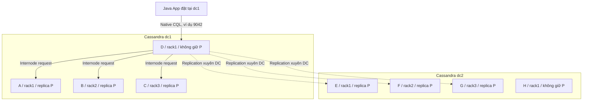
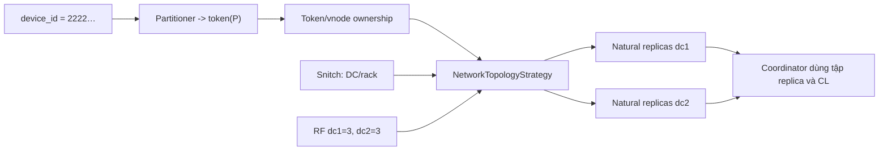
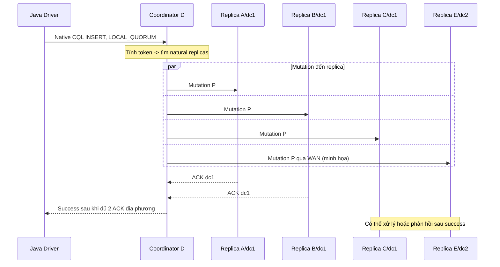
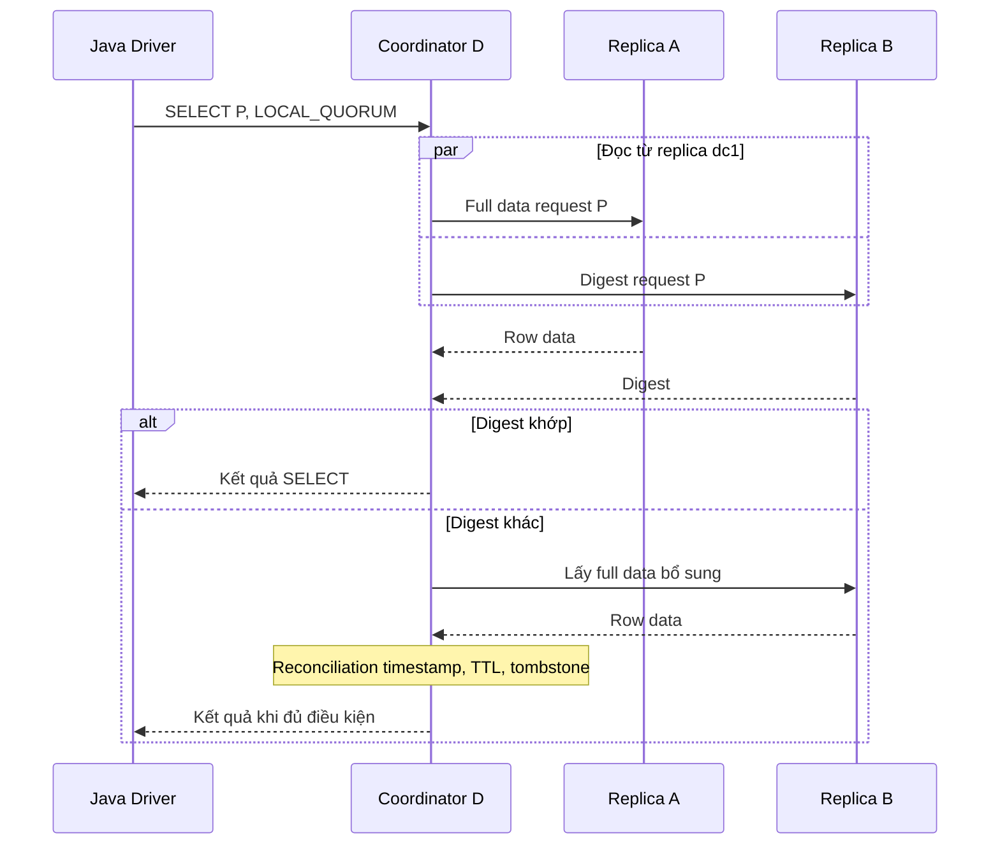
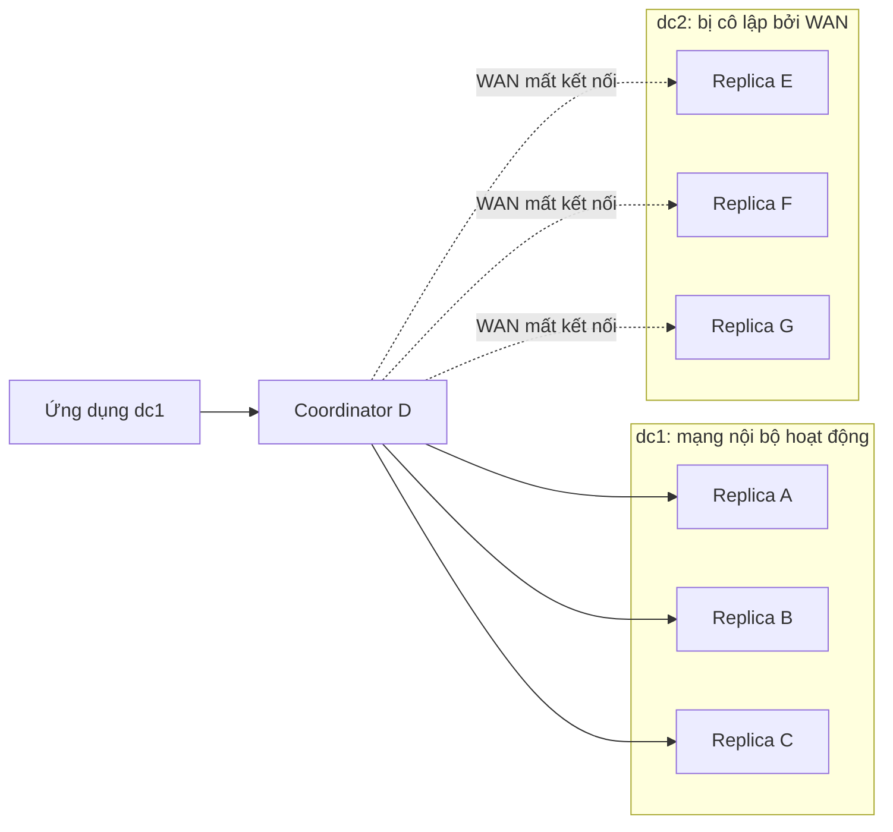
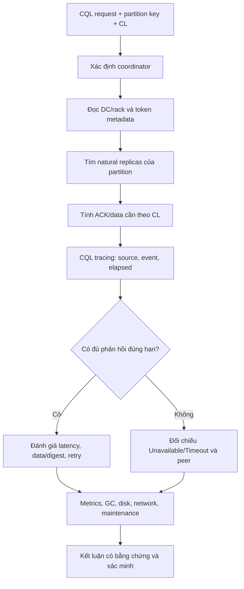

# Đọc sơ đồ cụm và truy vết một yêu cầu thực tế qua các nút

Một sơ đồ Apache Cassandra có thể vẽ tám node, hai datacenter, nhiều rack và những mũi tên liên lạc. Nhưng khi ứng dụng Java gửi **một** câu `INSERT` hoặc `SELECT`, câu hỏi quan trọng hơn là: **request vào node nào, partition nằm ở đâu, replica nào nhận thông điệp, bao nhiêu phản hồi đủ consistency level, và bằng chứng nào giúp kiểm tra đường đi thực tế?**

Bài này hướng dẫn bạn **đọc sơ đồ cụm như một bản đồ trách nhiệm**, sau đó **truy vết một yêu cầu CQL xuyên các node** bằng cách kết hợp CQL tracing, `nodetool`, metadata Java Driver và chỉ số vận hành. Ba lớp thông tin cần phân biệt là:

1. **Topology:** node, datacenter (DC), rack/failure domain, token và natural replica.
2. **Request path:** Java Driver → coordinator → replica → phản hồi → driver.
3. **Evidence:** trace của request, metadata token/replica, logs, trạng thái node và các giới hạn của mỗi công cụ.

Cassandra là cơ sở dữ liệu **wide-column phân tán**, thiết kế bảng theo mẫu truy vấn. Một partition key được ánh xạ thành token; **replication strategy** chọn các natural replica, còn **consistency level (CL)** quy định bao nhiêu phản hồi cần có để request thành công. Nắm được chuỗi này là nền tảng để giải thích đọc/ghi, replication đa DC, compaction, repair, timeout và kết nối Java.

Sau bài học, bạn có thể:

- Đọc sơ đồ cluster mà không nhầm **vòng token** với **dây mạng vật lý**.
- Phân biệt **contact point**, **coordinator**, **natural replica**, **seed**, **rack**, **DC** và **failure domain**.
- Tự dựng timeline cho ghi `LOCAL_QUORUM`, đọc data/digest, digest mismatch và lỗi timeout.
- Dùng `nodetool getendpoints` và replication metadata để đối chiếu replica của một partition key.
- Bật tracing có kiểm soát bằng `cqlsh`, đọc `system_traces` và phân biệt điều đã thấy với điều chỉ suy đoán.
- Lấy coordinator/tracing ID từ Apache Cassandra Java Driver 4.x và viết báo cáo điều tra một request thực tế.

## 1. Đọc sơ đồ: mũi tên nào biểu thị điều gì?

Trước khi theo dõi một request, cần biết **mỗi kiểu đường trên sơ đồ đang diễn tả loại quan hệ nào**. Có sơ đồ minh họa node bằng vòng tròn token, có sơ đồ vẽ mạng DC/rack hoặc tập replica. Chúng không đồng nghĩa.

| Dấu hiệu trên sơ đồ | Ý nghĩa nên kiểm tra | Điều không nên suy ra |
|---|---|---|
| Node thuộc **DC/rack** | Vị trí topology logic và miền lỗi được khai báo. | Các rack chắc chắn độc lập về nguồn điện hoặc switch thật. |
| Node sở hữu **token/vnode** | Trách nhiệm đối với khoảng token trong metadata. | Mỗi vnode tương đương một máy vật lý. |
| Mũi tên **client → node** | Kết nối native CQL tới node làm coordinator. | Client tự ghi trực tiếp đến mọi replica. |
| Mũi tên **coordinator → replica** | Internode request: mutation, data/digest, ACK. | Replica chắc chắn trả lời trước deadline. |
| Đường **gossip giữa peer** | Trao đổi trạng thái, liveness và membership. | Gossip truyền mọi row nghiệp vụ. |
| Đường **streaming/repair** | Chuyển hoặc đối chiếu dữ liệu giữa các node. | Đây là một `INSERT` của client. |
| Nét đứt **WAN/đường lỗi** | Kết nối có thể bị gián đoạn hoặc ảnh hưởng latency. | Mọi kết nối TCP của hai DC đều bắt buộc dùng cùng route. |

Đặc biệt, sơ đồ **token ring** là hình ảnh logic của không gian token. Nó **không** có nghĩa thông điệp phải đi tuần tự A → B → C → D giống một vòng mạng vật lý. Coordinator có thể liên hệ trực tiếp các replica thích hợp trên mạng internode.

## 2. Kịch bản xuyên suốt: hai DC, mỗi DC bốn node

Giả sử cluster `telemetry-cluster` gồm hai DC. Mỗi DC có bốn node trải trên ba rack; keyspace `telemetry` có RF = 3 trong từng DC.



**Giả định minh họa, không phải kết quả băm token thực tế:** với partition P, natural replica được giả định là `{A,B,C}` trong `dc1` và `{E,F,G}` trong `dc2`; D/H không phải replica P. Sơ đồ cũng **cố tình** để driver gửi request đến D nhằm chứng minh một node **không giữ P vẫn có thể làm coordinator**. Driver token-aware thường có thể ưu tiên replica địa phương như A/B/C khi metadata đầy đủ.

Trong cluster thật, việc chọn A/B/C/E/F/G phải được **đối chiếu theo token của partition và metadata thực**, không suy từ thứ tự chữ cái hoặc vị trí các ô trong hình.

### Những câu hỏi cần trả lời từ sơ đồ

1. DC nào là **địa phương** của coordinator? Trong kịch bản này: `dc1`.
2. RF của **partition P** là bao nhiêu? `RF_dc1 = 3`, `RF_dc2 = 3`, tổng sáu bản sao mong muốn.
3. Ai nhận CQL từ client? D, nên **D là coordinator của request này**.
4. Ai phải lưu P? A/B/C/E/F/G theo giả định.
5. Nếu dùng `LOCAL_QUORUM` tại D, cần tối thiểu bao nhiêu phản hồi `dc1`? **Hai**.
6. Với placement giả định, mất một rack chứa replica P có thể khiến một replica mất khả năng đáp ứng; hai rack khác còn cơ hội đạt quorum.

## 3. Đặt đúng vai trò lên từng node

Một node Cassandra có thể đảm nhận nhiều vai trò **tùy yêu cầu**, nhưng không phải mọi vai trò đều cố định theo máy.

| Vai trò | Ví dụ trên sơ đồ | Đặc tính |
|---|---|---|
| **Contact point** | Có thể D, A hoặc B, tùy Java Driver cấu hình. | Điểm kết nối ban đầu của client CQL; không nhất thiết giữ P. |
| **Coordinator** | D cho request đang xét. | Nhận CQL, xác định replica, đợi phản hồi theo CL; thay đổi theo request. |
| **Natural replica của P** | A/B/C/E/F/G trong ví dụ. | Được token + replication strategy chọn để lưu partition P. |
| **Node không giữ P** | D/H. | Vẫn có thể lưu partition Q và làm coordinator cho P. |
| **Seed node** | Có thể A/E nếu được cấu hình seed. | Điểm khám phá peer khi Cassandra khởi động; không phải leader mọi CQL. |
| **CMS member (một số phiên bản)** | Thành viên điều phối metadata ở Cassandra 5.x. | Không đồng nhất với seed hoặc coordinator dữ liệu. |

**Đừng đếm tất cả node `UN` để tính quorum của P.** D có thể Up nhưng không trở thành replica P chỉ vì đang làm coordinator. H cũng có thể Up nhưng không giúp `LOCAL_QUORUM` ở `dc1` của P.

### Locality của driver khác locality của dữ liệu

Driver cấu hình `localDatacenter = dc1` thường ưu tiên node thuộc `dc1` làm coordinator. Điều này **không đổi RF**: natural replicas vẫn được xác định bằng metadata. Một coordinator ở `dc1` có thể cần gửi mutation đến `dc2` vì keyspace được nhân bản ở cả hai DC.

## 4. Partition key → token → natural replicas

Để theo dõi đường đi thật, trước hết xác định partition key cụ thể. Chọn một bảng phục vụ yêu cầu **đọc trạng thái hiện tại của một thiết bị**:

```sql
CREATE KEYSPACE telemetry
WITH replication = {
    'class': 'NetworkTopologyStrategy',
    'dc1': 3,
    'dc2': 3
};

CREATE TABLE telemetry.device_state_by_id (
    device_id uuid PRIMARY KEY,
    tenant_id uuid,
    status text,
    battery_pct int,
    last_seen timestamp
);
```

`device_id` là partition key đơn, nên mỗi thiết bị có **một row trạng thái mới nhất**. Cách này phù hợp một truy vấn `WHERE device_id = ?`; nó **không** thay thế bảng lịch sử có clustering key/bucket ngày. Với dữ liệu time-series tăng không giới hạn, nên thiết kế thêm bảng như `readings_by_device_day` theo đúng mẫu truy vấn.

Khi ứng dụng hỏi thiết bị:

```sql
SELECT tenant_id, status, battery_pct, last_seen
FROM telemetry.device_state_by_id
WHERE device_id = 22222222-2222-2222-2222-222222222222;
```

Các bước logic:

1. Cassandra phân tích `device_id` có kiểu `uuid` và là toàn bộ partition key.
2. **Partitioner** băm giá trị khóa thành token (với `Murmur3Partitioner` ở nhiều cluster phổ biến).
3. Metadata token/vnode cho biết các node sở hữu những khoảng token.
4. `NetworkTopologyStrategy` kết hợp token, RF theo DC và thông tin DC/rack để chọn natural replicas.
5. Coordinator chọn cách liên hệ replica để đạt CL, cân nhắc topology, liveness và các tối ưu đọc/ghi.



Sơ đồ không nêu số token cụ thể vì **không thể suy ra token thực của một cluster chỉ từ UUID và tên node**: cần đúng partitioner và metadata token. Không dùng phép `hashCode()` Java hay modulo số node thay cho partitioner Cassandra.

## 5. Kiểm tra replica bằng công cụ trước khi bật tracing

Trên một Cassandra node phù hợp và phiên bản có hỗ trợ, có thể dùng:

```bash
nodetool status
nodetool describecluster
nodetool getendpoints telemetry device_state_by_id 22222222-2222-2222-2222-222222222222
```

**`nodetool getendpoints`** giúp hỏi tập endpoint có trách nhiệm cho một partition key trong table/keyspace, theo metadata của node chạy lệnh. Cú pháp và biểu diễn khóa đầu vào **phụ thuộc phiên bản và kiểu partition key**; ví dụ chọn khóa `uuid` đơn để giảm nhập nhằng. Với partition key tổng hợp, không tự nối các giá trị bằng dấu phẩy rồi mặc định công cụ sẽ băm đúng.

Đầu ra kỳ vọng là danh sách **địa chỉ replica**, chứ không phải bằng chứng chúng đã hoàn tất mọi mutation hoặc đang khỏe. Kết quả thực tế có thể **khác hoàn toàn** tập A/B/C/E/F/G minh họa; hãy thay tập trong sơ đồ bằng endpoint thật trước khi chẩn đoán.

### Khi nào kết quả replica có thể thay đổi?

- Cluster đang **bootstrap, decommission, replace hoặc thay topology**.
- RF keyspace được thay đổi, nhưng streaming/repair liên quan chưa kết thúc.
- Token/vnode, snitch, DC/rack hoặc metadata cluster đã thay.
- Node được hỏi chưa có góc nhìn metadata giống các node còn lại trong thời điểm chuyển đổi.

Vì vậy, log một kết quả `getendpoints` nên kèm **thời điểm, node chạy lệnh, phiên bản Cassandra, keyspace/table và chính xác giá trị partition key**.

### Đừng nhầm replicas với endpoints đang nhận request

`getendpoints` trả về **trách nhiệm lưu trữ theo metadata**. Tracing cho thấy **một số peer thực sự được liên hệ trong một request cụ thể**, có thể chỉ là tập con replica khi đọc CL thấp, hoặc có speculative retry tùy cấu hình. Hai danh sách trả lời hai câu hỏi khác nhau.

## 6. Truy vết một INSERT: sáu replica nhưng chỉ đợi hai ACK địa phương

Tạo một row trạng thái cho thiết bị:

```sql
INSERT INTO telemetry.device_state_by_id
    (device_id, tenant_id, status, battery_pct, last_seen)
VALUES (
    22222222-2222-2222-2222-222222222222,
    11111111-1111-1111-1111-111111111111,
    'ONLINE',
    87,
    '2026-11-21T08:30:00+07:00'
);
```

Giả sử D là coordinator trong `dc1` và CL ghi `LOCAL_QUORUM`:



**Lưu ý:** để sơ đồ dễ đọc, chỉ vẽ E đại diện cho nhóm replica từ xa; **F và G cũng thuộc tập natural replicas** của P và là đích replication theo giả định. Hai ACK `dc1` cho client nhận success **không chứng minh** E/F/G đã nhận mutation.

Tại replica, ghi thông thường liên quan **commit log + memtable** trước khi dữ liệu được flush thành SSTable; **compaction** là việc nền sau đó. Client không đợi mọi SSTable compact xong để ghi thành công.

### Cách kiểm tra điều kiện ACK

Với `RF_dc1 = 3`, `LOCAL_QUORUM` cần **floor(3/2)+1 = 2 ACK địa phương**. Đây là **điều kiện phản hồi**, không phải yêu cầu chỉ truyền mutation đến đúng hai node. Nếu D cũng là replica P thì một phần xử lý có thể diễn ra **cục bộ trên D**, làm sơ đồ internode có ít một mũi tên hơn.

### Ghi timeout: trace cần trả lời câu hỏi gì?

Nếu client thấy `WriteTimeout`, hãy hỏi: mutation đã gửi đến đâu, có bao nhiêu ACK hợp lệ tới coordinator trước deadline, replica nào báo lỗi và đường phản hồi về driver có bị mất không? **WriteTimeout không tương đương rollback.** Một số replica có thể đã lưu row `ONLINE`; retry với khóa/timestamp/TTL thay đổi không kiểm soát có thể làm sai ý nghĩa nghiệp vụ.

## 7. Truy vết một SELECT: full data và digest

Sau ghi, Java Driver thực hiện:

```sql
SELECT tenant_id, status, battery_pct, last_seen
FROM telemetry.device_state_by_id
WHERE device_id = 22222222-2222-2222-2222-222222222222;
```

Ở một đường đọc `LOCAL_QUORUM`, coordinator có thể lấy **full data** từ một replica và **digest** từ replica khác. Digest để đối chiếu nội dung đọc, không phải bản ghi có thể giải mã thành đầy đủ row.



Sơ đồ minh họa **một đường đọc có so sánh replica**, không phải lời hứa coordinator luôn gửi đúng một data request tới A và một digest request tới B. Số và thứ tự yêu cầu thực tế phụ thuộc CL, replica selection, speculative retry, liveness, paging và phiên bản.

### Digest mismatch có nghĩa gì?

Replica có thể khác nhau vì mutation chưa tới mọi nơi, TTL/tombstone hoặc các thay đổi cạnh tranh. Digest mismatch dẫn tới lấy thêm data để **reconcile**; nó **không tự chứng minh SSTable hỏng**. **Read repair** có thể tham gia tùy phiên bản/cấu hình bảng; **anti-entropy repair** đối chiếu dữ liệu trên phạm vi rộng hơn.

Với `LOCAL_ONE` thường chỉ cần **một phản hồi** từ replica địa phương, có nguy cơ đọc giá trị chưa mới nhất khi replica lệch. Đừng áp sơ đồ có digest/quorum cho **mọi** CL.

## 8. Trên giấy: tính quorum trước khi kết luận lỗi

Ở kịch bản RF = 3 trong mỗi DC và tổng RF = 6, giả sử coordinator D thuộc `dc1`:

| CL | Điều kiện | Khi C down nhưng A/B khỏe |
|---|---|---|
| `LOCAL_ONE` | Một replica `dc1`. | Có thể đạt. |
| `LOCAL_QUORUM` | Hai replica `dc1`. | Có thể đạt bằng A/B. |
| `QUORUM` | `floor(6/2)+1 = 4` replica trong tổng hai DC. | Có thể đạt nếu thêm ít nhất hai replica từ xa phản hồi đúng hạn. |
| `EACH_QUORUM` (**ghi**) | Hai ACK ở **mỗi DC**. | Có thể đạt nếu đủ hai ở từng DC và WAN hoạt động. |
| `ALL` | Cả sáu replica. | Không đạt nếu C không phản hồi. |

`EACH_QUORUM` chỉ dùng cho **ghi**, không phải CL đọc thông thường. **Quorum phải tính trên replica của đúng partition và theo phạm vi DC**, không phải số node tổng cộng đang Up.

Nếu trong `dc1` A/B liên lạc được còn C bị cô lập, một coordinator có đường tới A/B có thể đạt `LOCAL_QUORUM` cho P. Client chỉ tới được C **không** đạt hai phản hồi tại `dc1`, dù C vẫn đang chạy.

## 9. Tracing trong cqlsh: chạy một request có dấu vết

Trên **cluster thử nghiệm**, sau khi tạo keyspace/table ở mục 4, dùng `cqlsh`:

```sql
-- CONSISTENCY và TRACING là lệnh của cqlsh.
CONSISTENCY LOCAL_QUORUM;
TRACING ON;

SELECT tenant_id, status, battery_pct, last_seen
FROM telemetry.device_state_by_id
WHERE device_id = 22222222-2222-2222-2222-222222222222;

TRACING OFF;
```

Khi tracing được bật và request hỗ trợ, `cqlsh` có thể hiển thị **session tracing ID** và các sự kiện theo đường thực thi. Dữ liệu hữu ích gồm thời điểm bắt đầu, **coordinator**, hoạt động gửi read/mutation và nhận data/digest/ACK, thời gian tương đối của từng bước và node nguồn của event.

Không kỳ vọng output có **cùng câu chữ** ở mọi Cassandra 3.x/4.x/5.x. Không phải mọi nội bộ đều được ghi trace; trace **không phải packet capture**. Event từ node xa có thể đến muộn hoặc không có do timeout, thu thập bất đồng bộ hoặc lỗi mạng.

### Tracing không chứng minh toàn bộ replica hội tụ

`LOCAL_QUORUM` đọc từ A/B và hai phản hồi khớp chỉ mô tả **request đang xét**; nó không chứng minh C/E/F/G đều giữ cùng bản sao trong mọi partition. `TRACING ON` có overhead và dữ liệu trace thường có TTL, không phù hợp thay hệ thống audit nghiệp vụ.

## 10. Đọc dấu vết từ system_traces

Ở nhiều phiên bản Cassandra, tracing events được lưu trong keyspace hệ thống `system_traces`. Sau khi có tracing ID thật từ `cqlsh` hoặc Java Driver, có thể kiểm tra session theo UUID đó.

Ví dụ UUID **minh họa** (phải thay bằng ID thật):

```sql
SELECT session_id, coordinator, request, duration
FROM system_traces.sessions
WHERE session_id = aaaaaaaa-aaaa-4aaa-8aaa-aaaaaaaaaaaa;

SELECT event_id, activity, source, source_elapsed, thread
FROM system_traces.events
WHERE session_id = aaaaaaaa-aaaa-4aaa-8aaa-aaaaaaaaaaaa;
```

Các cột/trạng thái có thể thay đổi theo release. `system_traces` có TTL, events có thể được ghi bất đồng bộ và thiếu khi node lỗi. Một lần query không thấy rows **không đủ** kết luận tracing chưa từng được bật.

| Trường | Câu hỏi được hỗ trợ | Giới hạn |
|---|---|---|
| `session_id` | Event thuộc trace nào? | Không phải `device_id` hay application request ID. |
| `coordinator` | Node nào điều phối request? | Không nhất thiết natural replica P. |
| `source` | Event được ghi trên node nào? | Không chứng minh source giữ mọi partition. |
| `activity` | Bước nội bộ nào được trace? | Text phụ thuộc release/đường thực thi. |
| `source_elapsed` | Thời gian tương đối từ bắt đầu trace (thường microsecond). | Không cộng thẳng các mốc của nhiều node thành latency tổng. |
| `duration` | Thời lượng theo cơ chế ghi session. | Có thể khác thời gian đo ở client vì network/driver. |

Khi so sánh events từ nhiều host, phải xét **đồng hồ, trace thiếu event và độ trễ gửi event**. Đừng dùng thứ tự dòng hiện trên màn hình làm bằng chứng mọi thông điệp được tuần tự hóa như nhau.

## 11. Ghi bảng evidence thay vì chỉ chụp trace

Để truy vết có thể kiểm chứng, nên ghi kết quả theo một mẫu chung:

| Mục | Giá trị minh họa | Thu từ đâu? |
|---|---|---|
| Bảng và operation | `telemetry.device_state_by_id`, `SELECT`. | Statement ứng dụng/CQL. |
| Partition key | `device_id = 2222…`. | Tham số prepared statement. |
| CL | `LOCAL_QUORUM`. | CQL/driver statement. |
| Coordinator | D (minh họa). | Trace session / Java ExecutionInfo. |
| DC coordinator | `dc1`. | Metadata driver và `nodetool status`. |
| Natural replica P | A/B/C/E/F/G (giả định). | Thực tế: `nodetool getendpoints`/metadata token. |
| Replica có response | A/B trong sơ đồ đọc. | Trace event + metrics/log liên quan. |
| Trace ID | UUID thật do hệ thống cấp. | `cqlsh` hoặc `ExecutionInfo`. |
| Lỗi/latency | Đo từ driver và server. | Metrics, `system_traces`, logs. |

Không ghi token mật, chuỗi kết nối hoặc dữ liệu nhạy cảm vào log chẩn đoán. Nếu partition key là thông tin định danh, che/giảm dữ liệu trong báo cáo theo chính sách của tổ chức.

## 12. Java Driver 4.x: lấy coordinator và tracing ID

Driver Java là client **native CQL**, không tham gia gossip. API driver cho phép lấy metadata về các node mà client đã khám phá, node điều phối **một lần thực thi** và thông tin trace khi được yêu cầu.

Ví dụ Java Driver 4.x:

```java
import com.datastax.oss.driver.api.core.CqlSession;
import com.datastax.oss.driver.api.core.DefaultConsistencyLevel;
import com.datastax.oss.driver.api.core.cql.BoundStatement;
import com.datastax.oss.driver.api.core.cql.ExecutionInfo;
import com.datastax.oss.driver.api.core.cql.PreparedStatement;
import com.datastax.oss.driver.api.core.cql.ResultSet;
import com.datastax.oss.driver.api.core.cql.Row;
import com.datastax.oss.driver.api.core.metadata.Node;

import java.net.InetSocketAddress;
import java.util.UUID;

public class TraceCassandraRequest {
    public static void main(String[] args) {
        UUID deviceId = UUID.fromString(
            "22222222-2222-2222-2222-222222222222");

        // IP 192.0.2.0/24 chỉ dành cho tài liệu.
        try (CqlSession session = CqlSession.builder()
                .addContactPoint(new InetSocketAddress("192.0.2.11", 9042))
                .addContactPoint(new InetSocketAddress("192.0.2.12", 9042))
                .withLocalDatacenter("dc1")
                .build()) {

            for (Node node : session.getMetadata().getNodes().values()) {
                System.out.printf("peer=%s dc=%s rack=%s%n",
                    node.getEndPoint(), node.getDatacenter(), node.getRack());
            }

            PreparedStatement prepared = session.prepare(
                "SELECT tenant_id, status, battery_pct, last_seen " +
                "FROM telemetry.device_state_by_id WHERE device_id = ?");

            BoundStatement read = prepared.bind(deviceId)
                .setConsistencyLevel(DefaultConsistencyLevel.LOCAL_QUORUM)
                .setIdempotent(true)
                .setTracing(true); // Chỉ bật cho request chẩn đoán

            ResultSet result = session.execute(read);
            ExecutionInfo info = result.getExecutionInfo();

            System.out.println("Coordinator: " + info.getCoordinator());
            System.out.println("Trace ID: " + info.getTracingId());
            System.out.println("Query successful");

            for (Row row : result) {
                System.out.printf("status=%s battery=%s%n",
                    row.getString("status"),
                    row.isNull("battery_pct")
                        ? "null"
                        : row.getInt("battery_pct"));
            }
        }
    }
}
```

**Lưu ý sử dụng:**

- `192.0.2.11`/`192.0.2.12` là IP ví dụ, phải thay bằng contact point thật. `dc1` phải là tên DC thực tế.
- `ResultSet.getExecutionInfo()` mô tả lần thực thi được driver báo cáo; coordinator thực tế **có thể là A/B/C**, không nhất thiết D như sơ đồ.
- `getTracingId()` có thể không có giá trị nếu tracing không được bật/không nhận được thông tin liên quan. Kiểm tra trước khi dùng làm khóa truy vấn `system_traces`.
- `setTracing(true)` có overhead; chỉ bật có chủ đích, tránh bật vô điều kiện cho mọi traffic.
- Nên tái sử dụng `CqlSession`, cấu hình authentication/TLS/timeouts đúng môi trường và dùng metrics của driver để theo dõi request.

Nếu thư viện driver/release khác biệt về API, hãy đối chiếu tài liệu chính thức của bản đang dùng. Bài không yêu cầu chạy ứng dụng này trên cluster production.

## 13. ExecutionInfo và trace không phải một “đồ thị toàn tri”

Có ba mức quan sát bổ sung cho nhau:

1. **Driver:** biết node nhận request, thời gian đo từ client, thông tin retry/speculative attempts và kết quả/exception.
2. **Coordinator/server trace:** cho thấy những bước nội bộ được trace trên các node tham gia.
3. **Cluster/host metrics:** cho biết trạng thái replica, network, GC, disk, compaction, streaming và hàng đợi trong cùng khoảng thời gian.

Một trace **không hiện mọi kernel packet** và một câu `nodetool status` **không hiện chính xác đường đi của request**. Ví dụ:

- Trace cho thấy coordinator gửi digest request cho B nhưng không có event phản hồi. Có thể B chậm, mất mạng, hoặc event không được ghi đủ; cần metrics/log của B để kết luận.
- Driver thấy `AllNodesFailedException` khi không thể tìm coordinator CQL phù hợp, nhưng các node Cassandra có thể vẫn giao tiếp internode bình thường.
- `nodetool status` cho thấy B `UN` trong khi đọc từ B timeout do I/O hoặc GC; liveness không chứng minh phản hồi đúng hạn.

**Bằng chứng mạnh nhất là các tín hiệu độc lập cùng thời điểm hỗ trợ một giả thuyết**, không phải gán nguyên nhân cho một dòng trace đơn lẻ.

### Tracing ID và application request ID

Một API backend có thể có `request_id` riêng ở HTTP/application log. Cassandra tracing cấp **session ID riêng** cho truy vấn được trace; một API request có thể tạo **nhiều CQL requests**, và mỗi request được trace có thể có tracing ID khác nhau. Muốn dựng đường đi end-to-end, ghi quan hệ giữa các ID này theo chính sách bảo mật; không giả định chúng là cùng một UUID.

Nếu Java Driver retry hoặc gửi speculative execution, phải xem metadata cho những **attempt** liên quan thay vì chỉ một coordinator ở kết quả cuối. Những attempt có thể chọn node khác nhau trong cùng một request logic của ứng dụng.

## 14. Những nhánh lỗi thực tế khi theo dõi request

| Lỗi/triệu chứng | Điểm thất bại có thể nằm ở đâu? | Cách kiểm tra |
|---|---|---|
| Không mở được `CqlSession` hoặc TLS/auth error | Driver ↔ native CQL/coordinator. | Contact point, cổng `9042`, TLS, authentication, địa chỉ công bố cho client. |
| `Unavailable` | Coordinator nhìn không đủ replica khả dụng cho CL. | RF, CL, natural replicas, liveness theo góc nhìn coordinator. |
| `ReadTimeout` | Đường đọc không có đủ phản hồi trước deadline. | Trace data/digest, slow replica, disk/GC/network. |
| `WriteTimeout` | Không nhận đủ ACK ghi trước deadline. | Trace mutation/ACK, write load, trạng thái ghi không chắc chắn. |
| `ReadFailure` hoặc `WriteFailure` | Replica hoặc đường xử lý báo failure. | Logs, số failure, node liên quan và phiên bản. |
| Request timeout ở driver | Client hết deadline, có thể chưa nhận lỗi từ coordinator. | Driver metrics, client network, server trace nếu có. |
| Query đúng lúc schema đổi | Driver/server có schema metadata chưa phù hợp. | Schema agreement hoặc metadata epoch theo phiên bản, prepared statements. |
| Đọc chậm trong repair/bootstrap | Replica và mạng tranh chấp tài nguyên. | `compactionstats`, `netstats`, I/O, CPU, latency từng node. |

### Unavailable khác Timeout như thế nào?

`Unavailable` thường phản ánh nhận định coordinator rằng **không đủ replica đang được coi là khả dụng** để đạt CL. Timeout cho biết đường request đã chờ nhưng **không nhận đủ phản hồi trước deadline**. Cả hai có thể liên quan mạng nhưng **không chứng minh node đã chết**.

Ví dụ C có thể vẫn chạy nhưng bị tách mạng; A/B đủ cho `LOCAL_QUORUM` `dc1`. Nếu B cũng chậm vì disk I/O, yêu cầu có thể timeout dù trạng thái cluster còn nhiều node `UN`.

## 15. Theo dấu một lỗi WAN giữa hai datacenter

Trở lại sơ đồ hai DC có RF = 3 + 3. Giả sử WAN giữa `dc1` và `dc2` bị mất, còn A/B/C vẫn liên lạc được với D:



Với một ghi P:

- `LOCAL_QUORUM` tại `dc1` **có thể thành công** khi đủ hai ACK địa phương; `dc2` có thể chưa thấy mutation.
- `QUORUM` tổng RF 6 cần **bốn** phản hồi, trong khi phía `dc1` có tối đa ba natural replica của P: không đạt nếu WAN hoàn toàn ngắt và không có đường thay thế.
- `EACH_QUORUM` cho ghi cần hai ACK **mỗi DC**, nên cũng không đạt khi không thể liên hệ `dc2`.
- `LOCAL_QUORUM` đọc ở `dc2` sau failover **không mặc định thấy** ghi mới đã ACK tại `dc1` trước khi dữ liệu xuyên DC hội tụ.

**Gossip báo WAN đã phục hồi không đủ chứng minh dữ liệu đã repair.** Sau sự cố, cần đánh giá hint replay, dữ liệu bỏ lỡ, anti-entropy repair và mục tiêu RPO/RTO.

### Nếu coordinator đổi DC?

`LOCAL_QUORUM` được tính theo **DC của coordinator** theo đường thực thi. Khi driver đổi chính sách định tuyến hoặc failover sang DC khác, điều kiện ACK địa phương đổi theo. Vì thế phải log `localDatacenter`, coordinator và CL cùng nhau; chỉ ghi tên CL không đủ để tái hiện kết quả.

## 16. Khi trace cho thấy một replica chậm

Giả sử trace `SELECT` cho thấy:

```text
T0       Java gửi SELECT -> coordinator D
T0+2ms   D gửi full-data request tới A
T0+3ms   D gửi digest request tới B
T0+8ms   A có data response
T0+55ms  B mới có digest response
T0+57ms  D trả response tới client
```

Các mốc **hoàn toàn giả định** nhằm luyện đọc timeline. Chúng gợi ý đường đọc B hoặc mạng B→D chậm hơn đường A; **chưa đủ để khẳng định** B có vấn đề đĩa.

Checklist đối chiếu:

1. B có **GC pause** hoặc CPU pressure tại `T0` không?
2. `nodetool tpstats` và disk I/O latency của B có tăng không?
3. B có đang compaction, repair hoặc streaming trong khoảng đó không?
4. Các request khác đi qua B có cùng độ trễ, hay chỉ một partition nóng?
5. Network RTT/retransmit B↔D có bất thường không?
6. Tracing events có bị thiếu, trễ thu thập hoặc đo bằng đồng hồ khác nhau không?

Nếu B vốn đang bình thường, không nên remove/replace nó chỉ vì một sample `57 ms`. Phân tích cần **xu hướng nhiều request, p95/p99 và bằng chứng từ node**.

### Trace có thể làm đường thực thi thay đổi

Bật tracing tạo thêm công việc thu thập/lưu sự kiện. Nó hữu ích cho chẩn đoán nhưng có thể tăng latency so với request không trace. Đừng dùng duy nhất thời lượng một trace làm baseline tải production.

## 17. Kết nối sơ đồ với công cụ vận hành

Mỗi công cụ trả lời một phần khác nhau của sơ đồ:

```bash
nodetool status
nodetool describecluster
nodetool getendpoints telemetry device_state_by_id 22222222-2222-2222-2222-222222222222
nodetool gossipinfo
nodetool tpstats
nodetool compactionstats
nodetool netstats
```

| Công cụ | Dùng để xác minh | Không thể kết luận chỉ từ lệnh đó |
|---|---|---|
| `nodetool status` | DC/rack, Up/Down, vòng đời và địa chỉ node. | Không cho biết mọi thông điệp của một request đi đâu. |
| `nodetool getendpoints` | Natural replicas cho partition key theo metadata. | Không cho biết toàn bộ replica đã phản hồi đúng hạn. |
| `nodetool gossipinfo` | Trạng thái/liveness peer từ node đang quan sát. | Không chứng minh node down đã tắt thật. |
| `nodetool tpstats` | Stage queues, active/pending work theo phiên bản. | Không tự xác định node chậm do disk hay network. |
| `nodetool compactionstats` | Compaction đang chạy hoặc backlog. | Không thay dữ liệu trace của SELECT đang xét. |
| `nodetool netstats` | Streaming sessions/progress theo bản. | Không phải thống kê mọi packet internode. |
| `nodetool describecluster` | Metadata/schema tổng quan theo công cụ. | Không kiểm tra từng row đã hội tụ. |

`system.local` và `system_schema` hữu ích để xem topology/schema từ CQL:

```sql
SELECT cluster_name, data_center, rack, host_id
FROM system.local;

SELECT keyspace_name, replication
FROM system_schema.keyspaces
WHERE keyspace_name = 'telemetry';
```

`system.local` là thông tin của **node nhận câu CQL**, không phải toàn cluster. Trong Cassandra 5.x, metadata có thêm cơ chế **TCM/CMS**, nên không áp một cách đọc schema/topology của 3.x/4.x cho mọi bản.

## 18. Truy vết trên nhiều node: nhất quán về thời gian và danh tính

Một tình huống khó là A báo B `UN`, D báo B `DN`, driver thấy timeout. Để không lẫn sự kiện:

- Ghi **thời điểm có timezone** ở client, coordinator và host (nếu được phép).
- Ghi **host ID**, địa chỉ internode và địa chỉ native CQL; chúng có thể khác vì NAT/broadcast config.
- Xác định **DC/rack theo snitch** và rack/AZ thật; đừng chỉ đoán từ hostname.
- Ghi **trace session ID** và **application request ID** riêng. Trace ID là danh tính chẩn đoán; request ID nghiệp vụ là danh tính thao tác ở ứng dụng.
- Ghi **schema version/metadata state** khi có migration/topology change đang diễn ra.
- Không dùng thứ tự từng dòng log từ các host có đồng hồ lệch làm bằng chứng nhân quả tuyệt đối.

### Một bảng điều tra có thể tái lập

| Trường | Ví dụ ghi nhận |
|---|---|
| Time window | `2026-11-21 08:30:00–08:30:05 +07:00`. |
| Client | Java Driver 4.x, local DC = `dc1`. |
| Request | `SELECT device_state_by_id WHERE device_id = 2222…`. |
| CL / coordinator | `LOCAL_QUORUM` / D theo `ExecutionInfo`. |
| Natural replicas | Endpoint list từ `getendpoints` tại D. |
| Trace | UUID session thật; events với `source` và `source_elapsed`. |
| Node evidence | GC, disk, `tpstats`/`compactionstats` cùng thời gian. |
| Network evidence | RTT/retransmit coordinator ↔ replica liên quan. |
| Conclusion | Giả thuyết có bằng chứng, giới hạn chưa xác minh. |

Các giá trị chỉ là **mẫu điền**. Không mang UUID trace giả hoặc tên node minh họa đi kết luận một cluster thật.

## 19. Runbook mười bước để truy vết một request thực tế

1. **Chốt câu hỏi:** “Vì sao `SELECT` này chậm?” hoặc “Ghi `LOCAL_QUORUM` đã đạt ACK chưa?” — không điều tra toàn cluster một cách dàn trải.
2. **Thu request CQL:** table, operation, partition key, CL, timestamp, retry và application request ID; bảo vệ dữ liệu nhạy cảm.
3. **Xác định coordinator:** từ `ExecutionInfo`, cqlsh trace, log hoặc metrics; phân biệt contact point.
4. **Đọc topology:** dùng `nodetool status`, DC/rack và các failure domain liên quan.
5. **Tìm natural replicas:** dựa vào `getendpoints` hoặc token/strategy metadata đúng phiên bản; không đoán từ hình.
6. **Tính số phản hồi cần:** theo RF, CL và DC coordinator. Với RF = 3, `LOCAL_QUORUM` cần hai phản hồi địa phương.
7. **Bật trace có chọn lọc:** lấy trace ID, data/digest/mutation/ACK và diễn biến request.
8. **So sánh bằng chứng node:** `tpstats`, GC, disk, network, compaction, streaming/repair; phân biệt chậm và mất liên lạc.
9. **Đánh giá kết quả không chắc chắn:** đặc biệt là ghi timeout; xác định có được retry cùng khóa hay cần kiểm tra nghiệp vụ.
10. **Kết luận và kiểm chứng:** mô tả node/đường gây vấn đề, bằng chứng hỗ trợ, giới hạn trace và phép thử an toàn sau khắc phục.



Một runbook tốt không bắt đầu bằng **tắt node, xóa dữ liệu hay thay RF**. Các hành động topology/repair có thể ảnh hưởng dữ liệu; trước hết dùng phép đo và công cụ đọc-only để định vị vấn đề.

## 20. Các tình huống luyện đọc sơ đồ

**Bài A — Coordinator không giữ partition.** D không phải replica P nhưng ứng dụng gửi `INSERT` đến D. D có thể xử lý không? **Có**: D điều phối và gửi mutation đến những replica có trách nhiệm.

**Bài B — Contact point là seed.** Driver cấu hình A là contact point; A cũng là seed. Mọi CQL request phải qua A không? **Không**. Driver có thể chọn coordinator khác; seed cũng không phải master CQL.

**Bài C — RF = 3 mỗi DC.** Ghi `LOCAL_QUORUM` tại `dc1` cần bao nhiêu ACK địa phương? **Hai**. Không bắt buộc đợi ACK của DC xa để trả success.

**Bài D — Một replica cục bộ down.** C down, A/B khỏe. `LOCAL_QUORUM` P có đạt không? **Có thể**, nếu A/B phản hồi đúng hạn. `ALL` không đạt nếu C thực sự không phản hồi.

**Bài E — Hai replica chậm.** B/C vẫn `UN` nhưng không đáp ứng trước deadline; chỉ A có data/ACK. `LOCAL_QUORUM` có chắc thành công không? **Không**.

**Bài F — Digest mismatch.** Trace thấy data A và digest B khác. Có chứng minh SSTable B bị corrupt không? **Không**; replica có thể lệch phiên bản do mutation chưa hội tụ.

**Bài G — Trace chỉ hiện A/B.** Có thể kết luận C/E/F/G không phải natural replica P không? **Không**. Trace phản ánh request cụ thể, không thay metadata placement.

**Bài H — Ghi địa phương thành công.** `LOCAL_QUORUM` `dc1` thành công khi WAN đứt. `dc2` chắc chắn có row mới không? **Không**.

**Bài I — Client connection mất sau ghi.** Driver timeout nhưng coordinator có thể đã đủ ACK. Retry với event ID mới có chắc an toàn không? **Không**; cần idempotency/khóa nghiệp vụ và đánh giá timestamp/TTL.

**Bài J — Node UN nhưng chậm.** Trace cho thấy B đáp ứng trễ. Có nên remove B ngay không? **Không**. Kiểm tra GC, I/O, compaction, streaming, hot partition và network.

**Bài K — Đổi RF.** `getendpoints` trả tập replica mới sau `ALTER KEYSPACE`. Các replica mới chắc chắn có đủ dữ liệu lịch sử không? **Không**; cần streaming/rebuild/repair và xác minh.

**Bài L — Khóa tổng hợp.** Bảng lịch sử có `PRIMARY KEY ((tenant_id, device_id, event_day), ts)`. Chỉ băm `device_id` để tìm replica đúng không? **Không**; token phụ thuộc **toàn bộ partition key** được mã hóa đúng kiểu/thứ tự.

## 21. Những kết luận sai hay gặp khi đọc sơ đồ

| Kết luận sai | Cách hiểu đúng |
|---|---|
| “Node đầu vòng ring luôn nhận request trước.” | Ring token là biểu diễn logic; coordinator được client chọn theo routing. |
| “Coordinator phải là một natural replica.” | Coordinator có thể không giữ partition đang yêu cầu. |
| “Mũi tên đến replica nghĩa nó đã ACK.” | Gửi mutation/read và nhận phản hồi đúng hạn khác nhau. |
| “CL = 2 nghĩa chỉ ghi đúng hai bản sao.” | RF quyết định replica; CL quyết định phản hồi cần chờ. |
| “Node Up thì request qua nó luôn thành công.” | Node có thể chậm, hết tài nguyên hoặc không liên hệ replica khác. |
| “Trace có A/B nên P chỉ có hai replica.” | Trace phản ánh thao tác cụ thể, không thay replica metadata. |
| “Digest là row được nén.” | Digest chỉ dùng so sánh, không tái dựng full data. |
| “Trace không có events nên request chưa chạy.” | Events có thể thiếu, hết TTL hoặc ghi bất đồng bộ. |
| “Ghi timeout tức mutation không tồn tại.” | Một số replica hoặc quorum có thể đã ghi. |
| “Gossip hội tụ nghĩa data đã repair.” | Membership/liveness và replica data convergence là hai lớp khác nhau. |
| “Schema mới nghĩa data movement xong.” | Đổi placement có thể cần streaming/repair riêng. |

## 22. Tổng kết mô hình tư duy

Đọc một sơ đồ cụm Cassandra **không dừng ở việc đếm node**. Từ **một request thực tế**, bạn cần đi theo chuỗi:

```text
Java Driver / cqlsh
      |
      | CQL + partition key + consistency level
      v
Coordinator của request (có thể không giữ partition)
      |
      | Partition key -> token
      v
Replication strategy + RF + DC/rack -> natural replicas
      |
      +--> INSERT: mutation -> replica -> ACK theo CL
      |
      +--> SELECT: data/digest -> reconcile -> rows theo CL
      |
      v
Native CQL response / Unavailable / Timeout / Failure
      |
      v
Bằng chứng: trace ID + ExecutionInfo + getendpoints
      |
      v
Đối chiếu logs, GC, disk, network, gossip,
compaction, streaming, repair và metadata đúng phiên bản
```

**Ba câu hỏi quyết định** là: **(1) coordinator nào nhận yêu cầu, (2) những natural replica nào có trách nhiệm với partition, và (3) số phản hồi hợp lệ nào đã đến trước deadline?** Sơ đồ topology cho biết miền lỗi và trách nhiệm logic; CQL tracing cung cấp một phần đường đi thực tế; Java Driver và metrics/logs giúp hoàn thiện câu chuyện.

Khi phân biệt rõ **metadata placement**, **dòng thông điệp của request** và **bằng chứng quan sát được**, bạn có thể giải thích vì sao `LOCAL_QUORUM` vẫn ghi được khi một replica down, vì sao một node `UN` vẫn làm đọc timeout, vì sao ghi có thể thành công ở DC này nhưng chưa đến DC khác, và khi nào cần đánh giá repair sau sự cố. Đó là kỹ năng nền để vận hành Cassandra phân tán và thiết kế ứng dụng Java đáng tin cậy.
