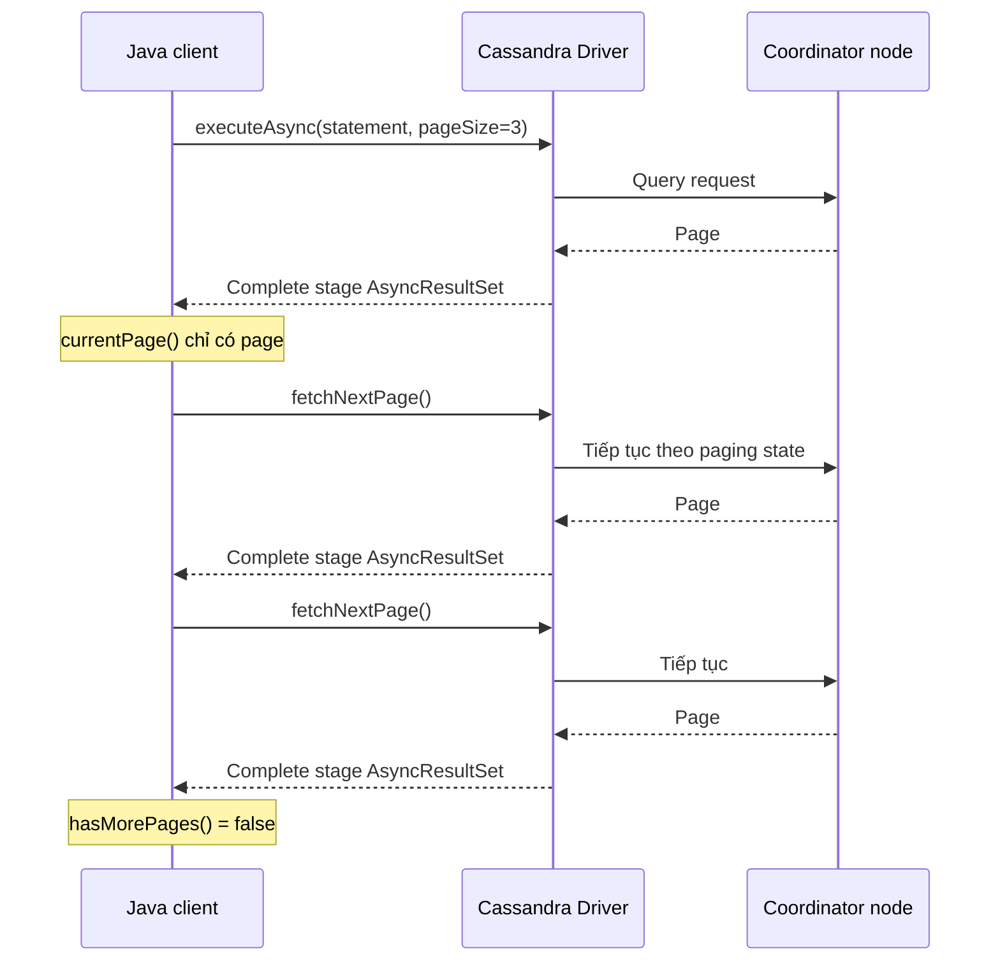
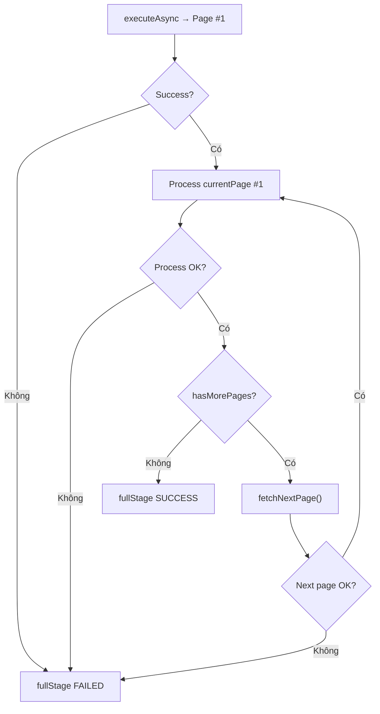
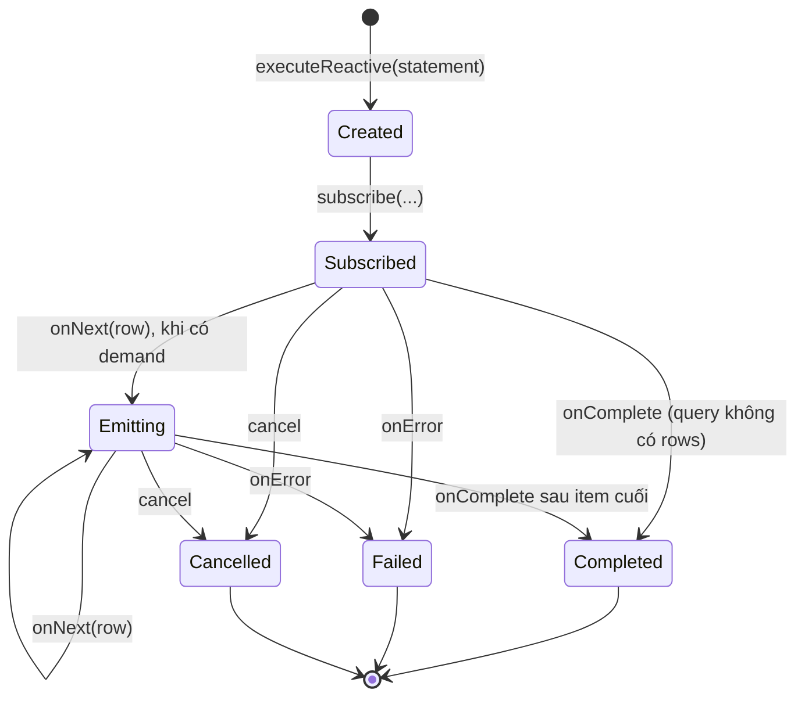

# Phân biệt hoàn tất yêu cầu với đã đọc hết mọi trang kết quả

> **Chương:** Bất đồng bộ và reactive  
> **Mô-đun:** `DATABASE_ENGINE_WIDE_COLUMN_CASSANDRA` — kiến trúc phân tán và mô hình wide-column của Apache Cassandra; khóa phân vùng, bảng theo truy vấn, consistency level, CQL, replication, compaction, repair, xử lý lỗi và kết nối Java.  
> **Trọng tâm:** Trong Java Driver 4.x, lời hứa “truy vấn bất đồng bộ đã hoàn tất” **không có nghĩa** toàn bộ các trang kết quả đã được truy xuất và xử lý. Hiểu đúng ranh giới `executeAsync`, `AsyncResultSet`, `currentPage`, `fetchNextPage`, `CompletionStage`, cùng `ReactiveResultSet` và tín hiệu `onComplete` để viết ứng dụng không bỏ sót dữ liệu.

Một lỗi rất phổ biến khi chuyển từ CQL đồng bộ sang bất đồng bộ:

```java
// SAI nếu mục tiêu là đọc TẤT CẢ row:
session.executeAsync(statement).thenAccept(result -> {
    for (Row row : result.currentPage()) {
        process(row);
    }
    markExportCompleted(); // Có thể còn nhiều trang chưa hề được fetch.
});
```

`executeAsync(statement)` trả về một `CompletionStage<AsyncResultSet>`. Khi stage này hoàn tất bình thường, driver đã có **phản hồi với một trang kết quả hiện tại**; nó chưa hứa đã fetch tất cả các trang tiếp theo. `currentPage()` chỉ duyệt phần dữ liệu của **trang hiện tại**. Nếu `hasMorePages()` là `true`, những trang sau cần được gọi lấy rõ ràng qua `fetchNextPage()`. Còn `markExportCompleted()` chỉ nên chạy sau khi **chuỗi fetch + xử lý từng trang** thành công, và sau khi các side effect cần thiết được xác nhận.

Đây không chỉ là lỗi thống kê số hàng. Trong một pipeline xuất dữ liệu, CDC reconciliation, backfill hoặc job nghiệp vụ, đánh dấu checkpoint quá sớm có thể làm mất những rows chưa được đọc — dù request đầu tiên báo thành công, không có exception, thậm chí p99 của request đầu nhìn rất tốt.

Bài này phân biệt rõ ba cấp độ hoàn tất:

1. **Request/page response ready:** `CompletionStage<AsyncResultSet>` của lần `executeAsync` hoặc `fetchNextPage` đã thành công.
2. **Full result set consumed:** mọi trang cần đọc đã được fetch và mọi row mong muốn đã được duyệt, hoặc reactive publisher đã báo `onComplete` sau khi được yêu cầu tiêu thụ toàn bộ.
3. **Downstream operation committed:** dữ liệu đã được ghi/sao lưu/xử lý đúng, checkpoint/manifest được cập nhật và được xác minh theo yêu cầu ứng dụng.

**1 không suy ra 2; 2 cũng không tự suy ra 3.**

## 1. Mục tiêu học tập

Sau khi học, bạn có thể:

- Giải thích Cassandra **phân trang ở protocol/driver** khác với `LIMIT` của CQL và phân trang ở giao diện web.
- Phân biệt `CqlSession.execute` trả `ResultSet` (synchronous) với `executeAsync` trả `CompletionStage<AsyncResultSet>`.
- Hiểu `currentPage()`, `remaining()`, `one()`, `hasMorePages()` và `fetchNextPage()`.
- Chứng minh tại sao một callback `thenAccept` chạy xong chưa chắc job đã đọc hết kết quả.
- Dùng `thenCompose` để tạo **một future hoàn tất sau tất cả các trang**, không chỉ trang đầu.
- Xử lý lỗi phát sinh **ở trang thứ hai/thứ N**, kể cả khi trang đầu đã thành công.
- Không gọi `session.execute()` đồng bộ trong callbacks trên thread I/O của driver.
- Giữ bộ nhớ giới hạn, rate limit và backpressure khi nhiều requests/pages chạy đồng thời.
- Phân biệt reactive **publisher được tạo**, **được subscribe**, **đã emit một row**, **đã onComplete**, **bị cancel**, **bị onError**.
- Giải thích tại sao `Flux.take(10)` hoặc `Mono.from(...)` có thể dừng đọc sớm mà không hề “consume all”.
- Kết hợp processing/persistence bất đồng bộ với paging bằng chuỗi có thể quan sát lỗi, không “fire-and-forget”.
- Thiết kế checkpoint, retry, paging state và thống kê page/row/byte có ý nghĩa vận hành.
- Viết lab CQL/Java driver 4.x kiểm chứng phân trang, sự kiện hoàn tất, cancel và lỗi.
- Đưa ra runbook xử lý “job báo DONE nhưng đích thiếu dữ liệu”.

## 2. Vì sao Cassandra phải chia kết quả thành nhiều trang?

### 2.1. Query hợp lệ có thể trả rất nhiều hàng

Bảng events được thiết kế theo tenant và ngày:

```sql
CREATE TABLE app.events_by_tenant_day (
    tenant_id uuid,
    event_day date,
    event_time timestamp,
    event_id uuid,
    event_type text,
    PRIMARY KEY ((tenant_id, event_day), event_time, event_id)
) WITH CLUSTERING ORDER BY (event_time DESC, event_id DESC);
```

Một partition `(tenant_id,event_day)` có thể có hàng trăm hoặc hàng chục nghìn sự kiện. Thay vì gửi toàn bộ qua một response lớn, Cassandra dùng cơ chế **paging** để trả dữ liệu thành các phần, giảm memory/response size và cho phép client xử lý từng phần.



Trang **không đồng nghĩa với transaction** hoặc snapshot bất biến toàn bộ dữ liệu. Nếu ứng dụng và replicas thay đổi trong lúc client chuyển qua các trang, những read requests khác nhau có thể quan sát thời điểm/trạng thái khác nhau theo semantics Cassandra.

### 2.2. Page size chỉ là kích cỡ *mỗi lần*

Ví dụ:

```java
BoundStatement stmt = prepared.bind(tenantId, eventDay)
    .setPageSize(3);
```

Nếu query có 8 rows và server trả lần lượt 3, 3, 2 rows:

```text
pageSize = 3
          ┌─────────────┐
Page #1   │ row 1,2,3   │  ← executeAsync stage hoàn tất ở đây
          ├─────────────┤
Page #2   │ row 4,5,6   │  ← chỉ khi fetchNextPage
          ├─────────────┤
Page #3   │ row 7,8     │  ← trang cuối
          └─────────────┘
Full results = 8 rows / 3 pages
```

**Số 3 là hint:** server có thể trả hơi nhiều/hơi ít so với target page size tùy điều kiện và Cassandra version. Không viết business logic dựa trên giả định `currentPage()` luôn có chính xác ba rows; dùng `hasMorePages()` để biết còn page, không dựa vào việc trang cuối có ít rows hơn `pageSize`.

### 2.3. Paging không làm query vô hạn trở nên rẻ

`setPageSize(500)` giới hạn số rows trong một phản hồi, **không giới hạn tổng scan** nếu code fetch đến hết. Một query thiếu partition key hoặc phải quét nhiều SSTables/tombstones vẫn đắt. Cần:

- Ràng buộc **partition key** đầy đủ.
- Phạm vi **clustering key** hợp lý.
- `LIMIT` nếu endpoint chỉ cần N rows.
- Page size dựa vào **kích thước row**, không chỉ số row.
- Giới hạn concurrency/bytes/s và timeout theo SLO.
- Kiểm tra replica availability, compaction/repair, read latency.

`Async` giúp ứng dụng không chặn một thread trong lúc chờ network; nó không biến Cassandra thành hệ OLAP phân tán cho full-table scans.

## 3. Ba cấp độ completion trong một luồng

### 3.1. Một timeline có nhiều mốc

```text
T0  executeAsync() được gọi; nhận CompletionStage ngay lập tức
T1  Cassandra trả page #1; stage #1 COMPLETE thành công
T2  App duyệt page #1
T3  fetchNextPage() cho page #2
T4  Page #2 về; stage #2 COMPLETE
T5  App duyệt page #2
T6  fetchNextPage() cho page #3
T7  Page #3 về và được duyệt; hasMorePages=false
T8  Downstream persistence / checksum / manifest đã hoàn thành
T9  Job COMMITTED
```

Ở T1, request/response trang đầu đã thành công. Nhưng **không thể đặt job COMPLETE trước T7** nếu mục tiêu là đọc mọi row; và nếu cần ghi dữ liệu đích bền vững thì **T7 vẫn chưa đủ**, phải đợi đến T8/T9.

### 3.2. Bảng ý nghĩa chính xác

| Tín hiệu / sự kiện | Chứng minh điều gì? | Không chứng minh điều gì? |
|---|---|---|
| `executeAsync` trả một stage | Driver đã nhận yêu cầu thực hiện bất đồng bộ | Coordinator đã xử lý, dữ liệu đã về |
| Stage đầu complete normally | Có `AsyncResultSet` của trang đầu | Những trang khác đã được fetch |
| `currentPage()` được duyệt hết | Rows của trang hiện tại đã được xử lý trong scope loop | `hasMorePages()` là false, downstream commit xong |
| `hasMorePages()==true` | Driver biết còn trang để fetch | Trang tiếp theo đã được đọc |
| `fetchNextPage` stage complete | Trang tiếp theo sẵn sàng | Tất cả trang sau nữa đã về |
| `hasMorePages()==false` **và** page đã duyệt hết | Result set đã được drain theo traversal này | External writes/checkpoints đã commit |
| Reactive `onComplete` | Publisher **được subscribe và không bị cancel sớm** đã phát hết các items trong stream scope | Các async side effects ngoài pipeline đã commit |
| HTTP 200 / job DONE | **Chỉ là lời khẳng định của ứng dụng** | Dữ liệu thật đúng nếu logic đánh dấu sớm |
| Downstream commit + reconcile | Một mức độ bằng chứng dữ liệu được ghi/đối soát | Tất cả replicas DC đều đồng nhất vĩnh viễn |

### 3.3. Tên biến tránh đánh lừa

Tránh:

```java
CompletionStage<AsyncResultSet> allRowsDone =
    session.executeAsync(statement);  // Tên SAI về semantics.
```

Dùng:

```java
CompletionStage<AsyncResultSet> firstPageStage =
    session.executeAsync(statement);

CompletionStage<Long> allRowsProcessedStage =
    firstPageStage.thenCompose(
        firstPage -> processAllPages(firstPage, 0L));
```

Tên `allRowsProcessedStage` chỉ đúng nếu `processAllPages` thực sự chờ mọi trang và việc xử lý được yêu cầu.

## 4. So sánh API sync, async và reactive

| Đặc điểm | Đồng bộ `execute` | Bất đồng bộ `executeAsync` | Reactive `executeReactive` |
|---|---|---|---|
| Kết quả API | `ResultSet` | `CompletionStage<AsyncResultSet>` | `ReactiveResultSet` (Publisher của `ReactiveRow`) |
| Trang đầu | `execute` trả sau phản hồi đầu | Stage đầu complete sau phản hồi đầu | Khi publisher được subscribe và có demand |
| Trang sau | Driver **tự fetch** khi iterator đi tiếp, có thể block caller | **Phải** gọi `fetchNextPage` | Driver điều phối theo subscriber demand/backpressure |
| “Đọc hết” | Duyệt hết `ResultSet`/iterator | Duyệt từng `currentPage` và fetch đến `hasMorePages=false` | Consume stream đến `onComplete`, không cancel/take sớm |
| Lỗi ở trang N | Có thể ném giữa lúc iterator đi tiếp | Page N stage complete exceptionally | `onError` ở publisher/subscriber |
| Thread gọi | Có thể block | Non-blocking driver I/O, callbacks cần chú ý | Signal có thể tới trên driver I/O thread |
| Hủy giữa chừng | Stop iteration/đóng scope | Dừng chain; không đảm bảo server undo | Subscription `cancel` dừng demand |
| Dùng trong | CLI, xử lý ít/concurrency giới hạn | Web async, ETL, futures pipeline | Reactor/Reactive Streams, demand-based pipelines |

**Không trộn**:

- `ResultSet` (sync) tự fetch thêm khi iterate.
- `AsyncResultSet` chỉ có current page.
- `ReactiveResultSet` publish rows khi subscribe; completion đến **sau khi subscriber nhận hết stream** (nếu không cancel/error).

Driver 3.x từng dùng result set chung ở nhiều API; Driver 4.x **cố ý tách** sync/async để tránh vô tình thực hiện các fetch blocking trong callback.

## 5. CQL lab: tạo đủ rows để thấy ít nhất hai trang

### 5.1. Chuẩn bị môi trường

Ví dụ dùng Cassandra lab có datacenter tên thật `dc1` và tối thiểu ba full replicas nếu cấu hình RF=3. Nếu lab chỉ có một node, đặt RF=1 cho đúng capacity, đồng thời hiểu rằng không kiểm chứng hành vi `LOCAL_QUORUM` với RF=3.

Cấu hình chuẩn bị:

```sql
CREATE KEYSPACE IF NOT EXISTS lab_async
WITH replication = {
  'class': 'NetworkTopologyStrategy',
  'dc1': 3
};

CREATE TABLE IF NOT EXISTS lab_async.events_by_tenant_day (
    tenant_id uuid,
    event_day date,
    event_time timestamp,
    event_id uuid,
    event_type text,
    payload text,
    PRIMARY KEY ((tenant_id, event_day), event_time, event_id)
) WITH CLUSTERING ORDER BY (
    event_time DESC,
    event_id DESC
);
```

Partition key `(tenant_id,event_day)` cho phép truy vấn nhanh events của tenant trong một ngày. Row size và số rows thực tế vẫn phải được giới hạn để không tạo partition khổng lồ.

### 5.2. Dữ liệu giả lập 8 hàng cùng partition

```sql
CONSISTENCY LOCAL_QUORUM;

INSERT INTO lab_async.events_by_tenant_day
(tenant_id,event_day,event_time,event_id,event_type,payload)
VALUES (
  11111111-1111-1111-1111-111111111111,
  '2026-11-21','2026-11-21 08:01:00+0000',
  00000000-0000-4000-8000-000000000001,'VIEW','p1'
);

INSERT INTO lab_async.events_by_tenant_day
(tenant_id,event_day,event_time,event_id,event_type,payload)
VALUES (
  11111111-1111-1111-1111-111111111111,
  '2026-11-21','2026-11-21 08:02:00+0000',
  00000000-0000-4000-8000-000000000002,'VIEW','p2'
);

INSERT INTO lab_async.events_by_tenant_day
(tenant_id,event_day,event_time,event_id,event_type,payload)
VALUES (
  11111111-1111-1111-1111-111111111111,
  '2026-11-21','2026-11-21 08:03:00+0000',
  00000000-0000-4000-8000-000000000003,'CLICK','p3'
);

INSERT INTO lab_async.events_by_tenant_day
(tenant_id,event_day,event_time,event_id,event_type,payload)
VALUES (
  11111111-1111-1111-1111-111111111111,
  '2026-11-21','2026-11-21 08:04:00+0000',
  00000000-0000-4000-8000-000000000004,'VIEW','p4'
);

INSERT INTO lab_async.events_by_tenant_day
(tenant_id,event_day,event_time,event_id,event_type,payload)
VALUES (
  11111111-1111-1111-1111-111111111111,
  '2026-11-21','2026-11-21 08:05:00+0000',
  00000000-0000-4000-8000-000000000005,'CLICK','p5'
);

INSERT INTO lab_async.events_by_tenant_day
(tenant_id,event_day,event_time,event_id,event_type,payload)
VALUES (
  11111111-1111-1111-1111-111111111111,
  '2026-11-21','2026-11-21 08:06:00+0000',
  00000000-0000-4000-8000-000000000006,'VIEW','p6'
);

INSERT INTO lab_async.events_by_tenant_day
(tenant_id,event_day,event_time,event_id,event_type,payload)
VALUES (
  11111111-1111-1111-1111-111111111111,
  '2026-11-21','2026-11-21 08:07:00+0000',
  00000000-0000-4000-8000-000000000007,'PURCHASE','p7'
);

INSERT INTO lab_async.events_by_tenant_day
(tenant_id,event_day,event_time,event_id,event_type,payload)
VALUES (
  11111111-1111-1111-1111-111111111111,
  '2026-11-21','2026-11-21 08:08:00+0000',
  00000000-0000-4000-8000-000000000008,'VIEW','p8'
);
```

Không dùng các lệnh INSERT trên môi trường production. Khi page size = 3, **kỳ vọng nhiều trang** (ví dụ 3,3,2), nhưng page size là hint và server có quyền thay đổi số rows mỗi page. Đừng viết test phụ thuộc chính xác ba trang; test cần chứng minh **trang đầu chưa bao phủ đủ 8 hàng** trong điều kiện lab đã được xác nhận.

### 5.3. Truy vấn chính thức theo partition

```sql
SELECT event_time, event_id, event_type, payload
FROM lab_async.events_by_tenant_day
WHERE tenant_id = 11111111-1111-1111-1111-111111111111
  AND event_day = '2026-11-21';
```

Không thêm `ALLOW FILTERING`. Hai điều kiện WHERE cung cấp đầy đủ partition key và kết quả được sắp xếp theo clustering columns mặc định `event_time DESC, event_id DESC`.

## 6. Java: ví dụ sai nhưng dễ qua code review

### 6.1. Chỉ đọc trang đầu

```java
import com.datastax.oss.driver.api.core.CqlSession;
import com.datastax.oss.driver.api.core.cql.AsyncResultSet;
import com.datastax.oss.driver.api.core.cql.Row;
import java.util.concurrent.CompletionStage;

CompletionStage<AsyncResultSet> stage =
    session.executeAsync(statement);

stage.thenAccept(rs -> {
    for (Row row : rs.currentPage()) {
        save(row);
    }
    System.out.println("DONE"); // SAI nếu còn trang.
});
```

Sai ở đâu?

1. `executeAsync` completion chỉ cho thấy một `AsyncResultSet` của page đầu.
2. `currentPage()` không tự fetch tất cả pages.
3. Code không kiểm `hasMorePages()`.
4. Code không gọi `fetchNextPage()`.
5. `thenAccept(...)` trả về **một stage mới**, nhưng nó bị bỏ qua; exception trong `save` hoặc callback có thể không được quan sát đầy đủ.
6. `save(row)` nếu là async side effect không được await thì ngay cả page đầu cũng chưa chắc persist xong.
7. Job có thể báo thành công dù đọc chưa đến row #4.

### 6.2. “Vòng for” khác nhau giữa hai API

Đồng bộ:

```java
// ResultSet sync có thể fetch thêm pages khi iterate.
ResultSet rs = session.execute(statement);
for (Row row : rs) {
    process(row);
}
```

Bất đồng bộ:

```java
// Chỉ iterator của PAGE HIỆN TẠI.
CompletionStage<AsyncResultSet> stage =
    session.executeAsync(statement);

stage.thenAccept(rs -> {
    for (Row row : rs.currentPage()) {
        process(row);
    }
});
```

Đó là khác biệt **có chủ đích** của Driver 4.x, không phải bug. Nếu chuyển code sync sang async chỉ bằng thay `execute` thành `executeAsync`, bạn phải viết rõ **paging traversal**.

### 6.3. `one()` không có nghĩa “chỉ có một row trên toàn bộ query”

```java
session.executeAsync(statement).thenApply(rs -> rs.one());
```

`AsyncResultSet.one()` lấy **một row từ trang hiện tại**, hoặc `null` nếu iterator của trang đó đã hết. Nó không phát hiện tự động thêm row trong trang sau và không có nghĩa query chỉ có một row trong toàn bộ Cassandra.

Dùng `one()` khi query được thiết kế để trả tối đa một row (full PK lookup/LIMIT 1 phù hợp), hoặc ứng dụng **cố ý chỉ cần phần tử đầu**. Với export/reconciliation cần đầy đủ, phải drain tất cả pages.

## 7. Các API quan trọng của AsyncResultSet

| API | Trả về | Ý nghĩa đúng | Sai lầm thường gặp |
|---|---|---|---|
| `currentPage()` | `Iterable<Row>` | Các rows trong **trang hiện tại** | Coi như toàn bộ result |
| `remaining()` | `int` | Số rows **chưa tiêu thụ** trong trang hiện tại | Coi như tổng rows còn lại |
| `one()` | `Row` hoặc `null` | Lấy row tiếp theo của current page | Coi là query đã hết nếu `null` |
| `hasMorePages()` | `boolean` | Còn một hoặc nhiều pages có thể fetch | Coi trang tiếp theo đã có sẵn |
| `fetchNextPage()` | `CompletionStage<AsyncResultSet>` | Fetch **một** trang kế tiếp bất đồng bộ | Gọi một lần rồi coi đã hết |
| `getExecutionInfo()` | `ExecutionInfo` | Metadata của response **trang này** | Coi metadata của toàn bộ scan |
| `getColumnDefinitions()` | `ColumnDefinitions` | Schema của các columns trả về | Coi là mô tả tất cả table data |
| `wasApplied()` | `boolean` | Kết quả LWT khi query phù hợp | Coi là “toàn bộ SELECT đã được duyệt” |

Các API trên thuộc Driver 4.19 `com.datastax.oss.driver.api.core.cql.AsyncResultSet`/`AsyncPagingIterable`. Trên những phiên bản khác, kiểm tài liệu chính xác của artifact đang dùng.

### 7.1. currentPage() chỉ được tiêu thụ một lần

Driver 4.19 nêu rõ `currentPage()` trả về cùng một iterable; các rows bị **consume** khi duyệt, không thể lặp lần hai để lấy lại tất cả từ đầu.

Sai:

```java
for (Row row : rs.currentPage()) {
    validate(row);
}
for (Row row : rs.currentPage()) {
    persist(row); // Không có gì đảm bảo còn rows để duyệt.
}
```

Đúng: **xác minh và xử lý trong cùng một lần duyệt**, hoặc lưu riêng một bản immutable bounded nếu thật sự cần two-pass processing của **một page**:

```java
for (Row row : rs.currentPage()) {
    validate(row);
    persist(row);
}
```

Nếu `persist` bất đồng bộ, phải chờ tương ứng trước khi tuyên bố page đã commit.

### 7.2. remaining() không thay cho hasMorePages()

Sau khi đọc hết page hiện tại:

```text
remaining() == 0
hasMorePages() == true
```

là trạng thái hoàn toàn hợp lệ: đã hết rows hiện tại **nhưng còn pages chưa fetch**.

Ngược lại:

```text
remaining() > 0
hasMorePages() == false
```

nghĩa là **đang ở trang cuối nhưng chưa duyệt hết các rows trong trang ấy**. Điều kiện hoàn tất đúng là **rows hiện tại đã được xử lý hết** *và* **không còn pages để fetch**.

### 7.3. Không gọi fetchNextPage khi hasMorePages=false

Theo API 4.19, `fetchNextPage()` có thể ném `IllegalStateException` nếu không có trang tiếp theo. Luôn kiểm:

```java
if (rs.hasMorePages()) {
    return rs.fetchNextPage();
}
```

Đừng tự xác định trang cuối bằng “ít hơn page size” hoặc “đã đọc đủ một con số ước lượng”.

### 7.4. Page và cursor không thread-safe để duyệt song song

Một `AsyncResultSet` dùng underlying iterable/cursor của current page. Không để hai threads đồng thời iterate cùng `currentPage`. Nếu cần xử lý song song, **chuyển rows thành dữ liệu immutable/detached** hoặc phân chia tác vụ có kiểm soát, quản lý lifetime của row buffers/driver và memory budget.

Các instances `AsyncResultSet` của những trang khác nhau có thể được xử lý trong những mô hình phức tạp, nhưng việc fetch next page phải đi theo protocol/order của result set; để đơn giản và tránh race, **đọc tuần tự từng trang** trước khi lấy trang sau trong bài lab.

## 8. Java đúng: nối CompletionStage qua mọi trang

### 8.1. Một future hoàn tất khi đã xử lý hết

Ví dụ sau đọc đầy đủ một partition, đếm rows và trả `CompletionStage<Long>` **chỉ hoàn tất sau trang cuối**:

```java
import com.datastax.oss.driver.api.core.cql.AsyncResultSet;
import com.datastax.oss.driver.api.core.cql.Row;
import java.util.concurrent.CompletableFuture;
import java.util.concurrent.CompletionStage;

public final class AllPagesCounter {

    public static CompletionStage<Long> countAll(
            CompletionStage<AsyncResultSet> firstPage) {
        return firstPage.thenCompose(rs -> countPage(rs, 0L));
    }

    private static CompletionStage<Long> countPage(
            AsyncResultSet rs, long previousCount) {

        long count = previousCount;
        for (Row row : rs.currentPage()) {
            count++;
        }

        if (!rs.hasMorePages()) {
            return CompletableFuture.completedFuture(count);
        }

        long accumulated = count;
        return rs.fetchNextPage().thenCompose(
            next -> countPage(next, accumulated));
    }
}
```

Khi gọi:

```java
CompletionStage<Long> wholeResultCount =
    AllPagesCounter.countAll(session.executeAsync(stmt));

wholeResultCount.whenComplete((count, failure) -> {
    if (failure != null) {
        System.err.println("Failed to read all pages");
    } else {
        System.out.println("All rows consumed = " + count);
    }
});
```

**Điểm chính:** `thenCompose` *flatten* một stage mà callback trả về; nó không chỉ nhận stage tiếp theo rồi bỏ qua. Nếu trang thứ N thất bại, `wholeResultCount` sẽ complete exceptionally thay vì trả một số count thành công giả.

### 8.2. Tại sao thenCompose mà không phải thenApply?

Ví dụ sai:

```java
// Callback trả về MỘT STAGE, nên thenApply tạo nested stage.
CompletionStage<CompletionStage<Long>> nested =
    session.executeAsync(stmt)
        .thenApply(rs -> countNextPages(rs));
```

Ví dụ đúng:

```java
CompletionStage<Long> flat =
    session.executeAsync(stmt)
        .thenCompose(rs -> countNextPages(rs));
```

`thenApply` phù hợp khi callback trả **giá trị thuần**: một `String`, `Long` hoặc DTO. `thenCompose` phù hợp khi callback khởi tạo **một bước bất đồng bộ mới**: `fetchNextPage`, persist async hoặc một query phụ thuộc.

### 8.3. Không quên quan sát stage cuối cùng

Một lỗi tinh vi:

```java
CompletionStage<Long> stage =
    AllPagesCounter.countAll(session.executeAsync(stmt));

stage.thenAccept(count -> logCount(count));
// Bỏ qua stage của thenAccept và lỗi của stage;
// nếu main return sớm, session có thể đóng trước khi xong.
```

Đối với CLI, có thể **chờ tại ranh giới trên thread ngoài driver I/O**:

```java
long count = stage.toCompletableFuture().join();
System.out.println(count);
```

Nhưng **không** gọi `join()` hoặc `session.execute()` đồng bộ **trong callback chạy trên thread I/O của driver**: có thể gây deadlock/thread starvation hoặc bị driver phát hiện và ném lỗi.

### 8.4. Error propagation của chain



Bản chất của `CompletionStage` composition là xây một kết quả **phụ thuộc vào tất cả những bước được chờ trong chain**. Nếu bạn gọi `fetchNextPage()` nhưng **không trả về stage** của nó, lỗi ở trang sau sẽ không nằm trong “full stage” và caller có thể nhận tín hiệu complete sai.

## 9. Quy tắc không block driver I/O threads

### 9.1. Callbacks có thể chạy trên I/O thread

`thenApply`, `thenAccept` và `thenCompose` không có hậu tố `Async` có thể chạy ngay trên thread hoàn tất stage — với `executeAsync` thường là **Netty/driver I/O thread**. Đặt trong callback một tác vụ chậm như:

```java
session.executeAsync(stmt).thenAccept(rs -> {
    for (Row row : rs.currentPage()) {
        writeCsvAndFsync(row); // CÓ THỂ BLOCK I/O THREAD!
    }
});
```

có thể trì hoãn xử lý các request khác trên cùng event loop, khiến p99 và timeouts tăng. Không cần “đọc hết 2 triệu rows” mới gây vấn đề; chỉ một page lớn hoặc một lần `fsync` chậm đã đủ.

### 9.2. Offload việc xử lý page nặng sang executor ứng dụng

Một mẫu phù hợp hơn là `thenComposeAsync` với executor riêng:

```java
import com.datastax.oss.driver.api.core.cql.AsyncResultSet;
import com.datastax.oss.driver.api.core.cql.Row;
import java.util.concurrent.CompletableFuture;
import java.util.concurrent.CompletionStage;
import java.util.concurrent.Executor;

public final class OffloadedPageDrain {

    // handle(row) là sync processing; executor KHÔNG được là driver I/O.
    public static CompletionStage<Long> drain(
            CompletionStage<AsyncResultSet> first,
            Executor workerExecutor) {
        return first.thenComposeAsync(
            rs -> processPage(rs, 0L, workerExecutor),
            workerExecutor);
    }

    private static CompletionStage<Long> processPage(
            AsyncResultSet rs, long count, Executor workers) {

        long nextCount = count;
        for (Row row : rs.currentPage()) {
            handle(row); // Chạy trên workerExecutor.
            nextCount++;
        }

        if (!rs.hasMorePages()) {
            return CompletableFuture.completedFuture(nextCount);
        }

        final long accumulated = nextCount;
        return rs.fetchNextPage().thenComposeAsync(
            next -> processPage(next, accumulated, workers),
            workers);
    }

    private static void handle(Row row) {
        // Chỉ minh họa: validate/transform/persist trong worker.
        if (row == null) {
            throw new IllegalArgumentException("unexpected null");
        }
    }
}
```

Ví dụ cho thấy **side effect đồng bộ trên executor riêng** được thực hiện trước khi fetch/complete tiếp. Nếu dùng `saveAsync(row)` để ghi tới Kafka/object store, phải **compose future của bước save**, không fire-and-forget.

Một `ExecutorService` theo ứng dụng phải được đóng đúng lifecycle. Trong production, cần **queue bounded, in-flight budget và shutdown policy**; `Executors.newFixedThreadPool` dùng một queue mặc định có thể tăng lớn nếu bạn đổ nhiều jobs vào liên tục.

### 9.3. Tránh đẩy toàn bộ dữ liệu vào memory để “không block”

Đổi:

```java
for (Row r : rs.currentPage()) {
    synchronized (allRows) {
        allRows.add(r);
    }
}
```

không giải quyết hết vấn đề nếu `allRows` tăng đến hàng triệu rows. Giữ pipeline streaming/chunked và có giới hạn bytes/page/partition. Với row chứa buffer lớn, cân nhắc chuyển sang DTO hoặc detach theo API/ownership khi chuyển thread, và đánh giá memory lifetime/GC.

## 10. Hoàn tất xử lý một trang vẫn có thể chưa commit downstream

### 10.1. Fire-and-forget persistence là bẫy thứ hai

```java
for (Row row : rs.currentPage()) {
    CompletableFuture<Void> saveFuture = saveAsync(row);
    // Bỏ qua saveFuture.
}

if (!rs.hasMorePages()) {
    markDone(); // SAI: các writes có thể đang chạy/thất bại.
}
```

Dù đã duyệt hết mọi trang, việc **khởi động** side effects khác với **chờ chúng thành công**. Nếu job export cần bảo đảm dữ liệu đã lưu vào object storage hoặc bảng Cassandra đích, completion stage cần bao phủ:

1. Fetch page.
2. Validate/transform rows.
3. Persist/flush downstream batch.
4. Verify ACK/checksum theo contract.
5. Sau đó lấy trang tiếp hoặc commit checkpoint.
6. Kết thúc mọi trang và commit manifest.

### 10.2. Ví dụ mô hình process-and-commit theo page

```java
// PSEUDOCODE – savePageAsync cần implement theo sink cụ thể.
CompletionStage<Void> consume(
        AsyncResultSet page, Sink sink) {

    List<EventDto> batch = new ArrayList<>();
    for (Row row : page.currentPage()) {
        batch.add(transform(row));
    }

    // savePageAsync chỉ complete sau khi sink xác nhận batch.
    return sink.savePageAsync(batch).thenCompose(ignored -> {
        if (!page.hasMorePages()) {
            return CompletableFuture.completedFuture(null);
        }
        return page.fetchNextPage()
            .thenCompose(next -> consume(next, sink));
    });
}
```

Đây là **pseudocode** vì `Sink`, `EventDto`, `transform` là abstraction của ứng dụng. Điểm đúng là **return các stage của cả save và fetch**, không phải mở hai future rồi đánh dấu done.

### 10.3. Checkpoint theo điều kiện

Một manifest có thể biểu diễn:

```yaml
# Manifest tự thiết kế, KHÔNG phải format của Cassandra.
job_id: export-20261121-001
query_scope:
  keyspace: lab_async
  table: events_by_tenant_day
  tenant: "11111111-1111-1111-1111-111111111111"
  event_day: "2026-11-21"
state: RUNNING
last_complete_page: 2
last_sink_commit: VERIFIED
paging_state: "<opaque encoded token, protected>"
final_page_reached: false
job_complete: false
```

**Không** chuyển `job_complete=true` chỉ vì stage của `executeAsync` đầu tiên hoàn tất. Chỉ cập nhật sau khi toàn bộ những trang trong scope được fetch/process, sink ACK/verify và manifest commit thành công.

## 11. Lỗi xảy ra ở trang thứ hai/thứ N

### 11.1. Vì sao first page success không chứng minh query luôn success?

Giả sử:

```text
Page 1: được trả thành công, 500 rows
Page 2: được trả thành công, 500 rows
Page 3: coordinator timeout / node unavailable / network error
```

`CompletionStage<AsyncResultSet>` của page 1 đã **complete normally**; nó không bị “thu hồi success” khi page 3 lỗi. Nếu job chỉ quan sát stage đầu, dashboard có thể báo xanh trong khi 1.000 rows đã đọc và những rows sau chưa được lấy.

Điều phải quan sát là stage của **toàn bộ chain** (ví dụ `fullScanStage`) hoặc reactive `onError`/`onComplete`, không chỉ first response.

### 11.2. Mẫu bắt exception đúng

```java
CompletionStage<Long> allPagesStage =
    AllPagesCounter.countAll(session.executeAsync(stmt));

CompletionStage<Void> monitored = allPagesStage.handle((count, err) -> {
    if (err != null) {
        System.err.println(
            "Full result NOT consumed: " +
            rootCause(err).getClass().getSimpleName());
    } else {
        System.out.println(
            "Full result consumed, rowCount=" + count);
    }
    return null;
});
```

`rootCause` chỉ là helper minh họa; nếu muốn job **fail** để scheduler retry, không chuyển mọi lỗi thành `null` success ở `handle(...)`. Đoạn `handle` ở trên dùng cho *logging*, không phù hợp làm completion result nghiệp vụ khi gặp lỗi vì nó có thể **nuốt lỗi**. Cách tốt hơn:

```java
CompletionStage<Long> monitoredWithoutSwallowing =
    allPagesStage.whenComplete((count, err) -> {
        if (err != null) {
            logFailureCategory(err);
        }
    });
```

`whenComplete` thường giữ trạng thái lỗi của stage gốc (trừ khi callback cũng lỗi); **vẫn phải lưu/await stage trả về** nếu callback phát sinh lỗi, và tránh xử lý nặng trong callback.

### 11.3. Tại sao retry full query có thể sai?

Nếu page 3 lỗi sau khi pages 1–2 đã được ghi ra sink:

- Retry toàn query có thể **ghi trùng** 1.000 rows.
- Một `DELETE`/TTL xảy ra giữa hai lần scan có thể làm kết quả thay đổi.
- Timestamps/CL có thể làm một lần read thấy khác dữ liệu.
- Bỏ các pages cũ và viết lại cần manifest/temp output rõ ràng.
- Không có snapshot toàn cluster chỉ nhờ paging state.

Cần chiến lược **idempotent sink, checkpoint được commit sau xử lý page, retry/resume có kiểm chứng, event identity và reconciliation**. Không dùng một generic retry policy để tuyên bố “đúng một lần”.

### 11.4. Thử lỗi có chủ đích trong lab

Một test nên:

1. Dùng mock/fake `AsyncResultSet` cho page 1 thành công.
2. Cấu hình `fetchNextPage` trả một future **failed** ở page 2.
3. Chạy `countAll` hoặc `consume`.
4. Assert **fullStage thất bại**, không gọi `markJobCompleted`.
5. Assert đã xử lý đúng page 1 và không commit page 2.
6. Retry theo chiến lược idempotent/dedup đã định nghĩa.

Không cần chủ động làm Cassandra production Down để minh họa lỗi. Integration test trên cluster lab có thể thêm network proxy/fault injection nếu được phép.

## 12. Reactive Streams: publisher được tạo chưa phải truy vấn đã chạy

### 12.1. Reactive API là một mô hình khác CompletionStage

Apache Cassandra Java Driver 4.x cung cấp API reactive thông qua `CqlSession.executeReactive(...)`. Nó trả một `ReactiveResultSet` đóng vai trò `Publisher<ReactiveRow>`.

Ví dụ khai báo:

```java
import com.datastax.dse.driver.api.core.cql.reactive.ReactiveResultSet;

ReactiveResultSet publisher =
    session.executeReactive(statement);

// Ở đây chưa có subscription.
// Không thể gọi markJobCompleted() chỉ vì publisher đã được tạo.
```

**Chú ý tên package:** `com.datastax.dse.driver.api.core.cql.reactive` có prefix `dse` vì lý do lịch sử, nhưng reactive queries cũng hoạt động với **Apache Cassandra OSS** khi dùng Java Driver 4.x phù hợp. Đừng suy đây là API chỉ dành cho DataStax Enterprise. Cần có thư viện **Reactive Streams API** trong runtime; các tích hợp như Project Reactor dùng thêm artifact tương thích.

Theo tài liệu Driver 4.19, publisher mặc định là:

- **Cold:** request thực sự được trigger khi có subscriber đăng ký, không phải ngay khi `executeReactive` trả về.
- **Unicast/single-subscription:** một instance `ReactiveResultSet` mặc định không cho nhiều subscribers độc lập.
- **Demand-aware:** subscriber quyết định số phần tử mong muốn, driver phát rows và điều phối fetch pages theo nhu cầu.
- **Non-blocking driver-side:** tránh block trong `onNext` vì signal có thể được phát trên driver I/O thread.

### 12.2. Bốn trạng thái của Publisher



`onComplete` là terminal signal của **subscription hiện tại**. Nếu ứng dụng chủ động giới hạn hoặc cắt stream (`take(n)`, `next()`, timeout/cancel), **downstream** có thể hoàn tất thành công sau N rows trong khi **upstream result set không được tiêu thụ hết**.

### 12.3. Anti-pattern: tạo publisher rồi bỏ đi

```java
// SAI: không ai subscribe -> query có thể chưa chạy.
ReactiveResultSet ignored =
    session.executeReactive(insertStatement);

markWriteCompleted();
```

Một anti-pattern khác trong Reactor:

```java
// SAI: doOnNext nhận publisher nhưng không subscribe nó.
Flux.just(insertStatement)
    .doOnNext(session::executeReactive)
    .then();
```

Kể cả nếu bên ngoài subscribe vào `Flux.just(...)`, reactive query phía trong **không được subscribe** vì `doOnNext` chỉ tạo đối tượng và bỏ đi. Cách đúng là **compose/flatten publisher**:

```java
Mono<Void> writesDone =
    Flux.just(insertStatement)
        .concatMap(stmt -> Flux.from(session.executeReactive(stmt)))
        .then();
```

Khi `writesDone` được subscribe, nó mới thực sự chạy. Ở đây `insertStatement` là một instance `Statement<?>` đã được chuẩn bị/bind; snippet phụ thuộc Reactor và driver reactive API.

## 13. Reactive: nhận mọi row và đợi onComplete

### 13.1. Ví dụ đọc toàn bộ partition bằng Reactor

```java
import com.datastax.dse.driver.api.core.cql.reactive.ReactiveRow;
import reactor.core.publisher.Flux;
import reactor.core.publisher.Mono;

Mono<Long> allRowsCounted =
    Flux.from(session.executeReactive(statement))
        .doOnNext(row -> inspect(row))
        .count();

// Với service web: RETURN Mono<Long> cho framework subscribe.
// Với CLI/test: gọi .block() ở thread ngoài driver I/O.
```

`Mono<Long>` sẽ emit **tổng số rows đã đi qua toàn bộ reactive stream** khi nguồn `onComplete` thành công. Nếu bất kỳ page nào thất bại, `Mono` sẽ fail, không emit count thành công. Nếu không subscribe, nó chưa được thực thi.

**Điều kiện:** `inspect` không được block/throw ngoài ý muốn và statement thật sự lấy đủ rows cần thiết. Nếu có operators `take/filter/onErrorResume` thì “count” phản ánh **stream sau operators**, không mặc định tổng logical rows trong Cassandra.

### 13.2. Count không phải luôn là tác vụ nên chạy

```java
Flux.from(session.executeReactive("SELECT * FROM enormous_table"))
    .count();
```

có thể phải đọc rất nhiều dữ liệu qua cluster, dù kết quả cuối chỉ là một `Long`. Khi cần metric đếm tổng rows cho hệ thống lớn, dùng pre-aggregation, analytics hoặc counters được thiết kế đúng thay vì scan toàn Cassandra.

Ví dụ trong bài chủ yếu để **minh họa completion semantics**, không khuyên dùng full-table scan trong production.

### 13.3. onComplete không đồng nghĩa onNext cuối đã persist

```java
Flux.from(session.executeReactive(statement))
    .doOnNext(row -> saveAsync(row)) // Bỏ future của saveAsync.
    .then();
```

Dù reactive stream phát hết và `onComplete`, `saveAsync(row)` có thể còn chạy. Để hoàn tất pipeline sau khi sink đã ACK, phải **compose**:

```java
// PSEUDOCODE: sink.persist(row) trả Mono<Void>.
Mono<Void> fullyPersisted =
    Flux.from(session.executeReactive(statement))
        .concatMap(row -> sink.persist(row), 1)
        .then();
```

Dùng `concatMap` để giữ thứ tự và xử lý lần lượt ở sink (prefetch đặt nhỏ khi cần). Nếu có thể thực thi song song, dùng `flatMap` với concurrency hạn chế, nhưng cần định nghĩa order/idempotency. `fullyPersisted` thành công nghĩa là:

1. Subscription được thực hiện.
2. Source publisher đã phát hết các rows yêu cầu trong full stream (không có `take`/cancel).
3. Mỗi `sink.persist(row)` đã hoàn tất theo contract của sink.
4. Không có `onError` chưa xử lý.

Nó **không** tự chứng minh backup ngoài DC, repair hoặc mọi replica của target đã hội tụ; đây là các hợp đồng bổ sung của hệ thống.

## 14. Vì sao take(n), next() và cancellation không phải “đọc hết”?

### 14.1. take(n) hoàn tất *downstream*, không drain nguồn

```java
Mono<Long> countAtMostFive =
    Flux.from(session.executeReactive(statement))
        .take(5)
        .count();
```

Nếu partition có 8 rows, `countAtMostFive` có thể trả 5 thành công. `take(5)` **cancel upstream** sau khi nhận đủ 5 phần tử; nó không cần request các pages còn lại. `Mono` completed ≠ entire Cassandra result consumed.

Dùng `take(5)` là **đúng** nếu yêu cầu chỉ lấy tối đa 5 rows; sai nếu application đặt tên kết quả là `allEventsExported`.

### 14.2. Mono.from(...) có thể lấy phần tử đầu rồi dừng

```java
Mono<ReactiveRow> firstOnly =
    Mono.from(session.executeReactive(statement));
```

`Mono.from(Publisher)` thường yêu cầu một phần tử đầu tiên và cancel khi đã có nó. Nó là lựa chọn hợp lý cho query được thiết kế trả tối đa một row, nhưng **không thể thay thế** tiêu thụ toàn bộ stream trong export.

Nếu muốn signal hoàn tất của toàn stream mà không giữ rows:

```java
Mono<Void> fullyConsumed =
    Flux.from(session.executeReactive(statement)).then();
```

Tuy nhiên, `then()` **bỏ qua dữ liệu row**; dùng nó khi thật sự chỉ cần drain/ack, không phải khi dữ liệu cần persist. Và nếu ở trước có `take(5)`, `then()` chỉ chờ stream **đã bị giới hạn 5 rows**.

### 14.3. Cancellation và tín hiệu terminal

Reactive Streams phân biệt:

- `onComplete`: publisher thông báo đã phát xong theo subscription được tiêu thụ.
- `onError`: truy vấn/stream thất bại.
- `cancel`: subscriber **không yêu cầu thêm data**; không phải `onComplete` của upstream.
- Timeout/disposal của framework: có thể hủy subscription trước khi đọc hết.

Dùng `doFinally` để ghi rõ termination reason:

```java
import reactor.core.publisher.Flux;
import reactor.core.publisher.Mono;
import reactor.core.publisher.SignalType;

Mono<Void> job =
    Flux.from(session.executeReactive(statement))
        .doFinally(signal -> {
            if (signal == SignalType.CANCEL) {
                markCancelledNotCompleted();
            } else if (signal == SignalType.ON_ERROR) {
                markFailedNotCompleted();
            }
            // Không mark DONE bừa trong doFinally.
        })
        .then();
```

`markCancelledNotCompleted()` và `markFailedNotCompleted()` là hook minh họa, không phải Driver/Reactor APIs. Trong production, nên giữ trạng thái job qua orchestrator thay vì thực hiện blocking database writes trong `doFinally`/driver thread.

### 14.4. HTTP client ngắt kết nối thì sao?

Trong web reactive application, khi caller đóng HTTP stream:

- Framework có thể dispose subscription upstream.
- Cassandra query đã bắt đầu có thể còn in-flight trong một khoảng.
- Không được khẳng định query chưa thực thi hoặc mọi tác dụng của write đã rollback.
- Job export độc lập với HTTP stream cần quản lý **vòng đời riêng** nếu muốn chạy tiếp sau khi client disconnect.
- Nếu endpoint chỉ phục vụ page/first N rows, cancellation sớm là hành vi **chủ ý** và không phải lỗi.

Phải phân biệt **job backend** và **response stream**: hai thứ có thể có vòng đời khác nhau.

## 15. Backpressure: nhu cầu row có ảnh hưởng đến fetch page

### 15.1. Reactive Streams demand

Trong Reactive Streams, subscriber gọi `Subscription.request(n)` để báo khả năng nhận thêm n items. Driver phát rows phù hợp demand và điều phối fetch page tiếp theo khi cần.

```text
Subscriber: request(4)
    │
    ▼
Driver: emit row1, row2, row3
    │
    ├── page #1 exhausted
    ├── có thêm demand
    └── fetch page #2
         └── emit row4
```

Nhưng Cassandra native protocol **không có cơ chế truyền backpressure từng row trực tiếp từ subscriber đến storage engine**. Driver kiểm soát **tốc độ yêu cầu trang tiếp theo**, không khiến một query thiếu partition key tự trở nên tối ưu.

### 15.2. Backpressure có mức hạt khác paging

| Tầng | Đơn vị | Điều được kiểm soát |
|---|---|---|
| Reactive subscriber | Số `onNext` items được yêu cầu | Nhu cầu nhận rows |
| Driver paging | Trang CQL/row buffers | Khi nào fetch trang sau |
| Cassandra CQL | Query shape, partition/clustering scan | Khối lượng công việc server |
| App concurrency | Bao nhiêu queries/batches in-flight | Tổng áp lực lên cluster |
| Downstream sink | Hàng/batch được ACK và commit | Tốc độ xử lý/persist thực |

Một subscriber gọi `request(1)` **không bảo đảm** Cassandra chỉ đọc đúng một row vật lý; một page có thể đã được server tính/đọc và gửi.

### 15.3. Thực hành: giới hạn demand và offload

Ví dụ với Reactor:

```java
import reactor.core.publisher.Flux;
import reactor.core.publisher.SynchronousSink;
import reactor.core.scheduler.Schedulers;

Flux<String> output =
    Flux.from(session.executeReactive(statement))
        .limitRate(32)
        .publishOn(Schedulers.boundedElastic())
        .map(row -> costlySynchronousSerialization(row));
```

`limitRate(32)` điều tiết demand mà Reactor phát cho upstream, **không** thay page size của driver. `publishOn` chuyển processing downstream sang scheduler khác; dùng boundedElastic cho blocking I/O vừa phải theo policy, nhưng không tùy tiện đưa hàng triệu tasks vào scheduler. Nếu processing là CPU-bound thuần, có thể cân nhắc `Schedulers.parallel()` với giới hạn phù hợp.

**Điều quan trọng:** `publishOn` có prefetch/buffer riêng tùy thư viện và version; vẫn cần memory budget và giám sát p99, không suy “reactive = zero buffering”.

### 15.4. Reactive writes cần giới hạn concurrency

Một anti-pattern:

```java
// SAI với nguồn 100.000 writes nếu không giới hạn concurrency:
Flux.from(sourceStatements)
    .flatMap(session::executeReactive)
    .then();
```

Có thể tạo số requests in-flight lớn, Cassandra bị quá tải, xuất hiện `WriteTimeoutException`/`OverloadedException`.

Giới hạn ví dụ:

```java
Mono<Void> writeBatchCompleted =
    Flux.from(sourceStatements)
        .flatMap(
            stmt -> Flux.from(session.executeReactive(stmt)),
            8 // Chỉ tối đa 8 subscriptions/query executions đồng thời.
        )
        .then();
```

Với **regular INSERT/UPDATE** thường không emit rows; terminal success của publisher cho biết server/driver request hoàn tất theo CL và semantics của statement. Nhưng:

- **LWT** cần kiểm `wasApplied`/conditional result thay vì coi “no error” là condition applied.
- Batch 8 concurrency chưa chắc phù hợp cluster; phải load-test.
- Một write timeout không chứng minh mutation chắc chắn chưa xảy ra.
- `flatMap` có thể không giữ thứ tự phát giữa requests; nếu cần per-partition order, dùng `concatMap` hoặc grouping/serialization theo khóa.

## 16. ReactiveResultSet single-subscription và caching

### 16.1. Không subscribe hai lần vào cùng publisher

```java
ReactiveResultSet result = session.executeReactive(statement);

long count = Flux.from(result).count().block();
// Subscription thứ hai lên cùng result: thường fail.
List<String> names = Flux.from(result)
    .map(r -> r.getString("event_type"))
    .collectList()
    .block();
```

Driver 4.19 mặc định có **cold, unicast, single-subscription** publishers. Subscription thứ hai có thể gây `IllegalStateException` qua `onError`. “Cold” ở đây không có nghĩa **một instance có thể subscribe lại vô hạn để chạy query mới**.

### 16.2. Một subscription, nhiều phép tính

Nếu cần count và metric tổng hợp trong cùng một lần đọc:

```java
// Reactor: chỉ một subscription nguồn, tạo kết quả tổng hợp.
Mono<EventStats> stats =
    Flux.from(session.executeReactive(statement))
        .reduce(
            new EventStats(),
            (acc, row) -> acc.add(row.getString("event_type")));
```

`EventStats` là helper minh họa; production nên tránh accumulator mutable được chia sẻ giữa subscriptions. Có thể dùng immutable accumulator hoặc `collect` supplier tạo state mới cho từng subscription. Đây là **một lần đọc source stream**, không phải hai lần.

### 16.3. cache() có thể giữ toàn bộ dataset

```java
Flux<String> cached =
    Flux.from(session.executeReactive(statement))
        .map(row -> row.getString("event_type"))
        .cache();
```

`cache()` hữu ích cho result set nhỏ cần nhiều consumers, nhưng nếu query trả triệu rows, caching tất cả ở heap có thể gây **OutOfMemoryError**. Với dữ liệu lớn:

- Tính các tổng hợp trong **một lượt**.
- Hoặc dùng multicast/shared flow với chính sách lifetime rõ.
- Hoặc ghi dữ liệu ra sink bền vững trước, rồi các consumers đọc từ sink.
- Không bật cache vô hạn chỉ để “có thể subscribe lần hai”.

### 16.4. Retry reactive cần tạo publisher mới

```java
// ANTI-PATTERN: retry có thể subscribe lại vào cùng publisher
// vốn chỉ cho một subscription.
Flux.from(session.executeReactive(statement))
    .retry(2);
```

Nếu policy thật sự cho phép retry query idempotent, phải tạo publisher mới theo mỗi attempt:

```java
Flux<ReactiveRow> retried =
    Flux.defer(() ->
        Flux.from(session.executeReactive(statement))
    ).retry(2);
```

**Nhưng rất quan trọng:** retry **toàn result stream** có thể phát lại rows đã emit và đã persist trước lỗi ở page N. Nếu downstream không idempotent, `retry(2)` có thể tạo dữ liệu trùng. Lựa chọn an toàn thường là checkpoint theo page/range, sink idempotent và retry/restore có kiểm soát, không chỉ một operator `retry`.

## 17. Đồng bộ hoàn tất khi query trả ít hoặc không có row

### 17.1. Point lookup

Với truy vấn:

```sql
SELECT event_type FROM lab_async.events_by_tenant_day
WHERE tenant_id = ?
  AND event_day = ?
  AND event_time = ?
  AND event_id = ?;
```

Full primary key xác định tối đa một row. Khi `executeAsync` trả page đầu, `one()` là đủ nếu hợp đồng “tìm một row hoặc không có”, vì query không có nhiều rows theo schema.

Điều kiện là **thiết kế query thực sự giới hạn tối đa một row**; không dùng suy đoán “API chỉ cần một row” để tuyên bố đã đọc hết cả một query không giới hạn.

### 17.2. INSERT/UPDATE không trả danh sách rows

```java
CompletionStage<AsyncResultSet> writeStage =
    session.executeAsync(insertStatement);
```

Với regular write CQL, stage hoàn tất thành công thể hiện response cho write request theo consistency level và semantics của Cassandra. Không cần `fetchNextPage` cho “danh sách dữ liệu trả về” nếu không có rows/pages sau. Nhưng vẫn không đồng nghĩa:

- Mọi replica ở tất cả DC đã nhận write.
- Backup incremental đã flush/upload xong.
- Các bảng denormalized khác đã được đồng bộ.
- Một transaction toàn cluster đã commit.
- Tất cả follow-up async tasks đã chạy.

### 17.3. LWT và wasApplied

Với `INSERT ... IF NOT EXISTS` hoặc conditional update:

```java
session.executeAsync(lwtStatement).thenApply(
    rs -> rs.wasApplied()
);
```

`wasApplied()==false` là kết quả hợp lệ cho **điều kiện không thỏa**; request có thể hoàn tất không lỗi nhưng mutation **không được áp dụng**.

Ở reactive API có `ReactiveResultSet.wasApplied()` trả một publisher metadata. Với regular non-LWT query, không dùng `wasApplied` để suy có dữ liệu hay “đã đọc hết” — đây là các câu hỏi khác nhau.

### 17.4. Empty result vẫn có thể hoàn tất thành công

Khi SELECT theo partition key không có row:

- Async `currentPage()` có thể rỗng và `hasMorePages()==false`.
- Reactive publisher có thể `onComplete` mà không có `onNext`.
- Đó là **một kết quả query thành công, không tìm thấy dữ liệu**, khác với timeout hoặc Unauthorized.

Không report “Cassandra unavailable” chỉ vì row count = 0.

## 18. Paging state, checkpoint và resume

### 18.1. Paging state là con trỏ trang, không phải snapshot timestamp

Mỗi page response có thể cung cấp `ExecutionInfo.getPagingState()` hoặc `getSafePagingState()` để dùng tiếp cùng statement. Theo tài liệu Driver 4.19:

- Paging state là **opaque**: không sửa bằng tay.
- Chỉ tái dùng với **cùng query string và cùng bound values**.
- Nó là cơ chế tiếp tục **theo hướng tiến**, không phải offset paging tùy ý.
- Safe wrapper `PagingState` có thể phát hiện sai statement sớm.
- Không phải transaction snapshot; dữ liệu Cassandra có thể đổi giữa các trang.

### 18.2. Ranh giới checkpoint đúng

```text
Fetch page #N
   ↓
Process all currentPage rows
   ↓
Sink ACK/verify page #N
   ↓
Persist "next-page paging state" + processed page ID
   ↓
Fetch page #N+1
```

**Không** persist paging state trỏ tới page #N+1 trước khi page #N đã được xử lý/commit đầy đủ: crash khi đó có thể làm **skip page #N**.

Nếu page #N đã được sink commit nhưng checkpoint chưa lưu, restart có thể xử lý lại page #N. Do đó sink phải idempotent hoặc có de-dup/checkpoint atomics phù hợp.

### 18.3. Paging state có thể xuất hiện khi còn rows trong page

`getExecutionInfo().getPagingState()` thường thể hiện vị trí **sau trang được fetch**, không phải vị trí chính xác giữa rows đã được người dùng consume trong current page. Vì vậy nếu lấy state ngay khi nhận page và đánh dấu checkpoint trước khi đọc hết page, sẽ có lỗ hổng.

Ví dụ sai:

```java
AsyncResultSet rs = ...;
ByteBuffer nextState = rs.getExecutionInfo().getPagingState();
saveCheckpoint(nextState);   // SAI nếu chưa process hết currentPage.
for (Row row : rs.currentPage()) {
    persist(row);
}
```

### 18.4. Tránh nhầm OffsetPager với protocol paging

Cassandra CQL không có `OFFSET` server-side theo cách RDBMS thường dùng. `OffsetPager` của driver có thể **giả lập** phân trang kiểu offset bằng cách chạy lại query rồi bỏ qua rows — chi phí tăng theo offset. Nó không thay cơ chế `fetchNextPage` và không nên dùng cho export toàn bảng.

Với UI phân trang “Next”, sử dụng paging state/continuation token được bảo vệ. Nếu token xuất ra HTTP:

- Mã hóa/encode và ký để chống sửa đổi theo security policy.
- Gắn tenant/role/query hash, expiry và schema version.
- Không đưa raw paging state dùng lại giữa users/queries khác.
- Xử lý token stale/sai statement bằng lỗi có kiểm soát.
- Chấp nhận rằng các pages qua thời gian không là global snapshot.

### 18.5. Topology/compaction/restart và paging state

Khi đổi schema, restart node, compaction hay thay topology, khả năng tiếp tục phải được **kiểm thử** theo Cassandra/Driver version. Paging token có thể hết hiệu lực hoặc query thấy dữ liệu thay đổi. Với migration yêu cầu tính đầy đủ mạnh, **token-range manifests, capture/replay và reconciliation** thường đáng tin hơn chỉ lưu một paging state.

## 19. Nhất quán đọc, CL và dữ liệu đổi giữa hai trang

### 19.1. Cùng một query không phải một transaction multi-page

Ví dụ trang đầu tại 10:00, trang thứ hai tại 10:02:

```text
10:00 Client đọc page #1 (events mới nhất)
10:01 Writer INSERT event mới, DELETE một event cũ
10:02 Client fetch page #2
```

Cassandra không bảo đảm các pages là một **snapshot logic của table/partition tại 10:00**. Query kết quả có thể phản ánh thay đổi xảy ra trong lúc paging; xuất hiện duplicate/missing theo điều kiện, thứ tự và dữ liệu ghi đồng thời cần được đánh giá theo bản/version cụ thể.

**Không** thiết kế “full export exact as of T0” bằng cách chỉ dùng `executeAsync` + `fetchNextPage`. Nếu nghiệp vụ cần cut mạnh, phải có immutable time buckets, write fence/event log, backup/snapshot với quy trình phù hợp hoặc hệ phân tích chuyên dụng.

### 19.2. LOCAL_QUORUM áp dụng cho mỗi request nhưng không tạo global snapshot

Với `NetworkTopologyStrategy` RF=3 ở local DC, `LOCAL_QUORUM` thường cần hai full replicas. Nhưng:

- Hai pages có thể do coordinator/replica trạng thái khác nhau phục vụ.
- TTL/tombstone/repair có thể ảnh hưởng quan sát.
- Một write vừa xảy ra có thể phản ánh khác nhau theo timestamp/CL.
- Một DC khác không tự được kiểm tra chỉ vì query ở `LOCAL_QUORUM`.

`CqlSession` và CL không tạo một “transaction” bao trùm các fetch pages.

### 19.3. Không suy completeness từ row count đơn lẻ

Một job đọc 8 rows trong lab và source cũng có 8 rows là **kiểm thử đơn giản**, không đủ để chứng minh tính đúng đắn khi bảng đang ghi:

- Một row thừa và một row thiếu vẫn giữ count 8.
- TTL có thể làm số hàng giảm theo thời gian.
- Một partition vừa được cập nhật trong lúc scan.
- Replica có thể chưa repair hoặc quorum không đủ.

Với migration/reconciliation, so **full primary keys, values, watermark/cutoff, deletes và checksum theo partitions**.

## 20. HTTP API: “trả một trang” khác “export toàn bộ”

### 20.1. Endpoint phân trang đúng scope

`GET /events?tenant=...&day=...&pageToken=...` thường chỉ cần:

1. Xác thực tenant và validate ngày/limit.
2. Query page theo PK, page size hợp lý.
3. Trả **rows của trang hiện tại**.
4. Trả continuation token an toàn nếu `hasMorePages()==true`.
5. Không tự fetch toàn lịch sử chỉ vì client muốn “một trang”.

Nếu endpoint chỉ hứa **một trang**, kết thúc sau first page là **đúng theo contract**. Nên đặt response metadata:

```json
{
  "items": [
    {"event_id": "00000000-0000-4000-8000-000000000008"}
  ],
  "has_more": true,
  "next_page_token": "<signed-and-scoped-token>"
}
```

Token là placeholder. Nếu page state không có hoặc không có trang sau thì `next_page_token` có thể null/absent theo API; không bịa token trong chương trình.

### 20.2. Endpoint export phải có contract khác

`POST /exports` thường tạo job:

```text
QUEUED → RUNNING → FETCHING / PERSISTING → VERIFYING → COMPLETED
                                              ↘ FAILED
                                         ↘ CANCELLED
```

HTTP 202 Accepted chỉ xác nhận job được nhận vào queue; **không** có nghĩa export xong. Job chỉ `COMPLETED` sau toàn bộ pages cần thiết đã được xử lý và artifact/manifest được verify.

### 20.3. Tránh trả 200 khi vẫn còn future chưa quan sát

Sai:

```java
public HttpResponse startExport() {
    session.executeAsync(stmt).thenAccept(this::processFirstPage);
    return HttpResponse.ok("Export complete"); // Sai contract.
}
```

Đúng về ý tưởng:

- Trả 202 + jobId, worker/scheduler sở hữu completion lifecycle; hoặc
- Trả một `CompletionStage<Response>`/`Mono<Response>` **đã compose** toàn bộ processing, không ngắt kết nối future ở callback.
- Có timeout riêng cho HTTP request vs job deadline; không giữ một HTTP connection cho job nhiều giờ mà không có lý do.
- Shutdown phải quản lý pending jobs, checkpoints và cancellation.

## 21. Vận hành: đo đúng ba loại latency

### 21.1. Tách first-page và full-scan latency

Ký hiệu:

- \(T_0\): bắt đầu query.
- \(T_1\): first page available.
- \(T_N\): trang cuối đã được consume.
- \(T_C\): sink/checkpoint commit và verify xong.

Khi đó:

\[
L_{\mathrm{first}} = T_1 - T_0
\]

\[
L_{\mathrm{read\ all}} = T_N - T_0
\]

\[
L_{\mathrm{job}} = T_C - T_0
\]

**Không dùng `L_first` như SLO của job export**. Một query có first-page latency 30 ms nhưng mất 6 phút để đọc 10.000 pages vẫn có L_read_all ≈ 6 phút. Nếu upload/sink cần thêm 2 phút sau đó, L_job ≈ 8 phút. Thời gian toàn job mới có ích để đánh giá “đã export xong”.

### 21.2. Capacity budget

Giả sử một job cần đọc 1,2 triệu rows, trung bình 1 KiB/row:

\[
V_{\mathrm{logical}} \approx
1.2 \times 10^6\ \mathrm{KiB}
\approx 1{,}172\ \mathrm{MiB}
\]

Nếu page size gợi ý 500 rows:

\[
N_{\mathrm{pages}} \approx
1{,}200{,}000/500
= 2{,}400.
\]

Nhưng đó chỉ là **ước lượng**; số rows/page thực và amplification của Cassandra có thể khác. Nếu trung bình 30 ms/network page *không trùng lấp*:

\[
T_{\mathrm{network}} \approx
2{,}400 \times 0.03 = 72\ \mathrm{giây}
\]

chưa tính decode, disk read/compaction, sink I/O, retries hay WAN. Không dùng phép nhân này như thời gian cam kết; nó giúp giải thích vì sao **first page vài chục ms không đồng nghĩa full export vài chục ms**.

### 21.3. Metrics có ích

| Metric | Ý nghĩa | Alert |
|---|---|---|
| `first_page_latency_ms` | Từ executeAsync đến stage đầu complete | Coordinator/driver/network chậm |
| `pages_fetched_total` | Các trang đã nhận | Có đang thực sự fetch tiếp? |
| `rows_processed_total` | Rows đã được xử lý | Tiến độ thực |
| `bytes_processed_total` | Dữ liệu đã transform/persist | Phản ánh khối lượng thực |
| `last_page_seen` | Đã đạt `hasMorePages=false` sau khi consume page cuối | Kết thúc traversal |
| `sink_ack_count` | Các page/batch đã persist thành công | Tránh “đọc nhưng chưa ghi” |
| `full_drain_latency_ms` | Từ đầu tới trang cuối | SLO đọc toàn phần |
| `job_commit_latency_ms` | Từ đầu tới manifest commit | SLO job |
| `paging_fetch_failures_total` | Lỗi tại fetch page tiếp theo | Phân biệt với lỗi trang đầu |
| `cancelled_subscriptions_total` | Reactive jobs bị cancel | Tránh đánh dấu DONE nhầm |
| `inflight_queries` | Số queries/pages đang chạy | Backpressure/concurrency |
| `cdc_or_export_lag` | Mốc cần đọc so với mốc đã xử lý | RPO/cutover readiness |

Đây là **tên metric minh họa do ứng dụng xây dựng**, không phải tên mặc định được Java Driver/Cassandra xuất sẵn.

### 21.4. SLO và failure classification

Một job phải phân biệt:

- **FIRST_PAGE_ERROR:** request đầu thất bại.
- **LATER_PAGE_ERROR:** request đầu thành công nhưng fetch page N lỗi.
- **PROCESS_ERROR:** giải mã/validation row lỗi.
- **SINK_ERROR:** ghi dữ liệu đích thất bại.
- **CANCELLED:** client/framework/job controller hủy.
- **INCOMPLETE:** dừng mà chưa có final-page evidence.
- **COMPLETED:** toàn chain thành công và downstream manifest commit.

Nếu chỉ có counter `query_success_total` tăng mỗi khi first stage complete, dashboard sẽ báo sai cho job phân trang.

## 22. Runbook xử lý “job báo DONE nhưng thiếu hàng”

### Tình huống A — Chỉ đọc trang đầu

**Triệu chứng:** tất cả jobs luôn export quanh `pageSize` rows, dù nguồn có nhiều hơn.

**Chẩn đoán:** tìm code `executeAsync(...).thenAccept(rs -> rs.currentPage())` mà không có `hasMorePages()/fetchNextPage()`. Kiểm tra type `AsyncResultSet` khác `ResultSet`.

**Sửa:** xây full-drain `CompletionStage` bằng `thenCompose` hoặc chuyển sang publisher reactive tiêu thụ đến `onComplete`. Thêm integration test với số rows lớn hơn một page.

### Tình huống B — Trang cuối chưa được duyệt hết

**Triệu chứng:** `hasMorePages=false` nhưng output ít hơn số rows dự kiến.

**Chẩn đoán:** code đánh dấu DONE khi thấy `!hasMorePages()` **trước** khi duyệt hết `currentPage()` cuối, hoặc `one()` chỉ lấy một row.

**Sửa:** process hết page hiện tại trước khi xét terminal condition; không dùng `remaining()==0` làm bằng chứng còn/không còn network pages.

### Tình huống C — Stage cuối bị bỏ qua

**Triệu chứng:** logs “start export OK”, job kết thúc sớm, lỗi âm thầm ở future.

**Chẩn đoán:** một `thenCompose/thenAccept/whenComplete` trả stage nhưng code không return/await/subscribe.

**Sửa:** trả về **composed stage** tại service boundary; observability gắn vào stage cuối; không fire-and-forget trừ khi có job scheduler sở hữu toàn bộ future.

### Tình huống D — Reactive lấy 10 rows thì hoàn tất

**Triệu chứng:** `Flux.take(10).then()` complete thành công, nhưng chưa có các rows tiếp theo.

**Chẩn đoán:** operator đã **cancel upstream**. Downstream completion chỉ nói phạm vi **đã được giới hạn** xong.

**Sửa:** nếu muốn toàn bộ, bỏ `take`; nếu business chỉ cần top-10, đổi tên metric/contract theo đúng phạm vi, dùng CQL `LIMIT 10` khi phù hợp thay vì đọc rộng rồi cancel.

### Tình huống E — Sink ghi chậm hoặc lỗi sau khi source onComplete

**Triệu chứng:** exporter đã đọc xong nhưng object storage vẫn thiếu file/batch.

**Chẩn đoán:** `doOnNext(row -> saveAsync(row))` bỏ future, source onComplete không chờ sink.

**Sửa:** `concatMap`/`flatMap` có concurrency budget và await ACK; commit manifest sau mọi side effect. Không mark COMPLETE trong doFinally nếu signal là CANCEL/ERROR.

### Tình huống F — Page N gặp timeout

**Triệu chứng:** first-page success, đọc vài nghìn rows rồi exception.

**Chẩn đoán:** phân biệt driver timeout, read timeout, unavailable, schema/permissions, network, large partition/tombstone; kiểm tại page N và cluster metrics.

**Sửa:** không nuốt exception; checkpoint đúng ranh giới page/sink, retry idempotent, đo p99, giảm concurrency hoặc sửa query/range. Không tự hạ consistency level nếu nghiệp vụ yêu cầu `LOCAL_QUORUM`.

### Tình huống G — Dataset thay đổi trong lúc đọc

**Triệu chứng:** job đã duyệt hết pages nhưng không khớp với source snapshot kiểm sau đó.

**Chẩn đoán:** nguồn vẫn ghi/DELETE/TTL, paging không phải snapshot; so hai thời điểm khác nhau.

**Sửa:** xác định cutoff/immutability, source write fence hoặc CDC replay và reconciliation theo khóa. Không cho rằng `hasMorePages=false` chứng minh ảnh dữ liệu tại T0.

## 23. Kiểm thử: mô phỏng nhiều trang và completion đúng

### 23.1. Các cases thiết yếu

| Test | Given | Mong đợi |
|---|---|---|
| Một page | 2 rows, `hasMorePages=false` | Full stage complete sau xử lý 2 rows |
| Hai pages | 3 + 2 rows | Full stage complete sau cả hai |
| N pages | 3 + 3 + 2 rows | Đếm 8, không bỏ sót |
| Page đầu lỗi | `executeAsync` future failed | Full stage failed |
| Page thứ N lỗi | First page success, next fetch failed | Full stage failed, không đánh dấu DONE |
| Page cuối còn rows | `hasMorePages=false` nhưng `remaining>0` | Process hết rows cuối |
| Page iterate twice | Gọi `currentPage` hai vòng | Test phát hiện rows bị consume, không xuất hai lần |
| Callback lỗi | Transform row ném exception | Full stage failed |
| Sink lỗi | `saveAsync` failed | Job không COMMITTED |
| Reactive chưa subscribe | Chỉ tạo Publisher | Không có query execution/success marker |
| Reactive `take(4)` | Nguồn 8 rows | Downstream complete 4, upstream chưa drain |
| Reactive `onError` page N | Nguồn lỗi giữa stream | Không có onComplete/success |
| Reactive cancel | Client disconnect | Job CANCELLED/partial, không DONE |
| Reactive single subscriber | Dùng publisher một lần rồi subscribe lại | Lần hai bị từ chối theo API mặc định |
| Concurrency overload | 100 jobs mở đồng thời | Backpressure/queue bounded/alerts hoạt động |
| Resume checkpoint | Crash sau sink ACK trước checkpoint | Retry không duplicate data logic |

### 23.2. Java pseudo fake pages

Có thể unit test `AllPagesCounter` bằng cách mock `AsyncResultSet` với Mockito hoặc fake theo API version. Logic test:

```java
// PSEUDOCODE: rs1, rs2 là mocked AsyncResultSet objects.
when(rs1.currentPage()).thenReturn(List.of(row1, row2, row3));
when(rs1.hasMorePages()).thenReturn(true);
when(rs1.fetchNextPage()).thenReturn(
    CompletableFuture.completedFuture(rs2));

when(rs2.currentPage()).thenReturn(List.of(row4, row5));
when(rs2.hasMorePages()).thenReturn(false);

long total = AllPagesCounter
    .countAll(CompletableFuture.completedFuture(rs1))
    .toCompletableFuture()
    .join();

assertEquals(5L, total);
```

Trong test thật phải mock Row, import framework và assert library. Thêm case:

```java
when(rs1.fetchNextPage()).thenReturn(
    CompletableFuture.failedFuture(
        new IllegalStateException("page 2 failed")));

assertThrows(CompletionException.class, () ->
    AllPagesCounter
        .countAll(CompletableFuture.completedFuture(rs1))
        .toCompletableFuture()
        .join()
);
```

`CompletableFuture.failedFuture` có từ Java 9; nếu project dùng Java 8, tạo future rồi `completeExceptionally`. Quan trọng hơn là assert **future toàn chain thất bại**, không assert stage trang đầu.

### 23.3. Integration test không giả định số pages tuyệt đối

Dù page size=3, Cassandra có thể cho số rows/page hơi khác. Trong lab:

1. Insert 8 rows cùng partition với full primary keys riêng.
2. Lấy dữ liệu bằng `SELECT` theo partition.
3. Đặt pageSize nhỏ và xác nhận thử nghiệm thực sự tạo nhiều pages.
4. Dùng async full-drain, assert 8 unique event IDs.
5. So với sync full iteration và reactive full consumption.
6. Thử chỉ `currentPage` rồi chứng minh nó trả **ít hơn 8** trong môi trường lab đang dùng.
7. Thử reactive `take(4)` rồi so **4** với **8**.
8. Không dùng `COUNT(*)` toàn cluster để đánh giá; chỉ so partition lab nhỏ hoặc tập keys đã biết.

### 23.4. Test không block event loops

Không dùng `Thread.sleep` dài hoặc gọi `join()` trong callback của driver để “đợi trang sau”; dùng fake CompletableFutures/virtual time nếu framework hỗ trợ và đợi kết quả **ở test thread**. Tránh integration test tạo connection/session cho từng page; một `CqlSession` dùng chung theo cluster/app lifecycle.

## 24. Bài tập áp dụng

### Bài 1 — Mốc completion

Job gọi `executeAsync` lúc 09:00, page đầu trả 09:00:00.050, page cuối đọc xong 09:01, sink commit 09:02. Tại mốc nào được tuyên bố “request đầu thành công”, “mọi trang đã đọc”, “export job hoàn tất”?

### Bài 2 — Một page nhưng chưa đọc hết

`hasMorePages()==false` ngay sau nhận `AsyncResultSet`, nhưng `remaining()==20`. Có được mark DONE không? Còn việc gì phải làm?

### Bài 3 — Mất trang vì callback

`thenAccept(rs -> rs.currentPage().forEach(this::save))` rồi gọi `markDone`. Nêu ít nhất ba điều chưa được bảo đảm.

### Bài 4 — thenApply hay thenCompose?

Hàm `next(AsyncResultSet)` trả `CompletionStage<Long>`. Muốn tạo một `CompletionStage<Long>` sau khi trang mới hoàn thành, dùng `thenApply` hay `thenCompose`? Vì sao?

### Bài 5 — one()

Một SELECT có 2.000 rows qua nhiều pages. `AsyncResultSet.one()` trả một row rồi code dừng. Có được coi đã drain query không? Trong trường hợp nào hành vi đó đúng?

### Bài 6 — Count cả trang

Truy vấn có pageSize=500, data 1.200 rows. `executeAsync(...).thenApply(rs -> count(rs.currentPage()))` cho 500. Đó là count của điều gì?

### Bài 7 — Lỗi trang thứ hai

`executeAsync` complete thành công nhưng `fetchNextPage` thất bại. Future nào phải đại diện kết quả job? Nếu chỉ quan sát first stage sẽ sai thế nào?

### Bài 8 — Blocking callback

Một callback `thenCompose` gọi `session.execute` đồng bộ để query tiếp. Điều gì có thể xảy ra nếu callback chạy trên driver I/O thread? Cách tổ chức đúng?

### Bài 9 — Reactive chưa subscribe

`ReactiveResultSet rs = session.executeReactive(stmt);` rồi không làm gì thêm. Có thể khẳng định request đã chạy chưa? Cần thực hiện thao tác nào?

### Bài 10 — take và onComplete

Một publisher có 100 rows, pipeline `Flux.from(rs).take(10).count()` trả 10 thành công. Có được gọi “đọc hết 100 rows” không? Tín hiệu nào bị hiểu sai?

### Bài 11 — Reactive write không emit row

`session.executeReactive(insert)` được subscribe, publisher complete nhưng không có `onNext`. Có nghĩa INSERT không thực hiện không? Làm sao kiểm kết quả LWT?

### Bài 12 — Fire-and-forget sink

`doOnNext(row -> saveAsync(row))` rồi `then()` hoàn tất. Những dữ liệu gì có thể vẫn chưa an toàn? Sửa bằng operator nào?

### Bài 13 — Checkpoint too early

Đầu page #3 có paging state cho page #4. Job lưu checkpoint này ngay khi page #3 về, sau đó crash khi mới xử lý 10% rows #3. Phần dữ liệu nào có thể bị bỏ qua khi restart?

### Bài 14 — Replay và duplicate

Sink đã ghi hết page #2 nhưng checkpoint còn ở page #1. Khi restart, page #2 có thể bị xử lý lại. Thiết kế nào ngăn bản ghi logic trùng?

### Bài 15 — Backpressure

Subscriber chỉ `request(1)`. Có bảo đảm Cassandra server không đọc hơn một row vật lý không? Vì sao?

### Bài 16 — Cancellation

HTTP user disconnect, subscription bị cancel sau 20 rows. Nếu job muốn xuất 1 triệu rows, scheduler nên ghi trạng thái gì? Có được coi onComplete không?

### Bài 17 — Cache

Cùng một `ReactiveResultSet` có hai subscribers. Lần thứ hai có thể thất bại vì sao? Dùng `cache()` trên 5 triệu rows có rủi ro gì?

### Bài 18 — Retry reactive

Publisher lỗi ở page N sau khi 2.000 rows đã persist. `retry(3)` từ đầu có thể làm gì? Vai trò của `Flux.defer(...)` là gì và còn cần điều kiện nào?

### Bài 19 — Paging không phải snapshot

Trong lúc quét partition, ứng dụng INSERT/DELETE các rows. Vì sao full-drain success vẫn không chứng minh tập rows bằng một snapshot tại T0?

### Bài 20 — Page size và LIMIT

Một endpoint chỉ cần 30 events nhưng pageSize=1000. Nên dùng CQL `LIMIT 30`, `setPageSize(30)` hay cả hai? Vì sao page size không giới hạn tổng rows?

### Bài 21 — Monitoring

Dashboard hiện `request_success_total=100` nhưng `pages_fetched_total=100`, mỗi job kỳ vọng hàng chục trang. Rủi ro gì? Metric nào cần thêm để chứng minh đã drain?

### Bài 22 — SLO

First-page latency=40 ms, 800 pages còn lại mỗi page trung bình 25 ms tuần tự, sink cần thêm 5 s. Ước lượng tối thiểu full job latency mà chưa tính overhead và giải thích khác first-page latency.

### Bài 23 — Reactive onError bị nuốt

Pipeline có `onErrorResume(err -> Mono.empty())` rồi `then()` và mark COMPLETED. Lỗi nào bị che và cách sửa reporting?

### Bài 24 — Multi-DC/CL

Query `LOCAL_QUORUM` được fetch đủ pages. Có thể tuyên bố mọi replica/remote DC hiện đồng bộ toàn bộ dữ liệu không?

### Bài 25 — LWT

Một `INSERT ... IF NOT EXISTS` trả `wasApplied=false` nhưng request stage success. Có mâu thuẫn không? Ý nghĩa của “success” là gì?

### Gợi ý đáp án

1. 09:00:00.050 = first request/page ready; 09:01 = full result consumed; 09:02 = sink committed, job DONE.
2. Chưa. Phải process/commit đủ 20 rows trong current page; `false` chỉ nói không còn page mạng.
3. Chưa xác nhận còn trang hay không, chưa chờ async saves, và stage lỗi có thể bị bỏ qua.
4. `thenCompose` để flatten future; `thenApply` cho nested `CompletionStage<CompletionStage<Long>>`.
5. Không. Đúng nếu query/full primary key bảo đảm tối đa một row hoặc API cố ý lấy đầu tiên.
6. Count rows trong **trang đầu**, không phải tổng query.
7. Full-chain stage phải fail; first stage success không đại diện kết quả cuối.
8. Driver I/O thread có thể bị block/deadlock hoặc driver fail fast; dùng `executeAsync`/`thenCompose`, hoặc offload CPU/IO nặng.
9. Chưa. Cần subscribe từ Reactor/Reactive Streams Subscriber; publisher cold.
10. Không. Downstream completion sau take 10 có thể đi kèm upstream cancellation, chưa drain 100.
11. Không. Regular write có thể hoàn tất với zero rows; kiểm lỗi/CL, và `wasApplied` cho LWT khi phù hợp.
12. Sink writes chưa chắc ACK/commit; dùng `concatMap/flatMap` compose Mono/future đến khi hoàn tất.
13. Phần 90% còn lại của page #3 có thể bị skip vì checkpoint trỏ sang page #4.
14. Dùng idempotent keys/version và sink commit/checkpoint có kiểm chứng; retry có thể xử lý lại nhưng không nhân bản logic.
15. Không. Driver điều tiết fetch page; native protocol không truyền per-row demand tới server storage engine.
16. `CANCELLED`/`INCOMPLETE`; cancel không phải upstream onComplete hoặc full drain.
17. Publisher mặc định single-subscription; `cache()` giữ mọi items trong memory, nguy cơ OOM.
18. Replay rows #1..#2000 gây duplicate; `defer` tạo publisher mới cho mỗi attempt, nhưng vẫn cần idempotent sink/checkpoint/reconciliation.
19. Không có transaction/snapshot toàn query nhiều pages; mutations/TTL/CL có thể đổi trong lúc đọc.
20. Thường dùng `LIMIT 30` để giới hạn tổng rows, và page size hợp lý theo response; page size chỉ hint mỗi lần.
21. Có thể mỗi job chỉ nhận first page rồi báo success; thêm full-drain status, last_page_seen, rows_processed, sink ack và full-job latency.
22. Xấp xỉ \(0{,}040 + 800\times0{,}025 + 5 = 25{,}04\) giây, chưa gồm các overhead; rất khác 40 ms.
23. Lỗi page N/sink bị chuyển thành stream rỗng “thành công”; giữ `onError` và đánh dấu FAILED, dùng recovery chỉ khi có contract rõ.
24. Không. Full-drain là client traversal, không chứng nhận replica repair/consistency across DC.
25. Không. Request được xử lý nhưng điều kiện LWT không thỏa, mutation không được áp dụng.

## 25. Checklist triển khai Java Driver async/reactive

**Query và dữ liệu**

- [ ] Truy vấn có đầy đủ partition key, clustering bounds phù hợp; không scan rộng vô ý.
- [ ] `LIMIT` cho API chỉ cần N rows; page size được hiểu là **hint mỗi trang**.
- [ ] Mỗi kết quả được xác định rõ là **one-page API** hay **full-drain job**.
- [ ] Không coi paging là snapshot toàn cluster khi writes/TTL/repair còn thay đổi.
- [ ] RF/CL/local DC phù hợp hợp đồng nghiệp vụ.

**Async API**

- [ ] Có vòng `currentPage → hasMorePages → fetchNextPage`.
- [ ] `currentPage()` chỉ được iterate một lần, không chia sẻ cursor giữa threads.
- [ ] Có một `CompletionStage` duy nhất đại diện toàn bộ traversal.
- [ ] Dùng `thenCompose` khi callback trả stage; không bỏ future.
- [ ] Lỗi ở trang N được propagate và không đánh dấu DONE.
- [ ] Không gọi sync `execute`/blocking `join` trong callbacks I/O threads.
- [ ] Offload xử lý nặng sang executor ứng dụng có capacity/queue policy.
- [ ] Đồng bộ downstream persistence cùng completion chain.

**Reactive API**

- [ ] Publisher được **subscribe** thực sự; không chỉ tạo qua `executeReactive`.
- [ ] Phân biệt `onComplete`, `onError` và `cancel`.
- [ ] Không dùng `take/next/Mono.from` cho job cần toàn bộ result.
- [ ] Không subscribe hai lần vào một `ReactiveResultSet` instance.
- [ ] Không gọi `retry` trên single-subscription publisher mà không có fresh-source strategy.
- [ ] Với retry, đảm bảo idempotency/rollback page/sink để tránh duplicate.
- [ ] Giới hạn concurrency và demand; không block `onNext` trên driver I/O.
- [ ] Không `cache()` toàn bộ large result set vào heap.
- [ ] Khi viết reactive, chờ terminal signal và đánh giá LWT `wasApplied` riêng.

**Vận hành**

- [ ] Metrics tách first-page latency, full-drain latency, job-commit latency.
- [ ] Có counters pages/rows/bytes processed và sink ACK.
- [ ] Paging states chỉ checkpoint **sau khi current page đã commit**.
- [ ] Manifest có trạng thái RUNNING/FAILED/CANCELLED/COMPLETED rõ.
- [ ] Có alert cho jobs dừng ở page #1, page N failures, retries và cancel.
- [ ] Có test nhiều trang, trang cuối còn rows, next page failure, sink failure.
- [ ] Shutdown/HTTP disconnect không gây mark DONE sai hoặc mất checkpoint.
- [ ] Có reconciliation/restore drill với workload đang ghi nếu bài toán yêu cầu.

## 26. Tài liệu đối chiếu theo phiên bản

- [Apache Cassandra Java Driver 4.19 — Paging](https://apache.github.io/cassandra-java-driver/4.19.0/core/paging/): `ResultSet` sync, `AsyncResultSet`, `hasMorePages`, `fetchNextPage` và paging state.
- [Apache Cassandra Java Driver 4.19 — Async Programming](https://apache.github.io/cassandra-java-driver/4.19.0/core/async/): `CompletionStage`, threading, error propagation và paging.
- [Apache Cassandra Java Driver 4.19 — Reactive Streams](https://apache.github.io/cassandra-java-driver/4.19.0/core/reactive/): `ReactiveResultSet`, subscription, backpressure, caching và retries.
- [Java Driver 4.19 API — AsyncPagingIterable](https://apache.github.io/cassandra-java-driver/4.19.0/api/com/datastax/oss/driver/api/core/AsyncPagingIterable.html): `currentPage` single-use, `remaining`, `hasMorePages` và `fetchNextPage`.
- [Java Driver 4.19 API — AsyncResultSet](https://apache.github.io/cassandra-java-driver/4.19.0/api/com/datastax/oss/driver/api/core/cql/AsyncResultSet.html): kết quả bất đồng bộ.
- [Java Driver 4.19 API — ReactiveResultSet](https://apache.github.io/cassandra-java-driver/4.19.0/api/com/datastax/dse/driver/api/core/cql/reactive/ReactiveResultSet.html): publisher unicast/single-subscriber và metadata.
- [Java Driver 4.19 API — ReactiveRow](https://apache.github.io/cassandra-java-driver/4.19.0/api/com/datastax/dse/driver/api/core/cql/reactive/ReactiveRow.html): row cùng execution info theo page.
- [Apache Cassandra — CQL/data modeling](https://cassandra.apache.org/doc/latest/cassandra/developing/cql/): thiết kế query theo partition và clustering key.
- [Project Reactor — Reference](https://projectreactor.io/docs/core/release/reference/): `Flux`, `Mono`, `take`, `then`, `concatMap`, `flatMap` và `publishOn`.

**Điều kiện phiên bản:** những examples chủ yếu dựa vào Java Driver 4.19.x, Project Reactor 3.x và Java 11+ khi có `CompletableFuture.failedFuture`. Kiểm tra artifact core, reactive-streams, phiên bản JVM, Cassandra release, response protocol và behavior của framework thực tế. Những snippets được ghi rõ `PSEUDOCODE` cần adapter/sink/test classes của dự án trước khi chạy.

## 27. Kết luận: khi nào được nói “đã đọc hết”?

- **`executeAsync` stage thành công chỉ bảo đảm trang hiện tại sẵn sàng**, không mặc nhiên có mọi trang.
- **`currentPage` chỉ có rows của trang hiện tại**, phải duyệt đúng một lần, rồi kiểm `hasMorePages`.
- **`hasMorePages=false` không tự chứng minh trang cuối đã được xử lý**, cần tiêu thụ rows còn lại.
- **`fetchNextPage` trả một future mới**; phải compose `thenCompose` qua mọi trang để lỗi trang N không bị bỏ sót.
- **Sync ResultSet có thể fetch tiếp khi iterate; AsyncResultSet không tự làm thế**. Chuyển sync → async mà bỏ paging loop là một lỗi logic nghiêm trọng.
- **Reactive `executeReactive` chỉ tạo Publisher**; phải có subscription/demand mới có request.
- **Reactive `onComplete` sau full consumption** là mốc phù hợp cho full-stream job; `take(n)`, `next()` hay cancel có thể kết thúc downstream sớm mà không drain nguồn.
- **onComplete/future complete không tự bảo đảm downstream persist** nếu `saveAsync` được gọi fire-and-forget; phải compose sink ACK và commit.
- **Paging state là con trỏ sang trang tiếp theo, không phải snapshot timestamp**; checkpoint chỉ sau khi page hiện tại đã được xử lý và sink commit.
- **Async/reactive không loại bỏ chi phí Cassandra**: partition key, CL, compaction, tombstones, concurrency, backpressure và timeout vẫn quyết định p99/tải.
- **Job DONE cần một hợp đồng kiểm chứng:** mọi trang trong phạm vi đã đọc, mọi row cần xử lý đã được xử lý, các bước persistence được xác nhận, không còn lỗi/cancel chưa xử lý và manifest đã commit.

Tóm lại: **“request đã hoàn tất” là một mốc mạng/driver, còn “đã đọc hết và xử lý hết” là một mốc của toàn bộ quy trình ứng dụng.** Hãy xây future/publisher và metrics theo đúng mốc bạn thật sự cần cam kết.

