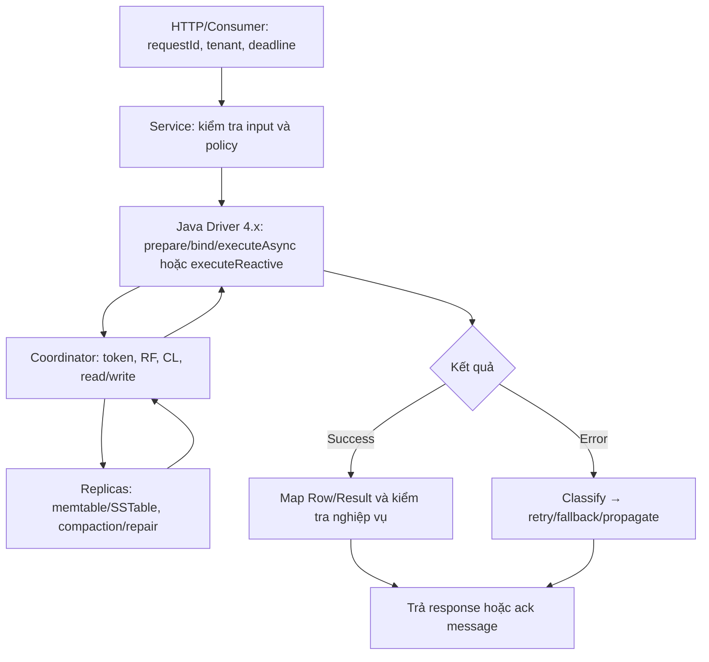
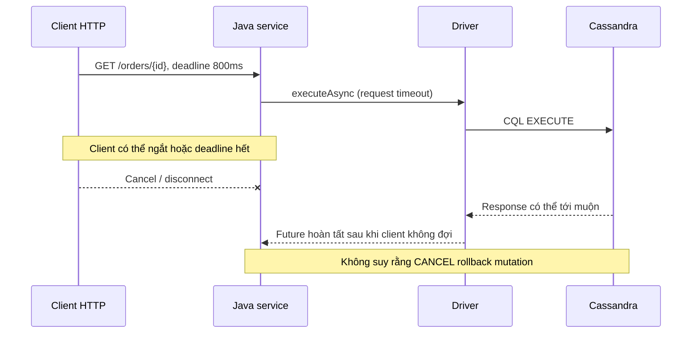
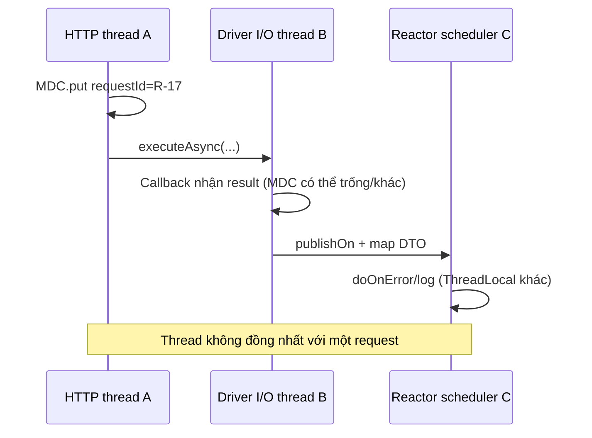

# Chuỗi xử lý lỗi, phục hồi và truyền ngữ cảnh ứng dụng

## 1. Tại sao xử lý bất đồng bộ không chỉ là đổi `execute` thành `executeAsync`?

Trong một dịch vụ Java truy cập Apache Cassandra, request thường trải qua nhiều bước: nhận HTTP/message, xác thực người dùng, tra cứu theo **partition key**, gọi Cassandra với một **consistency level**, ánh xạ `Row` sang dữ liệu nghiệp vụ, có thể cập nhật một bảng khác và cuối cùng trả response hoặc xác nhận message. Khi các bước chạy bất đồng bộ, một lỗi có thể xảy ra **sau khi method Java đã return** và trên một thread không phải thread tiếp nhận request.

Hai sai sót rất phổ biến:

- Ứng dụng gọi `session.executeAsync(stmt)` nhưng không giữ/quan sát `CompletionStage` cuối. Cassandra trả timeout nhưng API vẫn trả HTTP 200, hoặc callback ném exception mà không ai xử lý.
- Ứng dụng dùng Reactor, gọi `session.executeReactive(stmt)` nhưng không subscribe vào publisher. Đoạn mã nhìn như đã ghi dữ liệu, song **chưa có truy vấn nào được thực thi**.

Một sai sót tinh vi khác: timeout ở client **không xác nhận rằng một mutation chưa được ghi**. Nếu retry không có quy tắc idempotency, Cassandra có thể nhận cùng hành động nghiệp vụ nhiều lần. Vì vậy chuỗi bất đồng bộ phải trả lời được bốn câu hỏi:

1. **Thành công** của từng bước được định nghĩa thế nào (trả hàng, ghi đủ ACK theo CL, hay LWT `[applied]`)?
2. **Lỗi** nào là retryable, lỗi nào phải trả về nguyên vẹn hoặc dịch sang lỗi nghiệp vụ?
3. **Phục hồi** bằng cache/fallback có còn đáp ứng hợp đồng dữ liệu và mức nhất quán đã cam kết không?
4. **Ngữ cảnh** như request ID, trace ID, deadline và tenant được truyền qua các thread, callbacks và Reactor operators ra sao mà không rò rỉ dữ liệu?

Bài thuộc chương **Bất đồng bộ và reactive** của mô-đun `DATABASE_ENGINE_WIDE_COLUMN_CASSANDRA`, liên hệ trực tiếp kiến trúc phân tán, mô hình wide-column, partition key, thiết kế bảng theo truy vấn, replication/consistency đọc ghi, compaction, repair, xử lý lỗi và Java Driver 4.x.

**Sau bài, người học có thể** xây một luồng `CompletionStage` hoặc Reactor có error contract rõ; xử lý retry, timeout, cancellation, backpressure, paging; đưa correlation/tracing context qua ranh giới bất đồng bộ; và kiểm thử cả kết quả, dữ liệu bị từ chối, số lần gọi Cassandra và tác dụng phụ khi lỗi.

## 2. Bản đồ bốn tầng lỗi: đừng gom tất cả vào `Exception`



| Tầng | Ví dụ lỗi | Chủ sở hữu xử lý |
| --- | --- | --- |
| **Input/business** | Key sai định dạng, order không tồn tại, trạng thái không hợp lệ | Controller/service; trả 400/404/409 theo contract |
| **Driver/client** | Không tìm được node, TLS/credential lỗi, pool quá tải, timeout phía client | Hạ tầng ứng dụng; policy điều tiết/quan sát |
| **Coordinator/replica** | `UnavailableException`, `ReadTimeoutException`, `WriteTimeoutException`, schema lỗi | Driver + SRE; giữ CL và đánh giá dữ liệu thực |
| **Async/reactive pipeline** | Callback ném `NullPointerException`, subscriber cancel, scheduler bão hòa, context bị mất | Lập trình viên; không đổ mọi lỗi vào Cassandra |

**Không có row** (`row == null`, `Mono.empty()` sau một SELECT hợp lệ) không tự là lỗi hạ tầng. Ngược lại, **LWT `wasApplied() == false`** có thể là một request CQL hoàn tất bình thường nhưng điều kiện nghiệp vụ không được đáp ứng. Phải tách result/empty/false/error ở từng boundary.

## 3. Ba mô hình lập trình và ý nghĩa của chúng

| Mô hình | Java Driver 4.x | Thời điểm kích hoạt | Cách truyền lỗi |
| --- | --- | --- | --- |
| Đồng bộ | `session.execute(stmt)` → `ResultSet` | Khi gọi | Ném exception trực tiếp vào thread gọi |
| Bất đồng bộ | `session.executeAsync(stmt)` → `CompletionStage<AsyncResultSet>` | Khi gọi executeAsync | Stage hoàn tất exceptionally, callbacks được chạy sau |
| Reactive Streams | `session.executeReactive(stmt)` → `ReactiveResultSet` | **Khi subscribe** | `onError` signal trong stream |

Không đồng nhất `CompletionStage` với Reactive Streams:

- `CompletionStage` mô tả **một kết quả/thất bại hoàn tất trong tương lai**, không có cơ chế `request(n)` cho từng phần tử.
- `ReactiveResultSet` là publisher có tín hiệu `onSubscribe/onNext/onError/onComplete`, có demand/backpressure theo Reactive Streams.
- Có thể chuyển `CompletionStage` sang `Mono` hoặc dùng trực tiếp `Flux.from(session.executeReactive(...))`, nhưng cần hiểu **khi nào truy vấn thực sự chạy**, lúc nào retry tạo request mới và việc cancel có thể tác động tới ai.

Theo tài liệu Java Driver 4.18.x, reactive types nằm trong package có tiền tố `com.datastax.dse...` vì lịch sử phát triển; **reactive vẫn dùng với Apache Cassandra thông thường**, không yêu cầu chạy DSE.

## 4. Fixture CQL: dữ liệu nhỏ, hành vi đủ để test

Các ví dụ dưới đây dành cho **cluster lab**, DC tên `dc1`, có đủ node cho RF3. Với môi trường khác, điều chỉnh RF/DC theo topology. Không đưa dữ liệu nhạy cảm hoặc chạy DDL/xóa thử nghiệm trên production.

```sql
CREATE KEYSPACE async_lab_ks
WITH replication = {'class': 'NetworkTopologyStrategy', 'dc1': 3}
AND durable_writes = true;

CREATE TABLE async_lab_ks.orders_by_id (
    order_id uuid PRIMARY KEY,
    customer_id text,
    status text,
    total decimal,
    updated_at timestamp
);

CREATE TABLE async_lab_ks.events_by_order_day (
    order_id uuid,
    bucket_day date,
    event_ts timestamp,
    event_id uuid,
    event_type text,
    PRIMARY KEY ((order_id, bucket_day), event_ts, event_id)
) WITH CLUSTERING ORDER BY (event_ts DESC, event_id DESC);

INSERT INTO async_lab_ks.orders_by_id
    (order_id, customer_id, status, total, updated_at)
VALUES (11111111-2222-4333-8444-555555555555,
        'synthetic-customer-7', 'CREATED', 120.50,
        '2026-11-21T08:00:00+0000');

INSERT INTO async_lab_ks.events_by_order_day
    (order_id, bucket_day, event_ts, event_id, event_type)
VALUES (11111111-2222-4333-8444-555555555555,
        '2026-11-21', '2026-11-21T08:01:00+0000',
        22222222-3333-4444-8555-666666666666, 'CREATED');

INSERT INTO async_lab_ks.events_by_order_day
    (order_id, bucket_day, event_ts, event_id, event_type)
VALUES (11111111-2222-4333-8444-555555555555,
        '2026-11-21', '2026-11-21T08:02:00+0000',
        33333333-4444-4555-8666-777777777777, 'VALIDATED');

INSERT INTO async_lab_ks.events_by_order_day
    (order_id, bucket_day, event_ts, event_id, event_type)
VALUES (11111111-2222-4333-8444-555555555555,
        '2026-11-21', '2026-11-21T08:03:00+0000',
        44444444-5555-4666-8777-888888888888, 'READY');
```

**Bất biến lab:**

- `orders_by_id` có một order đã biết theo partition key `order_id`; một UUID khác sẽ cho kết quả rỗng.
- `events_by_order_day` có ba hàng trong partition `(order_id, bucket_day)`, theo thứ tự `READY → VALIDATED → CREATED`; `setPageSize(1)` tạo tình huống nhiều trang.
- Với RF3 và `LOCAL_QUORUM` trong cùng DC, các request đòi phản hồi quorum địa phương. CL **không thay** cơ chế chống trùng nghiệp vụ hoặc transaction trên nhiều partition.

## 5. Chuỗi `CompletionStage` đúng: compose thay vì block

Ví dụ Java 17+, Java Driver 4.18.x; các đoạn mã tiếp theo giả sử `CqlSession session` được tạo **một lần** trong vòng đời service và đóng đúng lúc ứng dụng shutdown.

```java
import java.math.BigDecimal;
import java.util.*;
import java.util.concurrent.*;
import com.datastax.oss.driver.api.core.DefaultConsistencyLevel;
import com.datastax.oss.driver.api.core.CqlSession;
import com.datastax.oss.driver.api.core.cql.*;

record Order(UUID id, String status, BigDecimal total) {}

// Chuẩn bị một lần khi khởi tạo repository (sau khi schema đã sẵn sàng).
PreparedStatement getOrder = session.prepare(
    "SELECT order_id, status, total " +
    "FROM async_lab_ks.orders_by_id WHERE order_id = ?");

CompletionStage<Optional<Order>> findOrderAsync(UUID orderId) {
    BoundStatement bound = getOrder.bind(orderId)
        .setConsistencyLevel(DefaultConsistencyLevel.LOCAL_QUORUM)
        .setIdempotent(true);

    return session.executeAsync(bound).thenApply(page -> {
        Row row = page.one();
        if (row == null) {
            return Optional.empty();
        }
        return Optional.of(new Order(
            row.getUuid("order_id"),
            row.getString("status"),
            row.getBigDecimal("total")));
    });
}
```

`thenApply` phù hợp khi **biến đổi kết quả tại chỗ** và không phát thêm tác vụ bất đồng bộ. Nếu cần gọi Cassandra lần nữa dựa vào kết quả, dùng `thenCompose`:

```java
CompletionStage<Optional<Order>> stage = findOrderAsync(orderId);

CompletionStage<Optional<String>> statusStage = stage.thenCompose(maybeOrder -> {
    if (maybeOrder.isEmpty()) {
        return CompletableFuture.completedFuture(Optional.empty());
    }
    // Ví dụ trả giá trị sau một bước bất đồng bộ khác.
    return fetchExternalStatusAsync(maybeOrder.get().id())
        .thenApply(Optional::ofNullable);
});
```

Trong đó `fetchExternalStatusAsync` là hàm giả định trả `CompletionStage<String>`; đoạn này minh họa composition, không đòi thêm bảng Cassandra. Dùng `thenApply` cho một hàm trả future sẽ tạo **future lồng future**, làm đường lỗi và kết quả khó kiểm soát.

### Chọn operator theo ý nghĩa

| API | Khi nào dùng? | Điều cần nhớ |
| --- | --- | --- |
| `thenApply(f)` | Map từ A sang B, tính toán nhẹ | Callback có thể chạy trên thread hoàn tất stage |
| `thenCompose(f)` | f trả một `CompletionStage<B>` | Flatten, lỗi stage bên trong truyền xuống |
| `thenCombine(other, f)` | Hai kết quả độc lập cùng cần cho một phép tính | Không tự có giới hạn concurrency |
| `whenComplete((v,e) -> ...)` | Metrics/log không đổi giá trị | Không phục hồi lỗi; lỗi callback có thể tạo stage lỗi mới |
| `exceptionally(ex -> value)` | Thay một lỗi cụ thể bằng giá trị fallback | Nếu áp dụng cho mọi lỗi sẽ che auth/schema/bug |
| `handle((v,e) -> ...)` | Biến đổi cả success/failure | Phải phân loại exception và ném lại trường hợp không cho phép |
| `thenApplyAsync(f, executor)` | Công việc map tốn CPU | Dùng executor có giới hạn, không giao vô hạn queue |

**Lỗi bị bỏ quên:** `stage.thenAccept(row -> ...);` nhưng không giữ stage được trả về. Nếu stage trước fail, callback không chạy; nếu callback ném exception, future mới fail mà không được quan sát. Trong code server, **trả stage cuối tới framework** và dùng terminal logging/metrics/error mapper phù hợp.

## 6. Tách lỗi gốc khỏi lớp `CompletionException`

Khi callback ném exception hoặc stage hoàn tất exceptionally, Java có thể bọc nguyên nhân trong `CompletionException`. Khi cần phân loại, unwrap có kiểm soát:

```java
static Throwable unwrapAsync(Throwable error) {
    Throwable current = error;
    while ((current instanceof CompletionException
            || current instanceof ExecutionException)
            && current.getCause() != null) {
        current = current.getCause();
    }
    return current;
}
```

Không nuốt stack trace hoặc thay mọi lỗi bằng `null`. Phân loại theo **ngữ nghĩa**:

| Nhóm | Ví dụ | Cách xử lý |
| --- | --- | --- |
| Not found/empty | `SELECT` theo PK trả 0 row | `Optional.empty()` hoặc HTTP 404; **không retry** vì không có lỗi |
| Invalid query/schema | `InvalidQueryException`, thiếu bảng/cột | Báo lỗi triển khai/schema; **không fallback như “không có đơn”** |
| Authentication/authorization | Credential sai, không có `SELECT/MODIFY` | Trả lỗi tương ứng và cảnh báo; không retry CQL liên tục |
| Transient availability/read timeout | `UnavailableException`, `ReadTimeoutException` | Có thể retry **đọc idempotent** trong ngân sách deadline, giữ CL |
| Write timeout | `WriteTimeoutException` | **Outcome không chắc chắn**; xác minh trạng thái trước khi retry nghiệp vụ |
| LWT không applied | `wasApplied() == false` | Trả conflict/điều kiện không đạt, **không** xem là transport error |
| Callback mapping bug | `NullPointerException`, codec/parse sai | Sửa code hoặc dữ liệu; không chạy vòng retry database |
| Cancellation | Subscriber cancel, HTTP client disconnect | Dọn tài nguyên; không khẳng định mutation đã rollback |

**Lưu ý:** tên exception và policy còn phụ thuộc release driver. Xử lý lỗi **đúng kiểu và đúng hợp đồng** trước, rồi mới cân nhắc retry/fallback.

### Phục hồi chọn lọc bằng `handle`

```java
CompletionStage<Optional<Order>> dbRead = findOrderAsync(orderId);

Optional<Order> cachedSnapshot = Optional.empty(); // Ví dụ: cache đã kiểm chứng.
boolean staleReadPermitted = false;                  // Chính sách endpoint.

CompletionStage<Optional<Order>> resolved =
    dbRead.handle((value, failure) -> {
        if (failure == null) {
            return value;
        }
        Throwable cause = unwrapAsync(failure);
        if (staleReadPermitted && cause instanceof
                com.datastax.oss.driver.api.core.servererrors.UnavailableException) {
            return cachedSnapshot; // Fallback CHỈ nếu contract cho phép.
        }
        throw new CompletionException(cause);
    });
```

Nếu API yêu cầu “đọc trạng thái đã xác nhận mới nhất theo `LOCAL_QUORUM`”, cache stale **không được** thay thế âm thầm. Fallback phải xuất hiện trong tài liệu API (ví dụ `stale=true`, thời điểm cache, chỉ chế độ read-only) hoặc không được thực hiện.

## 7. Threading: callback nhanh, không chặn driver I/O thread

Java Driver 4.x dùng thread pools nội bộ cho request I/O và tác vụ quản trị. Callback `thenApply` gắn với stage do driver hoàn tất có thể chạy **trên I/O thread**. Nếu callback gọi API đồng bộ `session.execute()`, code có nguy cơ deadlock và driver có cơ chế phát hiện/chặn kiểu gọi này.

```java
// SAI: blocking Cassandra call trong callback I/O:
session.executeAsync(bound).thenApply(rs -> {
    return session.execute(otherBound).one();  // KHÔNG LÀM.
});

// ĐÚNG: ghép các request bất đồng bộ:
session.executeAsync(bound).thenCompose(rs -> {
    Row first = rs.one();
    if (first == null) {
        return CompletableFuture.completedFuture(Optional.empty());
    }
    return session.executeAsync(otherBound)
        .thenApply(next -> Optional.ofNullable(next.one()));
});
```

Nếu phải hash hàng nghìn records hoặc serialize JSON nặng, đưa phần đó sang **executor CPU có giới hạn**:

```java
ExecutorService mappingPool = Executors.newFixedThreadPool(4);

CompletionStage<Payload> mapped = session.executeAsync(bound)
    .thenApplyAsync(rs -> mapLargeResponse(rs), mappingPool);

// mappingPool.shutdown() ở lifecycle shutdown của ứng dụng;
// không tạo một pool mới mỗi request.
```

Ở đây `Payload`/`mapLargeResponse` là abstractions minh họa. Với result nhiều page, cần fetch bất đồng bộ theo từng trang trước khi map toàn bộ. **Executor riêng không làm blocking driver call trở nên tối ưu**, nó chỉ chuyển chi phí và phải có backpressure/queue bound.

### Các anti-pattern cần loại bỏ

```java
// Không gọi từ HTTP event-loop hoặc driver callback:
Order blocking = findOrderAsync(orderId)
    .toCompletableFuture()
    .thenApply(opt -> opt.orElseThrow())
    .join();

// Không tạo unbounded executor/future fan-out:
for (UUID id : millionIds) {
    session.executeAsync(getOrder.bind(id));
}
```

`join()/get()` làm block thread; chạy trên event loop sẽ làm throughput giảm và timeout dây chuyền. Tạo hàng triệu in-flight requests không có giới hạn còn gây pool saturation, memory pressure, retry storm và p99 tăng.

## 8. Async paging: kết quả đúng nghĩa là đọc đủ trang

`session.executeAsync(stmt)` chỉ cung cấp **trang hiện tại** qua `AsyncResultSet.currentPage()`. Nếu yêu cầu nghiệp vụ lấy toàn bộ hàng trong một partition, phải fetch tiếp khi `hasMorePages()`.

```java
record Event(UUID id, String type) {}

static CompletionStage<List<Event>> collectAllPages(
        AsyncResultSet page, List<Event> collected) {
    for (Row row : page.currentPage()) {
        collected.add(new Event(
            row.getUuid("event_id"),
            row.getString("event_type")));
    }
    if (!page.hasMorePages()) {
        return CompletableFuture.completedFuture(List.copyOf(collected));
    }
    return page.fetchNextPage()
        .thenCompose(next -> collectAllPages(next, collected));
}

CompletionStage<List<Event>> eventsStage = session.executeAsync(
    preparedEvents.bind(
        orderId, LocalDate.of(2026, 11, 21))
        .setPageSize(1)
        .setConsistencyLevel(DefaultConsistencyLevel.LOCAL_QUORUM)
        .setIdempotent(true))
    .thenCompose(page -> collectAllPages(page, new ArrayList<>()));
```

Giả sử `preparedEvents` là prepared SELECT trên `events_by_order_day` và đã được khởi tạo. `ArrayList` trong ví dụ chỉ thuộc **một request/chain**, không chia sẻ giữa nhiều yêu cầu đồng thời. Với dữ liệu lớn, thay vì gom hết vào RAM cần xử lý trang theo streaming/giới hạn result; một callback map nặng nên offload.

**Không được** trả `currentPage()` rồi báo thành công nếu hợp đồng yêu cầu tất cả ba hàng. Nếu trang sau fail, **toàn bộ thao tác nghiệp vụ** cần báo fail hoặc có API partial-result được định nghĩa rõ, không âm thầm trả hàng thiếu. Việc gọi fetch tiếp cũng là request mạng mới, có timeout/retry độc lập.

## 9. Deadline, timeout và cancellation có ba ý nghĩa khác nhau

| Cơ chế | Ranh giới | Điều không được suy ra |
| --- | --- | --- |
| Driver request timeout | Giới hạn cho một request thực thi, bao gồm retries/speculation theo cấu hình driver | Không chứng minh write không tới replica |
| Application end-to-end deadline | Ngân sách cả API: auth → 2 query → mapping → response | Không tự đồng bộ với timeout mọi stage |
| Cancellation (future/subscriber) | Bên nhận ngừng chờ hoặc phát tín hiệu cancel | Không hủy vật lý mọi mutation đã được coordinator chấp nhận |

Ví dụ ngân sách **giả định**: client cho 800 ms; validation 30 ms, đọc order tối đa 250 ms, gọi dịch vụ phụ 200 ms, mapping 50 ms, dự phòng 270 ms. Đặt mỗi Cassandra attempt timeout 2 giây trong khi toàn API chỉ có 800 ms là cấu hình **mâu thuẫn**.



**Read timeout:** nếu là truy vấn idempotent, có thể retry trong ngân sách còn lại. **Write timeout:** phải xác minh/truy vết theo business ID trước khi tái phát hành hành động có side effect. HTTP client disconnect không có quyền “thu hồi” một `INSERT/UPDATE` đã đến server.

### Timeout trong Reactor

```java
Mono<Optional<Order>> readOnce = Mono.defer(
    () -> Mono.fromCompletionStage(() -> findOrderAsync(orderId)));

Mono<Optional<Order>> guarded = readOnce
    .timeout(Duration.ofMillis(500))
    .doOnError(error -> metrics.increment("order_read_failed"))
    .doFinally(signal -> metrics.increment("order_read_finished"));
```

`Mono.fromCompletionStage(Supplier)` hoãn tạo stage tới lúc subscribe. Một timeout của Reactor làm chuỗi phát lỗi/cancel phía subscriber; **không cam kết Cassandra đã dừng chạy**. Không dùng `timeout().onErrorReturn(empty)` để trả “order không tồn tại”.

## 10. Retry có điều kiện: giới hạn thời gian và tính idempotent

**Retry** là một yêu cầu mới hoặc một lần thử bổ sung, không phải một phép hồi sinh kết quả miễn phí. Driver có retry policy riêng; nếu thêm retry ở tầng Reactor/service, phải tính **cả hai lớp** để không nhân số lần request quá lớn.

| CQL/hành động | Retry ở tầng ứng dụng? | Lý do |
| --- | --- | --- |
| `SELECT ... WHERE order_id=?` | Có thể, với lỗi tạm thời và deadline | Thường idempotent; giữ CL và query semantics |
| `INSERT/UPDATE` cùng giá trị | Chỉ khi đã phân tích timestamp/TTL và nghiệp vụ | Dù trạng thái cuối giống nhau, expiration/audit/side effect có thể khác |
| `UPDATE counter ... c=c+1` | **Không retry mù** | Có thể tăng đôi |
| `list_col = list_col + [...]` | **Không retry mù** | Có thể thêm hai lần |
| `UPDATE ... IF status=?` | Không mặc định; xử lý kết quả không chắc chắn | LWT có Paxos/serial CL, cần xác minh điều kiện |
| Ghi hai bảng denormalized | Không coi retry cả chuỗi là atomic | Một bảng đã ghi, bảng khác có thể chưa ghi |
| Lỗi auth/schema/codec | Không | Retry không sửa credential, CQL hay Java mapping |

### Retry read chọn lọc bằng Reactor

```java
import reactor.core.publisher.Mono;
import reactor.util.retry.Retry;
import java.time.Duration;
import com.datastax.oss.driver.api.core.servererrors.*;

Mono<Optional<Order>> safeRead =
    Mono.defer(() ->
        Mono.fromCompletionStage(() -> findOrderAsync(orderId)))
    .retryWhen(
        Retry.backoff(2, Duration.ofMillis(50))
            .maxBackoff(Duration.ofMillis(250))
            .jitter(0.5)
            .filter(error ->
                error instanceof ReadTimeoutException
                || error instanceof UnavailableException))
    .timeout(Duration.ofMillis(800));
```

Đây là **minh họa**; trong ứng dụng thật còn cần chính sách concurrency, budget toàn request, xử lý wrapped exceptions và cấu hình retry phía driver. `Retry.backoff(2,...)` cho tối đa **hai lần retry bổ sung** sau lần đầu, không phải tổng hai attempts. `retryWhen` tạo subscription mới nên đoạn upstream cần được dựng bằng `defer`/supplier, không giữ một stage đã chạy sẵn.

**Không hạ CL từ `LOCAL_QUORUM` xuống `ONE` để retry thành công** nếu contract yêu cầu consistency cao hơn. Không retry ngay tức thì hàng loạt request khi một node/DC lỗi; dùng backoff có jitter và circuit/bulkhead phù hợp để tránh retry storm.

## 11. Fallback, circuit breaker và bulkhead: phục hồi có nghĩa vụ nghiệp vụ

Ba cơ chế khác nhau:

- **Fallback** trả một kết quả thay thế, ví dụ trạng thái cache đã gắn `asOf`. Nó phải được **chấp nhận bởi API contract**, không chỉ giúp giảm error count.
- **Circuit breaker** tạm ngăn gọi downstream khi đang có dấu hiệu thất bại kéo dài. Nó **không** chữa Cassandra, chỉ giới hạn thiệt hại và hỗ trợ hồi phục.
- **Bulkhead/concurrency limit** giới hạn số request Cassandra in-flight của một workload để lỗi/bão hòa không kéo toàn JVM/cluster xuống.

Ví dụ fallback có chọn lọc cho endpoint **chỉ đọc cho phép stale**:

```java
Mono<ReadView> view = readOrderMono(orderId)
    .map(order -> new ReadView(order, false))
    .onErrorResume(UnavailableException.class, error ->
        cachedView(orderId)
            .map(stale -> new ReadView(stale, true)));
```

Trong đó `readOrderMono` trả `Mono<Order>`, `cachedView` trả `Mono<Order>`, `ReadView` là DTO ví dụ; cả ba phải được thiết kế trước. Nếu `readOrderMono` trả empty vì không thấy đơn, chuỗi này **không** tự chạy fallback, vì empty **khác error**. Nếu cache cũng rỗng, hãy trả lỗi phù hợp và không che rằng DB đã unavailable.

**Không dùng fallback stale** cho xác nhận thanh toán, cấp quyền, check số dư hoặc điều kiện chuyển trạng thái nếu tính mới/consistency là bắt buộc. Không lấy `onErrorResume(e -> Mono.empty())` làm mẫu mặc định: nó biến outage thành “không có dữ liệu”.

### Giới hạn song song để tránh overload

```java
Flux<Order> orders = Flux.fromIterable(orderIds)
    .flatMap(id ->
        Mono.defer(() -> Mono.fromCompletionStage(
            () -> findOrderAsync(id)))
            .flatMap(optional ->
                optional.map(Mono::just).orElseGet(Mono::empty)),
        16); // Max concurrency minh họa, cần đo trên workload thật.
```

`flatMap(..., 16)` giúp giới hạn số chuỗi con đang hoạt động nhưng **không** tạo transaction, không đảm bảo thứ tự kết quả và không kiểm soát mọi request nền. Nếu cần giữ thứ tự, đánh giá `concatMap` hoặc `flatMapSequential` cùng độ trễ/throughput đánh đổi.

## 12. Driver reactive: publisher chỉ chạy khi được subscribe

Java Driver 4.x có `CqlSession.executeReactive(Statement<?>)`, trả `ReactiveResultSet` — một `Publisher<ReactiveRow>`. API có package lịch sử:

```java
import com.datastax.dse.driver.api.core.cql.reactive.ReactiveResultSet;
import com.datastax.dse.driver.api.core.cql.reactive.ReactiveRow;
import reactor.core.publisher.Flux;

ReactiveResultSet publisher = session.executeReactive(
    getOrder.bind(orderId)
        .setConsistencyLevel(DefaultConsistencyLevel.LOCAL_QUORUM)
        .setIdempotent(true));

// Chưa subscribe → chưa thực thi query.
Flux<Order> orders = Flux.from(publisher).map(r ->
    new Order(r.getUuid("order_id"), r.getString("status"),
        r.getBigDecimal("total")));

// Framework hoặc subscriber cuối phải subscribe;
// code production không gọi block() trên event-loop.
```

**Quan trọng:** publisher mặc định là **cold, unicast và chỉ cho một subscription**. Nếu một downstream dùng cùng `publisher` để `subscribe()` hai lần hoặc dùng `retryWhen` mà upstream tái subscribe vào cùng result set, driver có thể báo lỗi.

### Cách đúng để có publisher mới cho mỗi lần subscribe/retry

```java
Flux<Order> deferredRead = Flux.defer(() ->
    Flux.from(session.executeReactive(
        getOrder.bind(orderId)
            .setConsistencyLevel(DefaultConsistencyLevel.LOCAL_QUORUM)
            .setIdempotent(true)))
        .map(r -> new Order(
            r.getUuid("order_id"),
            r.getString("status"),
            r.getBigDecimal("total"))));

Flux<Order> retriable = deferredRead.retryWhen(
    Retry.backoff(2, Duration.ofMillis(50))
        .filter(error -> error instanceof ReadTimeoutException));
```

Với mỗi **subscription**, `Flux.defer` tạo một `ReactiveResultSet` mới. Điều này **cho phép retry đúng cơ chế**, nhưng cũng nghĩa là có **request CQL mới**; cần kiểm soát số lần retry và tính nhất quán dữ liệu. Không cache vô hạn một `Flux` chứa dữ liệu production rồi chia sẻ giữa tenant vì rủi ro PII, bộ nhớ và dữ liệu lỗi thời.

### Kết quả rỗng của write reactive có ý nghĩa gì?

Write CQL thông thường không trả row. Vì vậy:

```java
Mono<Void> saveStatusReactive(BoundStatement write) {
    return Mono.defer(() ->
        Flux.from(session.executeReactive(write)).then());
}
```

`then()` chỉ hoàn tất thành công **sau khi publisher upstream hoàn tất**; không có `onNext` không đồng nghĩa không có write. Sai lầm điển hình:

```java
// SAI: doOnNext chỉ là side-effect gọi hàm tạo publisher,
// không subscribe vào publisher được trả về.
Flux.just(write).doOnNext(session::executeReactive);

// ĐÚNG: trả publisher vào chain để nó được subscribe.
Mono<Void> writeDone = Flux.from(session.executeReactive(write)).then();
```

Đoạn `writeDone` cuối là **single-subscription**; nếu có thể retry/tái subscribe, bọc lời gọi `session.executeReactive(write)` trong `Mono.defer` như hàm đầu.

### LWT reactive có `wasApplied()` riêng

```java
Mono<Boolean> conditionalUpdate(BoundStatement lwt) {
    return Mono.defer(() -> {
        ReactiveResultSet rs = session.executeReactive(lwt);
        return Flux.from(rs).then(Mono.from(rs.wasApplied()));
    });
}
```

Method `wasApplied()` của reactive result set là **publisher metadata**; khi transaction/query chưa hoàn tất, metadata có thể chưa phát. `false` là điều kiện không thỏa, **không** phải lỗi driver. Dùng LWT/serial CL theo đúng yêu cầu nghiệp vụ; không coi nó là transaction atomic xuyên mọi partition.

## 13. Backpressure, paging và hủy stream

Reactive Streams hỗ trợ downstream phát demand qua `request(n)`. Driver có thể lấy thêm trang khi cần; tuy nhiên **demand theo row không phải cam kết số request mạng đúng bằng n**. Page size là gợi ý; một page có thể chứa nhiều rows. Với dữ liệu lớn, cần cả giới hạn tổng số hàng và xử lý tốc độ downstream.

```java
Flux<String> eventTypes = Flux.defer(() ->
    Flux.from(session.executeReactive(
        preparedEvents.bind(orderId, LocalDate.of(2026, 11, 21))
            .setConsistencyLevel(DefaultConsistencyLevel.LOCAL_QUORUM)
            .setPageSize(2)
            .setIdempotent(true))))
    .map(row -> row.getString("event_type"))
    .limitRate(64);
```

**Không gắn `collectList()` tùy tiện lên bảng có hàng triệu rows**: áp lực RAM vẫn tăng dù upstream có backpressure. Khi API chỉ cần 100 rows, biểu đạt giới hạn trong CQL/schema; nếu cần xử lý lâu, dùng paging/batch stream có policy và state rõ.

Nếu downstream `cancel()`:

- Reactor có thể dừng phát row mới và giải phóng subscription/network resources tùy driver.
- Server có thể đã xử lý request/page hoặc mutation trước khi nhận tín hiệu, đặc biệt trong tình huống timeout/disconnect.
- **Cancellation không rollback CQL write** và không đảm bảo source event đã được ack ở consumer.
- Nếu đã gửi một phần rows cho HTTP streaming response rồi fail, HTTP status có thể đã được commit; cần protocol lỗi/partial result rõ ràng, không giả định có thể thay toàn bộ response bằng HTTP 500.

## 14. Ngữ cảnh ứng dụng: request ID, trace ID, tenant và deadline

Ngữ cảnh **không chỉ là để log đẹp**. Nó giúp các lớp Java/driver/metrics liên kết:

- **Correlation/request ID:** nối log của HTTP handler, repository, retry và downstream.
- **Trace/span context:** nối các span theo quan hệ cha-con; không biến trace ID thành khóa nghiệp vụ.
- **Tenant/account scope:** quyết định **quyền truy cập ở service** và partition key nào được phép đọc; không được lấy tenant từ một log MDC cũ.
- **Deadline/cancellation:** budget từ request ingress, tránh mỗi downstream tự retry vượt tổng SLO.
- **Idempotency key/event ID:** phân biệt request lặp lại hợp lệ với sự kiện nghiệp vụ mới.
- **Authenticated principal:** danh tính đã xác thực, không chép raw token/password vào context hoặc logs.

### Vì sao `ThreadLocal`/MDC dễ sai?

Trong servlet sync, một request đôi khi chạy trên một thread từ đầu đến cuối. Trong async/Reactive:



`MDC` thường dựa trên `ThreadLocal`; pool threads **được tái sử dụng** cho nhiều request. Nếu không truyền và dọn ngữ cảnh đúng, log có thể **mất request ID** hoặc nghiêm trọng hơn **gắn nhầm request ID/tenant của người khác**. Không tự đọc `MDC.get("tenant")` rồi dùng làm authorization trong Reactor.

## 15. Truyền ngữ cảnh bằng tham số bất biến cho CompletionStage

Cách đơn giản và ít phụ thuộc framework nhất: tạo **immutable request context** khi nhận request, truyền nó rõ ràng vào service/repository và sử dụng trong callbacks.

```java
import java.time.Instant;
import java.util.UUID;

record RequestContext(
    String requestId,
    String tenantId,
    Instant deadlineUtc
) {}

CompletionStage<Optional<Order>> findOrder(
        RequestContext context, UUID orderId) {
    // Chính sách tenant được xác minh ở service trước khi gọi repository;
    // không lấy context từ shared ThreadLocal.
    BoundStatement stmt = getOrder.bind(orderId)
        .setConsistencyLevel(DefaultConsistencyLevel.LOCAL_QUORUM)
        .setIdempotent(true);

    return session.executeAsync(stmt)
        .thenApply(rs -> Optional.ofNullable(rs.one()).map(r ->
            new Order(
                r.getUuid("order_id"),
                r.getString("status"),
                r.getBigDecimal("total"))))
        .whenComplete((value, error) ->
            metrics.record(
                "orders_by_id_lookup",
                context.requestId(),
                error == null ? "success" : "error"));
}
```

Ở đây `metrics.record` chỉ là abstraction minh họa, **không** dùng raw request ID làm metric label/cardinality cao trong Prometheus. Quan hệ tenant→order phải được kiểm tra bằng business logic; truy vấn chỉ theo `order_id` không tạo row-level isolation trong Cassandra.

Ưu điểm: correlation ID không phụ thuộc thread nào chạy callback. Nhược điểm: phải đi qua tham số khi có nhiều tầng; cần giữ context **nhỏ, bất biến, không chứa secret và không bị lạm dụng như quyền truy cập tự thân**.

## 16. Reactor Context: gắn với subscription, không gắn với thread

Reactor cung cấp `Context` (dùng `contextWrite` để đặt, `deferContextual` để đọc). Context gắn với **subscriber/chuỗi**, hoạt động qua nhiều scheduler hops mà không cần buộc thread cố định.

```java
import reactor.core.publisher.Mono;
import reactor.util.context.Context;

Mono<String> pipeline = Mono.deferContextual(ctx -> {
    String requestId = ctx.getOrDefault("requestId", "missing");
    return Mono.just("handled:" + requestId);
});

Mono<String> withContext = pipeline
    .contextWrite(Context.of("requestId", "req-synthetic-001"));
```

Khi subscribe, `withContext` cho ra `handled:req-synthetic-001` dù operator có thể chạy trên thread khác. Ngược lại:

```java
Mono<String> unsafe = Mono.just("work")
    .publishOn(Schedulers.parallel())
    .map(v -> MDC.get("requestId")); // Có thể null hoặc sai!
```

Ví dụ second snippet giả sử đã import `reactor.core.scheduler.Schedulers` và `org.slf4j.MDC`; mục tiêu là **chứng minh anti-pattern**, không phải code được triển khai.

### Gắn context và đi qua repository

```java
Mono<Order> findOrderReactive(UUID orderId) {
    return Mono.deferContextual(ctx -> {
        String requestId = ctx.getOrDefault("requestId", "missing");
        return Mono.fromCompletionStage(() -> findOrderAsync(orderId))
            .flatMap(optional ->
                optional.map(Mono::just)
                    .orElseGet(Mono::empty))
            .doOnError(error -> logSafeError("findOrder", requestId, error));
    });
}

Mono<Order> response = findOrderReactive(orderId)
    .contextWrite(ctx -> ctx.put("requestId", "req-synthetic-001"));
```

`logSafeError` là logger abstraction chỉ ghi query shape/request ID đã kiểm tra định dạng/error class. **Ranh giới quan trọng:** Reactor Context được truy xuất trong operator, nhưng **không tự biến mọi callback bên trong CompletionStage hoặc thư viện ngoài Reactor thành context-aware**. Đoạn code nhận `requestId` trước khi tạo stage và truyền thông tin rõ ràng. Khi rời Reactor sang `Executor`/kafka callback tùy biến, cần context propagation explicit hoặc integration chuyên dụng.

### Hướng của `contextWrite`

Reactor Context được truyền từ downstream subscriber về upstream operators. Vì vậy `contextWrite(...)` đặt **phía cuối** của một chuỗi có thể cung cấp dữ liệu cho `deferContextual(...)` ở phía trên. Đặt context sau khi đã kích hoạt một `CompletableFuture` eager ở ngoài `defer` **không quay ngược thời gian** để truyền context tới request đã bắt đầu.

## 17. Bridge sang MDC và tracing: phải có scope, không đặt rồi quên

Nếu ứng dụng dùng SLF4J MDC, không gán `MDC.put("requestId", ...)` một lần rồi tin nó đi qua mọi thread. Với logging tại một operator, có thể **lấy Reactor Context rồi đặt MDC trong scope ngắn**:

```java
import org.slf4j.MDC;

Flux<Order> observed = ordersFlux
    .doOnEach(signal -> {
        if (!signal.isOnError() && !signal.isOnNext()) {
            return;
        }
        String reqId =
            signal.getContextView().getOrDefault("requestId", "unknown");
        try (MDC.MDCCloseable ignored =
                 MDC.putCloseable("requestId", reqId)) {
            if (signal.isOnError()) {
                log.warn("query_shape=orders_by_id_lookup failure_class={}",
                    signal.getThrowable().getClass().getSimpleName());
            } else {
                log.debug("query_shape=orders_by_id_lookup row_observed");
            }
        }
    });
```

Mã trên cần `ordersFlux` và `log` được khai báo từ ứng dụng, cùng context key đã được set. `MDC.putCloseable` trả về scope tự dọn khi callback kết thúc; **không lưu MDC vĩnh viễn trên I/O thread**. Đừng đưa tenant ID, UUID partition key, request body hay raw `BoundStatement` vào log nếu chứa PII.

### OpenTelemetry context khác một chuỗi trace ID

Đối với instrumentation dựa trên OpenTelemetry, `Context.current()` thường phụ thuộc scope/thread hiện tại. Muốn đưa context qua một callback không được framework tự instrument, phải **capture ở ranh giới đúng** và makeCurrent trong scope callback:

```java
import io.opentelemetry.context.Context;
import io.opentelemetry.context.Scope;

Context captured = Context.current();

CompletionStage<AsyncResultSet> stage = session.executeAsync(bound);
CompletionStage<AsyncResultSet> observedStage =
    stage.whenComplete((value, error) -> {
        try (Scope scope = captured.makeCurrent()) {
            recordSpanOutcome(error); // Placeholder instrumentation.
        }
    });
```

Đây là ví dụ cho **một callback**, không phải công cụ tự động truyền ngữ cảnh qua **mọi** stage. Trong Spring/Reactor/OpenTelemetry hiện đại, ưu tiên integration và context-propagation library phù hợp version; cần kiểm thử trace parent/span ID sau `publishOn`, `flatMap`, retries và scheduler hops. Không copy `Context.current()` bên trong callback sau khi thread đã đổi rồi cho rằng đã giữ parent span.

### Mức độ nhạy cảm của context

Một trace ID hoặc correlation ID không phải secret mật mã, nhưng vẫn có thể **liên kết** hoạt động của người dùng nếu log tập trung; quản lý retention và ACL. Không đưa password, bearer token, full customer payload, raw partition key hoặc authorization scopes nhạy cảm vào Reactor Context chỉ vì nó tiện.

## 18. Chuỗi lỗi giữa nhiều bước: partial success và bẫy fan-out

Giả sử một nghiệp vụ đổi trạng thái đơn hàng và ghi thêm event vào bảng khác. Nếu code:

```java
CompletionStage<Void> update = updateOrderAsync(event); // Giả định.
CompletionStage<Void> audit  = appendEventAsync(event); // Giả định.
CompletionStage<Void> both = update.thenCombine(audit,
    (a, b) -> null);
```

Hai stage có thể **chạy cùng lúc**; `thenCombine` chỉ chờ kết quả, không biến hai mutations thành một transaction atomic. Nếu update đã ACK nhưng append event fail, API có thể fail, song đơn hàng **đã đổi**. Retry nguyên cả pipeline có thể phát lại update/event.

### Mẫu phối hợp bền vững hơn

1. Đặt một **business event ID/idempotency key** ổn định ở ingress.
2. Chọn **nguồn chân lý** (authoritative event log/outbox hoặc một partition transaction phù hợp) và quy định thời điểm ack business.
3. Projector/replayer cập nhật các bảng Cassandra theo truy vấn, có checkpoint, retry **idempotent** và dead-letter queue.
4. Đối soát theo event ID giữa `orders_by_id` và `events_by_order_day`; không chỉ so row count.
5. Khi một write timeout, **đọc/đối chiếu outcome** nếu khả thi trước khi quyết định thao tác bù.

**Logged batch** của Cassandra có giới hạn atomicity và **không cung cấp isolation/giao dịch nghiệp vụ đa partition kiểu RDBMS** cho luồng nhiều dịch vụ; không dùng nó như bằng chứng “hai bảng chắc luôn cùng hiện trạng khi đọc”.

### Phân biệt xử lý lỗi fan-out

| Kịch bản | Điều có thể đã xảy ra | Cách xử lý |
| --- | --- | --- |
| Chưa gửi write nào, validation fail | DB không bị thay đổi bởi flow | Trả lỗi input, không retry DB |
| Write nguồn ACK, event projection timeout | Nguồn đã thành công; projection không chắc | Checkpoint/replay và đối soát |
| Cả hai futures timeout | Một/hai mutation có thể đã áp dụng | Kiểm tra event ID, không retry mù |
| Subscriber cancel sau write thứ nhất | Write thứ nhất vẫn có thể thành công | Chạy recovery/reconciliation ngoài vòng đời HTTP |
| LWT không applied | Request hoàn tất, điều kiện sai | Trả conflict, không retry như network failure |
| Ứng dụng crash giữa hai bước | Partial state | Event log/outbox bảo đảm resume từ checkpoint |

## 19. Consumer reactive và acknowledgement đúng thời điểm

Trong Kafka/queue consumer, một lỗi rất nguy hiểm là **ack/commit offset ngay khi tạo một publisher**:

```java
// SAI: publisher chưa subscribe, không đồng nghĩa DB đã ghi.
Publisher<?> query = session.executeReactive(write);
ackMessage(message); // Có thể mất sự kiện nếu process chết ngay sau đó.
```

Đúng hơn, commit offset **chỉ sau khi luồng ghi hoàn tất** theo contract và các bước idempotency đã đạt:

```java
Mono<Void> consume(EventMessage message) {
    BoundStatement stmt = bindEventMutation(message);
    return Mono.defer(() ->
            Flux.from(session.executeReactive(stmt)).then())
        .then(Mono.defer(() -> ackMessageAsync(message)))
        .onErrorResume(error -> handleConsumerFailure(message, error));
}
```

`ackMessageAsync` được giả định trả `Mono<Void>`, `handleConsumerFailure` cũng trả `Mono<Void>` và thực thi một policy cụ thể (nack/retry topic/DLQ), không được mặc định âm thầm ack. Không tạo statement không-idempotent rồi cho phép operator tự retry vô hạn. Khi consumer rebalance/crash, **at-least-once delivery** đòi event ID ổn định và dedup/ghi idempotent.

Tương tự khi HTTP client disconnect, một mutation đang bay trên Cassandra không tự biến thành transaction “không diễn ra”. Trạng thái request và trạng thái nghiệp vụ phải được quan sát riêng.

## 20. Ma trận operator: thấy lỗi ở đâu, xử lý ở đó

| Operator/cơ chế | Khi có lỗi | Có phục hồi không? | Bẫy |
| --- | --- | --- | --- |
| `doOnError` / `whenComplete` | Log/metric và truyền lỗi | **Không** | Side-effect ném lỗi mới che lỗi gốc; không quan sát stage cuối |
| `onErrorMap` | Đổi exception thành domain error | **Không** | Mất cause/classification nếu map mọi lỗi giống nhau |
| `onErrorResume` | Chọn stream thay thế | **Có** | Dễ biến outage thành empty/stale mà không có hợp đồng |
| `onErrorReturn` | Giá trị mặc định | **Có** | Không thích hợp cho consistency-sensitive data |
| `onErrorComplete` | Nuốt lỗi và complete | Có, nhưng dễ nguy hiểm | Dễ làm consumer ack event chưa ghi |
| `retryWhen` | Subscribe lại upstream | Có thể | Re-execute CQL; cần defer, idempotence và budget |
| `timeout` | Phát timeout/cancel khi quá deadline | Không tự sửa DB | Mutation có thể vẫn đã commit |
| `doFinally` | Cleanup/metric cả complete/error/cancel | Không | Không coi cancel là rollback |
| `onErrorContinue` | Bỏ qua phần tử gây lỗi trong vài operator | Rất dễ sai | Thay đổi semantics, khuyến cáo tránh cho workflow dữ liệu quan trọng |
| `flatMap(f, concurrency)` | Điều phối nhiều sub-flows | Không | Một downstream fail có thể xảy ra sau một phần side effects |

### Đừng “phục hồi” quá rộng

```java
// SAI cho API truy vấn dữ liệu quan trọng:
Mono<Order> wrong = readOrderMono(orderId)
    .onErrorResume(error -> Mono.empty());

// ĐÚNG hơn: chỉ bắt outage có fallback được phê duyệt,
// mọi lỗi khác vẫn phải truyền xuống:
Mono<Order> conditionalFallback = readOrderMono(orderId)
    .onErrorResume(UnavailableException.class,
        error -> allowedCachedOrder(orderId));
```

Ở đây `allowedCachedOrder` được giả định trả `Mono<Order>` và phải kiểm tra freshness, tenant, retention; không phải ví dụ khuyến nghị cho mọi endpoint.

## 21. Observability và kiểm chứng bằng thử nghiệm

### Ba đồng hồ phải đo riêng

1. **End-to-end API:** ingress đến response/ack, gồm mapping, auth, dependencies và paging.
2. **Driver request:** từ `executeAsync` tới response trang hiện tại, retries/speculative executions theo cấu hình.
3. **Cassandra coordinator/replica:** read/write latency theo bảng/CL, SSTable, tombstone, compaction/repair và network.

Không cộng p99 các tầng rồi gọi là p99 toàn luồng. Một flow có hai calls song song, fallback hoặc retry có đường găng khác nhau; đo **full-operation p95/p99, success ops/s, errors và retries** ở cùng workload.

| Metric | Dùng để tìm | Tránh |
| --- | --- | --- |
| `business_success/failure` | API/consumer đã hoàn thành contract? | Chỉ đếm CQL ACK mà quên bước sau |
| `request_timeout/rate` | Deadline và bão hòa | Che bằng HTTP 200/empty result |
| `retry_attempts` và backoff | Retry storm, multi-layer retries | Cộng cả driver và app mà không phân cấp |
| `in_flight, pool utilization` | Client đang tạo quá nhiều request | Chỉ nhìn CPU Cassandra |
| `pending compactions, disk await, GC` | Replica bận khiến latency tăng | Tự đổ lỗi cho Reactor |
| `cache_fallback_rate` | Mức suy giảm freshness | Không ghi stale/nguồn kết quả |
| `reactor_cancel/timeouts` | Subscriber đã hủy/đóng kết nối | Đồng nhất cancel với DB rollback |
| `trace/span link integrity` | Context có qua scheduler hops? | Đưa tenant/customer ID làm label |

### Bảng chẩn đoán nhanh

| Triệu chứng | Giả thuyết | Kiểm tra |
| --- | --- | --- |
| Một lỗi Cassandra biến thành HTTP 200 rỗng | `onErrorResume(e -> Mono.empty())` | Assert error contract, tìm operator nuốt lỗi |
| Callback Java không được gọi | Stage trước đã fail | Theo dõi stage cuối với `whenComplete`/framework |
| App treo dù Cassandra còn khỏe | Blocking `join()/execute()` trên I/O/event-loop | Thread dump, driver logs, scheduler metrics |
| Một publisher chỉ chạy lần đầu | ReactiveResultSet single-subscription | Tạo mới trong `Flux.defer` mỗi subscribe |
| Retry bị lỗi “second subscriber” | Re-subscribe trên cùng publisher | `Flux.defer(() -> Flux.from(session.executeReactive(...)))` |
| Ghi bị nhân đôi | Timeout rồi retry counter/list append hoặc event không idempotent | Idempotency key, replay logs, write timestamps |
| Log không có trace ID | MDC mất sau đổi thread | Reactor Context, OpenTelemetry instrumentation |
| Log tenant A xuất hiện ở request B | Không dọn ThreadLocal ở thread pool | Scoped MDC, test concurrency |
| p99 tăng sau thêm `publishOn` | Queue/scheduler bão hòa hoặc CPU mapping | Executor queues, allocation/GC, backpressure |
| Reactive stream trả ít hàng | Cancel/`take`/page error, nhầm `Mono.from(Publisher)` | Assert số rows/cutoff, kiểm tra full stream |
| Cassandra trả timeout nhiều hơn | RF/CL, replica bận, retry storm, compaction | `nodetool tpstats/compactionstats`, metrics coordinator |
| LWT trả `false` nhưng API báo “đã đổi” | Không kiểm `wasApplied` publisher | Kiểm tra kết quả điều kiện và state |

## 22. Runbook để phát hành một chuỗi async/reactive an toàn

### P0 — Vẽ hợp đồng và giới hạn lỗi

Liệt kê mỗi truy vấn CQL, partition key, result shape, CL/serial CL, timeout, điều kiện idempotent, yêu cầu freshness, default/fallback được phép, thời điểm ack business và kế hoạch rollback. Xác định **đơn vị thành công** là thao tác nghiệp vụ, không phải subscribe hoặc nhận trang đầu.

### P1 — Tách code I/O khỏi code CPU/blocking

Dùng `executeAsync` với `thenCompose` hoặc `executeReactive` với `Flux/Mono`, không `block()/join()` trong driver callback/event-loop. Nếu mapping tốn CPU, dùng scheduler/executor có giới hạn; đo queue depth và memory pressure. Tạo một `CqlSession` dùng chung cho mỗi cluster target.

### P2 — Xây error taxonomy

Mapping 404/not found, invalid CQL, auth, unavailable, read/write timeout, LWT not applied, cancellation và callback bug sang kết quả/API/consumer action khác nhau. Thử các lỗi được inject bằng test double/stub; không phải phá cluster thật.

### P3 — Retry và fallback có gate

Kiểm tra driver retry + app retry, giới hạn max attempts, delay/jitter, SLO deadline, số in-flight và tính idempotent. Với write unknown outcome, xác minh theo event ID/state; chỉ cho fallback stale nếu nghiệp vụ chấp nhận và được thể hiện rõ.

### P4 — Kiểm chứng truyền context

Tạo request ID giả, qua `thenCompose`, `publishOn`, `flatMap`, retry và cancellation. Đảm bảo log/trace thuộc cùng request, không mất ID và không rò tenant giữa hai request song song. Không đưa PII/raw partition key vào trace attributes hoặc metric labels.

### P5 — Test paging/backpressure

Fixture ít nhất ba hàng với page size một, xác nhận **đọc đủ ba**, không trả partial success khi page cuối fail. Thử downstream chậm, max concurrency và consumer cancellation; đo heap, queues và node attempts.

### P6 — Canary theo metric

Giữ query/data/CL/driver settings tương đương trước/sau. Quan sát business success/error, p95/p99, retry rate, fallback rate, pool/in-flight, CPU/GC, disk và pending compactions. Nếu correctness hoặc consistency fail, rollback feature dù latency tốt hơn.

### P7 — Dọn/đóng sự cố

Tắt tracing/debug chi tiết, dọn context scopes, đóng executors/session theo lifecycle; ghi lại nguyên nhân lỗi, business events có thể đã áp dụng và những reconciliation jobs cần chạy. Không ghi “cancelled” như bằng chứng data mutation chưa xảy ra.

## 23. Kiểm thử có thể tái lập

Các ví dụ sau minh họa **mục tiêu assertion**; sử dụng JUnit/Reactor Test, stubs của repository/driver và cluster lab có fixture nếu muốn chạy integration.

### 23.1. Kiểm tra Reactor Context qua operator

```java
import reactor.test.StepVerifier;
import reactor.core.publisher.Mono;
import reactor.util.context.Context;

Mono<String> withRequest = Mono.deferContextual(ctx ->
    Mono.just("id=" + ctx.get("requestId")))
    .contextWrite(Context.of("requestId", "req-synthetic-001"));

StepVerifier.create(withRequest)
    .expectNext("id=req-synthetic-001")
    .verifyComplete();
```

### 23.2. Kiểm tra không biến lỗi thành empty

```java
Mono<Order> failed = Mono.error(
    new IllegalStateException("simulated unavailable"));

StepVerifier.create(failed)
    .expectError(IllegalStateException.class)
    .verify();

// Không viết:
// failed.onErrorResume(e -> Mono.empty())
// rồi assert verifyComplete() và coi đó là ứng dụng khỏe.
```

### 23.3. Test retry chỉ cho phép đọc idempotent

Sử dụng stub có `AtomicInteger attempts`: lần đầu trả lỗi transient, lần thứ hai trả result, kiểm tra attempts = 2; với auth/schema error kiểm tra attempts = 1. Với write không idempotent, assert **không** có retry tự động. Nếu sử dụng `Retry.backoff`, có thể test bằng StepVerifier virtual time theo cách dựng publisher/lịch retry phù hợp; không dùng `Thread.sleep` làm bằng chứng chắc chắn.

### 23.4. Test context leakage và cancellation

Chạy đồng thời hai luồng có request IDs khác nhau, chuyển qua scheduler, khẳng định mỗi log/span sử dụng đúng ID. Test cancellation trong pha chờ Cassandra và xác minh **ứng dụng không ack message trước khi write được xác nhận**, nhưng **không** giả định test cancel chứng minh server rollback.

### 23.5. Integration test về Cassandra

Test dữ liệu fixture `orders_by_id` và `events_by_order_day`: đọc đúng partition, status/total, empty order, ba events đúng thứ tự qua nhiều page, quyền SELECT/MODIFY của role, LWT `wasApplied`, tính đúng sau một timeout giả lập. Với CL `LOCAL_QUORUM`, không hạ xuống `ONE` để phép thử “pass” dễ hơn.

## 24. Bài tập tình huống

1. Một HTTP handler trả 200 ngay sau `session.executeAsync(write)`, trong khi callback fail sau 300 ms. Sai ở đâu? Cần trả/await stage nào?
2. Vì sao `thenApply(x -> otherAsync(x))` có thể tạo future lồng nhau? Viết lại với `thenCompose`.
3. `whenComplete` có thay đổi lỗi thành giá trị fallback không? Điều gì xảy ra nếu callback cũng ném exception?
4. Với `Optional.empty()` từ SELECT hợp lệ, nên coi là “not found” hay retry Cassandra? Vì sao?
5. `ReadTimeoutException` và `WriteTimeoutException` khác nhau thế nào về rủi ro retry?
6. Tại sao timeout/cancel của Reactor không bảo đảm một `UPDATE` đã gửi tới coordinator chưa được ghi?
7. Một ứng dụng đặt retry phía driver tối đa hai lần và phía Reactor hai lần. Vì sao điều này có thể gây retry amplification?
8. Nêu ví dụ write không idempotent bằng counter hoặc list append; tại sao không bật retry mù?
9. Một stream `executeReactive` được tạo nhưng không ai subscribe. Đã ghi dữ liệu chưa? Cách sửa là gì?
10. Một `ReactiveResultSet` được tái subscribe bởi `retryWhen`. Tại sao cần `Flux.defer`?
11. `Flux.from(writePublisher).then()` trả empty value; điều đó chứng minh write không diễn ra không?
12. LWT `wasApplied=false` nên ánh xạ sang HTTP/logic nào thay vì coi là timeout?
13. Vì sao `onErrorResume(e -> Mono.empty())` nguy hiểm cho API thanh toán/trạng thái đơn hàng?
14. Nêu khác biệt giữa bulkhead, circuit breaker, fallback cache và retry; cách nào không được dùng để che stale data?
15. Vì sao `ThreadLocal/MDC` có thể mất hoặc lẫn request ID khi callback chạy trên driver I/O thread?
16. Dùng `contextWrite/deferContextual` để truyền ID qua Reactor; tại sao Context không tự chảy vào mọi callback của thư viện ngoài Reactor?
17. Làm sao đặt MDC trong scope ngắn và dọn trước khi thread xử lý request khác?
18. Khi ứng dụng ghi hai bảng denormalized bằng hai futures, `thenCombine` có làm chúng atomic không? Cần cơ chế gì để phục hồi partial success?
19. Một consumer đã ack offset khi mới tạo publisher. Nguy cơ mất dữ liệu xảy ra khi nào?
20. Với ba rows và page size một, hãy viết test chứng minh đọc đủ các trang và fail đúng khi trang cuối timeout.
21. Ưu/nhược điểm của việc `collectList()` khi stream trả hàng triệu rows?
22. Thiết kế bảng dashboard phân biệt business operations, driver requests, retries, p99, fallback và cancellations.

### Bài tổng hợp

Thiết kế `OrderService.findAndVerify(orderId, requestContext)`:

- Gọi Cassandra theo partition key bằng prepared statement và `LOCAL_QUORUM`; đọc `Order` với `CompletionStage` hoặc Reactor `Mono`.
- Nếu không có order, trả not found rõ nghĩa; nếu `UnavailableException`, chỉ fallback khi endpoint cho phép stale và gắn cờ.
- Retry read tối đa hai lần với backoff/jitter, trong deadline API; không retry auth/schema/codec.
- Truyền `requestId/traceId/deadline` qua callbacks và scheduler hops mà không dùng một `ThreadLocal` chia sẻ.
- Nếu cần đọc events, xử lý đủ pages/rows, không có partial success im lặng.
- Một write `PAID` bị timeout phải được xác minh theo event ID trước khi thực hiện lại action có side effect.
- Có metrics và tracing bảo vệ dữ liệu; test concurrent requests không trộn ngữ cảnh, timeout/cancel không ack sai.
- Công bố rõ số retry và lỗi từ cả driver lẫn service; không đánh đồng `Mono.empty()`, `false` của LWT và `onError`.

**Tiêu chí hoàn thành:** người học viết được luồng bất đồng bộ không block driver I/O, không bỏ quên errors, có retry/fallback đúng ngữ nghĩa Cassandra và idempotence, hiểu cold/single-subscription reactive publisher, truyền request/trace context theo scope, và kiểm tra được correctness + tính nhất quán + p99/error/throughput trong các tình huống lỗi.

## 25. Tài liệu tham khảo

- [Apache Cassandra Java Driver 4.18 — Async programming](https://apache.github.io/cassandra-java-driver/4.18.0/core/async/): `CompletionStage`, threading, callbacks, error propagation và async paging.
- [Apache Cassandra Java Driver 4.18 — Reactive Streams](https://apache.github.io/cassandra-java-driver/4.18.1/core/reactive/): `executeReactive`, cold single-subscription publishers, `Flux.defer` và reactive metadata/`wasApplied`.
- [Apache Cassandra Java Driver 4.18 — Paging](https://apache.github.io/cassandra-java-driver/4.18.0/core/paging/): `AsyncResultSet.currentPage/fetchNextPage`, page size và cursor.
- [Apache Cassandra Java Driver 4.18 — Idempotence](https://apache.github.io/cassandra-java-driver/4.18.1/core/idempotence/): retry/speculative execution, tính an toàn khi lặp mutation.
- [Apache Cassandra Java Driver 4.18 — Retry policy](https://apache.github.io/cassandra-java-driver/4.18.1/core/retries/): retry boundaries và lỗi theo consistency level.
- [Apache Cassandra Java Driver 4.18 — Non-blocking I/O](https://apache.github.io/cassandra-java-driver/4.18.1/core/non_blocking/): cảnh báo blocking trên driver threads.
- [Project Reactor — Context](https://projectreactor.io/docs/core/3.7.0/reference/advancedFeatures/context.html): `contextWrite`, `deferContextual` và ThreadLocal/MDC.
- [Project Reactor — Context propagation](https://projectreactor.io/docs/core/release/reference/advanced-contextPropagation.html): tích hợp Reactor Context với ThreadLocal/observability.
- [Project Reactor — Error handling](https://projectreactor.io/docs/core/release/reference/coreFeatures/error-handling.html): `onErrorResume`, `onErrorMap`, `doOnError`, retry.
- [Project Reactor — Testing](https://projectreactor.io/docs/core/release/reference/testing.html): `StepVerifier`, context assertions và virtual-time testing.
- [Apache Cassandra — Read and write paths](https://cassandra.apache.org/doc/stable/cassandra/architecture/dynamo.html): RF/CL, failure modes và dữ liệu được xác nhận.

**Kết luận:** Xử lý lỗi trong async/reactive Java không chỉ là `catch(Exception)` hay `onErrorResume`. Một luồng đúng phải **định nghĩa thành công ở mức nghiệp vụ, truyền lỗi tới subscriber/framework, chỉ retry khi an toàn, quản lý unknown write outcome và không biến outage thành empty success**. Với Reactor, hãy tạo nguồn cold đúng cách, tôn trọng backpressure và gắn context với **subscription thay vì thread**; với `CompletionStage`, hãy truyền request context rõ ràng và không block I/O callback. Kết quả cuối phải được kiểm chứng bằng dữ liệu, CL, idempotency, trace correlation, retry budget và các chỉ số end-to-end, trước khi gọi hệ thống là đã phục hồi an toàn.
