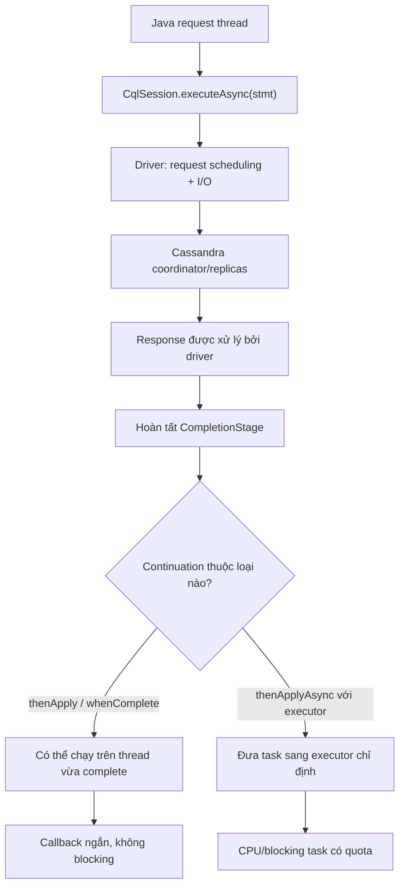
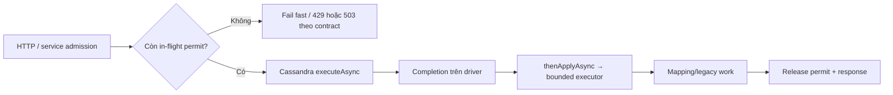
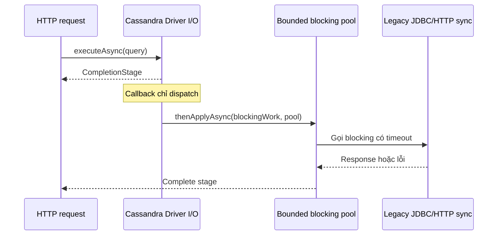
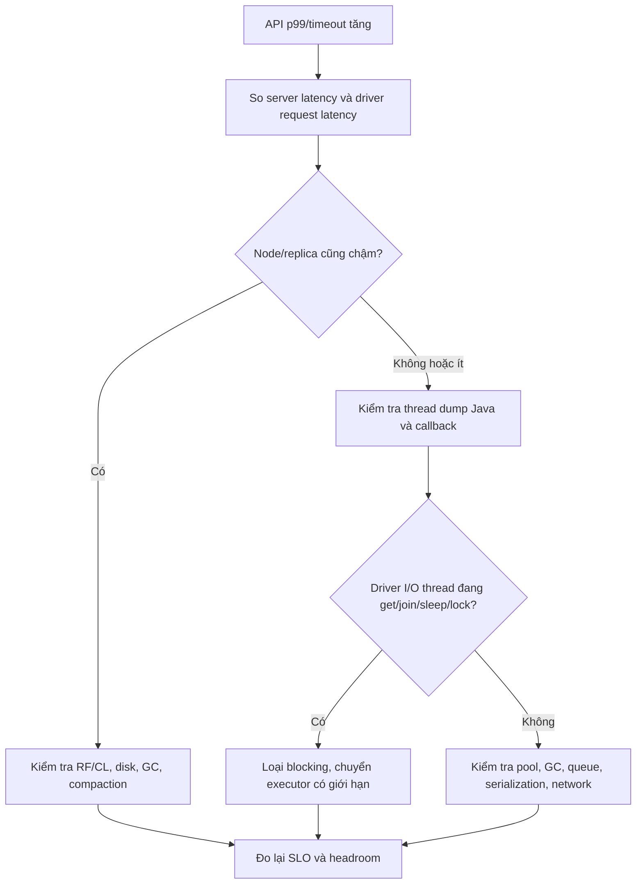

# Callback trên luồng driver và giới hạn gọi thao tác chặn trong Apache Cassandra

## 1. Bài toán: `executeAsync` không đồng nghĩa mọi bước đều không chặn

Apache Cassandra là cơ sở dữ liệu **wide-column phân tán**. Truy vấn CQL của ứng dụng Java được gửi đến **coordinator**, xử lý trên các replica theo **partition key** và **replication factor (RF)**, rồi trả kết quả theo **consistency level (CL)**. Một hệ thống có nhiều request đang chờ mạng/disk thường hưởng lợi từ I/O bất đồng bộ.

Java Driver 4.x cung cấp `CqlSession.executeAsync(...)` và `CompletionStage<AsyncResultSet>`. Nhưng xét đoạn code:

```java
session.executeAsync(statement)
    .thenApply(result -> {
        // BAD: callback có thể chạy trên thread hoàn tất của driver.
        try {
            Thread.sleep(200);
        } catch (InterruptedException e) {
            Thread.currentThread().interrupt();
            throw new IllegalStateException(e);
        }
        return result.hasMorePages();
    });
```

Lời gọi Cassandra bất đồng bộ **không bảo đảm callback bên trong sẽ chạy trên một thread chuyên biệt dành cho xử lý lâu**. Các continuation dạng `thenApply`/`thenCompose`/`whenComplete` có thể chạy ngay trên **thread hoàn tất future**, bao gồm một thread I/O/event loop của driver. Nếu callback ngủ, chờ mạng, chờ lock hoặc xử lý CPU nặng, nó có thể làm trễ việc xử lý những response khác cùng dùng tài nguyên đó.

**Mục tiêu của bài:** biết callback nào có thể chạy trên luồng driver, tránh thao tác chặn trên đường hoàn tất I/O, chuyển công việc nặng sang executor được giới hạn, phối hợp với reactive backpressure và đánh giá hệ quả lên p95/p99, timeout và retry.

> Quy tắc ngắn: **Callback chạy trên đường I/O phải ngắn, không chặn và có giới hạn công việc.** Nếu cần blocking, phải cô lập trong một executor có giới hạn, ngân sách thời gian và cơ chế từ chối khi quá tải.

### Bạn sẽ thực hành được

1. Phân biệt `execute`, `executeAsync`, `executeReactive` và mô hình paging.
2. Hiểu `thenApply`, `thenApplyAsync`, `thenCompose`, `whenComplete` và ngữ cảnh thread.
3. Phát hiện các lệnh gây chặn: `get`/`join`, `Thread.sleep`, JDBC, HTTP sync, file I/O, lock và xử lý nặng.
4. Dùng `thenCompose` cho chuỗi tác vụ **asynchronous thực sự**, không `join` bên trong callback.
5. Cách ly blocking/CPU work bằng executor riêng, semaphore/bulkhead và bounded queue.
6. Giữ **backpressure, cancellation, timeout và error propagation** trong pipeline reactive.
7. Dùng CQL, Java Driver 4.x và ví dụ Reactor để quan sát hiện tượng và cách xử lý.

## 2. Thread model của Java Driver 4.x: hiểu đúng mức bảo đảm

Java Driver 4.x sử dụng các thành phần nội bộ phục vụ I/O, quản lý connection, metadata, request scheduling và completion. Trong các triển khai thường gặp, các luồng Netty/event loop xử lý nhiều socket và sự kiện; **một thread I/O không dành riêng cho một query**.



Đây là mô hình **khái niệm**, không phải tài liệu cam kết tên thread hoặc thuật toán scheduling của mọi bản Java Driver. Với Java `CompletableFuture`, một continuation không có hậu tố `Async` có thể chạy:

- Trên thread hoàn tất future, ví dụ một thread driver I/O.
- Trên thread **gắn continuation** nếu future đã complete từ trước.
- Trên một thread khác tham gia thực thi completion tùy trường hợp.

Vì vậy **không được viết code dựa trên giả định `thenApply` luôn chạy trên driver thread**, cũng không được giả định nó **không bao giờ** chạy trên driver thread. Điều cần bảo đảm là nó **an toàn nếu được gọi trên luồng xử lý I/O**.

### Luồng của driver không phải thread phục vụ mọi công việc ứng dụng

Một driver event loop có thể xử lý response từ nhiều request. Nếu callback giữ nó quá lâu:

1. Response của các query khác chậm được xử lý.
2. Latency client tăng dù database server có thể đã xử lý xong.
3. Request timeout, reconnect hoặc retry có thể tăng.
4. Driver và application tiếp tục dồn việc, làm tình trạng xấu hơn.

Không nhầm **luồng driver của ứng dụng Java** với thread của **node Cassandra server**. Chặn callback có thể gây timeout từ phía client ngay cả khi `nodetool status` vẫn hiển thị các node `UN` và không có lỗi replication.

## 3. `execute`, `executeAsync` và reactive khác nhau ra sao?

| API | Mô hình kết quả | Điểm cần chú ý |
| --- | --- | --- |
| `session.execute(stmt)` | `ResultSet` đồng bộ | Thread caller chờ kết quả; iteration có thể auto-fetch page |
| `session.executeAsync(stmt)` | `CompletionStage<AsyncResultSet>` | Request không buộc caller chờ; callback có thể chạy trên thread hoàn tất |
| `asyncResultSet.currentPage()` | Hàng thuộc page đã nhận | Duyệt page hiện tại, không tự fetch tất cả page |
| `asyncResultSet.fetchNextPage()` | `CompletionStage<AsyncResultSet>` | Fetch tiếp bất đồng bộ, cần kiểm soát demand |
| `session.executeReactive(stmt)` | Publisher/Reactive Streams theo API phiên bản | Demand/backpressure; downstream vẫn có thể block nếu viết sai |

**Bất đồng bộ không đồng nghĩa song song vô hạn**, còn **reactive không tự bảo đảm không có blocking**. Một đoạn `Flux.map(row -> legacyJdbcCall(row))` vẫn block thread nào thực thi operator đó nếu không chuyển scheduler đúng cách.

### So sánh ba cách xử lý một truy vấn

```java
// 1. Đồng bộ: caller chờ.
ResultSet result = session.execute(statement);

// 2. Bất đồng bộ: caller lấy CompletionStage.
CompletionStage<AsyncResultSet> stage =
    session.executeAsync(statement);

// 3. Callback phải được thiết kế riêng:
CompletionStage<Integer> counts =
    stage.thenApply(rs -> countCurrentPageQuickly(rs));
```

Các biến/method trong đoạn này chỉ minh họa cấu trúc. `thenApply` cuối **chỉ nên làm thao tác nhỏ**, không gọi DB khác hoặc chuyển hàng trăm MB sang JSON ngay trong callback.

## 4. Bảng nhận diện thao tác chặn trong callback

| Thao tác bên trong callback | Rủi ro | Hướng thay thế |
| --- | --- | --- |
| `future.get()` hoặc `join()` | Thread chờ một future khác, có thể kẹt pipeline hoặc tạo starvation | `thenCompose` hoặc kết hợp future không chặn |
| `session.execute(...)` | Gọi CQL đồng bộ, chờ mạng/server | `session.executeAsync(...)` kết hợp `thenCompose` |
| `Thread.sleep(...)` | Chiếm thread dù không thực hiện công việc hữu ích | Scheduler/timer ngoài driver, deadline/backoff không chặn |
| HTTP client đồng bộ, JDBC, RPC sync | Chờ I/O có thể kéo dài | Client async thực sự, hoặc offload sang pool chuyên dụng |
| `Files.readAllBytes`, ghi file, gọi object storage sync | I/O chặn và bộ nhớ có thể tăng mạnh | Async API hoặc worker executor có giới hạn |
| JSON serialize/hash/zip hàng MB | CPU và allocation lớn | Executor CPU riêng, giới hạn payload |
| `synchronized` / chờ lock | Blocking gián tiếp do contention | Giảm phạm vi lock, actor/queue hoặc async coordination |
| Gọi logging/tracing sync rất nặng | Chặn I/O/lock phía logger/appender | Log nhỏ, async transport và rate limit |
| `ResultSet` sync iteration lấy toàn bộ | Có thể tự fetch page mới/chờ network | `AsyncResultSet.currentPage()` và `fetchNextPage` |
| `Mono.block()` trong reactive pipeline | Bỏ lợi ích không chặn; đôi khi bị runtime cấm | `flatMap`/`Mono`/`Flux` composition |

**Không phải mọi thao tác đọc trường từ `Row` đều nguy hiểm.** Ví dụ `row.getUuid("event_id")` hoặc tạo DTO nhỏ thường đủ nhanh. Ranh giới là **thời gian CPU, khả năng chờ, số hàng và phân bổ bộ nhớ**, không phải việc “đây là Java code”.

### Cẩn trọng với việc gọi code thư viện

Một method tên `format(...)` hoặc `enrich(...)` có thể:

- Đọc file cấu hình nếu chưa cache.
- Gọi HTTP/JDBC bên dưới.
- Khởi tạo kết nối hoặc lock lần đầu.
- Chạy reflection/serialization trên object lớn.
- Tạo log đồng bộ.

Vì vậy review callback phải theo **call graph**, không chỉ nhìn một dòng lambda rồi kết luận “không có `sleep` là an toàn”.

## 5. Anti-pattern: chờ kết quả khác ngay trong `thenApply`

Ví dụ cần lấy sự kiện, rồi lấy thông tin chi tiết một event. Đoạn sau **sai về mặt scheduling**:

```java
CompletionStage<String> bad = session.executeAsync(findEvent)
    .thenApply(firstResult -> {
        UUID eventId = firstResult.currentPage()
            .iterator().next().getUuid("event_id");

        // BAD: Blocking ngay trong callback, có thể chạy trên I/O thread.
        AsyncResultSet second = session.executeAsync(
            findDetails.bind(eventId)
        ).toCompletableFuture().join();

        return second.currentPage()
            .iterator().next().getString("details");
    });
```

Rủi ro:

1. Callback đang chiếm thread xử lý completion của request đầu.
2. Request thứ hai cần driver xử lý mạng/completion, trong khi callback **đang chờ**.
3. Nếu nhiều request cùng làm như vậy, I/O threads hoặc resources phục vụ completion có thể bị bão hòa.
4. `join` không tự đặt deadline của request tổng và có thể che nguồn exception trong `CompletionException`.

Đây không phải khẳng định mọi trường hợp đều deadlock; **starvation và p99 regression** đã đủ để cấm pattern này trên đường driver I/O.

### Sửa đúng bằng `thenCompose`

```java
CompletionStage<String> good = session.executeAsync(findEvent)
    .thenCompose(firstResult -> {
        Row first = firstResult.currentPage().iterator().next();
        UUID eventId = first.getUuid("event_id");

        // Trả một future khác, KHÔNG chờ đồng bộ tại đây.
        return session.executeAsync(findDetails.bind(eventId));
    })
    .thenApply(secondResult -> {
        Row row = secondResult.currentPage().iterator().next();
        return row.getString("details"); // Xử lý nhỏ, không blocking.
    });
```

`thenCompose` **flatten** `CompletionStage<CompletionStage<T>>` thành một stage có thể tiếp tục bất đồng bộ. Nó **không tự chuyển callback sang worker executor**, nhưng giúp bỏ chờ đồng bộ. Các bước đọc một row/định danh nhỏ còn có thể chạy trên thread hoàn tất; thao tác lâu vẫn phải offload.

### Điều kiện trước khi dùng ví dụ

Hai truy vấn `findEvent` và `findDetails` là prepared statements giả định; production phải xử lý trường hợp page rỗng, timeout, authorization và query theo partition key. Dùng `iterator().next()` mà không kiểm tra emptiness chỉ để làm nổi bật vấn đề thread, **không phải mẫu repository production hoàn chỉnh**.

## 6. `thenApply` và `thenApplyAsync` không khác nhau chỉ ở tên

Các continuations của `CompletableFuture` có ngữ nghĩa thread khác nhau:

| API | Cách callback thường được scheduling | Khi nào phù hợp |
| --- | --- | --- |
| `thenApply(fn)` | Thread hoàn tất stage hoặc thread gắn callback nếu đã hoàn tất | Mapping rất ngắn, không chặn |
| `thenCompose(fn)` | Có thể chạy trên thread hoàn tất stage; fn trả stage khác | Chuỗi async I/O thật sự, không `join` |
| `whenComplete(fn)` | Có thể chạy trên thread hoàn tất; giữ nguyên success/failure | Telemetry/cleanup nhẹ, không chặn |
| `handle(fn)`, `exceptionally(fn)` | Có thể chạy đồng bộ trên completion path | Phân loại lỗi nhanh; tránh I/O nặng |
| `thenApplyAsync(fn)` | Nếu không chỉ định executor, dùng **default async executor** của CompletableFuture, thường là common pool | Không dùng mặc định để cô lập blocking production |
| `thenApplyAsync(fn, executor)` | Callback được gửi tới **executor được chỉ định** | CPU xử lý nặng hoặc legacy blocking đã giới hạn |
| `thenComposeAsync(fn, executor)` | Phần callback được scheduling trên executor chỉ định | Khi chính bước tạo composition có công việc cần offload |

Không suy ra `thenComposeAsync` làm cho **mọi I/O nằm trong future tiếp theo** chạy trên executor đó: future được trả về có vòng đời và thread completion của nó.

### Vì sao không dùng `thenApplyAsync` không có executor cho mọi thứ?

Trong nhiều JVM, `CompletableFuture.thenApplyAsync(...)` không truyền executor dùng `ForkJoinPool.commonPool()`. Pool này là tài nguyên dùng chung với những tác vụ bất đồng bộ khác. Nếu đem nhiều thao tác blocking vào đó:

- Có thể làm chậm các tác vụ không liên quan.
- Số lượng việc xếp hàng/độ trễ khó được áp hạn riêng cho mỗi endpoint.
- Không có quota rõ cho Cassandra-result mapping.
- Khó theo dõi khi một loại callback chiếm hết worker.

**Đổi từ driver I/O thread sang common pool không tự động giải quyết overload.** Cần một executor rõ owner, giới hạn thread/queue/in-flight và thời gian xử lý.

## 7. Offload đúng: executor có giới hạn và bulkhead



Một thiết kế executor:

- **Fixed-size thread pool** phù hợp CPU và số lượng blocking calls.
- **Bounded queue**, không tạo queue vô hạn.
- **Bulkhead/semaphore** giới hạn số logical operations đang vào pipeline.
- **Explicit rejection policy**: khi đầy, từ chối có đo đạc thay vì âm thầm chạy trên thread không mong muốn.
- **Graceful shutdown**: ngừng nhận request, chờ những task hợp lệ rồi đóng executor.
- **Timeout/deadline**: request không được giữ tài nguyên vô hạn.

### Cảnh báo đặc biệt với `CallerRunsPolicy`

`ThreadPoolExecutor.CallerRunsPolicy` có thể chạy task ngay trên thread **gọi `execute(...)` khi queue đầy**. Nếu lời gọi `thenApplyAsync(..., executor)` được scheduling từ driver I/O completion thread, policy này có nguy cơ **đẩy công việc blocking trở lại chính driver thread**.

Vì vậy **không dùng `CallerRunsPolicy` như giải pháp “tự backpressure”** cho executor phục vụ callback Cassandra. Ưu tiên admission có giới hạn và một chính sách từ chối rõ ràng; test cả đường rejection thay vì chỉ test khi cluster nhẹ tải.

### Offload không tự tạo thêm capacity

Nếu 500 request đồng thời cần mỗi request một lệnh JDBC đồng bộ mất 200 ms, executor 8 threads không thể biến chúng thành 500 yêu cầu xử lý ngay lập tức. Nó chỉ cô lập driver I/O khỏi blocking. Vẫn cần:

- Giảm concurrency.
- Giới hạn queue và deadline.
- Dùng client async cho downstream nếu có thể.
- Kiểm tra database/JDBC pool limit bên dưới.
- Từ chối/shed load khi không đủ headroom.

## 8. CQL lab: bảng dữ liệu theo partition key để thử async

Ví dụ lab cô lập có DC tên `dc1` và đủ ba node cho RF3. Nếu lab một node, hãy chỉnh RF/CL theo thực tế; đừng biến `Unavailable` do thiếu replica thành chẩn đoán sai cho callback.

```sql
CREATE KEYSPACE IF NOT EXISTS async_lab
WITH replication = {
    'class': 'NetworkTopologyStrategy',
    'dc1': 3
}
AND durable_writes = true;

CREATE TABLE IF NOT EXISTS async_lab.events_by_tenant_day (
    tenant_id text,
    event_day date,
    occurred_at timestamp,
    event_id uuid,
    event_type text,
    payload text,
    PRIMARY KEY ((tenant_id, event_day), occurred_at, event_id)
) WITH CLUSTERING ORDER BY (
    occurred_at DESC,
    event_id ASC
);
```

Partition key `(tenant_id, event_day)` gom dữ liệu theo tenant/ngày; clustering `occurred_at DESC` ưu tiên sự kiện gần nhất trong partition. Nếu mỗi tenant có khối lượng cực lớn, phải xem kích thước partition và bucket nhỏ hơn; **paging hoặc executeAsync không giải quyết một partition quá nóng/quá lớn**.

### Nạp dữ liệu mẫu

```sql
INSERT INTO async_lab.events_by_tenant_day (
    tenant_id, event_day, occurred_at, event_id, event_type, payload
) VALUES (
    'tenant-01', '2026-11-20',
    '2026-11-20T10:00:00Z',
    11111111-1111-4111-8111-111111111111,
    'OPEN', 'event-1'
);

INSERT INTO async_lab.events_by_tenant_day (
    tenant_id, event_day, occurred_at, event_id, event_type, payload
) VALUES (
    'tenant-01', '2026-11-20',
    '2026-11-20T09:00:00Z',
    22222222-2222-4222-8222-222222222222,
    'CLICK', 'event-2'
);

INSERT INTO async_lab.events_by_tenant_day (
    tenant_id, event_day, occurred_at, event_id, event_type, payload
) VALUES (
    'tenant-01', '2026-11-20',
    '2026-11-20T08:00:00Z',
    33333333-3333-4333-8333-333333333333,
    'CLOSE', 'event-3'
);
```

Trong `cqlsh`:

```text
CONSISTENCY LOCAL_QUORUM;
```

Kiểm tra truy vấn:

```sql
SELECT occurred_at, event_id, event_type, payload
FROM async_lab.events_by_tenant_day
WHERE tenant_id = 'tenant-01'
  AND event_day = '2026-11-20'
LIMIT 100;
```

Không cần `ALLOW FILTERING` vì đã có đủ partition key. **`LIMIT 100` giới hạn tổng hàng của query logic; `setPageSize(20)` điều tiết kích thước trang, không tạo giới hạn đồng thời cho API.**

## 9. Code mẫu Java: callback nhỏ và chain không chặn

Repository sau dùng Java Driver 4.x và chuẩn bị query một lần. Ứng dụng truyền vào `CqlSession` đã cấu hình contact points, local DC, auth/TLS, timeout và lifecycle bên ngoài:

```java
import java.time.LocalDate;
import java.util.UUID;
import java.util.concurrent.CompletionStage;

import com.datastax.oss.driver.api.core.CqlSession;
import com.datastax.oss.driver.api.core.DefaultConsistencyLevel;
import com.datastax.oss.driver.api.core.cql.AsyncResultSet;
import com.datastax.oss.driver.api.core.cql.BoundStatement;
import com.datastax.oss.driver.api.core.cql.PreparedStatement;
import com.datastax.oss.driver.api.core.cql.Row;

public final class AsyncEventRepository {
    private final CqlSession session;
    private final PreparedStatement select;

    public AsyncEventRepository(CqlSession session) {
        this.session = session;
        this.select = session.prepare(
            "SELECT occurred_at, event_id, event_type, payload " +
            "FROM async_lab.events_by_tenant_day " +
            "WHERE tenant_id = ? AND event_day = ? LIMIT 100"
        );
    }

    public CompletionStage<Integer> countFirstPage(
            String tenantId, LocalDate day) {
        BoundStatement statement = select.bind(tenantId, day)
            .setConsistencyLevel(DefaultConsistencyLevel.LOCAL_QUORUM)
            .setPageSize(20)
            .setIdempotent(true);

        return session.executeAsync(statement).thenApply(rs -> {
            // Chỉ đọc page hiện tại; không truy cập mạng khác,
            // không sleep/get/join hoặc serialize object lớn.
            int count = 0;
            for (Row ignored : rs.currentPage()) {
                count++;
            }
            return count;
        });
    }

    public CompletionStage<Integer> countFirstTwoPages(
            String tenantId, LocalDate day) {
        BoundStatement statement = select.bind(tenantId, day)
            .setConsistencyLevel(DefaultConsistencyLevel.LOCAL_QUORUM)
            .setPageSize(20)
            .setIdempotent(true);

        return session.executeAsync(statement).thenCompose(first -> {
            int firstCount = countPage(first);
            if (!first.hasMorePages()) {
                return java.util.concurrent.CompletableFuture
                    .completedFuture(firstCount);
            }
            return first.fetchNextPage().thenApply(second ->
                firstCount + countPage(second));
        });
    }

    private static int countPage(AsyncResultSet result) {
        int count = 0;
        for (Row ignored : result.currentPage()) {
            count++;
        }
        return count;
    }
}
```

Điểm đáng chú ý:

1. `thenApply` chỉ đếm tối đa các hàng đã có của page; không chờ network và không đọc toàn bộ dataset.
2. `thenCompose` trả stage của `fetchNextPage()`; **không gọi `join()`** để lấy trang hai.
3. `setIdempotent(true)` là phù hợp cho `SELECT` thuần đọc, nhưng **không** tự áp dụng cho counter/list append/LWT có retry.
4. `pageSize=20` là mục tiêu fetch, không bảo đảm mọi page có đúng 20 hàng.
5. Lỗi ở truy vấn/page sau sẽ đi tới **exceptional completion** của stage kết quả.

Mẫu này chỉ đếm **tối đa hai page**, không tính toàn bộ query. Nếu phải quét nhiều page cho batch, cần một vòng lặp bất đồng bộ có giới hạn số trang/bytes/time, khả năng hủy và backpressure.

## 10. Code mẫu Java đầy đủ: giới hạn executor và số request in-flight

Ví dụ dưới đây mô phỏng service cần mapping một page sang DTO với chi phí có thể tăng theo business logic. Để không chuyển mapping nặng sang driver I/O thread, dùng `thenApplyAsync(..., mappingPool)` với **pool và queue có giới hạn**.

```java
import java.time.Instant;
import java.time.LocalDate;
import java.util.ArrayList;
import java.util.Collections;
import java.util.List;
import java.util.UUID;
import java.util.concurrent.ArrayBlockingQueue;
import java.util.concurrent.CompletableFuture;
import java.util.concurrent.CompletionStage;
import java.util.concurrent.RejectedExecutionException;
import java.util.concurrent.Semaphore;
import java.util.concurrent.ThreadFactory;
import java.util.concurrent.ThreadPoolExecutor;
import java.util.concurrent.TimeUnit;
import java.util.concurrent.atomic.AtomicInteger;

import com.datastax.oss.driver.api.core.CqlSession;
import com.datastax.oss.driver.api.core.DefaultConsistencyLevel;
import com.datastax.oss.driver.api.core.cql.AsyncResultSet;
import com.datastax.oss.driver.api.core.cql.BoundStatement;
import com.datastax.oss.driver.api.core.cql.PagingState;
import com.datastax.oss.driver.api.core.cql.PreparedStatement;
import com.datastax.oss.driver.api.core.cql.Row;

public final class BoundedEventPageService {
    private static final int PAGE_SIZE = 20;

    private final CqlSession session;
    private final PreparedStatement select;
    private final Semaphore inFlight = new Semaphore(64);
    private final ThreadPoolExecutor mappingPool;

    public BoundedEventPageService(CqlSession session) {
        this.session = session;
        this.select = session.prepare(
            "SELECT occurred_at, event_id, event_type, payload " +
            "FROM async_lab.events_by_tenant_day " +
            "WHERE tenant_id = ? AND event_day = ? LIMIT 100"
        );

        AtomicInteger nextId = new AtomicInteger();
        ThreadFactory threads = task -> {
            Thread thread = new Thread(
                task, "cassandra-page-mapper-" +
                nextId.incrementAndGet());
            thread.setDaemon(true);
            return thread;
        };

        mappingPool = new ThreadPoolExecutor(
            4, 4, 0L, TimeUnit.MILLISECONDS,
            new ArrayBlockingQueue<Runnable>(64),
            threads,
            new ThreadPoolExecutor.AbortPolicy()
        );
    }

    public CompletionStage<Page> readPage(
            String authorizedTenant, LocalDate day) {
        if (!inFlight.tryAcquire()) {
            CompletableFuture<Page> denied = new CompletableFuture<>();
            denied.completeExceptionally(new RejectedExecutionException(
                "Read concurrency budget exhausted"));
            return denied;
        }

        try {
            BoundStatement statement = select.bind(
                    authorizedTenant, day)
                .setConsistencyLevel(DefaultConsistencyLevel.LOCAL_QUORUM)
                .setPageSize(PAGE_SIZE)
                .setIdempotent(true);

            return session.executeAsync(statement)
                .thenApplyAsync(this::mapPage, mappingPool)
                .whenComplete((page, error) -> inFlight.release());
        } catch (RuntimeException failure) {
            inFlight.release();
            throw failure;
        }
    }

    private Page mapPage(AsyncResultSet result) {
        List<EventItem> items = new ArrayList<>();
        for (Row row : result.currentPage()) {
            items.add(new EventItem(
                row.getInstant("occurred_at"),
                row.getUuid("event_id"),
                row.getString("event_type"),
                row.getString("payload")
            ));
        }

        String next = null;
        if (result.hasMorePages()) {
            PagingState state =
                result.getExecutionInfo().getSafePagingState();
            if (state == null) {
                throw new IllegalStateException(
                    "Missing paging state for next page");
            }
            next = state.toString();
        }
        return new Page(items, next);
    }

    public void closeMappingPool() {
        // Gọi khi service đã ngừng nhận request; chờ hoàn tất
        // những task còn lại theo shutdown deadline của ứng dụng.
        mappingPool.shutdown();
    }

    public static final class EventItem {
        public final Instant occurredAt;
        public final UUID eventId;
        public final String type;
        public final String payload;

        public EventItem(
                Instant occurredAt, UUID eventId,
                String type, String payload) {
            this.occurredAt = occurredAt;
            this.eventId = eventId;
            this.type = type;
            this.payload = payload;
        }
    }

    public static final class Page {
        public final List<EventItem> items;
        public final String nextPagingState;

        public Page(List<EventItem> items, String nextPagingState) {
            this.items = Collections.unmodifiableList(
                new ArrayList<>(items));
            this.nextPagingState = nextPagingState;
        }
    }
}
```

### Vì sao cách này tốt hơn một pool không giới hạn?

- `Semaphore(64)` giới hạn số logical `readPage` đã được nhận, **gồm cả thời gian chờ Cassandra và thời gian mapping**.
- `ThreadPoolExecutor(4,4,...)` giới hạn số mapping tasks có thể chạy đồng thời.
- `ArrayBlockingQueue(64)` tránh queue vô hạn; `AbortPolicy` không fallback sang thread I/O khi đầy.
- `thenApplyAsync` tạo ranh giới scheduling tường minh.
- `whenComplete` chỉ giải phóng permit, là callback rất ngắn.
- `closeMappingPool` có lifecycle riêng; không đóng executor khi request vẫn còn đang phục vụ.

Đây là **mẫu học tập**, không phải framework production hoàn chỉnh. Production cần test lỗi **executor rejection**, shutdown race, cancellation, timeout, backpressure, metrics và phép ánh xạ lỗi khi `CompletableFuture` bị complete exceptionally. Nếu mapping pool dùng chung với task khác, admission không còn là bảo đảm queue sẽ luôn đủ.

### Hạn chế của ví dụ: không dùng raw paging state như REST token

`Page.nextPagingState` chỉ phù hợp để minh họa **repository-level**. Nếu trả cursor qua HTTP, phải xác thực tenant/query/role, có version/TTL, mã hóa hoặc ký bảo vệ và bind lại với **cùng CQL + tham số gốc**. `PagingState` không phải authorization token hay snapshot dữ liệu.

### Giới hạn theo tài nguyên thực, không chọn số 64 một cách máy móc

Số thread, queue và permit phải được chọn từ latency, throughput, kích thước page, quota CPU/memory và số node/connection. Nếu mỗi mapping task mất 200 ms, 4 threads chỉ xử lý một số lượng tác vụ hữu hạn mỗi giây; queue 64 có thể tạo **thời gian chờ dài** thay vì giúp hệ thống nhanh hơn.

Thực hành production nên đo **executor active count, queue depth, rejected count, in-flight permit, queue wait time và end-to-end p99**; thay vì tăng các con số tới khi hết bộ nhớ.

## 11. Khi cần tác vụ chặn thực sự: khoanh vùng và kiểm soát

Không phải lúc nào cũng có async SDK. Một service có thể phải gọi JDBC legacy, SDK cloud đồng bộ hoặc thư viện PDF/zip.

Thiết kế:



### Điều kiện tối thiểu cho một blocking call đã offload

1. **Timeout tại chính blocking library**: một JDBC/HTTP sync call có thể treo dù outer `CompletionStage` đã timeout.
2. **Pool riêng theo dependency/loại việc**: một API legacy chậm không lấy hết worker của mapping cần thiết cho các endpoint khác.
3. **Bounded concurrency và queue**: không tích lũy vô hạn request khi downstream down.
4. **Circuit breaking/fail fast** khi dependency liên tục lỗi, không làm toàn JVM bận chờ.
5. **Không giữ lock Cassandra state** khi gọi blocking library.
6. **Cancellation và deadline** phải được truyền khi dependency hỗ trợ.
7. **Metrics** riêng cho queue wait và blocking duration.

Nếu blocking dependency là nút nghẽn, giải pháp lâu dài có thể là chuyển sang client async hoặc tách workflow qua queue/event. Offload chỉ làm **cô lập rủi ro**; nó không biến một lời gọi chặn thành lời gọi không chặn.

## 12. Reactive Streams: backpressure không thay thế tránh blocking

Java Driver 4.x cung cấp API reactive theo **Reactive Streams**; ứng dụng có thể dùng publisher từ `session.executeReactive(statement)` và tích hợp với Reactor/RxJava theo các thư viện/phụ thuộc tương thích.

Trong reactive pipeline:

- **Publisher** phát dữ liệu.
- **Subscriber** có thể yêu cầu thêm dữ liệu bằng demand `request(n)`.
- Các toán tử `map`, `filter`, `flatMap` có thể chạy trên thread phát upstream nếu không có ranh giới scheduler.
- **Backpressure** giới hạn nhu cầu downstream, nhưng không tự làm cho `map` chứa JDBC hoặc `Thread.sleep` trở nên không chặn.
- Prefetch, buffer và page fetching phụ thuộc cách connector/operator/driver triển khai; **không suy từ `request(1)` rằng mọi tài nguyên upstream chỉ giữ đúng một row**.

### Ví dụ sai: blocking trực tiếp trong `map`

```java
Flux<String> bad =
    Flux.from(session.executeReactive(statement))
        .map(row -> legacyClient.lookupSync(
            row.getUuid("event_id")
        ));
```

Ở đây `legacyClient.lookupSync` là một dependency đồng bộ giả định. Nếu operator chạy ngay trên thread liên quan driver I/O, nó có thể chặn đường phát các sự kiện tiếp theo.

### Ví dụ đúng hướng: offload từng việc có giới hạn

```java
import java.util.UUID;

import reactor.core.publisher.Flux;
import reactor.core.publisher.Mono;
import reactor.core.scheduler.Scheduler;
import reactor.core.scheduler.Schedulers;

// Tạo scheduler ở startup; quản lý dispose ở shutdown.
Scheduler blockingScheduler =
    Schedulers.newBoundedElastic(
        8, 100, "legacy-lookup");

Flux<String> enriched =
    Flux.from(session.executeReactive(statement))
        .flatMap(row -> {
            UUID eventId = row.getUuid("event_id");
            return Mono.fromCallable(
                () -> legacyClient.lookupSync(eventId)
            ).subscribeOn(blockingScheduler);
        }, 8); // Tối đa 8 lookup đang được yêu cầu bởi flatMap.
```

Ví dụ Reactor yêu cầu dependency Reactor tương thích và `legacyClient` giả định tồn tại. `Schedulers.newBoundedElastic(...)` có giới hạn worker/queue, còn `flatMap(..., 8)` giới hạn concurrency của giai đoạn enrichment trong subscription này. Trong nhiều subscriptions đồng thời, vẫn cần **quota toàn service** và giới hạn downstream. Không lấy 8 làm giá trị production mặc định.

`subscribeOn` bên trong `Mono.fromCallable` giúp chuyển **blocking work** sang scheduler đó. Nếu muốn chuyển toàn bộ đoạn downstream CPU work sang scheduler khác, có thể dùng `publishOn` với prefetch phù hợp; phải hiểu ranh giới operator và đo bộ nhớ.

### Điều cần tránh

- `Flux.from(publisher).collectList()` với một dataset không giới hạn có thể gom mọi row vào bộ nhớ.
- `flux.blockLast()` hoặc `mono.block()` trên event loop/reactive thread tạo blocking và có thể gây lỗi runtime.
- `flux.subscribe(...)` rồi quên xử lý error/cancellation khiến công việc “fire-and-forget” không được quản lý.
- `flatMap` concurrency không giới hạn kết hợp driver request lớn có thể gây CPU/GC/queue overload.
- `onErrorResume` trả danh sách rỗng cho mọi lỗi có thể che `Unavailable`/timeout thật.

Reactive API có giá trị khi **đường dữ liệu end-to-end xử lý demand và lỗi rõ ràng**; không chỉ thay `executeAsync` bằng một publisher rồi gọi là backpressure.

## 13. `publishOn`, `subscribeOn` và sự khác biệt quan trọng

Trong Reactor:

| Toán tử | Ý nghĩa chính | Lỗi hay gặp |
| --- | --- | --- |
| `map(fn)` | Biến đổi đồng bộ trên thread đang thực thi operator | Đưa blocking I/O vào `fn` |
| `flatMap(fn, concurrency)` | Ghép các publisher con có thể xử lý đồng thời | Không giới hạn concurrency hoặc không giữ thứ tự khi nghiệp vụ cần |
| `concatMap(fn)` | Tuân theo thứ tự, xử lý tuần tự tùy operator/prefetch | Chậm khi một thao tác blocking treo |
| `subscribeOn(scheduler)` | Ảnh hưởng thread cho subscription và nguồn được bao | Đặt sai chỗ và nghĩ mọi callback tự chuyển |
| `publishOn(scheduler)` | Chuyển execution context của các toán tử phía sau | Đặt **sau** một `map` blocking nên quá muộn |
| `onBackpressureBuffer` | Đệm dữ liệu khi downstream chậm | Dùng buffer không giới hạn thay vì thực sự kiểm soát tải |
| `limitRate(n)` | Điều chỉnh demand request vào upstream | Không phải giới hạn concurrency của mọi HTTP/JDBC call |
| `timeout(...)` | Báo deadline tại tầng reactive | Không bảo đảm thao tác server đã bị rollback hoặc blocking call bị hủy |

Một `publishOn` có thể phát huy tác dụng khi đặt **trước** đoạn mapping CPU nặng, nhưng chuyển nhiều hàng vào queue cũng tiêu tốn bộ nhớ. Với blocking I/O cho mỗi row, dùng một publisher con như `Mono.fromCallable(...).subscribeOn(boundedScheduler)` thường làm ranh giới rõ hơn.

**Thứ tự kết quả:** `flatMap` có thể trả item không cùng thứ tự phát upstream. Nếu API cần clustering order Cassandra, phải dùng operator giữ thứ tự hoặc gắn sequence key, không đánh đổi tính đúng đắn lấy concurrency mà không có chính sách merge.

## 14. Cancellation và timeout: dừng chờ không đồng nghĩa “chưa ghi”

Với query đọc, hủy subscriber hoặc future có thể giúp ngừng quan tâm tới kết quả. Nhưng với mutation CQL, có thể Cassandra **đã áp dụng ghi** trước khi client thấy timeout/cancel.

```text
T0  Java gọi executeAsync(UPDATE ...)
T1  Coordinator gửi mutation tới replica
T2  HTTP caller hủy request
T3  Client cancel stage / reactive subscription
T4  Replica có thể đã ghi dữ liệu trước hoặc sau T2
```

**Cancellation không phải rollback.** Nếu mutation không idempotent như counter increment, list append, TTL có hiệu ứng thời gian hoặc LWT, không gửi lại mù chỉ vì subscriber đã cancel.

### Phân biệt ba deadline

1. **Driver request timeout:** thời hạn xử lý của request trong driver.
2. **HTTP/request deadline:** tổng thời gian caller chấp nhận chờ.
3. **Downstream blocking timeout:** thời hạn của JDBC/HTTP/file operation chạy trong pool.

Một deadline ngắn ở tầng ngoài không tự rút ngắn được một lời gọi đồng bộ đang bị treo. Cần timeout tại dependency hoặc cancellation được hỗ trợ thực sự.

### Retry có thể làm vấn đề tệ hơn

Khi callback chặn driver I/O:

- Responses có thể bị xử lý trễ, khiến driver thấy timeout.
- Một retry tạo thêm request đến Cassandra.
- CL `LOCAL_QUORUM` vẫn cần đủ replica, không được đổi xuống `ONE` chỉ để giảm lỗi biểu hiện.
- Retry hoặc speculative execution sai có thể nhân đôi tải; với write non-idempotent còn có thể nhân đôi mutation.

Giải pháp phải đi từ **loại bỏ blocking callback và điều tiết tải**, không bắt đầu bằng tăng timeout/retry lên nhiều lần.

## 15. Xử lý exception trong chain mà không che nguồn lỗi

`CompletionStage` hoàn tất theo hai trạng thái: **thành công** hoặc **exceptional completion**. Callback `thenApply` ném exception thì stage kế tiếp thất bại; không nên bắt mọi exception và trả một kết quả “rỗng” mà không báo.

```java
CompletionStage<Page> stage =
    service.readPage(authorizedTenant, day)
        .whenComplete((page, error) -> {
            // Chỉ telemetry O(1) và không blocking.
            // Không log credential, raw partition key hoặc payload.
            metrics.recordCompleted(error == null);
        });
```

Đây là trích đoạn trong môi trường có `service`, `Page`, `metrics`, `authorizedTenant` và `day`. Phải bảo đảm `metrics.recordCompleted` thật sự nhanh/không chặn; nếu nó gửi HTTP đồng bộ thì vẫn là lỗi thiết kế.

### Các lỗi cần tách bạch

| Dấu hiệu | Tầng lỗi có thể | Cách kiểm tra |
| --- | --- | --- |
| `ReadTimeoutException` | Replica không đáp ứng read CL kịp | RF/CL, disk/GC/network, node latency |
| `WriteTimeoutException` | Write không đủ xác nhận trong deadline | Outcome có thể chưa chắc chắn; tránh retry mutation non-idempotent |
| `UnavailableException` | Không đủ replica phục vụ CL | `nodetool status`, DC/rack, RF/CL |
| `DriverTimeoutException` | Driver hết deadline request | Có thể do driver/connection/pool hoặc server chậm |
| `AllNodesFailedException` | Không node nào hoàn tất request; root cause theo node | Auth, TLS, network, pool và driver routing |
| `RejectedExecutionException` | Executor local/pipeline quá tải hoặc shutdown | Queue/permits, rejection, admission |
| `CompletionException` | Wrapper của lỗi từ CompletableFuture | Kiểm tra nguyên nhân gốc; không retry theo wrapper |
| `OutOfMemoryError`/GC cực nặng | Buffer không giới hạn/`collectList`/payload lớn | Heap, allocation, demand, page size, queue |

Tên class exception và cách driver đưa root cause vào stage phụ thuộc phiên bản; khi gặp lỗi phải kiểm tra **cause** trước khi quyết định retry. `Unavailable`/timeout không tự chứng minh callback là nguồn lỗi; cần đo cả client và server.

### Một lỗi telemetry cũng có thể phá pipeline

Nếu `whenComplete` gọi code ném exception hoặc chặn lâu, stage kết quả có thể bị ảnh hưởng/hoàn tất muộn. Telemetry nên:

- Chỉ ghi counter/timestamp nhẹ trên đường completion.
- Không serialize toàn bộ `Row` vào logs.
- Không gọi network sync dưới danh nghĩa metrics.
- Có cơ chế gom/đẩy số liệu ngoài luồng với quota.

## 16. Quan sát hiệu năng: phân biệt Cassandra chậm với callback chặn



### Bảng quan sát theo tầng

| Tầng | Metric/quan sát | Gợi ý chẩn đoán |
| --- | --- | --- |
| Java API | Logical QPS, p95/p99, cancellation, HTTP deadline | Có spike sau deploy callback không? |
| Java Driver | Request latency, timeouts, attempts, in-flight, connection pool | Requests bị giữ ở client hay server? |
| Driver threads | Thread dump, event loop blocked duration, callback stack | Có `join`/`sleep`/JDBC/lock không? |
| Mapping executor | Active threads, queue depth, rejection, queue wait | Offload có bão hòa không? |
| Reactor | Demand/prefetch, in-flight flatMap, buffer, scheduler queue | Reactive có bị unbounded buffer không? |
| Cassandra | `nodetool tpstats`, `compactionstats`, `tablestats` | Node có thật sự quá tải không? |
| JVM/OS | GC pause, heap, CPU, disk wait, network | Có bottleneck khác cùng thời điểm không? |

Trong lab hoặc incident có kiểm soát:

```bash
nodetool status
nodetool tpstats
nodetool compactionstats
nodetool tablestats async_lab.events_by_tenant_day
nodetool tablehistograms async_lab events_by_tenant_day
```

Các số liệu `nodetool` là quan sát **theo node** và không đo trực tiếp thời gian nằm trong callback Java. Nếu Cassandra p99 local ổn nhưng API p99 xấu, cần xem thread dump và executor queue trước khi chỉnh compaction hoặc tăng RF một cách vô căn cứ.

### Tín hiệu thread dump đáng lưu ý

Trong thread dump của **ứng dụng Java**, tìm các stack liên quan Netty/driver callback và:

- `CompletableFuture.join`, `CompletableFuture.get`, `LockSupport.park`.
- `Thread.sleep`.
- JDBC socket read/HTTP sync client.
- `Files` hoặc file-system call.
- Monitor contention/synchronized locks.
- Serializer/encoder CPU nặng.

**Không dựa duy nhất vào tên thread**. Tên có thể khác theo driver/runtime, và các callback đã complete có thể chạy trên caller thread; xem stack, timing và đường gọi thực tế.

## 17. Thí nghiệm hiệu năng an toàn trên lab

### Thí nghiệm A — Callback nhẹ

1. Dùng `AsyncEventRepository.countFirstPage(...)` ở mục 9.
2. Chạy tải lab vừa phải, ghi API latency và driver request latency.
3. Kiểm tra số hàng/page và không có callback blocking.
4. Làm baseline trước khi thử anti-pattern.

### Thí nghiệm B — Mô phỏng callback chặn trên lab

Trong **lab cô lập**, có thể thử callback chứa `Thread.sleep(100)` sau một query để quan sát p99 và thread dump; **không chạy trên production** và không dùng như giải pháp timeout.

```java
// CHỈ LAB: không đưa vào service thật.
return session.executeAsync(statement).thenApply(rs -> {
    try {
        Thread.sleep(100);
    } catch (InterruptedException e) {
        Thread.currentThread().interrupt();
        throw new IllegalStateException(e);
    }
    return countCurrentPage(rs);
});
```

`countCurrentPage` là helper minh họa. Kết quả có thể thay đổi theo số I/O threads, số request, cách callback được scheduling và môi trường. **Không dự đoán một tỷ lệ p99 cố định**.

### Thí nghiệm C — Offload và giữ concurrency nhỏ

1. Chuyển callback nặng sang `thenApplyAsync(..., executor)`.
2. Đặt cố định thread count, queue size và in-flight permits.
3. Chạy một dải QPS từ thấp tới cao, theo dõi queue wait/rejected.
4. Kiểm tra rằng driver I/O không còn chứa blocking stack.
5. Khi tăng QPS quá capacity, yêu cầu hệ thống **fail fast có quan sát**, không tăng queue vô hạn.

### Thí nghiệm D — Reactive demand và xử lý chậm

1. Dùng publisher `executeReactive` với subscriber demand/buffer có giới hạn.
2. So `map` có blocking với `flatMap` offload vào bounded scheduler.
3. Giữ tốc độ xuống downstream đủ chậm để thấy queue và concurrency.
4. Không dùng `collectList` cho toàn bộ dataset khi số hàng không bị giới hạn.
5. Hủy subscription và xác minh resource cleanup; không giả định cancel rollback write.

### Tiêu chí lab thành công

| Tiêu chí | Kỳ vọng |
| --- | --- |
| Callback driver | Không còn blocking I/O, `join/get` hoặc sleep |
| Request latency | Không có tail spike lớn do callback giữ I/O thread |
| Executor | Queue/active/rejection nằm trong ngưỡng đã thiết kế |
| Bounded demand | Không dùng memory tăng mãi theo số rows/pages |
| Errors | Timeout, rejection và cancellation được phân loại đúng |
| CQL correctness | Query vẫn dùng partition key, CL và paging hợp lệ |
| Shutdown | Không mất quyền kiểm soát task khi dừng service |

## 18. Những tình huống dễ mắc lỗi

### Tình huống A — `thenApply` gọi JDBC

`executeAsync` thành công; callback dùng JDBC synchronous mất 300 ms. Trong peak traffic, API p99 tăng dù node Cassandra vẫn `UN`. Lý do?

**Đáp án định hướng:** Callback có thể chạy trên driver completion/I/O thread và chặn việc xử lý nhiều response. Chuyển JDBC sang executor có giới hạn hoặc dùng JDBC/HTTP async phù hợp; quan sát thread dump và queue.

### Tình huống B — `join` một query Cassandra khác

Trong `thenApply`, developer gọi `session.executeAsync(queryB).toCompletableFuture().join()` để lấy dữ liệu thứ hai.

**Đáp án định hướng:** Chặn callback trong khi driver còn phải hoàn tất queryB, gây starvation/latency hoặc kẹt trong trường hợp xấu. Dùng `thenCompose` trả stage của queryB và mapping ngắn ở bước tiếp theo.

### Tình huống C — Dùng `thenApplyAsync` không chỉ định pool

Một đội chuyển mọi callback sang `thenApplyAsync(...)` nhưng đặt HTTP sync client bên trong; p99 của nhiều endpoint khác cũng tăng.

**Đáp án định hướng:** Tác vụ có thể đang dùng default common pool, cạnh tranh với hệ thống khác. Dùng executor chuyên dụng/bounded, timeout tại HTTP client, admission và rejection rõ ràng.

### Tình huống D — `CallerRunsPolicy` để tránh từ chối

Mapping pool đầy, `CallerRunsPolicy` tự chạy mapping ngay tại nơi submit; logs cho thấy callback nặng xuất hiện trên thread I/O.

**Đáp án định hướng:** Chính rejection policy đã chuyển công việc về thread submit, có thể là driver I/O. Thay bằng bounded admission + `AbortPolicy`/xử lý overload, không fallback blocking.

### Tình huống E — Reactive nhưng `Mono.block()`

Một API dùng Reactor nhưng gọi `block()` trong operator/handler để chờ Cassandra.

**Đáp án định hướng:** Reactive pipeline bị biến thành synchronous wait; có thể block event loop hoặc bị runtime cấm. Trả publisher/`CompletionStage` và compose async, hoặc cô lập code legacy vào scheduler phù hợp.

### Tình huống F — `collectList` trên partition rất lớn

Lấy `Flux<Row>` từ Cassandra, gọi `collectList()` rồi serialize toàn bộ để trả một HTTP response.

**Đáp án định hướng:** Backpressure không giúp nếu downstream yêu cầu gom toàn bộ. Giới hạn query/page, stream response có quota hoặc chuyển sang export job với backpressure/checkpoint.

### Tình huống G — Timeout sau cancel write

Client hủy HTTP request chứa `UPDATE counter = counter + 1`. Service kết luận “đã cancel nên chưa ghi” rồi gửi lại.

**Đáp án định hướng:** Cancel không rollback mutation trên replica. Outcome có thể UNKNOWN; không retry counter mù, cần operation ID/event log hoặc quy trình đối soát.

### Tình huống H — Offload nhưng queue vô hạn

Driver I/O đã không còn blocked, nhưng mapping executor có queue vô hạn; ở peak, hàng nghìn page bị giữ và JVM OOM.

**Đáp án định hướng:** Offload chỉ chuyển vị trí nghẽn. Đặt quota in-flight, bounded queue, deadline/rejection, giảm payload và kiểm soát downstream.

### Tình huống I — `flatMap` làm đảo thứ tự

Reactive pipeline làm enrichment song song với `flatMap`, kết quả trả client bị đảo thứ tự sự kiện dù Cassandra query có clustering order.

**Đáp án định hướng:** `flatMap` có thể hoàn tất khác thứ tự upstream. Nếu API đòi order, dùng `concatMap`, `flatMapSequential` phù hợp hoặc sắp lại bằng key/sequence với quota.

### Tình huống J — Một node Down trong RF3

`LOCAL_QUORUM` RF3, một node Down; hai node còn lại Up nhưng API timeout sau khi thêm callback blocking. Có nên hạ CL xuống `ONE`?

**Đáp án định hướng:** Không nếu contract cần quorum. Trước tiên phân biệt latency Java driver callback với replica/server; loại blocking, kiểm tra node health, CPU/disk và retry. Đổi CL làm yếu bảo đảm, không sửa lỗi callback.

## 19. Runbook khi production có dấu hiệu callback starvation

1. **Xác nhận phạm vi:** loại API, query template, release, DC, read/write p95/p99, số timeout và thời điểm bắt đầu.
2. **Kiểm tra Cassandra:** `nodetool status`, replica CL, dropped messages, disk/GC/compaction; loại trừ việc node thật sự Down/quá tải.
3. **Chụp thread dump Java:** tìm driver completion/I/O stack đang `get/join`, `sleep`, JDBC/HTTP sync hoặc lock.
4. **Kiểm kê callback:** `thenApply`, `thenCompose`, `handle`, `whenComplete`, `exceptionally`, các reactive operators và callback telemetry.
5. **Kiểm tra executor:** pool loại nào, kích thước queue, rejection policy, `CallerRunsPolicy`, shared common pool và pending tasks.
6. **Dừng nguồn nhân tải:** hạn chế retry/speculation, giảm concurrency và công việc không thiết yếu theo change process.
7. **Khôi phục an toàn:** loại blocking khỏi I/O, offload với quota; canary và đo hiệu năng sau sửa.
8. **So SLO:** latency client/server, request attempts, executor queue, memory/GC, Cassandra pending tasks.
9. **Kiểm tra tính đúng dữ liệu:** với writes timeout/cancel, không giả định chưa ghi; đối soát counter/list/TTL/LWT theo semantics.
10. **Phòng tái phát:** code review/lint cho `join/get/block/sleep` trên async path, load test, bounded concurrency và alert.

Không dùng `nodetool flush`, repair hoặc compaction để “sửa callback blocking”; đó là **vấn đề code/scheduling của Java client**, dù cluster có thể chịu tải phụ trội do retry storm.

## 20. Checklist production cho async/reactive Cassandra

**Thiết kế code**

- [ ] Dùng `executeAsync` hoặc `executeReactive` khi cần I/O bất đồng bộ, không giả định toàn bộ downstream cũng không chặn.
- [ ] `thenApply`/`thenCompose`/`whenComplete`/`handle` chỉ làm việc nhỏ, không blocking, an toàn trên thread hoàn tất của driver.
- [ ] Không `get`/`join`/`sleep`/`session.execute` sync trong callback driver.
- [ ] Dùng `thenCompose` để nối asynchronous DB/API calls, không chờ future khác trong callback.
- [ ] Với CPU/legacy blocking work, dùng `thenApplyAsync(..., explicitExecutor)` hoặc reactive offload đúng chỗ.
- [ ] Không dùng `CallerRunsPolicy` trên executor được driver completion thread submit nếu task có thể block.
- [ ] Không coi default common pool là bulkhead cho production.

**Giới hạn tài nguyên**

- [ ] Có bounded thread count, queue và in-flight permit; kiểm soát rejection.
- [ ] Có timeout ở HTTP/JDBC/file sync dependency, không chỉ deadline HTTP bên ngoài.
- [ ] Có request/page/byte/time budget, tránh `collectList`/`fetchNextPage` vô hạn.
- [ ] Reactive demand/prefetch/concurrency được định mức; không dùng `flatMap` vô hạn.
- [ ] Có backpressure, cancellation và shutdown lifecycle được thử nghiệm.
- [ ] Không tạo `CqlSession` mới mỗi request; chuẩn bị statement một lần khi phù hợp.

**Dữ liệu và hệ phân tán**

- [ ] Query dùng partition key/clustering key đúng, không dựa vào async để chữa full scan.
- [ ] RF/CL, local DC, auth/TLS và paging được thiết kế/kiểm chứng đúng.
- [ ] Timeout/cancel của mutation không được coi là rollback.
- [ ] Retry và speculative execution chỉ bật cho thao tác đã chứng minh idempotent.
- [ ] Không hạ CL để che callback starvation.

**Quan sát và vận hành**

- [ ] Đo API p95/p99 và driver request latency riêng.
- [ ] Quan sát thread dump, event-loop blocked behavior, executor queue/reject và GC.
- [ ] Theo dõi driver attempts, timeout, connection pool và Cassandra `tpstats`/`compactionstats`.
- [ ] Có canary, overload/rejection test và quy trình rollback code.
- [ ] Có runbook phân biệt lỗi client callback với vấn đề replica/disk/network.

**Ghi nhớ:** `executeAsync` và reactive APIs giúp Java không phải chờ Cassandra trên thread gọi request, nhưng **callback không có hậu tố `Async` có thể chạy trên thread hoàn tất future của driver**. Đừng đặt `join/get`, `sleep`, JDBC/HTTP sync hoặc CPU work lớn vào đó. Hãy **compose async bằng `thenCompose`**, hoặc offload sang **executor/scheduler có giới hạn** với backpressure, deadline và rejection rõ ràng. Nhờ vậy, một tác vụ enrichment chậm không làm nghẽn luồng I/O chung, đồng thời vẫn giữ được tính đúng đắn của RF/CL, paging, retry và mutation trong một cluster Cassandra phân tán.
