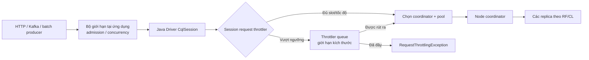
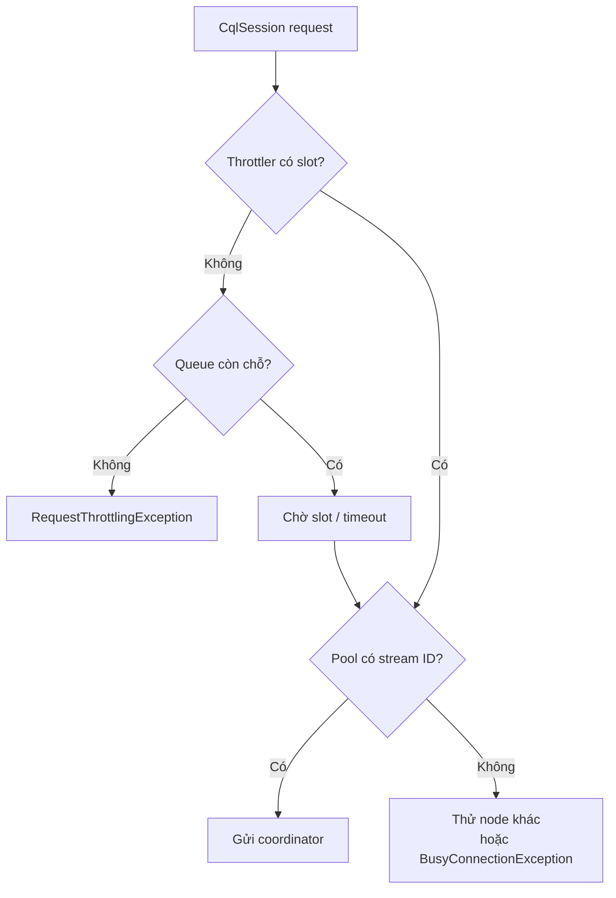
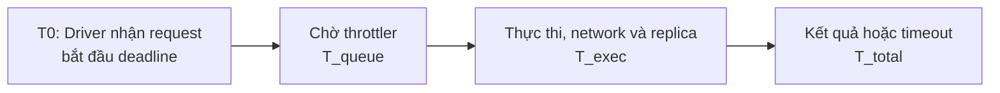
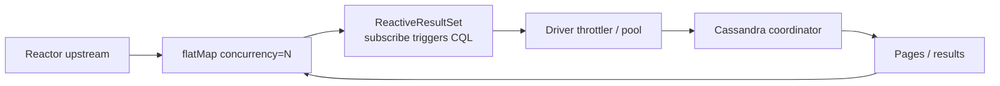
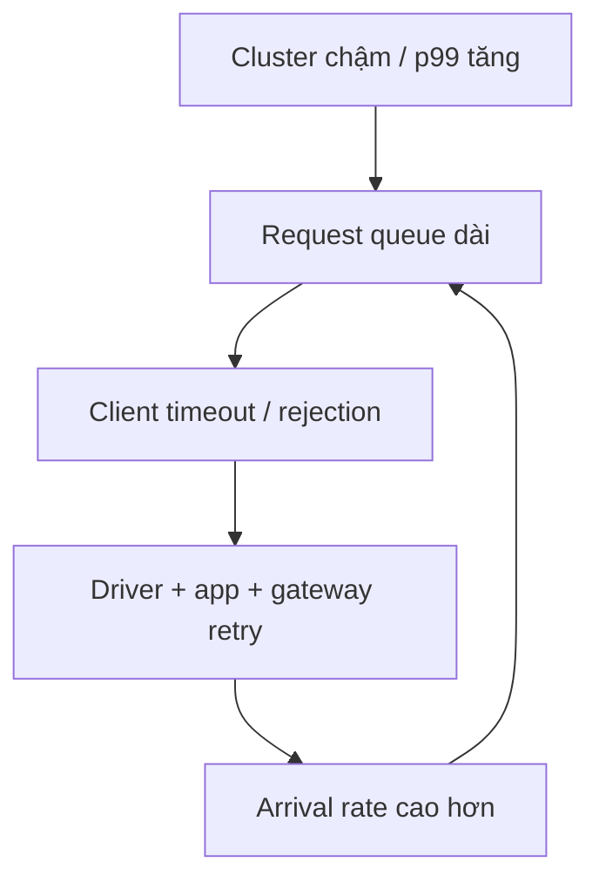

# Request throttler, hàng đợi và thời gian chờ

**Chương:** Bất đồng bộ và reactive  
**Module:** `DATABASE_ENGINE_WIDE_COLUMN_CASSANDRA` — Apache Cassandra

Một ứng dụng Java dùng `CqlSession.executeAsync()` để gửi hàng nghìn mutation vào Apache Cassandra. Ban đầu, thời gian phản hồi ổn định. Khi lượng sự kiện tăng đột ngột, số request đang chờ tăng, p99 xấu đi, một số thao tác nhận `DriverTimeoutException` mặc dù CPU Cassandra chưa chắc đã bão hòa. Đổi sang Reactive Streams có thể khiến code trông “non-blocking”, nhưng nếu upstream phát ra vô hạn mutation thì **non-blocking không đồng nghĩa có backpressure xuyên suốt đến Cassandra**.

Trong Java Driver 4.x, **request throttler** là một cơ chế **ở cấp session phía client** để giới hạn số request được phép tiếp tục hoặc tốc độ bắt đầu request. Khi vượt ngưỡng, request có thể được đưa vào **hàng đợi hữu hạn** hoặc bị từ chối. Cơ chế này liên quan trực tiếp tới **request timeout**, connection pool, stream IDs, retry, speculative execution và khả năng phục hồi khi cluster quá tải.

Bài viết tích hợp ngữ cảnh module `DATABASE_ENGINE_WIDE_COLUMN_CASSANDRA`: kiến trúc phân tán và wide-column, partition key/token, thiết kế bảng theo truy vấn, CQL, replication/consistency level, compaction/repair, xử lý lỗi và cách kết nối ứng dụng Java. Mục tiêu là lựa chọn **giới hạn tải, độ dài hàng đợi và thời gian chờ** phù hợp với hợp đồng nghiệp vụ — không chỉ tìm cấu hình để giảm exception.

> **Phạm vi:** Nội dung bám Apache Cassandra Java Driver **4.18.1** và Cassandra 4.1/5.x. Mọi con số dưới đây chỉ dành cho lab hoặc tính toán minh họa, **không phải cấu hình production mặc định**. Kiểm tra JDK, phiên bản driver/server, hành vi của framework reactive, export metrics và cấu hình hiện hành trước khi áp dụng. Không thử tạo overload trên cluster nghiệp vụ.

## 1. Mục tiêu học tập

Sau bài này, bạn có thể:

1. Phân biệt `execute()`, `executeAsync()`, `executeReactive()` và các phạm vi backpressure.
2. Giải thích ba request throttlers: **pass-through**, **concurrency-limiting** và **rate-limiting**.
3. Xác định giới hạn **in-flight**, **queue capacity**, **request rate** và giới hạn pool/stream ID là các tài nguyên khác nhau.
4. Mô tả vì sao **request timeout bắt đầu trước khi request được chuyển vào throttler**, nên request có thể hết hạn khi chưa gửi đến node.
5. Phân biệt `RequestThrottlingException`, `DriverTimeoutException`, `BusyConnectionException`, lỗi timeout từ server và overload.
6. Đọc ba metrics `throttling.delay`, `throttling.queue-size`, `throttling.errors` cùng `pool.available-streams`.
7. Chọn cửa sổ đồng thời theo throughput, độ trễ và bộ nhớ thay vì tăng queue vô giới hạn.
8. Dùng Java Driver 4.x và `CompletionStage` với **admission control** không chặn I/O thread.
9. Dùng Reactor `flatMap(..., concurrency)` để giới hạn write concurrency; giải thích ranh giới của Reactive Streams.
10. Thiết kế deadline, overload response, retry/idempotence và cách kiểm thử/rollback khi thay chính sách.

## 2. Vì sao tải tăng lại gây xếp hàng?

### 2.1. Đường đi của một request



Đó là sơ đồ khái niệm, không mô tả chính xác thứ tự tất cả callback nội bộ của một phiên bản driver. Điều cần nhớ: **request có thể mất thời gian ngay trong ứng dụng/driver trước khi coordinator nhìn thấy CQL**.

Một request đi qua nhiều nơi có thể đợi: HTTP server, worker queue, executor, throttler queue, connection pool/stream IDs, coordinator queue, disk/compaction. Thêm một hàng đợi không tạo throughput mới; nó chuyển thời gian chờ từ chỗ này sang chỗ khác.

### 2.2. Async không làm Cassandra tự xử lý nhanh hơn

`CqlSession.executeAsync()` trả về `CompletionStage<AsyncResultSet>` để Java thread không bị chặn trong lúc chờ network. Nếu ứng dụng phát sinh request nhanh hơn hệ thống tiêu thụ, số future/payload/context đang tồn tại vẫn tăng, gây memory pressure và latency.

**Non-blocking ≠ không giới hạn concurrency.** Reactive Streams giúp quản lý nhu cầu ở các publisher/subscriber có hỗ trợ, nhưng Cassandra native protocol không cung cấp một luồng tín hiệu backpressure end-to-end tổng quát từ server về upstream write producer.

### 2.3. Hàng đợi bảo vệ gì?

Một queue nhỏ có thể hấp thụ burst ngắn khi backend còn khả năng hồi phục. Queue lớn có thể tăng khả năng nhận request trong vài giây nhưng làm **độ trễ đầu-cuối** và lượng dữ liệu đang giữ trong bộ nhớ tăng.

| Trạng thái | Điều có thể tốt | Rủi ro |
| --- | --- | --- |
| Không queue | Fail fast khi quá tải | Burst nhỏ cũng có thể bị từ chối |
| Queue nhỏ/hữu hạn | Hấp thụ burst ngắn | Cần đặt timeout và giới hạn memory |
| Queue rất lớn | Ít rejection tức thời | Request hết hạn khi xếp hàng; p99 lớn; giữ payload/future, overload lan rộng |
| Queue vô hạn ở upstream | Producer không bị chặn lúc đầu | OOM/GC; khó suy số request còn hiệu lực |
| Giới hạn in-flight rõ | Backend được bảo vệ, predictable capacity | Cần sizing/telemetry để tránh under-utilization |

**Mục tiêu không phải queue không bao giờ đầy**, mà là dự đoán được hành vi khi vượt capacity: chấp nhận trong giới hạn hoặc từ chối rõ ràng và cho upstream giảm tốc.

## 3. Ba loại request throttler của Java Driver 4.18.1

Java Driver cấu hình dưới `datastax-java-driver.advanced.throttler`. Đây là **cơ chế chung của session**, không phải hàng đợi riêng cho mỗi partition/table/replica.

### 3.1. `PassThroughRequestThrottler`

Mặc định là pass-through: request được phép tiếp tục ngay, **không có queue chờ do throttler**.

```hocon
datastax-java-driver {
  advanced.throttler {
    class = PassThroughRequestThrottler
  }
}
```

Điều này **không có nghĩa mọi request chắc chắn được gửi**. Khi pool hết stream IDs hoặc không có node phù hợp, driver vẫn có thể thất bại, ví dụ `AllNodesFailedException` chứa `BusyConnectionException`. Pass-through chỉ không chặn ở tầng throttler.

### 3.2. `ConcurrencyLimitingRequestThrottler`

Cho phép tối đa `max-concurrent-requests` request đang thực thi; request vượt ngưỡng được xếp hàng tới `max-queue-size`. Khi một request active hoàn tất (thành công, lỗi hoặc timeout), driver cho request chờ lâu nhất tiến lên.

```hocon
# LAB: các số nhỏ để quan sát queue, KHÔNG phải baseline production.
datastax-java-driver {
  basic.request.timeout = 2 seconds

  advanced.throttler {
    class = ConcurrencyLimitingRequestThrottler
    max-concurrent-requests = 32
    max-queue-size = 64
  }
}
```

| Tham số | Ý nghĩa | Điều không có nghĩa |
| --- | --- | --- |
| `max-concurrent-requests = 32` | Tối đa 32 request cùng vượt qua concurrency gate của session | Không có nghĩa Cassandra chỉ xử lý 32 mutation trên toàn cluster |
| `max-queue-size = 64` | Nhiều nhất 64 request **đang chờ trong queue throttler** | Không phải 64 kết nối, 64 thread, 64 replica |
| `basic.request.timeout = 2 seconds` | Deadline do driver áp lên mỗi request | Không phải 2 giây riêng sau khi ra khỏi queue |
| `RequestThrottlingException` | Queue đã không còn khả năng nhận request mới khi limit bị chạm | Không tự đồng nghĩa server đã xử lý request |

Nếu 32 request đang active và 64 request đang chờ, request thứ 97 (trong ví dụ không có yêu cầu nào hoàn tất xen vào) có thể bị từ chối ở tầng throttler. Trong thực tế cạnh tranh thời gian thực làm con số tức thời thay đổi.

### 3.3. `RateLimitingRequestThrottler`

Giới hạn **số request bắt đầu mỗi giây** thay vì chỉ số active. Các request vượt tốc độ được xếp hàng; bộ rút queue theo chu kỳ `drain-interval`.

```hocon
# PHƯƠNG ÁN THAY THẾ cho lab, KHÔNG bật đồng thời với config trên.
datastax-java-driver {
  basic.request.timeout = 2 seconds

  advanced.throttler {
    class = RateLimitingRequestThrottler
    max-requests-per-second = 40
    max-queue-size = 80
    drain-interval = 5 milliseconds
  }
}
```

Với rate-based, **một request active hoàn tất không nhất thiết tạo quota mới ngay**: cần xem số request đã bắt đầu trong cửa sổ thời gian. Vì thế driver phải xét lại queue định kỳ.

`drain-interval` quá nhỏ có thể tăng wake-up/processing overhead; quá lớn làm request chờ dù tốc độ đã có thể cho phép. Không có giá trị “5 ms luôn tối ưu”; phải đo `throttling.delay` và request latency.

### 3.4. So sánh nhanh

| Đặc điểm | Pass-through | Concurrency-based | Rate-based |
| --- | --- | --- | --- |
| Giới hạn chính | Không ở throttler | Số request active | Request bắt đầu/giây |
| Cơ chế đưa vào queue | Không | Khi hết slot active | Khi vượt rate |
| Khi nào rút queue? | Không áp dụng | Khi request active hoàn tất | Theo rate window/`drain-interval` |
| Bảo vệ burst | Không | Có nếu queue hữu hạn | Có nếu queue hữu hạn |
| Bảo vệ in-flight khi backend chậm | Không | **Có** | **Không bảo đảm**; rate vẫn có thể tạo nhiều active |
| Độ phức tạp tuning | Thấp | Theo latency/concurrency/pool | Theo ingest rate/burst/drain |
| Điểm dễ nhầm | Hết stream IDs vẫn lỗi | Queue không tăng throughput | Rate limit không thay concurrency limit |

Không nhất thiết cần cả hai giới hạn ở chính tầng Driver: upstream producer cũng có thể cung cấp rate/concurrency control. Với ứng dụng reactive, thường nên chặn nguồn phát ngay ở pipeline thay vì để Driver giữ lượng lớn work chờ.

## 4. Throttler queue khác connection pool queue

Một trong những lỗi chẩn đoán phổ biến là thấy `BusyConnectionException` rồi tăng `max-queue-size` mà không xem pool.

### 4.1. Stream IDs là tài nguyên riêng

Cassandra native protocol multiplex nhiều request đồng thời trên một connection qua stream IDs. Driver giới hạn số request trên connection và số connections theo node. Khi tất cả streams phù hợp đều bận, driver có thể thử node khác; nếu không có node nào còn khả dụng, `AllNodesFailedException` có thể chứa `BusyConnectionException`.



Giới hạn pool và throttler phải **tương thích**: nếu pool hết stream IDs **trước khi** đạt concurrency threshold, bạn vẫn nhận busy connection dù queue throttler rất rộng.

### 4.2. Các option cần nhận biết

Tên/đơn vị liên quan trong Driver 4.x:

```text
advanced.throttler.max-concurrent-requests
advanced.throttler.max-queue-size
advanced.connection.pool.local.size
advanced.connection.pool.remote.size
advanced.connection.max-requests-per-connection
advanced.metrics.node.enabled = [pool.available-streams]
```

Kiểm tra file cấu hình tham chiếu và metric thực tế của phiên bản. Không coi tích số `node_count × connection_count × streams_per_connection` là năng lực request production: replica health, coordinator routing, speculative executions, network, disk/CPU và CL có thể đặt trần thấp hơn.

### 4.3. Vì sao không chỉ tăng connections?

Thêm connections có thể giúp nếu thực sự **pool stream IDs** là bottleneck và server còn headroom. Nhưng tăng quá mức gây:

- More network sockets/TLS overhead.
- Hàng đợi server/coordinator dày hơn.
- Nhiều request đang chạy gây memory pressure.
- Một hot partition vẫn chỉ có số replica/token owners nhất định.
- Write p99 xấu hơn khi đĩa/compaction đã bão hòa.
- Tăng số attempts do retry/speculative execution khi tải cao.

**Đừng tối ưu một metric riêng lẻ.** Cần so `throttling.queue-size`, `pool.available-streams`, p99 client, request rate, disk I/O và server errors.

## 5. Thời gian chờ: tính từ đâu?

### 5.1. Quy tắc quan trọng nhất

Trong Java Driver 4.x, **request timeout bao gồm thời gian nằm trong throttler queue**. Đồng hồ timeout bắt đầu **trước khi** request được chuyển vào throttler.

Vì vậy, một request có thể thất bại với timeout khi **chưa hề được gửi đến coordinator**. Ngược lại, một request đã gửi đi rồi timeout có thể đã được replica áp dụng nhưng client không nhận ACK; hai trường hợp không nên gộp thành “DB trả lỗi”.



Mô hình:

\[
T_{\mathrm{request}} \approx
T_{\mathrm{queue}} +
T_{\mathrm{execute/network}} +
T_{\mathrm{retry/speculate}}
\]

Trong thực tế một số phần có thể chồng lấp (ví dụ speculative executions), vì vậy phương trình chỉ là cách **phân tích ngân sách**, không phải biểu thức cộng thời gian tuyệt đối trong mọi execution.

### 5.2. Ví dụ request hết hạn trong queue

Giả sử request timeout `1.000 ms`:

| Thành phần | Thời gian minh họa |
| --- | ---: |
| Chờ throttler queue | 850 ms |
| Chuẩn bị/gửi + xử lý ở coordinator và replicas | 250 ms |
| Tổng | 1.100 ms |

Request **không đủ deadline** để hoàn thành, dù server xử lý 250 ms có thể bình thường. Tăng queue chỉ khiến request phải chờ lâu hơn trước khi chạm server; muốn giải quyết cần giảm arrival rate, tăng throughput thực sự hoặc fail fast theo deadline.

Một trường hợp khác: queue wait `1.100 ms` với timeout `1.000 ms`. Request có thể **timeout ngay trong queue**, không có query trace trên server. Đây không phải bằng chứng Cassandra query engine đã xử lý chậm.

### 5.3. Nhiều lớp timeout

| Tầng | Ví dụ timeout | Ý nghĩa |
| --- | --- | --- |
| HTTP/API gateway | 1,5 giây cho toàn request | Deadline người dùng/end-to-end |
| Application business logic | 1,2 giây còn lại sau auth/validation | Có thể gồm nhiều DB calls |
| Java Driver `basic.request.timeout` | Ví dụ 900 ms | Bao gồm throttling, retry/speculation trong phạm vi request |
| Per-statement `setTimeout` | Có thể override theo query | Dùng cho workload khác nhau |
| Cassandra coordinator read/write timeout | Phục vụ xử lý giữa server/replicas | Khác với client timeout |
| Kafka/queue job lease | Deadline xử lý/visibility timeout | Job có thể được redeliver khi quá hạn |
| JDK/Netty connection init/connect timeout | Thiết lập kết nối | Không phải SLA của CQL đã bắt đầu |

**Không cộng thẳng mọi timeout thành tổng** nếu các đồng hồ chạy lồng nhau. Để kiểm soát deadline, chọn thời gian mỗi tầng **nhỏ hơn phần ngân sách còn lại**, sau đó truyền thời gian còn lại xuống khi có cơ chế hỗ trợ.

### 5.4. Timeout không bảo đảm hủy mutation

- **Request hết hạn trong throttler queue:** Driver có thể chưa gửi mutation.
- **Request đã gửi rồi timeout:** mutation có thể đã được một phần hoặc đủ replica chấp nhận.
- **Ứng dụng hủy `CompletionStage`/subscriber:** không nên suy rằng Cassandra server đã rollback/hủy mutation đang thực thi.
- **HTTP client đóng kết nối:** Java service có thể vẫn còn request Cassandra chạy nếu không tích hợp cancellation.
- **Queue redelivery sau timeout:** worker có thể gửi lại cùng mutation.

Với `counter + 1`, list append, một payment event hoặc mutation không lũy đẳng, **không blind retry** sau timeout. Cần event ID ổn định, nguồn sự thật, idempotency design và reconciliation.

## 6. Khi queue đầy: sự khác biệt giữa từ chối và timeout

### 6.1. `RequestThrottlingException`

Khi request không được phép chạy ngay và queue đã đầy, throttler có thể từ chối với `RequestThrottlingException`. Đây là **tín hiệu quá tải ở session/client**, không phải thông điệp từ replica rằng CQL không hợp lệ.

Hành động nên cân nhắc:

1. Ghi metric và log với query class/endpoint, không log payload nhạy cảm.
2. Nếu là HTTP API, trả `429` (khi client vượt quota) hoặc `503` (khi service đang quá tải) **theo hợp đồng API**; có thể kèm Retry-After nếu có cách tính đáng tin.
3. Với queue consumer, giảm tốc/pause theo partition/chủ đề hoặc defer có giới hạn.
4. Không retry ngay lập tức trên cùng session trong vòng lặp nhanh.
5. Không tăng queue vô hạn để “hết exception”; đo hiệu suất và ngân sách deadline.
6. Ưu tiên cơ chế load shedding/admission **trước khi** tạo object/payload tốn bộ nhớ.

### 6.2. `DriverTimeoutException`

Một request có thể đã nằm trong queue, đã gửi lên server hoặc đang chờ response khi deadline phía client hết. Không chỉ từ exception này mà biết chắc mutation đã áp dụng hay chưa.

Cần dùng metrics `throttling.delay` cùng timeline application để suy khả năng queue wait. Dù `throttling.delay` cao và không thấy server trace, không dùng một lần timeout riêng lẻ để khẳng định chắc chắn request không gửi.

### 6.3. `BusyConnectionException` và `AllNodesFailedException`

Nếu driver không lấy được stream ID trên các connections tới bất kỳ coordinator phù hợp nào, có thể thấy `AllNodesFailedException` với các `BusyConnectionException` trong map lỗi node.

Điều này **khác** throttler queue full. Hướng xử lý là xem `pool.available-streams`, in-flight, retry/speculative concurrency, số connections, tình trạng node và capacity. Chỉ tăng `max-queue-size` có thể làm lỗi tiếp diễn.

### 6.4. `ReadTimeoutException`, `WriteTimeoutException`, `OverloadedException`

Các lỗi này thuộc đường xử lý server/replica/coordinator, không phải tín hiệu queue client duy nhất.

| Exception | Nơi phát sinh/ý nghĩa chính | Cần tránh |
| --- | --- | --- |
| `RequestThrottlingException` | Driver throttler từ chối do session quá tải | Retry tight loop |
| `DriverTimeoutException` | Deadline request phía client đã hết | Giả định request chắc chắn chưa được gửi |
| `AllNodesFailedException` + `BusyConnectionException` | Không lấy được connection/stream phù hợp | Tăng queue mà không đo pool |
| `ReadTimeoutException` | Coordinator không nhận đủ read response đúng hạn | Hạ CL tùy tiện để “hết timeout” |
| `WriteTimeoutException` | Write chưa đạt ACK yêu cầu kịp thời | Blind retry mutation không lũy đẳng |
| `OverloadedException` | Server báo overload | Thêm concurrency/retry gây bão |
| `UnavailableException` | Không đủ replica live theo CL | Hạ consistency trái business contract |

**Đừng gộp tất cả thành “network timeout”.** Phân loại riêng giúp biết vấn đề ở **client admission**, **connection pool**, **node/replica** hay **deadline architecture**.

## 7. Làm thế nào để chọn concurrency?

### 7.1. Little's law để tư duy về in-flight

Trong một hệ ở trạng thái gần ổn định:

\[
L \approx \lambda W
\]

với:

- `L`: số request trung bình đang ở trong hệ được xét.
- `λ`: throughput requests/giây.
- `W`: thời gian trung bình request ở hệ, đơn vị giây.

Ví dụ nếu ứng dụng hoàn tất **200 requests/s**, mỗi request mất trung bình **40 ms** (0,04 s) trong phần xử lý đang đo:

\[
L \approx 200\times 0{,}04=8
\]

Cần khoảng **8 in-flight trung bình** để duy trì throughput lý tưởng; không thể suy `max-concurrent-requests=8` là lựa chọn tối ưu, vì burst, p99, retry, phân bố node và workload kết hợp có thể đòi headroom. Chọn theo **đường cong throughput–latency đo thực tế**, không chỉ công thức.

### 7.2. Nếu latency tăng, concurrency có thể tăng dù rate giữ nguyên

Giả sử arrival giữ ở 200/s nhưng service time tăng từ 40 ms lên 200 ms:

\[
L \approx 200\times 0{,}2=40
\]

Nếu limit chỉ 16, requests bắt đầu xếp hàng. Nếu tăng limit lên 64 khi nguyên nhân là disk bão hòa, server có thể chậm hơn nữa. **Concurrency limit là guardrail, không phải cơ chế phục hồi throughput**.

### 7.3. Rate limit không chặn mọi in-flight

Một rate limit 100 requests/s với latency 5 s có thể tạo trung bình khoảng 500 requests đang thực thi nếu upstream tiếp tục gửi và không có giới hạn khác. Do đó:

- Rate limit phù hợp khi muốn ngân sách **request/s**.
- Concurrency limit phù hợp khi muốn ngân sách **work-in-progress**.
- Với backend chậm biến động, cần tránh giả định rate limit một mình bảo vệ memory/in-flight.
- Có thể kết hợp **admission control tại ứng dụng** với Driver throttler; tránh chồng hai queue không được quan sát.
- Tăng request timeout từ 2s lên 30s có thể làm giữ requests/stream IDs lâu hơn, khiến backlog phình.

### 7.4. Ước lượng queue wait

Nếu queue có 80 request chờ và backend giải phóng trung bình 40 request/s **trong khi không có arrivals mới**, một phép tính thô cho thời gian tháo hết queue:

\[
T_{\mathrm{drain}}\approx \frac{80}{40}=2\,\mathrm{s}
\]

Đây không phải SLA của từng request, bởi server time, token distribution, retry và arrivals mới thay đổi tốc độ rút queue. Nếu request timeout chỉ 1 s, nhiều request có thể **hết hạn trước khi được chạy**.

## 8. Java Driver config: tách rõ các nhóm option

### 8.1. Cấu hình ví dụ concurrency-based cho lab

```hocon
datastax-java-driver {
  basic.request.timeout = 2 seconds
  basic.request.default-idempotence = false

  advanced.throttler {
    class = ConcurrencyLimitingRequestThrottler
    max-concurrent-requests = 32
    max-queue-size = 64
  }

  advanced.metrics.session.enabled = [
    throttling.delay,
    throttling.queue-size,
    throttling.errors,
    cql-requests
  ]

  advanced.metrics.node.enabled = [
    pool.available-streams
  ]
}
```

**Quan trọng:**

- Con số ở `max-concurrent-requests`, `max-queue-size` và `request.timeout` phải được chọn **cùng nhau** theo p99/SLO.
- Throttler là **session-wide**, không phải quota riêng theo execution profile. Theo tài liệu tham chiếu, chọn throttler class không tùy ý override theo từng profile; kiểm tra phiên bản khi áp dụng.
- Để có metrics, cần cấu hình metrics library/integration và bật đúng danh sách metric; không bảo đảm các số tự xuất hiện trong Prometheus chỉ vì HOCON có dòng enabled.
- `default-idempotence=false` tránh mặc định coi mutation nguy hiểm là safe retry.
- `cql-requests` có thể có số đo cả đoạn chờ theo semantics driver; cần xác minh instrument/histogram trong release đang dùng.

### 8.2. Cấu hình ví dụ rate-based, dùng thay thế

```hocon
datastax-java-driver {
  basic.request.timeout = 2 seconds

  advanced.throttler {
    class = RateLimitingRequestThrottler
    max-requests-per-second = 40
    max-queue-size = 80
    drain-interval = 5 milliseconds
  }
}
```

Không copy cả hai block vào cùng một file rồi hy vọng driver phối hợp hai throttlers: `class` chỉ chọn một implementation. Nếu cần kiểm soát cả rate và concurrency, xem upstream pipeline/admission controller hoặc custom throttler được review kỹ, với test overload rõ.

### 8.3. Timeout theo từng statement

```java
BoundStatement query = prepared.bind(deviceId)
    .setConsistencyLevel(DefaultConsistencyLevel.LOCAL_QUORUM)
    .setTimeout(Duration.ofMillis(800))
    .setIdempotent(true);
```

Giá trị 800 ms chỉ là minh họa. Với một request phải qua 100 ms HTTP validation và có deadline client 1 s, bạn cần tính phần còn lại và các tầng. `setTimeout` không phải SLA end-to-end cho một workflow chứa **nhiều** CQL requests.

### 8.4. Tác dụng khi có nhiều application replicas

Nếu triển khai 6 pods Java, mỗi pod có một `CqlSession` với limit 32 concurrent, tổng theoretical gate có thể cho khoảng **6 × 32 = 192** requests active trước khi chạm throttler của từng session. Đây **không phải quota toàn cluster**.

Khi autoscale tăng replicas từ 6 lên 12, tổng khả năng phát requests có thể tăng **gấp đôi** dù mỗi pod giữ config giống nhau. Phải lập capacity theo **số sessions/pods/tenants/region** và workload tổng, không chỉ config một pod.

## 9. Lab CQL: thiết kế bảng để test không bị hot partition giả

### 9.1. Điều kiện lab

- Cassandra 4.1/5.x tương thích, Java Driver 4.x, cổng CQL khả dụng.
- Một DC giả định tên `datacenter1`; nếu khác phải thay đúng tên.
- Một node/RF1 đủ để thấy throttler queue, nhưng không đủ để thử replica failure/quorum; nếu cần RF3 phải dùng cluster ba node.
- Dữ liệu disposable, request rate và concurrency được **giới hạn rõ ràng**.
- Có quyền dùng `nodetool`, cqlsh và metrics tại node.
- Không dùng dashboard về dữ liệu production, không stress test đến disk full hoặc memory OOM.

### 9.2. DDL theo truy vấn

```sql
CREATE KEYSPACE IF NOT EXISTS lab_async_throttle
WITH replication = {
  'class': 'NetworkTopologyStrategy',
  'datacenter1': 1
}
AND durable_writes = true;

CREATE TABLE IF NOT EXISTS lab_async_throttle.events_by_device_day (
    device_id text,
    bucket_day date,
    event_ts timestamp,
    event_id uuid,
    event_type text,
    payload text,
    PRIMARY KEY ((device_id, bucket_day), event_ts, event_id)
) WITH CLUSTERING ORDER BY (event_ts DESC, event_id ASC);

CREATE TABLE IF NOT EXISTS lab_async_throttle.device_status_by_id (
    device_id uuid PRIMARY KEY,
    state text,
    updated_at timestamp
);
```

- `(device_id, bucket_day)` nhóm các events theo thiết bị/ngày, phù hợp truy vấn trong một ngày.
- Không gửi mọi event vào cùng `device_id='device-01'` nếu mục tiêu là đo capacity chung: một hot partition có thể bóp méo kết quả.
- `event_id` phải được tạo **một lần theo business event** để retries không tạo hai hàng logic.
- `device_status_by_id` cho phép lookup bằng khóa xác định, hữu ích cho Java async demo.
- Với workload thật, bucket ngày có thể quá lớn; chọn bucket nhỏ hơn theo access pattern và kích thước partition đo được.

### 9.3. Baseline nhỏ bằng CQL

```sql
CONSISTENCY ONE

INSERT INTO lab_async_throttle.device_status_by_id
    (device_id, state, updated_at)
VALUES (
    10000000-0000-4000-8000-000000000001,
    'ONLINE',
    '2026-11-21T00:00:00Z'
);

INSERT INTO lab_async_throttle.device_status_by_id
    (device_id, state, updated_at)
VALUES (
    10000000-0000-4000-8000-000000000002,
    'OFFLINE',
    '2026-11-21T00:01:00Z'
);

SELECT state, updated_at
FROM lab_async_throttle.device_status_by_id
WHERE device_id = 10000000-0000-4000-8000-000000000001;
```

`CONSISTENCY ONE` chỉ phù hợp ví dụ RF1 lab. Với production RF3 local và yêu cầu nhất quán đọc/ghi cao hơn, `LOCAL_QUORUM` có thể cần thiết; không tự hạ CL để “tăng tốc” khi hệ đang chậm.

### 9.4. Thu baseline trước khi tạo tải

```bash
nodetool status
nodetool info
nodetool tpstats
nodetool compactionstats
nodetool tablestats lab_async_throttle.device_status_by_id
nodetool tablestats lab_async_throttle.events_by_device_day
```

Ghi p50/p95/p99 client, số lỗi/throttling, queue-size, available-streams, node CPU/GC/disk I/O. Nếu không có exporter/metrics library, bài lab vẫn có thể minh họa API và timeout, nhưng **không được ghi kết luận “queue đầy” khi chưa có số đo**.

## 10. Async Java: giới hạn concurrency trước khi gửi

### 10.1. Vì sao không `for` gửi một triệu futures?

Mẫu không nên dùng:

```java
// PHẢN VÍ DỤ: tạo ra rất nhiều requests đang sống,
// dù I/O non-blocking; còn có thể tăng memory và queue.
for (UUID id : millionsOfIds) {
    session.executeAsync(read.bind(id));
}
```

Nó không đảm bảo Cassandra/driver có đủ concurrency/memory. Một list chứa hàng triệu `CompletionStage` không khác một backlog lớn tại ứng dụng, chỉ chuyển nơi giữ objects.

### 10.2. Một mẫu bounded async với admission rõ ràng

Đoạn Java dưới đây sử dụng `Semaphore.tryAcquire()` **không blocking**, từ chối ngay khi có quá nhiều request tại **đối tượng service này**. Đây là admission control **bổ sung**, không thay thế Driver throttler. Giá trị 16 chỉ dành cho lab.

```java
import com.datastax.oss.driver.api.core.CqlSession;
import com.datastax.oss.driver.api.core.DefaultConsistencyLevel;
import com.datastax.oss.driver.api.core.cql.AsyncResultSet;
import com.datastax.oss.driver.api.core.cql.BoundStatement;
import com.datastax.oss.driver.api.core.cql.PreparedStatement;
import com.datastax.oss.driver.api.core.cql.Row;

import java.time.Duration;
import java.util.Optional;
import java.util.UUID;
import java.util.concurrent.CompletableFuture;
import java.util.concurrent.CompletionException;
import java.util.concurrent.CompletionStage;
import java.util.concurrent.RejectedExecutionException;
import java.util.concurrent.Semaphore;

public final class BoundedAsyncDeviceReader {
    private final CqlSession session;
    private final PreparedStatement read;
    private final Semaphore permits = new Semaphore(16);

    public BoundedAsyncDeviceReader(CqlSession session) {
        this.session = session;
        this.read = session.prepare(
            "SELECT state, updated_at " +
            "FROM lab_async_throttle.device_status_by_id " +
            "WHERE device_id = ?"
        );
    }

    public CompletionStage<Optional<String>> readState(UUID deviceId) {
        // Thử ngay; không gọi acquire() blocking trong I/O callbacks.
        if (!permits.tryAcquire()) {
            CompletableFuture<Optional<String>> rejected =
                new CompletableFuture<>();
            rejected.completeExceptionally(
                new RejectedExecutionException(
                    "application admission: all 16 slots busy"));
            return rejected;
        }

        try {
            BoundStatement request = read.bind(deviceId)
                .setConsistencyLevel(DefaultConsistencyLevel.ONE)
                .setTimeout(Duration.ofSeconds(2))
                .setIdempotent(true);

            CompletionStage<AsyncResultSet> execution =
                session.executeAsync(request);

            // Handler chỉ đọc một cell, không làm I/O/CPU nặng
            // trong callback có thể chạy trên Netty I/O thread.
            return execution.handle((result, error) -> {
                permits.release();

                if (error != null) {
                    throw new CompletionException(error);
                }

                Row row = result.one();
                return row == null
                    ? Optional.empty()
                    : Optional.ofNullable(row.getString("state"));
            });
        } catch (RuntimeException ex) {
            // Nếu executeAsync ném lỗi ngay trước khi trả stage.
            permits.release();
            throw ex;
        }
    }
}
```

**Cách diễn giải:**

- Chỉ tối đa 16 `readState` đang chờ kết quả trên **instance** này; nếu application deploy nhiều instances, limit tổng khác.
- Khi không có permit, method trả future failed **ngay lập tức** thay vì xếp hàng vô hạn. HTTP layer có thể map sang 503/429 theo hợp đồng.
- `setTimeout(2s)` giới hạn thời gian ở Driver gồm cả throttler queue cho request đó.
- Handler giải phóng permit khi completion stage kết thúc (success/failure). Một request server đã gửi và timeout có thể tiếp tục tiêu thụ tài nguyên ở backend; không suy permit release = server đã ngừng làm việc.
- `readState` chỉ đọc một row; nếu query trả nhiều trang, cần thiết kế release permit theo **toàn bộ phạm vi fetch** muốn giới hạn, không chỉ trang đầu.
- `setIdempotent(true)` phù hợp read-only CQL; **không** tự cho phép hạ CL.
- Thí nghiệm một node/RF1 dùng `ONE`. Production phải dùng CL phù hợp RF/DC/business contract.
- Không log toàn bộ dữ liệu nhạy cảm nếu lỗi.

### 10.3. Một mẫu callback sai

```java
// PHẢN VÍ DỤ: không dùng blocking API ngay trong callback driver.
session.executeAsync(read.bind(deviceId))
    .thenApply(result -> {
        // Driver có thể chạy callback này trên I/O thread.
        return session.execute("SELECT * FROM system.local");
    });
```

Driver có thể phát hiện gọi API synchronous trên driver thread và fail fast để tránh deadlock. Kể cả khi không chết, CPU-intensive computation trong callback vẫn làm nghẽn event loop và tăng latency của nhiều requests khác.

Dùng `thenApplyAsync(..., boundedExecutor)` cho phần tính toán nặng, hoặc chain `thenCompose` để gọi thêm async query mà không block. Đừng tạo một thread mới cho mỗi row/request.

### 10.4. Phân tách thread và queue

| Thành phần | Nên làm | Không nên |
| --- | --- | --- |
| HTTP worker | Validate, quyết định admission, chuyển deadline | Tạo futures vô hạn |
| Driver I/O callback | Mapping nhỏ, propagate error, release permit | `Thread.sleep`, `join`, blocking DB/HTTP, CPU lớn |
| Compute executor hữu hạn | Transform dữ liệu nặng có giới hạn | Unbounded queue không metric |
| Ingest pipeline | Giới hạn số in-flight, rate limit, pause upstream | `flatMap` không giới hạn với nguồn vô tận |
| Cassandra server | Nhận workload trong capacity, đo disk/GC | Trông cậy client tự đoán node overload |

## 11. Reactive Streams: backpressure ở đâu có hiệu lực?

### 11.1. Reactive query là publisher lười thực thi

Java Driver hỗ trợ `session.executeReactive(statement)` trả `ReactiveResultSet`, một publisher. Theo tài liệu Driver 4.18.1, publisher mặc định **cold, unicast, chỉ một subscription**. Query được thực thi **khi subscribe**, không phải chỉ khi gọi method.



Nếu subscribe nhiều lần vào cùng publisher không được hỗ trợ, bạn có thể gặp lỗi hoặc gửi request ngoài dự kiến khi xây pipeline mới. Không coi publisher là `List<Row>` có thể duyệt đi duyệt lại.

### 11.2. Read backpressure tốt hơn write backpressure

Trong read, downstream subscriber yêu cầu số rows nhất định; Driver có thể điều chỉnh việc lấy các pages tiếp theo theo tốc độ tiêu thụ. Tuy nhiên:

- Page đã fetch vẫn chiếm bộ nhớ.
- Subscriber quá chậm có thể làm query timeout.
- Một row/page có thể có payload lớn, partition rộng hoặc tombstones.
- Không có guarantee **backpressure xuyên native protocol** từ Cassandra server tới producer của writes.
- `request(n)` không tự giới hạn số write statements từ một upstream khác.

Với write, producer có thể tạo statements nhanh hơn server. **Giới hạn concurrency ở `flatMap`, buffer và rate tại upstream** là cần thiết.

### 11.3. Mẫu Reactor write có concurrency hữu hạn

Giả sử bảng `lab_async_throttle.events_by_device_day` đã tạo. Mẫu dưới dùng Reactor 3.x và Driver 4.18.1. Nó minh họa **50 writes**, giới hạn **8 CQL executions đồng thời**; `blockLast` chỉ dùng ở entrypoint lab, **không** dùng trong callback driver hay WebFlux event loop.

```java
import com.datastax.oss.driver.api.core.CqlSession;
import com.datastax.oss.driver.api.core.DefaultConsistencyLevel;
import com.datastax.oss.driver.api.core.cql.BoundStatement;
import com.datastax.oss.driver.api.core.cql.PreparedStatement;
import com.datastax.oss.driver.api.core.data.CqlDate;
import reactor.core.publisher.Flux;
import reactor.core.publisher.Mono;

import java.nio.charset.StandardCharsets;
import java.time.Instant;
import java.time.LocalDate;
import java.util.UUID;

public final class BoundedReactiveIngest {
    public static void runLab(CqlSession session) {
        PreparedStatement insert = session.prepare(
            "INSERT INTO lab_async_throttle.events_by_device_day " +
            "(device_id, bucket_day, event_ts, event_id, " +
            "event_type, payload) VALUES (?, ?, ?, ?, ?, ?)"
        );

        CqlDate day = CqlDate.fromDaysSinceEpoch(
            (int) LocalDate.of(2026, 11, 21).toEpochDay());
        Instant start = Instant.parse("2026-11-21T00:00:00Z");

        Flux<Integer> completed = Flux.range(0, 50)
            .flatMap(i -> {
                UUID eventId = UUID.nameUUIDFromBytes(
                    ("lab-event-" + i).getBytes(StandardCharsets.UTF_8));

                // Dữ liệu, eventId và PK xác định; tránh tạo ID mới
                // trên mỗi retry của cùng business event.
                BoundStatement request = insert.bind(
                    "device-" + (i % 10),
                    day,
                    start.plusSeconds(i),
                    eventId,
                    "LAB_EVENT",
                    "payload-" + i
                )
                .setConsistencyLevel(DefaultConsistencyLevel.ONE)
                .setIdempotent(true);

                // Write result publisher không trả rows;
                // .then chỉ hoàn thành khi execution kết thúc.
                return Flux.from(session.executeReactive(request))
                    .then(Mono.just(i));
            }, 8); // tối đa 8 inner subscriptions đồng thời

        // CHỈ ở main thread của lab, không trong reactive server callback.
        completed
            .doOnNext(i -> System.out.println("ACK lab event " + i))
            .doOnError(e -> System.err.println(
                "Reactive write error: " + e.getClass().getSimpleName()))
            .blockLast();
    }
}
```

**Điểm quan trọng:** `flatMap(..., 8)` kiểm soát concurrency của các publisher nội bộ; nó không tạo **quota toàn cluster** nếu nhiều pods cùng chạy. `setIdempotent(true)` chỉ an toàn ở đây dưới giả định PK/event payload/timestamp giữ nguyên qua replay và không có side effects khác. Với counter hoặc list append, dùng `setIdempotent(false)` và không blind retry.

Nếu dùng `flatMap` không giới hạn hoặc `parallel()` quá nhiều rails, upstream có thể tạo ra tải vượt capacity dù driver có throttler. Driver queue lớn sẽ che sự thiếu giới hạn upstream, không thay thế thiết kế backpressure đúng.

### 11.4. Hạn chế `onBackpressureBuffer` vô hạn

Một reactive pipeline có thể trông “đã có backpressure” nhưng vẫn chứa operator buffer mặc định/cấu hình không giới hạn. Khi producer nhanh hơn consumer, heap tăng. Cần:

- Kiểm soát max queue/buffer size.
- Đưa ra policy drop/reject/defer phù hợp dữ liệu.
- Giới hạn concurrency theo query size và latency.
- Có deadline cho mỗi task.
- Với dữ liệu phải lưu, dùng durable broker/pause consumer phù hợp, không dựa vào một buffer RAM vô hạn.
- Không drop dữ liệu billing/ledger chỉ vì queue đầy; cần protocol retry/idempotence/durable storage đúng.

### 11.5. Reactive read và paging

```java
// Minh họa Reactive read, chỉ log một số rows nhỏ:
Flux.from(session.executeReactive(
    "SELECT event_ts, event_type " +
    "FROM lab_async_throttle.events_by_device_day " +
    "WHERE device_id = 'device-01' " +
    "AND bucket_day = '2026-11-21' LIMIT 20"
)).take(20)
 .doOnNext(row -> System.out.println(
     row.getString("event_type")))
 .blockLast(); // chỉ lab/main thread
```

Với result sets nhiều trang, từng page fetch có thể bị throttler giới hạn, nhưng **một request timeout** không tự tương đương một deadline toàn bộ streaming nhiều trang. Đặt total job deadline/application cancellation và memory budgets riêng, ngoài per-page request timeout.

## 12. Hàng đợi nhiều tầng: đặt admission ở đâu?

Một pipeline thực tế có thể là:

```text
HTTP/TCP accept queue
  -> API framework pending requests
  -> Executor / application admission
  -> Driver throttler queue
  -> Connection pool / stream IDs
  -> Cassandra coordinator
  -> Replica read/write path
  -> Disk, memtable flush, compaction, network
```

Nếu tất cả tầng đều có queue lớn, một request có thể xếp hàng nhiều lần. Ngay cả khi từng tầng “không đầy”, end-to-end SLA có thể đã hết hạn.

### 12.1. Quy tắc thiết kế

1. Chọn **một hoặc vài điểm admission chủ động** gần upstream, nơi còn có thể từ chối trước khi giữ nhiều dữ liệu/bộ nhớ.
2. Chỉ dùng queue hữu hạn để hấp thụ burst ngắn, không che tải vượt capacity kéo dài.
3. Theo dõi mỗi queue riêng; đừng gộp queue HTTP với `throttling.queue-size`.
4. Không đặt timeout từng tầng bằng hoặc lớn hơn toàn bộ deadline còn lại.
5. Với Kafka/queue, giới hạn số records đã poll nhưng chưa ACK; nếu backlog cao thì pause/resume hoặc điều chỉnh consumer concurrency.
6. Dùng bulkhead theo nghiệp vụ nếu read quan trọng và ingest analytics dùng chung cluster; không để batch chiếm toàn bộ slots.
7. Ghi rõ hành vi khi rejection: retry later, durable defer, fallback read, hay fail closed.

### 12.2. Fairness khi dùng chung CqlSession

Throttler là session-wide. Ví dụ cùng session phục vụ:

- API kiểm tra quyền (latency rất chặt).
- Job import 100.000 events (tải lớn).
- Job báo cáo định kỳ (nhiều page).

Nếu import chiếm hết active slots và queue, API quan trọng có thể nhận `RequestThrottlingException` hoặc timeout **dù query của nó rất nhanh**.

Giải pháp có thể là:

- Admission/bulkhead **trước** Driver theo endpoint/workload.
- Job import có concurrency/rate budget riêng.
- Tách instance/session hoặc deployment theo workload khi thực sự cần isolation và đã cân nhắc chi phí connections/metadata.
- SLA/quota/priority ở gateway/job scheduler.
- Custom throttler nếu cần ưu tiên, nhưng phải review thread-safety và failure handling.

Không tạo một `CqlSession` mới cho từng request HTTP để “có queue riêng”: việc mở connection/TLS/metadata quá thường xuyên có thể làm quá tải và rò tài nguyên. `CqlSession` là đối tượng dài hạn được tái sử dụng.

## 13. Error handling: fail fast, retry có kiểm soát và unknown outcome

### 13.1. Bảng quyết định

| Trường hợp | Ý nghĩa cần xác minh | Hành động thường hợp lý |
| --- | --- | --- |
| App admission limit đạt, chưa gọi Driver | Tải đã bị từ chối trước Cassandra | 429/503 hoặc enqueue bền ở upstream |
| `RequestThrottlingException` | Driver không nhận thêm request vì queue đầy | Giảm nguồn phát, fail fast/backoff, quan sát queue |
| Timeout trong throttler queue | Request có thể chưa gửi | Xem delay/trace; không suy chung là DB chậm |
| Timeout sau khi request đã gửi | Có thể đã thực thi mutation | Giữ event ID, reconcile, không blind retry non-idempotent |
| `BusyConnectionException` | Stream IDs/connections cạn | Xem pool metrics và retry/speculation |
| `ReadTimeoutException` | Replica/coordinator chưa đáp ứng đọc | Xem RF/CL, node health, tail latency |
| `WriteTimeoutException` | ACK chưa đạt điều kiện kịp thời | Unknown outcome, nhất là counter/list append |
| `OverloadedException` | Server báo quá tải | Giảm đồng thời/tốc độ, điều tra bottleneck |
| `UnauthorizedException` / invalid query | Lỗi phân quyền/schema/CQL | Sửa logic/chính sách; không retry tải |
| Upstream deadline hết | Người dùng/job không còn chờ | Ngừng tạo thêm việc nếu có thể; kiểm tra side effects còn chạy |

### 13.2. Idempotence là tiền đề cho retry, nhưng không đủ

`SELECT` thuần thường có thể đánh dấu idempotent. `INSERT` với primary key và payload xác định có thể lặp an toàn trong những giả định phù hợp. Nhưng:

- `counter = counter + 1` **không lũy đẳng**.
- `list = list + ['event']` **không lũy đẳng**.
- `INSERT` tạo UUID mới trên mỗi attempt không còn cùng event/PK.
- Ghi giá trị mới với TTL/timestamp khác có thể thay semantics.
- LWT/counter workflows cần đọc kết quả `[applied]`/unknown outcome riêng.
- Retry ở Driver không ngăn gateway/Kafka tự gửi lại.
- Retry không được tự hạ consistency level nếu nghiệp vụ yêu cầu quorum.

**Không sửa `RequestThrottlingException` bằng retry loop không giới hạn.** Nó xuất hiện khi session đang quá tải; retry ngay gây thêm pressure và có thể làm tình hình xấu hơn.

### 13.3. Retry storm



Một cách ổn định hơn là **bounded attempts**, backoff + jitter, deadline còn hiệu lực, circuit breaker và admission limits; quan trọng nhất là sửa nguyên nhân gốc: hot partition, thiếu capacity, disk I/O, GC, compaction, replica/network issues.

## 14. Observability: không tối ưu theo một con số

### 14.1. Metrics chính thức của Driver

Theo tài liệu 4.18.1:

| Metric | Loại/ý nghĩa | Câu hỏi |
| --- | --- | --- |
| `throttling.delay` | Timer: thời gian request bị giữ ở throttler | Queue wait ảnh hưởng p99 tới mức nào? |
| `throttling.queue-size` | Gauge: số request hiện đang chờ | Queue có tăng liên tục không? |
| `throttling.errors` | Counter: số lần `RequestThrottlingException` | Khi nào session bắt đầu từ chối tải? |
| `pool.available-streams` | Số stream IDs còn trên node/pool theo metric | Có hết stream IDs trước concurrency gate không? |
| `cql-requests` | Client request latency distribution | Total latency thay đổi thế nào? |

`throttling.queue-size` có ý nghĩa cho **built-in concurrency/rate throttlers**; với pass-through/custom implementation metric có thể là 0 hoặc khác theo implementation. `throttling.delay` cần cấu hình histogram/timer phù hợp khi export. Không coi metrics được bật mặc định.

### 14.2. Metrics liên quan ở app/server

| Tầng | Ví dụ |
| --- | --- |
| API | Arrival RPS, admitted RPS, rejected RPS, 429/503, p50/p95/p99 |
| Application | In-flight, semaphore permits, executor queue, heap/RSS, GC |
| Driver | Throttle delay/queue/errors, retries, timeout, available streams |
| Cassandra | `nodetool tpstats`, client read/write latency, pending tasks, dropped messages |
| Disk/storage | Read/write IOPS, `await`, disk free, compaction backlog |
| Topology | `nodetool status`, replica health, RF/CL, hints/streaming |
| Dữ liệu nghiệp vụ | Event loss/duplicate, lag, deadline misses, stale reads |

Quan sát **theo thời gian và theo node**. Một mức trung bình cluster 20 ms có thể che một hot partition p99 vài giây. Nếu Driver queue tăng nhưng node CPU thấp, cần kiểm tra limit quá thấp hoặc nguồn upstream tăng; nếu disk bão hòa thì tăng concurrency thường không giúp.

### 14.3. Bộ biểu đồ tối thiểu

```text
TIME_UTC:
DEPLOYMENT / INSTANCE_COUNT:
CASSANDRA_VERSION / DRIVER_VERSION:
THROTTLER_CLASS:
REQUEST_RATE_IN / REQUEST_RATE_COMPLETED:
ACTIVE_IN_FLIGHT:
THROTTLER_QUEUE_SIZE:
THROTTLING_DELAY_P50 / P95 / P99:
THROTTLING_ERRORS_PER_SEC:
POOL_AVAILABLE_STREAMS_PER_NODE:
CLIENT_REQUEST_P50 / P95 / P99:
REQUEST_TIMEOUT / REJECTION / BUSY_CONNECTION:
RETRIES / SPECULATIVE_EXECUTIONS:
NODE_CPU / GC / DISK_IO:
CASSANDRA_READ_WRITE_P99:
RF / CL / DC:
EVENT_BACKLOG / AGE:
DATA_DUPLICATES / UNKNOWN_OUTCOMES:
```

Không dùng `queue-size` bằng 0 ở một snapshot để tuyên bố không có bottleneck. Cần so các khoảng ingest cao/thấp và min/max/percentiles phù hợp. Nếu có export sang Prometheus, tránh dùng raw request/partition key làm label gây cardinality cao hoặc lộ dữ liệu.

## 15. Capacity planning và thời gian chờ: ba bài toán

### 15.1. Burst ngắn được hấp thụ

Giả sử upstream tăng tạm thời lên 120/s trong 5 giây, backend xử lý ổn định 100/s theo cùng cách đo. Backlog xấp xỉ:

\[
(120-100)\times5=100\ \text{requests}
\]

Queue capacity chỉ 64 sẽ không chứa cả burst nếu không có admission từ chối/giảm tốc. Queue capacity 128 có thể chứa **về số lượng**, nhưng phải kiểm tra deadline và memory. Nếu backend chỉ xử lý được 100/s, việc hoàn tất 100 requests chờ còn tốn thêm thời gian.

### 15.2. Mất cân bằng kéo dài

Upstream 150/s, backend 100/s trong 60 giây:

\[
(150-100)\times60=3.000\ \text{requests}
\]

Tăng queue từ 64 lên 3.000 chỉ đẩy sự cố sang heap/deadline. Không thể bù mất cân bằng dài hạn bằng RAM vô hạn. Cần giảm upstream, tăng capacity thực sự, scale-out hoặc đổi mô hình ghi/partition.

### 15.3. Deadline và queue length

Giả sử 32 in-flight slots, mỗi request active mất trung bình 200 ms, throughput lý tưởng có thể đạt xấp xỉ `32/0,2=160 requests/s` trong điều kiện server thật sự xử lý song song như giả định. Một queue 80 request sẽ thêm thời gian chờ đáng kể nếu liên tục đầy. Nếu p99 active tăng lên 1 s khi disk chậm, hiệu năng giảm và queue bắt đầu timeout.

**Phép tính không đủ để đặt production limit**. Cần đo phân bố requests, read/write ratio, CL, partition hotspots và node capacity thực.

## 16. Trường hợp lỗi và chẩn đoán

### A. Queue-size tăng, throttling.delay p99 tăng, server CPU thấp

Có thể limit concurrency quá thấp so với workload và server còn headroom; cũng có thể một số queries chậm giữ slot quá lâu. So active request latency, pool available-streams và disk trước khi tăng limit. Thử canary từng bước và rollback nếu p99 xấu.

### B. Queue-size thấp nhưng `BusyConnectionException` nhiều

Pool/stream IDs có thể cạn **trước** khi throttler chạm limit. Xem cấu hình connection pool, retry/speculative executions, available-streams và các node unreachable. Tăng queue-size không giải quyết nguyên nhân.

### C. `RequestThrottlingException` tăng nhưng Cassandra vẫn bình thường

Session có thể bị cấu hình quá chặt hoặc một job đang dồn quá nhiều requests vào cùng session. Đánh giá quota theo từng use case; điều chỉnh upstream/admission/fairness thay vì mở queue vô giới hạn.

### D. `DriverTimeoutException` nhiều nhưng server logs không có query

Request có thể hết deadline trong throttler queue **trước khi được gửi**, hoặc lỗi xảy ra ở giai đoạn client/network. Kiểm tra throttling.delay, trace sampling và attempt logs trước khi tăng server read/write timeout.

### E. Sau tăng timeout từ 2 s lên 30 s, heap/RSS tăng

Request/payload/futures có thể sống lâu hơn; queue và stream IDs bị giữ lâu hơn, khó fail fast. Đưa timeout về mức hợp đồng, giảm admission, xử lý workload/cluster capacity thay vì kéo dài chờ vô hạn.

### F. Java async callback dùng `Thread.sleep` hoặc `join`

Callback có thể chạy trên Driver Netty I/O thread; blocking kéo chậm hàng loạt requests và thậm chí deadlock. Chuyển sang chain async hoặc offload tính toán sang executor hữu hạn.

### G. Reactive `flatMap` gửi nhiều writes hơn Cassandra chịu được

`Flux` upstream tạo nhiều inner subscriptions cùng lúc, làm write timeout/overload. Giới hạn `flatMap(..., concurrency)`, kiểm soát nguồn phát và tránh buffer vô hạn. Driver throttler hữu hạn là hàng rào cuối, không phải giải pháp chính.

### H. Reactive read subscriber nhận kết quả rất chậm

Driver có thể fetch trang tiếp theo ít đi, nhưng request timeout/page timeout có thể xảy ra. Tránh blocking trong `onNext`, giới hạn page size và dùng downstream scheduling phù hợp; không đánh đồng với server corruption.

### I. Autoscale từ 4 lên 20 pods làm Cassandra quá tải

Mỗi pod có throttler riêng, nên global arrival/in-flight budget tăng; cluster không được thêm replica tương ứng. Tính lại N × per-instance limit, cap producers và capacity planning.

### J. Batch import khiến API kiểm tra trạng thái timeout

Một shared session-wide throttler có thể tạo head-of-line blocking. Đặt bulkhead/quotas theo loại công việc, giảm tốc importer và theo dõi API p99. Không tự tạo session mỗi HTTP request.

### K. Throttler rejection bị middleware retry ngay ba lần

Mỗi rejected request sinh thêm arrivals, làm queue khó giảm và tăng CPU app. Thay tight retry bằng backoff/circuit breaker hoặc reject upstream, với idempotence và request deadline.

### L. Mutation timeout rồi Kafka consumer redeliver

Server có thể đã áp dụng mutation trước timeout. Nếu là counter/list append, redelivery có thể double-effect. Cần event ID, dedup/transactional source-of-truth và reconciliation; không lấy throttler làm exactly-once mechanism.

## 17. Quy trình tuning an toàn

### P0 — Chốt yêu cầu nghiệp vụ

Ghi SLA p95/p99, deadline, loại queries, RF/CL, độ bền dữ liệu, read-after-write, yêu cầu mất mát/duplicate, số pods và nguồn burst. Không tùy tiện giảm CL chỉ để request ít timeout.

### P1 — Thu baseline

Quan sát ít nhất một khoảng bình thường và một khoảng tải cao: incoming/completed RPS, throttle delay/queue/errors, available streams, app heap/GC, Cassandra CPU/disk/compaction, timeout theo error class.

### P2 — Chọn giới hạn và queue

Quyết định ứng dụng cần giới hạn concurrency, rate hay cả hai ở các tầng khác nhau. Chọn queue hữu hạn dựa trên **deadline + burst budget**, không dùng 100.000 chỉ vì tài liệu ví dụ cho thấy số đó.

### P3 — Lab với dữ liệu disposable

Dùng một schema/query đại diện, payload/partition distribution/CL gần workload thật. Bắt đầu load thấp, tăng từng nấc có giới hạn; theo dõi khoảng request nào bắt đầu chờ, timeout hoặc rejection. Không gây OOM hay disk full.

### P4 — Fault tests

Thử một node chậm/Down trong cluster disposable, upstream burst, worker cancellation, page fetch chậm và network delay có kiểm soát. Xác minh lỗi đúng class và service không blind retry mutation nguy hiểm.

### P5 — Canary và rollback

Triển khai từng nhóm ứng dụng, theo dõi p99, queue wait, rejection, server errors và business correctness. Nếu lỗi tăng hoặc cluster xấu đi, giảm upstream/admission và khôi phục cấu hình đã biết an toàn, không mở queue vô hạn.

### P6 — Runbook production

Có người chịu trách nhiệm, dashboard, stop conditions, kế hoạch scale/failover và lịch review khi số pods, RF/CL hoặc traffic thay đổi. Cập nhật tài liệu cho on-call: **queue đầy là hành vi bảo vệ**, không tự động là bug cần tắt throttler.

## 18. Bảng quyết định cấu hình

| Triệu chứng đã đo | Hướng xem trước | Hành động cần tránh |
| --- | --- | --- |
| Throttle delay tăng, server còn headroom | Concurrency limit, hot queries, fairness | Tăng timeout mà không đo |
| Throttle queue đầy, nhiều 503 | Upstream rate, queue budget, admission | Retry tức thì trong vòng lặp |
| `BusyConnectionException`, available streams≈0 | Pool/stream IDs, retries, node health | Chỉ tăng max-queue-size |
| Disk/compaction bão hòa, p99 tăng | Workload, partition design, storage capacity | Tăng concurrency liên tục |
| Rate-limit queue tăng khi latency bình thường | Rate target < incoming RPS | Queue vô hạn |
| Timeout ngay cả khi queue không đầy | Driver request timeout, server response, network | Quy hết cho throttler |
| Reactive writes gây overload | `flatMap` concurrency và upstream rate | `subscribe`/`flatMap` vô hạn |
| API strict bị importer chiếm slot | Bulkhead/quotas/session isolation | Dùng chung unbounded queue |
| Autoscaling làm cluster chậm | Tổng số sessions × per-session limits | Chỉ nhìn config một pod |
| Counter/list append có timeout | Idempotence, dedup/reconciliation | Blind retry / speculative execution |

## 19. Bộ bài tập thực hành

### Bài tập A — Mô hình queue

Concurrency gate 16, queue size 32, có 16 request active và 32 request queued chưa hoàn tất. Một request mới đến sẽ gặp gì? Khi một active request hoàn tất, một request cũ trong queue có cơ hội đi đâu? Deadline của request queued bắt đầu ở thời điểm nào?

### Bài tập B — Little's law

Ứng dụng xử lý 250 requests/s và thời gian trung bình phần in-flight 80 ms. Tính số in-flight trung bình. Giải thích vì sao không thể lấy ngay kết quả làm `max-concurrent-requests` production.

### Bài tập C — Timeout trong queue

Request budget 800 ms, queue wait 700 ms, server xử lý bình thường 180 ms. Tại sao application có thể timeout dù Cassandra không chậm bất thường? Hãy nêu ít nhất ba hướng xử lý không dựa vào việc tăng deadline.

### Bài tập D — Phân biệt lỗi

Điền tầng khả dĩ gây `RequestThrottlingException`, `BusyConnectionException` và `WriteTimeoutException`. Với cái nào có thể kết luận chắc mutation chưa tới replica? Với cái nào phải coi outcome là không rõ?

### Bài tập E — Tải từ nhiều pods

Một pod có `max-concurrent-requests=40`. Có 12 pods, mỗi pod một session. Tính tổng gate tối đa theo mô hình và giải thích vì sao không phải concurrency tối đa an toàn của Cassandra.

### Bài tập F — Rate limit vs concurrency limit

Một job phát 100 requests/s, p99 tăng từ 100 ms lên 5 s. Rate limit 100/s có bảo đảm chỉ có 10 in-flight không? Dùng Little's law để minh họa, rồi đề xuất thêm một cơ chế admission.

### Bài tập G — Reactive flatMap

Một `Flux` chứa 500 events. So sánh `flatMap(stmt -> executeReactive(stmt))` không giới hạn với `flatMap(..., 8)`. Cách nào phù hợp khi Cassandra chỉ chịu được burst nhỏ? Khi nào vẫn cần rate limiting?

### Bài tập H — Retry và mất tính lũy đẳng

Một Kafka record tạo `counter + 1`. Driver timeout sau khi gửi, job được redeliver. Vì sao throttler không giúp biết delta đã được áp dụng? Đề xuất thiết kế dùng event ID hoặc nguồn fact.

### Bài tập I — Paging

Một SELECT có 1.000 trang, mỗi lần lấy trang có thể bị throttler. Request timeout 1 s nghĩa job phải hoàn tất trong 1 s không? Thiết kế application-level deadline và cancellation như thế nào?

### Bài tập J — Hợp đồng overload API

API đọc danh mục sản phẩm chấp nhận `503` khi backend quá tải. API tạo lệnh thanh toán không được mất event. Hãy thiết kế hai chiến lược rejection/queue khác nhau, nêu nơi giữ dữ liệu bền và điều kiện retry.

## 20. Câu hỏi tự kiểm tra

1. Request throttler thuộc tầng nào: client session, coordinator hay replica?
2. Mặc định Java Driver 4.x dùng throttler nào?
3. `ConcurrencyLimitingRequestThrottler` giới hạn in-flight hay requests/s?
4. `RateLimitingRequestThrottler` dùng `drain-interval` để làm gì?
5. Vì sao rate limiting không đảm bảo số in-flight luôn nhỏ khi latency tăng?
6. `max-queue-size` có phải số thread, connections hoặc SSTables không?
7. Request timeout bắt đầu trước hay sau khi request được dequeue?
8. Có thể timeout khi query chưa đến server không?
9. `RequestThrottlingException` khác `DriverTimeoutException` như thế nào?
10. Tại sao `BusyConnectionException` không tự chứng minh throttler queue đầy?
11. `pool.available-streams` giúp chẩn đoán gì?
12. Tăng queue từ 100 lên 100.000 có tăng throughput thực sự không?
13. Vì sao không nên tạo hàng triệu `CompletionStage` cùng lúc?
14. Callback async của Driver thường chạy trên thread nào?
15. Tại sao `join` hoặc `session.execute()` trong async callback nguy hiểm?
16. `executeReactive()` thực sự gửi request lúc gọi method hay khi subscribe?
17. ReactiveResultSet mặc định có cho nhiều subscribers không?
18. Backpressure ở đường đọc khác đường ghi Cassandra thế nào?
19. `flatMap(..., 8)` giới hạn điều gì? Có đặt quota cho mọi pods không?
20. Vì sao `onBackpressureBuffer` vô hạn có thể gây OOM?
21. Per-page request timeout có thay total streaming job timeout không?
22. Cancellation có bảo đảm Cassandra rollback một write đã gửi không?
23. Vì sao counter/list append không được blind retry sau timeout?
24. Một session-wide throttler có thể làm API quan trọng bị ảnh hưởng bởi import job ra sao?
25. Công thức Little's law là gì và cần giả định gì?
26. `throttling.delay`, `queue-size` và `errors` có loại metric nào?
27. Nếu autoscale tăng số pods gấp đôi, tổng concurrency gate có thể thay đổi thế nào?
28. Khi server disk bão hòa, tăng concurrency limit có thể gây hậu quả gì?
29. Vì sao chỉ nhìn HTTP 200 rate không đủ khi queue wait/p99 tăng?
30. Hãy lập stop conditions và rollback plan cho thay đổi throttler trên production.

### Checklist trước khi đưa throttler vào ứng dụng

- [ ] Đã phân loại query shapes, payload size, RF/CL, TTL và hot partition.
- [ ] Có business SLO/deadline và behavior rõ khi overload.
- [ ] Biết default pass-through và đã chọn class throttler theo mục tiêu cụ thể.
- [ ] Phân biệt concurrency limit, rate limit, queue capacity và pool/stream IDs.
- [ ] Hàng đợi hữu hạn; kích thước được chứng minh bằng burst và deadline.
- [ ] Request timeout **bao gồm throttling queue wait**.
- [ ] Có admission control upstream thay vì tạo futures vô hạn.
- [ ] Có timeout tổng cho HTTP/job/reactive paging, không chỉ per-request driver.
- [ ] Không blocking/CPU-heavy trên Netty I/O callback.
- [ ] Reactive write `flatMap` có concurrency hữu hạn; buffer cũng có giới hạn.
- [ ] Không xem Reactivity là backpressure hoàn chỉnh xuyên native protocol.
- [ ] Không blind retry counter, list append hoặc mutation non-idempotent.
- [ ] Không tự hạ consistency level để giải quyết queue/timeout.
- [ ] Có các metrics `throttling.delay`, `throttling.queue-size`, `throttling.errors`.
- [ ] Có `pool.available-streams` và phân biệt `BusyConnectionException`.
- [ ] Theo dõi app/Driver/Cassandra CPU, GC, disk, compaction và p99.
- [ ] Đã tính số sessions/pods để không nhân nhầm quota toàn cluster.
- [ ] Có bulkhead/rate budget cho batch jobs để bảo vệ request quan trọng.
- [ ] Đã thử rejection, timeout-in-queue và phục hồi trên cluster disposable.
- [ ] Có stop conditions, rollback và người chịu trách nhiệm thay đổi.
- [ ] Không kết luận từ số liệu lab rằng cluster production đạt một mức throughput cụ thể.

**Ghi nhớ:** **Request throttler không làm Cassandra nhanh hơn**; nó quyết định request nào được chạy, đợi hoặc bị từ chối để **bảo vệ giới hạn tải**. Với Java Driver 4.x, thời gian nằm trong throttler queue được tính vào request timeout, nên queue lớn có thể tạo timeout **trước khi gửi CQL**. Dùng **bounded concurrency, bounded queue, deadline và metrics** để giữ hệ thống dự đoán được; với reactive writes, áp dụng giới hạn ngay tại upstream. Không dùng retry vô hạn, timeout dài bất tận hoặc hạ consistency level để che bottleneck.

## Tài liệu kỹ thuật tham khảo

- [Apache Cassandra Java Driver 4.18.1 — Request throttling](https://apache.github.io/cassandra-java-driver/4.18.1/core/throttling/).
- [Apache Cassandra Java Driver 4.18.1 — Async programming và threading](https://apache.github.io/cassandra-java-driver/4.18.1/core/async/).
- [Apache Cassandra Java Driver 4.18.1 — Reactive Streams và backpressure](https://apache.github.io/cassandra-java-driver/4.18.1/core/reactive/).
- [Apache Cassandra Java Driver 4.18.1 — Pooling và stream IDs](https://apache.github.io/cassandra-java-driver/4.18.1/core/pooling/).
- [Apache Cassandra Java Driver 4.18.1 — Metrics](https://apache.github.io/cassandra-java-driver/4.18.1/core/metrics/).
- [Apache Cassandra Java Driver 4.18.1 — Retry và idempotence](https://apache.github.io/cassandra-java-driver/4.18.1/core/retries/).
- [Apache Cassandra Java Driver 4.18.1 — DefaultDriverOption API](https://apache.github.io/cassandra-java-driver/4.18.1/api/com/datastax/oss/driver/api/core/config/DefaultDriverOption.html).

**Ghi chú vận hành:** Những URLs và ví dụ này giúp xác định hành vi Driver 4.18.1, không thay thế việc đối chiếu version/bản phân phối, kiểm thử workload riêng và xác minh tính đúng của dữ liệu trong cluster đang chạy.

