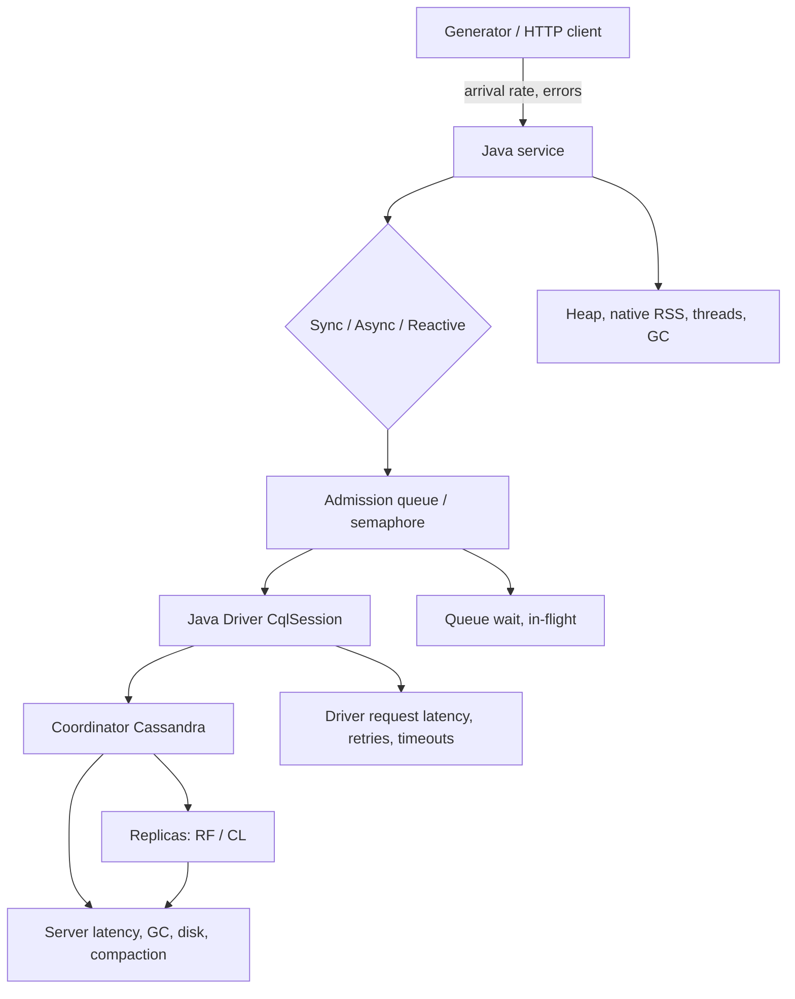

# Đo bộ nhớ, độ trễ và thông lượng khi chọn đồng bộ/bất đồng bộ trong Apache Cassandra

## 1. Vì sao phải đo thay vì mặc định “async luôn nhanh hơn”?

Trong module **DATABASE_ENGINE_WIDE_COLUMN_CASSANDRA**, Apache Cassandra là cơ sở dữ liệu wide-column phân tán. Bảng được thiết kế theo mẫu truy vấn, dữ liệu được đặt theo **partition key**, nhân bản theo **replication factor (RF)**; một lần đọc hoặc ghi phải đáp ứng **consistency level (CL)** qua coordinator và các replica. Độ trễ của truy vấn có thể đến từ mạng, replica chậm, compaction, tombstone, GC hoặc partition quá lớn, chứ không chỉ từ Java.

Ứng dụng Java có thể gọi Cassandra theo **đồng bộ (synchronous)**, **bất đồng bộ (asynchronous)** hoặc kết hợp **reactive streams**. Cùng một câu CQL:

```sql
SELECT order_id, status, updated_at
FROM commerce.orders_by_id
WHERE order_id = ?;
```

có thể được thực thi bằng API blocking `session.execute(...)` hoặc nonblocking `session.executeAsync(...)`. Cả hai vẫn cần Cassandra phục vụ cùng dữ liệu. Async **không tự làm CQL chạy nhanh hơn trên replica**, và sync **không nhất thiết chậm hơn** khi tải thấp, dữ liệu nhỏ hoặc ứng dụng đã có số worker thread thích hợp.

Ví dụ một service chỉ xử lý 50 yêu cầu/giây, mỗi `SELECT` hoàn tất trong vài mili giây: overhead quản lý future/callback ở async có thể không đáng kể nhưng cũng không mang lợi ích rõ rệt. Ngược lại, 2.000 request đồng thời với mỗi request chờ mạng 30 ms có thể khiến mô hình **một thread blocking cho một request** tiêu tốn nhiều thread stack và context switch; async có thể xử lý lượng in-flight tương đương với ít thread ứng dụng hơn, **nếu** giới hạn concurrency, queue và memory đúng cách.

**Câu hỏi thực tế không phải “sync hay async tối tân hơn?” mà là “mô hình nào đạt mục tiêu p99, thông lượng, bộ nhớ và độ tin cậy dưới workload của chúng ta?”**

Sau bài học, bạn sẽ biết cách:

1. Phân biệt số request được gửi, số request **thành công**, throughput và concurrency.
2. Đo **latency p50/p95/p99**, end-to-end latency và tác động của queueing, paging, retry.
3. Đo **heap, non-heap/native memory, số thread và GC** mà không nhầm một chỉ số thành toàn bộ memory footprint.
4. So sánh sync/async/reactive công bằng với cùng CQL, RF/CL, dữ liệu và trạng thái cluster.
5. Xây benchmark Java Driver 4.x có **giới hạn in-flight**, tránh tự tạo load generator thiếu kiểm soát.
6. Đọc kết quả và quyết định chọn mô hình theo SLO, không theo một chỉ số trung bình.
7. Nhận biết lỗi thường gặp: `CompletableFuture.join()`, queue vô hạn, callback blocking, `ResultSet.all()` và retry storm.

## 2. Ba mô hình thực thi trong Java Driver

### 2.1. Đồng bộ: lời gọi chặn thread hiện tại

```java
import com.datastax.oss.driver.api.core.cql.BoundStatement;
import com.datastax.oss.driver.api.core.cql.Row;

BoundStatement query = selectById.bind(orderId);
Row row = session.execute(query).one();
```

Thread gọi `execute(...)` chờ kết quả. Driver vẫn sử dụng kết nối và xử lý I/O nội bộ; “blocking API” **không có nghĩa driver tạo một socket mới cho mỗi request**.

**Lợi ích:** code tuyến tính, dễ đọc, dễ liên kết transaction/workflow nghiệp vụ, stack trace rõ. **Đánh đổi:** cần đủ thread ứng dụng để giữ nhiều request đang chờ mạng; nếu worker pool nhỏ, request bị xếp hàng, còn nếu quá lớn, RAM và context switching tăng.

### 2.2. Bất đồng bộ: kết quả hoàn thành qua future/callback

```java
import java.util.concurrent.CompletionStage;
import com.datastax.oss.driver.api.core.cql.AsyncResultSet;

CompletionStage<AsyncResultSet> future = session.executeAsync(query);
future.whenComplete((page, error) -> {
    if (error != null) {
        recordFailure(error); // Hàm ứng dụng: phải nhanh, không block.
    } else {
        recordSuccess(page);  // Hàm ứng dụng: chỉ xử lý nhẹ.
    }
});
```

`recordFailure` và `recordSuccess` là **hàm giả định**, không phải API của driver. Thread phát request không cần giữ trạng thái blocked chờ kết quả, nhưng request vẫn dùng memory, socket buffers, timeout budget và tài nguyên replica.

**Lợi ích:** ít thread chờ I/O hơn, dễ tổ chức fan-out có kiểm soát. **Đánh đổi:** cần quản lý future, callback, propagation lỗi, cancellation, queue, backpressure và vòng đời session.

### 2.3. Reactive: async cộng giao thức điều tiết nhu cầu

Mô hình reactive dựa trên `Publisher/Subscriber` và tín hiệu `request(n)` để biểu diễn **nhu cầu dữ liệu**. Với Java Driver 4.x và thư viện Reactive Streams phù hợp, reactive query có thể tích hợp với Reactor/RxJava hoặc tầng reactive của framework.

```text
Subscriber -- request(n) --> Publisher
Subscriber <-- onNext(row) -- Publisher
Subscriber <-- onError/onComplete
```

**Cần phân biệt hai loại backpressure:**

- **Backpressure của stream dữ liệu**: subscriber yêu cầu bao nhiêu row/event trước khi tiếp tục.
- **Admission control cho số truy vấn đồng thời**: bao nhiêu CQL statements được phép in-flight. Một publisher có hỗ trợ `request(n)` **không tự bảo đảm** chỉ có 50 query Cassandra được gửi đồng thời nếu ứng dụng `flatMap` hàng nghìn publishers cùng lúc.

Ví dụ pseudo-code minh họa ý tưởng Reactor, **không phải đoạn code độc lập có thể biên dịch nếu thiếu các API/dependency reactive tương ứng**:

```java
// PSEUDOCODE: tên API reactive phải đối chiếu Driver/Reactor version thực tế.
Flux.from(driverReactiveQuery(statement))
    .limitRate(64)
    .map(this::toOrder)
    .subscribe(this::consume, this::handleError);
```

`limitRate(64)` điều tiết nhu cầu của một stream theo semantics của Reactor; nó **không thay thế** giới hạn concurrency CQL tại tầng gọi nhiều statement. Nếu `consume` làm blocking I/O thì phải đổi thread scheduling và capacity planning phù hợp.

### 2.4. Ma trận chọn mô hình ban đầu

| Tiêu chí | Sync | Async | Reactive |
| --- | --- | --- | --- |
| Code điều khiển tuần tự | Đơn giản nhất | Future/callback/compose | Pipeline/operator |
| Nhiều request chờ I/O | Tốn worker threads hơn | Ít thread chờ hơn | Ít thread chờ, có demand signals |
| Memory mỗi request | Có thể gồm thread stack khi mỗi request giữ worker | Future, callback, context và buffers | Subscription, operators, queue/buffers |
| Bảo vệ khỏi overload | Thread pool/queue bounded | In-flight cap/semaphore/bulkhead | Limit concurrency **và** demand |
| Tích hợp Servlet blocking | Tự nhiên | Cần async servlet hoặc callback boundary | Có thể tăng phức tạp không cần thiết |
| Tích hợp WebFlux/event-loop | Phải offload blocking call | Phù hợp khi không block event loop | Phù hợp với pipeline reactive xuyên suốt |
| Khả năng debug | Dễ theo stack tuyến tính | Cần trace context/callback | Cần hiểu signal chain, scheduler và operator |
| p99 Cassandra server | Phụ thuộc CQL/replica | Về cơ bản cùng server path | Về cơ bản cùng server path |

**Chọn mô hình theo toàn bộ kiến trúc**, không chỉ thay `execute` bằng `executeAsync`. Nếu gọi async rồi lập tức `join()` trên cùng request thread, ứng dụng đã quay về chờ blocking nhưng thêm chi phí future.

## 3. Đo đúng bốn kết quả: latency, throughput, concurrency, memory

### 3.1. Latency là thời gian của một logical operation

`Latency` thường được đo bằng khoảng thời gian từ lúc một request được **chấp nhận** vào hệ thống đến khi hoàn tất thành công/thất bại. Cần quyết định ranh giới:

- **CQL attempt latency:** từ lúc driver gửi attempt đến lúc attempt có response.
- **Driver logical request latency:** từ khi gọi `execute/executeAsync` đến kết quả cuối, có thể gồm retry/speculative attempt.
- **Application operation latency:** từ lúc API/worker nhận việc, kể cả chờ queue, mã hóa dữ liệu, CQL và xử lý callback.
- **End-to-end HTTP latency:** thêm network frontend, middleware, authentication, serialization và response.

**Không đem p99 của riêng CQL attempt trong mô hình async so với p99 toàn HTTP endpoint trong mô hình sync.** Phải đo cùng điểm bắt đầu/kết thúc và cùng định nghĩa thành công.

### 3.2. Percentile quan trọng hơn average

Với nhiều request, các đại lượng thường dùng:

| Đại lượng | Diễn giải | Mục đích |
| --- | --- | --- |
| p50 | 50% quan sát có latency không vượt mức này | Trải nghiệm thường gặp |
| p95 | 95% không vượt mức này | Tail latency phổ biến |
| p99 | 99% không vượt mức này | Phát hiện tail gây timeout/ảnh hưởng SLO |
| Maximum | Quan sát chậm nhất | Nhạy với outlier, không dùng một mình |
| Error/timeout rate | Tỷ lệ thất bại | Ngăn “tăng throughput” bằng cách bỏ request |
| Queue wait | Thời gian chờ trước khi được gửi | Chẩn đoán saturate worker/admission |

Ví dụ giả định hai mô hình cùng đạt 5.000 truy vấn/giây:

| Mô hình | p50 | p95 | p99 | Tỷ lệ lỗi |
| --- | ---: | ---: | ---: | ---: |
| Sync (bounded 128 threads) | 12 ms | 38 ms | 90 ms | 0,1% |
| Async (bounded 256 in-flight) | 11 ms | 50 ms | 240 ms | 1,8% |

Kết luận **không** phải async tốt hơn chỉ vì có nhiều request được gửi hơn; p99 và error rate tệ hơn. Đây là **số giả định để luyện phân tích**, không phải benchmark thật hay kết quả về Cassandra/Driver.

### 3.3. Throughput: đếm hoàn tất, không chỉ số lần submit

Phân biệt:

\[
\text{Attempted rate}=\frac{\text{số request được gửi}}{\text{giây quan sát}}
\]

\[
\text{Successful throughput}=\frac{\text{số logical operations hoàn thành đúng}}{\text{giây quan sát}}
\]

Nếu producer submit 20.000 request/s nhưng cluster chỉ trả 7.000 thành công, queue/in-flight tăng và 13.000 pending hoặc timeout, **đừng quảng cáo throughput 20.000**. Cần ghi riêng attempted, completed, successful, failed, timed-out, retry attempts và backlog.

### 3.4. Memory: heap chưa phải toàn bộ RSS

| Chỉ số | Bao gồm/đại diện | Điểm dễ nhầm |
| --- | --- | --- |
| Java heap used/committed | Object, future, callback, rows/buffers trên heap | Một lần `used` đo ngay sau GC không biểu diễn peak |
| Non-heap | Metaspace, JIT code cache và phần VM khác | Không nằm trong `MemoryMXBean.getHeapMemoryUsage()` |
| Direct/native buffers | Netty/network buffers và native allocations | Không luôn hiển thị trong heap metric |
| Thread stack | Stack của thread Java/native | Nhiều blocking threads có thể làm tăng RSS |
| JVM process RSS/container memory | Bộ nhớ cư trú của process trong hệ điều hành/container | Có thể bao gồm mapped files, page caches theo môi trường |
| GC allocation rate/pauses | Object churn và thời gian dừng | Throughput cao nhưng GC nặng có thể làm p99 tệ |
| Peak in-flight/pending queue | Số request đang chờ | Dự báo memory tăng khi bị overload |

**Đo ít nhất ba lớp:** heap, process/container memory và GC/threads. Nếu chỉ dùng `Runtime.totalMemory() - freeMemory()`, bạn bỏ qua direct buffer và thread stack.

## 4. Định luật Little: liên hệ in-flight, throughput và latency

Ở trạng thái tương đối ổn định, cho một hệ thống có hàng chờ đủ điều kiện áp dụng:

\[
L=\lambda W
\]

Trong đó:

- `L`: số request **trung bình ở trong hệ thống** (in-flight + queue theo ranh giới đo).
- `λ`: throughput hoàn tất trung bình (operations/giây).
- `W`: thời gian trung bình một operation ở trong hệ thống (giây).

Ví dụ:

\[
\lambda=1{,}500\ \text{req/s},\quad W=0.04\ \text{s}
\Rightarrow L\approx60\ \text{requests}
\]

Nếu mục tiêu 3.000 request/s và latency trung bình vẫn 40 ms, hệ thống cần chịu khoảng **120 request đang tồn tại** theo ranh giới đo. Nếu latency vì overload tăng lên 200 ms, số pending cần thiết sẽ lên khoảng **600** ở cùng throughput; đây là nguồn gốc của tăng memory, không phải do async “tự nhiên ăn RAM”.

### 4.1. Bài toán memory minh họa

Giả sử mỗi request async giữ trung bình 16 KiB Java objects/buffers tính ở ranh giới đo, 10.000 request in-flight có thể giữ khoảng:

\[
10{,}000\times16\ \mathrm{KiB}\approx156.25\ \mathrm{MiB}
\]

Con số này **chỉ minh họa**, vì object graph, row size, Netty buffers và callback chain khác nhau. Nếu sync dùng một thread cho mỗi request, ngoài per-request data còn phải tính **thread stack và chi phí OS**. Nhưng không nên tạo 10.000 thread để “benchmark cho công bằng”: nó đo sức chịu của OS/thread scheduler nhiều hơn Cassandra.

**Bài học:** async cho phép có nhiều request in-flight với ít thread, **không có nghĩa nên tăng in-flight không giới hạn**.

## 5. Thiết kế thí nghiệm công bằng

Trước khi viết benchmark, khóa các biến ảnh hưởng lớn:

| Nhóm | Phải giữ giống nhau giữa sync và async |
| --- | --- |
| Cluster | Cùng Cassandra version, topology, RF/DC, node health, dữ liệu và trạng thái compaction/repair |
| CQL | Cùng prepared statement, partition key, payload/row size, page size, consistency level |
| Java Driver | Cùng driver version, session config, contact points, local DC, pool/retry/speculative policy |
| Máy chạy benchmark | Cùng CPU, RAM, JVM, GC, container limits và network path |
| Dataset | Cùng phân phối key (hot/cold), tỉ lệ hit/miss và kích thước partition |
| Workload | Cùng tỉ lệ read/write, số operation thành công mục tiêu và concurrency cap |
| Đo lường | Cùng vị trí bắt đầu/kết thúc, warmup, sampling, thời gian chạy và error accounting |
| Điều kiện nhiễu | Không đồng thời đổi schema, RF, compaction hay chạy backfill/repair tải lớn |

**Với benchmark đọc, chuẩn bị dữ liệu trước và dùng bộ ID hợp lệ**; nếu toàn bộ SELECT trả không có row, bạn đang đo workload khác với ứng dụng thực. Đừng dùng ngẫu nhiên UUID mới cho mỗi query nếu điều đó đổi hit rate và token distribution.

### 5.1. Một baseline CQL phục vụ điểm đọc

```sql
CREATE KEYSPACE IF NOT EXISTS commerce
WITH replication = {
  'class': 'NetworkTopologyStrategy',
  'dc1': 3
};

CREATE TABLE IF NOT EXISTS commerce.orders_by_id (
  order_id uuid PRIMARY KEY,
  customer_id uuid,
  status text,
  updated_at timestamp
);
```

Trong cluster một node, RF phải điều chỉnh cho phù hợp **trước** thử nghiệm. Bảng này chỉ dành cho query theo `order_id`; nếu cần liệt kê theo `customer_id`, cần bảng khác theo mẫu truy vấn, không dùng `ALLOW FILTERING` để tạo một benchmark “cố tình chậm”.

### 5.2. Phân biệt thí nghiệm closed-loop và open-loop

- **Closed-loop:** chỉ gửi request mới khi có request cũ hoàn tất hoặc còn slot in-flight. Dễ kiểm soát memory, nhưng khi server chậm, tốc độ phát request tự giảm. Tải thực có thể **thấp hơn** đích mong muốn.
- **Open-loop:** tạo request theo tốc độ đến dự kiến, độc lập thời gian xử lý của request trước. Phản ánh overload rõ hơn nhưng phải có queue/admission policy, nếu không queue phình và làm load generator tự sập.

Một benchmark closed-loop có thể **che tail latency** do `coordinated omission`: khi server đứng 500 ms, client không phát các request lẽ ra đã đến trong khoảng đó, nên histogram ít ghi nhận sự chậm trễ mà người dùng thực gặp.

**Nên làm cả hai:** closed-loop để xác định hiệu quả xử lý theo mức in-flight, open-loop để kiểm SLO tại arrival rate mục tiêu và lúc overload. Với open-loop, đo từ **thời điểm request dự kiến/được chấp nhận**, bao gồm queue wait. Dùng HDR Histogram hoặc công cụ load testing có hiệu chỉnh coordinated omission theo phương pháp phù hợp.

## 6. Đặt công cụ đo ở đâu?



**Bốn nơi thu metric:**

1. **Load generator**: request đến lúc nào, HTTP p50/p95/p99, status code, queueing ngoài service.
2. **Java service/JVM**: request success, active requests, thread count, heap, direct/native memory, GC, CPU.
3. **Java Driver**: requests in flight, connection health, coordinator latencies, retries, timeouts, pending task/queue theo API metric của bản driver.
4. **Cassandra Server**: read/write latency, dropped messages, pending compactions, disk I/O, GC, tombstones/SSTables, node availability, network.

Nếu benchmark chạy **trên chính node Cassandra**, CPU/RAM/network của generator có thể cạnh tranh trực tiếp với server; tốt hơn dùng máy hoặc container được cô lập tài nguyên và ghi rõ cấu hình.

## 7. Đo memory và thread count bằng JMX/Java

### 7.1. Đọc heap, non-heap và số thread

Mã sau chạy với JDK chuẩn, không cần thư viện ngoài:

```java
import java.lang.management.ManagementFactory;
import java.lang.management.MemoryMXBean;
import java.lang.management.MemoryUsage;
import java.lang.management.ThreadMXBean;

public final class JvmSnapshot {
    public static void print(String label) {
        MemoryMXBean memory = ManagementFactory.getMemoryMXBean();
        ThreadMXBean threads = ManagementFactory.getThreadMXBean();
        MemoryUsage heap = memory.getHeapMemoryUsage();
        MemoryUsage nonHeap = memory.getNonHeapMemoryUsage();

        System.out.printf(
            "%s heapUsed=%dMB heapCommitted=%dMB " +
            "nonHeapUsed=%dMB threads=%d peakThreads=%d%n",
            label,
            heap.getUsed() / 1024 / 1024,
            heap.getCommitted() / 1024 / 1024,
            nonHeap.getUsed() / 1024 / 1024,
            threads.getThreadCount(),
            threads.getPeakThreadCount());
    }
}
```

Đo tại các điểm: **trước warmup, sau warmup, trong tải ổn định, ngay sau peak và sau khi nguội**. Không so một `heapUsed` ở thời điểm ngẫu nhiên: GC có thể vừa thu dọn đối tượng.

### 7.2. Đo direct buffers qua `BufferPoolMXBean`

```java
import java.lang.management.BufferPoolMXBean;
import java.lang.management.ManagementFactory;

for (BufferPoolMXBean pool :
        ManagementFactory.getPlatformMXBeans(BufferPoolMXBean.class)) {
    System.out.printf(
        "bufferPool=%s count=%d memoryUsed=%d capacity=%d%n",
        pool.getName(),
        pool.getCount(),
        pool.getMemoryUsed(),
        pool.getTotalCapacity());
}
```

Chỉ số pool là một phần thông tin về buffers do JVM quản lý. **Không tự coi đây là toàn bộ Netty/native memory hoặc process RSS**. Với Netty allocator cụ thể, metric buffer pool/allocator cần kiểm API và cấu hình driver/runtime. Kết hợp giám sát container:

```text
# Các metric cần lấy từ hệ observability hiện có:
process_resident_memory_bytes
jvm_memory_used_bytes{area="heap"}
jvm_memory_used_bytes{area="nonheap"}
jvm_threads_live_threads
jvm_gc_pause_seconds_count/sum
jvm_memory_allocated_bytes_total (nếu runtime/exporter hỗ trợ)
container_memory_working_set_bytes
```

Tên metric **minh họa kiểu Prometheus/Micrometer**, exporter/version có thể đặt tên khác. Không lẫn **`-Xmx`** với RSS của process: RSS có thể cao hơn Xmx vì native allocations, stacks, metaspace và mapping.

### 7.3. Allocation rate và GC

Hai mô hình có thể đạt cùng throughput nhưng khác lượng allocation:

- Sync tạo ít đối tượng future/callback nhưng cần nhiều threads đang chờ.
- Async có thể tạo `CompletionStage`, closure, context và queue entries; nếu chain dài, allocation tăng.
- Reactive có thêm operator/subscription và buffer, nhưng có thể tiết kiệm tài nguyên nếu backpressure hoạt động tốt.

Đo **bytes allocated/op**, GC pauses p95/p99, số lần GC/giây, CPU và live heap. Một lần heap giảm sau GC **không đủ** nói throughput sẽ tốt hơn dưới tải liên tục.

## 8. Đo latency đúng bằng `System.nanoTime()`

Dùng `System.nanoTime()` cho **khoảng thời gian** trong cùng process; không dùng `System.currentTimeMillis()` để đo nanos vì đồng hồ wall-clock có thể điều chỉnh.

### 8.1. Sync: đo từ trước lúc gửi đến khi nhận row

```java
import java.util.concurrent.TimeUnit;
import com.datastax.oss.driver.api.core.cql.Row;

long startedAt = System.nanoTime();

try {
    Row row = session.execute(selectById.bind(orderId)).one();
    long elapsedNs = System.nanoTime() - startedAt;

    recordSuccessLatency(elapsedNs, row != null);
} catch (RuntimeException error) {
    long elapsedNs = System.nanoTime() - startedAt;
    recordFailureLatency(elapsedNs, error);
}
```

`recordSuccessLatency`/`recordFailureLatency` là hàm thu thập của ứng dụng, không phải Driver API. Ghi **cả latency của request lỗi**; nếu histogram chỉ chứa thành công, bạn có thể báo p99 rất đẹp trong khi 20% request timeout.

### 8.2. Async: đo từ lúc submit, không phải khi callback bắt đầu

```java
long startedAt = System.nanoTime();

session.executeAsync(selectById.bind(orderId))
    .whenComplete((page, error) -> {
        long elapsedNs = System.nanoTime() - startedAt;
        if (error == null) {
            recordAsyncSuccessLatency(elapsedNs);
        } else {
            recordAsyncFailureLatency(elapsedNs, error);
        }
    });
```

Nếu chỉ bắt đầu timer ở bên trong callback, bạn **chỉ đo thời gian xử lý callback**, bỏ mất thời gian mạng và coordinator.

Nếu request còn chờ **queue/admission** trước `executeAsync`, timer ở trên không đo queue wait. Đối với end-to-end service SLO, ghi thời điểm từ **lúc nhận việc** rồi tách queue wait và driver time riêng.

### 8.3. Percentile phải có histogram đủ tốt

Tránh tính p99 bằng việc giữ cả triệu giá trị `Long` trong `ArrayList` của chính benchmark: bạn sẽ tăng heap, GC và làm sai thí nghiệm memory. Dùng histogram có bộ nhớ giới hạn (ví dụ HDR Histogram) hoặc metrics backend có thiết kế percentile phù hợp. Giữ count, sum, error count và bucket/histogram; xuất định kỳ **ngoài đường nóng**.

**Cảnh báo:** p99 từ 100 samples có độ tin cậy rất thấp; thử nhiều lần, báo interval và so cùng throughput/error budget.

## 9. So sánh đồng bộ và bất đồng bộ ở cùng giới hạn in-flight

Một phương pháp công bằng cho bước đầu là dùng **closed-loop** ở các mức in-flight `C=8, 32, 64, 128, 256`. Mỗi mô hình chỉ được giữ tối đa C truy vấn Cassandra đang chờ. Dữ liệu/statement, retry policy, CL và page size giống nhau.

### 9.1. Sync bounded bằng một worker pool

Đoạn dưới đây là helper benchmark dùng `ExecutorCompletionService` để không tạo hàng đợi tác vụ vô hạn. Nó nhận danh sách UUID đã chuẩn bị, `PreparedStatement` và C số worker. Trong thử nghiệm thật phải định nghĩa rõ warmup/measurement window và thu histogram đầy đủ.

```java
import java.util.List;
import java.util.UUID;
import java.util.concurrent.*;
import com.datastax.oss.driver.api.core.CqlSession;
import com.datastax.oss.driver.api.core.DefaultConsistencyLevel;
import com.datastax.oss.driver.api.core.cql.PreparedStatement;

public final class BoundedSyncBench {

    public static final class Sample {
        public final long nanos;
        public final boolean success;

        public Sample(long nanos, boolean success) {
            this.nanos = nanos;
            this.success = success;
        }
    }

    public static void run(
            CqlSession session, PreparedStatement prepared,
            List<UUID> ids, int concurrency) throws Exception {

        ExecutorService pool = Executors.newFixedThreadPool(concurrency);
        CompletionService<Sample> completion =
            new ExecutorCompletionService<>(pool);

        int submitted = 0;
        int completed = 0;
        long success = 0;
        long errors = 0;
        long start = System.nanoTime();

        try {
            while (completed < ids.size()) {
                while (submitted < ids.size()
                        && submitted - completed < concurrency) {
                    UUID id = ids.get(submitted++);
                    long born = System.nanoTime();

                    completion.submit(() -> {
                        try {
                            session.execute(
                                prepared.bind(id)
                                    .setConsistencyLevel(
                                        DefaultConsistencyLevel.LOCAL_QUORUM)
                                    .setIdempotent(true)
                            ).one();
                            return new Sample(
                                System.nanoTime() - born, true);
                        } catch (RuntimeException e) {
                            return new Sample(
                                System.nanoTime() - born, false);
                        }
                    });
                }

                Sample sample = completion.take().get();
                completed++;
                if (sample.success) success++; else errors++;

                // Ở benchmark thật, ghi sample.nanos vào histogram bounded.
            }
        } finally {
            pool.shutdown();
        }

        double seconds = (System.nanoTime() - start) / 1e9;
        System.out.printf(
            "sync completed=%d ok=%d err=%d throughput=%.1f ops/s%n",
            completed, success, errors, completed / seconds);
    }
}
```

**Tính chất cần hiểu:**

- Đây là **closed-loop**, producer chỉ có tối đa C task đã submit chưa hoàn tất.
- Mốc `born` đặt trước submit nên latency bao gồm một phần chờ executor queue; nếu muốn đo **driver time**, cần thêm timer ngay trước `execute`.
- `ExecutorCompletionService` giữ các futures kết quả cho đến lúc consume; số đang pending bị chặn bởi C, không tăng theo toàn bộ dataset.
- `success` ở đây là **request CQL không ném exception**, **chưa kiểm** row có đúng nội dung; trong test correctness thực tế phải kiểm row và status theo dữ liệu kỳ vọng.
- Hàm dùng `throws Exception` để đơn giản hóa xử lý interruption/test failure; production cần propagate/cancel rõ ràng, không im lặng nuốt lỗi.
- `pool.shutdown()` chỉ ngừng nhận task; nếu test bị cancel giữa chừng, cần thu hồi/đợi worker còn chạy phù hợp, không đóng session quá sớm.
- Không bật logging từng row vì log I/O sẽ làm sai phép đo.

### 9.2. Async bounded mà không block driver callback

Đoạn sau điều tiết tối đa C `executeAsync` cùng lúc. Callback chỉ đẩy một sample vào queue ngắn; thread điều phối tiêu thụ completion và gửi tiếp. Nó **không** gọi `join()` trên driver thread và không giữ một future cho từng UUID toàn dataset.

```java
import java.util.List;
import java.util.UUID;
import java.util.concurrent.BlockingQueue;
import java.util.concurrent.LinkedBlockingQueue;

import com.datastax.oss.driver.api.core.CqlSession;
import com.datastax.oss.driver.api.core.DefaultConsistencyLevel;
import com.datastax.oss.driver.api.core.cql.PreparedStatement;

public final class BoundedAsyncBench {

    static final class Sample {
        final long nanos;
        final boolean success;

        Sample(long nanos, boolean success) {
            this.nanos = nanos;
            this.success = success;
        }
    }

    public static void run(
            CqlSession session, PreparedStatement prepared,
            List<UUID> ids, int maxInFlight) throws InterruptedException {

        BlockingQueue<Sample> completions = new LinkedBlockingQueue<>();
        int started = 0;
        int completed = 0;
        long success = 0;
        long errors = 0;
        long start = System.nanoTime();

        while (completed < ids.size()) {
            while (started < ids.size()
                    && started - completed < maxInFlight) {
                UUID id = ids.get(started++);
                long born = System.nanoTime();

                try {
                    session.executeAsync(
                        prepared.bind(id)
                            .setConsistencyLevel(
                                DefaultConsistencyLevel.LOCAL_QUORUM)
                            .setIdempotent(true)
                    ).whenComplete((result, error) -> {
                        completions.add(new Sample(
                            System.nanoTime() - born, error == null));
                    });
                } catch (RuntimeException e) {
                    completions.add(new Sample(
                        System.nanoTime() - born, false));
                }
            }

            Sample sample = completions.take();
            completed++;
            if (sample.success) success++; else errors++;

            // Ở benchmark thật, thêm sample.nanos vào histogram bounded.
        }

        double seconds = (System.nanoTime() - start) / 1e9;
        System.out.printf(
            "async completed=%d ok=%d err=%d throughput=%.1f ops/s%n",
            completed, success, errors, completed / seconds);
    }
}
```

Điều kiện áp dụng:

- `maxInFlight > 0` và `ids` phải là danh sách có kích thước hợp lý; input IDs của benchmark nên sinh ở giai đoạn chuẩn bị để không đưa chi phí tạo UUID vào kết quả.
- `LinkedBlockingQueue` ở đây có thể mặc định không giới hạn, nhưng do **chỉ có tối đa C request tồn tại** nên số completion từ các request đó được chặn gián tiếp; trong service production phải dùng queue bounded với policy rõ ràng và không block driver callback khi đầy.
- Callback chỉ tạo `Sample` và gọi `add`; không parse/serialize kết quả lớn, không gọi database lần nữa, không chạy HTTP/blocking I/O trong callback.
- Giống ví dụ sync, “success” mới chỉ là không có exception; thêm correctness check ở run riêng hoặc callback nhẹ nếu cần.
- Nếu test bị interrupt/cancel, cần quản lý những requests còn in-flight và session lifecycle. Đừng đóng session ngay rồi đo số lỗi do chính benchmark tạo ra.
- Queue + callback tạo allocations; đó là **một phần chi phí của lựa chọn implementation**, nhưng để so sánh chính xác cần instrumentation giống nhau ở mức phục vụ nghiệp vụ.

### 9.3. Một vấn đề về fairness cần giải thích

Sync giữ **C worker threads** chờ I/O, async thường giữ **ít threads** nhưng có C futures/callbacks. So sánh với cùng C in-flight cho thấy chi phí memory/thread của mỗi mô hình ở cùng lượng công việc đồng thời.

Để so sánh **khả năng đạt SLO**, còn cần benchmark open-loop với cùng arrival rate, cùng max queue wait, cùng request admission policy. Hai mô hình chỉ so “C=256” có thể cho throughput khác nhau; nhưng service có thể chỉ cần 500 ops/s và cả hai đều tốt.

## 10. Retry, timeouts và kết quả ghi chưa rõ làm sai benchmark ra sao?

Một trong những sai lầm phổ biến là đo throughput bằng số attempts, nhưng ứng dụng thực tính bằng số **logical operations hoàn tất đúng**.

Ví dụ một update:

```sql
UPDATE commerce.orders_by_id
SET status = 'PAID'
WHERE order_id = ?;
```

Nếu client timeout và retry ba lần, Cassandra có thể xử lý nhiều mutations dù chỉ có một ý định. CQL ghi giá trị cố định có thể trông giống idempotent, nhưng concurrent writes/timestamp, TTL, LWT và side effect nghiệp vụ vẫn có thể khiến retry gây sai lệch.

**Trong benchmark so sync/async:**

1. Dùng **read-only prepared SELECT** trước để cô lập chi phí API, mạng và memory.
2. Giữ nguyên retry policy/speculative execution ở cả hai mô hình; ghi số attempts và error rate.
3. Nếu benchmark ghi, dùng dữ liệu thử độc lập, key/idempotency rõ và kiểm correctness.
4. Không đặt `setIdempotent(true)` cho mọi mutation chỉ để tăng throughput; đây là metadata phục vụ retry/speculation, **không** tạo tính an toàn.
5. Không biến `WriteTimeout` thành “ghi thất bại” rồi retry ngay trong benchmark; hiệu quả thu được có thể đến từ gửi nhiều duplicate writes.
6. Thống kê `Unavailable`, `ReadTimeout`, `WriteTimeout` và driver request timeout riêng vì nguyên nhân khác nhau.
7. Không hạ CL từ `LOCAL_QUORUM` sang `ONE` chỉ để hình async đẹp hơn: như vậy đổi hợp đồng nhất quán.

**Ràng buộc đúng:** so sánh cùng số logical requests và tỷ lệ thành công có kiểm chứng. Throughput cao với sai kết quả không phải cải tiến.

## 11. Page size và kích thước row ảnh hưởng memory thế nào?

Khi query trả nhiều hàng, mỗi trang CQL cần memory cho buffers và objects liên quan. Page size lớn giảm số round trips nhưng có thể làm:

- Spike memory khi nhiều response pages về cùng lúc.
- Tăng chi phí decode/convert hàng trong callback.
- Tăng latency của trang chậm nếu partition lớn, row rộng hoặc nhiều tombstone.
- Gây queueing khi tầng HTTP giữ toàn bộ rows để serialize.

Ví dụ:

```java
BoundStatement listOrders = listByCustomer.bind(customerId)
    .setPageSize(100)
    .setConsistencyLevel(DefaultConsistencyLevel.LOCAL_QUORUM);
```

`setPageSize(100)` là **kích thước trang CQL mục tiêu**, không phải `LIMIT 100` và không tự giới hạn tổng số hàng. Phải đo:

| Tình huống | Mức tải memory ước tính | Điều kiện kèm theo |
| --- | --- | --- |
| 100 requests cùng giữ một trang 50 KiB | Khoảng 5 MiB cho payload trang thô | Chưa gồm Java objects, Netty, decode/serialization |
| 1.000 requests giữ một trang 500 KiB | Khoảng 488 MiB payload thô | Rủi ro GC/native memory lớn |
| Stream nhiều trang theo demand | Chỉ một số trang tồn tại đồng thời | Cần kiểm `fetchNextPage()` và downstream queue |

Những con số này chỉ **minh họa phép nhân dung lượng**, không là đo bộ nhớ thực.

### 11.1. Sync `ResultSet` và async `AsyncResultSet` không phân trang giống nhau

Sync iterator có thể **tự fetch** trang tiếp khi code tiếp tục duyệt:

```java
for (Row row : session.execute(statement)) {
    consume(row);
}
```

Nếu `consume(row)` chậm, thread bị giữ lâu. Nếu code dùng `ResultSet.all()` cho dataset chưa biết kích thước, có thể nạp rất nhiều row vào heap.

Async `AsyncResultSet.currentPage()` chỉ cho trang hiện tại; muốn trang sau phải gọi `fetchNextPage()` khi `hasMorePages()`:

```java
CompletionStage<AsyncResultSet> first =
    session.executeAsync(statement);

CompletionStage<Integer> count =
    first.thenCompose(page -> countPages(page, 0));

// Helper giả định countPages phải xử lý next-page theo demand và có
// ngưỡng rows/pages, không đệ quy nạp vô hạn.
```

Đây là đoạn minh họa dòng điều khiển, **không phải chương trình hoàn chỉnh** vì helper `countPages` chưa được định nghĩa. Với reactive, backpressure hỗ trợ điều tiết row signals, nhưng cần kiểm **prefetch/buffering thực tế** của operator và số publisher được chạy song song.

### 11.2. Kết luận về memory của paging

Đừng chỉ đo `pageSize`. Đo **số trang đồng thời đang được giữ**, bytes/page, number of active subscriptions/futures và thời gian dữ liệu bị giữ trong bộ nhớ. Async có thể tiết kiệm stack của thread nhưng tăng memory tổng nếu cho 10.000 result pages về đồng thời.

## 12. Chọn mô hình theo loại workload

| Workload | Bắt đầu thử bằng | Lý do | Điều kiện chuyển phương án |
| --- | --- | --- | --- |
| Admin CLI, migration runner, job tuần tự | Sync | Rõ ràng, tần suất thấp, đơn giản | Khi nhiều CQL độc lập cần chạy song song |
| REST API nhỏ/trung bình trên thread-per-request | Sync với pool bounded, đo trước | Phù hợp stack hiện tại | Khi thread count/queue wait/p99 tăng dưới tải |
| Gateway/service nhiều request chờ I/O | Async với in-flight cap | Giảm thread chờ, compose nhiều I/O | Nếu callback/allocation/GC hoặc độ phức tạp vượt lợi ích |
| WebFlux/reactive pipeline xuyên suốt | Reactive có backpressure và concurrency limit | Đồng bộ mô hình nonblocking qua các tầng | Nếu có blocking SDK không offload hoặc operator buffer vô hạn |
| Bulk ETL nhiều partitions | Async/reactive bounded | Giấu round-trip latency, tăng throughput theo slot | Phải tránh scan không giới hạn/overload Cassandra |
| One-row lookup rất nhanh ở tải thấp | Sync hoặc async đều được | Server latency chiếm phần lớn | Chọn theo SLO, đơn giản và framework |
| LWT/counter/operation có side effect | Cả ba cần workflow chặt chẽ | Idempotency và kết quả UNKNOWN quan trọng hơn kiểu API | Không tăng concurrency khi contention/timeout tăng |

**Không có mặc định “reactive tốt hơn async tốt hơn sync”.** Nếu toàn bộ HTTP service đã là reactive và mọi dependency hỗ trợ nonblocking, reactive có thể giảm thread overhead. Nếu chỉ một Cassandra call nhỏ trong service đồng bộ, async có thể thêm complexity mà chưa có lợi ích đo được.

## 13. Mẫu báo cáo benchmark có thể review được

Sau mỗi lần chạy, ghi **cấu hình** cùng **kết quả**, tránh screenshot một biểu đồ mà không biết tải.

### 13.1. Manifest thí nghiệm

```yaml
experiment: cassandra-java-sync-vs-async
environment: staging
cassandra:
  version: "<server-version>"
  datacenter: dc1
  replication_factor: 3
  consistency: LOCAL_QUORUM
  table: commerce.orders_by_id
driver:
  family: "java-driver-4.x"
  exact_version: "<pin-exact-version>"
  retry_policy: "<same-for-both>"
  speculative_execution: "<same-for-both>"
  request_timeout_ms: 2000
query:
  prepared: true
  type: SELECT_BY_PARTITION_KEY
  page_size: 100
dataset:
  known_existing_keys: 100000
  hot_key_fraction: "<measured>"
load:
  warmup_seconds: 120
  measurement_seconds: 300
  model: closed_loop
  concurrency_levels: [8, 32, 64, 128, 256]
jvm:
  version: "<exact-build>"
  heap_max: "<same-for-both>"
  gc: "<same-for-both>"
```

Đây là **biểu mẫu**, không phải output đo thật. Thời gian warmup/measurement và các mức C chỉ là điểm bắt đầu; workload có cache, compaction hoặc GC chu kỳ dài cần thời gian quan sát phù hợp hơn.

### 13.2. Bảng kết quả minh họa (số giả định)

| Mode | In-flight cap | Successful ops/s | p50 (ms) | p95 (ms) | p99 (ms) | Error % | Peak RSS (MiB) | Live threads |
| --- | ---: | ---: | ---: | ---: | ---: | ---: | ---: | ---: |
| Sync | 32 | 750 | 18 | 39 | 65 | 0.0 | 610 | 85 |
| Async | 32 | 755 | 19 | 41 | 70 | 0.0 | 603 | 56 |
| Sync | 128 | 2,550 | 26 | 80 | 135 | 0.2 | 830 | 182 |
| Async | 128 | 2,610 | 25 | 76 | 128 | 0.2 | 715 | 66 |
| Sync | 256 | 3,100 | 64 | 220 | 510 | 2.0 | 1,110 | 311 |
| Async | 256 | 3,050 | 60 | 250 | 600 | 3.1 | 930 | 71 |

**Không xem các giá trị trên là benchmark Cassandra thực tế**. Chúng chỉ minh họa cách đọc: ở C=128, async có thể là lựa chọn tốt nếu memory/p99 thực đo ổn định; ở C=256, cả hai có dấu hiệu bão hòa, p99 và errors tăng, tăng concurrency không cải thiện kết quả.

### 13.3. Cần ghi thêm ngoài bảng

- CPU Java app và từng Cassandra node (trung bình + peak).
- Heap used/committed/peak, process RSS, direct memory, GC pauses.
- Retry attempts và speculative attempts mỗi successful operation.
- Queue wait, number of pending, admission-rejected requests.
- Bytes/query, row size, page count, query correctness checks.
- `nodetool status`/node health, disk I/O, compaction tasks và tombstone metrics.
- Error phân loại theo `Unavailable`/`ReadTimeout`/`WriteTimeout`/DriverTimeout.
- Biến động giữa các lần chạy, kèm khoảng tin cậy hoặc tối thiểu nhiều repeat runs.

**Công bố full methodology**; nếu dùng thí nghiệm có 0.5% lỗi, không so nó trực tiếp với thí nghiệm 0% lỗi như hai kết quả đồng chất.

## 14. Cách đọc biểu đồ: điểm bão hòa và quyết định tối ưu

Khi tăng concurrency, throughput thường tăng ban đầu vì giấu network waiting time. Đến một ngưỡng, coordinator/replica, thread pool, network hoặc disk đạt giới hạn:

```text
Throughput
   ^
   |                      ________  (bão hòa)
   |                  ___/
   |              ___/
   |          ___/
   |      ___/
   |__ ___/
   +---------------------------------> In-flight concurrency

Latency p99
   ^
   |                              /
   |                          __/
   |                    _____/
   |       ____________/
   +---------------------------------> In-flight concurrency
```

Điểm tốt thường nằm **trước vùng p99 tăng dựng đứng**, không phải nơi completed ops/s tối đa tuyệt đối. Nếu target throughput = 2.000 ops/s, điểm C=64 đạt mục tiêu với p99 thấp/memory tốt có thể phù hợp hơn C=256 đạt 3.100 ops/s nhưng có 2% timeout.

### 14.1. Phân tích nguyên nhân theo dấu hiệu

| Quan sát | Khả năng | Kiểm tra tiếp |
| --- | --- | --- |
| Sync tăng nhiều threads, RSS tăng; throughput tương đương async | Thread stack/context switching | Thread dumps, process RSS, CPU scheduler |
| Async ít threads nhưng heap/GC tăng | Future chains/queue/rows giữ lâu | Allocation profiler, retained objects, queue size |
| Cả hai p99 tăng và server disk busy | Cassandra/storage bottleneck | Compaction, SSTable/tombstone, hot partition |
| Driver latency tăng nhưng server latency ổn | Client queue/routing/network | Queue wait, connection saturation, event loop blocking |
| Async callback chậm, driver I/O threads nghẽn | Blocking work trong callback | Thread dumps, callback timing, offload executor |
| Error tăng khi concurrency tăng | Overload, CL không đạt, retry storm | Exceptions, in-flight, replica health |
| p99 nhỏ bất thường ở closed-loop, open-loop rất tệ | Coordinated omission hoặc queueing bị bỏ qua | Arrival timestamps, latency từ ingress, queue depth |

Một mô hình tối ưu chỉ thật sự tốt nếu **SLO, error budget, memory limit và correctness** cùng đạt.

## 15. Bẫy thường gặp khi chuyển từ sync sang async

### 15.1. `executeAsync(...).toCompletableFuture().join()` ngay lập tức

```java
// Anti-pattern trong đường xử lý nonblocking:
AsyncResultSet page = session.executeAsync(statement)
    .toCompletableFuture()
    .join();
```

`join()` chặn thread gọi; nếu thread đó là event loop của WebFlux/Netty, có thể gây tail latency cao hoặc deadlock gián tiếp khi phụ thuộc vào cùng pool. Trong service đồng bộ, `join()` có thể hợp lệ trong một worker được dành cho blocking, nhưng **không tạo lợi ích nonblocking** tự động.

### 15.2. Gửi 100.000 futures một lần

```java
// Anti-pattern: tạo lượng request/future không giới hạn theo input.
for (UUID id : allIds) {
    session.executeAsync(prepared.bind(id));
}
```

Có thể gây peak RAM lớn, bão hòa connection/replica, timeout và retry storm. Sửa bằng `Semaphore`, bounded work queue, `maxInFlight` hoặc Reactor `flatMap(..., concurrency)` theo API/thư viện thực tế.

### 15.3. Đẩy CPU/blocking I/O vào callback

```java
session.executeAsync(statement).whenComplete((rows, error) -> {
    // Sai nếu đây là I/O chậm trên driver callback thread:
    // Thread.sleep(1000);
    // blockingHttpClient.call(...);
    // doHugeJsonSerialization(rows);
});
```

Callback có thể chạy trên thread nội bộ của driver; code chậm làm nghẽn xử lý những request khác. Nếu cần CPU nặng hoặc gọi hệ thống blocking, **chuyển sang executor riêng có giới hạn queue**; nhớ đo thêm queue wait của executor đó.

### 15.4. Mất context/tracing và exception

Async chain có thể hoàn thành trên thread khác, nên `ThreadLocal`/MDC của HTTP request không tự động lan truyền đầy đủ. Cần propagate trace context rõ, kiểm lỗi ở cuối `CompletionStage` và phân loại exception/cause. Không chỉ log error rồi trả HTTP 200.

### 15.5. “Hủy future” bị nhầm là rollback

Nếu một write đã tới coordinator, cancellation ở Java **không đảm bảo hủy mutation**. Với counter, LWT hoặc tác động bên ngoài, kết quả có thể `UNKNOWN`. Retry cần idempotency key, read-back/reconciliation theo hợp đồng nghiệp vụ, không dựa vào hiệu năng của async để lặp ghi.

### 15.6. Tăng page size để giảm round trips mà không đo bytes

Page size 1.000 có thể giảm số fetch, nhưng row có kích thước lớn làm mỗi response tăng memory/latency. Cần đo row bytes, direct buffers, p99 và số trang giữ đồng thời.

## 16. Quy trình áp dụng vào dự án Java thực

### Pha A — Đặt SLO và baseline

1. Xác định endpoint/worker quan trọng và hợp đồng tính nhất quán (`RF/DC/CL`).
2. Phân loại truy vấn: lookup theo partition key, pagination nhiều row, LWT, mutation và job quét có kiểm soát.
3. Đặt mục tiêu **successful throughput**, p95/p99, timeout/error budget và memory/process RSS limit.
4. Đo baseline **sync hiện có** dưới workload điển hình và peak, gồm queue wait/threads/GC.
5. Ghi phiên bản Cassandra Server, Java Driver, JDK, data model, table options và lịch compaction/repair.

### Pha B — Thử async/reactive cô lập

1. Dùng cùng `CqlSession` config, prepared CQL, CL, timeout, page size và dữ liệu.
2. Thực thi async với bounded max in-flight; không gửi không giới hạn.
3. Nếu reactive, kiểm `request(n)` và operator concurrency, buffer/prefetch, scheduler.
4. Chạy warmup, closed-loop concurrency sweep và open-loop arrival-rate tests.
5. Đo end-to-end latency (gồm admission queue), successful throughput, heap/RSS, threads/GC và lỗi.
6. Kiểm correctness của rows/writes và case timeout trước khi so giá trị hiệu năng.

### Pha C — Canaries và lựa chọn

- Đưa một tỷ lệ traffic có giám sát sang mô hình mới, giữ routing và CL tương đương.
- So p99, error rate, CPU/memory/GC, queue backlog, retry attempts và metric server.
- Nếu mô hình mới chỉ cải thiện memory nhưng p99/error tệ hơn, điều chỉnh concurrency, callback scheduling hoặc giữ sync.
- Nếu mô hình mới giảm p99/memory ở cùng success throughput và độ phức tạp vận hành chấp nhận được, mở rộng rollout.
- Có feature flag/rollback cấu hình, không đồng thời đổi partition key, RF hay compaction strategy nếu có thể.

### Pha D — Tối ưu sau rollout

- Chọn `maxInFlight` trước ngưỡng bão hòa, theo data partition và cluster headroom.
- Tách heavy queries/job nền sang riêng workload profile/bulkhead.
- Giảm object allocation/serialization trong callback.
- Bổ sung metrics các queue mà pipeline reactive tự tạo (publishOn/flatMap/buffer).
- Lặp benchmark khi thay JDK, Java Driver, topology, table schema, GC, instance size hoặc tỉ lệ dữ liệu.

**Không lấy một lần thử ngắn lúc cluster rảnh làm bằng chứng áp dụng cho production tải cao.**

## 17. Bài tập và tình huống phân tích

### Bài 1 — Little's Law

Một API Cassandra có throughput ổn định 2.400 operation/giây và latency trung bình 50 ms.

1. Trung bình có bao nhiêu operation đang tồn tại trong hệ thống theo ranh giới đo?
2. Nếu latency tăng lên 250 ms trong khi throughput không đổi, số operation trung bình tăng bao nhiêu?
3. Nếu memory mỗi operation giữ khoảng 24 KiB, phần memory minh họa tăng bao nhiêu?

**Gợi ý:** `L=λW`. Ban đầu `L=120`, sau đó `L=600`; chênh 480 operation, tương ứng khoảng 11,25 MiB theo giả định 24 KiB/op, chưa kể buffers/overheads.

### Bài 2 — Chọn sync hay async từ bảng số liệu

Giả sử **dữ liệu giả định** cho cùng 2.000 successful operations/giây:

| Metric | Sync | Async |
| --- | ---: | ---: |
| p50 | 15 ms | 16 ms |
| p99 | 120 ms | 105 ms |
| Process RSS | 920 MiB | 740 MiB |
| Active threads | 240 | 68 |
| Error rate | 0.1% | 0.1% |
| CPU server | 75% | 75% |

Bạn chọn gì cho một service có memory limit 800 MiB và SLO p99 dưới 150 ms? Vì sao? Cần thêm bằng chứng nào trước khi chuyển production?

**Gợi ý:** async đáp ứng cả RSS và p99 trong số liệu giả, trong khi sync vượt memory limit. Nhưng vẫn cần kiểm peak duration, repeatability, GC, queue wait, failure modes, correctness và deployment canary.

### Bài 3 — Async không giới hạn

Worker gửi 50.000 `executeAsync` đồng thời, Java heap tăng, GC pause và `ReadTimeout` nổ. Dev đề nghị tăng `-Xmx`.

1. Vì sao tăng heap chưa chắc giải quyết nguyên nhân?
2. Đặt giới hạn `maxInFlight` giúp gì?
3. Những metric nào cho biết Cassandra thực sự bão hòa hay load generator/client tự nghẽn?
4. Có nên tăng retry attempts trong lúc lỗi tăng?

**Gợi ý:** kiểm queue/in-flight, driver callback, Netty buffers, GC/CPU client và disk/compaction/latency server. Áp backpressure và bounded concurrency trước, không retry storm.

### Bài 4 — Closed-loop che tail latency

Bạn chạy 64 in-flight requests trong 10 phút, p99 báo 80 ms. Khi chạy open-loop 5.000 arrivals/s, p99 end-to-end 900 ms, queue backlog tăng.

1. Vì sao hai con số khác?
2. Cách thu time từ ingress/arrival loại bỏ sai lệch nào?
3. Làm sao đặt admission policy để hệ thống degrade có kiểm soát?

**Gợi ý:** closed-loop tự giảm rate khi server chậm, không ghi nhận những request lẽ ra đã đến. Open-loop thể hiện queue wait/overload; dùng bounded queue, load shedding và retry budget.

### Bài 5 — Trang lớn và reactive subscriber

Một stream trả các row lớn ~100 KiB. Publisher có thể prefetch nhiều trang, đồng thời 200 subscriptions. Vì sao một tầng reactive “không có blocking thread” vẫn có thể OOM?

**Gợi ý:** số trang/row được buffer, operator prefetch, upstream concurrency và bytes giữ trong heap/direct memory. Giảm in-flight/row buffers, kiểm backpressure, memory và page size phù hợp.

### Bài 6 — Đúng đắn của write benchmark

Hai thử nghiệm ghi `UPDATE`:

- A: sync 1.200 successful logical requests/s, 0.05% lỗi.
- B: async 2.400 CQL attempts/s nhưng 30% timeout, mọi request bị middleware retry thêm hai lần.

B có thực sự throughput cao gấp đôi A không? Có thể kết luận trạng thái dữ liệu sau retry không?

**Gợi ý:** không. Đang đếm attempts và đã thay đổi retry semantics; cần đếm **logical operation thành công**, phân loại ambiguous write outcome, idempotency và đối soát.

## 18. Checklist kiểm thử và quyết định production

- [ ] Đã giữ cố định CQL, prepared statement, partition key, RF/CL, dataset, timeout, page size và retry policy giữa các mode.
- [ ] Đã định nghĩa ranh giới **latency** giống nhau, gồm queue wait khi đo SLO toàn request.
- [ ] Đo p50/p95/p99, error/timeout rate và **successful throughput**, không chỉ attempted rate/average.
- [ ] Có cả closed-loop concurrency sweep và open-loop arrival-rate test phù hợp.
- [ ] Có warmup, thời gian đo đủ dài, lặp thí nghiệm và ghi trạng thái Cassandra lúc test.
- [ ] Đã đo heap used/peak/committed, process RSS/container memory, direct/native buffers, GC và thread count.
- [ ] Đã đo CPU Java và Cassandra, disk/compaction, network, dropped messages và replica health.
- [ ] Mỗi mô hình có concurrency cap, queue bounded và overload/backpressure policy rõ.
- [ ] Không thực thi blocking I/O hoặc tác vụ CPU nặng trên driver callback/event-loop.
- [ ] Async/reactive không `join()` trên event loop; xử lý/cấp phát future và subscription có kiểm soát.
- [ ] Đã đo cả số page/bytes của query nhiều row; không dùng `ResultSet.all()` trên kết quả không giới hạn.
- [ ] Đã đo callback/operator buffers, reactive prefetch và fan-out concurrency khi dùng Publisher.
- [ ] Retry và speculative execution được đo; không đánh đổi correctness để lấy throughput.
- [ ] Write timeout được xem là outcome có thể không rõ; có idempotency/reconciliation nếu nghiệp vụ cần.
- [ ] Đã phân tách latency do client queue/network/driver và latency do Cassandra/replica.
- [ ] Đã thử canary với metric SLO và có đường rollback mô hình/cấu hình.
- [ ] Có báo cáo kết quả kèm manifest phiên bản, hardware, workload, công cụ và phương pháp tính percentile.
- [ ] Đã chọn mode dựa trên **tập hợp điều kiện**: p99, successful throughput, RSS, lỗi, chi phí vận hành, tính đúng đắn và sự phù hợp framework.

**Kết luận:** `executeAsync` và reactive có thể giảm số thread phải chờ I/O, giúp ứng dụng đạt concurrency cao hơn, nhưng **không làm Cassandra trả lời một CQL nhanh hơn chỉ nhờ đổi API**. Việc chọn sync, async hay reactive phải được chứng minh bằng phép đo **độ trễ toàn thao tác (đặc biệt p99), successful throughput, bộ nhớ heap + native/RSS, thread/GC và error rate**, trong cùng workload và consistency level. Giữ **in-flight bounded**, phân biệt queue wait với server latency, kiểm pagination và retry/correctness; sau đó chọn phương án đạt SLO với mức rủi ro và độ phức tạp vận hành chấp nhận được.
