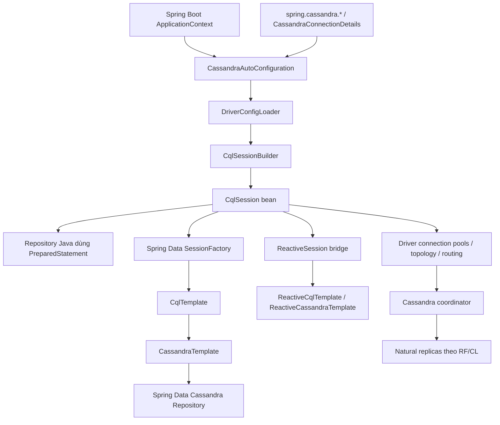
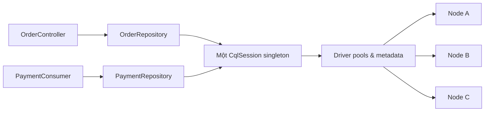
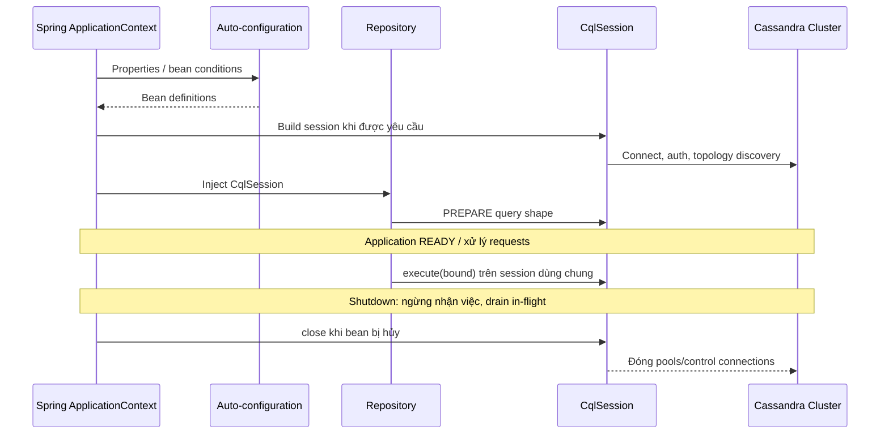
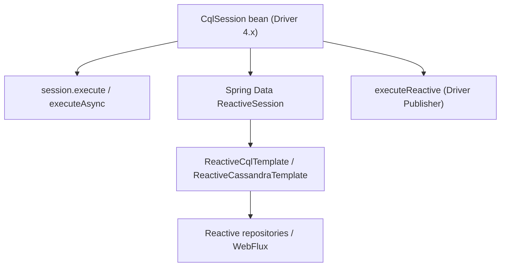

# CqlSession bean, auto-configuration và quản lý vòng đời

## 1. Bài toán: ai tạo, dùng và đóng kết nối Cassandra trong Spring Boot?

Trong một ứng dụng Java thông thường, ta có thể viết `CqlSession.builder().build()`, giữ đối tượng này và gọi `session.close()` khi thoát. Trong Spring Boot, cơ chế **dependency injection**, **auto-configuration** và **application lifecycle** nên thay thế phần quản lý thủ công đó. Nhiều controller, service, repository và scheduled job có thể đồng thời dùng Cassandra; nếu mỗi đối tượng tự tạo một session, hệ thống sẽ nhân đôi kết nối, metadata/control connection, thread pools và bộ nhớ cache prepared statements.

Điểm quan trọng nhất của bài: **`CqlSession` là đối tượng kết nối có vòng đời dài và thread-safe, không phải một connection ngắn hạn dành riêng cho mỗi truy vấn**. Spring Boot thường quản lý một bean `CqlSession` dùng chung; mỗi truy vấn tạo `BoundStatement` riêng, còn session quản lý việc định tuyến theo token, pooling và giao tiếp với các coordinator.

Bài thuộc chương **Spring Boot và Spring Data** của mô-đun `DATABASE_ENGINE_WIDE_COLUMN_CASSANDRA`. Những yếu tố cần kết nối với nhau gồm kiến trúc phân tán/wide-column, partition key, bảng theo truy vấn, consistency đọc ghi, CQL, replication, compaction, repair, xử lý lỗi và tích hợp Java.

**Mục tiêu học tập:**

1. Giải thích bean `CqlSession`, `CqlSessionBuilder`, Spring Data `SessionFactory` và `CassandraTemplate` khác nhau ở đâu.
2. Dùng starter và `spring.cassandra.*` để **Spring Boot tự cấu hình**, thay vì tự xây session trong từng service.
3. Biết khi nào cần `CqlSessionBuilderCustomizer`, `DriverConfigLoaderBuilderCustomizer` hoặc một `@Bean CqlSession` tự quản.
4. Quản lý startup, readiness, prepared statements, graceful shutdown và đóng session đúng chủ sở hữu.
5. Nhận diện hệ quả của nhiều session, nhiều cluster/DC, thiếu TLS/auth, sai local DC và schema tự động bị tạo/xóa khi khởi động.
6. Kiểm chứng bean wiring và đường đọc CQL trong Spring Boot bằng integration test, metrics và runbook.

> **Phạm vi phiên bản:** các ví dụ code Java và imports Spring Boot được neo vào **Spring Boot 3.5.x + Spring Data Cassandra 4.5.x + Apache Cassandra Java Driver 4.x**. Spring Boot **4.x** vẫn dùng `spring.cassandra.*` và ý tưởng tương tự, nhưng **package của một số loại auto-configuration/customizer đã chuyển** sang namespace mới; không copy nguyên imports từ bài này vào Boot 4 mà không đối chiếu API phiên bản đang dùng. Các đoạn CQL chỉ dùng trong **cluster lab**, không tự thay schema production.

## 2. Sơ đồ kiến trúc: một session phục vụ nhiều lớp



**Đọc sơ đồ từ trên xuống:**

- **Spring Boot** xem cấu hình và classpath để tạo bean phù hợp; không cần tự khởi tạo một session cho mỗi repository.
- **Java Driver** sở hữu các kết nối mạng, driver metadata, prepared cache, routing và retries.
- **Spring Data Cassandra** thêm mapping, template, repository và chuyển đổi exceptions. Nó **không phải một database connection khác** bắt buộc phải mở.
- **Cassandra** nhận CQL qua coordinator; dù code Spring chỉ gọi một method, vẫn cần một partition key/query pattern đúng, CL phù hợp và replicas khỏe.

**Không nhầm:** `CqlSession` ở Java Driver **khác** `SessionFactory` của Spring Data. `SessionFactory` là abstraction để các template lấy session được quản lý; nó không đồng nghĩa tạo một TCP connection cho mỗi lần gọi.

## 3. Chuẩn bị dự án: starter và dependency có vai trò khác nhau

Với Spring Boot 3.5.x, dependency thường dùng:

```xml
<!-- pom.xml: phần dependencies minh họa, version do Spring Boot BOM quản lý -->
<dependencies>
  <dependency>
    <groupId>org.springframework.boot</groupId>
    <artifactId>spring-boot-starter-data-cassandra</artifactId>
  </dependency>
  <dependency>
    <groupId>org.springframework.boot</groupId>
    <artifactId>spring-boot-starter-actuator</artifactId>
  </dependency>
  <dependency>
    <groupId>org.springframework.boot</groupId>
    <artifactId>spring-boot-starter-test</artifactId>
    <scope>test</scope>
  </dependency>
</dependencies>
```

Starter Cassandra đưa Java Driver và Spring Data Cassandra vào classpath theo bộ version tương thích do Spring Boot quản lý. Nếu ứng dụng **chỉ dùng Java Driver thuần**, có thể chọn dependency nhỏ hơn, nhưng khi đó phải hiểu điều kiện auto-configuration của phiên bản Boot và tự quyết định cần các template/repositories hay không.

**Không ép phiên bản Java Driver độc lập khỏi BOM** chỉ để lấy một API mới nếu chưa kiểm chứng tương thích Spring Data, Cassandra server và native protocol. Với Spring Boot 4.x, kiểm tra cả Java/Jakarta baseline, module auto-configuration và vị trí package mới trước khi nâng cấp.

### So sánh ba mức sử dụng

| Nhu cầu | API phía Java | Lợi ích | Giới hạn cần nhớ |
| --- | --- | --- | --- |
| Điều khiển query CQL trực tiếp | `CqlSession`, `PreparedStatement` | Rõ bind, CL, paging, driver features | Tự map row và xử lý exceptions |
| Query CQL có Spring hỗ trợ | `CqlTemplate` | Callback/query helpers và translation exceptions | Vẫn phải thiết kế CQL đúng partition key |
| Mapping entity/repository | `CassandraTemplate`, `CassandraRepository` | Mapping entity, repository CRUD | Không biến Cassandra thành JPA/RDBMS, không tự hỗ trợ mọi join/transaction |
| Reactive | `ReactiveCqlTemplate`, `ReactiveCassandraTemplate` hoặc driver `executeReactive` | Tích hợp Publisher/Reactor và nonblocking | Phải quản lý subscription/backpressure/error, vẫn dùng underlying session |

## 4. CQL lab: dữ liệu theo một partition key

Ví dụ keyspace `spring_cassandra_lab` tại DC tên `dc1`, RF3 khi lab có đủ node:

```sql
CREATE KEYSPACE spring_cassandra_lab
WITH replication = {'class': 'NetworkTopologyStrategy', 'dc1': 3}
AND durable_writes = true;

CREATE TABLE spring_cassandra_lab.orders_by_id (
    order_id uuid PRIMARY KEY,
    customer_id text,
    status text,
    total decimal,
    updated_at timestamp
);

INSERT INTO spring_cassandra_lab.orders_by_id
    (order_id, customer_id, status, total, updated_at)
VALUES (
    11111111-2222-4333-8444-555555555555,
    'synthetic-customer-01',
    'CREATED',
    125.50,
    '2026-11-21T08:00:00+0000'
);

SELECT order_id, status, total
FROM spring_cassandra_lab.orders_by_id
WHERE order_id = 11111111-2222-4333-8444-555555555555;
```

**Vì sao mô hình này phù hợp?** `order_id` là partition key; một truy vấn `WHERE order_id=?` có thể định tuyến theo token/replica. Bean `CqlSession` **không làm bảng sai truy vấn trở nên nhanh**: nếu API cần liệt kê theo customer/time range, nên thiết kế bảng khác theo query thay vì đưa `ALLOW FILTERING` vào repository một cách tùy tiện.

**Dữ liệu thử nghiệm** có UUID và customer ID giả. Không chạy lệnh tạo/xóa keyspace trên production hoặc để application role thường có quyền `CREATE/DROP`.

## 5. Auto-configuration của Spring Boot thực hiện những gì?

Theo API Spring Boot 3.5, lớp `org.springframework.boot.autoconfigure.cassandra.CassandraAutoConfiguration` cấu hình ba khâu chính:

```text
CassandraProperties / CassandraConnectionDetails
  -> DriverConfigLoader
  -> CqlSessionBuilder (prototype, có thể custom)
  -> CqlSession (lazy, conditional on missing bean)

Spring Data (khi classpath/conditions phù hợp)
  -> SessionFactory + CqlTemplate / CassandraTemplate
  -> Cassandra repositories / reactive alternatives
```

Các điểm phải hiểu:

1. **`@ConditionalOnClass(CqlSession.class)`:** Java Driver phải có trên classpath.
2. **`@ConditionalOnMissingBean`:** nếu ứng dụng khai báo một bean `CqlSession` riêng, auto-configuration thường **nhường quyền tạo session mặc định**. Đổi một bean có thể thay đổi toàn bộ graph.
3. **`@Lazy` trên session mặc định ở Boot 3.5:** bean có thể được tạo khi được dependency yêu cầu, không nhất thiết tại thời điểm tất cả config classes vừa được phát hiện. Nếu `@Service` inject nó khi khởi động, kết nối có thể được mở ngay trong startup.
4. **`CqlSessionBuilder` có scope prototype:** đây là builder **mutable**; không tái sử dụng một builder đã chỉnh cho cluster A để tạo session B mà chưa kiểm soát.
5. Spring Data auto-configuration làm việc **phía trên session hiện hữu**, không tạo một Cassandra cluster mới.

### Tên các lớp dễ xuất hiện trong báo cáo conditions

| Tầng | Spring Boot 3.5 class | Nhiệm vụ |
| --- | --- | --- |
| Kết nối Java Driver | `CassandraAutoConfiguration` | Loader, builder, `CqlSession` |
| Data mapping | `CassandraDataAutoConfiguration` | Converter, session factory, CQL/data templates |
| Repository imperative | `CassandraRepositoriesAutoConfiguration` | Spring Data repository beans |
| Reactive | `CassandraReactiveDataAutoConfiguration` | Reactive session/template bridge |
| Reactive repository | `CassandraReactiveRepositoriesAutoConfiguration` | Reactive repository beans |

Các lớp trên trong Boot 3.5 ở namespace `org.springframework.boot.autoconfigure...`; **Boot 4 đổi một số package**. Kiểm tra documentation/API/JAR của phiên bản đúng khi tra cứu auto-configuration report.

### Auto-config có nghĩa gì về tính sẵn sàng?

Có bean `CqlSession` trong ApplicationContext **không tự chứng minh** ba node Cassandra đang `UN`, đủ quorum hay application role được phép đọc bảng. Một kết nối thành công đến một coordinator cũng không chứng minh `LOCAL_QUORUM` của tất cả query sẽ đáp ứng SLO. Cần tách **bean wiring**, **connectivity**, **authorization**, **availability** và **business correctness**.

## 6. Khai báo `application.yml` tối thiểu, đúng namespace

Ví dụ cấu hình Spring Boot 3.5.x:

```yaml
spring:
  application:
    name: orders-api
  cassandra:
    contact-points:
      - cassandra-1.example.invalid:9042
      - cassandra-2.example.invalid:9042
    local-datacenter: dc1
    keyspace-name: spring_cassandra_lab
    username: ${CASSANDRA_APP_USER}
    password: ${CASSANDRA_APP_PASSWORD}
    request:
      timeout: 2s
      consistency: LOCAL_QUORUM
      page-size: 500
    connection:
      connect-timeout: 5s
    schema-action: none
```

**Đây là cấu hình minh họa, không phải endpoint có thể kết nối:** `example.invalid` là tên miền dành cho ví dụ; hãy thay bằng địa chỉ/tên DNS hợp lệ, đúng trust/TLS và credentials của lab. Không copy mật khẩu vào Git. Trong production, nạp secrets từ quản lý bí mật, có phân quyền truy cập và quy trình rotate.

| Property Boot 3.5 | Ý nghĩa | Sai lầm thường gặp |
| --- | --- | --- |
| `spring.cassandra.contact-points` | Seed addresses để driver bootstrap topology | Chỉ ghi node đã bị tắt hoặc contact points ở DC khác |
| `spring.cassandra.local-datacenter` | Tên DC mà driver coi là local | Sử dụng địa danh/alias không khớp DC thực trong snitch |
| `spring.cassandra.keyspace-name` | Default keyspace của session | Cho rằng nó tự tạo keyspace |
| `spring.cassandra.username/password` | Credential cho authenticator | Hard-code mật khẩu hoặc dùng superuser |
| `spring.cassandra.request.consistency` | CL mặc định của driver | Đổi CL chỉ để che thiếu replica hoặc timeout |
| `spring.cassandra.request.timeout` | Request timeout ở driver | Nhầm với API end-to-end deadline và connect timeout |
| `spring.cassandra.request.page-size` | Page-size hint | Nhầm với CQL `LIMIT` hay giới hạn bytes |
| `spring.cassandra.connection.connect-timeout` | Giới hạn thời gian mở connection | Nhầm với read/write timeout mỗi query |
| `spring.cassandra.schema-action` | Hành vi schema của Spring Data lúc khởi tạo | Vô tình chọn create/recreate/drop trên production |
| `spring.cassandra.ssl.*` | TLS/bundle/hostname verification | Chỉ bật flag mà chưa cấp trust chain phù hợp |

**Cẩn thận về tên prefix:** Với Spring Boot hiện đại, dùng `spring.cassandra.*`. Một số bài hướng dẫn **rất cũ** dùng `spring.data.cassandra.*` cho connection; không lấy nguyên cấu hình từ Boot 1.x/2.x cũ mà chưa đối chiếu metadata của version hiện tại.

### Boot properties và driver config file

Spring Boot có thể dùng cấu hình Java Driver riêng qua `spring.cassandra.config` khi cần các tham số nâng cao. Theo tài liệu Boot, nếu một property trùng cả trong file driver và `spring.cassandra.*`, giá trị Spring Boot properties có **độ ưu tiên cao hơn**.

```yaml
# Ví dụ lựa chọn nguồn cấu hình bổ sung:
spring:
  cassandra:
    config: classpath:custom-cassandra-driver.conf
    request:
      timeout: 2s
```

Không tự tạo thêm loader/session khi chỉ muốn chỉnh một timeout; ưu tiên **properties → driver config/customizer → custom session**, theo mức độ đặc biệt tăng dần.

## 7. CqlSession bean: singleton dùng chung và ownership rõ ràng

Spring Boot mặc định cung cấp bean theo scope singleton, và driver thiết kế `CqlSession` là **thread-safe, long-lived**. Điều đó không có nghĩa mọi object phụ trợ đều dùng chung an toàn:

- Một `CqlSession` chia sẻ giữa nhiều controllers/repositories là **đúng**.
- Một `PreparedStatement` cho một query shape chia sẻ qua nhiều requests thường là **đúng**.
- Một `BoundStatement` bất biến của Driver 4.x có thể dùng an toàn, nhưng mỗi request nên **bind giá trị riêng**.
- Một mutable `CqlSessionBuilder` tùy chỉnh cho hai clusters mà không clone/new builder là **nguy hiểm**.
- Một `ResultSet`/iterator hoặc collection tích lũy mutable dùng chung qua requests là **sai**.



**Không** tạo một session mới trong method xử lý request:

```java
// ANTI-PATTERN: mỗi request tạo và đóng session riêng.
Order findOrder(UUID id) {
    try (CqlSession session = CqlSession.builder().build()) {
        return query(session, id);
    }
}
```

Đoạn này làm tăng handshake, authentication, discovery, pool allocation và có thể tạo hàng trăm control connections/threads khi tải cao; đôi khi còn dùng config local DC/credentials khác với Boot. Cách đúng là **constructor injection** một bean đã do container quản lý.

## 8. Dùng bean được auto-config qua constructor injection

Ví dụ một repository thuần Java Driver, dùng schema từ mục 4:

```java
import java.math.BigDecimal;
import java.util.Optional;
import java.util.UUID;

import com.datastax.oss.driver.api.core.CqlSession;
import com.datastax.oss.driver.api.core.DefaultConsistencyLevel;
import com.datastax.oss.driver.api.core.cql.BoundStatement;
import com.datastax.oss.driver.api.core.cql.PreparedStatement;
import com.datastax.oss.driver.api.core.cql.Row;
import org.springframework.stereotype.Repository;

@Repository
public final class OrderLookupRepository {
    private final CqlSession session;
    private final PreparedStatement byId;

    public OrderLookupRepository(CqlSession session) {
        this.session = session;
        this.byId = session.prepare(
            "SELECT order_id, status, total " +
            "FROM spring_cassandra_lab.orders_by_id WHERE order_id = ?");
    }

    public Optional<OrderView> findById(UUID orderId) {
        BoundStatement request = byId.bind(orderId)
            .setConsistencyLevel(DefaultConsistencyLevel.LOCAL_QUORUM)
            .setIdempotent(true);

        Row row = session.execute(request).one();
        if (row == null) {
            return Optional.empty();
        }
        return Optional.of(new OrderView(
            row.getUuid("order_id"),
            row.getString("status"),
            row.getBigDecimal("total")));
    }

    public record OrderView(UUID orderId, String status, BigDecimal total) {}
}
```

**Lợi ích:** chỉ có một CqlSession; bean repository được Spring quản lý, prepared statement được tạo một lần theo lifecycle của repository. Driver dùng bound partition key để tối ưu routing khi có metadata cần thiết.

**Điểm cần cân nhắc:** `session.prepare(...)` trong constructor khiến Cassandra được truy cập trong lúc Spring tạo repository. Nếu cluster tạm chưa sẵn, ứng dụng có thể **fail startup**. Đây có thể là hành vi mong muốn với service không thể hoạt động nếu thiếu DB, nhưng phải đưa vào chiến lược readiness/retry deploy; nếu cần khởi động không phụ thuộc Cassandra, chuẩn bị statement **khi cần, có cache và kiểm soát lỗi** ở một component riêng, không xây toàn bộ session cho từng request.

Đừng gọi `session.close()` trong method `findById` hoặc `@PreDestroy` của repository này. Session là **bean chung do Spring sở hữu**, không phải resource mà repository được quyền đóng.

## 9. CqlTemplate, CassandraTemplate và Repository sử dụng cùng tài nguyên nào?

Nếu dependency Spring Data hiện diện, ứng dụng có thể inject template:

```java
import com.datastax.oss.driver.api.core.CqlSession;
import org.springframework.data.cassandra.core.CassandraTemplate;
import org.springframework.stereotype.Service;

@Service
public class OrderService {
    private final CqlSession session;
    private final CassandraTemplate template;

    public OrderService(CqlSession session, CassandraTemplate template) {
        this.session = session;
        this.template = template;
    }
}
```

Spring Data lấy session thông qua `SessionFactory`; nó **không đóng session sau mỗi query** vì session có vòng đời dài. Bạn có thể dùng trực tiếp Java Driver cho câu CQL cần kiểm soát CL/statement, và template/repository ở chỗ mapping đơn giản hơn; cả hai vẫn nên thống nhất **đường kết nối và role bảo mật**.

### Entity mapping ví dụ

```java
import java.math.BigDecimal;
import java.util.UUID;
import org.springframework.data.cassandra.core.mapping.PrimaryKey;
import org.springframework.data.cassandra.core.mapping.Table;
import org.springframework.data.cassandra.core.mapping.Column;

@Table("orders_by_id")
public class OrderEntity {
    @PrimaryKey("order_id")
    private UUID orderId;

    @Column("status")
    private String status;

    @Column("total")
    private BigDecimal total;

    // Getter/setter/constructor theo mapper đã chọn.
}
```

```java
import java.util.UUID;
import org.springframework.data.cassandra.repository.CassandraRepository;

public interface OrdersRepository
        extends CassandraRepository<OrderEntity, UUID> {
}
```

**Không giả định** JPA annotations, lazy joins, cascade transactions hoặc việc Spring Data tự sinh schema làm đúng mọi thiết kế Cassandra. `Repository.findById` theo primary key phù hợp; một method suy ra query lọc bằng cột không thuộc partition/clustering keys có thể đòi index hoặc không hỗ trợ hiệu quả. Ưu tiên thiết kế bảng theo **query patterns** rồi mới viết repository.

### Tranh chấp quyền sở hữu schema

`spring.cassandra.schema-action: none` là lựa chọn an toàn khi schema production được quản lý bởi migrations/runbook riêng. Các schema actions như create/recreate/drop **không nên tự bật trên production** khi nhiều instance Spring Boot khởi động đồng thời. Thay đổi DDL cần có một chủ sở hữu, schema agreement và kế hoạch expand/contract cho các phiên bản ứng dụng chạy song song.

## 10. Tùy chỉnh nhẹ: `CqlSessionBuilderCustomizer`

Theo API Spring Boot 3.5, customizer này được auto-configuration gọi trước khi build session, giúp thay đổi builder **mà vẫn giữ phần connection details/configuration còn lại**.

```java
import org.springframework.context.annotation.Bean;
import org.springframework.context.annotation.Configuration;
import org.springframework.boot.autoconfigure.cassandra.CqlSessionBuilderCustomizer;

@Configuration(proxyBeanMethods = false)
public class CassandraDriverCustomization {

    @Bean
    CqlSessionBuilderCustomizer applicationIdentity() {
        return builder -> builder.withApplicationName("orders-api");
    }
}
```

`withApplicationName` là API của Java Driver 4.x, dùng trong thông tin khởi tạo kết nối/observability khi server hỗ trợ. Cách này **không tạo một session mới** và không làm mất các property `spring.cassandra.*` được Boot áp dụng.

### Khi nào dùng customizer?

- Cần cấu hình trực tiếp trên builder mà property Boot không bao phủ.
- Cần gắn một plugin/listener/driver-specific option tương thích phiên bản.
- Muốn giữ auto-config, dependency injection, Spring Data wiring và vòng đời Spring quản lý.

**Đừng** dùng customizer để gọi `builder.build()` bên trong callback: callback chỉ **cấu hình builder**, Boot là thành phần build session. Không lưu builder này vào static variable rồi sửa từ request thread, vì builder là mutable.

## 11. Tùy chỉnh driver config: `DriverConfigLoaderBuilderCustomizer`

Khi cấu hình liên quan timeout, connection pooling, request throttling, request consistency hoặc metric của driver, **ưu tiên property Boot đã hỗ trợ**. Trường hợp cần một option chưa được ánh xạ, có thể dùng driver config loader customizer.

```java
import java.time.Duration;
import org.springframework.context.annotation.Bean;
import org.springframework.context.annotation.Configuration;
import org.springframework.boot.autoconfigure.cassandra.DriverConfigLoaderBuilderCustomizer;
import com.datastax.oss.driver.api.core.config.DefaultDriverOption;

@Configuration(proxyBeanMethods = false)
public class DriverTimeoutConfig {

    @Bean
    DriverConfigLoaderBuilderCustomizer loaderSettings() {
        return builder -> builder.withDuration(
            DefaultDriverOption.REQUEST_TIMEOUT,
            Duration.ofSeconds(2));
    }
}
```

Ở ví dụ này, timeout 2s **cũng có thể đặt bằng `spring.cassandra.request.timeout: 2s`** và thường nên chọn cách đơn giản hơn. Nếu cùng một option được quy định ở nhiều nơi, cần kiểm tra **ưu tiên cấu hình thực tế** theo Boot/Driver version; tránh điều chỉnh một nơi rồi thất vọng khi nơi khác override.

**Hai loại customizer khác nhau:**

| Loại | Thao tác trên | Ví dụ | Không nên làm |
| --- | --- | --- | --- |
| `CqlSessionBuilderCustomizer` | `CqlSessionBuilder` | Application name, driver extension | Gọi build/close session trong callback |
| `DriverConfigLoaderBuilderCustomizer` | `ProgrammaticDriverConfigLoaderBuilder` | Driver execution options | Sửa live connection của mọi request bằng cách tạo loader mới |

**Lưu ý namespace:** Hai customizer có package `org.springframework.boot.autoconfigure.cassandra` trên Boot 3.5. Với Boot 4, tra API `org.springframework.boot.cassandra.autoconfigure`. Cùng một interface name nhưng **imports cũ không biên dịch** ở phiên bản mới.

## 12. Khi thật sự cần `@Bean CqlSession` thủ công

Nếu dùng một cơ chế authentication đặc biệt, multiple clusters, certificate rotation có quy trình riêng, hay phải xây `CqlSession` không theo auto-config, có thể khai báo bean:

```java
import com.datastax.oss.driver.api.core.CqlSession;
import com.datastax.oss.driver.api.core.CqlSessionBuilder;
import org.springframework.context.annotation.Bean;
import org.springframework.context.annotation.Configuration;

@Configuration(proxyBeanMethods = false)
public class ExplicitCqlSessionConfig {

    @Bean(destroyMethod = "close")
    CqlSession applicationSession(CqlSessionBuilder builder) {
        // Boot 3.5 có thể cung cấp CqlSessionBuilder dạng prototype.
        // Thay đổi builder tại đây chỉ khi đã xác định cần.
        return builder.build();
    }
}
```

**Lưu ý thực thi:** cấu hình này là **một phương án thay thế auto-config session**, không đặt thêm vào một ứng dụng đang vận hành tốt chỉ để “đảm bảo có bean”. Spring Boot 3.5 dùng `@ConditionalOnMissingBean` nên khi phát hiện bean `CqlSession` do ứng dụng khai báo, nó thường **không tạo session mặc định**. Các template/repository sẽ phụ thuộc session do bạn tạo.

Nếu bạn khai báo **hai bean `CqlSession`**, injection theo type có thể **mơ hồ**. Cần `@Primary`/`@Qualifier` và wiring Spring Data/template rõ ràng, không mong Boot tự đoán cluster nào là “đơn hàng” và cluster nào là “lưu trữ”.

### Không đúp quá trình tạo/đóng

Sai:

```java
@Service
class BadOrderService {
    private final CqlSession injected;

    BadOrderService(CqlSession injected) {
        this.injected = injected;
    }

    @PreDestroy
    void stop() {
        injected.close(); // Sai ownership: service đóng session dùng chung.
    }
}
```

Đúng hơn: Spring sở hữu session bean; trong cấu hình manual dùng `@Bean(destroyMethod="close")` hoặc lifecycle contract tương đương, **đóng một lần khi ApplicationContext dừng**, sau khi đã xử lý in-flight work theo chính sách shutdown. Khi bean session được Boot tạo, container cũng quản lý việc giải phóng của bean đó; không tạo thêm một shutdown hook tự đóng cùng đối tượng.

## 13. Lifecycle thật: từ khởi động đến shutdown



### 13.1. Khởi động

1. Spring đọc properties, profile/environment, `CassandraConnectionDetails` nếu có service connection và các customizers.
2. Auto-config đăng ký bean definitions; ở Boot 3.5, session mặc định có tính **lazy** ở mức phương thức.
3. Khi một component cần session, driver build và bắt đầu kết nối/auth/discover nodes. **Lỗi network/auth có thể nổi lên trong startup** nếu bean được yêu cầu ở startup.
4. Nếu repository prepare statement trong constructor, schema/keyspace/table phải tồn tại và role phải có quyền; `schema-action: none` không tự tạo chúng.
5. Ứng dụng chỉ nên được đánh dấu **ready** khi các điều kiện thiết yếu đã được thỏa thuận, không chỉ khi cổng HTTP bind thành công.

### 13.2. Runtime

Một session thường quản lý:

- topology/metadata và lựa chọn local DC cho routing;
- connection pools đến nodes và control connection phục vụ cluster discovery;
- prepared statement cache/reprepare sau restart;
- request timeout, consistency, retry/idempotence, paging/tracing/metrics theo version.

Application logic phải tạo statement/bind values cho từng request; đừng đổi keyspace bằng lệnh `USE` theo request, vì session là tài nguyên chung. Ưu tiên **tên bảng đầy đủ** `keyspace.table` trong CQL và role least privilege.

### 13.3. Shutdown

1. Ngừng nhận request/message mới hoặc chuyển readiness ra khỏi luồng traffic.
2. Chờ/giới hạn in-flight requests và acknowledgements nghiệp vụ theo SLA.
3. Dừng scheduled jobs/consumers theo thứ tự phụ thuộc.
4. Container hủy beans và đóng session; các connection pools/driver threads được giải phóng.

Không suy rằng `close()` rollback các mutations đã được gửi. Với write timeout/cancel, outcome có thể không rõ và cần business idempotency/reconciliation.

## 14. Graceful shutdown: đóng quá sớm gây lỗi thật

Đặt mức shutdown phù hợp ứng dụng web, ví dụ:

```yaml
server:
  shutdown: graceful
spring:
  lifecycle:
    timeout-per-shutdown-phase: 30s
```

Điều này cho Spring Boot cơ hội dừng web requests theo vòng đời server; **không tự chứng minh** mọi Kafka consumer, background executor, reactive stream hoặc request CQL đã drain xong. Với workload nền, component cần chính sách stop riêng.

| Sự kiện shutdown | Rủi ro | Hành động |
| --- | --- | --- |
| Kubernetes gửi SIGTERM | Pod còn in-flight HTTP requests | Gỡ khỏi routing, chờ graceful stop |
| Kafka consumer đang xử lý write | Offset bị ack trước khi CQL hoàn tất | Ack sau kết quả nghiệp vụ, checkpoint/idempotency |
| Reactive stream vẫn subscribe | Session đóng trong khi publisher đang fetch trang sau | Định nghĩa cancel/drain và thời hạn |
| Scheduled job chạy batch | Closing session từ job bất kỳ làm lỗi toàn ứng dụng | Job không sở hữu session; lifecycle stop theo orchestrator |
| Request ghi timeout sát shutdown | Không rõ đã được áp dụng hay chưa | Khôi phục theo event ID/outbox sau restart |

**Đừng dùng `@PreDestroy` của mỗi repository để đóng injected session.** Một bean đơn nhất có thể được dùng bởi nhiều repositories; ai tạo session thì người đó chịu trách nhiệm đóng. Khi nhiều contexts/child contexts cùng dùng một instance, thiết kế rõ ownership để tránh đóng trùng.

## 15. Health check và readiness: không để liveness tạo vòng restart

Spring Boot Actuator có Cassandra health contributor khi cấu hình/điều kiện phù hợp. Nó giúp kiểm tra database có sẵn sàng ở mức nhất định; **không phải bằng chứng toàn bộ bảng/partition/CL và mọi DC đều đáp ứng SLO**.

```yaml
management:
  endpoints:
    web:
      exposure:
        include: health,info
  endpoint:
    health:
      show-details: never
  health:
    cassandra:
      enabled: true
```

**Tách hai ý nghĩa:**

- **Liveness:** tiến trình còn hoạt động và không bị deadlock nghiêm trọng. Tránh để mất Cassandra tạm thời làm Kubernetes restart đồng loạt các pod khỏe, gây connection storm.
- **Readiness:** có nên nhận traffic mới? Với API cần đọc/ghi Cassandra, cần một policy kiểm tra có đủ khả năng phục vụ. Việc kiểm tra `LOCAL_QUORUM`, quyền của service role hoặc query mẫu **có thể** là phần của readiness nếu được thiết kế ít tải và không chứa PII.

Một health indicator mặc định không bắt buộc kiểm tra chính câu `SELECT ... WHERE pk=?` của ứng dụng. Nếu bảng theo query phụ thuộc nhiều DC hay có authorization đặc biệt, bổ sung **smoke test nghiệp vụ định kỳ** có giới hạn và cảnh báo riêng, không query liên tục mỗi lần kube probe.

### Không expose topology/credential ra Actuator

`/actuator/health`, `/actuator/env`, `/actuator/configprops` và debug conditions có thể lộ thông tin cấu hình/hạ tầng nếu mở sai. Giới hạn endpoints, RBAC và details; không đưa raw Cassandra passwords, contact points nhạy cảm hoặc query bind values vào response public.

## 16. TLS, authentication và authorization trong vòng đời session

**Spring Bean không tạo bảo mật tự động.** Nếu CQL traffic phải mã hóa, cần cấu hình driver trust chain/TLS và bảo đảm certificate hostname khớp contact point. Ví dụ production:

```yaml
spring:
  cassandra:
    ssl:
      enabled: true
      verify-hostname: true
      # bundle: cassandra-client  # Chỉ khi đã khai báo SSL bundle tương ứng.
    username: ${CASSANDRA_APP_USER}
    password: ${CASSANDRA_APP_PASSWORD}
```

**Bật TLS mà không cấp CA/truststore/SSL bundle phù hợp** có thể gây handshake failure, không phải lỗi keyspace. TLS client-to-node và mã hóa inter-node Cassandra là hai phạm vi cấu hình khác nhau; role `app_orders` cần quyền trên bảng, chứ không dùng superuser.

Ví dụ trong **lab đã bật CassandraAuthorizer**:

```sql
-- Chỉ thực thi qua account bảo mật được duyệt trong LAB.
CREATE ROLE app_orders
WITH LOGIN = true AND SUPERUSER = false
AND PASSWORD = '<LAB_RANDOM_SECRET>';

GRANT SELECT ON TABLE spring_cassandra_lab.orders_by_id
TO app_orders;
```

Nếu `app_orders` chỉ có SELECT, `INSERT/UPDATE/DELETE` hoặc schema DDL sẽ bị từ chối theo cấu hình authorizer có hiệu lực. Việc Spring tạo bean và login thành công **không chứng minh** service có quyền với mọi bảng. Với Cassandra nhiều phiên bản, role metadata ở `system_auth` chịu ảnh hưởng RF/topology/caches; các quyền cấp/thu hồi có thể có độ trễ hiệu lực, cần test qua nhiều coordinator.

## 17. Vì sao “một keyspace = một session” không tuyệt đối?

CqlSession có thể có **default keyspace**, nhưng CQL hoàn toàn có thể dùng **fully qualified names** trên nhiều keyspace nếu role có quyền. Không cần tạo thêm một session chỉ vì ứng dụng đọc `orders_ks.orders_by_id` và `audit_ks.audit_by_id` trên **cùng cluster với cùng credentials/security/driver config**.

Khi nào tách session là hợp lý?

| Trường hợp | Có thể dùng chung? | Lý do |
| --- | --- | --- |
| Hai bảng, cùng keyspace | **Có** | Cùng cluster và policy |
| Hai keyspace, cùng cluster, cùng credentials | **Thường có** | Dùng tên bảng đầy đủ; không cần thêm control connection |
| Hai clusters vật lý khác nhau | **Không nên dùng một session** | Session quản lý một cluster topology |
| Cùng cluster nhưng hai identities/role riêng | **Có thể cần tách** | Authentication/permissions của session gắn danh tính |
| DC khác, routing policy khác rõ ràng | **Đánh giá riêng** | Driver local DC/routing, failover/WAN strategy cần explicit |
| Multi-tenant isolation qua role riêng | **Không giả định chung** | RBAC của Cassandra ở mức table/keyspace, không có row-level ACL mặc định |

**Cái giá của session mới:** mở thêm pools, control connection, topology listeners, memory/threads và prepared cache. Với hàng nghìn tenants, **một session mỗi tenant** thường gây tài nguyên quá lớn; hãy xem lại mô hình cô lập và security architecture.

## 18. Đa cluster: cần `@Qualifier` và quản lý đúng mỗi bean

Nếu buộc phải kết nối hai cluster, mỗi session phải có tên/credentials/local DC riêng. Ví dụ cấu trúc (rút gọn, chỉ để minh họa ownership):

```java
import java.net.InetSocketAddress;
import com.datastax.oss.driver.api.core.CqlSession;
import org.springframework.beans.factory.annotation.Qualifier;
import org.springframework.context.annotation.Bean;
import org.springframework.context.annotation.Configuration;
import org.springframework.context.annotation.Primary;

@Configuration(proxyBeanMethods = false)
public class TwoClustersConfig {

    @Bean(name = "primaryClusterSession", destroyMethod = "close")
    @Primary
    CqlSession primary() {
        return CqlSession.builder()
            .addContactPoint(new InetSocketAddress("192.0.2.11", 9042))
            .withLocalDatacenter("dc1")
            .withAuthCredentials("orders_role", System.getenv("ORDERS_DB_PASS"))
            .build();
    }

    @Bean(name = "archiveClusterSession", destroyMethod = "close")
    CqlSession archive() {
        return CqlSession.builder()
            .addContactPoint(new InetSocketAddress("192.0.2.22", 9042))
            .withLocalDatacenter("archive_dc")
            .withAuthCredentials("archive_role", System.getenv("ARCHIVE_DB_PASS"))
            .build();
    }
}

// Trong repository:
// ArchiveRepository(@Qualifier("archiveClusterSession") CqlSession session)
```

`192.0.2.0/24` là địa chỉ TEST-NET minh họa; **không có TLS trong code rút gọn này** nên nó **không phải cấu hình production an toàn**. Trong hệ thống thật, định nghĩa TLS, truststore, failure policy, metrics/session names và secrets cho từng cluster; không chỉ copy code.

**Điểm dễ sai:** Boot mặc định có thể lùi lại khi đã thấy bean CqlSession; các Spring Data template/repository auto-config có thể chọn session `@Primary`. Nếu muốn hai bộ repositories thực sự tách biệt, cần cấu hình riêng `SessionFactory`/template/repositories bằng tên/qualifier, không chỉ định nghĩa hai `CqlSession` rồi hy vọng auto-config tự phân tách.

## 19. Reactive và async: không cần một session thứ hai chỉ vì đổi API

Spring Data Cassandra hỗ trợ lớp imperative lẫn reactive. Khi classpath/conditions phù hợp, Spring Boot có thể tạo `ReactiveSession`/`ReactiveCqlTemplate`/`ReactiveCassandraTemplate` từ **underlying CqlSession**.



**Một số quy tắc quan trọng:**

- Reactive publisher chỉ thực thi khi **subscribe**; không tạo `Publisher` rồi trả HTTP 200/ack message trước khi pipeline hoàn tất.
- Không gọi `block()/join()` trên Netty/Reactor event-loop hoặc driver I/O callback.
- Với nhiều rows/pages, bảo toàn backpressure, không `collectList()` vô hạn.
- Khi subscriber cancel hoặc timeout, **không kết luận Cassandra đã rollback mutation**.
- Khi dùng Spring Data reactive/template, không đóng `CqlSession` bên trong mỗi subscription; bean/container chịu trách nhiệm vòng đời.

### Ví dụ dùng Driver 4.x với WebFlux

```java
import reactor.core.publisher.Mono;
import reactor.core.publisher.Flux;
import com.datastax.oss.driver.api.core.cql.Row;

public Mono<OrderLookupRepository.OrderView> findReactive(UUID id) {
    return Flux.defer(() ->
        Flux.from(session.executeReactive(byId.bind(id)
            .setConsistencyLevel(DefaultConsistencyLevel.LOCAL_QUORUM)
            .setIdempotent(true))))
        .next()
        .map(row -> new OrderLookupRepository.OrderView(
            row.getUuid("order_id"),
            row.getString("status"),
            row.getBigDecimal("total")));
}
```

Đoạn này thuộc một repository giả định có `session`/`byId` ở scope; chỉ áp dụng cho SELECT theo một primary key trả tối đa một hàng. `Flux.defer` giúp tạo publisher mới cho từng subscription (driver reactive publisher có ràng buộc single subscription). Nếu dùng `Mono.empty()` làm “not found”, controller phải phân biệt với `onError` thật. Không dùng `onErrorResume(e -> Mono.empty())` để che outage.

## 20. Quan sát: khi thấy nhiều kết nối, tìm bean trước khi tìm compaction

Một Spring Boot service tạo **nhiều CqlSession** hơn dự kiến có thể làm:

- Nhiều control connections, connection pools và metadata refresh events.
- Nhiều prepared caches, thêm PREPARE/reprepare traffic.
- Tăng thread count/memory, CPU/GC và connection churn.
- Khi deploy đồng loạt 100 pods, tạo connection storm lên Cassandra; startup/readiness bị trễ.

Những chỉ số nên theo dõi:

| Lớp | Chỉ số | Dùng để kết luận |
| --- | --- | --- |
| Spring | Bean `CqlSession` count, bean names, auto-config conditions | Có custom bean làm Boot back off không? |
| Startup | Session init duration, auth/TLS/topology errors | Cluster thiếu readiness hay config sai? |
| Driver | Connections, in-flight, pool saturation, request retries, p95/p99 | Phần client có gây chậm không? |
| CQL | Successful QPS, timeout/error, CL, paging, query shapes | Có query theo partition key đúng và đủ kết quả? |
| Cassandra | `nodetool status/tpstats/compactionstats`, table read metrics | Replica/compaction/repair có gây độ trễ? |
| Shutdown | In-flight chưa xong, consumer ack, driver connection close | Có mất/có thể lặp công việc nghiệp vụ không? |

**Không log toàn bộ `CqlSession`, raw CQL bind values hoặc Cassandra credentials** để debug bean wiring. Actuator conditions/beans hữu ích ở môi trường được bảo vệ; với production chỉ bật truy cập cho người có quyền và redact cấu hình nhạy cảm.

### Lệnh Cassandra read-only khi chẩn đoán

```bash
nodetool status
nodetool describecluster
nodetool tpstats
nodetool compactionstats
nodetool tablestats spring_cassandra_lab.orders_by_id
```

Các lệnh trên quan sát **node được hỏi** và cluster theo phạm vi công cụ, không biến health indicator trên một ứng dụng thành chứng nhận mọi replica/CL khỏe. Nếu `CqlSession` bean có thể tạo được nhưng `LOCAL_QUORUM` không đạt, phải điều tra RF/DC/rack/replica cùng số liệu driver và host.

## 21. Kiểm thử auto-config và lifecycle không cần đụng production

### 21.1. Unit test bean wiring

Với Spring Test/ApplicationContext, kiểm tra số beans CqlSession, tên/qualifiers, customizer được áp dụng; thử một trường hợp có custom `@Bean` để xác minh auto-config backoff. Bản unit test **không cần Cassandra thật** nếu mock phần tạo session/bean definitions phù hợp; không kiểm tra giao thức bằng một mock rồi tuyên bố kết nối thật đã hoạt động.

### 21.2. Integration test với Testcontainers

Spring Boot 3.5 hỗ trợ `@DataCassandraTest` và tích hợp Testcontainers `@ServiceConnection`. Phải có dependencies test tương ứng như `spring-boot-testcontainers` và module Cassandra của Testcontainers phiên bản tương thích.

```java
import com.datastax.oss.driver.api.core.CqlSession;
import org.junit.jupiter.api.Test;
import org.springframework.beans.factory.annotation.Autowired;
import org.springframework.boot.test.autoconfigure.data.cassandra.DataCassandraTest;
import org.springframework.boot.testcontainers.service.connection.ServiceConnection;
import org.testcontainers.containers.CassandraContainer;
import org.testcontainers.junit.jupiter.Container;
import org.testcontainers.junit.jupiter.Testcontainers;
import org.testcontainers.utility.DockerImageName;

import static org.assertj.core.api.Assertions.assertThat;

@Testcontainers
@DataCassandraTest(properties = "spring.cassandra.schema-action=none")
class CassandraSessionWiringIT {
    @Container
    @ServiceConnection
    static CassandraContainer<?> cassandra =
        new CassandraContainer<>(
            DockerImageName.parse("cassandra:4.1"));

    @Autowired CqlSession session;

    @Test
    void createsDriverSession() {
        assertThat(session).isNotNull();
        assertThat(session.execute(
            "SELECT release_version FROM system.local").one()).isNotNull();
    }
}
```

**Lưu ý về version:** ví dụ dùng API Testcontainers 1.x và Boot 3.5. Testcontainers mới hơn có thể thay package/module, Spring Boot 4 thay package `@DataCassandraTest`. Hãy căn chỉnh dependencies với BOM và **không** bắt buộc ghim `cassandra:4.1` như một version production. Nếu test yêu cầu kiểm tra table lab, tạo schema fixture riêng trong container trước khi repository chạy; `schema-action: none` **không tự sinh keyspace/table**.

### 21.3. Test lifecycle và đóng một lần

Trong test dùng một fake/wrapped CqlSession hoặc hook đã được kiểm chứng, xác minh:

- Context tạo không quá một session cho cấu hình một cluster.
- Hai service cùng inject **cùng session instance**.
- Closing một repository không làm session bị đóng.
- Khi context shutdown, bean session được giải phóng **một lần**.
- Scheduled job/consumer dừng theo lifecycle và không gửi request sau khi session đóng.

Không cần thử bằng cách giết node Cassandra production. Có thể dùng test double cho lifecycle và container cô lập cho integration.

## 22. Sự cố thường gặp và cách phân biệt nguyên nhân

| Hiện tượng | Nguyên nhân cần xem | Hướng xử lý |
| --- | --- | --- |
| `NoSuchBeanDefinitionException: CqlSession` | Thiếu driver/starter, auto-config bị exclude, profile/condition không match | Xem classpath, `--debug`/conditions report có kiểm soát |
| `NoUniqueBeanDefinitionException: CqlSession` | Hai cluster sessions, injection thiếu qualifier | `@Qualifier`/`@Primary` và templates/repo wiring |
| Khởi động chậm/không lên | Auth/TLS/contact points/local DC sai, node unavailable | Đối chiếu driver logs + topology; không mở firewall bừa |
| Boot app lên nhưng query thất bại lần đầu | Session lazy/bean chưa được ép khởi tạo, role/table không tồn tại | Readiness đúng yêu cầu, warmup có kiểm soát |
| Bean CqlSession được tạo hai lần | Custom config + auto-config/child context, factory thủ công trong service | Kiểm kê bean graph và code `CqlSession.builder()` |
| Sau mỗi HTTP request connection tăng | Tạo/đóng session trong request scope | Constructor inject singleton, không instantiate per request |
| Java Driver báo `UnauthorizedException` | Role thiếu `SELECT/MODIFY` | Test quyền trên table, không cấp superuser |
| Query báo table không tồn tại | Sai keyspace hoặc schema migration chưa chạy | Kiểm tra fully qualified CQL/schema agreement |
| p99 xấu dù Spring bean khỏe | Query không theo PK, hot partition, compaction/repair, CL | Trace/metrics đúng scope, không tự tăng session count |
| Spring Data template không dùng đúng cluster | Nhiều sessions, `@Primary` chọn sai hoặc SessionFactory wiring | Explicit factories/qualifiers và integration tests |
| Reconnect/timeout sau rotate secret | Credential/TLS thay nhưng session cũ còn dùng | Chiến lược rollout/recreate session có kiểm soát |
| Shutdown mất event | Ack message trước DB success hoặc session đóng trước drain | Lifecycle stop → await → close, retry idempotent |
| Actuator health UP nhưng một query P0 fail | Health check không bao phủ query/CL/business correctness | Bổ sung smoke test, readiness theo contract |
| App tạo/xóa bảng khi startup | `schema-action` nguy hiểm | `none`, quản lý schema riêng theo change |
| Boot 4 code không nhận customizer import | Namespace class thay đổi | Đối chiếu Boot 4 API, không copy import 3.5 |

## 23. Runbook triển khai Spring Boot + Cassandra

### P0 — Chốt topology và hợp đồng

Kiểm kê cluster/DC, contact points, keyspace, RF/CL, partition key/query patterns, role và TLS. Xác định Spring Boot/Driver/Spring Data version; không để một service tự chọn DC khác khi failover nếu chưa có thiết kế.

### P1 — Để Boot quản lý một session

Khai báo starter, `spring.cassandra.*`, schema-action none và secrets. Ưu tiên auto-config; customizer chỉ khi cần. Ghi lý do nếu thay bằng `@Bean CqlSession`, chủ sở hữu close và số sessions cho từng cluster.

### P2 — Tách schema migration khỏi startup đa pod

Tạo/đổi keyspace và tables theo change được duyệt; kiểm tra schema agreement, app version tương thích và quyền role. Không cho mỗi pod cùng tạo/drop schema khi rollout.

### P3 — Test context và kết nối

Kiểm tra bean CqlSession và SessionFactory/templates/qualifier, kết nối TLS/auth, local DC, query theo partition key/CL. Chạy integration tests với fixture và Testcontainers, không chỉ mock.

### P4 — Readiness và startup

Kiểm tra driver session thực sự connect, permissions hợp lệ và application-level smoke test khi cần. Không làm liveness phụ thuộc một endpoint Cassandra không ổn định. Nếu lazy session, quyết định rõ warmup trước ready hay cho request đầu gặp lỗi.

### P5 — Canary và giám sát

Đo startup time, số connections/node, request in-flight, retries, p95/p99, successful QPS, error và pool saturation. Với Cassandra, đối chiếu compaction/repair/hot partitions; không gán mọi chậm trễ cho Spring.

### P6 — Shutdown an toàn

Đặt graceful shutdown, dừng nhận job, chờ/giới hạn in-flight, giữ business idempotency và đóng session từ container một lần. Theo dõi request sau close và các write outcome chưa rõ.

### P7 — Rà soát vận hành định kỳ

Kiểm tra version mismatch, certificates/secret rotation, quyền quá rộng, bean tạo dư, schema-action và driver config overrides. Diễn tập node loss/DC failure theo yêu cầu RF/CL và đo RTO ở cấp ứng dụng, không chỉ đo trạng thái process.

## 24. Bài tập tự kiểm tra

1. Vì sao `CqlSession` nên dùng dạng singleton dùng chung, còn `BoundStatement` nên được bind theo mỗi request?
2. Spring Boot có thể tạo `CqlSession` từ những thành phần `DriverConfigLoader`/`CqlSessionBuilder`/properties nào?
3. `@ConditionalOnMissingBean` có nghĩa gì khi bạn tự khai báo `@Bean CqlSession`?
4. Vì sao `@Lazy` của session bean ở Boot 3.5 có thể làm lỗi kết nối xuất hiện muộn hơn thời điểm startup?
5. Khác nhau giữa Java Driver `CqlSession`, Spring Data `SessionFactory`, `CqlTemplate` và `CassandraTemplate`?
6. Một repository tạo `CqlSession.builder().build()` trong mỗi method có những chi phí nào?
7. Vì sao không dùng `try (CqlSession s = injectedSession)` trong business method?
8. Vai trò của `spring.cassandra.local-datacenter` là gì khi cluster có nhiều DC? Nó có thay RF không?
9. Cấu hình `spring.cassandra.keyspace-name` có tự tạo keyspace không?
10. Vì sao `schema-action: none` thường phù hợp production, nhất là khi nhiều pod khởi động cùng lúc?
11. Khi nào nên dùng `CqlSessionBuilderCustomizer` thay vì tự khai báo một bean session?
12. Sự khác nhau giữa `DriverConfigLoaderBuilderCustomizer` và `CqlSessionBuilderCustomizer`?
13. Nếu một cấu hình driver option xuất hiện trong file driver và `spring.cassandra.*`, cần kiểm tra quy tắc ưu tiên nào?
14. Vì sao `CassandraTemplate` không đồng nghĩa mở một Cassandra connection mới?
15. Một ứng dụng đọc hai keyspace cùng cluster/cùng role, có bắt buộc hai CqlSession không?
16. Khi có hai cluster sessions, vì sao phải dùng `@Qualifier` và có thể phải tự cấu hình SessionFactory/repositories?
17. Boot Actuator cassandra health UP có chứng minh một query `LOCAL_QUORUM` ở partition nóng sẽ đúng và nhanh không?
18. Vì sao không nên gắn một outage Cassandra tạm thời trực tiếp vào liveness probe khiến pod restart liên tục?
19. Điều gì xảy ra khi Kafka consumer ack offset trước khi reactive write hoàn tất?
20. Vì sao token-aware routing và query design vẫn quan trọng dù Spring Data đã cung cấp Repository CRUD?
21. Thiết kế một integration test chứng minh Bean CqlSession thực sự hoạt động với Cassandra Testcontainers.
22. Liệt kê các bước để rotate credentials/TLS mà không gây mất toàn bộ connection của mọi pod cùng lúc.
23. Nếu service Java có hai `CqlSession` sau deploy mới, hãy lập quy trình tìm nguồn tạo và chỉ số để đánh giá overhead.
24. Nếu app Boot 3.5 lên Boot 4, các package customizer cần rà soát ở đâu?

### Bài tổng hợp: một ứng dụng Order API

Hãy xây dựng ứng dụng Spring Boot với `GET /orders/{orderId}`:

- Dùng starter Cassandra, cấu hình `spring.cassandra.contact-points`/`local-datacenter`/`keyspace-name`, schema-action none, credential từ secret manager và TLS.
- Inject một `CqlSession` vào `OrderLookupRepository`; prepare câu `SELECT order_id,status,total ... WHERE order_id=?`, bind UUID, chạy CL `LOCAL_QUORUM`.
- Trả 404 khi row vắng mặt; phân biệt timeout, unavailable và unauthorized, không che các lỗi này bằng kết quả rỗng.
- Dùng Actuator health/readiness có kiểm soát, tránh liveness phụ thuộc Cassandra transient error; không expose secrets.
- Chạy `@DataCassandraTest` với Testcontainers, kiểm tra bean wiring, query fixture, role SELECT và keyspace đúng.
- Canary đo p95/p99, successful QPS, driver pool, compaction, cleanup và graceful shutdown dưới in-flight requests.
- Mở rộng thêm archive cluster **chỉ nếu có nhu cầu thực**, dùng session riêng và qualifier rõ; xác minh không tạo thêm session vô tình.

**Tiêu chí hoàn thành:** người học lý giải được **ai tạo và ai đóng CqlSession**, tự cấu hình được một bean session qua Boot mà không nhân kết nối, biết phân biệt customizer với override bean, mapping Spring Data với driver session, xử lý startup/readiness/shutdown và test kết nối thật trong môi trường cô lập.

## 25. Tài liệu tham khảo

- [Spring Boot 3.5 — Working with NoSQL Technologies: Cassandra](https://docs.spring.io/spring-boot/3.5/reference/data/nosql.html): starter, `CqlSession`, properties và customizers.
- [Spring Boot 3.5 — CassandraAutoConfiguration API](https://docs.spring.io/spring-boot/3.5/api/java/org/springframework/boot/autoconfigure/cassandra/CassandraAutoConfiguration.html): `@ConditionalOnMissingBean`, `@Lazy`, `CqlSessionBuilder` prototype, loader và session.
- [Spring Boot 3.5 — Cassandra properties](https://docs.spring.io/spring-boot/3.5/appendix/application-properties/): `spring.cassandra.*`, timeout, consistency, schema-action, SSL.
- [Spring Boot 3.5 — Testing Spring Boot Applications](https://docs.spring.io/spring-boot/3.5/reference/testing/spring-boot-applications.html): `@DataCassandraTest`.
- [Spring Boot 3.5 — Testcontainers Service Connections](https://docs.spring.io/spring-boot/3.5/reference/testing/testcontainers.html): `@ServiceConnection`, CassandraContainer và connection details.
- [Spring Boot 3.5 — Actuator Endpoints](https://docs.spring.io/spring-boot/3.5/reference/actuator/endpoints.html): cassandra health, liveness/readiness và endpoint security.
- [Spring Boot 4.x — CassandraAutoConfiguration](https://docs.spring.io/spring-boot/4.0/api/java/org/springframework/boot/cassandra/autoconfigure/CassandraAutoConfiguration.html): namespace thay đổi khi nâng Boot.
- [Spring Data Cassandra 4.5 — CQL Template API](https://docs.spring.io/spring-data/cassandra/reference/4.5/cassandra/cql-template.html): `CqlSession` dài hạn, `SessionFactory` và trách nhiệm dispose.
- [Spring Data Cassandra 4.5 — CqlSessionFactoryBean](https://docs.spring.io/spring-data/cassandra/docs/4.5.x/api/org/springframework/data/cassandra/config/CqlSessionFactoryBean.html): `FactoryBean`, init/destroy, thread-safe singleton và exception translation.
- [Apache Cassandra Java Driver 4.x — Session / Builder](https://apache.github.io/cassandra-java-driver/4.18.1/api/com/datastax/oss/driver/api/core/session/SessionBuilder.html): xây session, application name, authentication và connection details.
- [Apache Cassandra — Data Modeling](https://cassandra.apache.org/doc/stable/cassandra/data_modeling/): phân vùng theo query, replication và model wide-column.

**Kết luận:** Trong Spring Boot, quản lý Cassandra đúng bắt đầu bằng **một `CqlSession` bean có chủ sở hữu và vòng đời rõ**, thường do auto-configuration tạo từ `spring.cassandra.*`. Các controller, service, CQL templates và Spring Data repositories **dùng lại session**, không tự tạo rồi đóng kết nối cho mỗi request. Hãy tùy chỉnh bằng properties/customizer trước khi override bean; khi nhiều cluster, wiring và close mỗi session phải tường minh. Cuối cùng, việc **bean tồn tại không đồng nghĩa cluster phục vụ đúng**: cần kiểm chứng partition key, RF/CL, quyền, TLS, schema, readiness, graceful shutdown và các chỉ số latency/error/throughput end-to-end.
